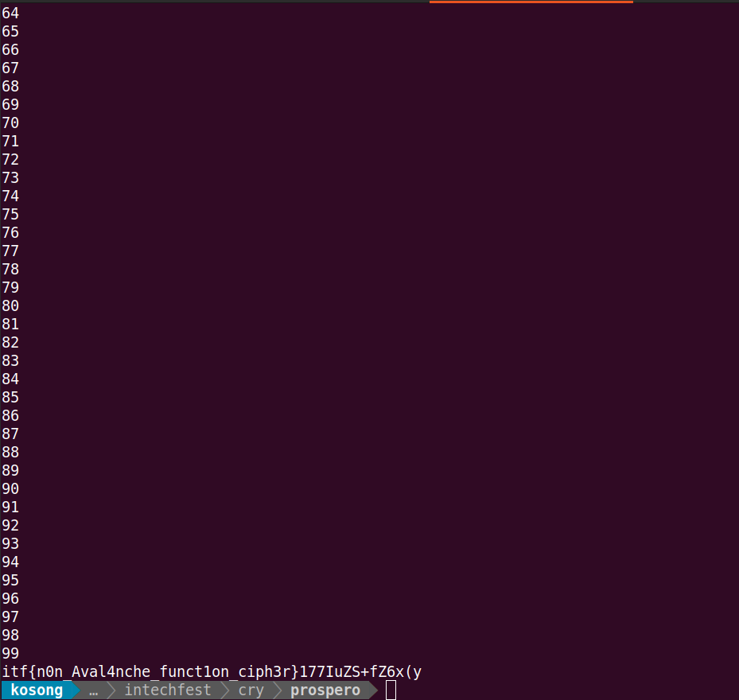

# Attacking Non Avalanche AES (Custom AES Implementation)

Study case Intechfest 2022 (prospero)

## Preface

During the competition, my team got 1st place and i got 1st blood in this challenge. In this case, there is modification on AES source code that make the AES vulnerable.

## Attacking Vulnerable Code

Given source code below



```python
#!/usr/bin/env python3
"""
This is an exercise in secure symmetric-key encryption, implemented in pure
Python (no external libraries needed).
Original AES-128 implementation by Bo Zhu (http://about.bozhu.me) at
https://github.com/bozhu/AES-Python . PKCS#7 padding, CBC mode, PKBDF2, HMAC,
byte array and string support added by me at https://github.com/boppreh/aes.
Other block modes contributed by @righthandabacus.
Although this is an exercise, the `encrypt` and `decrypt` functions should
provide reasonable security to encrypted messages.
"""


s_box = (
    0x63, 0x7C, 0x77, 0x7B, 0xF2, 0x6B, 0x6F, 0xC5, 0x30, 0x01, 0x67, 0x2B, 0xFE, 0xD7, 0xAB, 0x76,
    0xCA, 0x82, 0xC9, 0x7D, 0xFA, 0x59, 0x47, 0xF0, 0xAD, 0xD4, 0xA2, 0xAF, 0x9C, 0xA4, 0x72, 0xC0,
    0xB7, 0xFD, 0x93, 0x26, 0x36, 0x3F, 0xF7, 0xCC, 0x34, 0xA5, 0xE5, 0xF1, 0x71, 0xD8, 0x31, 0x15,
    0x04, 0xC7, 0x23, 0xC3, 0x18, 0x96, 0x05, 0x9A, 0x07, 0x12, 0x80, 0xE2, 0xEB, 0x27, 0xB2, 0x75,
    0x09, 0x83, 0x2C, 0x1A, 0x1B, 0x6E, 0x5A, 0xA0, 0x52, 0x3B, 0xD6, 0xB3, 0x29, 0xE3, 0x2F, 0x84,
    0x53, 0xD1, 0x00, 0xED, 0x20, 0xFC, 0xB1, 0x5B, 0x6A, 0xCB, 0xBE, 0x39, 0x4A, 0x4C, 0x58, 0xCF,
    0xD0, 0xEF, 0xAA, 0xFB, 0x43, 0x4D, 0x33, 0x85, 0x45, 0xF9, 0x02, 0x7F, 0x50, 0x3C, 0x9F, 0xA8,
    0x51, 0xA3, 0x40, 0x8F, 0x92, 0x9D, 0x38, 0xF5, 0xBC, 0xB6, 0xDA, 0x21, 0x10, 0xFF, 0xF3, 0xD2,
    0xCD, 0x0C, 0x13, 0xEC, 0x5F, 0x97, 0x44, 0x17, 0xC4, 0xA7, 0x7E, 0x3D, 0x64, 0x5D, 0x19, 0x73,
    0x60, 0x81, 0x4F, 0xDC, 0x22, 0x2A, 0x90, 0x88, 0x46, 0xEE, 0xB8, 0x14, 0xDE, 0x5E, 0x0B, 0xDB,
    0xE0, 0x32, 0x3A, 0x0A, 0x49, 0x06, 0x24, 0x5C, 0xC2, 0xD3, 0xAC, 0x62, 0x91, 0x95, 0xE4, 0x79,
    0xE7, 0xC8, 0x37, 0x6D, 0x8D, 0xD5, 0x4E, 0xA9, 0x6C, 0x56, 0xF4, 0xEA, 0x65, 0x7A, 0xAE, 0x08,
    0xBA, 0x78, 0x25, 0x2E, 0x1C, 0xA6, 0xB4, 0xC6, 0xE8, 0xDD, 0x74, 0x1F, 0x4B, 0xBD, 0x8B, 0x8A,
    0x70, 0x3E, 0xB5, 0x66, 0x48, 0x03, 0xF6, 0x0E, 0x61, 0x35, 0x57, 0xB9, 0x86, 0xC1, 0x1D, 0x9E,
    0xE1, 0xF8, 0x98, 0x11, 0x69, 0xD9, 0x8E, 0x94, 0x9B, 0x1E, 0x87, 0xE9, 0xCE, 0x55, 0x28, 0xDF,
    0x8C, 0xA1, 0x89, 0x0D, 0xBF, 0xE6, 0x42, 0x68, 0x41, 0x99, 0x2D, 0x0F, 0xB0, 0x54, 0xBB, 0x16,
)

inv_s_box = (
    0x52, 0x09, 0x6A, 0xD5, 0x30, 0x36, 0xA5, 0x38, 0xBF, 0x40, 0xA3, 0x9E, 0x81, 0xF3, 0xD7, 0xFB,
    0x7C, 0xE3, 0x39, 0x82, 0x9B, 0x2F, 0xFF, 0x87, 0x34, 0x8E, 0x43, 0x44, 0xC4, 0xDE, 0xE9, 0xCB,
    0x54, 0x7B, 0x94, 0x32, 0xA6, 0xC2, 0x23, 0x3D, 0xEE, 0x4C, 0x95, 0x0B, 0x42, 0xFA, 0xC3, 0x4E,
    0x08, 0x2E, 0xA1, 0x66, 0x28, 0xD9, 0x24, 0xB2, 0x76, 0x5B, 0xA2, 0x49, 0x6D, 0x8B, 0xD1, 0x25,
    0x72, 0xF8, 0xF6, 0x64, 0x86, 0x68, 0x98, 0x16, 0xD4, 0xA4, 0x5C, 0xCC, 0x5D, 0x65, 0xB6, 0x92,
    0x6C, 0x70, 0x48, 0x50, 0xFD, 0xED, 0xB9, 0xDA, 0x5E, 0x15, 0x46, 0x57, 0xA7, 0x8D, 0x9D, 0x84,
    0x90, 0xD8, 0xAB, 0x00, 0x8C, 0xBC, 0xD3, 0x0A, 0xF7, 0xE4, 0x58, 0x05, 0xB8, 0xB3, 0x45, 0x06,
    0xD0, 0x2C, 0x1E, 0x8F, 0xCA, 0x3F, 0x0F, 0x02, 0xC1, 0xAF, 0xBD, 0x03, 0x01, 0x13, 0x8A, 0x6B,
    0x3A, 0x91, 0x11, 0x41, 0x4F, 0x67, 0xDC, 0xEA, 0x97, 0xF2, 0xCF, 0xCE, 0xF0, 0xB4, 0xE6, 0x73,
    0x96, 0xAC, 0x74, 0x22, 0xE7, 0xAD, 0x35, 0x85, 0xE2, 0xF9, 0x37, 0xE8, 0x1C, 0x75, 0xDF, 0x6E,
    0x47, 0xF1, 0x1A, 0x71, 0x1D, 0x29, 0xC5, 0x89, 0x6F, 0xB7, 0x62, 0x0E, 0xAA, 0x18, 0xBE, 0x1B,
    0xFC, 0x56, 0x3E, 0x4B, 0xC6, 0xD2, 0x79, 0x20, 0x9A, 0xDB, 0xC0, 0xFE, 0x78, 0xCD, 0x5A, 0xF4,
    0x1F, 0xDD, 0xA8, 0x33, 0x88, 0x07, 0xC7, 0x31, 0xB1, 0x12, 0x10, 0x59, 0x27, 0x80, 0xEC, 0x5F,
    0x60, 0x51, 0x7F, 0xA9, 0x19, 0xB5, 0x4A, 0x0D, 0x2D, 0xE5, 0x7A, 0x9F, 0x93, 0xC9, 0x9C, 0xEF,
    0xA0, 0xE0, 0x3B, 0x4D, 0xAE, 0x2A, 0xF5, 0xB0, 0xC8, 0xEB, 0xBB, 0x3C, 0x83, 0x53, 0x99, 0x61,
    0x17, 0x2B, 0x04, 0x7E, 0xBA, 0x77, 0xD6, 0x26, 0xE1, 0x69, 0x14, 0x63, 0x55, 0x21, 0x0C, 0x7D,
)


def sub_bytes(s):
    for i in range(4):
        for j in range(4):
            s[i][j] = s_box[s[i][j]]


def inv_sub_bytes(s):
    for i in range(4):
        for j in range(4):
            s[i][j] = inv_s_box[s[i][j]]


def shift_rows(s):
    s[0][1], s[1][1], s[2][1], s[3][1] = s[1][1], s[2][1], s[3][1], s[0][1]
    s[0][2], s[1][2], s[2][2], s[3][2] = s[2][2], s[3][2], s[0][2], s[1][2]
    s[0][3], s[1][3], s[2][3], s[3][3] = s[3][3], s[0][3], s[1][3], s[2][3]


def inv_shift_rows(s):
    s[0][1], s[1][1], s[2][1], s[3][1] = s[3][1], s[0][1], s[1][1], s[2][1]
    s[0][2], s[1][2], s[2][2], s[3][2] = s[2][2], s[3][2], s[0][2], s[1][2]
    s[0][3], s[1][3], s[2][3], s[3][3] = s[1][3], s[2][3], s[3][3], s[0][3]


def add_round_key(s, k):
    for i in range(4):
        for j in range(4):
            s[i][j] ^= k[i][j]


def mix_columns(s):
    s[1][0], s[1][1], s[1][2], s[1][3] = s[1][3], s[1][0], s[1][1], s[1][2]
    s[2][0], s[2][1], s[2][2], s[2][3] = s[2][2], s[2][3], s[2][0], s[2][1]
    s[3][0], s[3][1], s[3][2], s[3][3] = s[3][1], s[3][2], s[3][3], s[3][0]


def inv_mix_columns(s):
    s[1][0], s[1][1], s[1][2], s[1][3] = s[1][1], s[1][2], s[1][3], s[1][0]
    s[2][0], s[2][1], s[2][2], s[2][3] = s[2][2], s[2][3], s[2][0], s[2][1]
    s[3][0], s[3][1], s[3][2], s[3][3] = s[3][3], s[3][0], s[3][1], s[3][2]


r_con = (
    0x00, 0x01, 0x02, 0x04, 0x08, 0x10, 0x20, 0x40,
    0x80, 0x1B, 0x36, 0x6C, 0xD8, 0xAB, 0x4D, 0x9A,
    0x2F, 0x5E, 0xBC, 0x63, 0xC6, 0x97, 0x35, 0x6A,
    0xD4, 0xB3, 0x7D, 0xFA, 0xEF, 0xC5, 0x91, 0x39,
)


def bytes2matrix(text):
    """ Converts a 16-byte array into a 4x4 matrix.  """
    return [list(text[i:i + 4]) for i in range(0, len(text), 4)]


def matrix2bytes(matrix):
    """ Converts a 4x4 matrix into a 16-byte array.  """
    return bytes(sum(matrix, []))


def xor_bytes(a, b):
    """ Returns a new byte array with the elements xor'ed. """
    return bytes(i ^ j for i, j in zip(a, b))


def inc_bytes(a):
    """ Returns a new byte array with the value increment by 1 """
    out = list(a)
    for i in reversed(range(len(out))):
        if out[i] == 0xFF:
            out[i] = 0
        else:
            out[i] += 1
            break
    return bytes(out)


def pad(plaintext):
    """
    Pads the given plaintext with PKCS#7 padding to a multiple of 16 bytes.
    Note that if the plaintext size is a multiple of 16,
    a whole block will be added.
    """
    padding_len = 16 - (len(plaintext) % 16)
    padding = bytes([padding_len] * padding_len)
    return plaintext + padding


def unpad(plaintext):
    """
    Removes a PKCS#7 padding, returning the unpadded text and ensuring the
    padding was correct.
    """
    padding_len = plaintext[-1]
    assert padding_len > 0
    message, padding = plaintext[:-padding_len], plaintext[-padding_len:]
    assert all(p == padding_len for p in padding)
    return message


def split_blocks(message, block_size=16, require_padding=True):
    assert len(message) % block_size == 0 or not require_padding
    return [message[i:i + 16] for i in range(0, len(message), block_size)]


class AES:
    """
    Class for AES-128 encryption with CBC mode and PKCS#7.
    This is a raw implementation of AES, without key stretching or IV
    management. Unless you need that, please use `encrypt` and `decrypt`.
    """
    rounds_by_key_size = {16: 10, 24: 12, 32: 14}

    def __init__(self, master_key, rounds=None):
        """
        Initializes the object with a given key.
        """
        assert len(master_key) in AES.rounds_by_key_size
        if(rounds is None):
            self.n_rounds = AES.rounds_by_key_size[len(master_key)]
        else:
            self.n_rounds = rounds
        self._key_matrices = self._expand_key(master_key)

    def _expand_key(self, master_key):
        """
        Expands and returns a list of key matrices for the given master_key.
        """
        # Initialize round keys with raw key material.
        key_columns = bytes2matrix(master_key)
        iteration_size = len(master_key) // 4

        # Each iteration has exactly as many columns as the key material.
        columns_per_iteration = len(key_columns)
        i = 1
        while len(key_columns) < (self.n_rounds + 1) * 4:
            # Copy previous word.
            word = list(key_columns[-1])

            # Perform schedule_core once every "row".
            if len(key_columns) % iteration_size == 0:
                # Circular shift.
                word.append(word.pop(0))
                # Map to S-BOX.
                word = [s_box[b] for b in word]
                # XOR with first byte of R-CON, since the others bytes of R-CON are 0.
                word[0] ^= r_con[i]
                i += 1
            elif len(master_key) == 32 and len(key_columns) % iteration_size == 4:
                # Run word through S-box in the fourth iteration when using a
                # 256-bit key.
                word = [s_box[b] for b in word]

            # XOR with equivalent word from previous iteration.
            word = xor_bytes(word, key_columns[-iteration_size])
            key_columns.append(word)

        # Group key words in 4x4 byte matrices.
        return [key_columns[4 * i: 4 * (i + 1)] for i in range(len(key_columns) // 4)]

    def encrypt_block(self, plaintext):
        """
        Encrypts a single block of 16 byte long plaintext.
        """
        assert len(plaintext) == 16

        plain_state = bytes2matrix(plaintext)

        add_round_key(plain_state, self._key_matrices[0])

        for i in range(1, self.n_rounds):
            sub_bytes(plain_state)
            shift_rows(plain_state)
            mix_columns(plain_state)
            add_round_key(plain_state, self._key_matrices[i])

        sub_bytes(plain_state)
        shift_rows(plain_state)
        add_round_key(plain_state, self._key_matrices[-1])

        return matrix2bytes(plain_state)

    def decrypt_block(self, ciphertext):
        """
        Decrypts a single block of 16 byte long ciphertext.
        """
        assert len(ciphertext) == 16

        cipher_state = bytes2matrix(ciphertext)

        add_round_key(cipher_state, self._key_matrices[-1])
        inv_shift_rows(cipher_state)
        inv_sub_bytes(cipher_state)

        for i in range(self.n_rounds - 1, 0, -1):
            add_round_key(cipher_state, self._key_matrices[i])
            inv_mix_columns(cipher_state)
            inv_shift_rows(cipher_state)
            inv_sub_bytes(cipher_state)

        add_round_key(cipher_state, self._key_matrices[0])

        return matrix2bytes(cipher_state)

    def encrypt_cbc(self, plaintext, iv):
        """
        Encrypts `plaintext` using CBC mode and PKCS#7 padding, with the given
        initialization vector (iv).
        """
        assert len(iv) == 16

        plaintext = pad(plaintext)

        blocks = []
        previous = iv
        for plaintext_block in split_blocks(plaintext):
            # CBC mode encrypt: encrypt(plaintext_block XOR previous)
            block = self.encrypt_block(xor_bytes(plaintext_block, previous))
            blocks.append(block)
            previous = block

        return b''.join(blocks)

    def decrypt_cbc(self, ciphertext, iv):
        """
        Decrypts `ciphertext` using CBC mode and PKCS#7 padding, with the given
        initialization vector (iv).
        """
        assert len(iv) == 16

        blocks = []
        previous = iv
        for ciphertext_block in split_blocks(ciphertext):
            # CBC mode decrypt: previous XOR decrypt(ciphertext)
            blocks.append(xor_bytes(previous, self.decrypt_block(ciphertext_block)))
            previous = ciphertext_block

        return unpad(b''.join(blocks))
        
```





```python
import os
from aes import AES

FLAG = open('flag.txt', 'rb').read()

if __name__ == '__main__':

    aes = AES(os.urandom(16))
    iv = os.urandom(16)

    msg = input('Your msg >> ')

    print('Encrypted flag :', aes.encrypt_cbc(FLAG, iv).hex())
    print('Encrypted msg  :', aes.encrypt_cbc(msg.encode(), iv).hex())

```



Given the source code from AES, the difference is that the implementation of **mix\_column** is changed to something like a shift value (swap value). This change results in each byte in the input being independent of other bytes and can be mapped to the output. So, for example, the input at index 1 is mapped to the output at index 10. This vulnerability known as "Non Avalanche", so we can map each plaintext value to what the ciphertext will be where the order of the indexes also has an effect, such as the 0th index for A in the ciphertext being different from the 1st index for A. Another problem is that we cannot control the input, because the input will be later xor with IV , likewise for the next block xor with the previous ciphertext. So the solution is to leave it to the system, so let the program generate its own values for the plaintext, we just need to map the values. So here we send a lot of plaintext null bytes (so it's easy, no need to xor back for each plaintext (ciphertext index i-1) when mapped to ciphertext index i where i > 0. For the request we do it repeatedly to get more possibilities a lot, then just do a little statistics for the flag value (the flag value appears the most for each index). For the first block xored with iv we can leak iv, because we know the value entered in the first block / control it. Here's the solver that i use

```python
#!/usr/bin/env python3
from pwn import *
import string

s_box = (
    0x63, 0x7C, 0x77, 0x7B, 0xF2, 0x6B, 0x6F, 0xC5, 0x30, 0x01, 0x67, 0x2B, 0xFE, 0xD7, 0xAB, 0x76,
    0xCA, 0x82, 0xC9, 0x7D, 0xFA, 0x59, 0x47, 0xF0, 0xAD, 0xD4, 0xA2, 0xAF, 0x9C, 0xA4, 0x72, 0xC0,
    0xB7, 0xFD, 0x93, 0x26, 0x36, 0x3F, 0xF7, 0xCC, 0x34, 0xA5, 0xE5, 0xF1, 0x71, 0xD8, 0x31, 0x15,
    0x04, 0xC7, 0x23, 0xC3, 0x18, 0x96, 0x05, 0x9A, 0x07, 0x12, 0x80, 0xE2, 0xEB, 0x27, 0xB2, 0x75,
    0x09, 0x83, 0x2C, 0x1A, 0x1B, 0x6E, 0x5A, 0xA0, 0x52, 0x3B, 0xD6, 0xB3, 0x29, 0xE3, 0x2F, 0x84,
    0x53, 0xD1, 0x00, 0xED, 0x20, 0xFC, 0xB1, 0x5B, 0x6A, 0xCB, 0xBE, 0x39, 0x4A, 0x4C, 0x58, 0xCF,
    0xD0, 0xEF, 0xAA, 0xFB, 0x43, 0x4D, 0x33, 0x85, 0x45, 0xF9, 0x02, 0x7F, 0x50, 0x3C, 0x9F, 0xA8,
    0x51, 0xA3, 0x40, 0x8F, 0x92, 0x9D, 0x38, 0xF5, 0xBC, 0xB6, 0xDA, 0x21, 0x10, 0xFF, 0xF3, 0xD2,
    0xCD, 0x0C, 0x13, 0xEC, 0x5F, 0x97, 0x44, 0x17, 0xC4, 0xA7, 0x7E, 0x3D, 0x64, 0x5D, 0x19, 0x73,
    0x60, 0x81, 0x4F, 0xDC, 0x22, 0x2A, 0x90, 0x88, 0x46, 0xEE, 0xB8, 0x14, 0xDE, 0x5E, 0x0B, 0xDB,
    0xE0, 0x32, 0x3A, 0x0A, 0x49, 0x06, 0x24, 0x5C, 0xC2, 0xD3, 0xAC, 0x62, 0x91, 0x95, 0xE4, 0x79,
    0xE7, 0xC8, 0x37, 0x6D, 0x8D, 0xD5, 0x4E, 0xA9, 0x6C, 0x56, 0xF4, 0xEA, 0x65, 0x7A, 0xAE, 0x08,
    0xBA, 0x78, 0x25, 0x2E, 0x1C, 0xA6, 0xB4, 0xC6, 0xE8, 0xDD, 0x74, 0x1F, 0x4B, 0xBD, 0x8B, 0x8A,
    0x70, 0x3E, 0xB5, 0x66, 0x48, 0x03, 0xF6, 0x0E, 0x61, 0x35, 0x57, 0xB9, 0x86, 0xC1, 0x1D, 0x9E,
    0xE1, 0xF8, 0x98, 0x11, 0x69, 0xD9, 0x8E, 0x94, 0x9B, 0x1E, 0x87, 0xE9, 0xCE, 0x55, 0x28, 0xDF,
    0x8C, 0xA1, 0x89, 0x0D, 0xBF, 0xE6, 0x42, 0x68, 0x41, 0x99, 0x2D, 0x0F, 0xB0, 0x54, 0xBB, 0x16,
)

inv_s_box = (
    0x52, 0x09, 0x6A, 0xD5, 0x30, 0x36, 0xA5, 0x38, 0xBF, 0x40, 0xA3, 0x9E, 0x81, 0xF3, 0xD7, 0xFB,
    0x7C, 0xE3, 0x39, 0x82, 0x9B, 0x2F, 0xFF, 0x87, 0x34, 0x8E, 0x43, 0x44, 0xC4, 0xDE, 0xE9, 0xCB,
    0x54, 0x7B, 0x94, 0x32, 0xA6, 0xC2, 0x23, 0x3D, 0xEE, 0x4C, 0x95, 0x0B, 0x42, 0xFA, 0xC3, 0x4E,
    0x08, 0x2E, 0xA1, 0x66, 0x28, 0xD9, 0x24, 0xB2, 0x76, 0x5B, 0xA2, 0x49, 0x6D, 0x8B, 0xD1, 0x25,
    0x72, 0xF8, 0xF6, 0x64, 0x86, 0x68, 0x98, 0x16, 0xD4, 0xA4, 0x5C, 0xCC, 0x5D, 0x65, 0xB6, 0x92,
    0x6C, 0x70, 0x48, 0x50, 0xFD, 0xED, 0xB9, 0xDA, 0x5E, 0x15, 0x46, 0x57, 0xA7, 0x8D, 0x9D, 0x84,
    0x90, 0xD8, 0xAB, 0x00, 0x8C, 0xBC, 0xD3, 0x0A, 0xF7, 0xE4, 0x58, 0x05, 0xB8, 0xB3, 0x45, 0x06,
    0xD0, 0x2C, 0x1E, 0x8F, 0xCA, 0x3F, 0x0F, 0x02, 0xC1, 0xAF, 0xBD, 0x03, 0x01, 0x13, 0x8A, 0x6B,
    0x3A, 0x91, 0x11, 0x41, 0x4F, 0x67, 0xDC, 0xEA, 0x97, 0xF2, 0xCF, 0xCE, 0xF0, 0xB4, 0xE6, 0x73,
    0x96, 0xAC, 0x74, 0x22, 0xE7, 0xAD, 0x35, 0x85, 0xE2, 0xF9, 0x37, 0xE8, 0x1C, 0x75, 0xDF, 0x6E,
    0x47, 0xF1, 0x1A, 0x71, 0x1D, 0x29, 0xC5, 0x89, 0x6F, 0xB7, 0x62, 0x0E, 0xAA, 0x18, 0xBE, 0x1B,
    0xFC, 0x56, 0x3E, 0x4B, 0xC6, 0xD2, 0x79, 0x20, 0x9A, 0xDB, 0xC0, 0xFE, 0x78, 0xCD, 0x5A, 0xF4,
    0x1F, 0xDD, 0xA8, 0x33, 0x88, 0x07, 0xC7, 0x31, 0xB1, 0x12, 0x10, 0x59, 0x27, 0x80, 0xEC, 0x5F,
    0x60, 0x51, 0x7F, 0xA9, 0x19, 0xB5, 0x4A, 0x0D, 0x2D, 0xE5, 0x7A, 0x9F, 0x93, 0xC9, 0x9C, 0xEF,
    0xA0, 0xE0, 0x3B, 0x4D, 0xAE, 0x2A, 0xF5, 0xB0, 0xC8, 0xEB, 0xBB, 0x3C, 0x83, 0x53, 0x99, 0x61,
    0x17, 0x2B, 0x04, 0x7E, 0xBA, 0x77, 0xD6, 0x26, 0xE1, 0x69, 0x14, 0x63, 0x55, 0x21, 0x0C, 0x7D,
)


def sub_bytes(s):
    for i in range(4):
        for j in range(4):
            s[i][j] = s_box[s[i][j]]


def inv_sub_bytes(s):
    for i in range(4):
        for j in range(4):
            s[i][j] = inv_s_box[s[i][j]]


def shift_rows(s):
    s[0][1], s[1][1], s[2][1], s[3][1] = s[1][1], s[2][1], s[3][1], s[0][1]
    s[0][2], s[1][2], s[2][2], s[3][2] = s[2][2], s[3][2], s[0][2], s[1][2]
    s[0][3], s[1][3], s[2][3], s[3][3] = s[3][3], s[0][3], s[1][3], s[2][3]


def inv_shift_rows(s):
    s[0][1], s[1][1], s[2][1], s[3][1] = s[3][1], s[0][1], s[1][1], s[2][1]
    s[0][2], s[1][2], s[2][2], s[3][2] = s[2][2], s[3][2], s[0][2], s[1][2]
    s[0][3], s[1][3], s[2][3], s[3][3] = s[1][3], s[2][3], s[3][3], s[0][3]


def add_round_key(s, k):
    for i in range(4):
        for j in range(4):
            s[i][j] ^= k[i][j]


def mix_columns(s):
    s[1][0], s[1][1], s[1][2], s[1][3] = s[1][3], s[1][0], s[1][1], s[1][2]
    s[2][0], s[2][1], s[2][2], s[2][3] = s[2][2], s[2][3], s[2][0], s[2][1]
    s[3][0], s[3][1], s[3][2], s[3][3] = s[3][1], s[3][2], s[3][3], s[3][0]


def inv_mix_columns(s):
    s[1][0], s[1][1], s[1][2], s[1][3] = s[1][1], s[1][2], s[1][3], s[1][0]
    s[2][0], s[2][1], s[2][2], s[2][3] = s[2][2], s[2][3], s[2][0], s[2][1]
    s[3][0], s[3][1], s[3][2], s[3][3] = s[3][3], s[3][0], s[3][1], s[3][2]


r_con = (
    0x00, 0x01, 0x02, 0x04, 0x08, 0x10, 0x20, 0x40,
    0x80, 0x1B, 0x36, 0x6C, 0xD8, 0xAB, 0x4D, 0x9A,
    0x2F, 0x5E, 0xBC, 0x63, 0xC6, 0x97, 0x35, 0x6A,
    0xD4, 0xB3, 0x7D, 0xFA, 0xEF, 0xC5, 0x91, 0x39,
)


def bytes2matrix(text):
    """ Converts a 16-byte array into a 4x4 matrix.  """
    return [list(text[i:i + 4]) for i in range(0, len(text), 4)]


def matrix2bytes(matrix):
    """ Converts a 4x4 matrix into a 16-byte array.  """
    return bytes(sum(matrix, []))


def xor_bytes(a, b):
    """ Returns a new byte array with the elements xor'ed. """
    return bytes(i ^ j for i, j in zip(a, b))


def inc_bytes(a):
    """ Returns a new byte array with the value increment by 1 """
    out = list(a)
    for i in reversed(range(len(out))):
        if out[i] == 0xFF:
            out[i] = 0
        else:
            out[i] += 1
            break
    return bytes(out)


def pad(plaintext):
    """
    Pads the given plaintext with PKCS#7 padding to a multiple of 16 bytes.
    Note that if the plaintext size is a multiple of 16,
    a whole block will be added.
    """
    padding_len = 16 - (len(plaintext) % 16)
    padding = bytes([padding_len] * padding_len)
    return plaintext + padding


def unpad(plaintext):
    """
    Removes a PKCS#7 padding, returning the unpadded text and ensuring the
    padding was correct.
    """
    padding_len = plaintext[-1]
    assert padding_len > 0
    message, padding = plaintext[:-padding_len], plaintext[-padding_len:]
    assert all(p == padding_len for p in padding)
    return message


def split_blocks(message, block_size=16, require_padding=True):
    assert len(message) % block_size == 0 or not require_padding
    return [message[i:i + 16] for i in range(0, len(message), block_size)]


class AES:
    """
    Class for AES-128 encryption with CBC mode and PKCS#7.
    This is a raw implementation of AES, without key stretching or IV
    management. Unless you need that, please use `encrypt` and `decrypt`.
    """
    rounds_by_key_size = {16: 10, 24: 12, 32: 14}

    def __init__(self, master_key, rounds=None):
        """
        Initializes the object with a given key.
        """
        assert len(master_key) in AES.rounds_by_key_size
        if(rounds is None):
            self.n_rounds = AES.rounds_by_key_size[len(master_key)]
        else:
            self.n_rounds = rounds
        self._key_matrices = self._expand_key(master_key)

    def _expand_key(self, master_key):
        """
        Expands and returns a list of key matrices for the given master_key.
        """
        # Initialize round keys with raw key material.
        key_columns = bytes2matrix(master_key)
        iteration_size = len(master_key) // 4

        # Each iteration has exactly as many columns as the key material.
        columns_per_iteration = len(key_columns)
        i = 1
        while len(key_columns) < (self.n_rounds + 1) * 4:
            # Copy previous word.
            word = list(key_columns[-1])

            # Perform schedule_core once every "row".
            if len(key_columns) % iteration_size == 0:
                # Circular shift.
                word.append(word.pop(0))
                # Map to S-BOX.
                word = [s_box[b] for b in word]
                # XOR with first byte of R-CON, since the others bytes of R-CON are 0.
                word[0] ^= r_con[i]
                i += 1
            elif len(master_key) == 32 and len(key_columns) % iteration_size == 4:
                # Run word through S-box in the fourth iteration when using a
                # 256-bit key.
                word = [s_box[b] for b in word]

            # XOR with equivalent word from previous iteration.
            word = xor_bytes(word, key_columns[-iteration_size])
            key_columns.append(word)

        # Group key words in 4x4 byte matrices.
        return [key_columns[4 * i: 4 * (i + 1)] for i in range(len(key_columns) // 4)]

    def encrypt_block(self, plaintext):
        """
        Encrypts a single block of 16 byte long plaintext.
        """
        assert len(plaintext) == 16

        # print(self._key_matrices)
        plain_state = bytes2matrix(plaintext)
        # print("Init", plain_state)
        add_round_key(plain_state, self._key_matrices[0])

        for i in range(1, self.n_rounds):
            sub_bytes(plain_state)
            shift_rows(plain_state)
            # print(i,plain_state)
            mix_columns(plain_state)
            # print(i,plain_state)    
            add_round_key(plain_state, self._key_matrices[i])

        sub_bytes(plain_state)
        shift_rows(plain_state)
        add_round_key(plain_state, self._key_matrices[-1])
        # print("Last",plain_state)

        return matrix2bytes(plain_state)

    def decrypt_block(self, ciphertext):
        """
        Decrypts a single block of 16 byte long ciphertext.
        """
        assert len(ciphertext) == 16

        cipher_state = bytes2matrix(ciphertext)

        add_round_key(cipher_state, self._key_matrices[-1])
        inv_shift_rows(cipher_state)
        inv_sub_bytes(cipher_state)

        for i in range(self.n_rounds - 1, 0, -1):
            add_round_key(cipher_state, self._key_matrices[i])
            inv_mix_columns(cipher_state)
            inv_shift_rows(cipher_state)
            inv_sub_bytes(cipher_state)

        add_round_key(cipher_state, self._key_matrices[0])

        return matrix2bytes(cipher_state)

    def encrypt_cbc(self, plaintext, iv):
        """
        Encrypts `plaintext` using CBC mode and PKCS#7 padding, with the given
        initialization vector (iv).
        """
        assert len(iv) == 16

        plaintext = pad(plaintext)

        blocks = []
        previous = iv
        # print(iv)
        for plaintext_block in split_blocks(plaintext):
            # CBC mode encrypt: encrypt(plaintext_block XOR previous)
            block = self.encrypt_block(xor_bytes(plaintext_block, previous))
            blocks.append(block)
            previous = block

        return b''.join(blocks)

    def decrypt_cbc(self, ciphertext, iv):
        """
        Decrypts `ciphertext` using CBC mode and PKCS#7 padding, with the given
        initialization vector (iv).
        """
        assert len(iv) == 16

        blocks = []
        previous = iv
        for ciphertext_block in split_blocks(ciphertext):
            # CBC mode decrypt: previous XOR decrypt(ciphertext)
            blocks.append(xor_bytes(previous, self.decrypt_block(ciphertext_block)))
            previous = ciphertext_block

        return unpad(b''.join(blocks))

def split_blocks(block):
    res = []
    for i in range(0,len(block),16):
        res.append(block[i:i+16])
    return res

if __name__ == '__main__':
    context.log_level = 'error'
    key = b"KOSONGBLONG12345"
    aes = AES(key)
    iv = b"ABCDEFGHIJKLMNOP"
    payload = b"A"*16
    tmp_enc = aes.encrypt_cbc(payload, iv)[:16]
    mapp = {}
    for i in range(16):
        tmp_payload = list(payload)
        tmp_payload[i] = 66
        check = aes.encrypt_cbc(bytes(tmp_payload),iv)[:16]
        for j in range(len(check)):
            if(check[j]!=tmp_enc[j]):
                mapp[j] = i
                break
    
    null_byte = b"\x00"
    payload = null_byte*5000
    poss_flag =  [{} for _ in range(48)]
    for loop in range(100):
        print(loop)
        try:
            r = remote("15.235.143.42",49119)
            r.sendline(payload)
            r.recvuntil(b"flag : ")
            ct = bytes.fromhex(r.recvline().strip().decode())
            list_ct = split_blocks(ct)
            r.recvuntil(b"msg  : ")
            tmp = r.recvline().strip().decode()
            tmp = bytes.fromhex(tmp)
            r.close()
        except Exception as e:
            continue
        list_block = split_blocks(tmp)
        dicc = {}
        for i in range(0x100):
            dicc[i] = [0 for _ in range(16)]
        for i in range(len(list_block)-1):
            for j,x in enumerate(list_block[i+1]):
                dicc[x][j] = list_block[i][mapp[j]]
        leaked = []
        for i in list_ct:
            blk = [0  for _ in range(16)]
            for j,x in enumerate(i):
                blk[mapp[j]] = dicc[x][j]
            leaked.append(blk)
        xor_iv = []
        for i in list_block[:1]:
            blk = [0  for _ in range(16)]
            for j,x in enumerate(i):
                blk[mapp[j]] = dicc[x][j]
            xor_iv.append(blk)
        for i in range(1):
            for j in range(len(leaked[i])):
                leaked[i][j] = leaked[i][j]^xor_iv[i][j]
        for i in range(1,len(leaked)):
            for j in range(len(leaked[i])):
                leaked[i][j] = leaked[i][j]^list_ct[i-1][j]
        cnt = 0
        for i in leaked:
            for j in i:
                tmp = chr(j)
                if(tmp in string.printable[:-6]):
                    if(tmp not in poss_flag[cnt]):
                        poss_flag[cnt][tmp] = 1
                    else:
                        poss_flag[cnt][tmp] += 1
                cnt += 1
    fix_flag = ""
    for i in poss_flag:
        sorted_x = sorted(i.items(), key=lambda kv: kv[1])
        fix_flag += sorted_x[-1][0]
    print(fix_flag)

```

<figure><figcaption></figcaption></figure>

Flag : itf{n0n\_Aval4nche\_funct1on\_ciph3r}
