# Cheating Game Built with WASM

Study case NCW 2022 Quals (Flaggy Bird V2).

## Preface

During the competition my team got 1st place and i got 1st blood on this challenge. This challenge was new for me, since it required me to do cheating using [Cetus](https://github.com/Qwokka/Cetus).

## Cheating the Game with Cetus

Given URL  <http://103.167.136.123:2122/> . The game was made using Unity, I tried to analyze the assets until it was a mess (quite painful) until finally I got enlightenment with [Cetus](https://github.com/Qwokka/Cetus). The concept is the same as the cheat engine, but here it took a long time to get the score value because it had to be exactly the same to get the flag in this challenge.

<figure>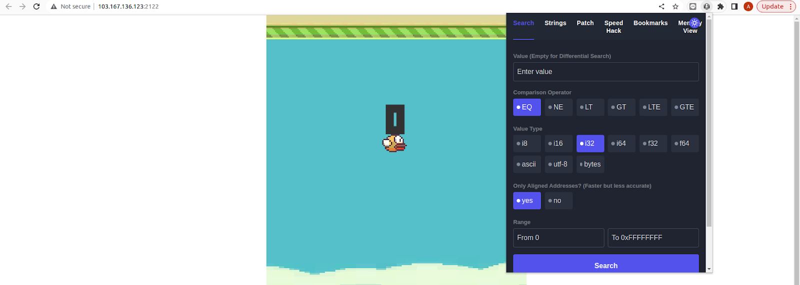<figcaption></figcaption></figure>

<figure>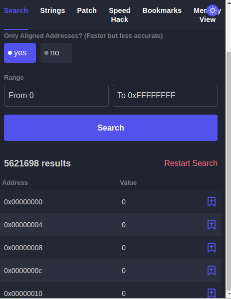<figcaption></figcaption></figure>

<figure>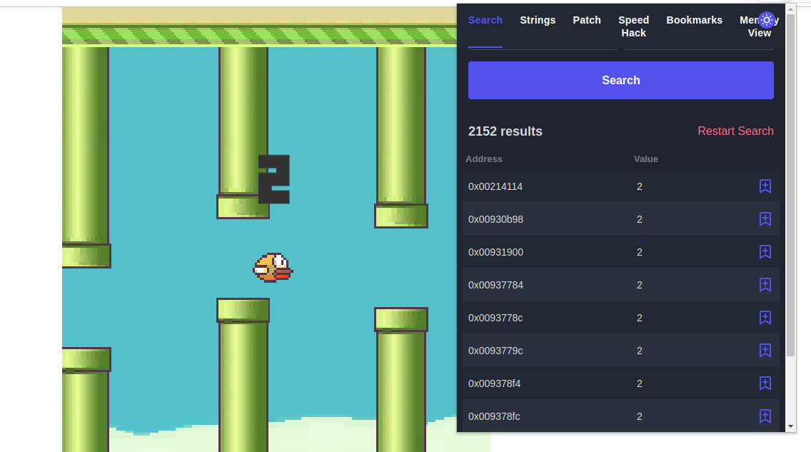<figcaption></figcaption></figure>

<figure>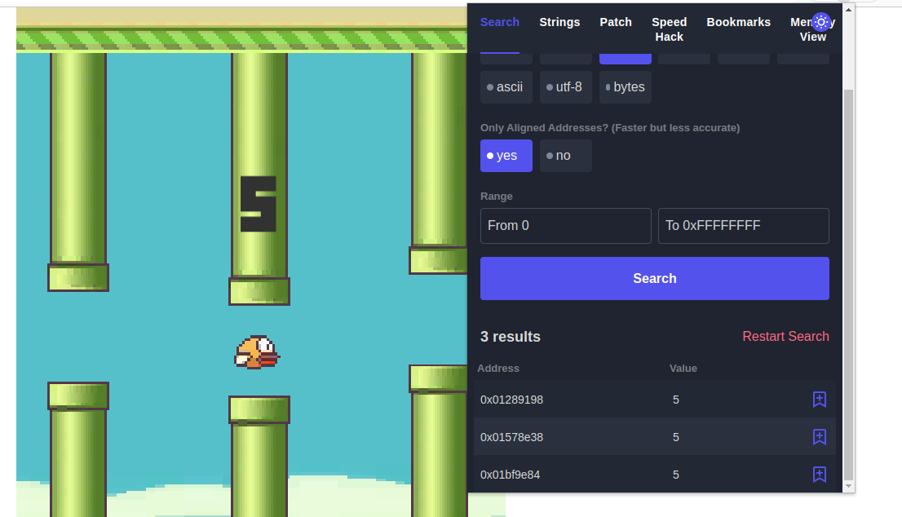<figcaption></figcaption></figure>

<figure>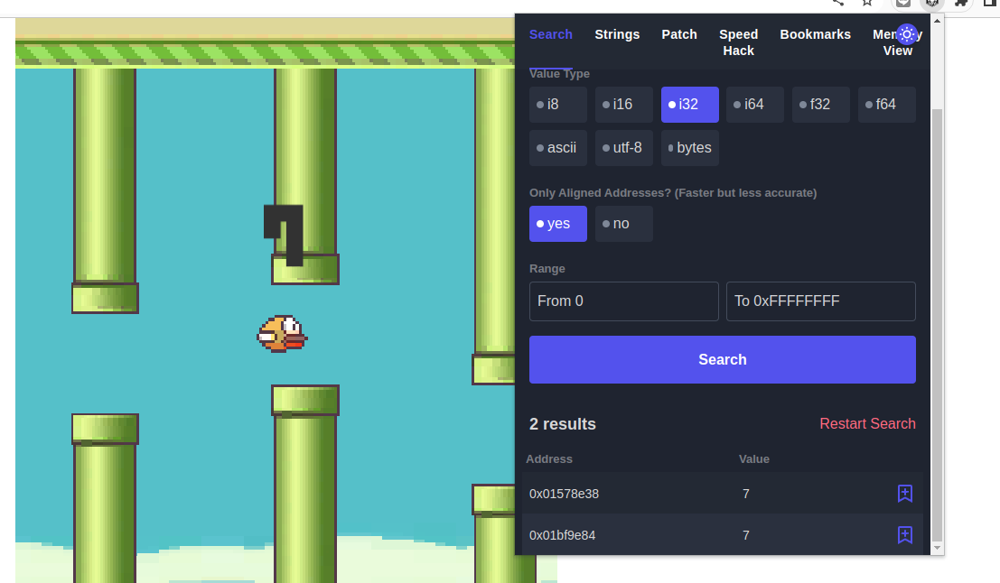<figcaption></figcaption></figure>

To get the address from the score, the method is quite easy, exactly the same as the cheat engine. So do a search for every change in the score, for example from 0 do a search 0, change to 1 do a search 1 until you get a few addresses (and always the same as our score). If this means we have found the correct score address, then add the address to the bookmarks.

<figure>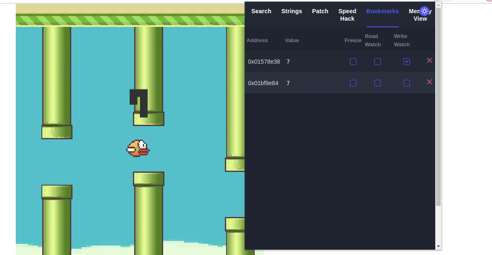<figcaption></figcaption></figure>

Here we get the address for the score is 0x01578e38 . At the beginning, we did an analysis of each function in the read watch but couldn't find the right one, but when we tried to do an analysis of the function that does the write, it turned out that there was a constant value that was compared.

<figure>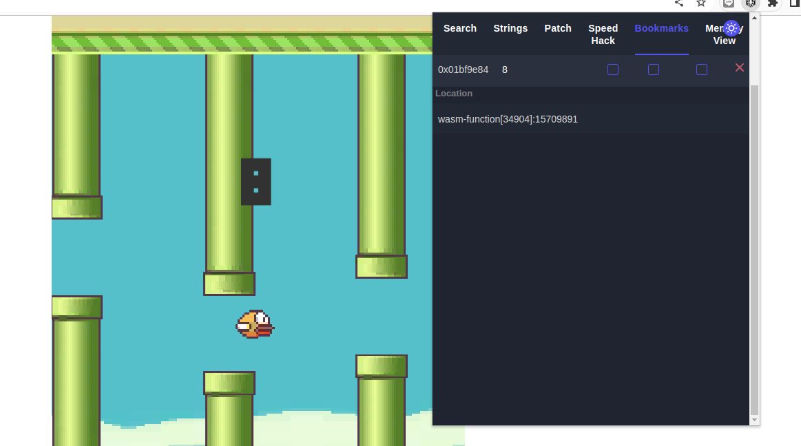<figcaption></figcaption></figure>

<figure>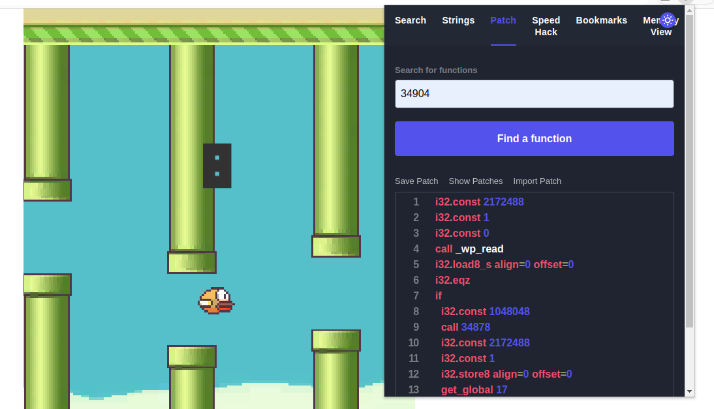<figcaption></figcaption></figure>

<figure>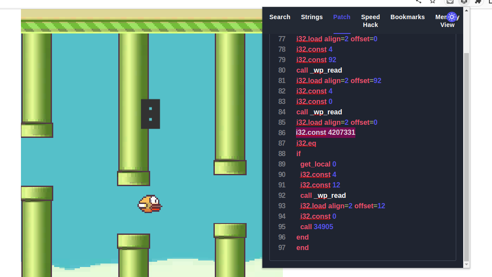<figcaption></figcaption></figure>

It appears that there is an i32.eq instruction which compares 32 bit values and when we change the score to 4207330 and continue playing to add 1 we get a flag.

<figure>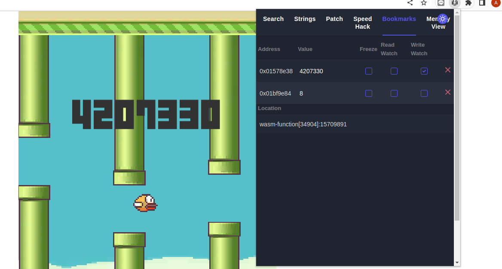<figcaption></figcaption></figure>

<figure>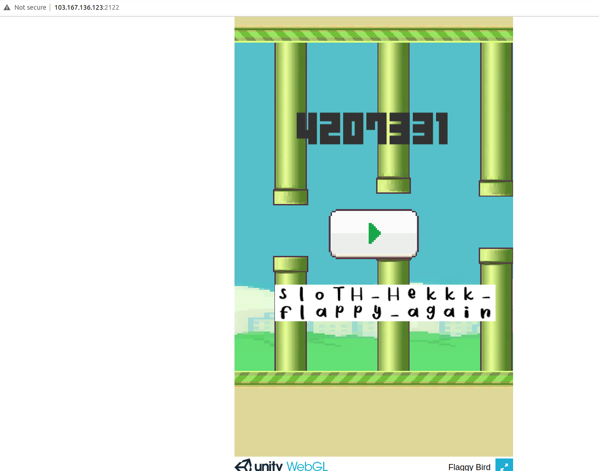<figcaption></figcaption></figure>

Flag : NCW22{sloTH\_Hekkk\_flappy\_again}
