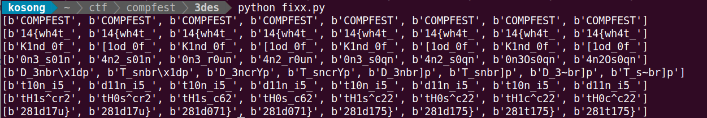

# Partial Known Plaintext Attack on Custom 3DES

Study case Compfest 2022 Quals (3(3DES))

## Preface

During the competition there is no solve for the challenge but i can solve this like 5 minutes after the competition end. At that time, i didn't find much information regarding this attack on 3DES, so i just analyzing the code and find the bug.

## Analyzing the Code

Given source code below

```python
from des_lib import *
from Crypto.Util.number import long_to_bytes as l2b, bytes_to_long as b2l
from flag import FLAG
import os

def lrot(s, n):
    for _ in range(n):
        s = s[1:] + s[0]
    return s

def generate_keys():
    key_bits = bin(b2l(KEY[0]))[2:].zfill(64)
    permuted_key = ''.join([key_bits[i] for i in PERMUTED_CHOICE_1])

    a = [permuted_key[:len(permuted_key) // 2]]
    b = [permuted_key[len(permuted_key) // 2:]]

    for i, rot in enumerate(BITS_ROT_TABLE):
        a.append(lrot(a[i], rot))
        b.append(lrot(b[i], rot))

    for i in range(1, 17):
        a_b = a[i] + b[i]
        key_bits = ''.join([a_b[j] for j in PERMUTED_CHOICE_2])
        KEY.append(int(key_bits, 2).to_bytes(6, 'big'))

def xor(a, b):
    return ''.join([str(int(i) ^ int(j)) for i, j in zip(a, b)])

def sumn(a):
    return int((1 << 4) - 0xf / 8 * (a - 1))

def S(bits, i):
    return '{0:04b}'.format(S_BOXES[i][int(bits[0] + bits[-1], 2)][int(bits[1:-1], 2)])

def F(bits, key):
    e = ''.join([bits[i] for i in EXPANSION_FUNCTION])
    key_bits = bin(b2l(key))[2:].zfill(48)

    xored = xor(key_bits, e)
    s = ''.join([S(xored[i:i+6], i//6) for i in range(0, len(xored), 6)])

    return ''.join([s[i] for i in P])

def encrypt(plain, n):
    plain_bits = bin(b2l(plain))[2:].zfill(64)
    permuted = ''.join([plain_bits[i] for i in INITIAL_PERMUTATION])

    l = [permuted[:len(permuted) // 2]]
    r = [permuted[len(permuted) // 2:]]
    for i in range(n):
        l.append(r[i])
        r.append(xor(l[i], F(r[i], KEY[i+1])))

    r_l = r[-1] + l[-1]
    permuted_final = ''.join([r_l[i] for i in FINAL_PERMUTATION])

    return int(permuted_final, 2).to_bytes(8, 'big')  

KEY = [os.urandom(8)]
generate_keys()

with open('flag.enc', 'w') as fout:
    for i in range(1,10):
        cipher = b''.join([encrypt(FLAG[j:j+8], sumn(i)) for j in range(0, len(FLAG), 8)])
        print(cipher.hex(), file=fout)
```

So the bug is in the following code snippet with the value n = 1 (1 round)

```python
----snippet----
for i in range(n):
        l.append(r[i])
        r.append(xor(l[i], F(r[i], KEY[i+1])))
----snippet----
```

## Implementing the Attack

Because we know the first block (first 8 bytes) is COMPFEST . So in the encryption flow we can know the values of l\[0] and r\[0] . After that we can get F(r\[i], KEY\[i+1]) . Then by reversing the F function we can get the possibility of xored because there are several valid values. From the xored possibility, we can brute force the 2nd block and manually validate what strings are in the 2nd block. This is done to get fewer possible keys, because the result of the xored product is 4\*\*8. From the 2nd block, only 8 possibilities are obtained, because it is relatively small, use these 8 keys to decrypt all blocks and get a flag. Here is the solver i use

```python
from Crypto.Util.number import long_to_bytes as l2b, bytes_to_long as b2l
import string
from itertools import product


INITIAL_PERMUTATION = [
57, 49, 41, 33, 25, 17, 9,  1,
        59, 51, 43, 35, 27, 19, 11, 3,
        61, 53, 45, 37, 29, 21, 13, 5,
        63, 55, 47, 39, 31, 23, 15, 7,
        56, 48, 40, 32, 24, 16, 8,  0,
        58, 50, 42, 34, 26, 18, 10, 2,
        60, 52, 44, 36, 28, 20, 12, 4,
        62, 54, 46, 38, 30, 22, 14, 6
        ]
EXPANSION_FUNCTION = [
31,  0,  1,  2,  3,  4,
         3,  4,  5,  6,  7,  8,
         7,  8,  9, 10, 11, 12,
        11, 12, 13, 14, 15, 16,
        15, 16, 17, 18, 19, 20,
        19, 20, 21, 22, 23, 24,
        23, 24, 25, 26, 27, 28,
        27, 28, 29, 30, 31,  0
]

S_BOXES =    [[[14,  4, 13,  1,  2, 15, 11,  8,  3, 10,  6, 12,  5,  9,  0,  7],
             [ 0, 15,  7,  4, 14,  2, 13,  1, 10,  6, 12, 11,  9,  5,  3,  8],
             [ 4,  1, 14,  8, 13,  6,  2, 11, 15, 12,  9,  7,  3, 10,  5,  0],
             [15, 12,  8,  2,  4,  9,  1,  7,  5, 11,  3, 14, 10,  0,  6, 13]],
            [[15,  1,  8, 14,  6, 11,  3,  4,  9,  7,  2, 13, 12,  0,  5, 10],
             [ 3, 13,  4,  7, 15,  2,  8, 14, 12,  0,  1, 10,  6,  9, 11,  5],
             [ 0, 14,  7, 11, 10,  4, 13,  1,  5,  8, 12,  6,  9,  3,  2, 15],
             [13,  8, 10,  1,  3, 15,  4,  2, 11,  6,  7, 12,  0,  5, 14,  9]],
            [[10,  0,  9, 14,  6,  3, 15,  5,  1, 13, 12,  7, 11,  4,  2,  8],
             [13,  7,  0,  9,  3,  4,  6, 10,  2,  8,  5, 14, 12, 11, 15,  1],
             [13,  6,  4,  9,  8, 15,  3,  0, 11,  1,  2, 12,  5, 10, 14,  7],
             [ 1, 10, 13,  0,  6,  9,  8,  7,  4, 15, 14,  3, 11,  5,  2, 12]],
            [[ 7, 13, 14,  3,  0,  6,  9, 10,  1,  2,  8,  5, 11, 12,  4, 15],
             [13,  8, 11,  5,  6, 15,  0,  3,  4,  7,  2, 12,  1, 10, 14,  9],
             [10,  6,  9,  0, 12, 11,  7, 13, 15,  1,  3, 14,  5,  2,  8,  4],
             [ 3, 15,  0,  6, 10,  1, 13,  8,  9,  4,  5, 11, 12,  7,  2, 14]],
            [[ 2, 12,  4,  1,  7, 10, 11,  6,  8,  5,  3, 15, 13,  0, 14,  9],
             [14, 11,  2, 12,  4,  7, 13,  1,  5,  0, 15, 10,  3,  9,  8,  6],
             [ 4,  2,  1, 11, 10, 13,  7,  8, 15,  9, 12,  5,  6,  3,  0, 14],
             [11,  8, 12,  7,  1, 14,  2, 13,  6, 15,  0,  9, 10,  4,  5,  3]],
            [[12,  1, 10, 15,  9,  2,  6,  8,  0, 13,  3,  4, 14,  7,  5, 11],
             [10, 15,  4,  2,  7, 12,  9,  5,  6,  1, 13, 14,  0, 11,  3,  8],
             [ 9, 14, 15,  5,  2,  8, 12,  3,  7,  0,  4, 10,  1, 13, 11,  6],
             [ 4,  3,  2, 12,  9,  5, 15, 10, 11, 14,  1,  7,  6,  0,  8, 13]],
            [[ 4, 11,  2, 14, 15,  0,  8, 13,  3, 12,  9,  7,  5, 10,  6,  1],
             [13,  0, 11,  7,  4,  9,  1, 10, 14,  3,  5, 12,  2, 15,  8,  6],
             [ 1,  4, 11, 13, 12,  3,  7, 14, 10, 15,  6,  8,  0,  5,  9,  2],
             [ 6, 11, 13,  8,  1,  4, 10,  7,  9,  5,  0, 15, 14,  2,  3, 12]],
            [[13,  2,  8,  4,  6, 15, 11,  1, 10,  9,  3, 14,  5,  0, 12,  7],
             [ 1, 15, 13,  8, 10,  3,  7,  4, 12,  5,  6, 11,  0, 14,  9,  2],
             [ 7, 11,  4,  1,  9, 12, 14,  2,  0,  6, 10, 13, 15,  3,  5,  8],
             [ 2,  1, 14,  7,  4, 10,  8, 13, 15, 12,  9,  0,  3,  5,  6, 11]]]

P = [15, 6, 19, 20, 28, 11,
        27, 16, 0, 14, 22, 25,
        4, 17, 30, 9, 1, 7,
        23,13, 31, 26, 2, 8,
        18, 12, 29, 5, 21, 10,
        3, 24]

FINAL_PERMUTATION = [39,  7, 47, 15, 55, 23, 63, 31,
        38,  6, 46, 14, 54, 22, 62, 30,
        37,  5, 45, 13, 53, 21, 61, 29,
        36,  4, 44, 12, 52, 20, 60, 28,
        35,  3, 43, 11, 51, 19, 59, 27,
        34,  2, 42, 10, 50, 18, 58, 26,
        33,  1, 41,  9, 49, 17, 57, 25,
        32,  0, 40,  8, 48, 16, 56, 24]


def xor(a, b):
    return ''.join([str(int(i) ^ int(j)) for i, j in zip(a, b)])

def S(bits, i):
    # print(i,bits)
    return '{0:04b}'.format(S_BOXES[i][int(bits[0] + bits[-1], 2)][int(bits[1:-1], 2)])

def F_rev(bits,known):
    e = ''.join([bits[i] for i in EXPANSION_FUNCTION])
    s = [0 for _ in range(32)]
    cnt = 0
    for i in P:
        s[i] = known[cnt]
        cnt+=1
    s = ''.join(s)
    xored = []
    for i in range(0,len(s),4):
        xored.append(s[i:i+4])
    xorred_poss = [[] for _ in range(8)]
    for i in range(len(xored)):
        for j in range(len(S_BOXES[i])):
            for k in range(len(S_BOXES[i][j])):
                if(S_BOXES[i][j][k]==int(xored[i],2)):
                    mid = bin(k)[2:].zfill(4)
                    tmp = bin(j)[2:].zfill(2)
                    first = tmp[0]
                    last = tmp[1]
                    poss = first + mid + last
                    xorred_poss[i].append(poss)
    # print(xorred_poss)
    return xorred_poss

def F_brute(e, xored, target):
    key_bits = xor(xored,e)
    xored2 = xor(key_bits,target)
    s = ''.join([S(xored2[i:i+6], i//6) for i in range(0, len(xored), 6)])
    return key_bits, ''.join([s[i] for i in P])    

def decrypt(ct,key):
    ct_bits = bin(b2l(ct))[2:].zfill(64)
    permuted = ''.join([ct_bits[i] for i in INITIAL_PERMUTATION])
    l = [permuted[:len(permuted) // 2]]
    r = [permuted[len(permuted) // 2:]]
    for i in range(1):
        l.append(r[i])
        r.append(xor(l[i], F(r[i], key)))
    r_l = r[-1] + l[-1]
    permuted_final = ''.join([r_l[i] for i in FINAL_PERMUTATION])
    return int(permuted_final, 2).to_bytes(8, 'big')

def F(bits, key_bits):
    e = ''.join([bits[i] for i in EXPANSION_FUNCTION])
    xored = xor(key_bits, e)
    s = ''.join([S(xored[i:i+6], i//6) for i in range(0, len(xored), 6)])
    return ''.join([s[i] for i in P])
    
real_ct = "065f58404245435575317a637c31741b5b317f714b24675e342b335a7225316b101a266a23371d352464217b1f7d255a211d60764f737277323865617467753c"
known_plain = b"COMPFEST"
plain_bits = bin(b2l(known_plain))[2:].zfill(64)
permuted = ''.join([plain_bits[i] for i in INITIAL_PERMUTATION])
l = [permuted[:len(permuted) // 2]]
r = [permuted[len(permuted) // 2:]]
ct = real_ct[:32]
ct = bytes.fromhex(ct)
known_ct = ct[:8]
bin_known_ct = bin(b2l(known_ct))[2:].zfill(64)
target = ct[8:]
r_l = [0 for _ in range(64)]
cnt = 0
for i in FINAL_PERMUTATION:
    r_l[i] = bin_known_ct[cnt]
    cnt+=1
r_l = ''.join(r_l)
r_rev = r_l[:32]
l_rev = r_l[32:]
known_enc = xor(l[0],r_rev)
bits_enc =r[0]
xorred_enc = F_rev(bits_enc,known_enc)

ct2_bits = bin(b2l(target))[2:].zfill(64)
permuted = ''.join([bin_known_ct[i] for i in INITIAL_PERMUTATION])
permuted2 = ''.join([ct2_bits[i] for i in INITIAL_PERMUTATION])
r = [permuted[len(permuted) // 2:]]
l2 = [permuted2[:len(permuted2) // 2]]
r2 = [permuted2[len(permuted2) // 2:]]
e = ''.join([r[0][i] for i in EXPANSION_FUNCTION])
e2 = ''.join([r2[0][i] for i in EXPANSION_FUNCTION])
l2.append(r2[0])
list_key_bits = []
for i in product(*xorred_enc):
    tmp_key = ''.join(i)
    key_bits, tmp2 = F_brute(e, tmp_key,e2)
    tmp_r = xor(l2[0], tmp2)
    r_l = tmp_r + l2[-1]
    permuted_final = ''.join([r_l[i] for i in FINAL_PERMUTATION])
    res = int(permuted_final, 2).to_bytes(8, 'big').decode()
    if(all(c in string.printable for c in res)):
        if(res=="14{wh4t_"):
            list_key_bits.append(key_bits)

bytes_ct = bytes.fromhex(real_ct)
result = [[] for _ in range(0,len(bytes_ct),8)]
for i in range(0,len(bytes_ct),8):
    for j in list_key_bits:
        result[i//8].append(decrypt(bytes_ct[i:i+8],j))
for i in result:
    print(i)

```

<figure><figcaption></figcaption></figure>

Flag : COMPFEST14{wh4t\_K1nd\_0f\_0n3\_r0unD\_3ncrYpt10n\_i5\_tH1s\_c62281d071}
