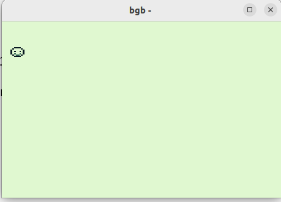
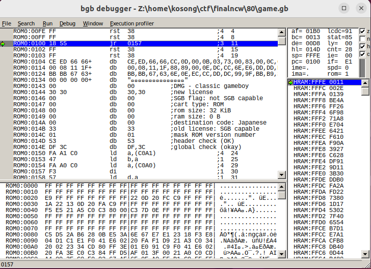
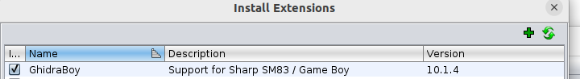
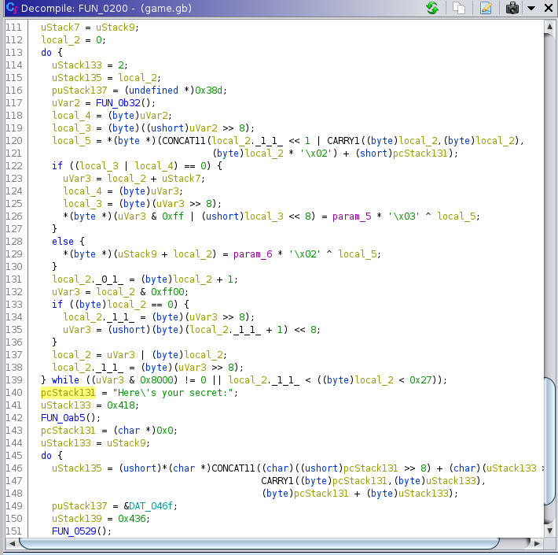
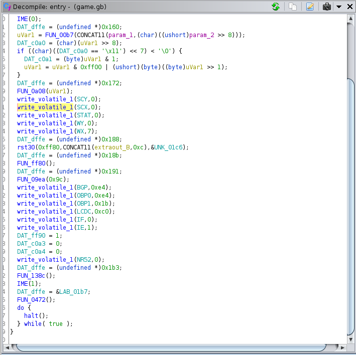
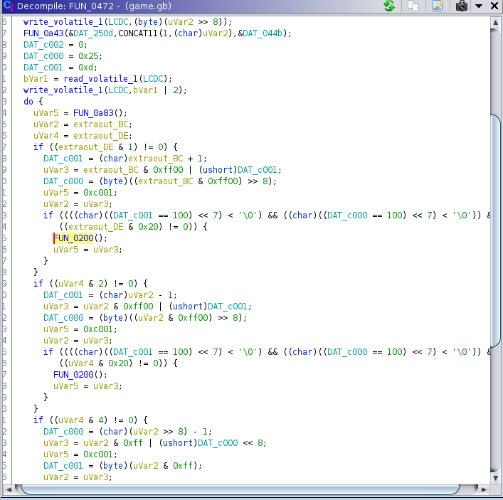
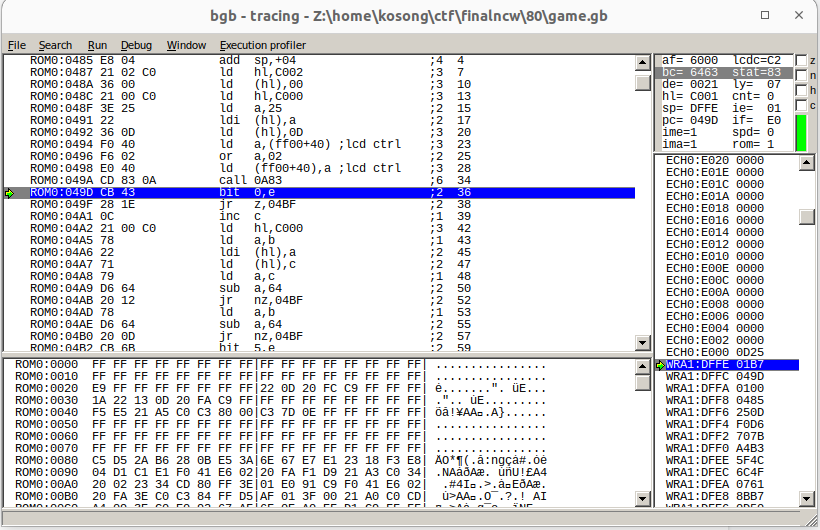
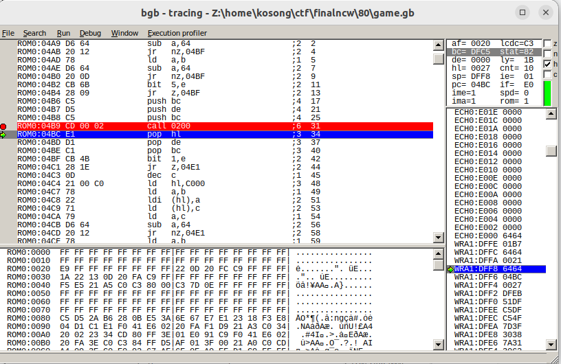
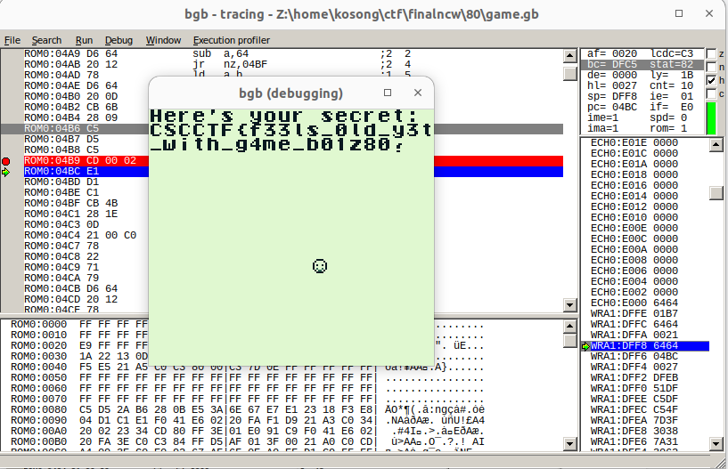

# Reverse Engineering Game Boy

Study case NCW 2022 Final (80's)

## Preface

During the competition, my team got 1st place and i got 1st blood in this challenge. It was my first time using bgb as debugger and doing debugging on game boy. In this case i do static and dynamic analysis to solve the challenge.

## Static and Dynamic Analysis

Given a game.gb file, after searching around we found that there is an emulator with a debugger feature, namely bgb.

<figure><figcaption></figcaption></figure>

Load the ROM, then use the debugger feature

<figure><figcaption></figcaption></figure>

<figure><figcaption></figcaption></figure>

In this case, we also use Ghidra to decompile with the support of the GhidraBoy plugin.

<figure><figcaption></figcaption></figure>

In function 0\_200 you can see there is a string here's your secret which seems to be related to the flag. Check the initial function when loading the game

<figure><figcaption></figcaption></figure>

There are several functions and after cross checking the function reference 0472 there is a call to 0200.

<figure><figcaption></figcaption></figure>

Because we don't know how to input or change the BC DE value through the game, we use the debugger to forcefully change the register value. There are several checks, namely

```
DE&0x1 != 0 
DE >= 0x20
B + 1 == 100 
C  == 100
```

And below are the appropriate values

```
DE = 0021
BC = 6463
```

<figure><figcaption></figcaption></figure>

Then just continue until 0200 is called and we will get the flag

<figure><figcaption></figcaption></figure>

<figure><figcaption></figcaption></figure>

Flag : NCW22{f33ls\_0ld\_y3t\_with\_g4me\_b01z80?}
