# Analyzing CVE-2021-22204 Based on Network Traffic (PCAP file)

Study case Intechfest CTF 2023 (breached)

## Preface

During the competition, i got second blood for breached challenge (forensic) and overall my team got 1st place on Intechfest CTF 2023. This challenge was fun, since it required me to do cracking, deobfusacting, and obviously scripting.

## Decrypting HTTPs Traffic

Given a pcap file, then we check the existing traffic with Wireshark.

<figure>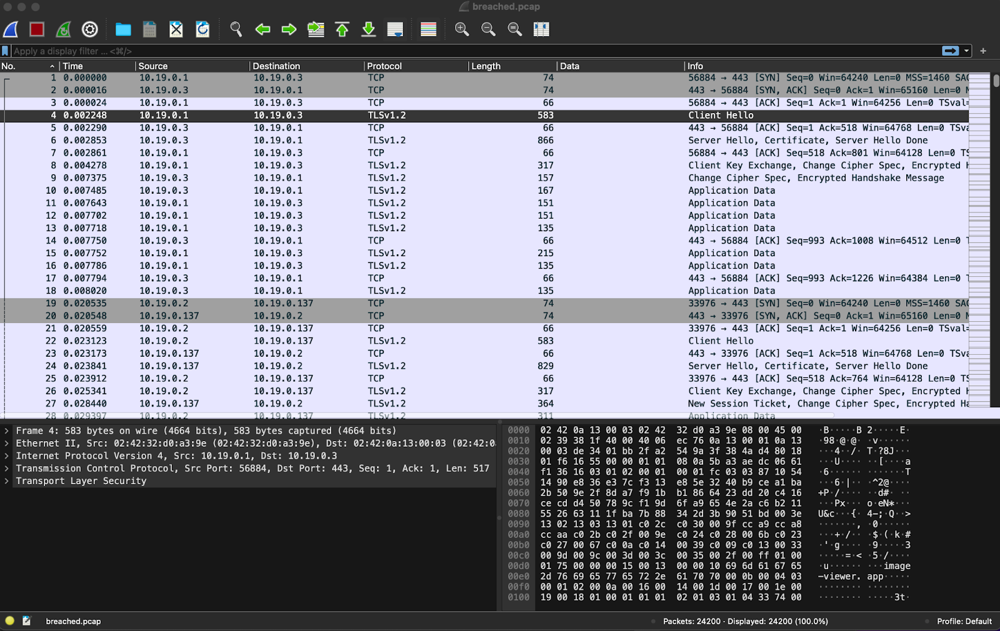<figcaption></figcaption></figure>

It is known that we cannot read the existing traffic directly because it uses the TLS protocol for communication. Check the Server hello package (number 6) to find out the certificate used to encrypt the HTTP communication so that it becomes HTTPS.

<figure>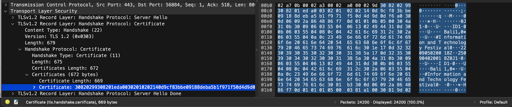<figcaption></figcaption></figure>

To export the certificate, we can press right click on the certificate section then click export packet bytes

<figure><figcaption></figcaption></figure>

Selanjutnya untuk membaca data dari certificate disini kami ubah dulu ke PEM lalu dump informasi yang ada.

Next, to read the data from the certificate, we need to convert it first to PEM then dump the existing information.

<figure>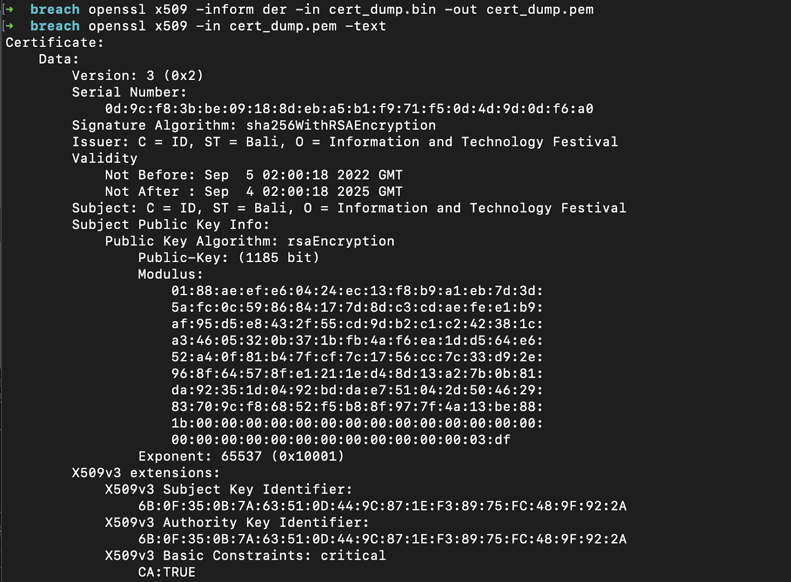<figcaption></figcaption></figure>

In the modulus section, copy the value and remove the “:” to get a valid hex value. Check the modulus used in the factor db (assuming we can get the prime factors)

<figure>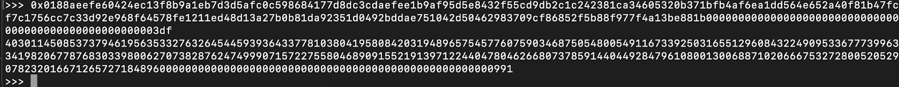<figcaption></figcaption></figure>

<figure>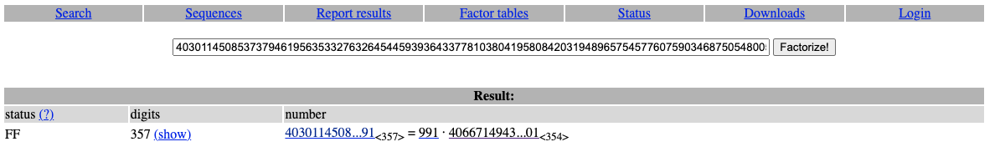<figcaption></figcaption></figure>

From image above, we can see that the factors are available because one of the factors has a small value. So, the next step is reconstructing the private key with Python. The following is the script i use

```python
from Crypto.PublicKey import RSA  # provided by pycryptodome
from Crypto.Util.number import *

n = 0x0188aeefe60424ec13f8b9a1eb7d3d5afc0c598684177d8dc3cdaefee1b9af95d5e8432f55cd9db2c1c242381ca34605320b371bfb4af6ea1dd564e652a40f81b47fcf7c1756cc7c33d92e968f64578fe1211ed48d13a27b0b81da92351d0492bddae751042d50462983709cf86852f5b88f977f4a13be881b000000000000000000000000000000000000000000000000000003df
p = 991
q = 406671494302460086978441304503798733192670467990013929561865207184146980369097957521159183196776479482683400924875172638065076643156179612849846828232864080119077972490703960393532508297432698979910748931783170979291671308584640354632138531580330980121784773165153917989914435207651180793857373634560000000000000000000000000000000000000000000000000000001
e = 0x10001
phi = (p-1)*(q-1)
d = inverse(e, phi)
assert p*q == n
key = RSA.construct((n, e, d))
# print(key.exportKey())

out = open("priv_key.pem","wb")
out.write(key.exportKey())
out.close()
```

<figure>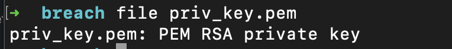<figcaption></figcaption></figure>

Next, just add the generated RSA private key in Wireshark (preferences -> RSA Keys -> add new keyfile)

<figure>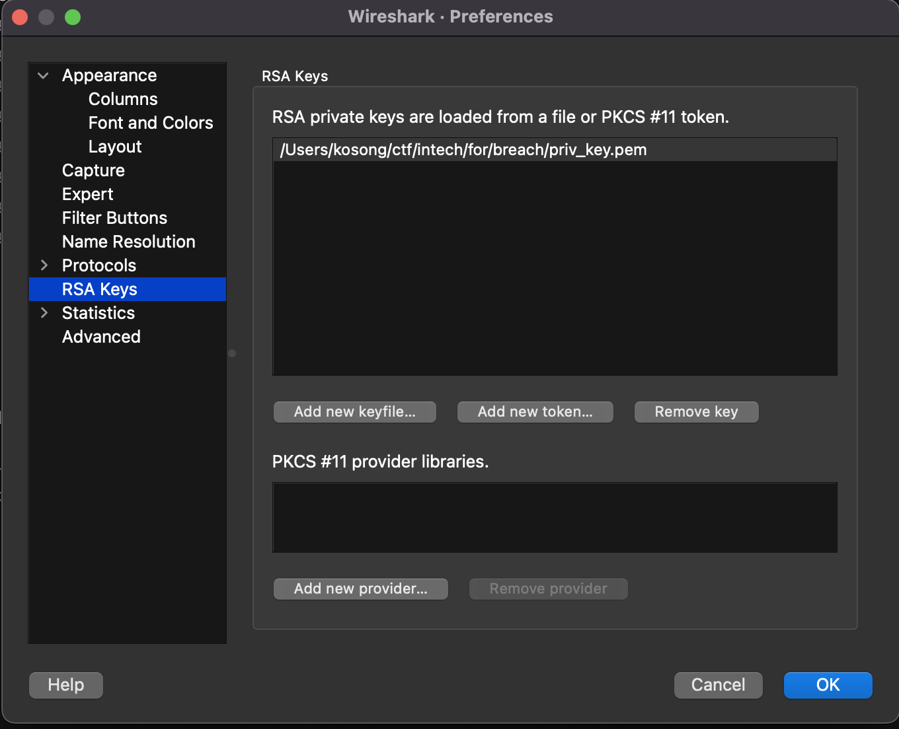<figcaption></figcaption></figure>

Reopen breached.pcap and we can see that the HTTPS traffic has been successfully decrypted.&#x20;

<figure>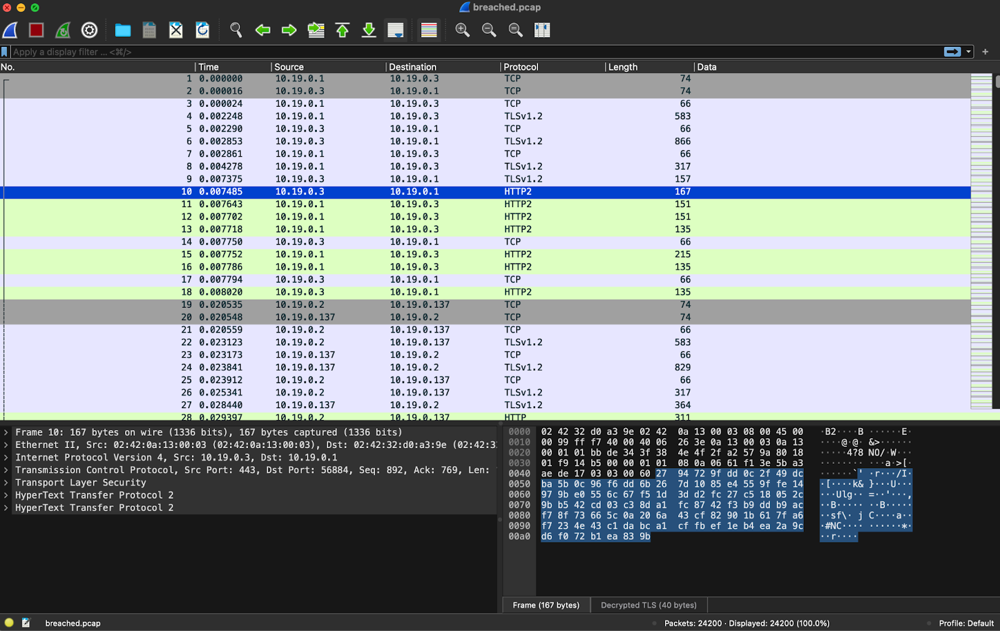<figcaption></figcaption></figure>

<figure>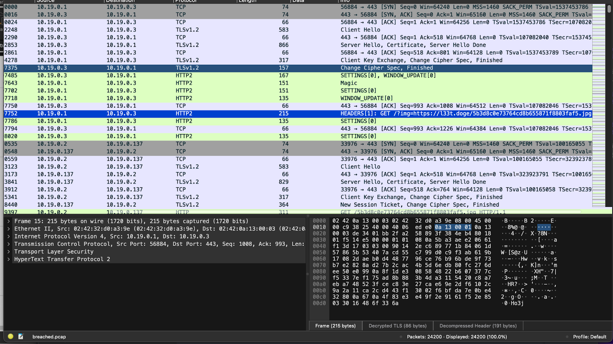<figcaption></figcaption></figure>

## Finding Infection Vector

From the existing traffic, it can be seen that there is access to a website and the parameter used is img=

<figure>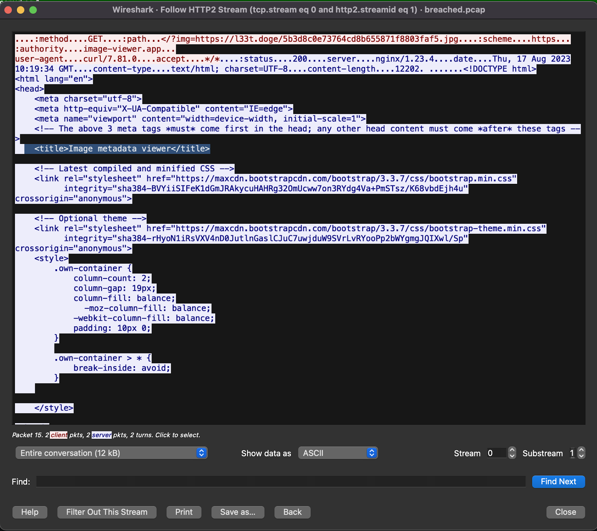<figcaption></figcaption></figure>

From the page title, it is known that the page is used to view the metadata of an image. From the hint it is also known that an exploit was carried out on the deprecated library where the payload was inserted into the image. Searching the internet we found an exploit against exiftool (CVE-2021-22204) with the keyword "metadata image exploit". The CVE compresses the RCE payload and we confirm that the compression results do not show the original payload (therefore there is no command in the strings)

## Analyzing Exploitation Flow

<figure>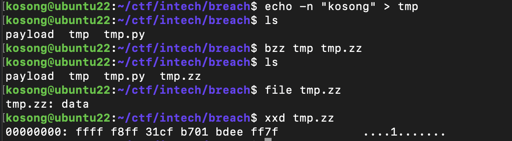<figcaption></figcaption></figure>

It can be seen in the image above that the "kosong" string when compressed with bzz produces unprintable data. Next, try reconstructing the image for exploitation with the following [script](<https://www.exploit-db.com/exploits/50911 >). After that, compare the image strings from the Wireshark export image with the generated image from the exploit

<figure>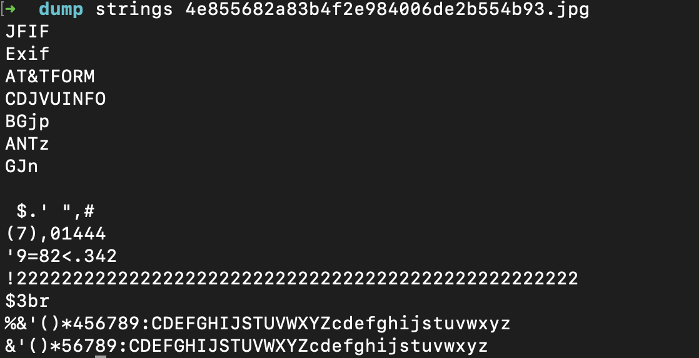<figcaption></figcaption></figure>

<figure>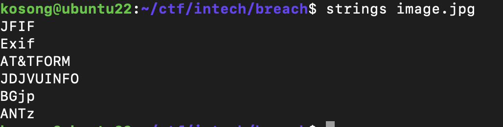<figcaption></figcaption></figure>

We can see that there are similarities, namely that they both have the string "Exif, AT\&TFORM, DJVUINFO, ANtz", then carry out an analysis of how the payload is embedded in the image file. In the exploit-db script, comment on the following code to be able to analyze the process of embedding the payload into the image

<figure>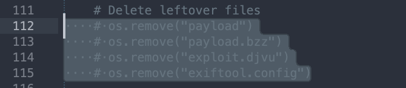<figcaption></figcaption></figure>

Next, just run the exploit, for example with the following command

```bash
python3 tmp.py -c ls
```

<figure>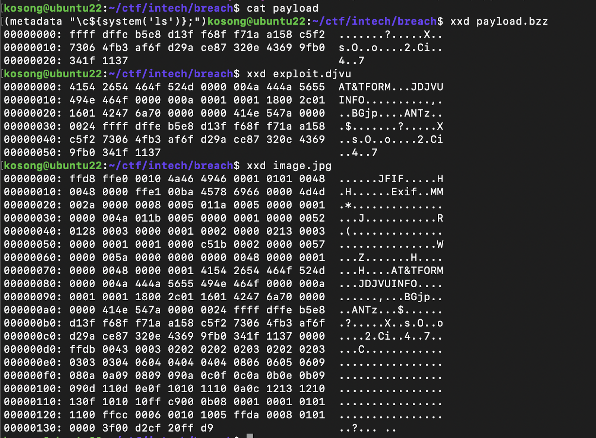<figcaption></figcaption></figure>

From the image above we know some information, so we can get the compressed payload with the following information

```
ANTz + null byte (2 bytes) + length (2 bytes) + payload
```

So then just do the scripting to extract the payload then decompress it.

```python
import subprocess
from Crypto.Util.number import *
import base64
import glob

for img in glob.glob('./images/*'):
	f = open(img, "rb").read()
	sep = bytes.fromhex("0000414e547a0000")
	if(sep in f):
		tmp = f.split(sep)[1]
		length = bytes_to_long(tmp[0:2])
		data = tmp[2:2+length]

		out = open("tmp.zz", "wb")
		out.write(data)
		out.close()
		subprocess.run(['bzz', '-d', 'tmp.zz', 'dec'])

		dec = open("dec", "r").read()
		print(dec)
	break # debugging first iter
```

## Extracting Attacker Payload

### Deobfuscating Attacker Payload

<figure>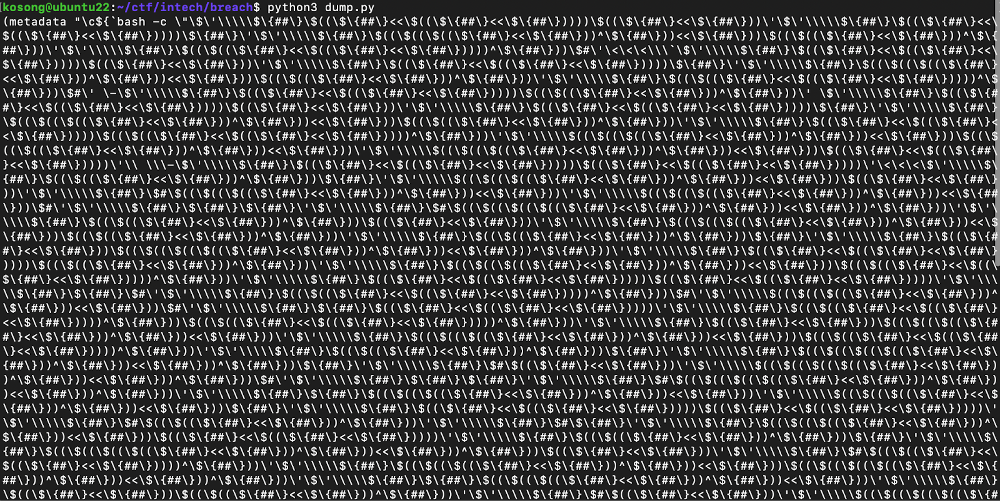<figcaption></figcaption></figure>

The payload is obfuscated, assuming that other payloads are also obfuscated, here we script the deobfuscate to speed up the overall process. The deobfuscate approach is detailed below

* Translate $\<payload> into its original form by echoing the payload. Example “echo ${##}”
* After getting all the $\<payload> value mappings, create a dictionary for the automatic translation process
* The translated results display the form \123 which is the octal value format

```python
import subprocess
from Crypto.Util.number import *
import base64
import glob

def deobfs(fn):
	f = open(fn, "r").read()
	f = f.replace('\\', '')

	dicc = {
		'$#' : '0',
		'${##}' : '1',
		'$((1<<1))' : '2',
		'$((2^1))' : '3',
		'$((1<<2))' : '4',
		'$((4^1))' : '5',
		'$((3<<1))' : '6',
		'$((6^1))' : '7'
	}

	for i in dicc:
		f = f.replace(i, dicc[i])
	
	data = f.split('bash -c ')[1].split('`')[1].split("'")
	
	result = ""
	for i in data:
		try:
			tmp = int(i, 8)
			result += chr(tmp)
		except Exception as e:
			continue
	return result

for img in glob.glob('./images/*'):
	f = open(img, "rb").read()
	sep = bytes.fromhex("0000414e547a0000")
	if(sep in f):
		fn = img.split('./images/')[1]

		tmp = f.split(sep)[1]
		length = bytes_to_long(tmp[0:2])
		data = tmp[2:2+length]

		out = open("tmp.zz", "wb")
		out.write(data)
		out.close()
		subprocess.run(['bzz', '-d', 'tmp.zz', 'dec'])

		print(deobfs("dec"))
	break # debugging first iter

```

<figure><figcaption></figcaption></figure>

From the image above, it is known that the base64 -d process is running, so here we just decode the value after base64d.

```python
import subprocess
from Crypto.Util.number import *
import base64
import glob

def deobfs(fn):
	f = open(fn, "r").read()
	f = f.replace('\\', '')

	dicc = {
		'$#' : '0',
		'${##}' : '1',
		'$((1<<1))' : '2',
		'$((2^1))' : '3',
		'$((1<<2))' : '4',
		'$((4^1))' : '5',
		'$((3<<1))' : '6',
		'$((6^1))' : '7'
	}

	for i in dicc:
		f = f.replace(i, dicc[i])
	
	data = f.split('bash -c ')[1].split('`')[1].split("'")
	
	result = ""
	for i in data:
		try:
			tmp = int(i, 8)
			result += chr(tmp)
		except Exception as e:
			continue
	return result

for img in glob.glob('./images/*'):
	f = open(img, "rb").read()
	sep = bytes.fromhex("0000414e547a0000")
	if(sep in f):
		fn = img.split('./images/')[1]

		tmp = f.split(sep)[1]
		length = bytes_to_long(tmp[0:2])
		data = tmp[2:2+length]

		out = open("tmp.zz", "wb")
		out.write(data)
		out.close()
		subprocess.run(['bzz', '-d', 'tmp.zz', 'dec'])

		res =deobfs("dec")
		for i in range(4):
			try:
				print(base64.b64decode(res.split("base64d")[1]+'='*(i+1)))
				break
			except Exception as e:
				continue
	break
```

### Analyzing Blind Command Injection (Time Based)

<figure>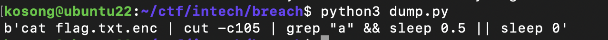<figcaption></figcaption></figure>

It turns out that the payload used to extract data is time based (delay > 0.5 if correct), so extract the time difference between request and response in Wireshark. An example is reducing the time from package number 191 to number 164.

<figure>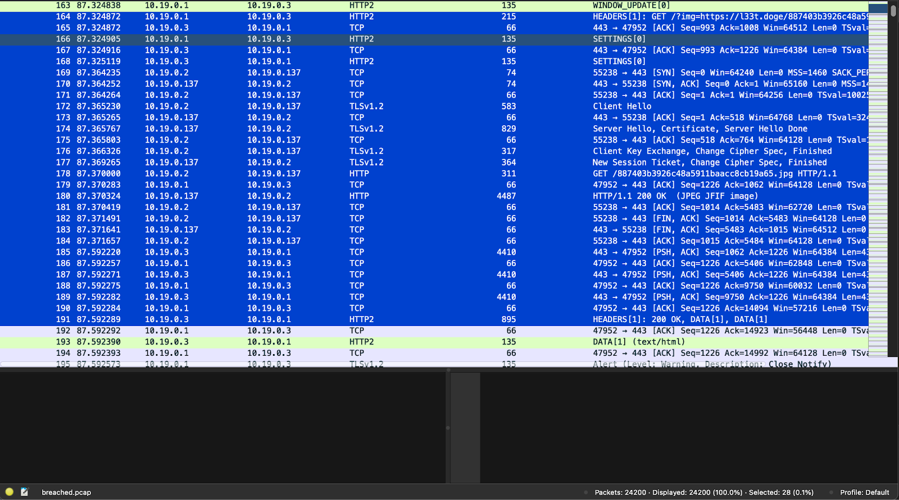<figcaption></figcaption></figure>

test.json -> extracted results in JSON format (file -> export packet dissection -> as JSON)

```python
import json

f = open("test.json", "r").read()

data = json.loads(f)
dict = {
	
}
for i in data:
	frame_number = int(i['_source']['layers']['frame']['frame.number'])
	tmp = i['_source']['layers']['http2']['http2.stream']
	if('http2.length' in tmp):
		length = int(tmp['http2.length'])
		if(length > 700):
			end = float(i['_source']['layers']['frame']['frame.time_relative'])
			dict[fn] = end - start
			# print(frame_number, fn, end - start)
	
	if('http2.request.full_uri') in tmp:
		start = float(i['_source']['layers']['frame']['frame.time_relative'])
		fn = tmp['http2.request.full_uri'].split('https://image-viewer.app/?img=https://l33t.doge/')[1]
	

print(dict)

```

From the results of deobfuscate payload, it can be seen that there are 2 files extracted, namely password.txt and flag.txt.enc. So the results will be divided into 2, namely variables for storing flag.txt.enc and password.txt. Combine all the scripts you have created and run them

```python
import subprocess
from Crypto.Util.number import *
import base64
import glob
import json

def deobfs(fn):
	f = open(fn, "r").read()
	f = f.replace('\\', '')

	dict = {
		'$#' : '0',
		'${##}' : '1',
		'$((1<<1))' : '2',
		'$((2^1))' : '3',
		'$((1<<2))' : '4',
		'$((4^1))' : '5',
		'$((3<<1))' : '6',
		'$((6^1))' : '7'
	}

	for i in dict:
		f = f.replace(i, dict[i])
	
	data = f.split('bash -c ')[1].split('`')[1].split("'")
	
	result = ""
	for i in data:
		try:
			tmp = int(i, 8)
			result += chr(tmp)
		except Exception as e:
			continue
	return result

f = open("test.json", "r").read()
data = json.loads(f)
dict = {}
dict2 = {}
for i in data:
	frame_number = int(i['_source']['layers']['frame']['frame.number'])
	tmp = i['_source']['layers']['http2']['http2.stream']
	if('http2.length' in tmp):
		length = int(tmp['http2.length'])
		if(length > 700):
			end = float(i['_source']['layers']['frame']['frame.time_relative'])
			dict[fn] = end - start
	
	if('http2.request.full_uri') in tmp:
		start = float(i['_source']['layers']['frame']['frame.time_relative'])
		fn = tmp['http2.request.full_uri'].split('https://image-viewer.app/?img=https://l33t.doge/')[1]

for img in glob.glob('./images/*'):
	f = open(img, "rb").read()
	sep = bytes.fromhex("0000414e547a0000")
	if(sep in f):
		fn = img.split('./images/')[1]

		tmp = f.split(sep)[1]
		length = bytes_to_long(tmp[0:2])
		data = tmp[2:2+length]

		out = open("tmp.zz", "wb")
		out.write(data)
		out.close()
		subprocess.run(['bzz', '-d', 'tmp.zz', 'dec'])
	
		res = deobfs("dec")

		for i in range(4):
			try:
				dict2[fn] = base64.b64decode(res.split("base64d")[1]+'='*(i+1))
				break
			except Exception as e:
				continue

ct = [b'?' for i in range(200)]
password = [b'?' for i in range(200)]

for i in dict:
	if(dict[i] > 0.5):
		index = int(dict2[i].split(b'cut -c')[1].split(b' |')[0])
		value = dict2[i].split(b'grep "')[1].split(b'"')[0]
		if(b'flag.txt.enc' in dict2[i]):
			ct[index - 1] = value
		elif(b'password.txt'):
			password[index - 1] = value

print(b''.join(ct))
print(b''.join(password))

```

<figure>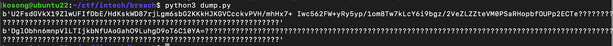<figcaption></figcaption></figure>

From the output it is known that the ciphertext looks like the encrypted result from openssl (Salted\_\*). So try using openssl to decrypt

<figure>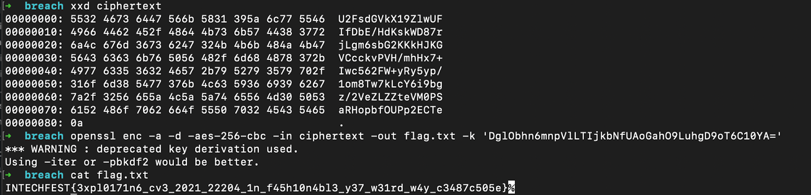<figcaption></figcaption></figure>

Flag : INTECHFEST{3xpl0171n6\_cv3\_2021\_22204\_1n\_f45h10n4bl3\_y37\_w31rd\_w4y\_c3487c505e}
