# Reverse Engineering Protected Python Application   ̶w̶i̶t̶h̶ ̶P̶y̶a̶r̶m̶o̶r̶

Study case protection on windows, linux, and macOS environment

## Preface

In this post, i want to share my approach to analyzing protected python applications. Over time, I have encountered many such applications across Windows, Linux, and macOS. Each experience led me to try different methods and techniques to better understand how these applications work and how they can be analyzed.

## Approaches

<table><thead><tr><th width="186.87109375">Approach</th><th width="187">Protection</th><th>Platform</th><th>Study Case</th></tr></thead><tbody><tr><td><strong>Monkey Patching Python Function</strong></td><td>PyArmor</td><td>Linux</td><td><a href="#study-case-tfcctf-2024-mcknight">TFCCTF 2024 - McKnight</a></td></tr><tr><td></td><td>PyArmor</td><td>Linux</td><td><a href="#study-case-blackhat-mea-2023-can-you-break-the-armor">BlackHat MEA 2023 - Can you break the armor?</a></td></tr><tr><td></td><td>PyArmor</td><td>Windows</td><td><a href="#testing-on-windows">Testing on Windows</a></td></tr><tr><td></td><td>PyArmor</td><td>macOS</td><td><a href="#testing-on-macos">Testing on macOS</a></td></tr><tr><td></td><td>PyArmor</td><td>*</td><td><a href="#further-exploration-1">Further Exploration #1</a></td></tr><tr><td></td><td>PyArmor</td><td>*</td><td><a href="#further-exploration-2">Further Exploration #2</a></td></tr><tr><td></td><td>PyArmor</td><td>*</td><td><a href="#further-exploration-3">Further Exploration #3</a></td></tr><tr><td><strong>Injecting Python Code to Running Process</strong></td><td>Custom</td><td>Windows</td><td><a href="/posts/write-up/2024/sas-ctf-quals/reverse-engineering/#ebin-464-pts">SAS CTF Quals 2024 - Ebin, Utilizing PyInjector</a></td></tr><tr><td></td><td>PyArmor (Partially Static)</td><td>Windows</td><td><a href="/posts/write-up/2025/securinets-final/reverse-engineering/#ezpyracy-380-pts">Securinets Final 2025 - Ezpiracy, Utilizing PyInjector</a></td></tr><tr><td></td><td>PyArmor</td><td>Windows</td><td><a href="/posts/write-up/2025/sas-ctf-quals/malware/#music-speed-changer">SAS CTF Quals 2025 - Music Speed Changer, Utilizing PyInjector</a></td></tr><tr><td></td><td>PyArmor</td><td>Linux/macOS</td><td><a href="#testing-on-linux">Testing on Linux</a></td></tr><tr><td><strong>Modifying Python Executable</strong></td><td>Custom</td><td>Linux</td><td><a href="/posts/write-up/2024/hkcert-ctf-quals/reverse-engineering/#black-magic-400-pts">HKCERT Quals 2024 - Black Magic, Tracing Opcode</a></td></tr><tr><td></td><td>Custom</td><td>Linux</td><td><a href="/posts/write-up/2024/acsc/reverse-engineering/#compyled-50-pts">ACSC 2024 - compyled, Tracing Opcode</a></td></tr><tr><td></td><td>PyArmor</td><td>Linux</td><td>TFCCTF 2024 - McKnight, Dumping Object Code (LD_PRELOAD)</td></tr><tr><td></td><td>-</td><td>Windows</td><td>Testing on Windows</td></tr><tr><td></td><td>-</td><td>macOS</td><td>Testing on macOS</td></tr></tbody></table>

### Stomping Python Builtin Function

* Tested on: Linux, MacOS, Windows

#### Study Case: TFCCTF 2024 - McKnight

Given python file that run pyarmor, we recognize it from the code

```python
from pytransform import pyarmor_runtime
pyarmor_runtime()
__pyarmor__(__name__, __file__, <DATA>)
```

There are also another files given such as in image below

<figure>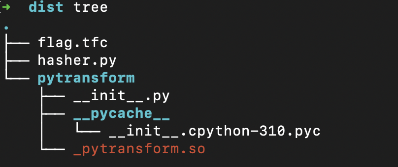<figcaption></figcaption></figure>

When we run the program it will give us output like below

<figure><figcaption></figcaption></figure>

One of the possible function used by the program to printout the usage string is "print" which is builtin function from python. So basically if we define our print function it will replace the print function used by the program. Lets try with simple code

```python
import pprint

def print(x):
    pprint.pp("[X] Injected : " + x)

code = open('/home/kosong/ctf/tfc/re/mcknight/hasher.py','rb').read()
exec(code)
```

<figure>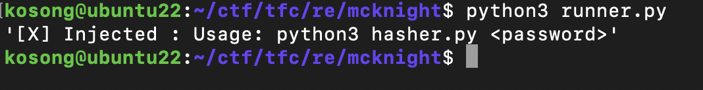<figcaption></figcaption></figure>

We can see that we've successfully injected our python code. Now what we can do? since we can inject our python code we can do some information gathering. Lets try with calling global function.

```python
import pprint

def print(x):
    pprint.pp("[X] Injected")
    pprint.pp(globals())

code = open('/home/kosong/ctf/tfc/re/mcknight/hasher.py','rb').read()
exec(code)
```

<figure>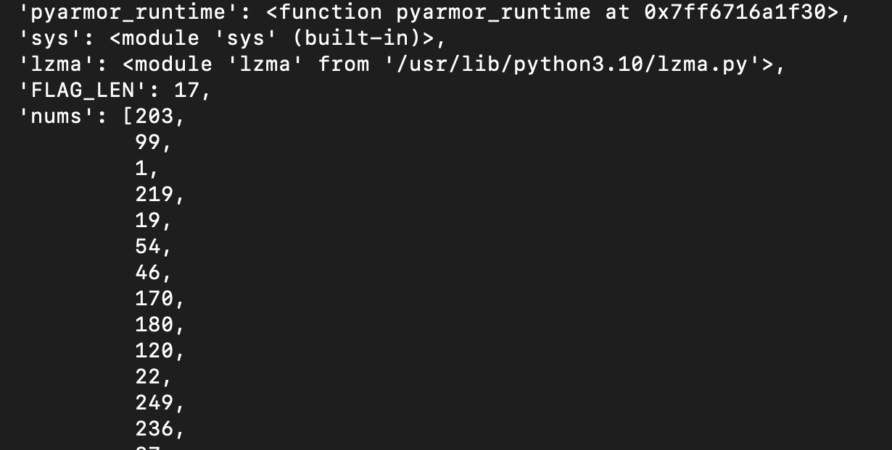<figcaption></figcaption></figure>

<figure>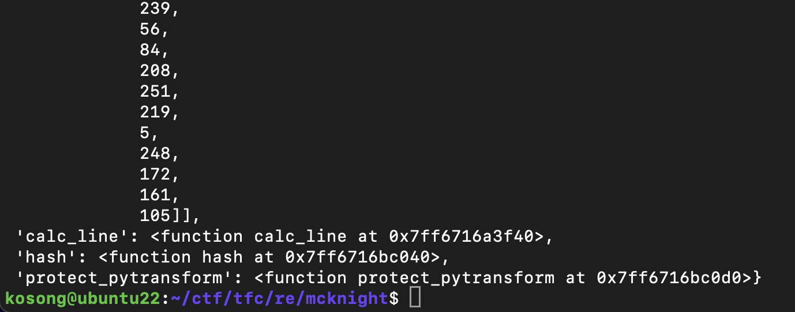<figcaption></figcaption></figure>

Know we have information about function and variable available in protected code, lets try to call all of them.

* Call calc\_line function, to see whats argument should be passed (if needed)

```python
import pprint

def print(x):
    pprint.pp("[X] Injected")
    calc_line()

code = open('/home/kosong/ctf/tfc/re/mcknight/hasher.py','rb').read()
exec(code)
```

<figure>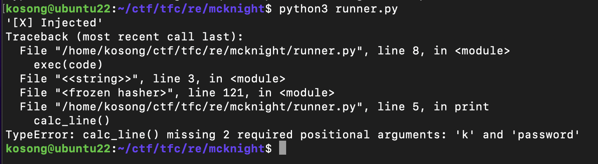<figcaption></figcaption></figure>

* Call hash function, to see whats argument should be passed (if needed)

<figure>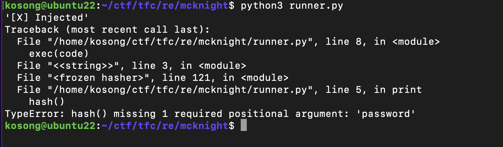<figcaption></figcaption></figure>

Now we know what argument should be passed, lets try to pass some data based on known information (trial and error will be enough)

```python
import pprint

def print(x):
    pprint.pp("[X] Injected")
    password = "ABCD"
    pprint.pp(calc_line(0, password.encode()))
    pprint.pp(hash(password))

code = open('/home/kosong/ctf/tfc/re/mcknight/hasher.py','rb').read()
exec(code)
```

<figure>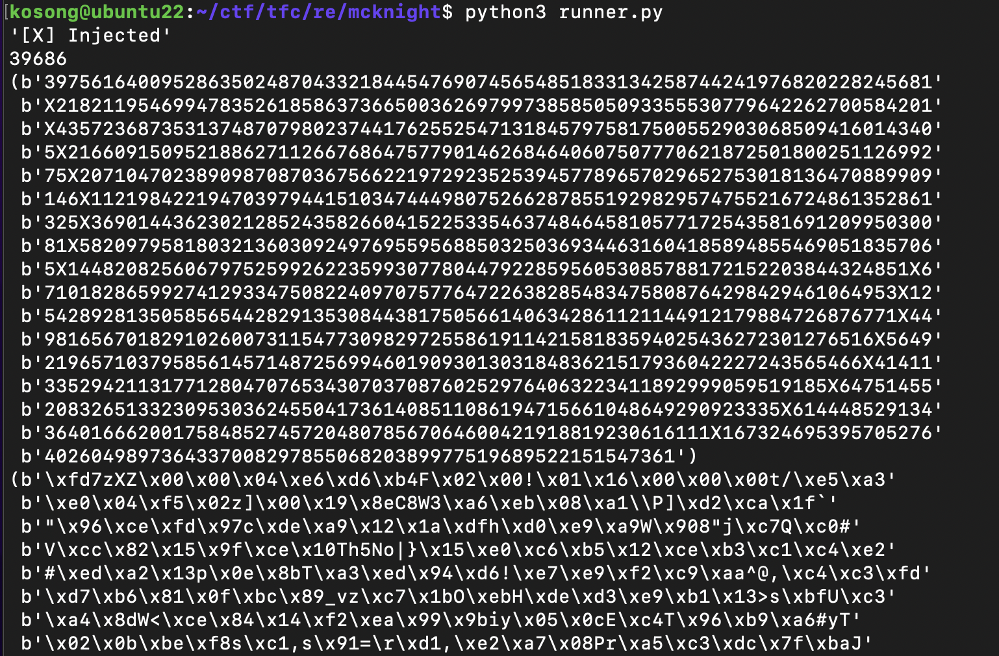<figcaption></figcaption></figure>

So using this approach we can call any function inside the protected code, what about getting the "plaintext" code? Lets try using dis

```python
import pprint
import dis

def print(x):
    pprint.pp("[X] Injected")
    pprint.pp(dis.dis(calc_line))

code = open('/home/kosong/ctf/tfc/re/mcknight/hasher.py','rb').read()
exec(code)
```

<figure>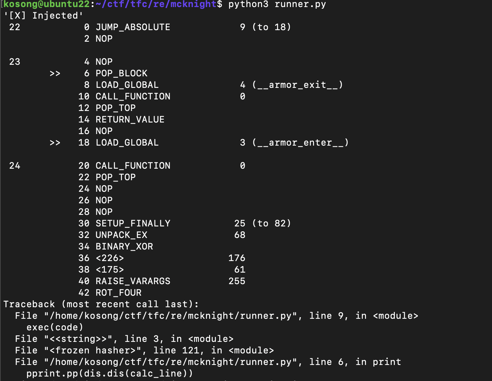<figcaption></figcaption></figure>

It failed, but if we take a look on the partial disassembled code it looks like still protected with pyarmor. Also the error shown message "IndexError: tuple index out of range", so it looks like something missing with the list of name (wether variable or function). Lets try another approach to disassembly the code, one of the approach we can use is by utilizing function attribute in python which is \`\_\_code\_\_\`.

```python
import pprint
import dis

def print(x):
    pprint.pp("[X] Injected")
    pprint.pp(dis.dis(calc_line.__code__.co_code))

code = open('/home/kosong/ctf/tfc/re/mcknight/hasher.py','rb').read()
exec(code) 
```

```python
'[X] Injected'
          0 JUMP_ABSOLUTE            9 (to 18)
          2 NOP
          4 NOP
    >>    6 POP_BLOCK
          8 LOAD_GLOBAL              4 (4)
         10 CALL_FUNCTION            0
         12 POP_TOP
         14 RETURN_VALUE
         16 NOP
    >>   18 LOAD_GLOBAL              3 (3)
         20 CALL_FUNCTION            0
         22 POP_TOP
         24 NOP
         26 NOP
         28 NOP
         30 SETUP_FINALLY           25 (to 82)
         32 UNPACK_EX               68
         34 BINARY_XOR
         36 <226>                  176
         38 <175>                   61
         40 RAISE_VARARGS          255
         42 ROT_FOUR
         44 DELETE_NAME            244 (244)
         46 <188>                  156
         48 <188>                   25
         50 RAISE_VARARGS          177
         52 MAP_ADD                 72
         54 DELETE_NAME            231 (231)
         56 CONTAINS_OP             70
         58 <37>
         60 <226>                  182
         62 <167>                   60
         64 <225>                  248
         66 <255>                   67
         68 WITH_EXCEPT_START
         70 <236>                  156
         72 <214>                   11
         74 RAISE_VARARGS          176
         76 <168>                   86
         78 DELETE_NAME            228 (228)
         80 JUMP_ABSOLUTE            3 (to 6)
    >>   82 LOAD_GLOBAL              4 (4)
         84 CALL_FUNCTION            0
         86 POP_TOP
         88 RERAISE                  0
         90 RETURN_VALUE
         92 NOP
         94 NOP
         96 NOP
         98 <199>                   31
        100 ROT_THREE
        102 BINARY_OR
        104 GET_ITER
        106 DICT_MERGE              74
        108 ROT_N                   97
        110 <230>                  205
        112 <255>                  192
```

We got output above and it still looks like protected by pyarmor. But until this step, we know that "print" function is executed, which is most likely done in the main function. So we know that function calc\_line and hash is not being called, but main most likely yes. Then how can we go to main function?&#x20;

We can utilize frame, let's see following example

* frame\_1 -> frame\_2 -> frame\_3 -> print

Basically above example is a call stack, because we overwrite print function, we can go to the previous frame but at first we need to get the current frame first, which is the modified print.

```python
def print(x):
    pprint.pp("[X] Injected")
    pprint.pp(list(sys._current_frames().values()))
```

<figure>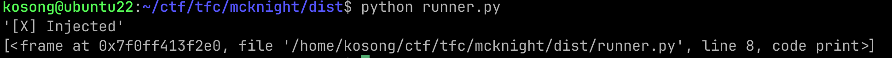<figcaption></figcaption></figure>

We can see that there is only one frame and it is pointed to file runner.py and function print. Now let's go to previous frame.

```python
def print(x):
    pprint.pp("[X] Injected")
    pprint.pp(list(sys._current_frames().values())[0].f_back)
```

<figure>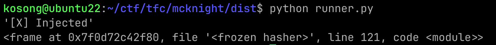<figcaption></figcaption></figure>

Now it pointed to frozen hasher, which is pyarmor protected code. Now let's try to dump the code.

```python
def print(x):
    pprint.pp("[X] Injected")
    pprint.pp(dis.dis(list(sys._current_frames().values())[0].f_back.f_code))
```

<figure>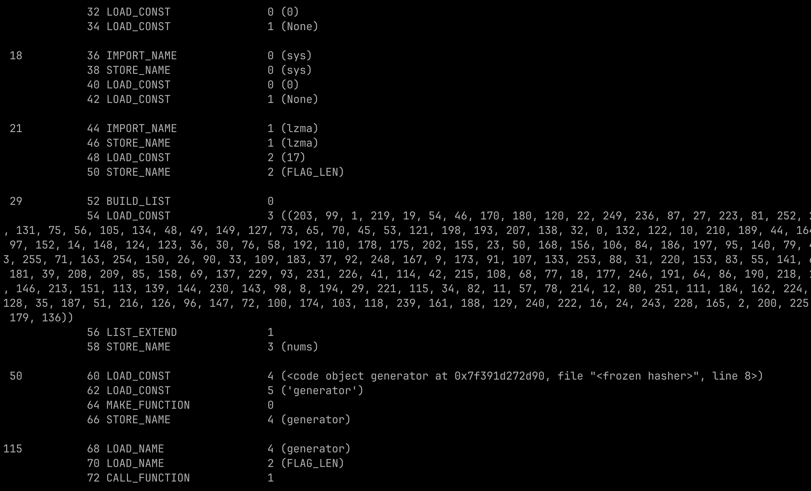<figcaption></figcaption></figure>

```python
 1           0 JUMP_ABSOLUTE            9 (to 18)
              2 NOP
              4 NOP
        >>    6 POP_BLOCK

  2           8 LOAD_GLOBAL             20 (__armor_exit__)
             10 CALL_FUNCTION            0
             12 POP_TOP
             14 RETURN_VALUE

  4          16 NOP
        >>   18 LOAD_GLOBAL             19 (__armor_enter__)

  6          20 CALL_FUNCTION            0
             22 POP_TOP
             24 NOP
             26 NOP

  8          28 NOP
             30 SETUP_FINALLY           82 (to 196)
             32 LOAD_CONST               0 (0)
             34 LOAD_CONST               1 (None)

 18          36 IMPORT_NAME              0 (sys)
             38 STORE_NAME               0 (sys)
             40 LOAD_CONST               0 (0)
             42 LOAD_CONST               1 (None)

 21          44 IMPORT_NAME              1 (lzma)
             46 STORE_NAME               1 (lzma)
             48 LOAD_CONST               2 (17)
             50 STORE_NAME               2 (FLAG_LEN)

 29          52 BUILD_LIST               0
             54 LOAD_CONST               3 ((203, 99, 1, 219, 19, 54, 46, 170, 180, 120, 22, 249, 236, 87, 27, 223, 81, 252, 232, 66, 241, 61, 235, 40, 217, 74, 145, 196, 7, 131, 75, 56, 105, 134, 48, 49, 149, 127, 73, 65, 70, 45, 53, 121, 198, 193, 207, 138, 32, 0, 132, 122, 10, 210, 189, 44, 164, 25, 166, 195, 5, 47, 157, 20, 119, 247, 199, 97, 152, 14, 148, 124, 123, 36, 30, 76, 58, 192, 110, 178, 175, 202, 155, 23, 50, 168, 156, 106, 84, 186, 197, 95, 140, 79, 43, 15, 244, 125, 205, 3, 234, 212, 13, 182, 233, 255, 71, 163, 254, 150, 26, 90, 33, 109, 183, 37, 92, 248, 167, 9, 173, 91, 107, 133, 253, 88, 31, 220, 153, 83, 55, 141, 62, 101, 28, 242, 112, 52, 89, 6, 17, 135, 211, 181, 39, 208, 209, 85, 158, 69, 137, 229, 93, 231, 226, 41, 114, 42, 215, 108, 68, 77, 18, 177, 246, 191, 64, 86, 190, 218, 102, 185, 160, 142, 172, 171, 237, 238, 245, 59, 146, 213, 151, 113, 139, 144, 230, 143, 98, 8, 194, 29, 221, 115, 34, 82, 11, 57, 78, 214, 12, 80, 251, 111, 184, 162, 224, 201, 4, 206, 204, 227, 38, 169, 130, 67, 116,128, 35, 187, 51, 216, 126, 96, 147, 72, 100, 174, 103, 118, 239, 161, 188, 129, 240, 222, 16, 24, 243, 228, 165, 2, 200, 225, 104, 60, 21, 159, 117, 94, 176, 154, 250, 63, 179, 136))
             56 LIST_EXTEND              1
             58 STORE_NAME               3 (nums)

 50          60 LOAD_CONST               4 (<code object generator at 0x7f391d272d90, file "<frozen hasher>", line 8>)
             62 LOAD_CONST               5 ('generator')
             64 MAKE_FUNCTION            0
             66 STORE_NAME               4 (generator)

115          68 LOAD_NAME                4 (generator)
             70 LOAD_NAME                2 (FLAG_LEN)
             72 CALL_FUNCTION            1

116          74 STORE_NAME               5 (coeffs)
             76 LOAD_CONST               6 (<code object calc_line at 0x7f391d272e40, file "<frozen hasher>", line 21>)
             78 LOAD_CONST               7 ('calc_line')
             80 MAKE_FUNCTION            0

117          82 STORE_NAME               6 (calc_line)
             84 LOAD_CONST               8 (<code object hash at 0x7f391d272ef0, file "<frozen hasher>", line 29>)
             86 LOAD_CONST               9 ('hash')
             88 MAKE_FUNCTION            0
             90 STORE_NAME               7 (hash)
             92 LOAD_CONST              10 (<code object protect_pytransform at 0x7f391d290240, file "<frozen hasher>", line 50>)
             94 LOAD_CONST              11 ('protect_pytransform')

118          96 MAKE_FUNCTION            0
             98 STORE_NAME               8 (protect_pytransform)
            100 LOAD_NAME                8 (protect_pytransform)
            102 CALL_FUNCTION            0

119         104 POP_TOP
            106 LOAD_NAME                9 (__name__)
            108 LOAD_CONST              12 ('__main__')
            110 COMPARE_OP               2 (==)
            112 POP_JUMP_IF_FALSE       96 (to 192)

120         114 LOAD_NAME               10 (len)
            116 LOAD_NAME                0 (sys)
            118 LOAD_ATTR               11 (argv)
            120 CALL_FUNCTION            1
            122 LOAD_CONST              13 (2)

121         124 COMPARE_OP               3 (!=)
            126 POP_JUMP_IF_FALSE       73 (to 146)
            128 LOAD_NAME               12 (print)
            130 LOAD_CONST              14 ('Usage: python3 hasher.py <password>')
            132 CALL_FUNCTION            1

122         134 POP_TOP
            136 LOAD_NAME                0 (sys)
            138 LOAD_METHOD             13 (exit)
            140 LOAD_CONST              15 (1)
            142 CALL_METHOD              1
            144 POP_TOP
        >>  146 LOAD_NAME                0 (sys)

123         148 LOAD_ATTR               11 (argv)
            150 LOAD_CONST              15 (1)
            152 BINARY_SUBSCR
            154 STORE_NAME              14 (password)
            156 LOAD_NAME               15 (open)
            158 LOAD_CONST              16 ('flag.tfc')

116         160 LOAD_CONST              17 ('wb')
            162 CALL_FUNCTION            2
            164 STORE_NAME              16 (f)
            166 LOAD_NAME               16 (f)
            168 LOAD_METHOD             17 (write)
            170 LOAD_NAME                7 (hash)
            172 LOAD_NAME               14 (password)
            174 CALL_FUNCTION            1
            176 CALL_METHOD              1
            178 POP_TOP
            180 LOAD_NAME               16 (f)
            182 LOAD_METHOD             18 (close)
            184 CALL_METHOD              0
            186 POP_TOP
            188 LOAD_CONST               1 (None)
            190 JUMP_ABSOLUTE            3 (to 6)
        >>  192 LOAD_CONST               1 (None)
            194 JUMP_ABSOLUTE            3 (to 6)
        >>  196 LOAD_GLOBAL             20 (__armor_exit__)
            198 CALL_FUNCTION            0
            200 POP_TOP
            202 RERAISE                  0
            204 RETURN_VALUE
            206 NOP
            208 NOP
            210 NOP
            212 JUMP_IF_NOT_EXC_MATCH   122 (to 244)
            214 BINARY_TRUE_DIVIDE
            216 <150>                    1
            218 <216>                  222
            220 <208>                  255
            222 LIST_TO_TUPLE
```

We can see the code now! how it can be? because in pyarmor they implement runtime obfuscation, the function will be encrypted before and after called. But in this case we inspect it "during" the call. You can see following image from pyarmor site for overview of how its runtime obfuscation works

<figure>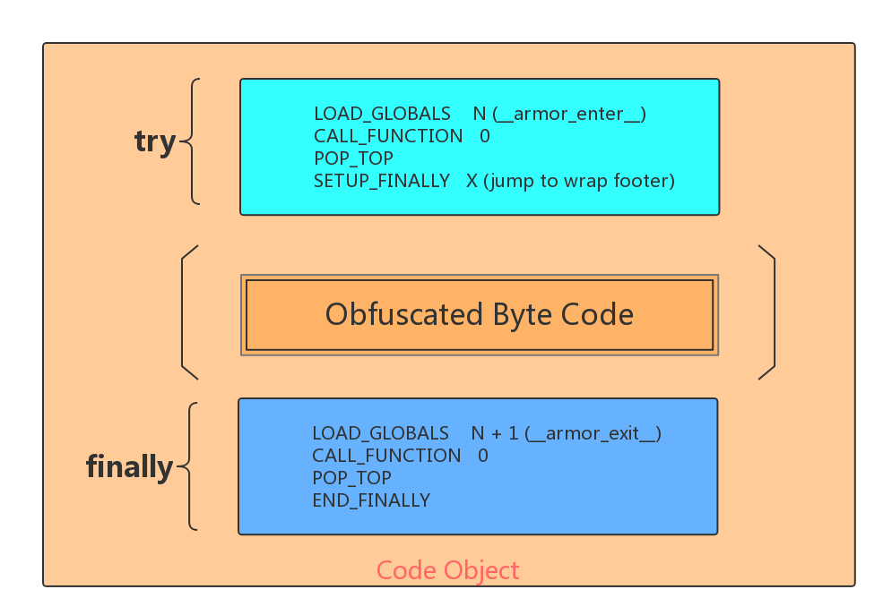<figcaption></figcaption></figure>

Now we've the disassembly for main function, next how can we inpsect other function's code? We can see that in main function there is import of lzma function but it never called in main function. So probably it called in hasher/calc\_line/generator function. Using the same idea we can do exactly same approach, so let's try to modify the lzma code and go to previous frame and dump the disassembly code.&#x20;

In this case, because we don't know that function is called, so we can do trial and error by putting some debug string on each function in lzma. I found that compress function is called by the hasher.py, so let's dump the code.

```python
def compress(data, format=FORMAT_XZ, check=-1, preset=None, filters=None):
    """Compress a block of data.

    Refer to LZMACompressor's docstring for a description of the
    optional arguments *format*, *check*, *preset* and *filters*.

    For incremental compression, use an LZMACompressor instead.
    """
    import dis
    import sys
    dis.dis(list(sys._current_frames().values())[0].f_back.f_code)

    comp = LZMACompressor(format, check, preset, filters)
    return comp.compress(data) + comp.flush()
```

<figure>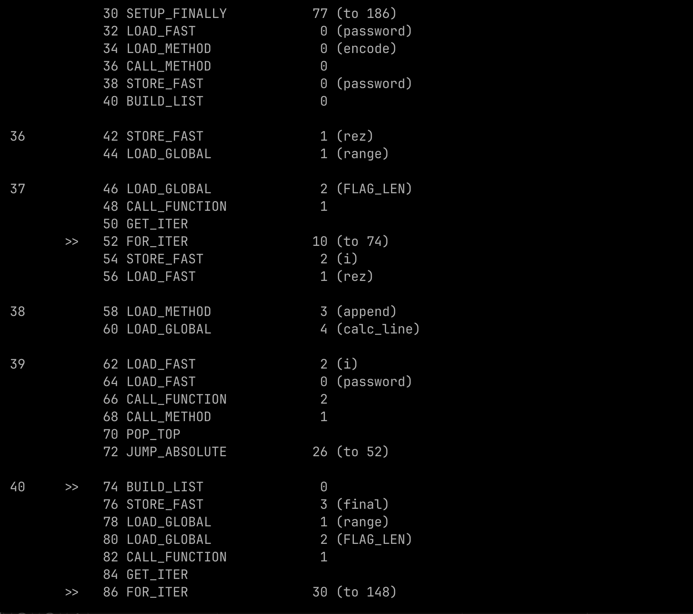<figcaption></figcaption></figure>

We've code for hasher now but we still have one function left which is calc\_line. From the disassembly code of hasher and main function, looks like calc\_line never call print or lzma function, now how can we dump it?

Let's try to inspect the argument used by calc\_line first.

```
def print(x):
    pprint.pp("[X] Injected")
    co = calc_line.__code__
    posonly = co.co_posonlyargcount
    argcount = co.co_argcount
    varnames = co.co_varnames
    poskw_names = varnames[posonly:argcount]
    pprint.pp(poskw_names)
```

<figure>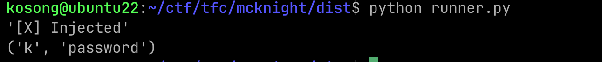<figcaption></figcaption></figure>

So the defined argument for calc\_line is k, password. Through hash disassembly we know that password has "bytes" as its data type. Previously we've been trying to overwrite function called by the obfuscated code which are print and compress. Now the question is, what function should we overwrite?&#x20;

Let's inspect bytes type data.

```python
>>> data = b"testing"
>>> dir(data)
['__add__', '__class__', '__contains__', '__delattr__', '__dir__', '__doc__', '__eq__', '__format__', '__ge__', '__getattribute__', '__getitem__', '__getnewargs__', '__gt__', '__hash__', '__init__', '__init_subclass__', '__iter__', '__le__', '__len__', '__lt__', '__mod__', '__mul__', '__ne__', '__new__', '__reduce__', '__reduce_ex__', '__repr__', '__rmod__', '__rmul__', '__setattr__', '__sizeof__', '__str__', '__subclasshook__', 'capitalize', 'center', 'count', 'decode', 'endswith', 'expandtabs', 'find', 'fromhex', 'hex', 'index', 'isalnum', 'isalpha', 'isascii', 'isdigit', 'islower', 'isspace', 'istitle', 'isupper', 'join', 'ljust', 'lower', 'lstrip', 'maketrans', 'partition', 'removeprefix', 'removesuffix', 'replace', 'rfind', 'rindex', 'rjust', 'rpartition', 'rsplit', 'rstrip', 'split', 'splitlines', 'startswith', 'strip', 'swapcase', 'title', 'translate', 'upper', 'zfill']
```

We see that there are many attribute in format `__<name>__`, in python we called them as magic method. One of the interesting method or function is \_\_getitem\_\_, which is the function used to get value by its index. For example as following

```python
>>> data.__getitem__(0)
116
>>> data[0]
116
```

What is \_\_getitem\_\_ ? From following [reference](https://www.geeksforgeeks.org/python/__getitem__-in-python/) we know that \_\_getitem\_\_ called when we try to access element from an object. So if we can modify password variable to use our defined class, then we can go inside the calc\_line function with assumption that password are accessed in format of password\[i] because password has bytes as its original data type.&#x20;

But the problem is we can't overwrite \_\_getitem\_\_ function...

But in python there is a [proxy object](https://refactoring.guru/design-patterns/proxy/python/example), basically we can create a class that wrap an existing object and then we can intercept some builtin function by defining builtin function in the wrap proxy class (because it actually like creating new class so no limitation on defining builtin function such as \_\_getitem\_\_ and so on). Following is the flow of the idea

* Execute given code, then use garbage collector to find target function objects from previous run
  * We must changes it from using exec to runpy to make it behave like the original run of hasher.py
* Patch the global name calc\_line to a wrapper that converts password into a proxy object
  * The proxy implements its own `__len__` and `__getitem__`
  * Every time the original calc\_line executes password\[i], the proxy’s \_\_getitem\_\_ runs and then we can dump the current executing frame and disassemble bytecode by using the original approach.
* To execute calc\_line with the patched password we can easily do it by calling the "hash" function again

```python
import gc
import sys
import types
import runpy
import dis

FOUND = False

class BytesProxy:
    def __init__(self, b):
        self._b = b

    def __len__(self):
        return len(self._b)

    def __getitem__(self, i):
        dump_func("calc_line")
        v = self._b[i]
        return v


def dump_func(target):
    global FOUND
    if FOUND:
        return
    f = list(sys._current_frames().values())[0]
    while f:
        if f.f_code.co_filename == "<frozen hasher>":
            if f.f_code.co_name == target:
                break
        f = f.f_back

    FOUND = True
    dis.dis(f.f_code)

def find_func(target_name):
    for obj in gc.get_objects():
        if isinstance(obj, types.FunctionType):
            co = getattr(obj, "__code__", None)
            if co and co.co_filename == "<frozen hasher>":
                if target_name and co.co_name == target_name:
                    return obj

PATH = "/home/kosong/ctf/tfc/mcknight/dist/hasher.py"
PW = sys.argv[1]
runpy.run_path(PATH, run_name="__main__")

hash_fn = find_func("hash")

tmp_global = hash_fn.__globals__

calc_line_obj = tmp_global["calc_line"]
calc_line_ori = calc_line_obj

def calc_line_wrapper(k, password, func_ori=calc_line_ori):
    if not isinstance(password, BytesProxy):
        password = BytesProxy(password)
    return func_ori(k, password)

tmp_global["calc_line"] = calc_line_wrapper
tmp_global["hash"](PW)
```

<figure>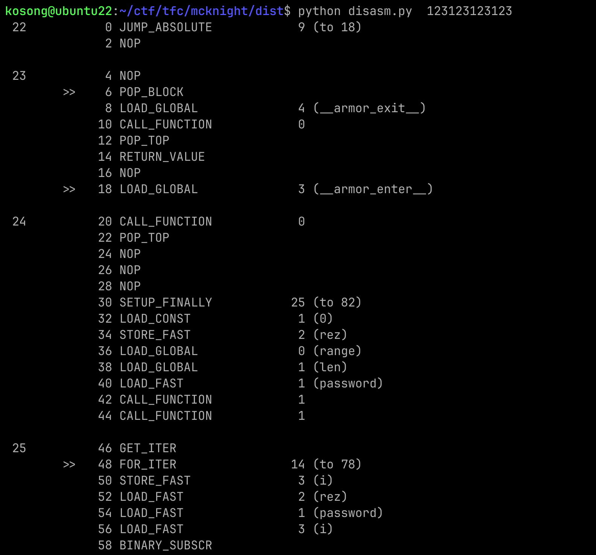<figcaption></figcaption></figure>

From image above we can see that we've sucessfully disassemble the calc\_line function!

Another approach that we can do is doing blackbox analysis by analyzing input output. If the code is not much complex we can do educated guess to know the algorithm. For example we know that there is loop in the code and there is usage of coeffs variable.

```python
import pprint
import dis

def print(x):
    pprint.pp("[X] Injected")
    pprint.pp(coeffs)
    for i in range(2):
        pprint.pp(calc_line(i, b"A"))
        pprint.pp(calc_line(i, b"B"))
        pprint.pp(calc_line(i, b"AB"))
        pprint.pp(calc_line(i, b"ABC"))

code = open('/home/kosong/ctf/tfc/re/mcknight/hasher.py','rb').read()
exec(code)
```

```python
[[203, 25, 183, 185, 103, 131, 156, 181, 12, 99, 166, 37, 160, 118, 75, 106, 39],
 [25, 183, 185, 103, 131, 156, 181, 12, 99, 166, 37, 160, 118, 75, 106, 39, 80],
 [183, 185, 103, 131, 156, 181, 12, 99, 166, 37, 160, 118, 75, 106, 39, 80, 1],
 [185, 103, 131, 156, 181, 12, 99, 166, 37, 160, 118, 75, 106, 39, 80, 1, 195],
 [103, 131, 156, 181, 12, 99, 166, 37, 160, 118, 75, 106, 39, 80, 1, 195, 92],
 [131, 156, 181, 12, 99, 166, 37, 160, 118, 75, 106, 39, 80, 1, 195, 92, 142],
 [156, 181, 12, 99, 166, 37, 160, 118, 75, 106, 39, 80, 1, 195, 92, 142, 239],
 [181, 12, 99, 166, 37, 160, 118, 75, 106, 39, 80, 1, 195, 92, 142, 239, 56],
 [12, 99, 166, 37, 160, 118, 75, 106, 39, 80, 1, 195, 92, 142, 239, 56, 84],
 [99, 166, 37, 160, 118, 75, 106, 39, 80, 1, 195, 92, 142, 239, 56, 84, 208],
 [166, 37, 160, 118, 75, 106, 39, 80, 1, 195, 92, 142, 239, 56, 84, 208, 251],
 [37, 160, 118, 75, 106, 39, 80, 1, 195, 92, 142, 239, 56, 84, 208, 251, 219],
 [160, 118, 75, 106, 39, 80, 1, 195, 92, 142, 239, 56, 84, 208, 251, 219, 5],
 [118, 75, 106, 39, 80, 1, 195, 92, 142, 239, 56, 84, 208, 251, 219, 5, 248],
 [75, 106, 39, 80, 1, 195, 92, 142, 239, 56, 84, 208, 251, 219, 5, 248, 172],
 [106, 39, 80, 1, 195, 92, 142, 239, 56, 84, 208, 251, 219, 5, 248, 172, 161],
 [39, 80, 1, 195, 92, 142, 239, 56, 84, 208, 251, 219, 5, 248, 172, 161, 105]]
13195
13398
14845
27106
1625
1650
13703
26098
```

Lets analyze each output

```python
0, A -> 13195 -> 203 * ord('A')
0, B -> 13398 -> 203 * ord('B')
0, AB -> 14845 -> 203 * ord('A') + 25 * ord('B')
0, ABC -> 27106 -> 203 * ord('A') + 25 * ord('B') + 183 * ord('C')
1, A -> 1625 -> 25 * ord('A')
1, B -> 1650 -> 25 * ord('B')
1, AB -> 13703 -> 25 * ord('A') + 183* ord('B')
1, ABC -> 26098 -> 25 * ord('A') + 183* ord('B') + 185 * ord('C')
```

The result from our educated guess is the operation from calc\_line is matrix multiplication so until this step we've been successfully reversed calc\_line function. But what about hash function? it will be harder than calc\_line since it call calc\_line function and again we need to do some educated guess for it.

#### Study Case: BlackHat MEA 2023 - Can you break the armor?

Given python file protected with pyarmor file with directory below

<figure>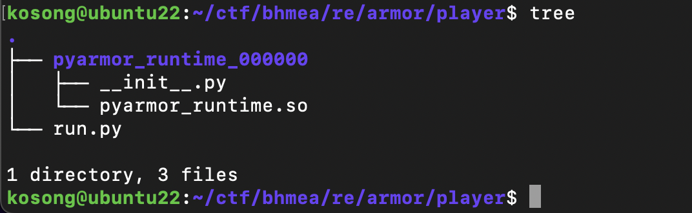<figcaption></figcaption></figure>

lf we run run.py it will give nothing, but if we use python run.py with argument it will show the output like below

<figure>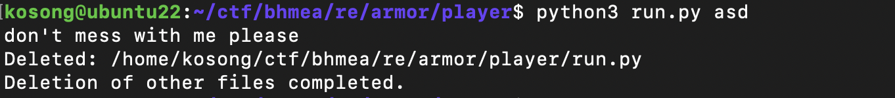<figcaption></figcaption></figure>

We can see that there is print function also called, so lets stomp it again.

```python
import pprint

def print(x):
    pprint.pp("[X] Injected")
    pprint.pp(globals())
    exit()

code = open('/home/kosong/ctf/bhmea/re/armor/player/run.py','rb').read()
exec(code)
```

Because there is self deletion we need to overcome it by calling exit at first print.&#x20;

<figure>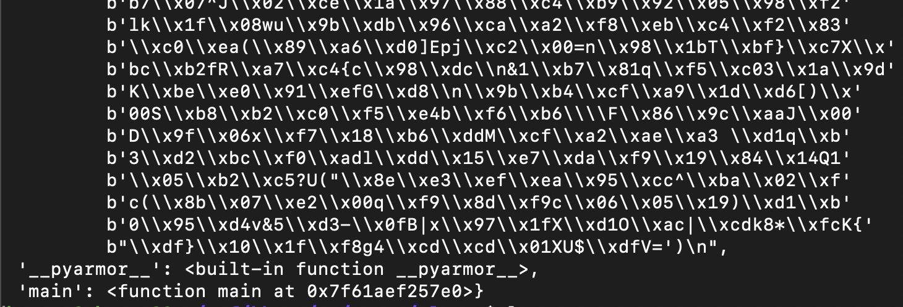<figcaption></figcaption></figure>

Looks like there is only main function, because we know that it will be failed if we disassembly the main function because it is protected with pyarmor lets gather some information from \`\_\_code\_\_\`.&#x20;

```python
import pprint
import dis

def print(x):
    pprint.pp("[X] Injected")
    pprint.pp(main.__code__.co_consts)
    exit()

code = open('/home/kosong/ctf/bhmea/re/armor/player/run.py','rb').read()
exec(code)
```

<figure>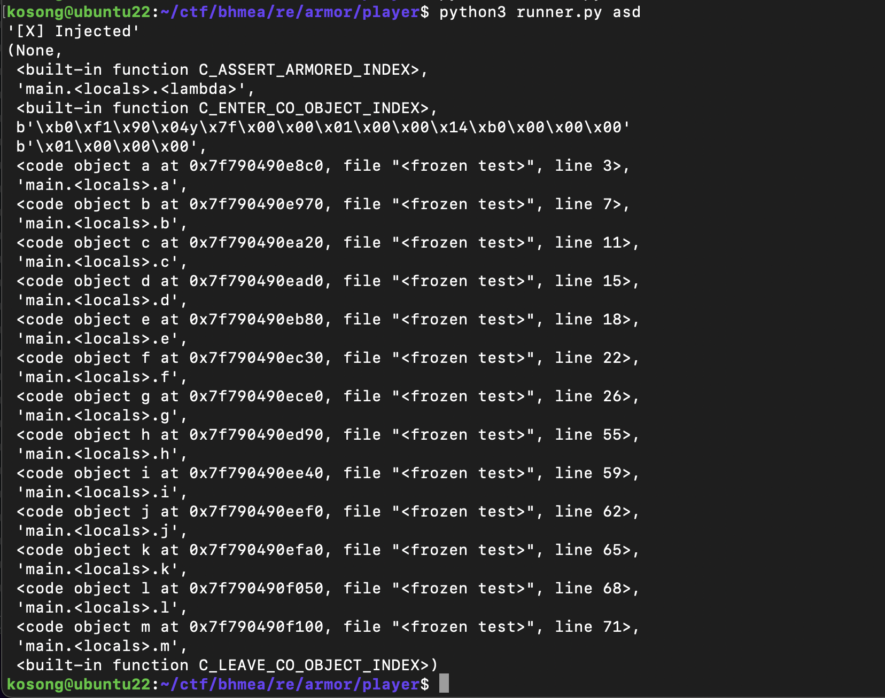<figcaption></figcaption></figure>

So looks like in this case there are many nested function inside main function, lets try to disassembly those nested functions.

```python
import pprint
import dis

def print(x):
    pprint.pp("[X] Injected")
    pprint.pp(dis.dis(main.__code__.co_consts[5]))
    exit()

code = open('/home/kosong/ctf/bhmea/re/armor/player/run.py','rb').read()
exec(code)
```

<figure>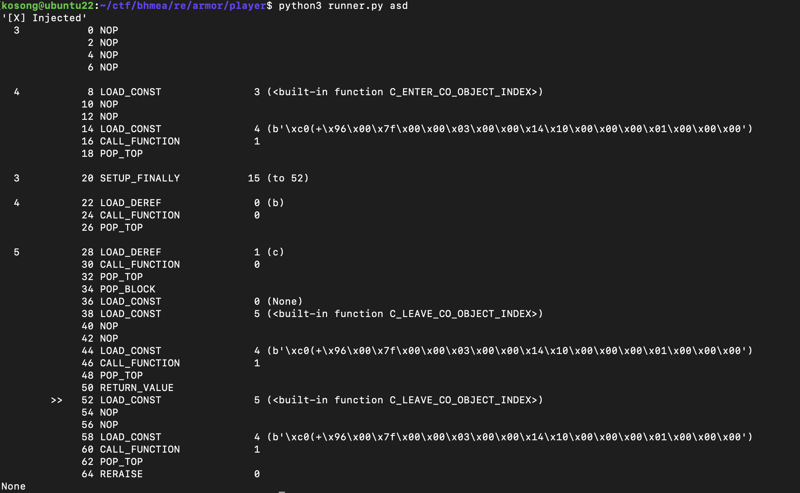<figcaption></figcaption></figure>

Looks like it successfully disassembled, that's mean that nested function inside main function in this case are not "obfuscated" although the main function is obfuscated, lets loop all the code object in co\_consts.

```python
import pprint
import dis

def print(x):
    pprint.pp("[X] Injected")
    for i in range(100):
        try:
            pprint.pp(dis.dis(main.__code__.co_consts[i]))
        except Exception as e:
            continue
    exit()

code = open('/home/kosong/ctf/bhmea/re/armor/player/run.py','rb').read()
exec(code)
```

<figure>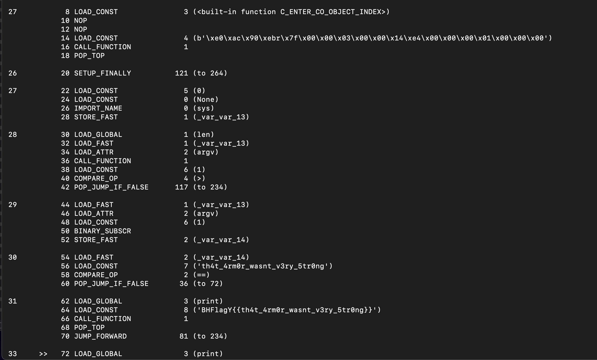<figcaption></figcaption></figure>

Nice, looks like until this step we've been successfully got the flag by disassembling nested function by looking at the constants.&#x20;

#### Testing on Windows

Is it this approach works on windows? yes it works. Let's try simple program protected by PyArmor

<figure>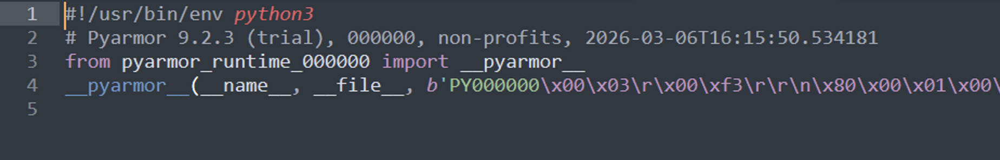<figcaption></figcaption></figure>

<figure>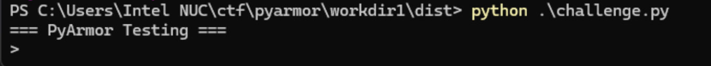<figcaption></figcaption></figure>

Then just create a script to replace python function as following

```python
import pprint
import dis
import sys

def print(x):
    pprint.pp("[X] Injected")
    pprint.pp(dis.dis(list(sys._current_frames().values())[0].f_back.f_code))

code = open('challenge.py','rb').read()
exec(code)
```

And we would see the disassembled code

<figure>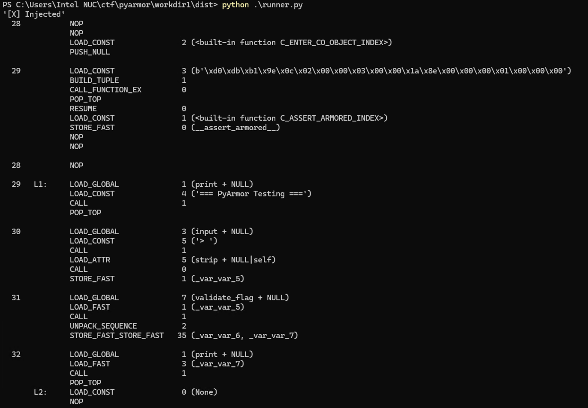<figcaption></figcaption></figure>

#### Testing on macOS

Is it this approach works on macOS? yes it works. Let's use the same code and obfuscate it with pyarmor on macOS.

<figure>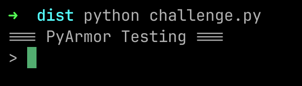<figcaption></figcaption></figure>

Create the same runner.py code

```python
import pprint
import dis
import sys

def print(x):
    pprint.pp("[X] Injected")
    pprint.pp(dis.dis(list(sys._current_frames().values())[0].f_back.f_code))

code = open('challenge.py','rb').read()
exec(code)
```

<figure>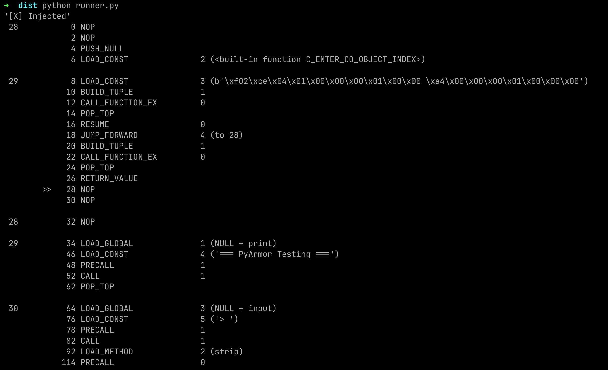<figcaption></figcaption></figure>

#### Further Exploration #1

Running `method 2` directly from PyArmor-Unpacker will be failed, but because we managed to get inside the protected code we can combine it with unpacker `method 2` from this [PyArmor-Unpacker](https://github.com/Svenskithesource/PyArmor-Unpacker/tree/main). By looking at the structure we can slightly modified the code so it will work with our runner.py

```python
import pprint
import dis
import inspect
import marshal
import os
import struct
import subprocess
import sys
import types
import typing
from functools import wraps
from pathlib import Path

import opcode

LOAD_GLOBAL = opcode.opmap["LOAD_GLOBAL"]
RETURN_OPCODE = opcode.opmap["RETURN_VALUE"].to_bytes(
    2, byteorder="little"
)  # Convert to bytes so it can be added to bytes easier later on
SETUP_FINALLY = opcode.opmap["SETUP_FINALLY"]
EXTENDED_ARG = opcode.opmap["EXTENDED_ARG"]
OPCODE_SIZE = 2  # can differ in older/newer versions
JUMP_FORWARD = opcode.opmap["JUMP_FORWARD"]

# All absolute jumps
JUMP_ABSOLUTE = opcode.opmap.get("JUMP_ABSOLUTE")
CONTINUE_LOOP = opcode.opmap.get("CONTINUE_LOOP")
POP_JUMP_IF_FALSE = opcode.opmap.get("POP_JUMP_IF_FALSE")
POP_JUMP_IF_TRUE = opcode.opmap.get("POP_JUMP_IF_TRUE")
JUMP_IF_FALSE_OR_POP = opcode.opmap.get("JUMP_IF_FALSE_OR_POP")
JUMP_IF_TRUE_OR_POP = opcode.opmap.get("JUMP_IF_TRUE_OR_POP")

absolute_jumps = [
    JUMP_ABSOLUTE,
    CONTINUE_LOOP,
    POP_JUMP_IF_FALSE,
    POP_JUMP_IF_TRUE,
    JUMP_IF_FALSE_OR_POP,
    JUMP_IF_TRUE_OR_POP,
]
# TODO more documentation

code_attrs = [  # ordered correctly by types.CodeType type creation
    "co_argcount",
    "co_posonlyargcount",
    "co_kwonlyargcount",
    "co_nlocals",
    "co_stacksize",
    "co_flags",
    "co_code",
    "co_consts",
    "co_names",
    "co_varnames",
    "co_filename",
    "co_name",
    "co_firstlineno",
    "co_lnotab",
    "co_freevars",
    "co_cellvars",
]

if sys.version_info.major < 3 or (
    sys.version_info.major == 3 and sys.version_info.minor < 8
):
    code_attrs.remove("co_posonlyargcount")

double_jump = (
    True if sys.version_info.major == 3 and sys.version_info.minor >= 10 else False
)


def get_magic():
    if sys.version_info >= (3, 4):
        from importlib.util import MAGIC_NUMBER

        return MAGIC_NUMBER
    else:
        import imp

        return imp.get_magic()


MAGIC_NUMBER = get_magic()


started_exiting = False


def calculate_extended_args(
    arg: int,
):  # This function will calculate the necessary extended_args needed
    """
    EXTENDED_ARG logic:
    - Its opcode shifts left by 8, and adds it to the next opcode
    - There are a maximum of 3 EXTENDED_ARGs for one opcode because
      the first of those will be shifted 3 times for a total of
      24 bits shifted. This fits exactly in the 32-bit integer boundaries.
    """
    extended_args = []
    new_arg = arg
    if arg > 255:
        extended_arg = arg >> 8
        while True:
            if extended_arg > 255:
                extended_args.append(extended_arg & 255)
                extended_arg >>= 8
            else:
                extended_args.append(extended_arg)
                extended_args.reverse() # reverse because we appended in the order
                                        # of most recent EXTENDED_ARG (the one closest to
                                        # the actual opcode) to the least recent EXTENDED_ARG
                                        # (the one farthest from the actual opcode)
                break

        new_arg = arg & 255
    return extended_args, new_arg


def execute_code_obj(obj: types.CodeType):
    def a():
        pass

    a.__code__ = obj

    number_of_regular_arguments = obj.co_argcount
    if sys.version_info.major > 3 or (
        sys.version_info.major == 3 and sys.version_info.minor > 7
    ):
        args = [i for i in range(obj.co_posonlyargcount)]
        number_of_regular_arguments -= obj.co_posonlyargcount
    else:
        args = []

    kwargs = {obj.co_varnames[-i]: i for i in range(obj.co_kwonlyargcount)}
    args.extend([i for i in range(number_of_regular_arguments - obj.co_kwonlyargcount)])

    try:
        a(*args, **kwargs)
    except:
        pass


def find_first_opcode(co: bytes, op_code: int):
    for i in range(0, len(co), 2):
        if co[i] == op_code:
            return i
    raise ValueError("Could not find the opcode")


def get_arg_bytes(co: bytes, op_code_index: int) -> bytearray:
    """
    This function calculate the argument of a call while considering the EXTENDED_ARG opcodes that may come before that
    """
    result = bytearray()
    result.append(co[op_code_index + 1])

    checked_opcode = op_code_index - 2
    while checked_opcode >= 0 and co[checked_opcode] == EXTENDED_ARG:
        result.insert(0, co[checked_opcode + 1])
        checked_opcode -= 2
    return result


def calculate_arg(co: bytes, op_code_index: int) -> int:
    return int.from_bytes(get_arg_bytes(co, op_code_index), "big")

def get_flags(flags):
    names = []
    for i in range(32):
        flag = 1<<i
        if flags & flag:
            names.append(flag)
            flags ^= flag
            if not flags:
                break

    return names

def flag_to_num(flags, exclude=[]):
    real = 0
    for flag in flags:
        if flag not in exclude:
            real ^= flag

    return real

def remove_async(flags: int) -> int:
    flag_lst = get_flags(flags)
    return flag_to_num(flag_lst, [128, 256, 512]) # all coroutine flags

def handle_under_armor(obj: types.CodeType):
    # TODO make handling EXTENDED_ARG a function
    i = find_first_opcode(obj.co_code, JUMP_FORWARD)
    jumping_arg = i + calculate_arg(obj.co_code, i)
    if double_jump:
        jumping_arg *= 2

    load_armor = jumping_arg + find_first_opcode(obj.co_code[jumping_arg:], LOAD_GLOBAL)

    pop_index = load_armor + 4

    obj = copy_code_obj(
        obj,
        co_code=obj.co_code[:pop_index] + RETURN_OPCODE + obj.co_code[pop_index + 2 :],
    )
    old_freevars = obj.co_freevars
    old_flags = obj.co_flags

    obj = copy_code_obj(obj, co_freevars=(), co_flags=remove_async(old_flags))

    try:
        execute_code_obj(obj)
    except Exception as e:
        pprint.pp(e)

    obj = copy_code_obj(obj, co_code=obj.co_code, co_freevars=old_freevars, co_flags=old_flags)

    new_names = tuple(n for n in obj.co_names if n != "__armor__")
    return copy_code_obj(obj, co_code=obj.co_code[:jumping_arg], co_names=new_names)


def output_code(obj):
    if isinstance(obj, types.CodeType):
        obj = copy_code_obj(
            obj,
            co_names=tuple(output_code(name) for name in obj.co_names),
            co_varnames=tuple(output_code(name) for name in obj.co_varnames),
            co_freevars=tuple(output_code(name) for name in obj.co_freevars),
            co_cellvars=tuple(output_code(name) for name in obj.co_cellvars),
            co_consts=tuple(output_code(name) for name in obj.co_consts),
        )

        # TODO I think there is a bug here because the prints are really weird.
        if "pytransform" in obj.co_freevars:
            #  obj.co_name not in ["<lambda>", 'check_obfuscated_script', 'check_mod_pytransform']:
            pass
        elif "__armor__" in obj.co_names:
            # TODO I don't know when a function uses __armor__ but we should find it and add tests
            obj = handle_under_armor(obj)

        elif "__armor_enter__" in obj.co_names:
            obj = handle_armor_enter(obj)
        else:
            pass
    return obj


def handle_armor_enter(obj: types.CodeType):

    load_enter_function = b"".join(
        i.to_bytes(1, byteorder="big")
        for i in [LOAD_GLOBAL, obj.co_names.index("__armor_enter__")]
    )
    pop_top_start = obj.co_code.find(load_enter_function) + 4

    load_exit_function = b"".join(
        i.to_bytes(1, byteorder="big")
        for i in [LOAD_GLOBAL, obj.co_names.index("__armor_exit__")]
    )
    fake_exit = obj.co_code.find(load_exit_function) - 2

    new_code = (
        obj.co_code[:pop_top_start] + RETURN_OPCODE + obj.co_code[pop_top_start + 2 :]
    )  # replace the pop_top after __pyarmor_enter__ to return
    old_freevars = obj.co_freevars
    old_flags = obj.co_flags

    obj = copy_code_obj(obj, co_code=new_code, co_freevars=(), co_flags=remove_async(old_flags))

    try:
        execute_code_obj(obj)
    except Exception as e:
        pprint.pp(e)

    obj = copy_code_obj(obj, co_code=obj.co_code, co_freevars=old_freevars, co_flags=old_flags)
    names = tuple(
        n for n in obj.co_names if not n.startswith("__armor")
    )  # remove the pyarmor functions
    raw_code = obj.co_code

    try_start = find_first_opcode(obj.co_code, SETUP_FINALLY)

    size = calculate_arg(obj.co_code, try_start)
    if double_jump:
        size *= 2
    raw_code = raw_code[: try_start + size]

    raw_code = raw_code[try_start + 2 :]
    raw_code += (
        RETURN_OPCODE  # add return # TODO this adds return none to everything? what?
    )

    raw_code = bytearray(raw_code)
    i = 0
    while i < len(raw_code):
        op = raw_code[i]
        if op in absolute_jumps:
            argument = calculate_arg(raw_code, i)

            while raw_code[i-2] == EXTENDED_ARG: # Remove the preceding extended arguments, we add our custom ones later on
                raw_code.pop(i-2) # opcode
                raw_code.pop(i-2) # arguments

                i -= 2
                op = raw_code[i]

            if double_jump:
                argument *= 2

            if argument == fake_exit:
                raw_code[i] = opcode.opmap[
                    "RETURN_VALUE"
                ]  # Got to use this because the variable is converted to bytes
                continue

            new_arg = argument - (try_start + 2)

            extended_args, new_arg = calculate_extended_args(new_arg)

            for extended_arg in extended_args:
                raw_code.insert(i, EXTENDED_ARG)
                raw_code.insert(
                    i + 1, extended_arg if not double_jump else extended_arg // 2
                )
                i += 2

            raw_code[i + 1] = new_arg if not double_jump else new_arg // 2

        i += 2

    raw_code = bytes(raw_code)

    return copy_code_obj(obj, co_names=names, co_code=raw_code)


def _pack_uint32(val):
    """Convert integer to 32-bit little-endian bytes"""
    return struct.pack("<I", val)


def code_to_bytecode(code, mtime=0, source_size=0):
    """
    Serialise the passed code object (PyCodeObject*) to bytecode as a .pyc file
    The args mtime and source_size are inconsequential metadata in the .pyc file.
    """

    # Add the magic number that indicates the version of Python the bytecode is for
    #
    # The .pyc may not decompile if this four-byte value is wrong. Either hardcode the
    # value for the target version (eg. b'\x33\x0D\x0D\x0A' instead of MAGIC_NUMBER)
    # or see trymagicnum.py to step through different values to find a valid one.
    data = bytearray(MAGIC_NUMBER)

    # Handle extra 32-bit field in header from Python 3.7 onwards
    # See: https://www.python.org/dev/peps/pep-0552
    if sys.version_info >= (3, 7):
        # Blank bit field value to indicate traditional pyc header
        data.extend(_pack_uint32(0))

    data.extend(_pack_uint32(int(mtime)))

    # Handle extra 32-bit field for source size from Python 3.2 onwards
    # See: https://www.python.org/dev/peps/pep-3147/
    if sys.version_info >= (3, 2):
        data.extend(_pack_uint32(source_size))

    data.extend(marshal.dumps(code))

    return data


def orig_or_new(func):
    sig = inspect.signature(func)
    kwarg_params = list(sig.parameters.keys())

    @wraps(func)
    def wrapee(orig, **kwargs):
        binding = sig.bind_partial(**kwargs)
        new_kwargs = binding.arguments
        for k in kwarg_params:
            if k not in new_kwargs:
                new_kwargs[k] = getattr(orig, k)
        return func(**new_kwargs)

    # add the original_object to the signature of the function
    orig_params = list(sig.parameters.values())
    orig_params.insert(
        0, inspect.Parameter("original_object", inspect.Parameter.POSITIONAL_ONLY)
    )
    sig.replace(parameters=orig_params)
    wrapee.__signature__ = sig
    return wrapee


def array_to_params(names_array):
    return [
        inspect.Parameter(name, inspect.Parameter.KEYWORD_ONLY, default=None)
        for name in names_array
    ]


def sig_from_array(names_array):
    def decor(f):
        sig = inspect.Signature(parameters=array_to_params(names_array))

        @wraps(f)
        def wrappe(**kwargs):
            bound = sig.bind(**kwargs)
            bound.apply_defaults()
            return f(**bound.kwargs)

        wrappe.__signature__ = sig
        return wrappe

    return decor


@orig_or_new
@sig_from_array(code_attrs)
def copy_code_obj(**kwargs):
    """
    create a copy of code object with different paramters.
    If a parameter is None then the default is the previous code object values
    """
    args = [kwargs[name] for name in code_attrs]
    return types.CodeType(*args)


def marshal_to_pyc(file_path: typing.Union[str, Path], code: types.CodeType):
    file_path = str(file_path)
    pyc_code = code_to_bytecode(code)
    with open(file_path, "wb") as f:
        f.write(pyc_code)


def print(x):
    pprint.pp("[X] Injected")
    for frame in sys._current_frames().values(): # runner.py
        frame = frame.f_back # <frozen>
    code = frame.f_code
    code = output_code(code)
    pprint.pp(code.co_filename)
    filename = code.co_filename.replace("<frozen ", "").replace(">", "")
    pprint.pp(filename)
    if filename.endswith(".pyc"):
        pass
    elif filename.endswith(".py"):
        filename += "c"
    else:
        filename += ".pyc"
    pprint.pp(filename)
    DUMP_DIR = Path("./dump")
    DUMP_DIR.mkdir(exist_ok=True)
    marshal_to_pyc(DUMP_DIR / filename, code)

tmp = open('/home/kosong/ctf/tfc/re/mcknight/hasher.py','rb').read()
exec(tmp)
```

Run code above and we will get dump/hasher.pyc, then use pycdc to decompile the code.

<figure>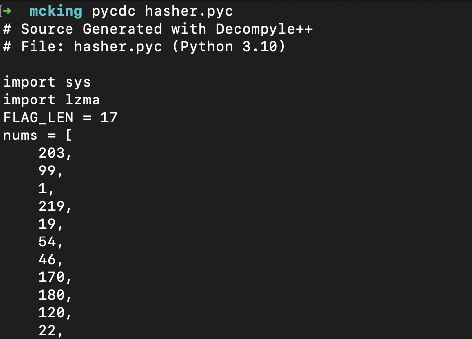<figcaption></figcaption></figure>

```python
# Source Generated with Decompyle++
# File: hasher.pyc (Python 3.10)

import sys
import lzma
FLAG_LEN = 17

nums = [ 203, 99, 1, 219, 19, 54, 46, 170, 180, 120, 22, 249, 236, 87, 27, 223, 81, 252, 232, 66, 241, 61, 235, 40, 217, 74, 145, 196, 7, 131, 75, 56, 105, 134, 48, 49, 149, 127, 73, 65, 70, 45, 53, 121, 198, 193, 207, 138, 32, 0, 132, 122, 10, 210, 189, 44, 164, 25, 166, 195, 5, 47, 157, 20, 119, 247, 199, 97, 152, 14, 148, 124, 123, 36, 30, 76, 58, 192, 110, 178, 175, 202, 155, 23, 50, 168, 156, 106, 84, 186, 197, 95, 140, 79, 43, 15, 244, 125, 205, 3, 234, 212, 13, 182, 233, 255, 71, 163, 254, 150, 26, 90, 33, 109, 183, 37, 92, 248, 167, 9, 173, 91, 107, 133, 253, 88, 31, 220, 153, 83, 55, 141, 62, 101, 28, 242, 112, 52, 89, 6, 17, 135, 211, 181, 39, 208, 209, 85, 158, 69, 137, 229, 93, 231, 226, 41, 114, 42, 215, 108, 68, 77, 18, 177, 246, 191, 64, 86, 190, 218, 102, 185, 160, 142, 172, 171, 237, 238, 245, 59, 146, 213, 151, 113, 139, 144, 230, 143, 98, 8, 194, 29, 221, 115, 34, 82, 11, 57, 78, 214, 12, 80, 251, 111, 184, 162, 224, 201, 4, 206, 204, 227, 38, 169, 130, 67, 116, 128, 35, 187, 51, 216, 126, 96, 147, 72, 100, 174, 103, 118, 239, 161, 188, 129, 240, 222, 16, 24, 243, 228, 165, 2, 200, 225, 104, 60, 21, 159, 117, 94, 176, 154, 250, 63, 179, 136]

def generator(cnt):
    coeffs = []
    for i in range(cnt):
        aux = []
        for j in range(cnt):
            aux.append(nums[(i + j) * 1337 % 256])
        coeffs.append(aux)
    return coeffs

coeffs = generator(FLAG_LEN)

def calc_line(k, password):
    rez = 0
    for i in range(len(password)):
        rez += password[i] * coeffs[k][i]
    return rez


def hash(password):
    password = password.encode()
    rez = []
    for i in range(FLAG_LEN):
        rez.append(calc_line(i, password))
    final = []
    for k in range(FLAG_LEN):
        aux = 0
        for i in range(FLAG_LEN):
            aux += coeffs[i][i] * rez[k] ** i
        final.append(aux)
    data = 'X'.join((lambda .0: [ str(i) for i in .0 ])(final))
    data = lzma.compress(data.encode())
    return data


def protect_pytransform():
    import pytransform
    
    def assert_builtin(func):
        type = ''.__class__.__class__
        builtin_function = type(''.join)
        if type(func) is not builtin_function:
            raise RuntimeError('%s() is not a builtin' % func.__name__)

    
    def check_obfuscated_script():
[1]    41468 segmentation fault  /Users/kosong/tools/pycdc/pycdc hasher.pyc
```

#### Further Exploration #2

After taking a look on method 3, this approach basically did the same approach with method 3 but by utilizing builtin function called by the protected code instead of hooking `marshal.loads` using `sysaudit` (sys.addaudithook). Looking at usage of sysaudit actually we can utilize it also as a helper for this approach, for example in context of tracing which libraries are imported or even which functions are imported.

```python
import os
import runpy
import sys

if __name__ == "__main__":
    if len(sys.argv) < 2:
        print("Usage: python3 tracer.py target.py args")
        exit()

    target = os.path.abspath(sys.argv[1])
    target_argv = [target] + sys.argv[2:]

    fd = os.open("audit.log", os.O_WRONLY | os.O_CREAT | os.O_TRUNC, 0o644)

    def hook(event, args):
        if event.startswith(("import", "exec", "compile")):
            line = f"{event} {args!r}\n".encode()
            os.write(fd, line)

    sys.addaudithook(hook)
    sys.argv = target_argv
    try:
        runpy.run_path(target, run_name="__main__")
    finally:
        os.close(fd)
```

<figure>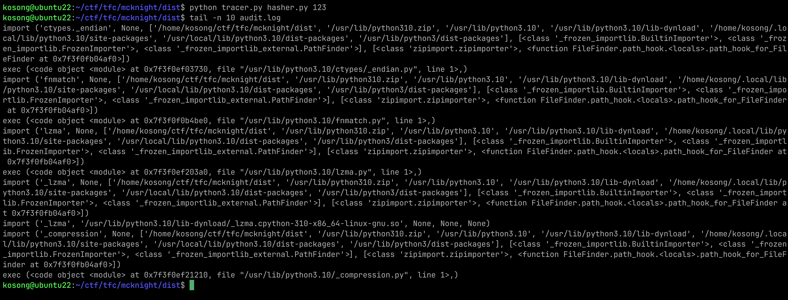<figcaption></figcaption></figure>

From image above we can see that there is no direct reference of "compress" function from lzma.py, basically because lzma.compress is high level but at least we know what libraries are imported.&#x20;

Looking at existing library, i found [py-spy](https://github.com/benfred/py-spy) which can be used to do this idea. So we can change the idea of "trying" all functions from imported library to finding specific function then only modify it.

```bash
sudo py-spy record --format speedscope -o profile.speedscope.json -- /usr/bin/python3.10 hasher.py 123
```

We got following output

```json
{"$schema":"https://www.speedscope.app/file-format-schema.json","profiles":[{"type":"sampled","name":"Thread 80562 \"MainThread\"","unit":"seconds","startValue":0.0,"endValue":0.25,"samples":[[3,2,1,0],[3,2,6,5,4],[3,2,6,5,4],[3,2,6,5,4],[3,2,6,5,4],[3,2,6,5,4],[3,2,6,5,4],[3,2,6,5,4],[3,2,6,5,4],[3,2,6,5,4],[3,2,6,5,4],[3,2,6,5,4],[3,2,6,5,4],[10,9,8,7],[10,9,8],[10,13,12,11],[10,13,12,11],[10,13,12,11],[10,13,12,11],[10,13,12,11],[10,13,12,11],[10,13,12,11],[10,13,12,11],[10,13,12,11],[10,13,12,11]],"weights":[0.01,0.01,0.01,0.01,0.01,0.01,0.01,0.01,0.01,0.01,0.01,0.01,0.01,0.01,0.01,0.01,0.01,0.01,0.01,0.01,0.01,0.01,0.01,0.01,0.01]}],"shared":{"frames":[{"name":"_load_library","file":"/home/kosong/ctf/tfc/mcknight/dist/pytransform/__init__.py","line":332,"col":null},{"name":"pyarmor_init","file":"/home/kosong/ctf/tfc/mcknight/dist/pytransform/__init__.py","line":355,"col":null},{"name":"pyarmor_runtime","file":"/home/kosong/ctf/tfc/mcknight/dist/pytransform/__init__.py","line":364,"col":null},{"name":"<module>","file":"/home/kosong/ctf/tfc/mcknight/dist/hasher.py","line":2,"col":null},{"name":"init_pytransform","file":"/home/kosong/ctf/tfc/mcknight/dist/pytransform/__init__.py","line":76,"col":null},{"name":"wrap","file":"/home/kosong/ctf/tfc/mcknight/dist/pytransform/__init__.py","line":58,"col":null},{"name":"pyarmor_init","file":"/home/kosong/ctf/tfc/mcknight/dist/pytransform/__init__.py","line":356,"col":null},{"name":"check_lib_pytransform","file":"<frozen hasher>","line":96,"col":null},{"name":"protect_pytransform","file":"<frozen hasher>","line":112,"col":null},{"name":"<module>","file":"<frozen hasher>","line":118,"col":null},{"name":"<module>","file":"/home/kosong/ctf/tfc/mcknight/dist/hasher.py","line":3,"col":null},{"name":"compress","file":"/usr/lib/python3.10/lzma.py","line":327,"col":null},{"name":"hash","file":"<frozen hasher>","line":48,"col":null},{"name":"<module>","file":"<frozen hasher>","line":116,"col":null}]},"activeProfileIndex":null,"exporter":"py-spy@0.4.1","name":"py-spy profile"}
```

Then just use speedscope to visualize those json and we can see that compress function from lzma.py is called!

<figure>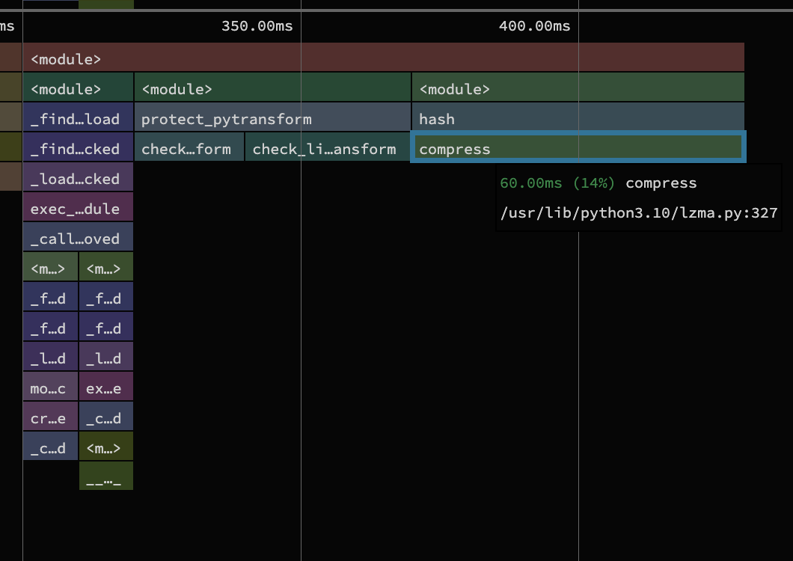<figcaption></figcaption></figure>

#### Further Exploration #3

Instead of changing the injected code every time we want to do update, actually we can spawn python interactive using pdb. For example as following

```python
import pprint
import pdb

def print(x):
    pprint.pp("[X] Injected")
    pdb.set_trace()

code = open('/home/kosong/ctf/tfc/mcknight/dist/hasher.py','rb').read()
exec(code)
```

Then we can just inspect the code at runtime.

<figure>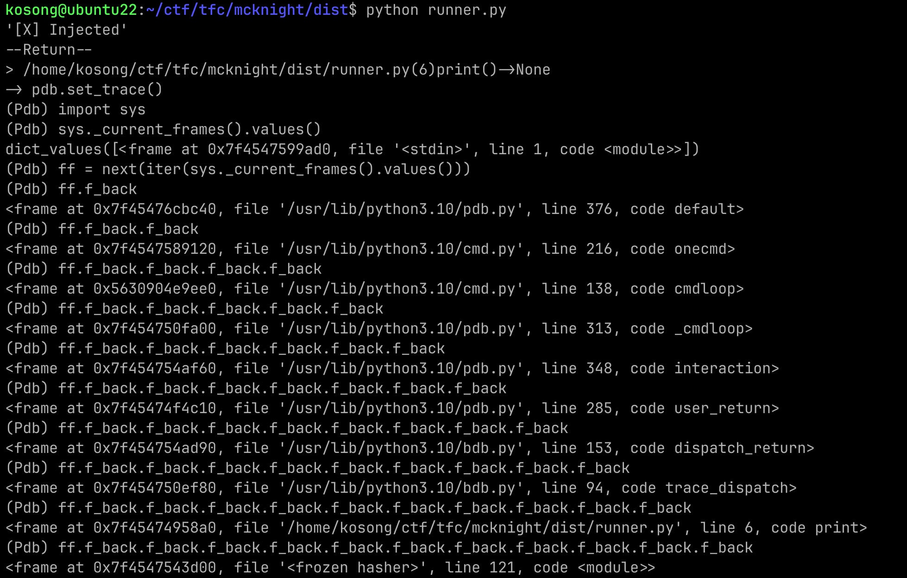<figcaption></figcaption></figure>

<figure>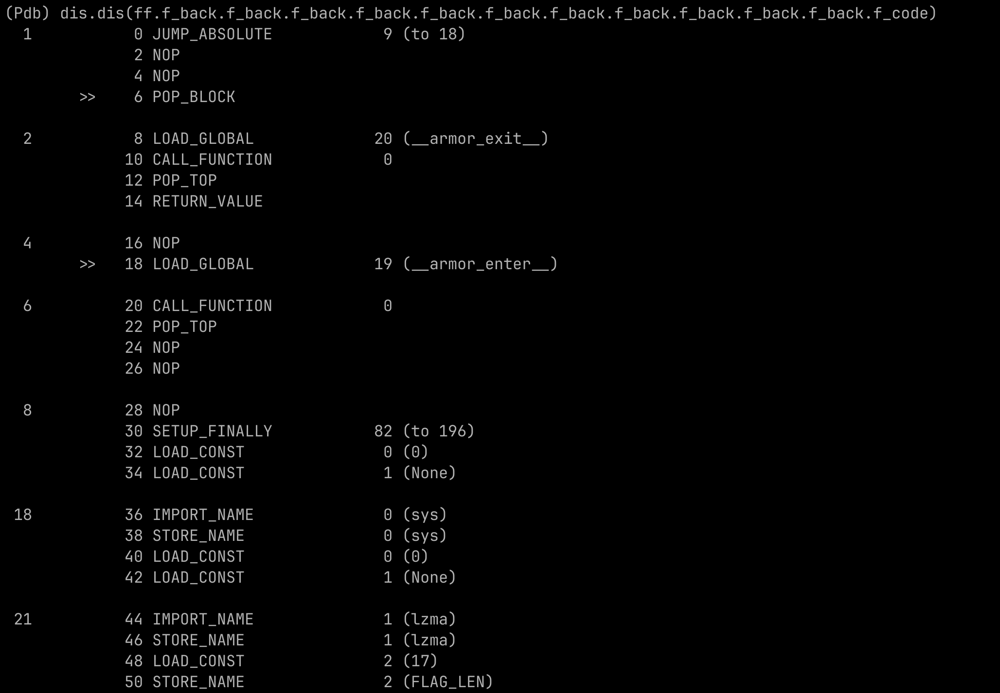<figcaption></figcaption></figure>

### Injecting Python Code during Runtime

#### Testing on Linux

Run the target code, then grep pid of that process.

<figure>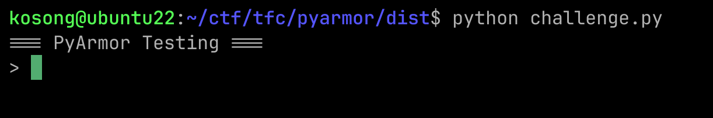<figcaption></figcaption></figure>

<figure><figcaption></figcaption></figure>

In this case, we will use tool named [hypno](https://github.com/kmaork/hypno).&#x20;

```python
from hypno import inject_py

pid = 79481
python_code = """
import dis,sys;dis.dis(list(sys._current_frames().values())[0].f_back.f_code)
"""
inject_py(pid, python_code)
```

<figure>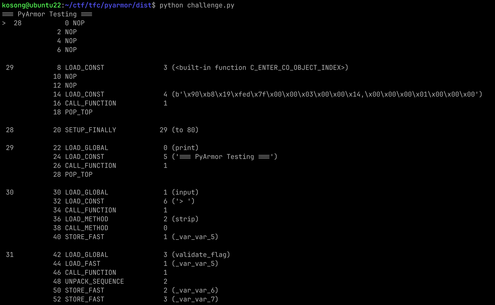<figcaption></figcaption></figure>

Then the injected code output will show in the running process, as we can see in image above that we've successfully disassembled the code. In README.md from hypno repository we can see that hypno also support macOS environment, so the same approach would be work for analyzing protected python apps in macOS.

### Modifying Python Executable

* Tested on: Linux

#### Study Case: TFCCTF 2024 - McKnight, Tracing Opcode

**---To Be Updated---**

#### Study Case: TFCCTF 2024 - McKnight, Dumping Object Code

**---To Be Updated---**

## Conclusion

**---To Be Updated---**

## References

* <https://github.com/Svenskithesource/PyArmor-Unpacker/tree/main>
* [https://github.com/levanvn/FLARE-ON9-Chal11\_Unpacking-Pyarmor](https://github.com/levanvn/FLARE-ON9-Chal11_Unpacking-Pyarmor?tab=readme-ov-file)
