# Reverse Engineering

| Challenge                         | Topic                                              |
| --------------------------------- | -------------------------------------------------- |
| [FCaaS](#fcaas-0-solve) (0 solve) | Staged ELF, Runtime Modification, Input Validation |

## FCaaS

### Description

Like usual flag checker. Nothing new, but now running as a service

### Solution

Given ELF bit file, then open it using IDA

<figure>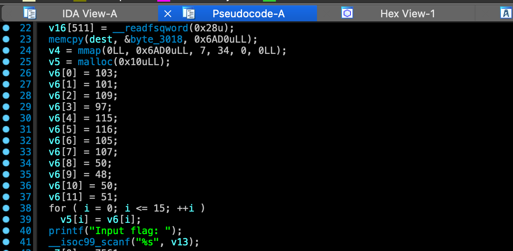<figcaption></figcaption></figure>

From the `main` function we can see that the program receive user input using `scanf` and store it on `v13`.

<figure>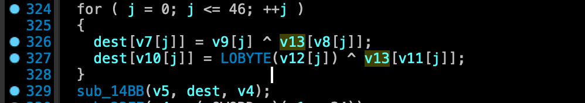<figcaption></figcaption></figure>

`v13` values are processed with xor operation and stored in `dest` variable. Function `sub_14bb` use dest variable as argument and when we dive on the function we can see that the function actually `RC4` algorithm

<figure>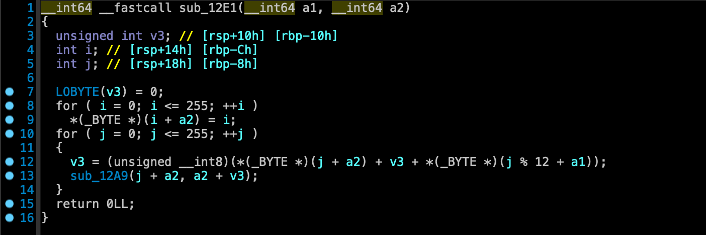<figcaption></figcaption></figure>

<figure>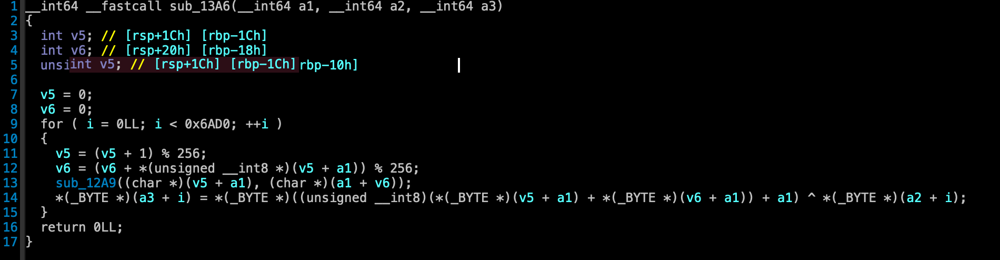<figcaption></figcaption></figure>

Since we know the key we can reimplement it on our main programming language, in this case i reimplement it on `python`.

<figure>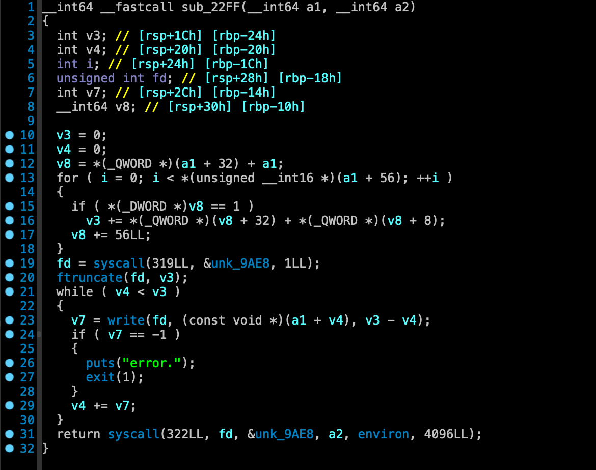<figcaption></figcaption></figure>

The last function called on main function is executing file located on memory, we can check the `syscall` on link below <https://github.com/torvalds/linux/blob/master/arch/x86/entry/syscalls/syscall_64.tbl>&#x20;

<figure>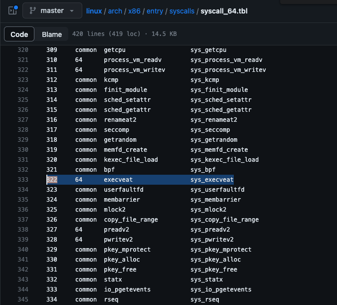<figcaption></figcaption></figure>

So actually the `RC4` algorithm used to decrypt the actual binary that validate the flag. Here is script i use to decrypt the binary

```python
def rc4(key, data):
    S = list(range(256))
    j = 0

    for i in range(256):
        j = (j + S[i] + key[i % len(key)]) % 256
        S[i], S[j] = S[j], S[i]

    i = j = 0
    result = []
    for byte in data:
        i = (i + 1) % 256
        j = (j + S[i]) % 256
        S[i], S[j] = S[j], S[i]
        t = (S[i] + S[j]) % 256
        result.append(byte ^ S[t])

    return bytes(result)

v6 = [0 for _ in range(12)]
v6[0] = 103;
v6[1] = 101;
v6[2] = 109;
v6[3] = 97;
v6[4] = 115;
v6[5] = 116;
v6[6] = 105;
v6[7] = 107;
v6[8] = 50;
v6[9] = 48;
v6[10] = 50;
v6[11] = 51;

v7 = [0 for _ in range(47)]
v8 = [0 for _ in range(47)]
v9 = [0 for _ in range(47)]
v10 = [0 for _ in range(47)]
v11 = [0 for _ in range(47)]
v12 = [0 for _ in range(47)]
v7[0] = 7561;
v7[1] = 9309;
v7[2] = 11821;
v7[3] = 6059;
v7[4] = 10569;
v7[5] = 9057;
v7[6] = 13325;
v7[7] = 10317;
v7[8] = 7061;
v7[9] = 10065;
v7[10] = 8059;
v7[11] = 12573;
v7[12] = 12073;
v7[13] = 9561;
v7[14] = 14073;
v7[15] = 16073;
v7[16] = 15823;
v7[17] = 15073;
v7[18] = 15571;
v7[19] = 11573;
v7[20] = 5057;
v7[21] = 12821;
v7[22] = 13073;
v7[23] = 5557;
v7[24] = 8307;
v7[25] = 7809;
v7[26] = 7311;
v7[27] = 10817;
v7[28] = 8555;
v7[29] = 11067;
v7[30] = 13821;
v7[31] = 14573;
v7[32] = 9815;
v7[33] = 13573;
v7[34] = 14323;
v7[35] = 6311;
v7[36] = 12325;
v7[37] = 15323;
v7[38] = 11321;
v7[39] = 8807;
v7[40] = 6813;
v7[41] = 5305;
v7[42] = 6561;
v7[43] = 16325;
v7[44] = 5809;
v7[45] = 4809;
v7[46] = 14823;
v8[0] = 11;
v8[1] = 18;
v8[2] = 28;
v8[3] = 5;
v8[4] = 23;
v8[5] = 17;
v8[6] = 34;
v8[7] = 22;
v8[8] = 9;
v8[9] = 21;
v8[10] = 13;
v8[11] = 31;
v8[12] = 29;
v8[13] = 19;
v8[14] = 37;
v8[15] = 45;
v8[16] = 44;
v8[17] = 41;
v8[18] = 43;
v8[19] = 27;
v8[20] = 1;
v8[21] = 32;
v8[22] = 33;
v8[23] = 3;
v8[24] = 14;
v8[25] = 12;
v8[26] = 10;
v8[27] = 24;
v8[28] = 15;
v8[29] = 25;
v8[30] = 36;
v8[31] = 39;
v8[32] = 20;
v8[33] = 35;
v8[34] = 38;
v8[35] = 6;
v8[36] = 30;
v8[37] = 42;
v8[38] = 26;
v8[39] = 16;
v8[40] = 8;
v8[41] = 2;
v8[42] = 7;
v8[43] = 46;
v8[44] = 4;
v8[45] = 0;
v8[46] = 40;
v9[0] = 165;
v9[1] = 232;
v9[2] = 233;
v9[3] = 1;
v9[4] = 194;
v9[5] = 47;
v9[6] = 170;
v9[7] = 71;
v9[8] = 129;
v9[9] = 182;
v9[10] = 107;
v9[11] = 130;
v9[12] = 219;
v9[13] = 12;
v9[14] = 71;
v9[15] = 224;
v9[16] = 54;
v9[17] = 172;
v9[18] = 188;
v9[19] = 138;
v9[20] = 7;
v9[21] = 123;
v9[22] = 111;
v9[23] = 187;
v9[24] = 45;
v9[25] = 182;
v9[26] = 133;
v9[27] = 64;
v9[28] = 87;
v9[29] = 115;
v9[30] = 227;
v9[31] = 19;
v9[32] = 208;
v9[33] = 188;
v9[34] = 70;
v9[35] = 151;
v9[36] = 58;
v9[37] = 254;
v9[38] = 114;
v9[39] = 31;
v9[40] = 189;
v9[41] = 125;
v9[42] = 137;
v9[43] = 157;
v9[44] = 234;
v9[45] = 26;
v9[46] = 197;
v10[0] = 4910;
v10[1] = 5158;
v10[2] = 5406;
v10[3] = 5660;
v10[4] = 5910;
v10[5] = 6160;
v10[6] = 6412;
v10[7] = 6664;
v10[8] = 6914;
v10[9] = 7162;
v10[10] = 7412;
v10[11] = 7662;
v10[12] = 7910;
v10[13] = 8160;
v10[14] = 8408;
v10[15] = 8656;
v10[16] = 8908;
v10[17] = 9160;
v10[18] = 9412;
v10[19] = 9662;
v10[20] = 9918;
v10[21] = 10166;
v10[22] = 10418;
v10[23] = 10670;
v10[24] = 10918;
v10[25] = 11170;
v10[26] = 11424;
v10[27] = 11674;
v10[28] = 11922;
v10[29] = 12174;
v10[30] = 12426;
v10[31] = 12674;
v10[32] = 12922;
v10[33] = 13163;
v10[34] = 13426;
v10[35] = 13674;
v10[36] = 13922;
v10[37] = 14174;
v10[38] = 14424;
v10[39] = 14676;
v10[40] = 14926;
v10[41] = 15174;
v10[42] = 15424;
v10[43] = 15672;
v10[44] = 15924;
v10[45] = 16176;
v10[46] = 16428;
v11[0] = 37;
v11[1] = 34;
v11[2] = 43;
v11[3] = 46;
v11[4] = 41;
v11[5] = 18;
v11[6] = 44;
v11[7] = 42;
v11[8] = 45;
v11[9] = 22;
v11[10] = 19;
v11[11] = 31;
v11[12] = 7;
v11[13] = 9;
v11[14] = 27;
v11[15] = 40;
v11[16] = 0;
v11[17] = 17;
v11[18] = 1;
v11[19] = 6;
v11[20] = 32;
v11[21] = 20;
v11[22] = 38;
v11[23] = 23;
v11[24] = 4;
v11[25] = 29;
v11[26] = 2;
v11[27] = 14;
v11[28] = 36;
v11[29] = 13;
v11[30] = 12;
v11[31] = 39;
v11[32] = 24;
v11[33] = 8;
v11[34] = 25;
v11[35] = 3;
v11[36] = 26;
v11[37] = 21;
v11[38] = 5;
v11[39] = 35;
v11[40] = 16;
v11[41] = 15;
v11[42] = 11;
v11[43] = 33;
v11[44] = 30;
v11[45] = 10;
v11[46] = 28;
v12[0] = 121;
v12[1] = 255;
v12[2] = 199;
v12[3] = 153;
v12[4] = 77;
v12[5] = 143;
v12[6] = 20;
v12[7] = 12;
v12[8] = 47;
v12[9] = 63;
v12[10] = 47;
v12[11] = 111;
v12[12] = 149;
v12[13] = 229;
v12[14] = 224;
v12[15] = 211;
v12[16] = 140;
v12[17] = 92;
v12[18] = 252;
v12[19] = 124;
v12[20] = 200;
v12[21] = 33;
v12[22] = 116;
v12[23] = 118;
v12[24] = 25;
v12[25] = 234;
v12[26] = 59;
v12[27] = 7;
v12[28] = 33;
v12[29] = 193;
v12[30] = 151;
v12[31] = 70;
v12[32] = 242;
v12[33] = 179;
v12[34] = 255;
v12[35] = 244;
v12[36] = 204;
v12[37] = 39;
v12[38] = 163;
v12[39] = 224;
v12[40] = 126;
v12[41] = 117;
v12[42] = 216;
v12[43] = 70;
v12[44] = 249;
v12[45] = 213;
v12[46] = 76;

# input
v13 = b"gemastik{AAAAAAAAAAAAAAAAAAAAAAAAAAAAAAAAAAAAA}"

dest = list(bytes.fromhex(""))

for j in range(47):
    dest[v7[j]] = v9[j] ^ v13[v8[j]]
    dest[v10[j]] = v12[j] ^ v13[v11[j]]

pt = rc4(v6, dest)

out = open("newbin", "wb")
out.write(pt)
out.close()
```

<figure>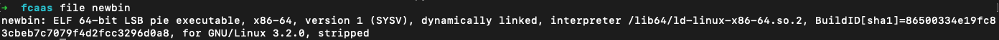<figcaption></figcaption></figure>

Running the new elf we can see that there is no output but we can confirm that it is valid `elf`

<figure>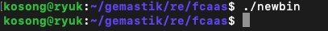<figcaption></figcaption></figure>

Now the question is how can the binary validate the flag? and where is our input stored?

<figure>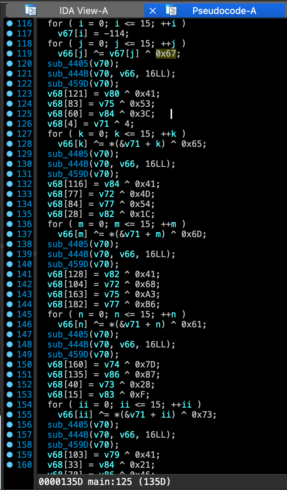<figcaption></figcaption></figure>

<figure>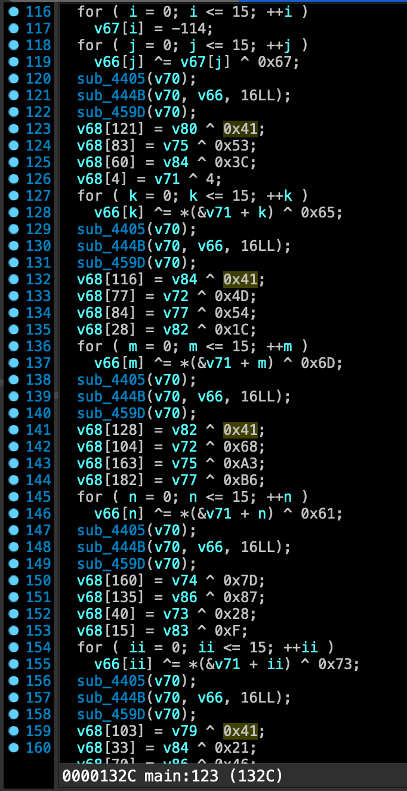<figcaption></figcaption></figure>

When we decompile the new binary we can see that there are some values that looks like our input which is `gemastik2023{AA...AA}.` Take a look on assembly code we can see that `0x67` or g stored on address `0x12c9`

<figure>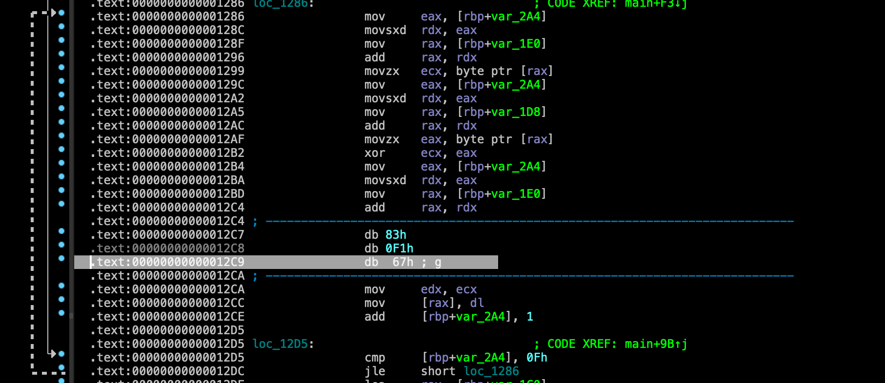<figcaption></figcaption></figure>

On initial binary, we found the same value (`0x12c9` or `4809`)

<figure>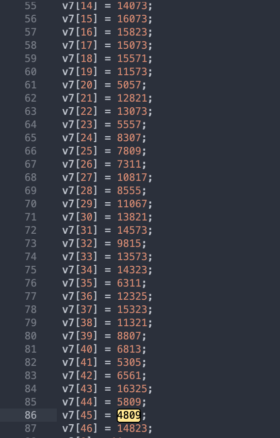<figcaption></figcaption></figure>

<figure>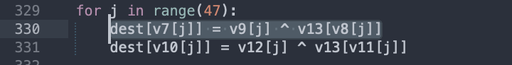<figcaption></figcaption></figure>

and we can confirm that `v8[45]` value is `0`, so line `330` with `j  =` `45` produce `dest[3809] = v9[0] ^ v13[0]`. Line `331` do the same thing but with different value which is `dest[16176] = v13[10]^v12[9]`. Checking value on address `16176` or `0x3f30` on new binary we found that it also store constant (`0x41`)

<figure>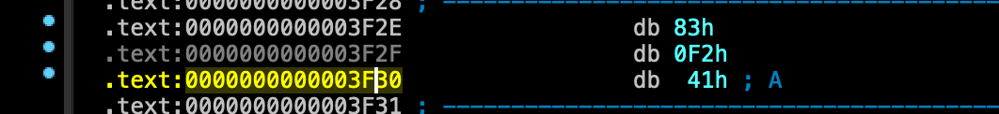<figcaption></figcaption></figure>

Now we know how is our input stored in second binary. So the next step is understanding how the second binary validate our input.

<figure>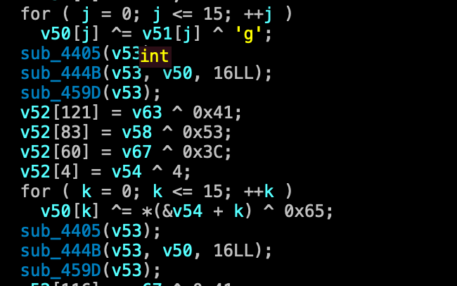<figcaption></figcaption></figure>

So actually there are 3 functions that process our input, so take a look on each function.

<figure>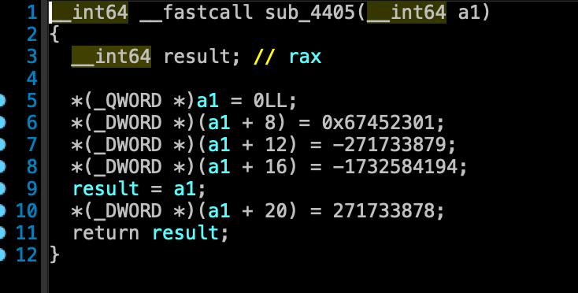<figcaption></figcaption></figure>

<figure>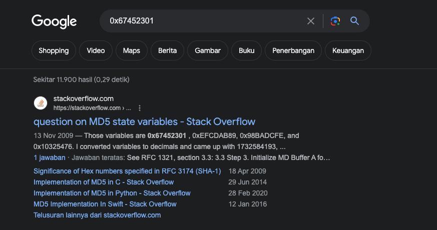<figcaption></figcaption></figure>

<figure>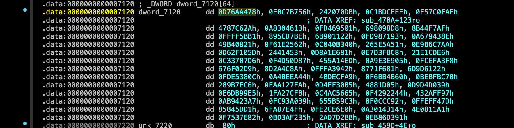<figcaption></figcaption></figure>

From the constant stored on each function we can confirm that those 3 function generate `md5` hash. After knowing all functions we can rewrite flow like below

```c
...
for ( j = 0; j <= 15; ++j )
    result[j] ^= init[j] ^ input[x1];
v55 = md5(result);
check[a] = v54[b] ^ input[x2];
check[c] = v54[d] ^ e;
check[f] = v54[g] ^ h;
check[i] = v54[j] ^ k;

for ( j = 0; j <= 15; ++j )
    result[j] ^= v54[j] ^ input[x3];
...
```

We know all the variable values except the input. So basically we can bruteforce each byte by validating with `md5` result stored in check variable (each input can be validated with `3 bytes` hash). After getting valid input on index `x1` we can recover another value on index `x2` and so on. Here is final script to recover the flag by bruteforcing

```python
import hashlib
import string

def get_hash(a1, a2):
	tmp = []
	for i in range(len(a1)):
		tmp.append(a1[i] ^ a2)
	return hashlib.md5(bytes(tmp)).digest(), tmp

def xor_op(a1, a2):
	tmp = []
	for i in range(len(a1)):
		tmp.append(a1[i]^a2[i])
	return tmp

known = b"gemastik{"

index_flag = [37, 34, 43, 46, 41, 18, 44, 42, 45, 22, 19, 31, 7, 9, 27, 40, 0, 17, 1, 6, 32, 20, 38, 23, 4, 29, 2, 14, 36, 13, 12, 39, 24, 8, 25, 3, 26, 21, 5, 35, 16, 15, 11, 33, 30, 10, 28]
index_digest = [[9, 4, 13, 0], [13, 1, 6, 11], [11, 1, 4, 6], [3, 15, 2, 12], [8, 13, 15, 10], [5, 8, 15, 9], [6, 14, 0, 1], [0, 12, 15, 1], [8, 15, 12, 9], [0, 14, 15, 7], [12, 5, 15, 7], [11, 9, 8, 2], [5, 2, 11, 1], [10, 6, 3, 15], [13, 2, 6, 3], [6, 8, 7, 14], [9, 13, 11, 12], [12, 11, 9, 2], [7, 0, 5, 4], [13, 0, 4, 2], [3, 10, 4, 11], [14, 13, 3, 12], [9, 3, 12, 5], [15, 0, 8, 6], [14, 0, 11, 7], [4, 2, 12, 14], [5, 11, 6, 8], [12, 5, 4, 9], [14, 1, 7, 5], [0, 15, 14, 2], [13, 9, 2, 12], [15, 9, 2, 13], [4, 9, 11, 10], [14, 5, 0, 3], [10, 2, 5, 9], [5, 2, 7, 14], [0, 1, 4, 2], [1, 2, 8, 0], [9, 5, 15, 13], [10, 8, 12, 0], [13, 4, 5, 8], [5, 0, 6, 11], [8, 10, 14, 1], [1, 9, 11, 6], [7, 4, 12, 0], [9, 14, 15, 6], [9, 4, 12, 2]]
index_result = [121, 83, 60, 4, 116, 77, 84, 28, 128, 104, 163, 182, 160, 135, 40, 15, 103, 33, 70, 156, 8, 142, 147, 53, 127, 120, 174, 54, 149, 68, 76, 134, 45, 2, 57, 107, 73, 9, 58, 168, 27, 43, 167, 38, 17, 80, 112, 75, 125, 85, 82, 183, 99, 87, 26, 34, 20, 18, 51, 106, 59, 161, 150, 101, 110, 86, 44, 137, 154, 29, 146, 56, 138, 166, 100, 113, 69, 145, 186, 184, 159, 22, 66, 109, 55, 170, 63, 132, 117, 181, 122, 131, 32, 25, 6, 50, 119, 148, 31, 78, 158, 36, 171, 187, 162, 47, 92, 172, 114, 118, 94, 35, 64, 16, 139, 151, 12, 175, 177, 62, 5, 46, 3, 1, 7, 126, 97, 115, 67, 108, 179, 185, 0, 144, 140, 136, 81, 88, 41, 37, 30, 61, 48, 10, 74, 130, 96, 176, 91, 178, 19, 13, 93, 152, 105, 98, 165, 90, 49, 14, 141, 102, 95, 124, 89, 71, 164, 72, 11, 123, 23, 21, 65, 173, 143, 79, 111, 153, 39, 24, 133, 129, 52, 42, 180, 157, 155, 169]
check = [0xc3, 0x5f, 0x71, 0x9f, 0x9c, 0x9a, 0x1e, 0xd5, 0x6b, 0x66, 0xfd, 0xb2, 0xb1, 0x24, 0x97, 0xd1, 0x71, 0xae, 0xf1, 0xc2, 0xa2, 0xc8, 0xab, 0x68, 0xb8, 0x1f, 0x5, 0x9b, 0x5c, 0xb3, 0x26, 0xe8, 0x8e, 0x8b, 0x9c, 0x9d, 0x5c, 0x90, 0x4c, 0x43, 0x7a, 0xb9, 0x3, 0xca, 0x45, 0x6b, 0xa1, 0x4d, 0x72, 0x6d, 0x52, 0x5d, 0x18, 0x7a, 0x74, 0x3f, 0xb2, 0x8d, 0x32, 0xcf, 0x91, 0xf6, 0xff, 0x4a, 0xd0, 0x7, 0x58, 0x63, 0xa7, 0xad, 0x22, 0x5e, 0x1d, 0xb7, 0x80, 0x96, 0xbf, 0xfa, 0x49, 0x9c, 0x6d, 0xf8, 0xec, 0xb9, 0x92, 0x3f, 0xea, 0xa3, 0x1a, 0x7c, 0xa5, 0xf8, 0x5d, 0x8b, 0x7b, 0xaf, 0x13, 0x96, 0x6a, 0xbe, 0x14, 0x32, 0x7f, 0x38, 0x30, 0x9, 0x40, 0xec, 0xea, 0x96, 0x6a, 0xaa, 0x8d, 0xa2, 0xb4, 0xa2, 0x1a, 0x32, 0x15, 0x52, 0xd2, 0x18, 0xab, 0x18, 0x69, 0x44, 0x29, 0xe5, 0x99, 0x3a, 0xb7, 0xe1, 0x95, 0xb5, 0x8f, 0x80, 0x6d, 0x9c, 0x76, 0xc5, 0x4b, 0x4a, 0x3, 0xc, 0xbc, 0xb4, 0x97, 0xad, 0xf1, 0x5c, 0x97, 0xf6, 0x8f, 0x80, 0xda, 0x20, 0x14, 0x19, 0xe0, 0x74, 0x3b, 0x4e, 0x93, 0xa0, 0x46, 0x6f, 0xca, 0xf1, 0xed, 0x46, 0xef, 0x21, 0xda, 0x74, 0x82, 0xb5, 0xd9, 0x92, 0x1f, 0x35, 0x50, 0x45, 0x5a, 0x9b, 0xd4, 0x36, 0x7c, 0x8e]

flag = [0 for _ in range(47)]

for i in range(len(known)):
	flag[i] = known[i]

leaked_hash = b"\x8e" * 16

last_pt = xor_op(b"\x00"*16, leaked_hash)

for i in range(len(known)):
	hash_val, xor_val = get_hash(last_pt, flag[i])
	flag[index_flag[i]] = hash_val[index_digest[i][0]] ^ check[index_result[i*4]]
	last_pt = xor_op(xor_val, hash_val)


for i in range(len(known), 47):
	if(flag[i] == 0):
		for j in string.printable[:-6]:
			hash_val, xor_val = get_hash(last_pt, ord(j))	
			tmp = [(hash_val[index_digest[i][1]] ^ index_result[i*4 + 1] == check[index_result[i*4 + 1]])]
			tmp.append((hash_val[index_digest[i][2]] ^ index_result[i*4 + 2] == check[index_result[i*4 + 2]]))
			tmp.append((hash_val[index_digest[i][3]] ^ index_result[i*4 + 3] == check[index_result[i*4 + 3]]))
			if(all(tmp) == True):
				flag[index_flag[i]] = hash_val[index_digest[i][0]] ^ check[index_result[i*4]]
				flag[i] = ord(j)
				last_pt = xor_op(xor_val, hash_val)
				print(i, bytes(flag))
				break
	else:
		hash_val, xor_val = get_hash(last_pt, flag[i])
		last_pt = xor_op(xor_val, hash_val)

print(bytes(flag))
```

Flag : gemastik{you\_know\_the\_pattern\_you\_got\_the\_flag}
