# Reverse Engineering

<!-- challenge-index: 3e27473959359a58 -->

| Challenge | Topic |
| --- | --- |
| [WASM ROLL (228 pts)🥇](#wasm-roll-228-pts) | WebAssembly, Decompilation |
| [Takeshi's Castle (500 pts)🥇](#takeshis-castle-500-pts) | Anti-Debugging, Path Finding |

<!-- /challenge-index -->

## WASM ROLL (228 pts)

### Description

\-

### Solution

Diberikan akses ke sebuah website , dimana dibuat menggunakan wasm. Jadi saya ubah ke c untuk lebih mudahnya dengan wasm2c.

<figure>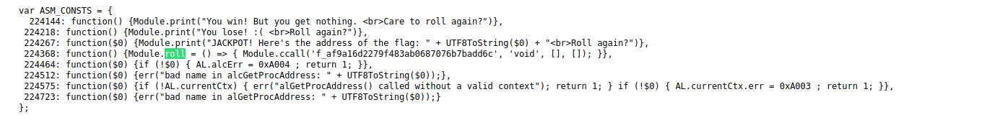<figcaption></figcaption></figure>

Module.roll memangil fungsi f\_af9a16d2279f483ab0687076b7badd6c . Jadi cari fungsi tersebut di wasm.

<figure>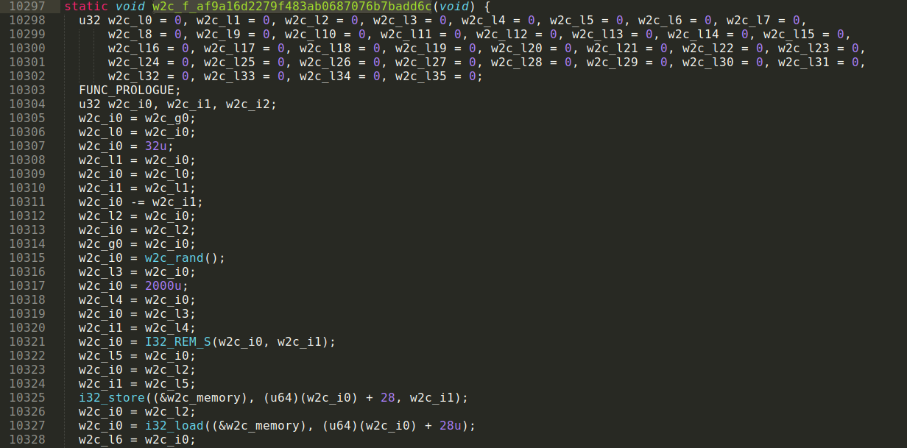<figcaption></figcaption></figure>

Setelah saya lakukan debugging pada browser , intinya dia bakal melakukan pengecekan terhadap rand()%2000 , jika sesuai maka dijalankanlah suatu fungsi w2c\_f405 . Sempat stuck karena berusaha mencari cara untuk mengubah local variable pada browser ternyata tidak bisa. Jadi pakai solusi lain , yaitu patching terhadap wasm. Ubah ke wat , patch , konvert ke wasm lagi. Disini saya melakukan patching yang membuat fungsi 405 dijalankan apapun hasilnya

<figure>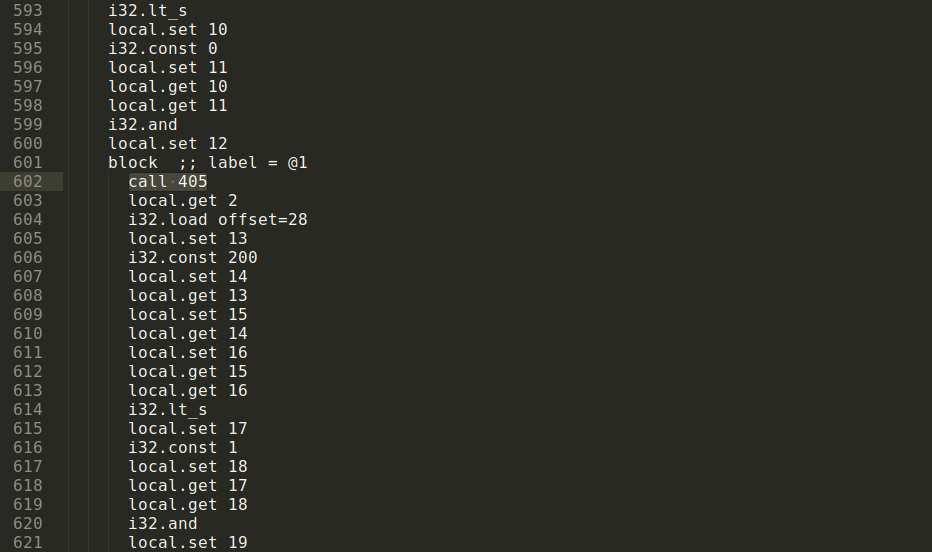<figcaption></figcaption></figure>

Selanjutnya setup http server lalu buka file html di lokal yang melakukan load terhadap patched wasm. Breakpoint pada instruksi setelah call 405 dan didapatkan address dari flag, disini sempet stuck lagi karena chrome terbaru ga bisa liat memory , jadinya downgrade dan bisa dapat flagnya.

<figure>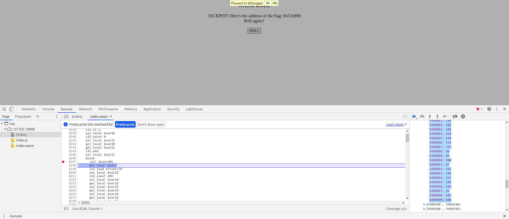<figcaption></figcaption></figure>

<figure>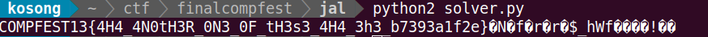<figcaption></figcaption></figure>

Flag : COMPFEST13{4H4\_4N0tH3R\_0N3\_0F\_tH3s3\_4H4\_3h3\_b7393a1f2e}

## Takeshi's Castle (500 pts)

### Description

\-

### Solution

Diberikan file elf 64 bit , selanjutnya kami lakukan decompile

<figure>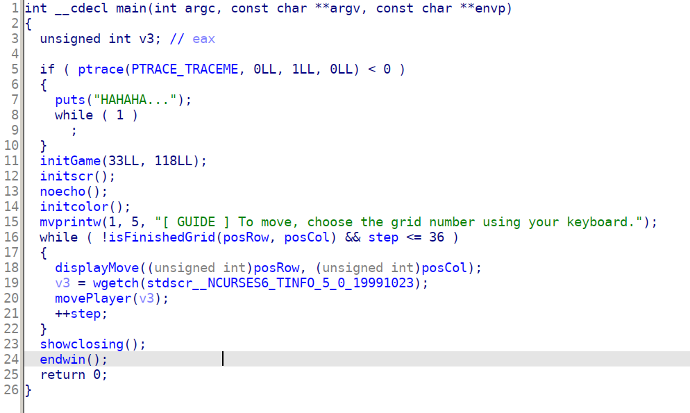<figcaption></figcaption></figure>

Terdapat pengecekan debugger di awal yaitu menggunakan ptrace , bypass pengecekan tersebut dengan fake library.&#x20;

```c
long ptrace(int request, int pid, void *addr, void *data) {
    return 0;
}
```

Ketika saya coba run programnya , hasilnya sama persis dengan judul , yaitu benteng takeshi.&#x20;

<figure>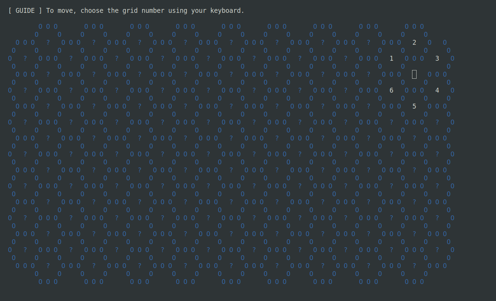<figcaption></figcaption></figure>

Jadi kemungkinan perpindahan yang bisa kita lakukan yaitu 1,2,3,4,5,6 . Tujuan dari kita sendiri ada di baris 18 kolom -2 . Berikut saya tandai X

<figure>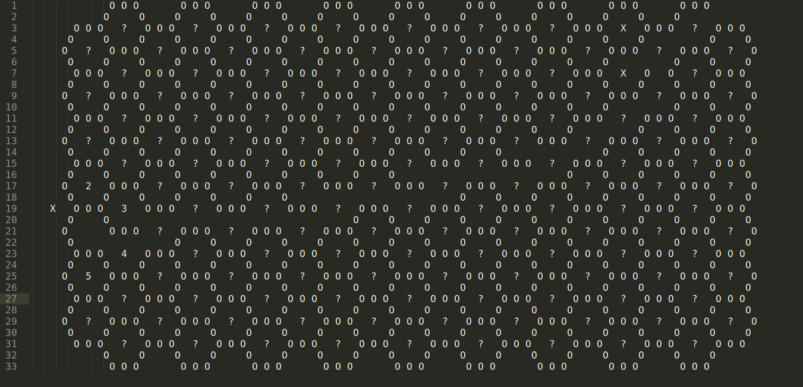<figcaption></figcaption></figure>

Di awal saya coba lakukan patching terhadap fungsi yang memanggil meet demon , gampangnya ketika menghasilkan meet demon maka dia akan diam di tempat. Kode yang saya ubah ada di address 0x221C.

<figure>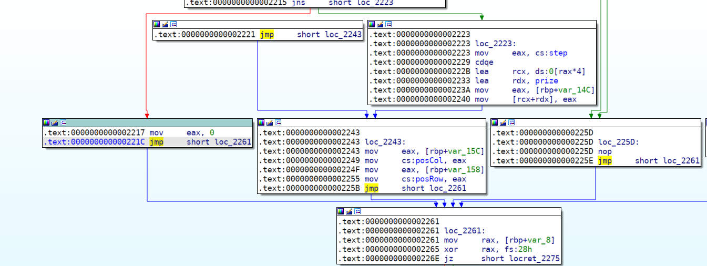<figcaption></figcaption></figure>

Namun tetap saja kita harus memainkannya , dan jumlah step juga tetap bertambah. Jadi saya pakai solusi lainnya yaitu bruteforce semua kemungkinan pintu , disini saya menyadari satu hal , yaitu ada beberapa kemungkinan untuk menuju ke X , cara paling cepat adalah dengan menerapkan algoritma dfs, namun disini saya tidak , saya melakukannya semi automated tapi sudah cukup cepat dikarenakan kemungkinannya tidak terlalu banyak. x

<figure>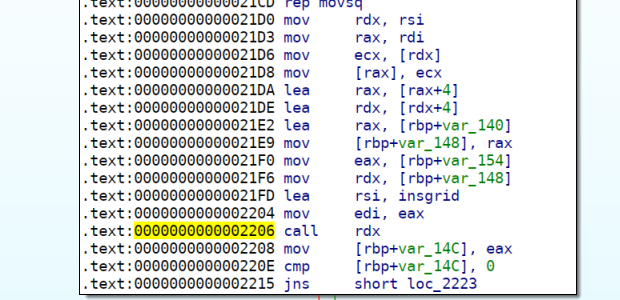<figcaption></figcaption></figure>

Untuk pengecekannya sendiri cukup simple , intinya return dari pemanggilan rdx disimpan ke array lalu lakukan hal yang sama ketika ditampilkannya prize, yaitu kurangi index ke-i dengan i-1 dimana i mulai dari 1.

<figure>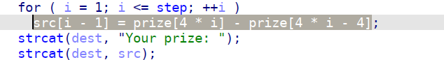<figcaption></figcaption></figure>

&#x20;Di awal saya coba lakukan automated bruteforce dengan script berikut

```python
#!/usr/bin/python3
import string
class SolverEquation(gdb.Command):
	def __init__ (self):
    	super (SolverEquation, self).__init__ ("solve-equation",gdb.COMMAND_OBSCURE)

	def invoke (self, arg, from_tty):
    	zz = 2
    	while zz!=37:
        	check = zz
        	f = open("data.txt","r").read()
        	data = ["1","2","3","4","5","6"]
        	for x in data:
            	cnt = 0
            	tmp = f+x
            	g = open("data.txt","w")
            	g.write(tmp)
            	g.close()
            	gdb.execute("r < data.txt")
            	arr = []
            	for i in range(zz):
                	try:
                    	val = addr2num(gdb.selected_frame().read_register("eax"))
                    	arr.append(val)
                    	gdb.execute("c")
                    	if(i>0):
                        	# print(arr)
                        	if(chr((arr[i]-arr[i-1])&0xff) in string.printable[:-6]):
                            	cnt += 1
                	except Exception as e:
                    	print(e)
            	# print(arr)
            	if(cnt==zz-1):
                	fl = ""
                	for z in range(1,len(arr)):
                    	fl += chr((arr[z] - arr[z-1])&0xff)
                	if(fl=="COMPFESTd"):
                    	continue
                	elif(fl=="COMPFEST{"):
                    	continue
                	elif(fl=="COMPFEST13{hEy_YoU"):
                    	continue
                	zz += 1
                	print(z,fl)
                	break
        	if(zz==check):
            	print(z,fl)
            	break

def addr2num(addr):
	try:
    	return int(addr)&0xffffffffffffffff  # Python 3
	except:
    	return long(addr) # Python 2
SolverEquation()

```

Namun seperti yang saya bilang bahwa ada beberapa kemungkinan lain , jadi disini saya lanjutkan dengan semi automated.

```python
#!/usr/bin/python3
import string
temp_arr = []
class SolverEquation(gdb.Command):
	def __init__ (self):
    	super (SolverEquation, self).__init__ ("solve-equation",gdb.COMMAND_OBSCURE)

	def invoke (self, arg, from_tty):
    	global temp_arr
    	f = open("data.txt","r").read()
    	data = ["1","2","3","4","5","6"]
    	zz = len(f)+1
    	for x in data:
        	tmp = f + x
        	g = open("data.txt","w")
        	g.write(tmp)
        	g.close()
        	gdb.execute("r < data.txt")
        	arr = []
        	for i in range(zz):
            	try:
                	val = addr2num(gdb.selected_frame().read_register("eax"))
                	arr.append(val)
                	gdb.execute("c")
            	except Exception as e:
                	print(e)
        	temp_arr.append(arr)
    	for i,j in enumerate(temp_arr):
        	tmp = ""
        	for x in range(1,len(j)):
            	try:
                	tmp += chr((j[x]-j[x-1])&0xff)
            	except Exception as e:
                	tmp += '?'
        	try:
            	print(data[i],j,tmp)
        	except Exception as e:
            	print(tmp)
def addr2num(addr):
	try:
    	return int(addr)&0xffffffffffffffff  # Python 3
	except:
    	return long(addr) # Python 2
SolverEquation()

```

Ya caranya dengan tentukan sendiri kemungkinan flag yang tepat , namun jika kita salah ngga perlu harus benar benar mengulang , ingat benteng takeshi , jadi misal kita menuju ruang x lewat y , setelah dari x ternyata jalan yang mungkin hanya melalui a dan b. Maka jika kita ke ruang x melalui z nantinya dari x juga lewat a dan b untuk ke target akhir. Berikut hasil akhir dari percobaan saya

<figure>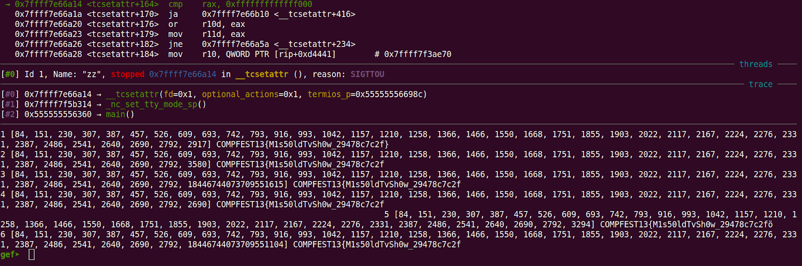<figcaption></figcaption></figure>

data.txt

```
5656654345616131111216655551121166616
```

Flag : COMPFEST13{M1s50ldTvSh0w\_29478c7c2f}
