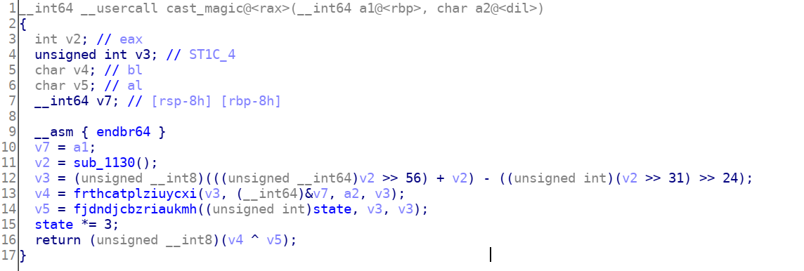
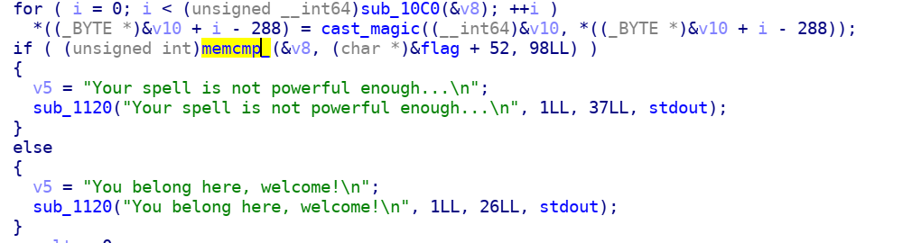
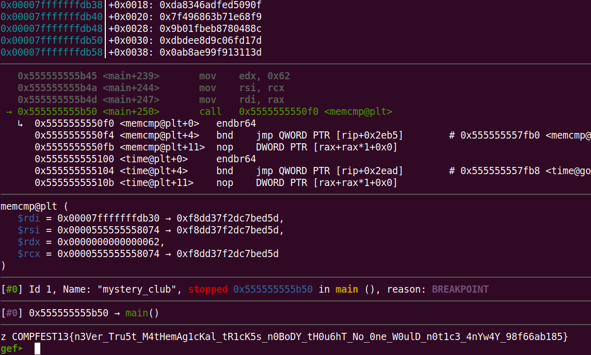
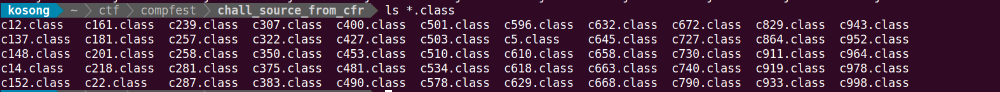
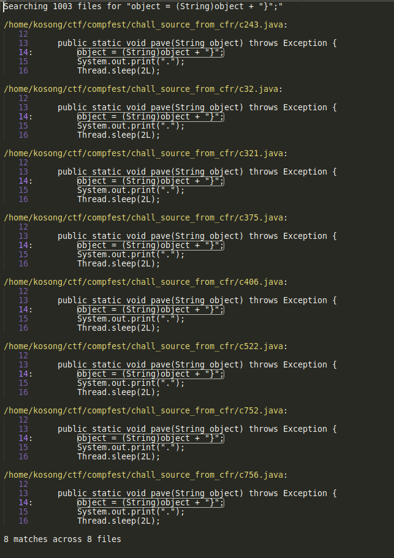
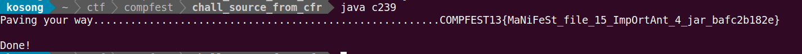

# Reverse Engineering

<!-- challenge-index: 0e40c8f74dfe6437 -->

| Challenge | Topic |
| --- | --- |
| [Binary Pin (454 pts)](#binary-pin-454-pts) | Java Bytecode, PIN Validation |
| [Magical Mystery Club (482 pts)](#magical-mystery-club-482-pts) | GDB, Bytewise Validation |
| [Pave The Way (494 pts)🥇](#pave-the-way-494-pts) | Java, Class Loading |

<!-- /challenge-index -->

## Binary Pin (454 pts)

### Description

\-

### Solution

Diberikan file jar , kemudian kami coba decompile. Disini kami sempat overthinking mengenai cara mengerjakannya , kemudian baru sadar disini tugas kita adalah memasukkan key yang benar. Dimana nilai key sendiri 9 bit , jadi possible sekali untuk di bruteforce , jadi tinggal bruteforce key dan dump resultnya lalu analisis manual atau grep .&#x20;

Generate possible key

```python
from itertools import product

for i in product(["0","1"],repeat=9):
    tmp = []
    for j in range(9):
   	 tmp.append(i[j])
    print(tmp)
```

Bruteforce key

```java
import java.util.*;
class Main{

   public static void main(String[] args) {
  	char arr[][] = {{'0', '0', '0', '0', '0', '0', '0', '0', '0'},{'0', '0', '0', '0', '0', '0', '0', '0', '1'},{'0', '0', '0', '0', '0', '0', '0', '1', '0'},{'0', '0', '0', '0', '0', '0', '0', '1', '1'},{'0', '0', '0', '0', '0', '0', '1', '0', '0'},{'0', '0', '0', '0', '0', '0', '1', '0', '1'},{'0', '0', '0', '0', '0', '0', '1', '1', '0'},{'0', '0', '0', '0', '0', '0', '1', '1', '1'},{'0', '0', '0', '0', '0', '1', '0', '0', '0'},{'0', '0', '0', '0', '0', '1', '0', '0', '1'},{'0', '0', '0', '0', '0', '1', '0', '1', '0'},{'0', '0', '0', '0', '0', '1', '0', '1', '1'},{'0', '0', '0', '0', '0', '1', '1', '0', '0'},{'0', '0', '0', '0', '0', '1', '1', '0', '1'},{'0', '0', '0', '0', '0', '1', '1', '1', '0'},{'0', '0', '0', '0', '0', '1', '1', '1', '1'},{'0', '0', '0', '0', '1', '0', '0', '0', '0'},{'0', '0', '0', '0', '1', '0', '0', '0', '1'},{'0', '0', '0', '0', '1', '0', '0', '1', '0'},{'0', '0', '0', '0', '1', '0', '0', '1', '1'},{'0', '0', '0', '0', '1', '0', '1', '0', '0'},{'0', '0', '0', '0', '1', '0', '1', '0', '1'},{'0', '0', '0', '0', '1', '0', '1', '1', '0'},{'0', '0', '0', '0', '1', '0', '1', '1', '1'},{'0', '0', '0', '0', '1', '1', '0', '0', '0'},{'0', '0', '0', '0', '1', '1', '0', '0', '1'},{'0', '0', '0', '0', '1', '1', '0', '1', '0'},{'0', '0', '0', '0', '1', '1', '0', '1', '1'},{'0', '0', '0', '0', '1', '1', '1', '0', '0'},{'0', '0', '0', '0', '1', '1', '1', '0', '1'},{'0', '0', '0', '0', '1', '1', '1', '1', '0'},{'0', '0', '0', '0', '1', '1', '1', '1', '1'},{'0', '0', '0', '1', '0', '0', '0', '0', '0'},{'0', '0', '0', '1', '0', '0', '0', '0', '1'},{'0', '0', '0', '1', '0', '0', '0', '1', '0'},{'0', '0', '0', '1', '0', '0', '0', '1', '1'},{'0', '0', '0', '1', '0', '0', '1', '0', '0'},{'0', '0', '0', '1', '0', '0', '1', '0', '1'},{'0', '0', '0', '1', '0', '0', '1', '1', '0'},{'0', '0', '0', '1', '0', '0', '1', '1', '1'},{'0', '0', '0', '1', '0', '1', '0', '0', '0'},{'0', '0', '0', '1', '0', '1', '0', '0', '1'},{'0', '0', '0', '1', '0', '1', '0', '1', '0'},{'0', '0', '0', '1', '0', '1', '0', '1', '1'},{'0', '0', '0', '1', '0', '1', '1', '0', '0'},{'0', '0', '0', '1', '0', '1', '1', '0', '1'},{'0', '0', '0', '1', '0', '1', '1', '1', '0'},{'0', '0', '0', '1', '0', '1', '1', '1', '1'},{'0', '0', '0', '1', '1', '0', '0', '0', '0'},{'0', '0', '0', '1', '1', '0', '0', '0', '1'},{'0', '0', '0', '1', '1', '0', '0', '1', '0'},{'0', '0', '0', '1', '1', '0', '0', '1', '1'},{'0', '0', '0', '1', '1', '0', '1', '0', '0'},{'0', '0', '0', '1', '1', '0', '1', '0', '1'},{'0', '0', '0', '1', '1', '0', '1', '1', '0'},{'0', '0', '0', '1', '1', '0', '1', '1', '1'},{'0', '0', '0', '1', '1', '1', '0', '0', '0'},{'0', '0', '0', '1', '1', '1', '0', '0', '1'},{'0', '0', '0', '1', '1', '1', '0', '1', '0'},{'0', '0', '0', '1', '1', '1', '0', '1', '1'},{'0', '0', '0', '1', '1', '1', '1', '0', '0'},{'0', '0', '0', '1', '1', '1', '1', '0', '1'},{'0', '0', '0', '1', '1', '1', '1', '1', '0'},{'0', '0', '0', '1', '1', '1', '1', '1', '1'},{'0', '0', '1', '0', '0', '0', '0', '0', '0'},{'0', '0', '1', '0', '0', '0', '0', '0', '1'},{'0', '0', '1', '0', '0', '0', '0', '1', '0'},{'0', '0', '1', '0', '0', '0', '0', '1', '1'},{'0', '0', '1', '0', '0', '0', '1', '0', '0'},{'0', '0', '1', '0', '0', '0', '1', '0', '1'},{'0', '0', '1', '0', '0', '0', '1', '1', '0'},{'0', '0', '1', '0', '0', '0', '1', '1', '1'},{'0', '0', '1', '0', '0', '1', '0', '0', '0'},{'0', '0', '1', '0', '0', '1', '0', '0', '1'},{'0', '0', '1', '0', '0', '1', '0', '1', '0'},{'0', '0', '1', '0', '0', '1', '0', '1', '1'},{'0', '0', '1', '0', '0', '1', '1', '0', '0'},{'0', '0', '1', '0', '0', '1', '1', '0', '1'},{'0', '0', '1', '0', '0', '1', '1', '1', '0'},{'0', '0', '1', '0', '0', '1', '1', '1', '1'},{'0', '0', '1', '0', '1', '0', '0', '0', '0'},{'0', '0', '1', '0', '1', '0', '0', '0', '1'},{'0', '0', '1', '0', '1', '0', '0', '1', '0'},{'0', '0', '1', '0', '1', '0', '0', '1', '1'},{'0', '0', '1', '0', '1', '0', '1', '0', '0'},{'0', '0', '1', '0', '1', '0', '1', '0', '1'},{'0', '0', '1', '0', '1', '0', '1', '1', '0'},{'0', '0', '1', '0', '1', '0', '1', '1', '1'},{'0', '0', '1', '0', '1', '1', '0', '0', '0'},{'0', '0', '1', '0', '1', '1', '0', '0', '1'},{'0', '0', '1', '0', '1', '1', '0', '1', '0'},{'0', '0', '1', '0', '1', '1', '0', '1', '1'},{'0', '0', '1', '0', '1', '1', '1', '0', '0'},{'0', '0', '1', '0', '1', '1', '1', '0', '1'},{'0', '0', '1', '0', '1', '1', '1', '1', '0'},{'0', '0', '1', '0', '1', '1', '1', '1', '1'},{'0', '0', '1', '1', '0', '0', '0', '0', '0'},{'0', '0', '1', '1', '0', '0', '0', '0', '1'},{'0', '0', '1', '1', '0', '0', '0', '1', '0'},{'0', '0', '1', '1', '0', '0', '0', '1', '1'},{'0', '0', '1', '1', '0', '0', '1', '0', '0'},{'0', '0', '1', '1', '0', '0', '1', '0', '1'},{'0', '0', '1', '1', '0', '0', '1', '1', '0'},{'0', '0', '1', '1', '0', '0', '1', '1', '1'},{'0', '0', '1', '1', '0', '1', '0', '0', '0'},{'0', '0', '1', '1', '0', '1', '0', '0', '1'},{'0', '0', '1', '1', '0', '1', '0', '1', '0'},{'0', '0', '1', '1', '0', '1', '0', '1', '1'},{'0', '0', '1', '1', '0', '1', '1', '0', '0'},{'0', '0', '1', '1', '0', '1', '1', '0', '1'},{'0', '0', '1', '1', '0', '1', '1', '1', '0'},{'0', '0', '1', '1', '0', '1', '1', '1', '1'},{'0', '0', '1', '1', '1', '0', '0', '0', '0'},{'0', '0', '1', '1', '1', '0', '0', '0', '1'},{'0', '0', '1', '1', '1', '0', '0', '1', '0'},{'0', '0', '1', '1', '1', '0', '0', '1', '1'},{'0', '0', '1', '1', '1', '0', '1', '0', '0'},{'0', '0', '1', '1', '1', '0', '1', '0', '1'},{'0', '0', '1', '1', '1', '0', '1', '1', '0'},{'0', '0', '1', '1', '1', '0', '1', '1', '1'},{'0', '0', '1', '1', '1', '1', '0', '0', '0'},{'0', '0', '1', '1', '1', '1', '0', '0', '1'},{'0', '0', '1', '1', '1', '1', '0', '1', '0'},{'0', '0', '1', '1', '1', '1', '0', '1', '1'},{'0', '0', '1', '1', '1', '1', '1', '0', '0'},{'0', '0', '1', '1', '1', '1', '1', '0', '1'},{'0', '0', '1', '1', '1', '1', '1', '1', '0'},{'0', '0', '1', '1', '1', '1', '1', '1', '1'},{'0', '1', '0', '0', '0', '0', '0', '0', '0'},{'0', '1', '0', '0', '0', '0', '0', '0', '1'},{'0', '1', '0', '0', '0', '0', '0', '1', '0'},{'0', '1', '0', '0', '0', '0', '0', '1', '1'},{'0', '1', '0', '0', '0', '0', '1', '0', '0'},{'0', '1', '0', '0', '0', '0', '1', '0', '1'},{'0', '1', '0', '0', '0', '0', '1', '1', '0'},{'0', '1', '0', '0', '0', '0', '1', '1', '1'},{'0', '1', '0', '0', '0', '1', '0', '0', '0'},{'0', '1', '0', '0', '0', '1', '0', '0', '1'},{'0', '1', '0', '0', '0', '1', '0', '1', '0'},{'0', '1', '0', '0', '0', '1', '0', '1', '1'},{'0', '1', '0', '0', '0', '1', '1', '0', '0'},{'0', '1', '0', '0', '0', '1', '1', '0', '1'},{'0', '1', '0', '0', '0', '1', '1', '1', '0'},{'0', '1', '0', '0', '0', '1', '1', '1', '1'},{'0', '1', '0', '0', '1', '0', '0', '0', '0'},{'0', '1', '0', '0', '1', '0', '0', '0', '1'},{'0', '1', '0', '0', '1', '0', '0', '1', '0'},{'0', '1', '0', '0', '1', '0', '0', '1', '1'},{'0', '1', '0', '0', '1', '0', '1', '0', '0'},{'0', '1', '0', '0', '1', '0', '1', '0', '1'},{'0', '1', '0', '0', '1', '0', '1', '1', '0'},{'0', '1', '0', '0', '1', '0', '1', '1', '1'},{'0', '1', '0', '0', '1', '1', '0', '0', '0'},{'0', '1', '0', '0', '1', '1', '0', '0', '1'},{'0', '1', '0', '0', '1', '1', '0', '1', '0'},{'0', '1', '0', '0', '1', '1', '0', '1', '1'},{'0', '1', '0', '0', '1', '1', '1', '0', '0'},{'0', '1', '0', '0', '1', '1', '1', '0', '1'},{'0', '1', '0', '0', '1', '1', '1', '1', '0'},{'0', '1', '0', '0', '1', '1', '1', '1', '1'},{'0', '1', '0', '1', '0', '0', '0', '0', '0'},{'0', '1', '0', '1', '0', '0', '0', '0', '1'},{'0', '1', '0', '1', '0', '0', '0', '1', '0'},{'0', '1', '0', '1', '0', '0', '0', '1', '1'},{'0', '1', '0', '1', '0', '0', '1', '0', '0'},{'0', '1', '0', '1', '0', '0', '1', '0', '1'},{'0', '1', '0', '1', '0', '0', '1', '1', '0'},{'0', '1', '0', '1', '0', '0', '1', '1', '1'},{'0', '1', '0', '1', '0', '1', '0', '0', '0'},{'0', '1', '0', '1', '0', '1', '0', '0', '1'},{'0', '1', '0', '1', '0', '1', '0', '1', '0'},{'0', '1', '0', '1', '0', '1', '0', '1', '1'},{'0', '1', '0', '1', '0', '1', '1', '0', '0'},{'0', '1', '0', '1', '0', '1', '1', '0', '1'},{'0', '1', '0', '1', '0', '1', '1', '1', '0'},{'0', '1', '0', '1', '0', '1', '1', '1', '1'},{'0', '1', '0', '1', '1', '0', '0', '0', '0'},{'0', '1', '0', '1', '1', '0', '0', '0', '1'},{'0', '1', '0', '1', '1', '0', '0', '1', '0'},{'0', '1', '0', '1', '1', '0', '0', '1', '1'},{'0', '1', '0', '1', '1', '0', '1', '0', '0'},{'0', '1', '0', '1', '1', '0', '1', '0', '1'},{'0', '1', '0', '1', '1', '0', '1', '1', '0'},{'0', '1', '0', '1', '1', '0', '1', '1', '1'},{'0', '1', '0', '1', '1', '1', '0', '0', '0'},{'0', '1', '0', '1', '1', '1', '0', '0', '1'},{'0', '1', '0', '1', '1', '1', '0', '1', '0'},{'0', '1', '0', '1', '1', '1', '0', '1', '1'},{'0', '1', '0', '1', '1', '1', '1', '0', '0'},{'0', '1', '0', '1', '1', '1', '1', '0', '1'},{'0', '1', '0', '1', '1', '1', '1', '1', '0'},{'0', '1', '0', '1', '1', '1', '1', '1', '1'},{'0', '1', '1', '0', '0', '0', '0', '0', '0'},{'0', '1', '1', '0', '0', '0', '0', '0', '1'},{'0', '1', '1', '0', '0', '0', '0', '1', '0'},{'0', '1', '1', '0', '0', '0', '0', '1', '1'},{'0', '1', '1', '0', '0', '0', '1', '0', '0'},{'0', '1', '1', '0', '0', '0', '1', '0', '1'},{'0', '1', '1', '0', '0', '0', '1', '1', '0'},{'0', '1', '1', '0', '0', '0', '1', '1', '1'},{'0', '1', '1', '0', '0', '1', '0', '0', '0'},{'0', '1', '1', '0', '0', '1', '0', '0', '1'},{'0', '1', '1', '0', '0', '1', '0', '1', '0'},{'0', '1', '1', '0', '0', '1', '0', '1', '1'},{'0', '1', '1', '0', '0', '1', '1', '0', '0'},{'0', '1', '1', '0', '0', '1', '1', '0', '1'},{'0', '1', '1', '0', '0', '1', '1', '1', '0'},{'0', '1', '1', '0', '0', '1', '1', '1', '1'},{'0', '1', '1', '0', '1', '0', '0', '0', '0'},{'0', '1', '1', '0', '1', '0', '0', '0', '1'},{'0', '1', '1', '0', '1', '0', '0', '1', '0'},{'0', '1', '1', '0', '1', '0', '0', '1', '1'},{'0', '1', '1', '0', '1', '0', '1', '0', '0'},{'0', '1', '1', '0', '1', '0', '1', '0', '1'},{'0', '1', '1', '0', '1', '0', '1', '1', '0'},{'0', '1', '1', '0', '1', '0', '1', '1', '1'},{'0', '1', '1', '0', '1', '1', '0', '0', '0'},{'0', '1', '1', '0', '1', '1', '0', '0', '1'},{'0', '1', '1', '0', '1', '1', '0', '1', '0'},{'0', '1', '1', '0', '1', '1', '0', '1', '1'},{'0', '1', '1', '0', '1', '1', '1', '0', '0'},{'0', '1', '1', '0', '1', '1', '1', '0', '1'},{'0', '1', '1', '0', '1', '1', '1', '1', '0'},{'0', '1', '1', '0', '1', '1', '1', '1', '1'},{'0', '1', '1', '1', '0', '0', '0', '0', '0'},{'0', '1', '1', '1', '0', '0', '0', '0', '1'},{'0', '1', '1', '1', '0', '0', '0', '1', '0'},{'0', '1', '1', '1', '0', '0', '0', '1', '1'},{'0', '1', '1', '1', '0', '0', '1', '0', '0'},{'0', '1', '1', '1', '0', '0', '1', '0', '1'},{'0', '1', '1', '1', '0', '0', '1', '1', '0'},{'0', '1', '1', '1', '0', '0', '1', '1', '1'},{'0', '1', '1', '1', '0', '1', '0', '0', '0'},{'0', '1', '1', '1', '0', '1', '0', '0', '1'},{'0', '1', '1', '1', '0', '1', '0', '1', '0'},{'0', '1', '1', '1', '0', '1', '0', '1', '1'},{'0', '1', '1', '1', '0', '1', '1', '0', '0'},{'0', '1', '1', '1', '0', '1', '1', '0', '1'},{'0', '1', '1', '1', '0', '1', '1', '1', '0'},{'0', '1', '1', '1', '0', '1', '1', '1', '1'},{'0', '1', '1', '1', '1', '0', '0', '0', '0'},{'0', '1', '1', '1', '1', '0', '0', '0', '1'},{'0', '1', '1', '1', '1', '0', '0', '1', '0'},{'0', '1', '1', '1', '1', '0', '0', '1', '1'},{'0', '1', '1', '1', '1', '0', '1', '0', '0'},{'0', '1', '1', '1', '1', '0', '1', '0', '1'},{'0', '1', '1', '1', '1', '0', '1', '1', '0'},{'0', '1', '1', '1', '1', '0', '1', '1', '1'},{'0', '1', '1', '1', '1', '1', '0', '0', '0'},{'0', '1', '1', '1', '1', '1', '0', '0', '1'},{'0', '1', '1', '1', '1', '1', '0', '1', '0'},{'0', '1', '1', '1', '1', '1', '0', '1', '1'},{'0', '1', '1', '1', '1', '1', '1', '0', '0'},{'0', '1', '1', '1', '1', '1', '1', '0', '1'},{'0', '1', '1', '1', '1', '1', '1', '1', '0'},{'0', '1', '1', '1', '1', '1', '1', '1', '1'},{'1', '0', '0', '0', '0', '0', '0', '0', '0'},{'1', '0', '0', '0', '0', '0', '0', '0', '1'},{'1', '0', '0', '0', '0', '0', '0', '1', '0'},{'1', '0', '0', '0', '0', '0', '0', '1', '1'},{'1', '0', '0', '0', '0', '0', '1', '0', '0'},{'1', '0', '0', '0', '0', '0', '1', '0', '1'},{'1', '0', '0', '0', '0', '0', '1', '1', '0'},{'1', '0', '0', '0', '0', '0', '1', '1', '1'},{'1', '0', '0', '0', '0', '1', '0', '0', '0'},{'1', '0', '0', '0', '0', '1', '0', '0', '1'},{'1', '0', '0', '0', '0', '1', '0', '1', '0'},{'1', '0', '0', '0', '0', '1', '0', '1', '1'},{'1', '0', '0', '0', '0', '1', '1', '0', '0'},{'1', '0', '0', '0', '0', '1', '1', '0', '1'},{'1', '0', '0', '0', '0', '1', '1', '1', '0'},{'1', '0', '0', '0', '0', '1', '1', '1', '1'},{'1', '0', '0', '0', '1', '0', '0', '0', '0'},{'1', '0', '0', '0', '1', '0', '0', '0', '1'},{'1', '0', '0', '0', '1', '0', '0', '1', '0'},{'1', '0', '0', '0', '1', '0', '0', '1', '1'},{'1', '0', '0', '0', '1', '0', '1', '0', '0'},{'1', '0', '0', '0', '1', '0', '1', '0', '1'},{'1', '0', '0', '0', '1', '0', '1', '1', '0'},{'1', '0', '0', '0', '1', '0', '1', '1', '1'},{'1', '0', '0', '0', '1', '1', '0', '0', '0'},{'1', '0', '0', '0', '1', '1', '0', '0', '1'},{'1', '0', '0', '0', '1', '1', '0', '1', '0'},{'1', '0', '0', '0', '1', '1', '0', '1', '1'},{'1', '0', '0', '0', '1', '1', '1', '0', '0'},{'1', '0', '0', '0', '1', '1', '1', '0', '1'},{'1', '0', '0', '0', '1', '1', '1', '1', '0'},{'1', '0', '0', '0', '1', '1', '1', '1', '1'},{'1', '0', '0', '1', '0', '0', '0', '0', '0'},{'1', '0', '0', '1', '0', '0', '0', '0', '1'},{'1', '0', '0', '1', '0', '0', '0', '1', '0'},{'1', '0', '0', '1', '0', '0', '0', '1', '1'},{'1', '0', '0', '1', '0', '0', '1', '0', '0'},{'1', '0', '0', '1', '0', '0', '1', '0', '1'},{'1', '0', '0', '1', '0', '0', '1', '1', '0'},{'1', '0', '0', '1', '0', '0', '1', '1', '1'},{'1', '0', '0', '1', '0', '1', '0', '0', '0'},{'1', '0', '0', '1', '0', '1', '0', '0', '1'},{'1', '0', '0', '1', '0', '1', '0', '1', '0'},{'1', '0', '0', '1', '0', '1', '0', '1', '1'},{'1', '0', '0', '1', '0', '1', '1', '0', '0'},{'1', '0', '0', '1', '0', '1', '1', '0', '1'},{'1', '0', '0', '1', '0', '1', '1', '1', '0'},{'1', '0', '0', '1', '0', '1', '1', '1', '1'},{'1', '0', '0', '1', '1', '0', '0', '0', '0'},{'1', '0', '0', '1', '1', '0', '0', '0', '1'},{'1', '0', '0', '1', '1', '0', '0', '1', '0'},{'1', '0', '0', '1', '1', '0', '0', '1', '1'},{'1', '0', '0', '1', '1', '0', '1', '0', '0'},{'1', '0', '0', '1', '1', '0', '1', '0', '1'},{'1', '0', '0', '1', '1', '0', '1', '1', '0'},{'1', '0', '0', '1', '1', '0', '1', '1', '1'},{'1', '0', '0', '1', '1', '1', '0', '0', '0'},{'1', '0', '0', '1', '1', '1', '0', '0', '1'},{'1', '0', '0', '1', '1', '1', '0', '1', '0'},{'1', '0', '0', '1', '1', '1', '0', '1', '1'},{'1', '0', '0', '1', '1', '1', '1', '0', '0'},{'1', '0', '0', '1', '1', '1', '1', '0', '1'},{'1', '0', '0', '1', '1', '1', '1', '1', '0'},{'1', '0', '0', '1', '1', '1', '1', '1', '1'},{'1', '0', '1', '0', '0', '0', '0', '0', '0'},{'1', '0', '1', '0', '0', '0', '0', '0', '1'},{'1', '0', '1', '0', '0', '0', '0', '1', '0'},{'1', '0', '1', '0', '0', '0', '0', '1', '1'},{'1', '0', '1', '0', '0', '0', '1', '0', '0'},{'1', '0', '1', '0', '0', '0', '1', '0', '1'},{'1', '0', '1', '0', '0', '0', '1', '1', '0'},{'1', '0', '1', '0', '0', '0', '1', '1', '1'},{'1', '0', '1', '0', '0', '1', '0', '0', '0'},{'1', '0', '1', '0', '0', '1', '0', '0', '1'},{'1', '0', '1', '0', '0', '1', '0', '1', '0'},{'1', '0', '1', '0', '0', '1', '0', '1', '1'},{'1', '0', '1', '0', '0', '1', '1', '0', '0'},{'1', '0', '1', '0', '0', '1', '1', '0', '1'},{'1', '0', '1', '0', '0', '1', '1', '1', '0'},{'1', '0', '1', '0', '0', '1', '1', '1', '1'},{'1', '0', '1', '0', '1', '0', '0', '0', '0'},{'1', '0', '1', '0', '1', '0', '0', '0', '1'},{'1', '0', '1', '0', '1', '0', '0', '1', '0'},{'1', '0', '1', '0', '1', '0', '0', '1', '1'},{'1', '0', '1', '0', '1', '0', '1', '0', '0'},{'1', '0', '1', '0', '1', '0', '1', '0', '1'},{'1', '0', '1', '0', '1', '0', '1', '1', '0'},{'1', '0', '1', '0', '1', '0', '1', '1', '1'},{'1', '0', '1', '0', '1', '1', '0', '0', '0'},{'1', '0', '1', '0', '1', '1', '0', '0', '1'},{'1', '0', '1', '0', '1', '1', '0', '1', '0'},{'1', '0', '1', '0', '1', '1', '0', '1', '1'},{'1', '0', '1', '0', '1', '1', '1', '0', '0'},{'1', '0', '1', '0', '1', '1', '1', '0', '1'},{'1', '0', '1', '0', '1', '1', '1', '1', '0'},{'1', '0', '1', '0', '1', '1', '1', '1', '1'},{'1', '0', '1', '1', '0', '0', '0', '0', '0'},{'1', '0', '1', '1', '0', '0', '0', '0', '1'},{'1', '0', '1', '1', '0', '0', '0', '1', '0'},{'1', '0', '1', '1', '0', '0', '0', '1', '1'},{'1', '0', '1', '1', '0', '0', '1', '0', '0'},{'1', '0', '1', '1', '0', '0', '1', '0', '1'},{'1', '0', '1', '1', '0', '0', '1', '1', '0'},{'1', '0', '1', '1', '0', '0', '1', '1', '1'},{'1', '0', '1', '1', '0', '1', '0', '0', '0'},{'1', '0', '1', '1', '0', '1', '0', '0', '1'},{'1', '0', '1', '1', '0', '1', '0', '1', '0'},{'1', '0', '1', '1', '0', '1', '0', '1', '1'},{'1', '0', '1', '1', '0', '1', '1', '0', '0'},{'1', '0', '1', '1', '0', '1', '1', '0', '1'},{'1', '0', '1', '1', '0', '1', '1', '1', '0'},{'1', '0', '1', '1', '0', '1', '1', '1', '1'},{'1', '0', '1', '1', '1', '0', '0', '0', '0'},{'1', '0', '1', '1', '1', '0', '0', '0', '1'},{'1', '0', '1', '1', '1', '0', '0', '1', '0'},{'1', '0', '1', '1', '1', '0', '0', '1', '1'},{'1', '0', '1', '1', '1', '0', '1', '0', '0'},{'1', '0', '1', '1', '1', '0', '1', '0', '1'},{'1', '0', '1', '1', '1', '0', '1', '1', '0'},{'1', '0', '1', '1', '1', '0', '1', '1', '1'},{'1', '0', '1', '1', '1', '1', '0', '0', '0'},{'1', '0', '1', '1', '1', '1', '0', '0', '1'},{'1', '0', '1', '1', '1', '1', '0', '1', '0'},{'1', '0', '1', '1', '1', '1', '0', '1', '1'},{'1', '0', '1', '1', '1', '1', '1', '0', '0'},{'1', '0', '1', '1', '1', '1', '1', '0', '1'},{'1', '0', '1', '1', '1', '1', '1', '1', '0'},{'1', '0', '1', '1', '1', '1', '1', '1', '1'},{'1', '1', '0', '0', '0', '0', '0', '0', '0'},{'1', '1', '0', '0', '0', '0', '0', '0', '1'},{'1', '1', '0', '0', '0', '0', '0', '1', '0'},{'1', '1', '0', '0', '0', '0', '0', '1', '1'},{'1', '1', '0', '0', '0', '0', '1', '0', '0'},{'1', '1', '0', '0', '0', '0', '1', '0', '1'},{'1', '1', '0', '0', '0', '0', '1', '1', '0'},{'1', '1', '0', '0', '0', '0', '1', '1', '1'},{'1', '1', '0', '0', '0', '1', '0', '0', '0'},{'1', '1', '0', '0', '0', '1', '0', '0', '1'},{'1', '1', '0', '0', '0', '1', '0', '1', '0'},{'1', '1', '0', '0', '0', '1', '0', '1', '1'},{'1', '1', '0', '0', '0', '1', '1', '0', '0'},{'1', '1', '0', '0', '0', '1', '1', '0', '1'},{'1', '1', '0', '0', '0', '1', '1', '1', '0'},{'1', '1', '0', '0', '0', '1', '1', '1', '1'},{'1', '1', '0', '0', '1', '0', '0', '0', '0'},{'1', '1', '0', '0', '1', '0', '0', '0', '1'},{'1', '1', '0', '0', '1', '0', '0', '1', '0'},{'1', '1', '0', '0', '1', '0', '0', '1', '1'},{'1', '1', '0', '0', '1', '0', '1', '0', '0'},{'1', '1', '0', '0', '1', '0', '1', '0', '1'},{'1', '1', '0', '0', '1', '0', '1', '1', '0'},{'1', '1', '0', '0', '1', '0', '1', '1', '1'},{'1', '1', '0', '0', '1', '1', '0', '0', '0'},{'1', '1', '0', '0', '1', '1', '0', '0', '1'},{'1', '1', '0', '0', '1', '1', '0', '1', '0'},{'1', '1', '0', '0', '1', '1', '0', '1', '1'},{'1', '1', '0', '0', '1', '1', '1', '0', '0'},{'1', '1', '0', '0', '1', '1', '1', '0', '1'},{'1', '1', '0', '0', '1', '1', '1', '1', '0'},{'1', '1', '0', '0', '1', '1', '1', '1', '1'},{'1', '1', '0', '1', '0', '0', '0', '0', '0'},{'1', '1', '0', '1', '0', '0', '0', '0', '1'},{'1', '1', '0', '1', '0', '0', '0', '1', '0'},{'1', '1', '0', '1', '0', '0', '0', '1', '1'},{'1', '1', '0', '1', '0', '0', '1', '0', '0'},{'1', '1', '0', '1', '0', '0', '1', '0', '1'},{'1', '1', '0', '1', '0', '0', '1', '1', '0'},{'1', '1', '0', '1', '0', '0', '1', '1', '1'},{'1', '1', '0', '1', '0', '1', '0', '0', '0'},{'1', '1', '0', '1', '0', '1', '0', '0', '1'},{'1', '1', '0', '1', '0', '1', '0', '1', '0'},{'1', '1', '0', '1', '0', '1', '0', '1', '1'},{'1', '1', '0', '1', '0', '1', '1', '0', '0'},{'1', '1', '0', '1', '0', '1', '1', '0', '1'},{'1', '1', '0', '1', '0', '1', '1', '1', '0'},{'1', '1', '0', '1', '0', '1', '1', '1', '1'},{'1', '1', '0', '1', '1', '0', '0', '0', '0'},{'1', '1', '0', '1', '1', '0', '0', '0', '1'},{'1', '1', '0', '1', '1', '0', '0', '1', '0'},{'1', '1', '0', '1', '1', '0', '0', '1', '1'},{'1', '1', '0', '1', '1', '0', '1', '0', '0'},{'1', '1', '0', '1', '1', '0', '1', '0', '1'},{'1', '1', '0', '1', '1', '0', '1', '1', '0'},{'1', '1', '0', '1', '1', '0', '1', '1', '1'},{'1', '1', '0', '1', '1', '1', '0', '0', '0'},{'1', '1', '0', '1', '1', '1', '0', '0', '1'},{'1', '1', '0', '1', '1', '1', '0', '1', '0'},{'1', '1', '0', '1', '1', '1', '0', '1', '1'},{'1', '1', '0', '1', '1', '1', '1', '0', '0'},{'1', '1', '0', '1', '1', '1', '1', '0', '1'},{'1', '1', '0', '1', '1', '1', '1', '1', '0'},{'1', '1', '0', '1', '1', '1', '1', '1', '1'},{'1', '1', '1', '0', '0', '0', '0', '0', '0'},{'1', '1', '1', '0', '0', '0', '0', '0', '1'},{'1', '1', '1', '0', '0', '0', '0', '1', '0'},{'1', '1', '1', '0', '0', '0', '0', '1', '1'},{'1', '1', '1', '0', '0', '0', '1', '0', '0'},{'1', '1', '1', '0', '0', '0', '1', '0', '1'},{'1', '1', '1', '0', '0', '0', '1', '1', '0'},{'1', '1', '1', '0', '0', '0', '1', '1', '1'},{'1', '1', '1', '0', '0', '1', '0', '0', '0'},{'1', '1', '1', '0', '0', '1', '0', '0', '1'},{'1', '1', '1', '0', '0', '1', '0', '1', '0'},{'1', '1', '1', '0', '0', '1', '0', '1', '1'},{'1', '1', '1', '0', '0', '1', '1', '0', '0'},{'1', '1', '1', '0', '0', '1', '1', '0', '1'},{'1', '1', '1', '0', '0', '1', '1', '1', '0'},{'1', '1', '1', '0', '0', '1', '1', '1', '1'},{'1', '1', '1', '0', '1', '0', '0', '0', '0'},{'1', '1', '1', '0', '1', '0', '0', '0', '1'},{'1', '1', '1', '0', '1', '0', '0', '1', '0'},{'1', '1', '1', '0', '1', '0', '0', '1', '1'},{'1', '1', '1', '0', '1', '0', '1', '0', '0'},{'1', '1', '1', '0', '1', '0', '1', '0', '1'},{'1', '1', '1', '0', '1', '0', '1', '1', '0'},{'1', '1', '1', '0', '1', '0', '1', '1', '1'},{'1', '1', '1', '0', '1', '1', '0', '0', '0'},{'1', '1', '1', '0', '1', '1', '0', '0', '1'},{'1', '1', '1', '0', '1', '1', '0', '1', '0'},{'1', '1', '1', '0', '1', '1', '0', '1', '1'},{'1', '1', '1', '0', '1', '1', '1', '0', '0'},{'1', '1', '1', '0', '1', '1', '1', '0', '1'},{'1', '1', '1', '0', '1', '1', '1', '1', '0'},{'1', '1', '1', '0', '1', '1', '1', '1', '1'},{'1', '1', '1', '1', '0', '0', '0', '0', '0'},{'1', '1', '1', '1', '0', '0', '0', '0', '1'},{'1', '1', '1', '1', '0', '0', '0', '1', '0'},{'1', '1', '1', '1', '0', '0', '0', '1', '1'},{'1', '1', '1', '1', '0', '0', '1', '0', '0'},{'1', '1', '1', '1', '0', '0', '1', '0', '1'},{'1', '1', '1', '1', '0', '0', '1', '1', '0'},{'1', '1', '1', '1', '0', '0', '1', '1', '1'},{'1', '1', '1', '1', '0', '1', '0', '0', '0'},{'1', '1', '1', '1', '0', '1', '0', '0', '1'},{'1', '1', '1', '1', '0', '1', '0', '1', '0'},{'1', '1', '1', '1', '0', '1', '0', '1', '1'},{'1', '1', '1', '1', '0', '1', '1', '0', '0'},{'1', '1', '1', '1', '0', '1', '1', '0', '1'},{'1', '1', '1', '1', '0', '1', '1', '1', '0'},{'1', '1', '1', '1', '0', '1', '1', '1', '1'},{'1', '1', '1', '1', '1', '0', '0', '0', '0'},{'1', '1', '1', '1', '1', '0', '0', '0', '1'},{'1', '1', '1', '1', '1', '0', '0', '1', '0'},{'1', '1', '1', '1', '1', '0', '0', '1', '1'},{'1', '1', '1', '1', '1', '0', '1', '0', '0'},{'1', '1', '1', '1', '1', '0', '1', '0', '1'},{'1', '1', '1', '1', '1', '0', '1', '1', '0'},{'1', '1', '1', '1', '1', '0', '1', '1', '1'},{'1', '1', '1', '1', '1', '1', '0', '0', '0'},{'1', '1', '1', '1', '1', '1', '0', '0', '1'},{'1', '1', '1', '1', '1', '1', '0', '1', '0'},{'1', '1', '1', '1', '1', '1', '0', '1', '1'},{'1', '1', '1', '1', '1', '1', '1', '0', '0'},{'1', '1', '1', '1', '1', '1', '1', '0', '1'},{'1', '1', '1', '1', '1', '1', '1', '1', '0'},{'1', '1', '1', '1', '1', '1', '1', '1', '1'}};
  	for (char a[] : arr) {
     	for (char b : a) {
        	Secret.getInstance().process(b);
     	}
     	System.out.println(Secret.getInstance().getData());
     	Secret.getInstance().resetInstance();
  	}

   }
}
```

<figure><figcaption></figcaption></figure>

Flag : COMPFEST13{brut3Force\_AND\_w1n\_6965d74c2e}

## Magical Mystery Club (482 pts)

### Description

\-

### Solution

Diberikan file ELF 64 bit, kemudian kami coba decompile

<figure><figcaption></figcaption></figure>

<figure><figcaption></figcaption></figure>

Disini kami lakukan analisis pada fungsi main dan cast magic, cast magic untuk setiap indexnya nilai nya sama , jadi antar index tidak saling bergantung , jadi bisa dibruteforce per index. Berikut solver yang kami gunakan

```python
#!/usr/bin/python3
import string

flag = ""
class SolverEquation(gdb.Command):
	def __init__ (self):
    	super (SolverEquation, self).__init__ ("solve-equation",gdb.COMMAND_OBSCURE)

	def invoke (self, arg, from_tty):
    	global flag
    	cmp_val = [0x5d, 0xed, 0x7b, 0xdc, 0xf2, 0x37, 0xdd, 0xf8, 0xf, 0x9, 0xd5, 0xfe, 0xad, 0x46, 0x83, 0xda, 0xf9, 0x68, 0x1e, 0xb7, 0x63, 0x68, 0x49, 0x7f, 0x8c, 0x48, 0x80, 0x87, 0xeb, 0xfb, 0x1, 0x9b, 0x7d, 0xd1, 0x6f, 0xc0, 0xd9, 0xe8, 0xde, 0xdb, 0x3d, 0x11, 0x13, 0xf9, 0x99, 0xae, 0xb8, 0xa, 0x9, 0x58, 0xf7, 0x4d, 0xac, 0xb4, 0x78, 0x97, 0x82, 0xb4, 0xbc, 0x8d, 0xa, 0x2d, 0x9, 0x9c, 0x8a, 0xf7, 0x69, 0xd5, 0xe8, 0xe7, 0xc4, 0xc8, 0x39, 0xce, 0x18, 0xf8, 0xaf, 0x59, 0xbd, 0x2d, 0xcc, 0x8e, 0xf7, 0xb5, 0x6c, 0x83, 0x49, 0x53, 0x80, 0xb6, 0x92, 0xb6, 0x1f, 0xda, 0x3f, 0x94, 0x43, 0x1f]
    	gdb.execute("b *0x0000555555555b50")
    	for _ in range(98):
        	for i in string.printable[:-6]:
            	f = open("data","w")
            	f.write(flag + i*(98-len(flag)))
            	f.close()
            	gdb.execute("r < data")
            	tmp = parse(gdb.execute("x/"+str(len(flag)+1)+"bx $rdi",to_string=True))
            	if(tmp[:len(flag)+1]==cmp_val[:len(flag)+1]):
                	flag += i
                	break
    	print("z",flag)
def parse(f):
	f = f.split("\n")
	result = []
	for i in f:
    	tmp = i.split("\t")
    	for j in range(1,len(tmp)):
        	result.append(int(tmp[j],16))
	return result
def addr2num(addr):
	try:
    	return int(addr)&0xff  # Python 3
	except:
    	return long(addr) # Python 2
SolverEquation()
```

Flag bisa dilihat pada file data atau tunggu sampai selesai script berjalan

<figure><figcaption></figcaption></figure>

<figure><figcaption></figcaption></figure>

Flag : COMPFEST13{n3Ver\_Tru5t\_M4tHemAg1cKal\_tR1cK5s\_n0BoDY\_tH0u6hT\_No\_0ne\_W0ulD\_n0t1c3\_4nYw4Y\_98f66ab185}

## Pave The Way (494 pts)

### Description

\-

### Solution

Diberikan file jar , disini kami lakukan extract terhadap file jar tersebut. Nama filenya mirip yaitu diawali dengan c dan diikuti dengan angka, untuk mencari file mainnya ( entry point ) kita bisa liat di manifest.

<figure><figcaption></figcaption></figure>

Diketahui main classnya yaitu c239 , lakukan compile pada c239 maka class lain yang dipanggil akan ikut tercompile juga

<figure><figcaption></figcaption></figure>

Karena di file aslinya tidak ada print terhadap nilai flag maka kita perlu cari tahu di class mana method terakhir dipanggil. Caranya karena kita tahu nilai akhir flag adalah “}” lakukan search pada file yang menambahkan “}” pada variable object.

<figure><figcaption></figcaption></figure>

Ambil nama filenya , lalu lakukan perbandingan dengan file class tadi.

```python
import glob
a = glob.glob("*.class")
b = ['c243','c32','c321','c375','c406','c522','c752','c756']
for i in b:
    if(i+".class" in a):
   	 print i
```

Didapatkan class terakhir yang diakses

<figure><figcaption></figcaption></figure>

Lakukan edit terhadap file tersebut yaitu dengan menambahkan print terhadap variable object

```java
class c375 {
	c375() {
	}

	public static void main(String[] arrstring) throws Exception {
    	System.out.print("Paving your way.");
    	c375.pave("");
	}

	public static void pave(String object) throws Exception {
    	object = (String)object + "}";
    	System.out.print(".");
    	Thread.sleep(2L);
    	System.out.println(object);
    	System.out.println("\nDone!");
	}
}
```

Disini kami sudah melakukan rewrite terhadap semua thread sleep menjadi 2 milisecond , entah kenapa ingin menulis 2 daripada 1 atau menghapusnya. Tapi 2 sudah termasuk sangat cepat. Selanjutnya compile file c375 lalu run kembali file c239 untuk mendapatkan flagnya

<figure><figcaption></figcaption></figure>

Flag : COMPFEST13{MaNiFeSt\_file\_15\_ImpOrtAnt\_4\_jar\_bafc2b182e}
