# Reverse Engineering

<!-- challenge-index: 151205b873585046 -->

| Challenge | Topic |
| --- | --- |
| [Yggdarsil (656 Pts)](#yggdarsil-656-pts) | Rust, Mach-O, Elm |
| [Goliath (699 Pts)](#goliath-699-pts) | Rust, Self-Modifying Code |

<!-- /challenge-index -->

## Yggdarsil (656 Pts)

### Description

\-

### Solution

Diberikan file mach-o , jadi kami coba jalankan terlebih dahulu menggunakan vm mac-os.

<figure>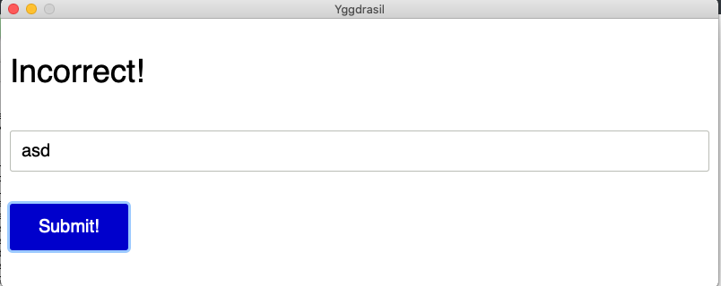<figcaption></figcaption></figure>

Selanjutnya kita coba lakukan decompile terhadap file tersebut.

<figure>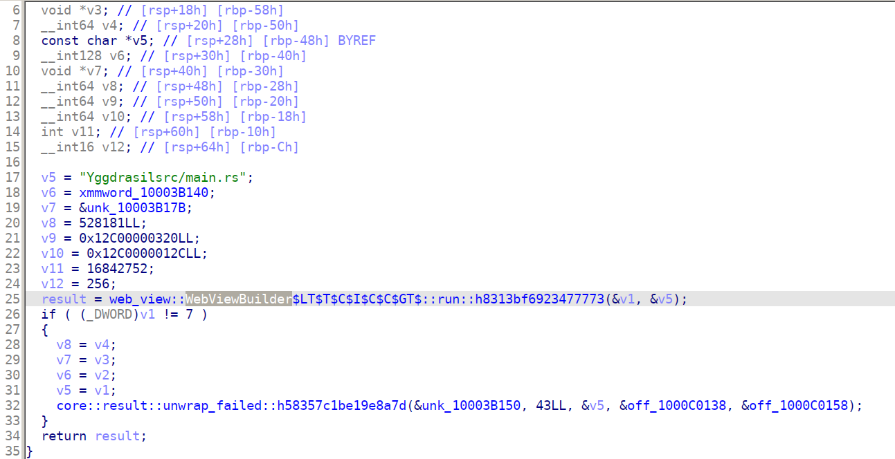<figcaption></figcaption></figure>

Terlihat bahwa program tersebut dibuat menggunakan rust , pada fungsi main terdapat fungsi untuk memanggil webview , jadi bisa kita simpulkan dari hasil eksekusi dan static analysis bahwa program tersebut melakukan load terhadap web. Ada 2 kemungkinan disini , web bisa online atau di store di program itu sendiri, jadi lakukan string untuk melihat string apa aja yang disimpan oleh program.

<figure>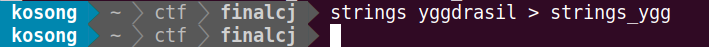<figcaption></figcaption></figure>

<figure>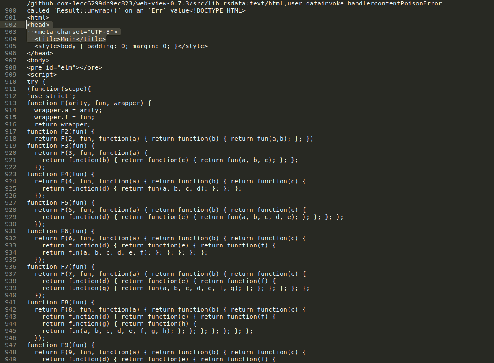<figcaption></figcaption></figure>

Terlihat terdapat kode html ,lakukan search pada “Incorrect!”

<figure>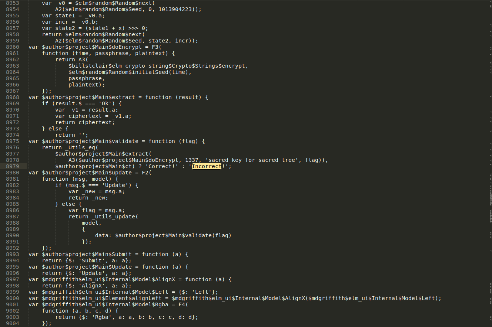<figcaption></figcaption></figure>

Dapat dilihat pada potongan kode diatas bahwa terdapat pengecekan terhadap hasil encrypt dari input kita.

Berikut adalah kode dari fungsi doEncrypt

```javascript
var $author$project$Main$doEncrypt = F3(
    function (time, passphrase, plaintext) {
   	 return A3(
   		 $billstclair$elm_crypto_string$Crypto$Strings$encrypt,
   		 $elm$random$Random$initialSeed(time),
   		 passphrase,
   		 plaintext);
    });

```

Fungsi tersebut menjalankan fungsi billstclair$elm\_crypto\_string$Crypto$Strings$encrypt dan salah satu argumen juga menjalankan suatu fungsi $elm$random$Random$initialSeed. Jadi tinggal search aja untuk kedua fungsi tersebut dan didapatkan informasi bahwa kode tersebut dibuat menggunakan elm-lang dan fungsi encrypt diambil dari salah satu library yang ada pada elm-lang

<figure>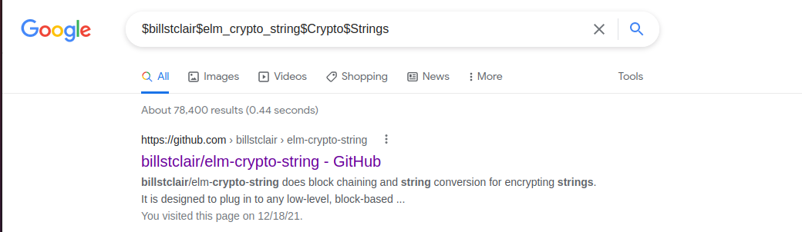<figcaption></figcaption></figure>

Lakukan install terhadap elm-lang dan juga librarynya , lalu coba fungsinya ( lakukan encrypt decrypt ).

<figure>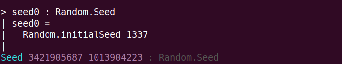<figcaption></figcaption></figure>

<figure>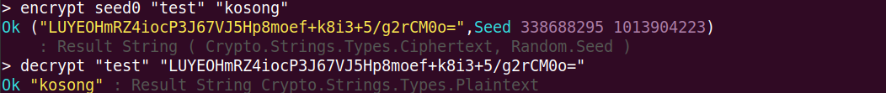<figcaption></figcaption></figure>

Karena sudah bisa encrypt decrypt maka kita coba lakukan decrypt terhadap ct yang dibandingkan dengan hasil encrypt input kita.

```javascript
A3($author$project$Main$doEncrypt, 1337, 'sacred_key_for_sacred_tree', flag)),
var $author$project$Main$ct = 'LUYEOHmRZ4iocP3J67VJ5Cg6WENfuCS6B5BXeqBjMtARkE7d80JjKU53yfTM\n3mm5TgE74LOtl/q6nedvGI+Qbg==';
```

Karena sudah memiliki key dan ct maka lakukan decrypt

<figure>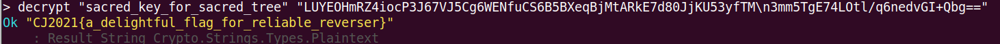<figcaption></figcaption></figure>

Flag : CJ2021{a\_delightful\_flag\_for\_reliable\_reverser}

## Goliath (699 Pts)

### Description

\-

### Solution

Diberikan file ELF 64-bit , kalau diliat dari strings program tersebut dibuat menggunakan rust

<figure>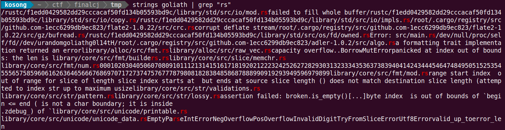<figcaption></figcaption></figure>

Selanjutnya kita coba jalankan file tersebut dan ada yang aneh , yaitu keluar encrypted tapi telat ( sepertinya program lain ) dan hasil md5sum berubah

<figure>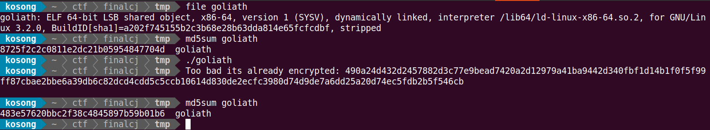<figcaption></figcaption></figure>

Maka dari itu kami coba lakukan static analysis dan dynamic analysis.&#x20;

Pertama kita tahu bahwa goliath berubah , berarti terdapat open terhadap file goliath . Dapat dipastikan ketika kita ubah nama filenya maka akan error

<figure>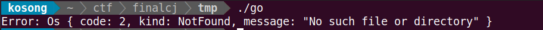<figcaption></figcaption></figure>

Cek fungsi open dan liat reference terhadap fungsi tersebut

<figure>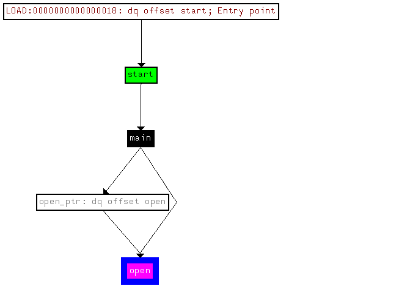<figcaption></figcaption></figure>

Hanya dipanggil difungsi main dan sepertinya bisa kita skip

<figure>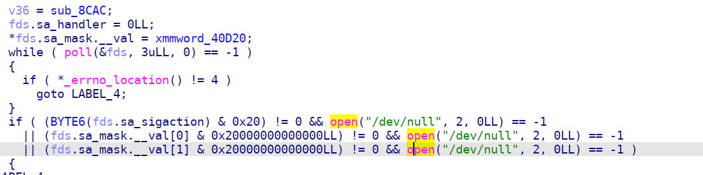<figcaption></figcaption></figure>

Selanjutnya cek fungsi open64

<figure>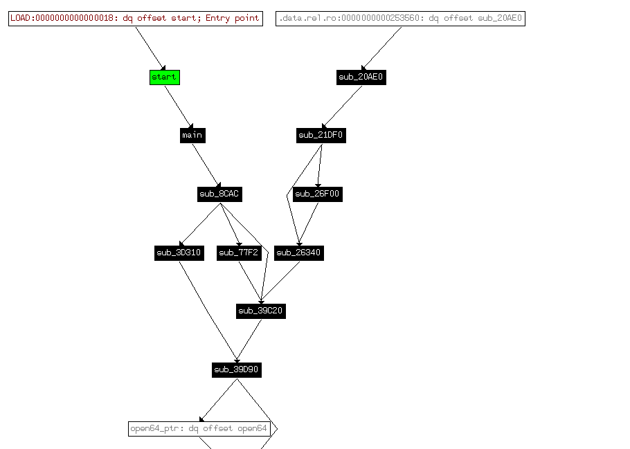<figcaption></figcaption></figure>

Terlihat bahwa dipanggil oleh beberapa fungsi , jadi kita keep informasi ini. Berdasarkan informasi sebelumnya kita ketahui bahwa ada perubahan terhadap file dengan nama goliath , jadi kita search string goliath.

<figure>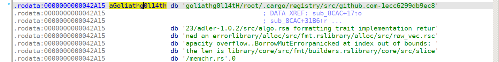<figcaption></figcaption></figure>

Didapatkan string goliath juga diload di fungsi sub\_8CAC , maka selanjutnya analisis fungsi sub\_8CAC.

Disini kami melakukan analisis beberapa fungsi secara dynamic , adapun berikut untuk beberapa address penting yang kami catat.

```
Num Type       Disp Enb Address        What
1   breakpoint keep y   0x000055555540cd75
    breakpoint already hit 1 time
2   breakpoint keep y   0x0000555555408cbb
    breakpoint already hit 1 time
3   breakpoint keep y   0x0000555555408cd8 -> detect file
    breakpoint already hit 1 time
4   breakpoint keep y   0x0000555555408e0c -> check length
5   breakpoint keep y   0x0000555555408e60
7   breakpoint keep y   0x0000555555408f4d
8   breakpoint keep y   0x0000555555408ed5
9   breakpoint keep y   0x0000555555409019 -> ptrace
10  breakpoint keep y   0x0000555555409034 -> ptrace
11  breakpoint keep y   0x0000555555409041
```

Jadi untuk fungsi ptrace kita bypass , caranya adalah dengan mengubah nilai ecx menjadi 6

<figure>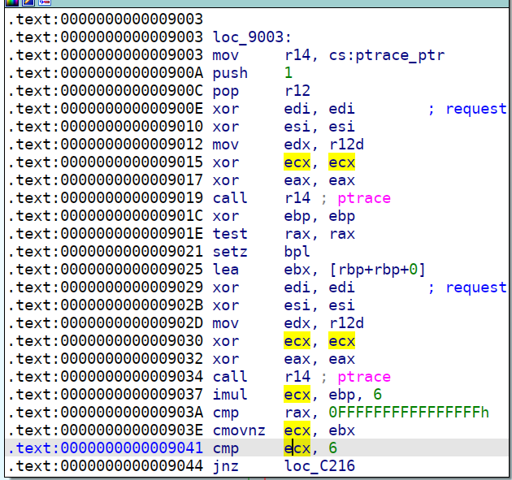<figcaption></figcaption></figure>

Selanjutnya akan dilakukan xor value yang ada dimemory $rbp+$rdi dan $r14+$rbx

<figure>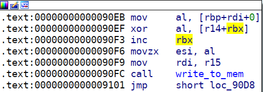<figcaption></figcaption></figure>

Jadi kita lakukan dump terhadap nilai pada address tersebut, adapun untuk panjangnya kita ketahui dari perbandingan nilai rbx dan r12

<figure>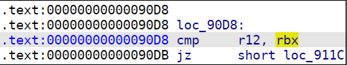<figcaption></figcaption></figure>

Berikut untuk dumpnya

<figure>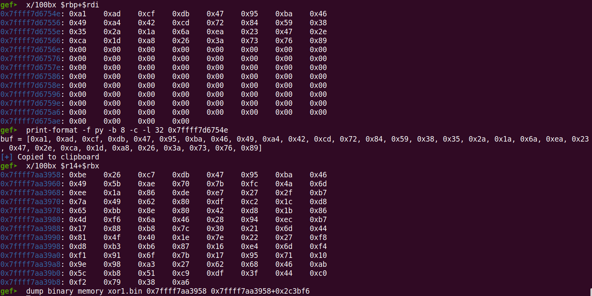<figcaption></figcaption></figure>

Selanjutnya tinggal lakukan xor dan cek hasil dari xor tersebut.

```python
key = [0xa1, 0xad, 0xcf, 0xdb, 0x47, 0x95, 0xba, 0x46, 0x49, 0xa4, 0x42, 0xcd, 0x72, 0x84, 0x59, 0x38, 0x35, 0x2a, 0x1a, 0x6a, 0xea, 0x23, 0x47, 0x2e, 0xca, 0x1d, 0xa8, 0x26, 0x3a, 0x73, 0x76, 0x89]
f = open("xor1.bin","rb").read()
res = []
q = open("out","wb")
for i in range(len(f)):
    res.append(f[i]^key[i%len(key)])
q.write(bytes(res))
```

<figure>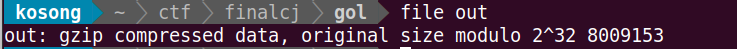<figcaption></figcaption></figure>

Ternyata file gzip , jadi ubah extensi jadi gz lalu lakukan extract.


Didapatkan file out yang merupakan file ELF64 bit

<figure>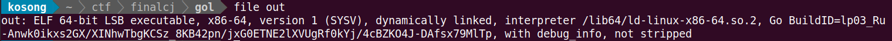<figcaption></figcaption></figure>

Yang mana ketika kita jalankan akan menghasilkan output seperti yang diawal tadi&#x20;

<figure>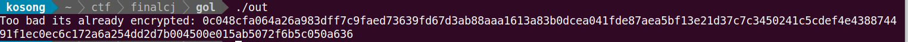<figcaption></figcaption></figure>

Jadi selanjutnya langsung decompile file tersebut

```c
// local variable allocation has failed, the output may be wrong!
void __cdecl main_main()
{
  string length; // [rsp+10h] [rbp-E0h]
  __int64 lengtha; // [rsp+10h] [rbp-E0h]
  string lengthb; // [rsp+10h] [rbp-E0h]
  string lengthc; // [rsp+10h] [rbp-E0h]
  uint8 *elem; // [rsp+18h] [rbp-D8h]
  string elema[3]; // [rsp+18h] [rbp-D8h] OVERLAPPED
  __int64 a; // [rsp+20h] [rbp-D0h]
  __int128 aa; // [rsp+20h] [rbp-D0h] OVERLAPPED
  string ab; // [rsp+20h] [rbp-D0h]
  __interface_{} ac; // [rsp+20h] [rbp-D0h]
  string a_16; // [rsp+30h] [rbp-C0h]
  string plaintext; // [rsp+48h] [rbp-A8h]
  string key_len; // [rsp+58h] [rbp-98h]
  char v13[64]; // [rsp+68h] [rbp-88h] BYREF
  uint8 *key_ptr; // [rsp+A8h] [rbp-48h]
  uint8 *iv_ptr; // [rsp+B0h] [rbp-40h]
  string v16; // [rsp+B8h] [rbp-38h] BYREF
  _OWORD v17[2]; // [rsp+C8h] [rbp-28h] BYREF

  main_ran(32LL);
  key_ptr = elem;
  *((_QWORD *)&aa + 1LL) = main_ran(16LL).str;
  iv_ptr = elem;
  length.str = (uint8 *)"https://gist.githubusercontent.com/vidner/6fede10781c23f76d222fdbec6c4607c/raw/1058e0711938e1c80"
                    	"d69ecfeebd470790a2f4863/viva-el-rey";
  length.len = 131LL;
  *(__uint8 *)&elema[1LL].len = main_doRequest(length);
  lengtha = a;
  *(_QWORD *)&aa = elema[1LL].len;
  crypto_sha256_Sum256(lengtha, *((_QWORD *)&aa + 1LL));
  ((void (*)(void))loc_4564A4)();
  v17[1LL] = 0LL;
  *(runtime_eface_0 *)&elema[1LL].len = runtime_convT2Enoptr((runtime__type_0 *)&stru_6969C0, v13);
  v17[1LL] = aa;
  lengthb.str = (uint8 *)"%x";
  lengthb.len = 2LL;
  *(_QWORD *)&aa = &v17[1LL];
  *((_QWORD *)&aa + 1LL) = 1LL;
  elema[1LL].len = 1LL;
  plaintext = fmt_Sprintf(lengthb, *(__interface_{} *)&aa);
  elema[0LL].str = (uint8 *)"CJ2021{";
  elema[0LL].len = 7LL;
  elema[1LL] = elema[2LL];
  elema[2LL].str = (uint8 *)"}";
  elema[2LL].len = 1LL;
  key_len = runtime_concatstring3((uint8 (*)[32])&v13[32LL], *(string (*)[3])&elema[0LL].str);
  ab.str = key_ptr;
  ab.len = (__int64)key_len.str;
  a_16.str = iv_ptr;
  a_16.len = key_len.len;
  main_Ase256(plaintext, ab, a_16, 16LL);
  v16 = plaintext;
  v17[0LL] = 0LL;
  runtime_convT2Estring((runtime__type_0 *)&e, &v16);
  v17[0LL] = *(_OWORD *)&ac.array;
  lengthc.str = (uint8 *)"Too bad its already encrypted: %v\n";
  lengthc.len = 34LL;
  ac.array = (interface_{} *)v17;
  ac.len = 1LL;
  ac.cap = 1LL;
  fmt_Printf(lengthc, ac);
}

```

Terlihat bahwa program melakukan request terhadap suatu gist lalu melakukan sha256 dan enkripsi aes. Karena terlihat terdapat format flag maka kemungkinan yang di encrypt adalah flag , jadi lakukan breakpoint pada pemanggilan fungsi main\_Ase256 agar tahu value dari argumentnya (flag).

<figure>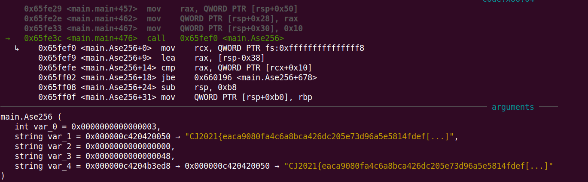<figcaption></figcaption></figure>

<figure>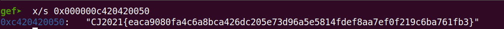<figcaption></figcaption></figure>

Adapun berikut breakpoint yang kami set sebelumnya untuk melakukan analisis pada binary tersebut

<figure>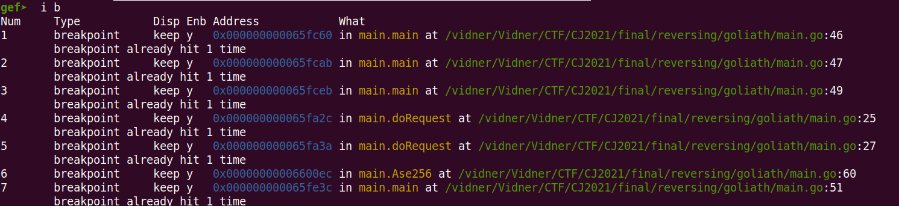<figcaption></figcaption></figure>

Flag : CJ2021{eaca9080fa4c6a8bca426dc205e73d96a5e5814fdef8aa7ef0f219c6ba761fb3}
