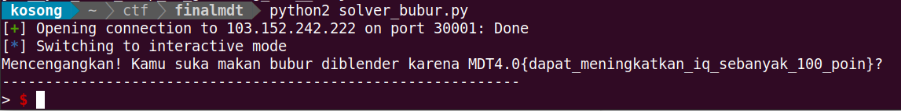
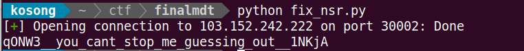

# Cryptography

<!-- challenge-index: e8d1e17ccba4cc22 -->

| Challenge | Topic |
| --- | --- |
| [Bubur Connoisseur (549 pts)](#bubur-connoisseur-549-pts) | AES-ECB, Block Substitution |
| [Not So Random (663 pts)](#not-so-random-663-pts) | PRNG, Modular Roots |

<!-- /challenge-index -->

## Bubur Connoisseur (549 pts)

### Description

\-

### Solution

Diberikan source code sebagai berikut

```python
#!/usr/bin/env python3
from Crypto.Cipher import AES
from Crypto.Util.Padding import pad, unpad
import json, signal, sys

class Unbuffered(object):
	def __init__(self, stream):
    	self.stream = stream
	def write(self, data):
    	self.stream.write(data)
    	self.stream.flush()
	def writelines(self, datas):
    	self.stream.writelines(datas)
    	self.stream.flush()
	def __getattr__(self, attr):
    	return getattr(self.stream, attr)

sys.stdout = Unbuffered(sys.stdout)

FLAG = open('flag.txt', 'rb').read()

BUBUR = {
	"diaduk": "semua rasa tercampur dengan sempurna",
	"tidak diaduk": "terlihat dan terjaga tetap estetik",
	"diblender": FLAG.decode()
}

key = AES.get_random_bytes(AES.block_size)

def user_input(s):
	inp = input(s).strip()
	assert len(inp) < 1024
	return inp

def tulis():
	try:
    	nama = user_input('Nama: ')
    	sekte = user_input('Sekte (diaduk/tidak diaduk): ')
    	assert sekte in ['diaduk', 'tidak diaduk']
    	alasan = BUBUR[sekte]
    	rating = int(user_input('Rating (1-5): '))
    	assert rating in [1, 2, 3, 4, 5]
	except:
    	print('Review kamu aneh, silakan coba lagi')
    	return

	form = json.dumps({
    	"nama": nama,
    	"sekte": sekte,
    	"alasan": alasan,
    	"rating": rating
	}).encode()

	enc = AES.new(key, AES.MODE_ECB).encrypt(pad(form, 16))
	kupon = enc.hex()
	print('Kamu bisa gunakan kupon di bawah ini untuk mendapatkan bubur gratis!')
	print('Kupon: ' + kupon)

def redeem(kupon):
	try:
    	dec = AES.new(key, AES.MODE_ECB).decrypt(bytes.fromhex(kupon))
    	form = json.loads(unpad(dec, 16))
    	assert "sekte" in form.keys() and "alasan" in form.keys() and "rating" in form.keys()

    	form["alasan"] = BUBUR[form["sekte"]]

    	if form["sekte"] == "diblender" and form["rating"] == 5:
        	print(f'Mencengangkan! Kamu suka makan bubur {form["sekte"]} karena {form["alasan"]}?')
    	else:
        	print(f'Kupon berhasil digunakan! Bubur gratis untuk kamu: {chr(0x1f372)}')
	except:
    	print('Kupon yang kamu miliki tidak berasal dari Warung Bubur MDT')
    	return

def banner():
	print('-' * 60)
	print('Selamat datang di Warung Bubur MDT')
	print('Warung Bubur MDT sedang mengadakan event tulis review bubur')
	print('Setiap review yang kamu tulis dapat ditukarkan dengan 1 porsi bubur gratis')
	print('Review terbaik akan mendapatkan hadiah spesial dari Warung Bubur MDT')
	print('-' * 60)
	print('Kamu bisa:')
	print('1. Tulis review')
	print('2. Redeem kupon')

def main():
	banner()
	ink = 100
	used = []
	while True:
    	print('-' * 60)
    	opt = user_input('> ')
    	if opt == '1':
        	if ink >= 30:
            	tulis()
            	ink -= 30
        	else:
            	print('Tinta pulpenmu tidak cukup untuk menulis review lagi')
    	elif opt == '2':
        	coupon = user_input('Kupon: ')
        	if coupon in used:
            	print('Kupon telah digunakan')
        	else:
            	redeem(coupon)
            	used.append(coupon)
    	else:
        	break

if __name__ == '__main__':
	signal.alarm(60)
	main()
```

Dari source code tersebut dapat diketahui bahwa tujuan kita adalah menampilkan flag dengan cara mengisi nilai sekte dengan diblender. Karena enkripsi yang digunakan adalah AES ECB , jadi antar blocknya tidak saling terikat , jadi kita bisa meracik ciphertext dengan mengkombinasikan nilai per blocknya untuk menghasilkan plaintext dengan nilai sekte diblender. Berikut proses pembuatan ciphertext yang kami lakukan

```
Hasil 
{"nama": "AAAAAA -> f[0]
A", "sekte": "di -> f[1]
blender", "sekte -> s[1]
asan": "semua ra -> s[3]
aduk", "alasan": -> f[2]
 "semua rasa ter -> f[3]
campur dengan se -> f[4]
mpurna", "rating -> f[5]
": 5}        	-> f[6]

f->first
{"nama": "AAAAAA 0
A", "sekte": "di 1
aduk", "alasan": 2
 "semua rasa ter 3
campur dengan se 4
mpurna", "rating 5
": 5} 6

s->second
{"nama": "AAAAAA 0
blender", "sekte 1
": "diaduk", "al 2
asan": "semua ra 3
sa tercampur den 4
gan sempurna", " 5
rating": 5} 6
```

Dapat dilihat pada section hasil kita berhasil membuat suatu ciphertext yang nantinya akan membuat nilai sekte menjadi diblender. Berikut penerapannya pada python

```python
from pwn import *

def split(target):
    result = []
    for i in range(0,len(target),32):
   	 result.append(target[i:i+32])
    return result
payload = ["AAAAAAA","AAAAAAblender"]
r = remote("103.152.242.222",30001)
r.recvuntil("> ")
r.sendline("1")
r.recvuntil("Nama: ")
r.sendline(payload[0])
r.recvuntil(": ")
r.sendline("diaduk")
r.recvuntil(": ")
r.sendline("5")
r.recvuntil("Kupon: ")
f = split(r.recvline().strip())
r.recvuntil("> ")
r.sendline("1")
r.recvuntil("Nama: ")
r.sendline(payload[1])
r.recvuntil(": ")
r.sendline("diaduk")
r.recvuntil(": ")
r.sendline("5")
r.recvuntil("Kupon: ")
s = split(r.recvline().strip())
payload = f[0]+f[1]+s[1]+s[3]+f[2]+f[3]+f[4]+f[5]+f[6]
r.recvuntil("> ")
r.sendline("2")
r.recvuntil("Kupon: ")
r.sendline(payload)
r.interactive()

```

<figure><figcaption></figcaption></figure>

Flag : MDT4.0{dapat\_meningkatkan\_iq\_sebanyak\_100\_poin}

## Not So Random (663 pts)

### Description

\-

### Solution

Diberikan source code sebagai berikut

```python
#!/usr/bin/env python3
import random, re, signal, sys

class Unbuffered(object):
	def __init__(self, stream):
    	self.stream = stream
	def write(self, data):
    	self.stream.write(data)
    	self.stream.flush()
	def writelines(self, datas):
    	self.stream.writelines(datas)
    	self.stream.flush()
	def __getattr__(self, attr):
    	return getattr(self.stream, attr)

sys.stdout = Unbuffered(sys.stdout)

FLAG = open('flag.txt', 'rb').read()
FLAG = re.findall(rb'MDT4.0{(\w+)}', FLAG)[0]
F1 = int.from_bytes(FLAG[:5], 'big')
F2 = int.from_bytes(FLAG[5:], 'big')

class NotSoRandom:
	def __init__(self, seed):
    	self.p = 0xffffffffffffffffffbf
    	self.a, self.b = seed, seed

	def next(self):
    	self.a, self.b = pow(self.b, 2, self.p), pow(self.a, 5, self.p)
    	return pow(self.a * self.b, 19, self.p)

def user_input(s):
	inp = input(s).strip()
	assert len(inp) < 1024
	return inp

def main():
	seed = (random.getrandbits(40) << 40) | F1
	nsr = NotSoRandom(seed)
	for _ in range(3):
    	opt = user_input('> ')
    	if opt == '1':
        	print(nsr.next())
    	elif opt == '2':
        	guess = int(user_input('guess: '))
        	if guess == nsr.next():
            	print(F2 * nsr.next())
        	else:
            	print('try harder...')
    	else:
        	break

if __name__ == '__main__':
	signal.alarm(40)
	main()

```

Intinya disini kita harus melakukan leak terhadap nilai seed ( F1 ) , dan juga nilai dari nsr.next() untuk mendapatkan nilai F2. Disini kami melakukan pengamatan terhadap 3 nilai next yang dihasilkan dan didapatkan persamaan seperti berikut

```
a = b

1st next
a^5*a^2 = a^7
(a^7)^19 = a^133

2nd next
(a^5)^2*(a^2)^5 = (a^20)^19 = a^380

3rd next
((a^5)^2)^5*((a^2)^5)^2 = (a^70)^19 = a^1330

4th next
a^3800
```

Karena nilai dari 3rd next adalah 1330 dan 1st next adalah 133 , jadi kita bisa menebak nilai ke tiga dengan hanya memangkatkan 10 untuk nilai 1st next.

```
3rd = (1st^10) mod p
```

Selanjutnya kami sempet stuck untuk mendapatkan nilai seed , karena hanya kurang mod saja :3 . Berikut analisa yang kami lakukan

```
e*d mod phi = 19
n = p -> prime
```

Jadi karena nilai e\*d mod phi tidak sama dengan 1 kita perlu melakukan pengecekan terhadap seluruh kemungkinan nilai yang ada ( menggunakan nthroot\_mod , sebelumnya kami hanya menggunakan nthroot -> stuckk lama ). Karena n prime jadi untuk phi tinggal n-1 saja. Berikut solver yang kami gunakan

```python
import math
import sympy
from Crypto.Util.number import *
import string
from pwn import *

e = 133
n = 0xffffffffffffffffffbf

r = remote("103.152.242.222",30002)
r.recvuntil(">")
r.sendline("1")
ct1 = int(r.recvline().strip())
ct3 = pow(ct1,10,n)
r.recvuntil(">")
r.sendline("1")
ct2 = int(r.recvline().strip())
r.recvuntil(">")
r.sendline("2")
r.recvuntil(":")
r.sendline(str(ct3))
res = int(r.recvline().strip())
ct4 = pow(ct2,10,n)
f2 = long_to_bytes(res//ct4).decode()
g = math.gcd(e, n-1)
d = inverse(e//g, n-1)
for x in sympy.nthroot_mod(pow(ct1, d, n), g, n, True):
	tmp = long_to_bytes(x)
	try:
   	 check = tmp[-5:].decode()
   	 print(check+f2)
	except Exception as e:
   	 continue
```

<figure><figcaption></figcaption></figure>

Flag : MDT4.0{qONW3\_\_you\_cant\_stop\_me\_guessing\_out\_\_1NKjA}
