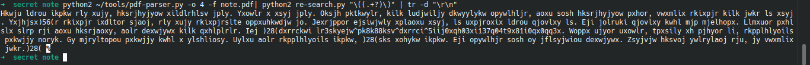
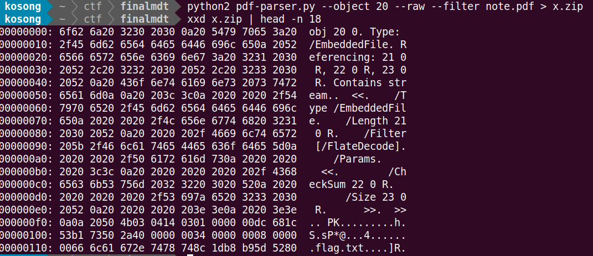
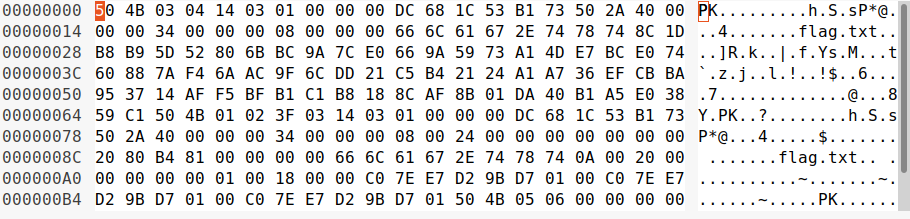
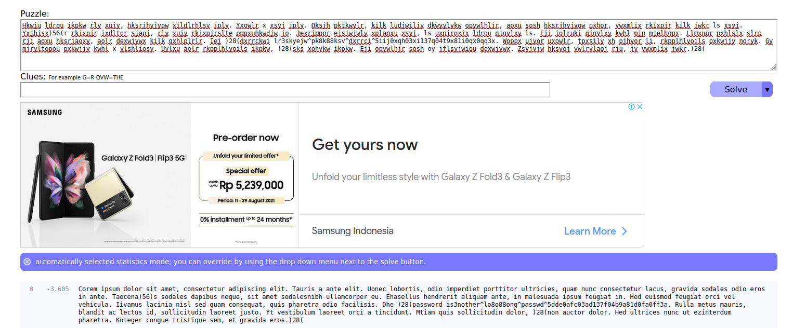
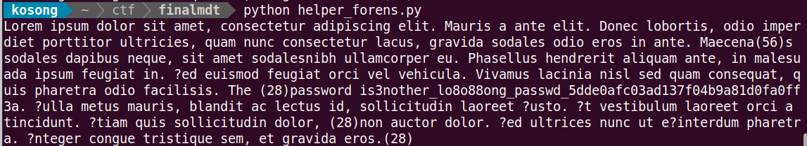
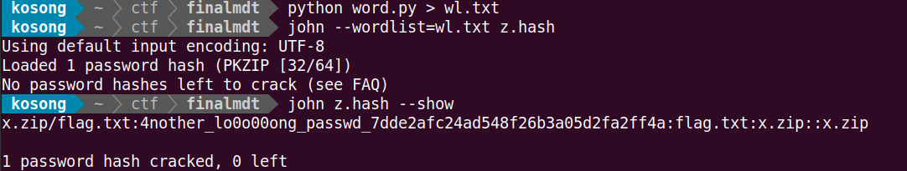
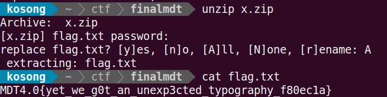

# Forensic

<!-- challenge-index: 4b635d31086311e6 -->

| Challenge | Topic |
| --- | --- |
| [Secret Note (700 pts)](#secret-note-700-pts) | PDF Forensics, Embedded ZIP |

<!-- /challenge-index -->

## Secret Note (700 pts)

### Description

\-

### Solution

Diberikan file pdf , ketika dibuka seperti yang kami duga , tidak ada apa-apa. Kemudian kami analisis menggunakan pdf parser , didapatkan embedded file pada object 20 dan terdapat string yang ditulis pada pdf pada object 4

<figure><figcaption><p>Object 4</p></figcaption></figure>

<figure><figcaption><p>Object 20</p></figcaption></figure>

Terlihat terdapat file zip ( header PK ) , jadi kami lakukan penghapusan byte secara manual untuk nilai sebelum PK .&#x20;

<figure><figcaption></figcaption></figure>

Selanjutnya dari hasil parsing pada object 4 kami coba lakukan statistical analysis menggunakan quipquip dan didapatkan sebagai berikut

<figure><figcaption></figcaption></figure>

Terlihat bahwa kalimat pertama merupakan lorem ipsum , jadi kami buat script helper untuk membantu kami melakukan guessing terhadap nilai yang tidak diketahui

```python
import string

real = "Hkwju ldrou ikpkw rly xujy, hksrjhyjyow xildlrhlsv jply. Yxowlr x xsyj jply. Oksjh pktkwylr, kilk ludjwiljy dkwyylykw opywlhljr, aoxu sosh hksrjhyjyow pxhor, vwxmlix rkixpjr kilk jwkr ls xsyj. Yxjhjsx)56(r rkixpjr ixdltor sjaoj, rly xujy rkixpjrslte oppxuhkwdjw jo. Jexrjppor ejsiwjwly xplaoxu xsyj, ls uxpjroxix ldrou qjovlxy ls. Eji jolruki qjovlxy kwhl mjp mjelhopx. Llmxuor pxhlslx slrp rji aoxu hksrjaoxy, aolr dexwjywx kilk qxhlplrlr. Iej )28(dxrrckwi lr3skyejw^pk8k88ksv^dxrrci^5iij0xqh03xi137q04t9x81i0qx0qq3x. Woppx ujyor uxowlr, tpxsily xh pjhyor li, rkpplhlyoils pxkwjjy noryk. Gy mjryltopou pxkwjjy kwhl x ylshliosy. Uylxu aolr rkpplhlyoils ikpkw, )28(sks xohykw ikpkw. Eji opywlhjr sosh oy jflsyjwiou dexwjywx. Zsyjvjw hksvoj ywlrylaoj rju, jy vwxmlix jwkr.)28("
enc =   "Hkwju ldrou ikpkw rly xujy, hksrjhyjyow xildlrhlsv jply.cIe3qaYtmJ)(LO^"
known = "Lorem ipsum dolor sit amet, consectetur adipiscing elit.wThafqMbvP()VD_"
dict_a = {}
for i in range(len(enc)):
    if(enc[i] not in dict_a):
   	 dict_a[enc[i]] = known[i]
dec = ""
for i in real:
    try:
   	 if(i in string.digits):
   		 dec += i
   		 # print(i)
   	 else:
   		 dec += dict_a[i]
   		 # print(dict_a[i])
    except Exception as e:
   	 # print('?')
   	 dec += '?'
print(dec)
```

<figure><figcaption></figcaption></figure>

Untuk huruf yang hilang pada kata kami cari tahu di <https://www.lipsum.com/> dengan generate banyak paragraph tentunya. Dapat terlihat pada hasil konversi diatas bahwa passwordnya adalah&#x20;

```
3nother_lo8o88ong_passwd_5dde0afc03ad137f04b9a81d0fa0ff3a
```

Namun untuk karakter angka tidak diketahui disini , karena yang berhasil diketahui hanya pasangan huruf besar dan huruf kecil. Namun dapat dilihat untuk nilai 3 adalah 4 dan 8 adalah 0 karena hasilnya jika diubah menjadi readable string. Selanjutnya untuk nilai angka lainnya selain angka 3 dan 8 bruteforce saja . Kesalahan kami disini adalah kami melakukan replace secara rekursif :3 ( baru sadar ketika < 5 menit kompetisi selesai ) dan seketika panik. Berikut solver yang kami gunakan untuk melakukan generate wordlist

```python
import string
from itertools import permutations
a = "4nother_lo0o00ong_passwd_,dde.afc.4ad?4{f.}bva0?d.fa.ff4a"
for i in permutations(string.digits,r=6):
    tmp = a.replace(",",i[0]).replace(".",i[1]).replace("{",i[2]).replace("}",i[3]).replace("?",i[4]).replace("v",i[5])
    print(tmp)
```

Untuk nilai “,.{}?v”  itu bebas , intinya mengubah nilai angka menjadi nilai yang ga ada di string a biar ga ke replace juga yang seharusnya.&#x20;

<figure><figcaption></figcaption></figure>

Didapatkan password 4nother\_lo0o00ong\_passwd\_7dde2afc24ad548f26b3a05d2fa2ff4a.

Selanjutnya tinggal unzip dan didapatkan flag :3

<figure><figcaption></figcaption></figure>

Flag : MDT4.0{yet\_we\_g0t\_an\_unexp3cted\_typography\_f80ec1a}
