# Reverse Engineering

<!-- challenge-index: 91dde098e940852e -->

| Challenge | Topic |
| --- | --- |
| [WHOMEGALUL (663 pts)](#whomegalul-663-pts) | CRC32, Z3 |
| [WeirdChamp (691 pts)](#weirdchamp-691-pts) | F#, .NET Decompilation |

<!-- /challenge-index -->

## WHOMEGALUL (663 pts)

### Description

\-

### Solution

Diberikan file ELF 64 bit , disini kami langsung coba melakukan decompile

```c
__int64 main__main()
{
  __int64 v0; // rdx
  char *v2; // [rsp+0h] [rbp-60h]
  int v3; // [rsp+8h] [rbp-58h]
  int v4; // [rsp+Ch] [rbp-54h]
  __int64 v5; // [rsp+10h] [rbp-50h]
  __int64 v6; // [rsp+18h] [rbp-48h]
  char v7; // [rsp+20h] [rbp-40h]
  char v8; // [rsp+30h] [rbp-30h]
  char v9; // [rsp+40h] [rbp-20h]
  __int64 v10; // [rsp+50h] [rbp-10h]
  __int64 v11; // [rsp+58h] [rbp-8h]

  v5 = os__hostname();
  v6 = v0;
  memmove_plt(&v7, &v5, 16LL);
  v2 = L_1261;
  v3 = 53;
  v4 = 1;
  memmove_plt(&v8, &v2, 16LL);
  memmove_plt(&v9, &v7, 32LL);
  main__Credential_validate(&v9);
  return println(v10, v11);
}

```

Terlihat dari fungsi main\_\_main , bahwa hostname dari komputer kita digunakan sebagai argument dari fungsi main\_\_Credential\_validate.

```c
v74 = v77;
	v72 = string_substr(*v77, v77[1], 0LL, 4LL);
	v73 = v2;
	string_bytes(&v75, v72);
	v74 = &v11;
	memmove_plt(&v11, &v75, 32LL);
	v76 = hash__crc32__sum((unsigned __int64)&v11);
	v74 = v77;
	v68 = string_substr(*v77, v77[1], 4LL, 8LL);
	v69 = v3;
	string_bytes(&v70, v68);
	v74 = &v11;
	memmove_plt(&v11, &v70, 32LL);
	v71 = hash__crc32__sum((unsigned __int64)&v11);
	v74 = v77;
	v64 = string_substr(*v77, v77[1], 8LL, 12LL);
	v65 = v4;
	string_bytes(&v66, v64);
	v74 = &v11;
	memmove_plt(&v11, &v66, 32LL);
	v67 = hash__crc32__sum((unsigned __int64)&v11);
	v74 = v77;
	v61 = v77 + 1;
	v59 = string_substr(*v77, v77[1], 12LL, *((unsigned int *)v77 + 2));
	v60 = v5;
	string_bytes(&v62, v59);
	v74 = &v11;
	memmove_plt(&v11, &v62, 32LL);
	v63 = hash__crc32__sum((unsigned __int64)&v11);
	v51 = v76;
	v52 = v71;
	v53 = v67;
	v54 = v63;
	new_array_from_c_array(&v55, 4LL, 4LL, 4LL, &v51);
```

Pada fungi main\_\_Credential\_validate dilakukan pengecekan panjang hostname kita, kemudian dilakukan hash dengan algoritma crc32 untuk per 4 byte nya

```c
   for ( i = 0; i < v58; ++i )
	{
  	v34 = *(_DWORD *)(4LL * i + v57);
  	for ( j = 0; j < v58; ++j )
  	{
    	v32 = *(_DWORD *)(4LL * j + v57);
    	if ( v34 != v32 )
    	{
      	v31 = v32 + v34;
      	v74 = &v11;
      	memmove_plt(&v11, &v49, 32LL);
      	result = (_DWORD *)array_get(v50, (unsigned __int64)&v49, v6, v7, v8);
      	if ( v31 != *result )
        	return result;
      	++v50;
    	}
  	}
	}
```

Selanjutnya dilakukan penambahan untuk nilai index yang tidak sama ( i!=j ) dan dilakukan pengecekan dengan hardcode value pada binary. Jadi disini kami lakukan extract terhadap hardcode tersebut lalu gunakan z3 untuk mendapatkan nilai dari crc32 flag per 4 byte , untuk mendapatkan plaintext lakukan bruteforce.

```python
from z3 import *

# dump = ['13e3e974', 'b8fb8dd0', 'ba94a470', '13e3e974', '5e07e4c0', '5fa0fb60', 'b8fb8dd0', '5e07e4c0', '4b89fbc', 'ba94a470', '5fa0fb60', '4b89fbc']

flag = [BitVec(f"flag_{i}", 64) for i in range(4)]
s = Solver()
s.add(flag[0]+flag[1] == 0x113e3e974)
s.add(flag[0]+flag[2] == 0xb8fb8dd0)
s.add(flag[0]+flag[3] == 0xba94a470)
s.add(flag[1]+flag[2] == 0x5e07e4c0)
s.add(flag[1]+flag[3] == 0x5fa0fb60)
s.add(flag[2]+flag[3] == 0x4b89fbc)
s.check()
model = s.model()
res = []
for i in flag:
    res.append(model[i].as_long())
print(res)

```

<figure>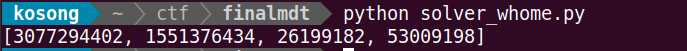<figcaption></figcaption></figure>

Selanjutnya bruteforce, disini kami menggunakan pypy untuk mempercepat proses bruteforce

```python
import string
from itertools import product
import zlib

flag = [3077294402, 1551376434, 26199182, 53009198]
list_str = string.uppercase + string.lowercase + string.digits
res = [0]*4
cnt = 0
for i in product(string.printable[:-6],repeat=4):
    tmp = zlib.crc32(i[0]+i[1]+i[2]+i[3])
    tmp = tmp&0xffffffff
    if(tmp in flag):
   	 res[flag.index(tmp)] = i[0]+i[1]+i[2]+i[3]
    if(0 not in res):
   	 break
print ''.join(res)

```

<figure>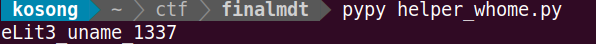<figcaption></figcaption></figure>

Untuk mendapatkan flag disini kami lakukan write saja ke memory&#x20;

```python
#!/usr/bin/python3

static_val=[]
class SolverEquation(gdb.Command):
	def __init__ (self):
    	super (SolverEquation, self).__init__ ("solve-equation",gdb.COMMAND_OBSCURE)

	def invoke (self, arg, from_tty):
    	global static_val
    	gdb.execute("delete")
    	gdb.execute("b *0x000000000044e684")
    	gdb.execute("r")
    	gdb.execute('set {char [17]} $rax = "eLit3_uname_1337"')
    	gdb.execute('set $rdx = 0x10')
    	gdb.execute("c")
def addr2num(addr):
	try:
    	return int(addr)&0xff  # Python 3
	except:
    	return long(addr) # Python 2
SolverEquation()
```

<figure>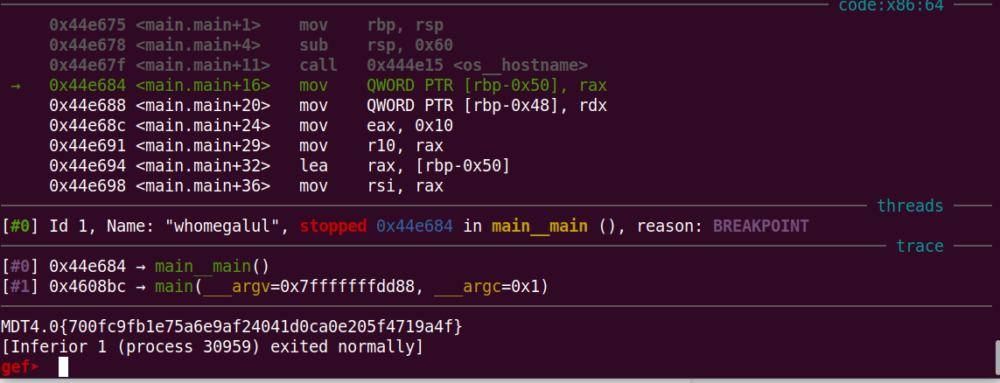<figcaption></figcaption></figure>

Flag : MDT4.0{700fc9fb1e75a6e9af24041d0ca0e205f4719a4f}

## WeirdChamp (691 pts)

### Description

\-

### Solution

Diberikan file exe yang cukup berat, dibuat dengan F# . Disini kami menggunakan dnspy untuk melakukan decompile terhadap file exe tersebut

<figure>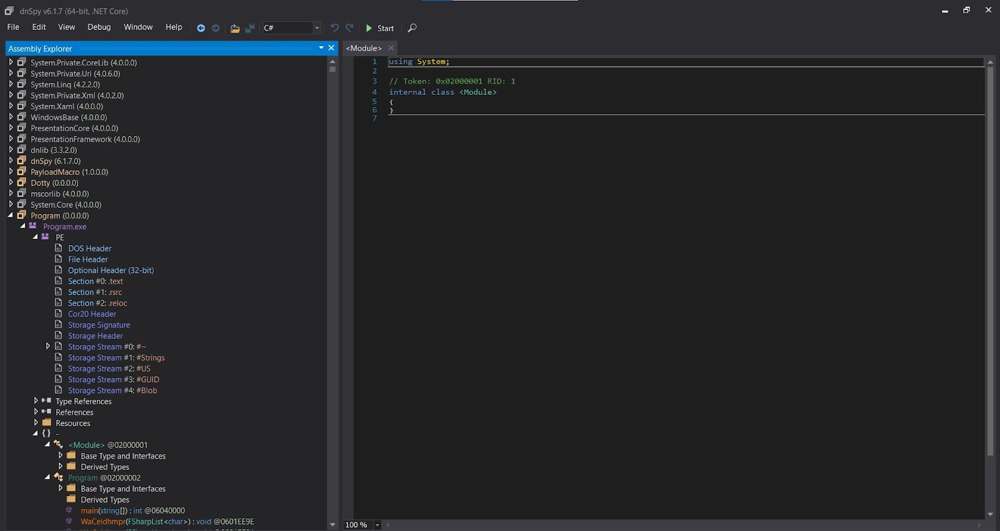<figcaption></figcaption></figure>

Tentunya setelah menunggu cukup lama akhirnya kami mendapatkan full source codenya , berikut untuk full source codenya&#x20;

Disini kami kesulitan karena tidak dapat menjalankan filenya namun setelah kami analisis ternyata pada setiap function yang didefinisikan terdapat pemanggilan fungsi print , yang melakukan print “L” . Karena saat kami lihat terdapat tail head , seperti 2 mata koin , dan ada print huruf “L” maka kami simpulkan bahwa L bermakna LOSE , dan ada fungsi yang melakukan print “W” yang bermakna WIN . Jadi kami coba cari fungsi yang melakukan print “W” , dan ternyata ADA.

<figure>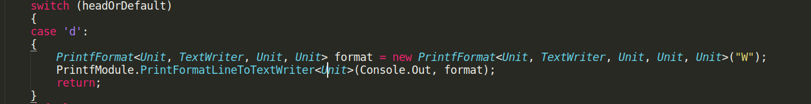<figcaption></figcaption></figure>

Karena diawal terlihat bahwa fungsi ini melakukan pemanggilan fungsi lain secara rekursif maka disini kami sama saja dengan melakukan rekursif secara reverse ( dari child ke parent ). Disini kami mendapatkan keseluruhan flagnya secara manual :) . Tinggal search search aja untuk nama fungsinya

<figure>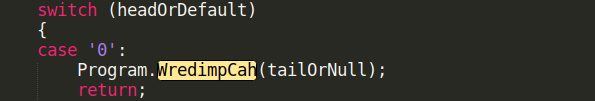<figcaption></figcaption></figure>

<figure>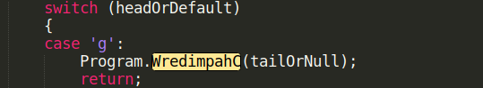<figcaption></figcaption></figure>

<figure><figcaption></figcaption></figure>

<figure>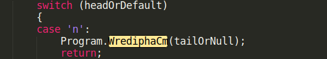<figcaption></figcaption></figure>

<figure>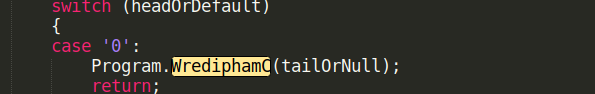<figcaption></figcaption></figure>

<figure>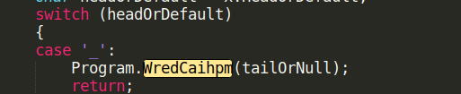<figcaption></figcaption></figure>

<figure>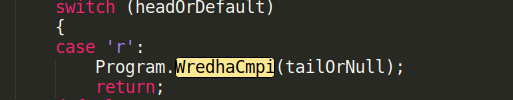<figcaption></figcaption></figure>

<figure>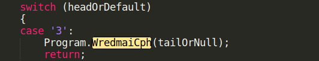<figcaption></figcaption></figure>

<figure>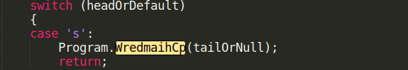<figcaption></figcaption></figure>

<figure>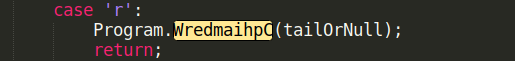<figcaption></figcaption></figure>

<figure>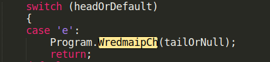<figcaption></figcaption></figure>

<figure>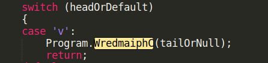<figcaption></figcaption></figure>

<figure>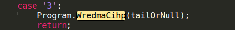<figcaption></figcaption></figure>

<figure>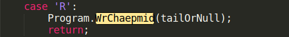<figcaption></figcaption></figure>

<figure>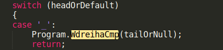<figcaption></figcaption></figure>

<figure>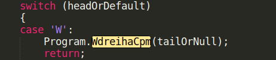<figcaption></figcaption></figure>

<figure>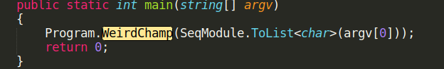<figcaption></figcaption></figure>

Kemudian tinggal gabungkan dari bawah ke atas atau atas ke bawah lalu reverse dan diapatkan flagnya.

Flag : MDT4.0{W\_R3vers3r\_0n\_g0d}
