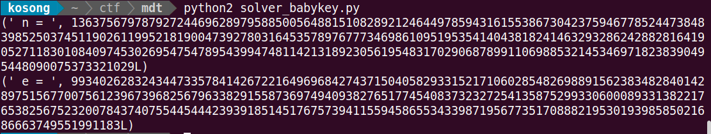
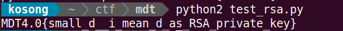

# Cryptography

<!-- challenge-index: 2d555ddb451aa40e -->

| Challenge | Topic |
| --- | --- |
| [Baby Key (592 pts)](#baby-key-592-pts) | RSA, Wiener's Attack |

<!-- /challenge-index -->

## Baby Key (592 pts)

### Description

\-

### Solution

Diberikan source code sebagai berikut

```python
#!/usr/bin/env python3
from Crypto.PublicKey import RSA
from gmpy2 import digits

key = RSA.import_key(open('key.pem').read())
msg = int(digits(int.from_bytes(open('flag.txt', 'rb').read(), 'little'), 8))
enc = int.to_bytes(pow(msg, key.e, key.n), 128, 'little')
open('flag.enc', 'wb').write(enc)
```

Sepertinya tidak ada yang aneh dari source code tersebut , jadi selanjutnya kami coba cek keynya dan ternyata nilai e yang diberikan besar.

<figure><figcaption></figcaption></figure>

Dari sini kami coba lakukan common attack pada rsa dengan public exponent besar yaitu menggunakan wiener attack dan ternyata berhasil. Berikut script yang kami gunakan



```python
def rational_to_contfrac(x,y):
	# Converts a rational x/y fraction into a list of partial quotients [a0, ..., an]
	a = x // y
	pquotients = [a]
	while a * y != x:
    	x, y = y, x - a * y
    	a = x // y
    	pquotients.append(a)
	return pquotients

def convergents_from_contfrac(frac):
	# computes the list of convergents using the list of partial quotients
	convs = [];
	for i in range(len(frac)): convs.append(contfrac_to_rational(frac[0 : i]))
	return convs

def contfrac_to_rational (frac):
	# Converts a finite continued fraction [a0, ..., an] to an x/y rational.
	if len(frac) == 0: return (0,1)
	num = frac[-1]
	denom = 1
	for _ in range(-2, -len(frac) - 1, -1): num, denom = frac[_] * num + denom, num
	return (num, denom)

```





```python
from continued_fractions import *
from Crypto.Util.number import *

n = 136375679787927244696289795885005648815108289212464497859431615538673042375946778524473848398525037451190261199521819004739278031645357897677734698610951953541404381824146329328624288281641905271183010840974530269547547895439947481142131892305619548317029068789911069885321453469718238390495448090075373321029

e = 9934026283243447335784142672216496968427437150405829331521710602854826988915623834828401428975156770075612396739682567963382915587369749409382765177454083732327254135875299330600089331382217653825675232007843740755445444239391851451767573941155945865534339871956773517088821953019398585021686663749551991183

tmp = open('flag.enc', 'r').read()

c = bytes_to_long(tmp[::-1])

def egcd(a, b):
	if a == 0: return (b, 0, 1)
	g, x, y = egcd(b % a, a)
	return (g, y - (b // a) * x, x)

def mod_inv(a, m):
	g, x, _ = egcd(a, m)
	return (x + m) % m

def isqrt(n):
	x = n
	y = (x + 1) // 2
	while y < x:
    	x = y
    	y = (x + n // x) // 2
	return x
 
def crack_rsa(e, n):
	frac = rational_to_contfrac(e, n)
	convergents = convergents_from_contfrac(frac)
    
	for (k, d) in convergents:
    	if k != 0 and (e * d - 1) % k == 0:
        	phi = (e * d - 1) // k
        	s = n - phi + 1
        	# check if x*x - s*x + n = 0 has integer roots
        	D = s * s - 4 * n
        	if D >= 0:
            	sq = isqrt(D)
            	if sq * sq == D and (s + sq) % 2 == 0: return d

d = crack_rsa(e, n)
print(long_to_bytes(int(str(pow(c,d,n)),8))[::-1])

```



<figure><figcaption></figcaption></figure>

Flag : MDT4.0{small\_d\_\_i\_mean\_d\_as\_RSA\_private\_key}
