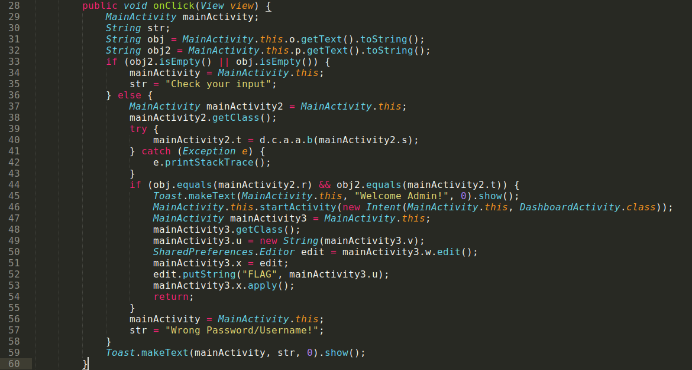
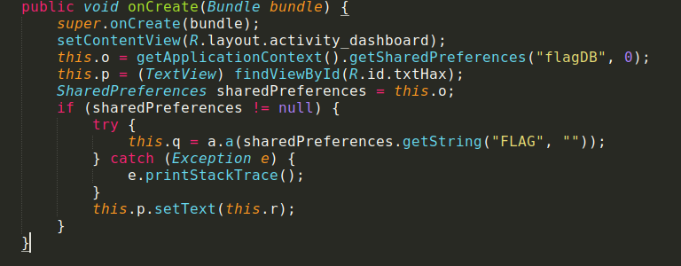
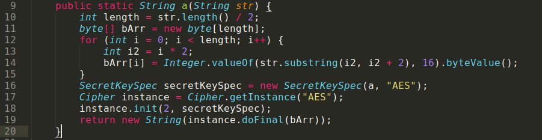
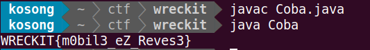
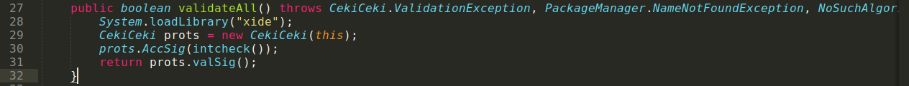
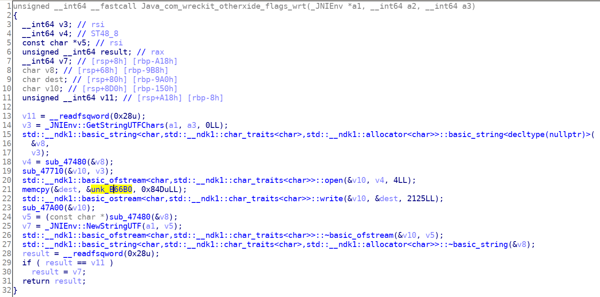
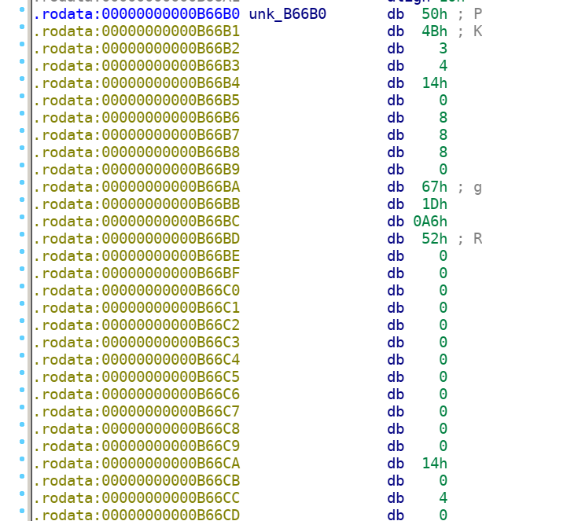
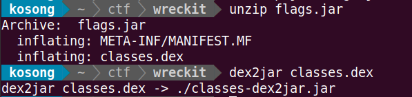
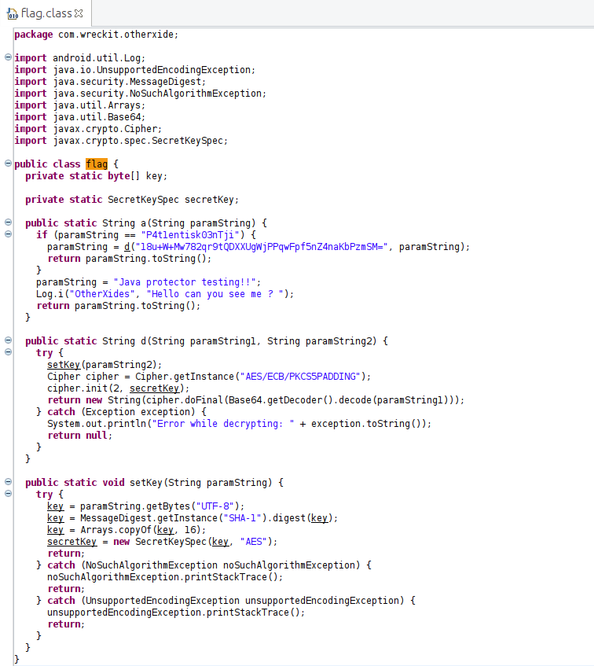
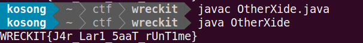

# Mobile

<!-- challenge-index: 954de2dfc24f3705 -->

| Challenge | Topic |
| --- | --- |
| [Ezhax](#ezhax) | Android, AES |
| [Otherxide](#otherxide) | JNI, AES, Base64 |

<!-- /challenge-index -->

## Ezhax

### Description

\-

### Solution

Diberikan file apk , disini kami langsung membukanya menggunakan jadx-gui lalu menyimpan source beserta resourcenya juga.

Pada class MainActivity terdapat method menarik yaitu onClick

<figure><figcaption></figcaption></figure>

Pada method tersebut dilakukan pengecekan login , kemudian akan ada suatu sharedpreference dengan nama FLAG yang di set dengan value yaitu variable v pada class MainActivity

```java
public byte[] v = {49, 53, 66, 68, 53, 65, 50, 67, 48, 56, 48, 66, 66, 48, 55, 54, 49, 52, 48, 53, 68, 52, 57, 69, 57, 49, 51, 54, 67, 48, 52, 69, 48, 68, 67, 55, 50, 65, 48, 49, 69, 68, 69, 48, 50, 57, 69, 53, 51, 52, 69, 52, 50, 69, 70, 54, 68, 66, 54, 50, 65, 50, 50, 55};
```

Pada class DashboardActivity terdapat method oncreate yang menggunakan sharedpreference flag yang di set tadi dan memanggil method a

<figure><figcaption></figcaption></figure>

Jadi selajutnya kami coba buka method a

<figure><figcaption></figcaption></figure>

Pada method a dilakukan decrypt menggunakan AES , jadi disini kami tinggal menyalin kode tersebut untuk melakukan decrypt terhadap encrypted text. Berikut script yang kami gunakan

```java
import javax.crypto.Cipher;
import javax.crypto.spec.SecretKeySpec;
class Coba{
    public static final byte[] a = {99, 108, 107, 105, 110, 103, 116, 102, 112, 97, 105, 114, 122, 101, 103, 103};
    public static void main(String[] args) {
   	 System.out.println(a("15BD5A2C080BB0761405D49E9136C04E0DC72A01EDE029E534E42EF6DB62A227"));
    }

    public static String a(String str) {
    	int length = str.length() / 2;
    	byte[] bArr = new byte[length];
    	for (int i = 0; i < length; i++) {
        	int i2 = i * 2;
        	bArr[i] = Integer.valueOf(str.substring(i2, i2 + 2), 16).byteValue();
    	}
    	try{
   		 SecretKeySpec secretKeySpec = new SecretKeySpec(a, "AES");
    	Cipher instance = Cipher.getInstance("AES");
    	instance.init(2, secretKeySpec);
    	return new String(instance.doFinal(bArr));
    	}
    	catch (Exception e) {
   		 return "";
    	}
	}
}
```

<figure><figcaption></figcaption></figure>

Flag : WRECKIT{m0bil3\_eZ\_Reves3}

## Otherxide

### Description

\-

### Solution

Diberikan file apk disini kami langsung membukanya menggunakan jadx.

Pada class MainActivity terdapat pemanggilan method yang menarik karena melibatkan native library yaitu xide

<figure><figcaption></figcaption></figure>

Setelah kami telusuri ternyata pada class flags dilakukan pemanggilan terhadap fungsi flag yang didapat dari hasil load terhadap dex. File dex sendiri didapat dari fungsi wrt yang dilakukan pemanggilan dari native library. Jadi disini saya coba buka native library tersebut lalu mengambil file dex nya dan konversi file dex ke jar lalu membukanya dengan jd gui. Terakhir tinggal analisis fungsi decrypt dari flag dan terapkan pada kode java yang dibuat sendiri.

<figure><figcaption></figcaption></figure>

<figure><figcaption></figcaption></figure>

Extract dengan python

```python
f = open("libxide.so","rb").read()
out = open("flags.jar","wb")
out.write(f[0xB66B0:0xB6EFD])
```

<figure><figcaption></figcaption></figure>

<figure><figcaption></figcaption></figure>

&#x20;Berikut script yang kami gunakan untuk melakukan decrypt

```java
import java.io.UnsupportedEncodingException;
import java.security.MessageDigest;
import java.security.NoSuchAlgorithmException;
import java.util.Arrays;
import java.util.Base64;
import javax.crypto.Cipher;
import javax.crypto.spec.SecretKeySpec;

class OtherXide{
      private static byte[] key;
 
  private static SecretKeySpec secretKey;
    public static void main(String[] args) {
   	 String  paramString = d("18u+W+Mw782qr9tQDXXUgWjPPqwFpf5nZ4naKbPzmSM=", "P4t1entisk03nTji");
   	 System.out.println(paramString);
    }

    public static String d(String paramString1, String paramString2) {
	try {
  	setKey(paramString2);
  	Cipher cipher = Cipher.getInstance("AES/ECB/PKCS5PADDING");
  	cipher.init(2, secretKey);
  	return new String(cipher.doFinal(Base64.getDecoder().decode(paramString1)));
	} catch (Exception exception) {
  	System.out.println("Error while decrypting: " + exception.toString());
  	return null;
	}
  }
 
  public static void setKey(String paramString) {
	try {
  	key = paramString.getBytes("UTF-8");
  	key = MessageDigest.getInstance("SHA-1").digest(key);
  	key = Arrays.copyOf(key, 16);
  	secretKey = new SecretKeySpec(key, "AES");
  	return;
	} catch (NoSuchAlgorithmException noSuchAlgorithmException) {
  	noSuchAlgorithmException.printStackTrace();
  	return;
	} catch (UnsupportedEncodingException unsupportedEncodingException) {
  	unsupportedEncodingException.printStackTrace();
  	return;
	}
  }
}
```

<figure><figcaption></figcaption></figure>

Flag : WRECKIT{J4r\_Lar1\_5aaT\_rUnT1me}
