# Reverse Engineering

<!-- challenge-index: ffa2184feadd1be5 -->

| Challenge | Topic |
| --- | --- |
| [baby networking (496 pts)🥇](#baby-networking-496-pts) | Custom Network Protocol, Key Recovery |
| [baby mips? (500 pts)🥇](#baby-mips-500-pts) | MIPS64, QEMU |

<!-- /challenge-index -->

## baby networking (496 pts)

### Description

\-

### Solution

Diberikan file ELF, kami langsung membukanya menggunakan IDA

<figure>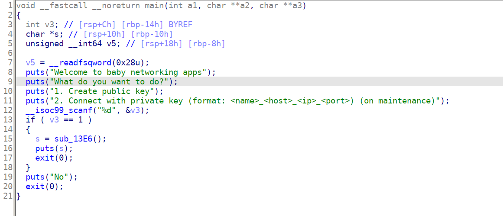<figcaption></figcaption></figure>

Jadi disini fungsi yang berjalan dengan sempurna adalah fungsi generate public key. Berikut fungsinya

<figure>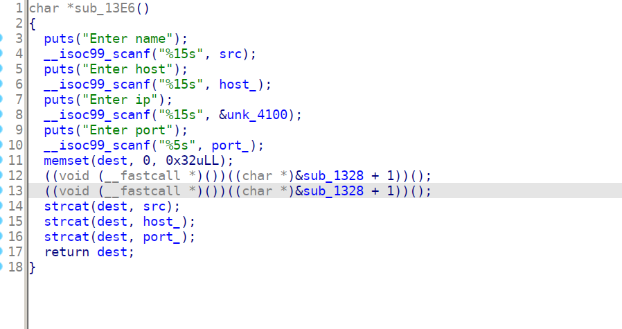<figcaption></figcaption></figure>

Name dan host dilakukan enkripsi dengna key yaitu IP . Berikut algoritma enkripsinya

<figure>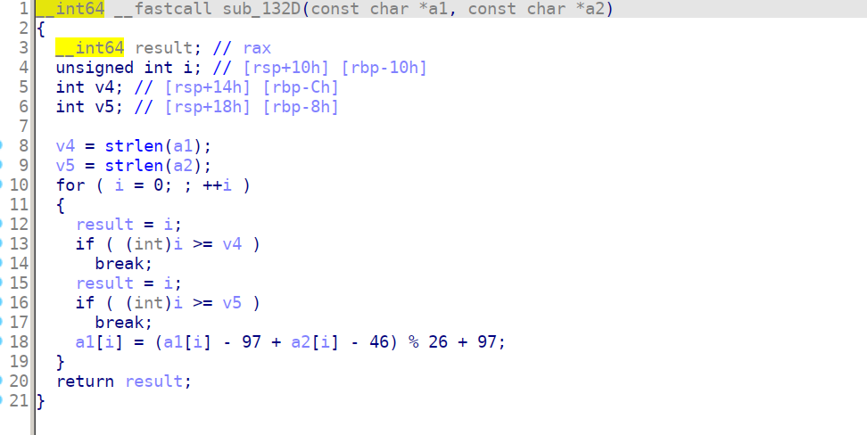<figcaption></figcaption></figure>

Disini kami tidak membaca deskripsi , namun kami berhasil melakukan leak terhadap IP address dengan berdasarkan pada ip dari service lain . Berikut script yang kami gunakan ketika melakuka percobaan semi manual

```python
# a = "gcaeeqwrrgmnvyxgcaevjnlraidvzm11235"
a = "nsbopgwibtJcqm8080"

# a1[i] = (a1[i] - 97 + a2[i] - 46) % 26 + 97;
def dec(a1,a2):
	res = ""
	for i in range(min(len(a1),len(a2))):
		res += chr(((ord(a1[i]) - 97 - ord(a2[i]) + 46) % 26) + 97)
	return res

def enc(a1,a2):
	res = ""
	for i in range(min(len(a1),len(a2))):
		res += chr((ord(a1[i]) - 97 + ord(a2[i]) - 46) % 26 + 97)
	return res

# z = "wibtJcqm"
# b = "kosong"
# a = dec(z,"127.0.0.1")
# print(a)

a = "gcaeeqwrrgmnvyx"
b = "gcaevjnlraidvzm"
test = "taestaaaaaa.com"
# c = "^_`^nrvoqjKcrp1234"
c = "whvtkrvtKfrm"
# plain = "kosong"
# print(enc(plain,"127.0.0.1"))
brute = "103.167.132.188"
print("name",dec(a,brute))
print("host",dec(b,brute))

```

<figure>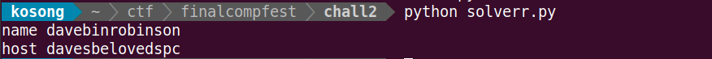<figcaption></figcaption></figure>

Kemudian kami membaca deskripsi dan ternyata ada namanya jadi ini benar. Selanjutnya tinggal cari tahu fungsi untuk komunikasi dengan server

<figure>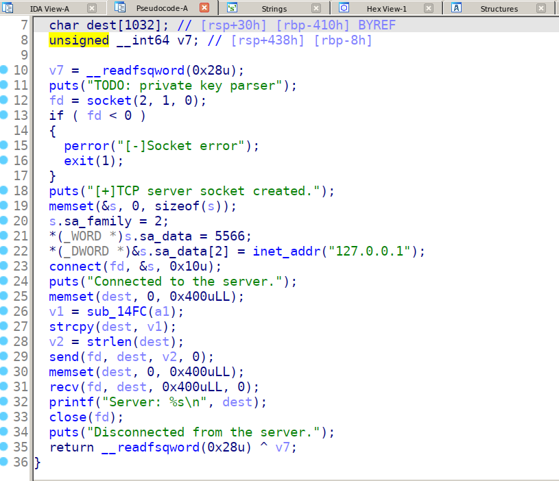<figcaption></figcaption></figure>

Fungsi pada ELF tidak sempurna , namun overall jelas. Jadi caranya adalah dengan konek ke server lalu mengirim value sebagai berikut

<figure>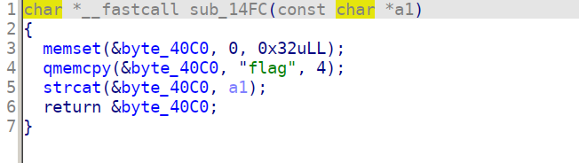<figcaption></figcaption></figure>

```
flag<name>_<host>_<ip>_<port>
```

Berikut final solver dari kami

```python
from pwn import *

r = remote("103.167.132.188",11235)
payload = "flagdavebinrobinson_davesbelovedspc_103.167.132.188_11235"
r.send(payload)
r.interactive()
```

<figure>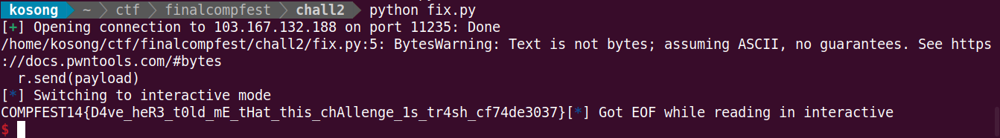<figcaption></figcaption></figure>

Flag : COMPFEST14{D4ve\_heR3\_t0ld\_mE\_tHat\_this\_chAllenge\_1s\_tr4sh\_cf74de3037}

## baby mips? (500 pts)

### Description

\-

### Solution

Diberikan ELF yang dicompile menggunakan mips64 el, binary tersebut dicompile dengan static. Kami menggunakan referensi berikut untuk melakukan debug <https://reverseengineering.stackexchange.com/questions/8829/cross-debugging-for-arm-mips-elf-with-qemu-toolchain> dan diawal kami coba lakukan compile dan debug untuk program yang kita buat sendiri (untuk memahami proses debugging terhadap mips64el executable) . Lakukan debug. Disini untuk menemukan fungsi dengan cara trial and error, intinya kami coba breakpoint di beberapa fungsi yang sepertinya dibuat oleh problem setter (bukan library). Hingga kami menemukan fungsi yang menerima input sampai di operasi terhadap input. Berikut daftar breakpoint yang tercatat (ketika step akhir untuk mendapat flag).&#x20;

<figure>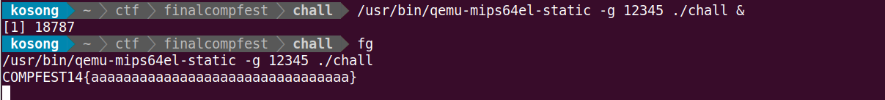<figcaption></figcaption></figure>

<figure>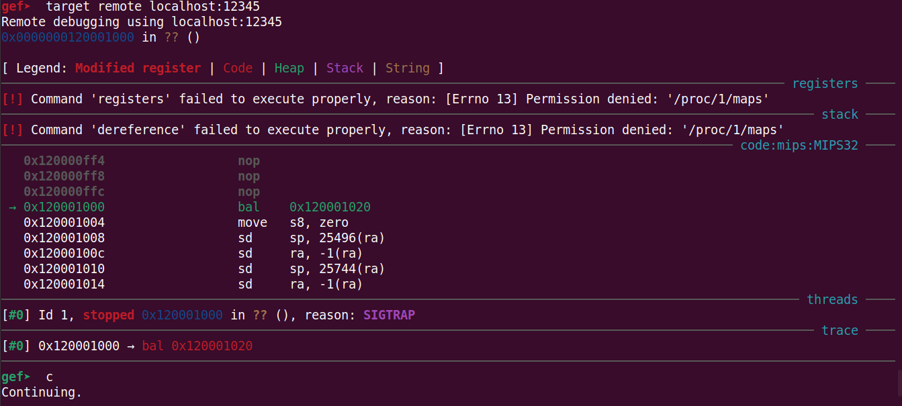<figcaption></figcaption></figure>

<figure>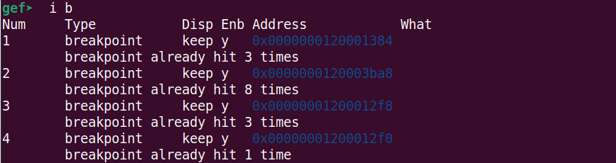<figcaption></figcaption></figure>

Pada salah satu fungsi kami melihat addressnya lalu cross check dengan ghidra dan didapatkan fungsi berikut

<figure>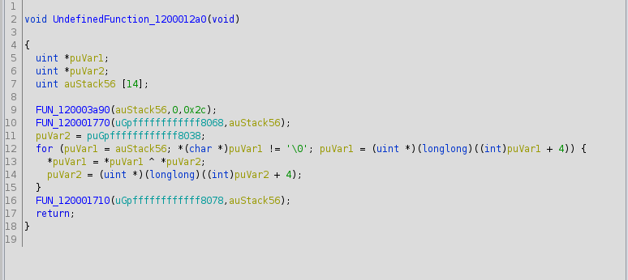<figcaption></figcaption></figure>

Terlihat bahwa dilakukan xor, dan hasil dari analisis kami setiap hasil enkripsi untuk input nilainya sama asalkan indexnya sama dan valuenya sama untuk index tersebut. Ketika kami lakukan breakpoint pada fungsi tersebut didapatkan bahwa input kita (4 byte) di lakukan xor dengan suatu nilai static.

<figure>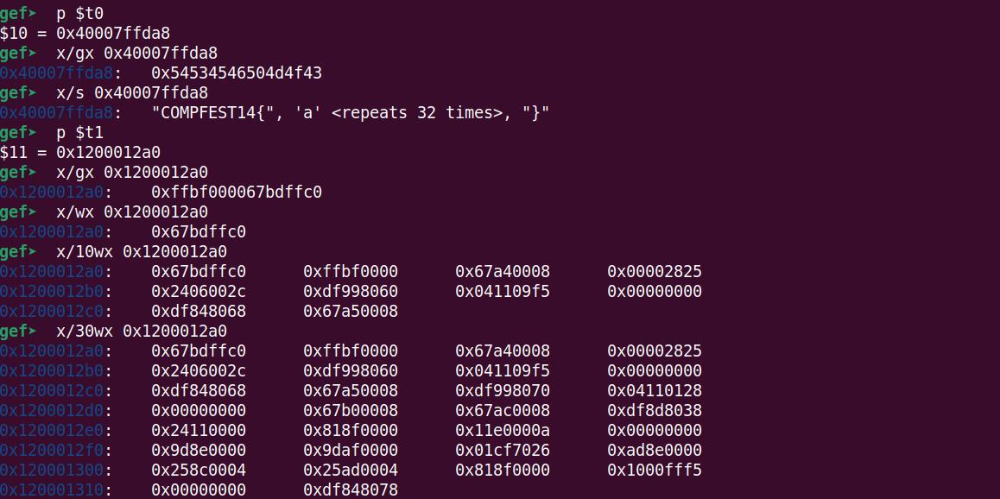<figcaption></figcaption></figure>

<figure>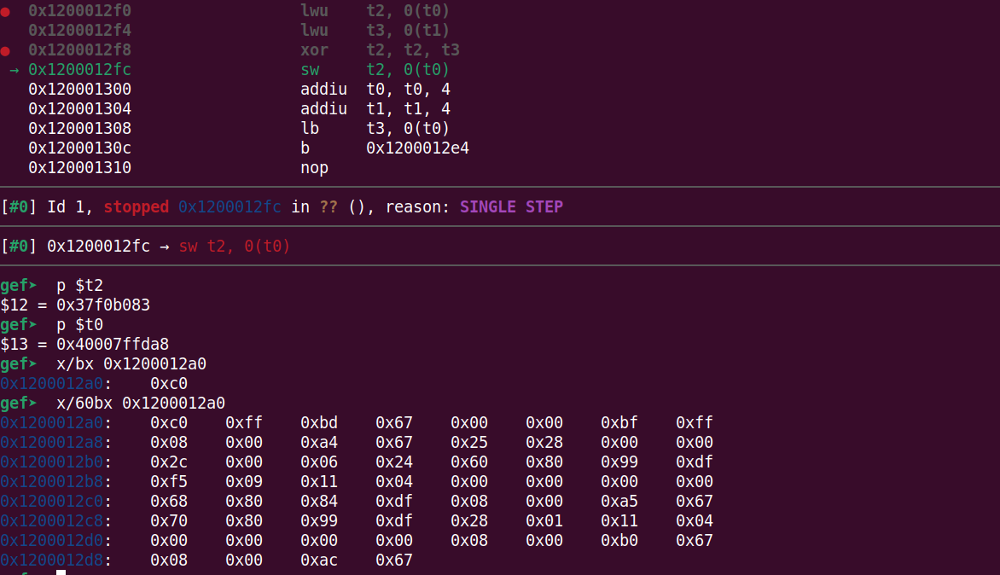<figcaption></figcaption></figure>

Dump nilai tersebut lalu xor dengan encrypted value dari soal dan dapat flag. Berikut solver yang kami gunakan

```python
a = [0xc0,0xff,0xbd,0x67,0x00,0x00,0xbf,0xff,0x08,0x00,0xa4,0x67,0x25,0x28,0x00,0x00,0x2c,0x00,0x06,0x24,0x60,0x80,0x99,0xdf,0xf5,0x09,0x11,0x04,0x00,0x00,0x00,0x00,0x68,0x80,0x84,0xdf,0x08,0x00,0xa5,0x67,0x70,0x80,0x99,0xdf,0x28,0x01,0x11,0x04,0x00,0x00,0x00,0x00,0x08,0x00,0xb0,0x67,0x08,0x00,0xac,0x67]
f = open("out.bin","rb").read()
flag = ""
for i in range(len(f)):
	flag += chr(f[i]^a[i])
print(flag)
```

<figure><figcaption></figcaption></figure>

Flag : COMPFEST14{m1ps\_i3\_e4sy\_r1gHt???\_b868937a70}
