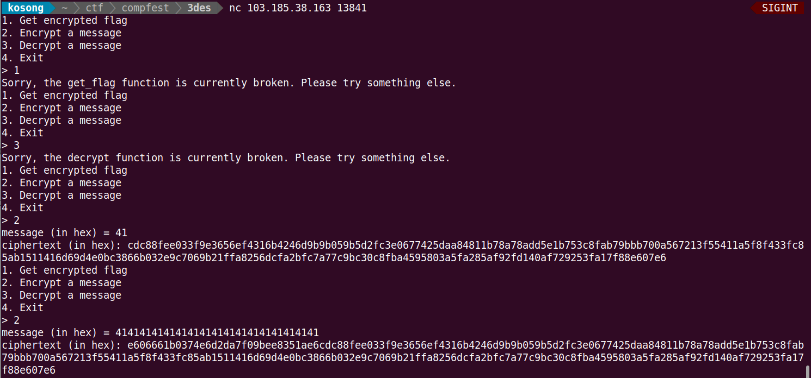
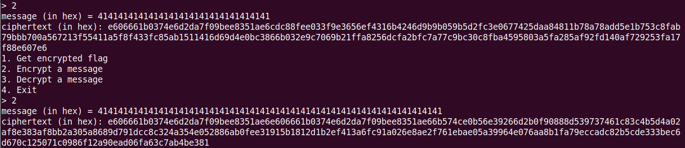
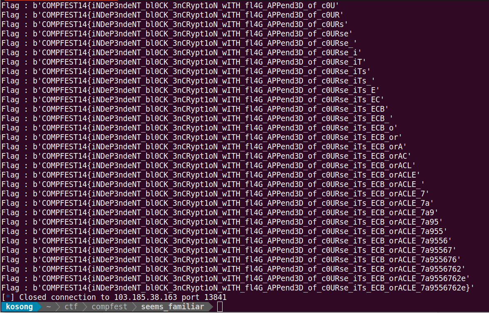

# Cryptography

<!-- challenge-index: 07c4ffa73363cd31 -->

| Challenge | Topic |
| --- | --- |
| [Seems Familiar (n pts)](#seems-familiar-n-pts) | AES-ECB, Encryption Oracle |
| [3(3DES) (500 pts)🥇](/notes/research/2022/partial-known-plaintext-attack-on-custom-3des/) | Custom 3DES, Known Plaintext |

<!-- /challenge-index -->

## Seems Familiar (n pts)

### Description

\-

### Solution

Diberikan akses ke sebuah service 103.185.38.163 13841 .&#x20;

<figure><figcaption></figcaption></figure>

Terlihat bahwa fitur nomor 1 dan 3 tidak bisa dijalankan, hanya fitur nomor 2. Kemudian kami melakukan enumerasi terhadap service tersebut untuk mengetahui mode AES apa yang digunakan dengan cara mengirimkan “A” > 2 block atau 2\*16.

<figure><figcaption></figcaption></figure>

2 blok ciphertext pertama sama, jadinya bisa kita simpulkan bahwa ini ECB. Selanjutnya tinggal brute force per byte saja untuk flagnya dengan cara melakukan validasi di block X , dengan kondisi perbandingan pada block X yaitu junk+leaked\_flag+brute\_char == junk+leaked\_flag . Berikut solver yang kami gunakan

```python
from pwn import *
import string

r = remote("103.185.38.163",13841)
length = 96
flag = b""
while b"}" not in flag:
	r.recvuntil(b"> ")
	r.sendline(b"2")
	r.recvuntil(b"(in hex) = ")
	payload = hex(ord('A'))[2:]*(length-1)
	r.sendline(payload.encode())
	check = r.recvuntil(b"(in hex): ")
	block = []
	resp = r.recvline().strip()
	resp = bytes.fromhex(resp.decode())
	for i in range(0,len(resp),16):
		block.append(resp[i:i+16])
	for i in string.printable[:-6]:
		# print(i)
		r.recvuntil(b"> ")
		r.sendline(b"2")
		r.recvuntil(b"(in hex) = ")
		tmp_payload = payload + flag.hex() +  hex(ord(i))[2:]
		r.sendline(tmp_payload.encode())
		check = r.recvuntil(b"(in hex): ")
		resp = r.recvline().strip()
		resp = bytes.fromhex(resp.decode())
		block_check = []
		for j in range(0,len(resp),16):
			block_check.append(resp[j:j+16])
		if(block[5]==block_check[5]):
			flag += i.encode()
			print("Flag : {}".format(flag))
			length -= 1
			break
```

<br>



Flag : COMPFEST14{iNDeP3ndeNT\_bl0CK\_3nCRypt1oN\_wITH\_fl4G\_APPend3D\_of\_c0URse\_iTs\_ECB\_orACLE\_7a9556762e}
