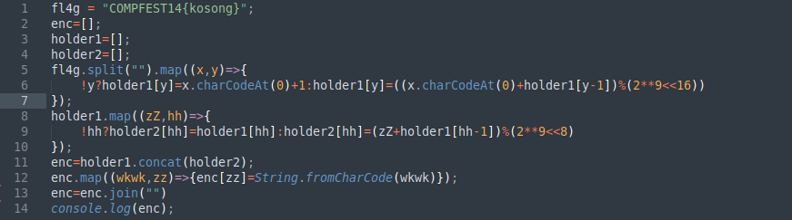
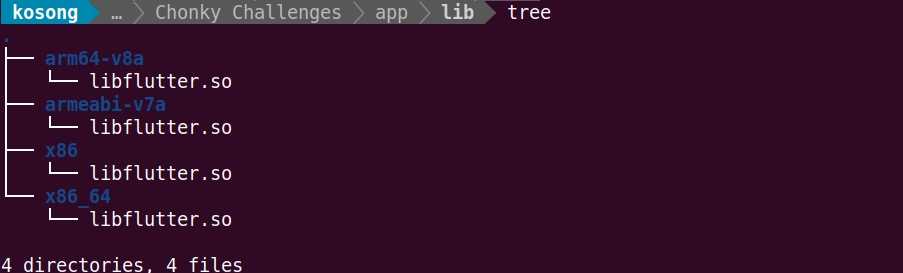
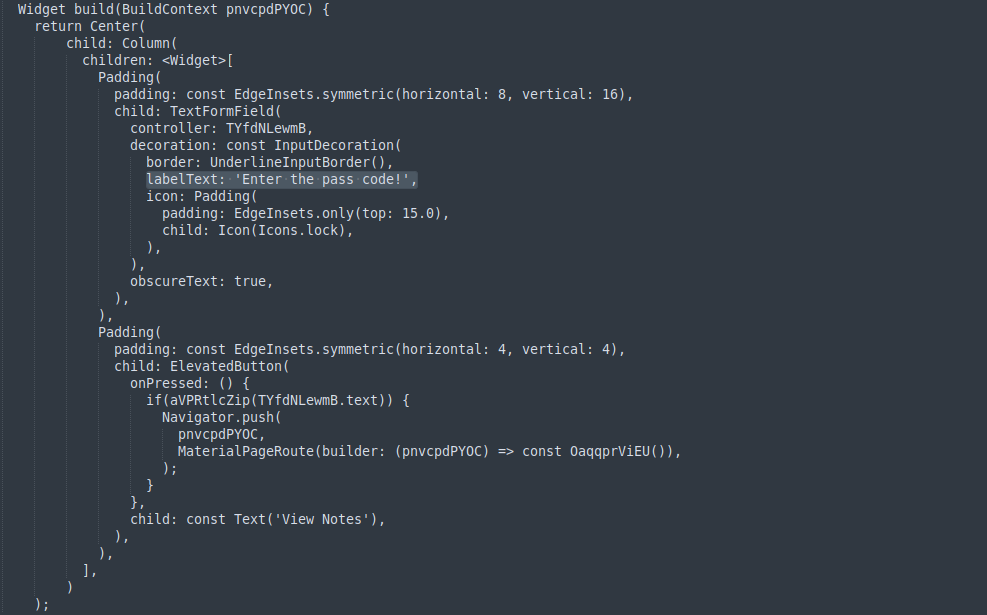
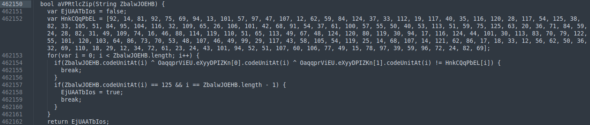
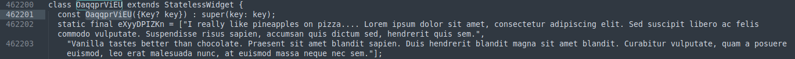
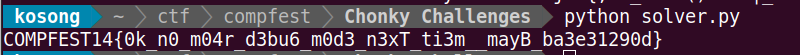
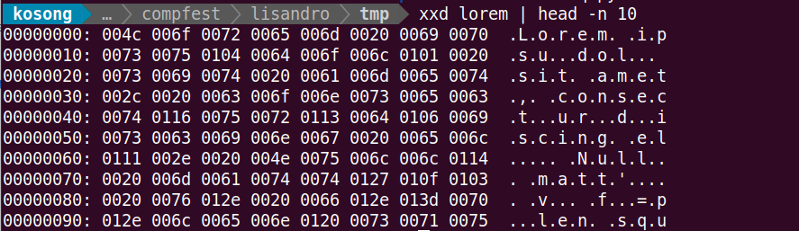
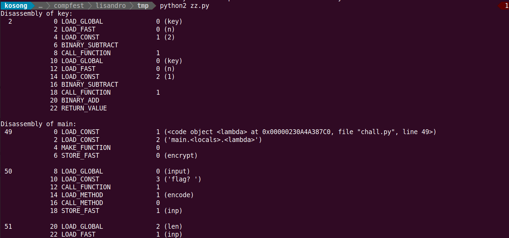
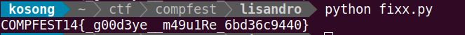

# Reverse Engineering

<!-- challenge-index: 19834009452ee414 -->

| Challenge | Topic |
| --- | --- |
| [baby JaSon adler (500 pts)🥇](#baby-jason-adler-500-pts) | JavaScript, Deobfuscation |
| [PrivNotes (500 pts)🥇](#privnotes-500-pts) | Flutter, APK Reversing |
| [Lisandro martineZ (500 pts)🥇](#lisandro-martinez-500-pts) | LZ78, Python Bytecode |

<!-- /challenge-index -->

## baby JaSon adler (500 pts)

### Description

\-

### Solution

Diberikan file sebagai berikut

```javascript
enc=[];holder1=[];holder2=[];fl4g.split("").map((x,y)=>{!y?holder1[y]=x.charCodeAt(0)+1:holder1[y]=((x.charCodeAt(0)+holder1[y-1])%(2**9<<16))});holder1.map((zZ,hh)=>{!hh?holder2[hh]=holder1[hh]:holder2[hh]=(zZ+holder1[hh-1])%(2**9<<8)});enc=holder1.concat(holder2);enc.map((wkwk,zz)=>{enc[zz]=String.fromCharCode(wkwk)});enc=enc.join("")
```

Terlihat dari fungsinya bahwa ini merupakan kode javacsript. Jadi lakukan deobfuscate simple dengan cara menambahkan newline pada kodenya.

<figure><figcaption></figcaption></figure>

Berikut alur programnya

```
holder1 = [flag[0], (flag[1]+flag[0])%(2**9<<16), (flag[2]+flag[1]+flag[0])%(2**9<<16), dst]
```

Dari holder1 kita sudah bisa mendapatkan flag dan holder1 ada pada output yaitu (length\_output/2) bytes pertama. Untuk output sendiri disini dilakukan konversi menggunakan string.fromCharCode dan dari percobaan terlihat bahwa outpuntya terencode, jadi untuk mendapatkan nilai asli tinggal kita buka lalu decode. Setelah itu baru lakukan reverse dengan cara subtract index ke i dengan i-1 dimana i>0 dan untuk index ke-0 cukup subtract dengan 1. Berikut solver yang kami gunakan

```python
f = open("enc.txt","rb").read()
g = f.decode()
out = []
for i in g:
	out.append(ord(i))
length = len(out)//2
h1 = out[:length]
h2 = out[length:]
flag = chr(h1[0]-1)
for i in range(1,len(h1)):
	flag += chr(h1[i]-h1[i-1])
print(flag)
```

<figure><figcaption></figcaption></figure>

Flag : COMPFEST14{4dler\_ch3ccs0me\_1s\_f4s7er\_7h4n\_cRC!!\_0240f11cc5}

## PrivNotes (500 pts)

### Description

\-

### Solution

Diberikan file APK. Kami coba jalankan pada android

<figure><figcaption></figcaption></figure>

Terlihat terdapat string “Enter the pass code!” . Kita simpan informasi ini, selanjutnya kita coba decompile menggunakan apktool.&#x20;

<figure><figcaption></figcaption></figure>

APK tersebut dibuat menggunakan flutter, selanjutnya kami coba cek kernel\_blob.bin dengan asumsi mungkin APK tersebut dicompile dengan debug mode aktif.

<figure><figcaption></figcaption></figure>

Lakukan pencarian untuk string “Enter the pass code!”&#x20;

<figure><figcaption></figcaption></figure>

Ternyata ada, selanjutnya tinggal cari fungsi validasinya. Disini kita bisa lihat pada potongan kode diatas bahwa fungsi validasinya terdapat pada aVPRtlcZip .&#x20;

<figure><figcaption></figcaption></figure>

Fungsi validasi hanya melakukan xor input dengan value yang ada pada array OaqqprViEU . Jadi kita search array OaqqprViEU untuk mendapatkan valuenya.

<figure><figcaption></figcaption></figure>

Karena sudah mendapatkan valuenya tinggal lakukan xor saja dengan mengubah input\[i] menjadi enc\[i] pada algoritma yang ditemukan. Berikut solver yang kami gunakan

```python
enc = [92, 14, 81, 92, 75, 69, 94, 13, 101, 57, 97, 47, 107, 12, 62, 59, 84, 124, 37, 33, 112, 19, 117, 40, 35, 116, 120, 28, 117, 54, 125, 38, 82, 33, 105, 51, 84, 95, 104, 116, 32, 109, 65, 26, 106, 101, 42, 68, 91, 54, 37, 61, 100, 57, 55, 50, 40, 53, 113, 51, 59, 75, 125, 63, 20, 36, 71, 84, 59, 24, 28, 82, 31, 49, 109, 74, 16, 46, 88, 114, 119, 110, 51, 65, 113, 49, 67, 48, 124, 120, 80, 119, 30, 94, 17, 116, 124, 44, 101, 30, 113, 83, 70, 79, 122, 55, 101, 120, 103, 64, 86, 73, 70, 53, 48, 107, 46, 49, 99, 29, 117, 43, 58, 105, 54, 119, 25, 14, 68, 107, 14, 121, 62, 86, 17, 18, 33, 12, 56, 62, 50, 36, 32, 69, 110, 18, 29, 12, 34, 72, 61, 23, 24, 43, 101, 94, 52, 51, 107, 60, 106, 77, 49, 15, 78, 97, 39, 59, 96, 72, 24, 82, 69]
eXyyDPIZKn = ["I really like pineapples on pizza.... Lorem ipsum dolor sit amet, consectetur adipiscing elit. Sed suscipit libero ac felis commodo vulputate. Suspendisse risus sapien, accumsan quis dictum sed, hendrerit quis sem.",
    "Vanilla tastes better than chocolate. Praesent sit amet blandit sapien. Duis hendrerit blandit magna sit amet blandit. Curabitur vulputate, quam a posuere euismod, leo erat malesuada nunc, at euismod massa neque nec sem."]

# ZbalwJOEHB.codeUnitAt(i) ^ OaqqprViEU.eXyyDPIZKn[0].codeUnitAt(i) ^ OaqqprViEU.eXyyDPIZKn[1].codeUnitAt(i) != HnkCQqPbEL[i]
flag = ""
for i in range(len(enc)):
	flag += chr(enc[i]^ord(eXyyDPIZKn[0][i])^ord(eXyyDPIZKn[1][i]))
	if("}" in flag):
		break
print(flag)
```

<figure><figcaption></figcaption></figure>

Flag : COMPFEST14{0k\_n0\_m04r\_d3bu6\_m0d3\_n3xT\_ti3m\_\_mayB\_ba3e31290d}

## Lisandro martineZ (500 pts)

### Description

\-

### Solution

Diberikan file chall dan lorem. Berikut isi untuk file lorem

<figure><figcaption></figcaption></figure>

Dari judul kami asumsikan bahwa ada compression menggunakan LZ namun kita tidak tahu LZ variasi apa. Jadi kami coba beberapa variasi LZ hingga mendapatkan yang mirip hasilnya yaitu LZ78. Berikut implementasi dari compress dan decompress LZ78 dengan sedikit modifikasi untuk pembacaan filenya.

```python
import string

def compress(uncompressed):
    """Compress a string to a list of output symbols."""

    # Build the dictionary.
    dict_size = 256
    dictionary = dict((chr(i), chr(i)) for i in xrange(dict_size))
    # in Python 3: dictionary = {chr(i): chr(i) for i in range(dict_size)}

    w = ""
    result = []
    for c in uncompressed:
        wc = w + c
        if wc in dictionary:
            w = wc
        else:
            result.append(dictionary[w])
            # Add wc to the dictionary.
            dictionary[wc] = dict_size
            dict_size += 1
            w = c

    # Output the code for w.
    if w:
        result.append(dictionary[w])
    return result


def decompress(compressed):
    """Decompress a list of output ks to a string."""
    from cStringIO import StringIO

    # Build the dictionary.
    dict_size = 256
    dictionary = dict((chr(i), chr(i)) for i in xrange(dict_size))
    # in Python 3: dictionary = {chr(i): chr(i) for i in range(dict_size)}

    # use StringIO, otherwise this becomes O(N^2)
    # due to string concatenation in a loop
    result = StringIO()
    w = compressed.pop(0)
    result.write(w)
    for k in compressed:
        if k in dictionary:
            entry = dictionary[k]
        elif k == dict_size:
            entry = w + w[0]
        else:
            raise ValueError('Bad compressed k: %s' % k)
        result.write(entry)

        # Add w+entry[0] to the dictionary.
        dictionary[dict_size] = w + entry[0]
        dict_size += 1

        w = entry
    return result.getvalue()

# compressed = compress('Lorem Ipsum Dolor')
# decompressed = decompress(compressed)
# print (decompressed)

f = open("chall","r").read()
f = list(f)
result = []
for i in range(0,len(f),2):
    tmp = (f[i]+f[i+1]).encode('hex')
    tmp = int(tmp,16)
    if  tmp > 255:
        result.append(tmp)
    else:
        result.append(chr(tmp))
print(decompress(result))

```

<figure><figcaption></figcaption></figure>

Terlihat kita sudah berhasil melakukan decompress. Selanjutnya tinggal lakukan decompile manual untuk op code python tersebut dengan mengacu pada <https://docs.python.org/3/library/dis.html> . Setelah decompile manual kami juga lakukan validasi dengan cara melakukan dis terhadap fungsi yang telah kami rekonstruksi. Berikut adalah hasil rekonstruksi kami

```python
import dis


def werivy(inp):
	if(2*inp[33]+1*inp[17]-2*inp[20]-1*inp[26]+4*inp[29] == -29):
		if(3*inp[4]-3*inp[28]+1*inp[27]-4*inp[26]-1*inp[23] == -1029):
			if(3*inp[4]+4*inp[25]-1*inp[30]-4*inp[13]-2*inp[3] == 80):
				if(2*inp[2]-2*inp[30]+1*inp[39]-1*inp[21]+3*inp[1] == 548):
					if(4*inp[6]-1*inp[11]+1*inp[38]+2*inp[24]+1*inp[28] == 751):
						if(4*inp[8]-3*inp[0]-2*inp[9]+3*inp[37]+4*inp[34] == 1939):
							if(2*inp[18]-4*inp[12]+1*inp[7]-3*inp[9]-4*inp[11] == -46):
								if(3*inp[21]+4*inp[26]-4*inp[2]+2*inp[22]-2*inp[0] == 685):
									if(4*inp[23]+3*inp[1]+2*inp[20]-1*inp[16]-2*inp[25] == 1007):
										if(1*inp[0]+3*inp[2]+2*inp[36]-3*inp[14]+2*inp[24] == 350):
											if(2*inp[22]+2*inp[10]+3*inp[19]-3*inp[8]+4*inp[0] == 686):
												if(1*inp[5]-1*inp[27]+3*inp[0]-4*inp[25]-4*inp[36] == -667):
													if(1*inp[27]+1*inp[8]+1*inp[25]+1*inp[34]+1*inp[24] == 793):
														if(4*inp[18]-1*inp[27]-1*inp[16]-4*inp[39]+2*inp[5] == -1012):
															if(3*inp[2]-3*inp[20]+2*inp[8]-4*inp[5]-1*inp[33] == 714):
																if(2*inp[7]-3*inp[34]+1*inp[37]+2*inp[35]+4*inp[10] == 719):
																	if(1*inp[1]-4*inp[20]-2*inp[39]+4*inp[30]-3*inp[2] == -25):
																		if(3*inp[33]-2*inp[7]-4*inp[23]-3*inp[32]-4*inp[37] == -1909):
																			if(1*inp[22]+3*inp[18]-4*inp[30]+2*inp[15]-2*inp[25] == -395):
																				if(2*inp[12]-4*inp[29]+2*inp[7]+4*inp[23]+2*inp[4] == 1096):
																					if(1*inp[11]+1*inp[37]-2*inp[29]+1*inp[38]+1*inp[23] == 460):
																						if(3*inp[10]-1*inp[7]-3*inp[26]-4*inp[24]+3*inp[34] == 287):
																							if(1*inp[31]-2*inp[6]-2*inp[1]-3*inp[17]+2*inp[28] == -169):
																								if(4*inp[26]+2*inp[6]-2*inp[39]+4*inp[38]+1*inp[3] == 1020):
																									if(2*inp[32]+2*inp[27]+4*inp[30]-4*inp[6]+3*inp[28] == 1873):
																										if(4*inp[20]-4*inp[6]+2*inp[24]+2*inp[29]-1*inp[13] == -122):
																											if(2*inp[36]-3*inp[17]-1*inp[13]-4*inp[37]-4*inp[14] == -1648):
																												if(4*inp[16]-3*inp[38]+2*inp[8]-2*inp[28]-4*inp[3] == 292):
																													if(4*inp[11]+4*inp[31]-1*inp[19]-2*inp[14]-2*inp[22] == -181):
																														if(4*inp[29]+3*inp[16]-3*inp[17]-2*inp[15]+2*inp[21] == 494):
																															if(4*inp[10]+2*inp[36]+3*inp[34]+3*inp[19]-3*inp[1] == 1200):
																																if(1*inp[35]-1*inp[31]-3*inp[10]+2*inp[39]-1*inp[33] == -7):
																																	if(4*inp[17]+1*inp[19]+1*inp[36]-2*inp[13]-4*inp[16] == -531):
																																		if(3*inp[35]-4*inp[14]+2*inp[4]-4*inp[19]-1*inp[3] == -370):
																																			if(1*inp[13]-4*inp[5]-3*inp[15]-4*inp[21]+1*inp[18] == -1364):
																																				if(3*inp[5]+1*inp[4]-1*inp[15]-4*inp[33]-4*inp[12] == -259):
																																					if(1*inp[18]+3*inp[32]+3*inp[11]-4*inp[15]-4*inp[35] == -1166):
																																						if(1*inp[9]+2*inp[14]+4*inp[22]-2*inp[35]+2*inp[21] == 876):
																																							if(2*inp[38]-4*inp[31]+2*inp[12]-1*inp[9]-1*inp[32] == -337):
																																								if(3*inp[3]+1*inp[32]-3*inp[12]-1*inp[31]-2*inp[9] == -77):
																																									return True
	return False

def encrypt(x):
	return (87*x+22)%256

def key(n):
	if n <= 1:
		return n
	return key(n-2)+key(n-1)

def fib(n, computed = {0: 0, 1: 1}):
	if n not in computed:
		computed[n] = fib(n-1, computed) + fib(n-2, computed)
	return computed[n]
	
def main():
	inp = input("flag?").encode()
	if(inp!=40):
		print("Wrong!")
	enc = [encrypt(inp[0]^key(0))]
	for i in range(1,len(inp)):
		enc.append(encrypt(inp[i]^key(i))^inp[i-1])
	if(werivy(enc)):
		return "Correct"
	else:
		return "Wrong!"


# print(dis.dis(main))
# print(dis.dis(main))
# print(dis.dis(key))
# print(dis.dis(encrypt))
# print(dis.dis(werivy))
```

Untuk werivy kami membuat parser, karena terlihat pengecekannya identik.

```python
import re

f = open("werivy.txt").read()
opcode = [
  "LOAD_CONST",
  "LOAD_FAST",
  "BINARY_MULTIPLY",
  "BINARY_ADD",
  "BINARY_SUBTRACT",
  "POP_JUMP_IF_FALSE"
]
f = f.split("\n")
res = [[] for i in range(41)]
ind = 0
for x in range(len(f)):
  i = f[x]
  r1 = re.findall(r"\((.*?)\)", i)
  if(opcode[0] in i):
    res[ind].append(str(r1[0]))
  if(opcode[2]) in i:
    res[ind].append(f"*")
  if(opcode[3]) in i:
    res[ind].append(f"+")
  if(opcode[4]) in i:
    res[ind].append(f"-")
  if(opcode[5] in i):
    ind += 1

# (2*inp[33]+1*inp[17]-2*inp[20]-1*inp[26]+4*inp[29] == -29)
fmt = "({}{}inp[{}]{}{}{}inp[{}]{}{}{}inp[{}]{}{}{}inp[{}]{}{}{}inp[{}] == {})"
for i in range(len(res)-1):
  tmp = res[i]
  print(fmt.format(tmp[0],tmp[2],tmp[1],tmp[6],tmp[3],tmp[5],tmp[4],tmp[10],tmp[7],tmp[9],tmp[8],tmp[14],tmp[11],tmp[13],tmp[12],tmp[18],tmp[15],tmp[17],tmp[16],tmp[19]))

```

werivy.txt merupakan file dissasembly dari fungsi werivy. Selanjutnya kita dapat mereverse program tersebut , berikut alurnya

* &#x20;fungsi key terlihat seperti algoritma untuk melakukan generate bilangan fibonacci
* dapatkan nilai enc yang menghasilkan true pada fungsi werivy menggunakan z3
* karena kita tahu format flag jadi kita hanya perlu bruteforce per byte aja untuk index ke-i dimana i > 0
* lakukan penyesuaian untuk index bilangan fibonacci dengan cara validasi dengan format flag
* z3 menghasilkan lebih dari 1 kemungkinan untuk beberapa index pada enc, jadi tambahkan validasi pada index ke-i jika kita tidak berhasil bruteforce byte pada index ke-i

Berikut solver yang kami gunakan

```python
from z3 import *
import string

def encrypt(x):
    return (87*x+22)%256

def fib(n, computed = {0: 0, 1: 1}):
    if n not in computed:
        computed[n] = fib(n-1, computed) + fib(n-2, computed)
    return computed[n]
    
s = Solver()
inp = [BitVec("x{}".format(i), 8) for i in range(40)]
s.add(2*inp[33]+1*inp[17]-2*inp[20]-1*inp[26]+4*inp[29] == -29)
s.add(3*inp[4]-3*inp[28]+1*inp[27]-4*inp[26]-1*inp[23] == -1029)
s.add(3*inp[4]+4*inp[25]-1*inp[30]-4*inp[13]-2*inp[3] == 80)
s.add(2*inp[2]-2*inp[30]+1*inp[39]-1*inp[21]+3*inp[1] == 548)
s.add(4*inp[6]-1*inp[11]+1*inp[38]+2*inp[24]+1*inp[28] == 751)
s.add(4*inp[8]-3*inp[0]-2*inp[9]+3*inp[37]+4*inp[34] == 1939)
s.add(2*inp[18]-4*inp[12]+1*inp[7]-3*inp[9]-4*inp[11] == -46)
s.add(3*inp[21]+4*inp[26]-4*inp[2]+2*inp[22]-2*inp[0] == 685)
s.add(4*inp[23]+3*inp[1]+2*inp[20]-1*inp[16]-2*inp[25] == 1007)
s.add(1*inp[0]+3*inp[2]+2*inp[36]-3*inp[14]+2*inp[24] == 350)
s.add(2*inp[22]+2*inp[10]+3*inp[19]-3*inp[8]+4*inp[0] == 686)
s.add(1*inp[5]-1*inp[27]+3*inp[0]-4*inp[25]-4*inp[36] == -667)
s.add(1*inp[27]+1*inp[8]+1*inp[25]+1*inp[34]+1*inp[24] == 793)
s.add(4*inp[18]-1*inp[27]-1*inp[16]-4*inp[39]+2*inp[5] == -1012)
s.add(3*inp[2]-3*inp[20]+2*inp[8]-4*inp[5]-1*inp[33] == 714)
s.add(2*inp[7]-3*inp[34]+1*inp[37]+2*inp[35]+4*inp[10] == 719)
s.add(1*inp[1]-4*inp[20]-2*inp[39]+4*inp[30]-3*inp[2] == -25)
s.add(3*inp[33]-2*inp[7]-4*inp[23]-3*inp[32]-4*inp[37] == -1909)
s.add(1*inp[22]+3*inp[18]-4*inp[30]+2*inp[15]-2*inp[25] == -395)
s.add(2*inp[12]-4*inp[29]+2*inp[7]+4*inp[23]+2*inp[4] == 1096)
s.add(1*inp[11]+1*inp[37]-2*inp[29]+1*inp[38]+1*inp[23] == 460)
s.add(3*inp[10]-1*inp[7]-3*inp[26]-4*inp[24]+3*inp[34] == 287)
s.add(1*inp[31]-2*inp[6]-2*inp[1]-3*inp[17]+2*inp[28] == -169)
s.add(4*inp[26]+2*inp[6]-2*inp[39]+4*inp[38]+1*inp[3] == 1020)
s.add(2*inp[32]+2*inp[27]+4*inp[30]-4*inp[6]+3*inp[28] == 1873)
s.add(4*inp[20]-4*inp[6]+2*inp[24]+2*inp[29]-1*inp[13] == -122)
s.add(2*inp[36]-3*inp[17]-1*inp[13]-4*inp[37]-4*inp[14] == -1648)
s.add(4*inp[16]-3*inp[38]+2*inp[8]-2*inp[28]-4*inp[3] == 292)
s.add(4*inp[11]+4*inp[31]-1*inp[19]-2*inp[14]-2*inp[22] == -181)
s.add(4*inp[29]+3*inp[16]-3*inp[17]-2*inp[15]+2*inp[21] == 494)
s.add(4*inp[10]+2*inp[36]+3*inp[34]+3*inp[19]-3*inp[1] == 1200)
s.add(1*inp[35]-1*inp[31]-3*inp[10]+2*inp[39]-1*inp[33] == -7)
s.add(4*inp[17]+1*inp[19]+1*inp[36]-2*inp[13]-4*inp[16] == -531)
s.add(3*inp[35]-4*inp[14]+2*inp[4]-4*inp[19]-1*inp[3] == -370)
s.add(1*inp[13]-4*inp[5]-3*inp[15]-4*inp[21]+1*inp[18] == -1364)
s.add(3*inp[5]+1*inp[4]-1*inp[15]-4*inp[33]-4*inp[12] == -259)
s.add(1*inp[18]+3*inp[32]+3*inp[11]-4*inp[15]-4*inp[35] == -1166)
s.add(1*inp[9]+2*inp[14]+4*inp[22]-2*inp[35]+2*inp[21] == 876)
s.add(2*inp[38]-4*inp[31]+2*inp[12]-1*inp[9]-1*inp[32] == -337)
s.add(3*inp[3]+1*inp[32]-3*inp[12]-1*inp[31]-2*inp[9] == -77)

s.add(inp[3]==6)
s.add(inp[24]!=171)
s.check()
model=s.model()
num = []

for i in inp:
    num.append(model[i].as_long())

inp = "C"
for i in range(len(inp),len(num)):
    for j in string.printable[:-6]:
        tmp = encrypt(fib(i+1)^ord(j))^ord(inp[i-1])
        if(tmp==num[i]):
            inp += j
            break
print(inp)

```

<figure><figcaption></figcaption></figure>

Flag : COMPFEST14{\_g00d3ye\_\_m49u1Re\_6bd36c9440}
