# Reverse Engineering

<!-- challenge-index: 19412b3314caf5b8 -->

| Challenge | Topic |
| --- | --- |
| [👦 You need to GO! John (500 pts)🥇](#you-need-to-go-john-500-pts) | Go, OTP Validation, Z3 |
| [⚡ Ragnarok (500 pts)🥇](#ragnarok-500-pts) | Unpacking, VM, Z3 |
| [🎮 80's (500 pts)🥇](/notes/research/2022/reverse-engineering-game-boy/) | Game Boy ROM, Emulation |

<!-- /challenge-index -->

## 👦 You need to GO! John (500 pts)

### Description

\-

### Solution

Diberikan file PE yang dibuat dengan golang. Disini kami membukanya menggunakan IDA. Kita perlu menginputkan value yang sesuai sebanyak 3 kali. Pertama username, password, lalu OTP.

<figure>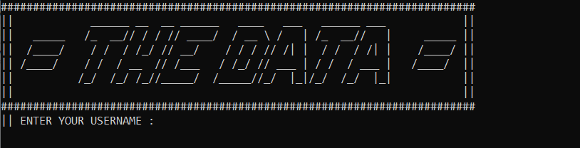<figcaption></figcaption></figure>

<figure>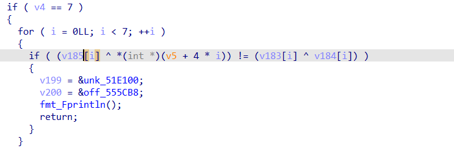<figcaption></figcaption></figure>

Untuk username algoritmanya dapat dilihat diatas, intinya kita bisa lakukan leak terhadap value dari xor dan mendapatkan value input yang sesuai.

<figure>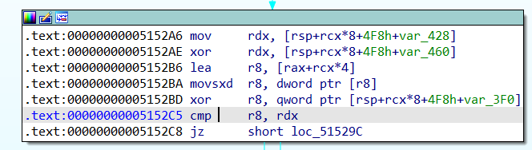<figcaption></figcaption></figure>

Leak value rdx pada 0x5152c5 dan qword ptr \[rsp+rcx\*8+4F8h+var\_3F0] pada 0x5152bd. Lakukan xor dapat value username yang sesuai.

```python
xor_inp = [0x46,0x3C,0x32,0x50,0x46,0x3C,0x32]
cmp_val = [0xc,0x53,0x5a,0x3e,0x11,0x55,0x4a]
username = ""
for i in range(0,len(xor_inp)):
	username += chr(xor_inp[i]^cmp_val[i])
print(username) # JohnWix
```

Selanjutnya password, namun disini ada beberapa sleep yang tidak berhubungan dengan password/flag jadi bisa kita patch supaya tidak dijalankan fungsi sleep sebenarnya.

<figure>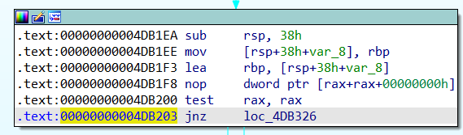<figcaption></figcaption></figure>

Caranya dengan mengubah jle menjadi jnz pada 0x4db203 .&#x20;

<figure>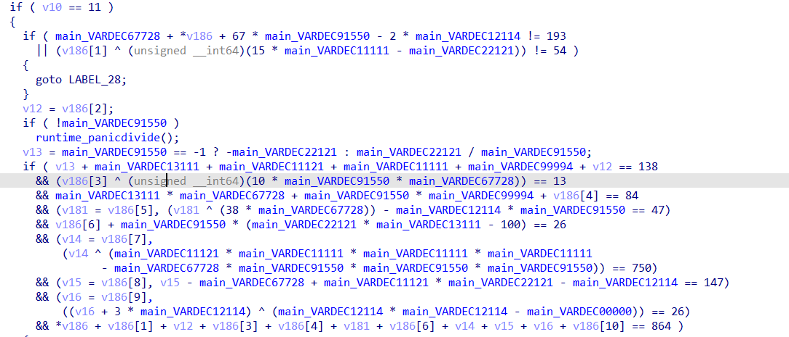<figcaption></figcaption></figure>

Untuk value password tinggal dapatkan semua static value lalu gunakan z3. Berikut script yang kami gunakan

```python
from z3 import *

v164 =[BitVec("x{}".format(i), 8) for i in range(11)]

main_VARDEC11111 = 5
main_VARDEC11121 = 6
main_VARDEC12114 = 9
main_VARDEC13111 = 7
main_VARDEC22121 = 8
main_VARDEC67728 = 3
main_VARDEC91550 = 2
main_VARDEC99994 = 4
main_VARDEC00000 = 0

v13 = 4
s = Solver()
s.add(main_VARDEC67728 + v164[0] + 67 * main_VARDEC91550 - 2 * main_VARDEC12114 == 193)
s.add(v164[1] ^ (15 * main_VARDEC11111 - main_VARDEC22121) == 54)
s.add(v13 + main_VARDEC13111 + main_VARDEC11121 + main_VARDEC11111 + main_VARDEC99994 + v164[2] == 138)
s.add(v164[3] ^ (10 * main_VARDEC91550 * main_VARDEC67728) == 13)
s.add((main_VARDEC13111 * main_VARDEC67728) + (main_VARDEC91550 * main_VARDEC99994) + v164[4] == 84)
s.add((v164[5] ^ (38 * main_VARDEC67728)) - (main_VARDEC12114 * main_VARDEC91550) == 47)
s.add(v164[6] + main_VARDEC91550 * (main_VARDEC22121 * main_VARDEC13111 - 100) == 26)
s.add(v164[7] ^ (main_VARDEC11121 * main_VARDEC11111 * main_VARDEC11111 * main_VARDEC11111 - main_VARDEC67728 * main_VARDEC91550 * main_VARDEC91550 * main_VARDEC91550) == 750)
s.add(v164[8] - main_VARDEC67728 + (main_VARDEC11121 * main_VARDEC22121) - main_VARDEC12114 == 147)
s.add((v164[9] + 3 * main_VARDEC12114) ^ (main_VARDEC12114 * main_VARDEC12114 - main_VARDEC00000) == 26)
s.add(v164[0] + v164[1] + v164[2] + v164[3] + v164[4] + v164[5] + v164[6] + v164[7] + v164[8] + v164[9] + v164[10] == 864 )

print(s.check())
input2 =""
model=s.model()
for i in v164:
    input2 +=chr(model[i].as_long())
print(input2) # Jup173r8o0M

```

Terakhir adalah OTP

<figure>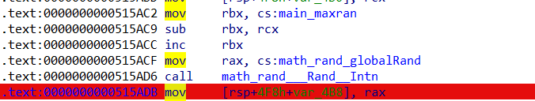<figcaption></figcaption></figure>

Leak value rax setelah pemanggilan fungsi rand lalu kurangkan dengan main\_minran.

<figure>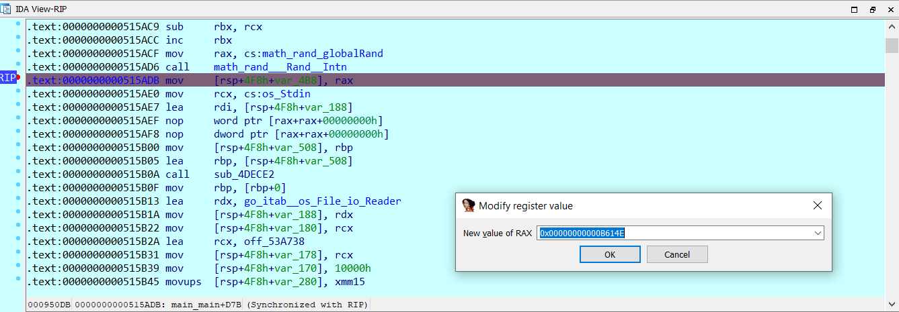<figcaption></figcaption></figure>

&#x20;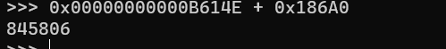

<figure><figcaption></figcaption></figure>

<figure>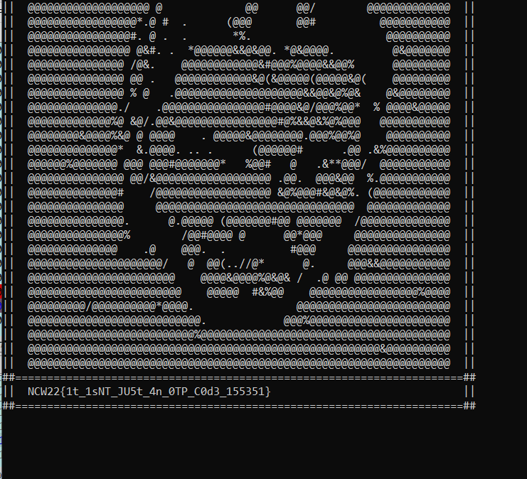<figcaption></figcaption></figure>

Flag  : NCW22{1t\_1sNT\_JU5t\_4n\_0TP\_C0d3\_155351}

## ⚡ Ragnarok (500 pts)

### Description

\-

### Solution

Diberikan file PE yang dipack , karena disini kami tidak tahu packer yang digunakan jadi debug saja. Set breakpoint pada akhir pemanggilan fungsi yang melakukan jump pada suatu address

<figure>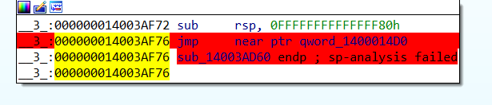<figcaption></figcaption></figure>

Step over dan nanti akan ketemu dengan pemanggilan suatu fungsi

<figure>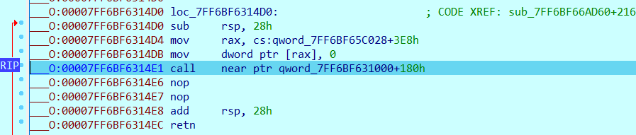<figcaption></figcaption></figure>

Selanjutnya step into

<figure>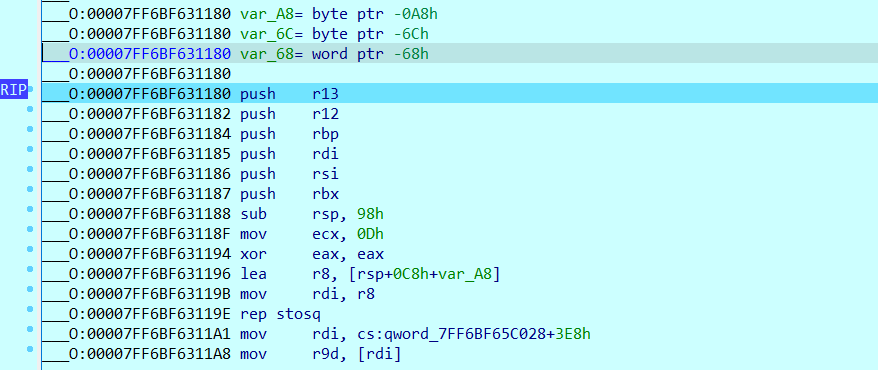<figcaption></figcaption></figure>

Sampai disini kita sudah masuk ke hasil unpacknya (program aslinya). Selanjutnya lakukan analisis dan kami mendapatkan fungsi pengecekannya yaitu pada sub\_7FF6BF631A57

<figure>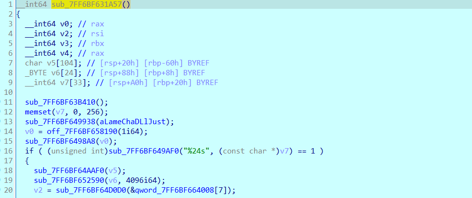<figcaption></figcaption></figure>

Intinya kita disuruh menginputkan 24 bytes value. Nantinya 24 bytes value tersebut akan dioperasikan dan operasinya berbasis VM (hardcode).

<figure>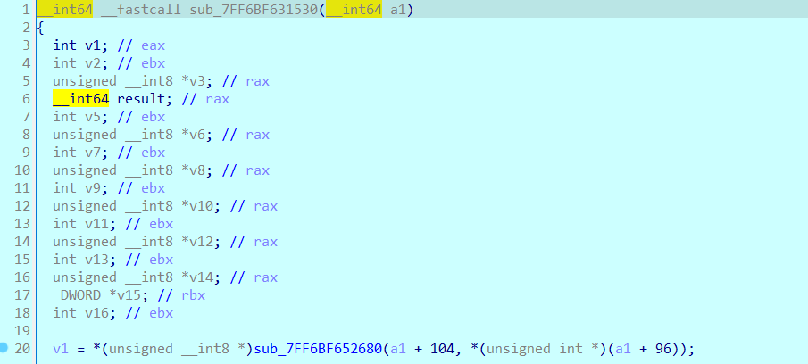<figcaption></figcaption></figure>

<figure>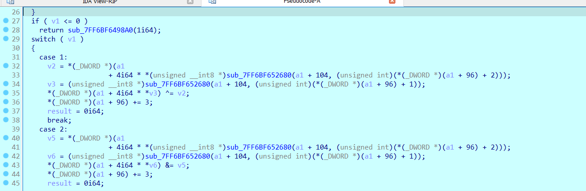<figcaption></figcaption></figure>

Untuk mempermudah disini kami membuat assemblernya namun pertama kami perlu lakukan leak terhadap bytecode VM nya terlebih dahulu.

<figure>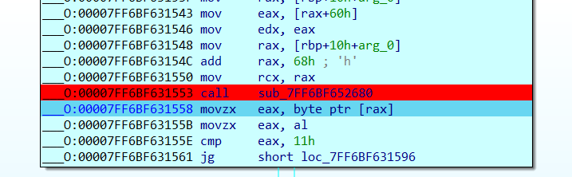<figcaption></figcaption></figure>

<figure>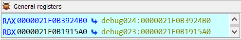<figcaption></figcaption></figure>

<figure>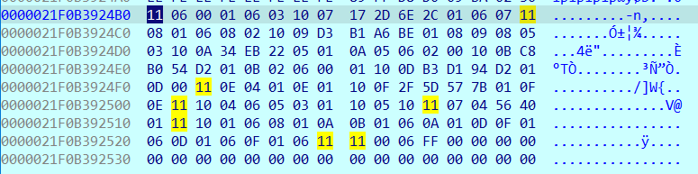<figcaption></figcaption></figure>

Copya value pada address 0000021F0B3924B0 sampai 0000021F0B392520 (bytecode VM). Berikut assembler yang kami buat

```python
from Crypto.Util.number import *
data = [0x11,0x06,0x00,0x01,0x06,0x03,0x10,0x07,0x17,0x2D,0x6E,0x2C,0x01,0x06,0x07,0x11,0x08,0x01,0x06,0x08,0x02,0x10,0x09,0xD3,0xB1,0xA6,0xBE,0x01,0x08,0x09,0x08,0x05,0x03,0x10,0x0A,0x34,0xEB,0x22,0x05,0x01,0x0A,0x05,0x06,0x02,0x00,0x10,0x0B,0xC8,0xB0,0x54,0xD2,0x01,0x0B,0x02,0x06,0x00,0x01,0x10,0x0D,0xB3,0xD1,0x94,0xD2,0x01,0x0D,0x00,0x11,0x0E,0x04,0x01,0x0E,0x01,0x10,0x0F,0x2F,0x5D,0x57,0x7B,0x01,0x0F,0x0E,0x11,0x10,0x04,0x06,0x05,0x03,0x01,0x10,0x05,0x10,0x11,0x07,0x04,0x56,0x40,0x01,0x11,0x10,0x01,0x06,0x08,0x01,0x0A,0x0B,0x01,0x06,0x0A,0x01,0x0D,0x0F,0x01,0x06,0x0D,0x01,0x06,0x0F,0x01,0x06,0x11,0x11,0x00,0x06,0xFF,0x00,0x00,0x00,0x00]
inp = ['0123','4567','89ab','cdef','ghij','klmn']
cnt = 0 
while data[cnt]!=0xff:
	ins = data[cnt]
	if(ins==17):
		print(f"inp[{data[cnt+1]}] = inp[{data[cnt+2]}]")
		cnt += 3
	elif(ins==1):
		print(f"inp[{data[cnt+1]}] ^= inp[{data[cnt+2]}]")
		cnt += 3
	elif(ins==16):
		a = bytes(data[cnt+2:cnt+6])
		print(f"inp[{data[cnt+1]}] = {hex(bytes_to_long(a[::-1]))}")
		cnt += 6
	elif(ins==8):
		print(f"inp[{data[cnt+1]}] -= inp[{data[cnt+2]}]")
		cnt += 3
	elif(ins==6):
		print(f"inp[{data[cnt+1]}] += inp[{data[cnt+2]}]")
		cnt += 3
	else:
		print(hex(ins))
		cnt += 3
```

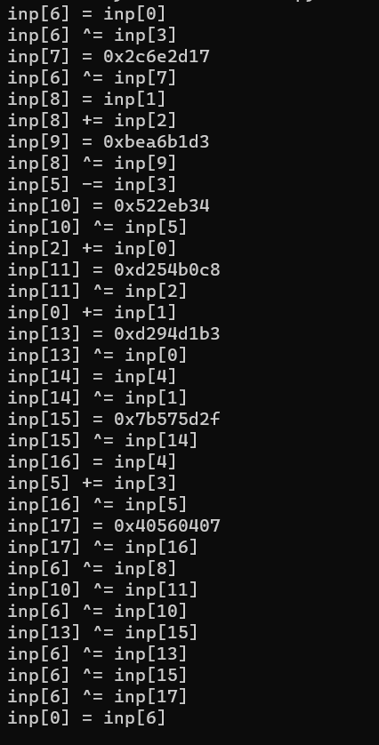

Selanjutnya udah jelas maksudnya yaitu mendapatkan input yang pas, gunakan z3.

```python
from z3 import *
from Crypto.Util.number import *

inp =[BitVec("x{}".format(i), 32) for i in range(6)]
s = Solver()
s.add(inp[0]^inp[3] == 0x2c6e2d17)
s.add(inp[1]+inp[2] == 0xbea6b1d3)
s.add(inp[5]-inp[3] == 0x522eb34)
s.add(inp[2]+inp[0] == 0xd254b0c8)
s.add(inp[0]+inp[1] == 0xd294d1b3)
s.add(inp[4]^inp[1] == 0x7b575d2f)
s.add(inp[4]^inp[5] == 0x40560407)
print(s.check())
model=s.model()
# print(model)
flag = b""
for i in inp:
    tmp = model[i].as_long()
    flag += long_to_bytes(tmp)[::-1]
print(flag)

```

<figure>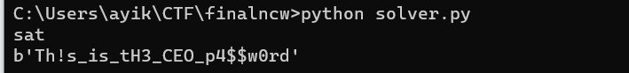<figcaption></figcaption></figure>

<figure>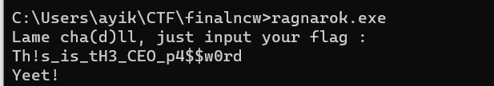<figcaption></figcaption></figure>

Flag : NCW22{Th!s\_is\_tH3\_CEO\_p4$$w0rd}
