# Misc

<!-- challenge-index: b58ff984751f77bf -->

| Challenge | Topic |
| --- | --- |
| [Solar System (500 pts)🥇](#solar-system-500-pts) | Solidity, Smart Contracts |

<!-- /challenge-index -->

## Solar System (500 pts)

### Description

\-

### Solution

Diberikan file zip dengan isi sebagai berikut

<figure>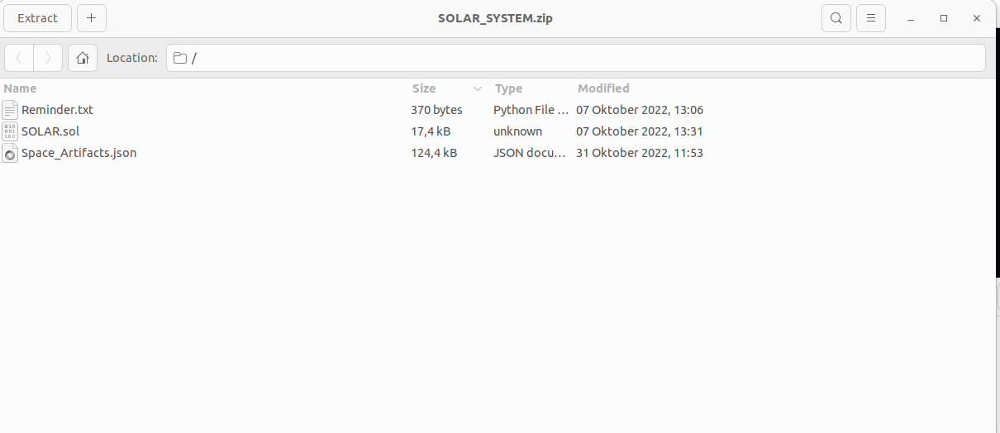<figcaption></figcaption></figure>

Karena soal ini masih terlalu asing bagi kami , jadi kami coba lakukan pencarian mengenai bagaimana cara compile file .sol . Disini kami menemukan ada package brownie pada python (<https://eth-brownie.readthedocs.io/en/stable/>) namun ketika kami coba compile gagal. Kami lanjut mencari hingga menemukan referensi writeup berikut <https://medium.com/zh3r0/sharky-ctf-blockchain-level-0-to-4-writeup-524b728709d0> . Jadi ternyata kita bisa lakukan compile menggunakan remix ide dan ada online compilernya , jadi gunakan online compiler (<https://remix.ethereum.org/>) . Ada beberapa contract didalam file .sol, disini kami lakukan penyelesaian untuk setiap contract.

#### Flag1

<figure>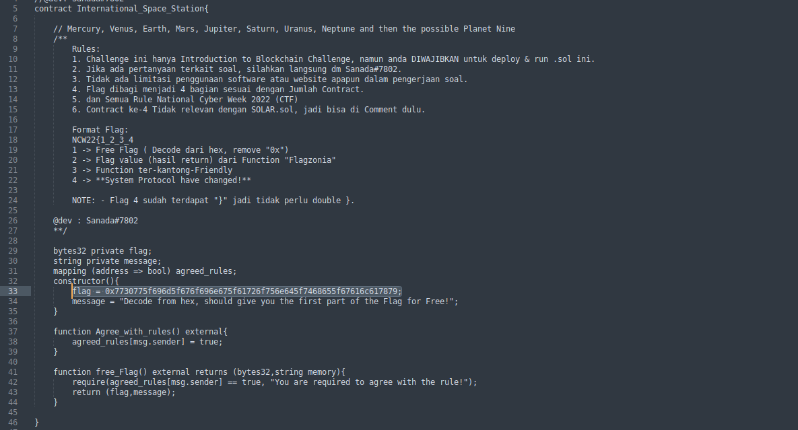<figcaption></figcaption></figure>

Flag1 merupakan free flag bisa langsung kita dapatkan pada contract International\_Space\_Station di constructor.

<figure>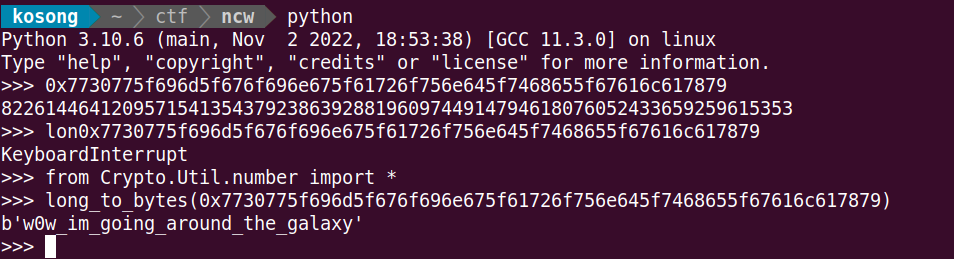<figcaption></figcaption></figure>

Flag1 : w0w\_im\_going\_around\_the\_galaxy

#### Flag2

Flag2 gunakan remix ide, compile dan deploy contract baru.

<figure>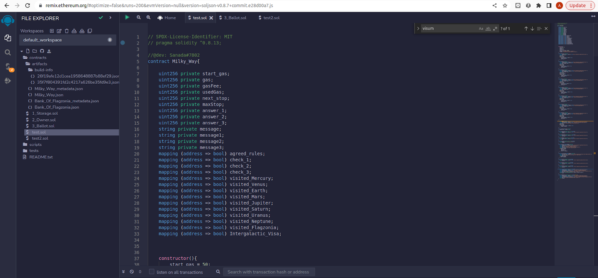<figcaption></figcaption></figure>

<figure>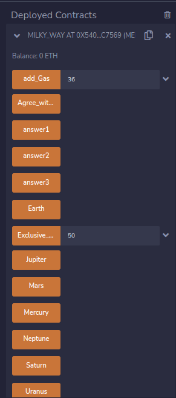<figcaption></figcaption></figure>

Disini ada beberapa fungsi yang bisa kita panggil, namun bisa dilihat pada beberapa fungsi terdapat requirement, seperti contohnya untuk fungsi earth kita harus jalankan fungsi neptune terlebih dahulu. Jadi disini kami lakukan pemetaan pemanggilan fungsi dan juga constraint lain sehingga didapatkan sebagai berikut

```
Urutan planet
Mercury,uranus,jupiter,venus,saturn,mars,neptune,earth

Total gas untuk sampai bumi
5+15+3+20+23+8+29+133 = 236

Total gas tambahan = 236 - 50 = 186
Gas awal 50, dan baru bisa mengisi setiap 2 stop dan juga pada awal perjalanan, jadi untuk setiap pengisian jumlahnya adalah sebagai berikut
[50, 50, 50, 36]
```

Pada flagzonia terdapat pengecekan tambahan, yaitu Intergalactic\_Visa . Disini untuk mengubah variable tersebut menjadi true kita perlu memanggil fungsi visum. Namun gas kita 0, jadi setelah kami cek ada fungsi exclusive\_gas dan bisa dijalankan ketika kita sudah ke bumi dan tambahan gas harus 50. Jadi nantinya gas = 0 setelah di Visum dan memenuhi semua constraint yang ada. Terakhir tinggal panggil flagzonia dan dapat angka yang merupakan part of flag.

<figure>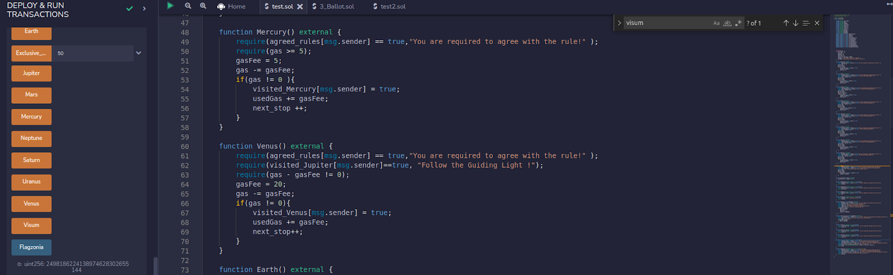<figcaption></figcaption></figure>

Flag2 : 2498186224138974628302655144

#### Flag3&#x20;

Flag3 adalah nama fungsi yang ada pada contract Bank\_Of\_Flagzonia dan memiliki execution fee paling rendah. Karena kami tidak tahu bagaimana mengecek execution fee, maka coba-coba saja karena kebetulan daftar fungsi yang mencurigakan hanya ada 2 yakni donateClothes dan donateHouse. Dan diakhir kami mendapatkan yang benar yaitu donateHouse setelah mencobanya pada platform hehe.

Flag3 : donateHouse

#### Flag4

Flag4 kami dapatkan dengan static analysis. Lakukan beautify pada Space\_Artifacts.json

<figure>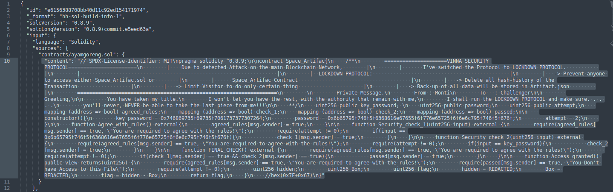<figcaption></figcaption></figure>

Selanjutnya terdapat kodingan yang mirip pada contract Space\_Artifac pada SOLAR.sol . Lakukan beautify dengan mengubah melakukan parsing terhadap \n.

<figure>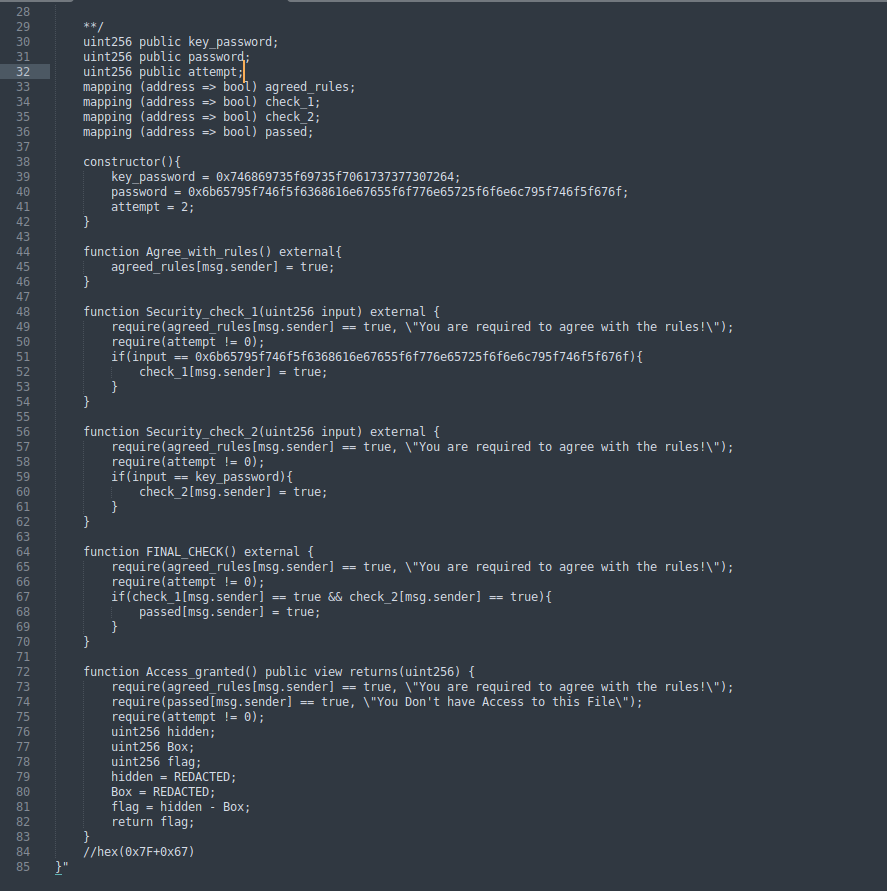<figcaption></figcaption></figure>

Jadi flag adalah hidden-Box. Namun dapat dilhat bahwa hidden dan Box valuenya dihilangkan pada kodingan diatas. Mencari di Space\_Artifacts.json kami menemukan kedua value tersebut

<figure>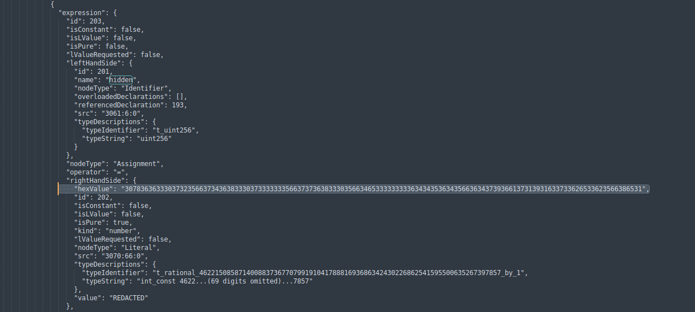<figcaption></figcaption></figure>

<figure>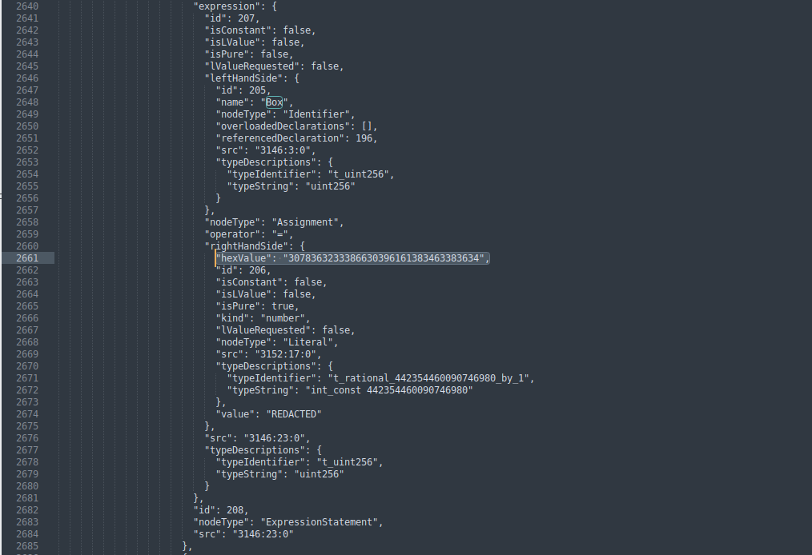<figcaption></figcaption></figure>

Selanjutnya karena itu merupakan hexvalue maka perlu kita ubah ke bentuk ascii nya

<figure>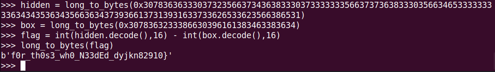<figcaption></figcaption></figure>

Flag4 : f0r\_th0s3\_wh0\_N33dEd\_dyjkn82910}

Gabungkan semua flag dengan format NCW22{1\_2\_3\_4 dan submit

Flag : NCW22{w0w\_im\_going\_around\_the\_galaxy\_2498186224138974628302655144\_donateHouse\_f0r\_th0s3\_wh0\_N33dEd\_dyjkn82910}
