# Reverse Engineering

<!-- challenge-index: 1b269d67415a910e -->

| Challenge | Topic |
| --- | --- |
| [Count the Flag but Easier (331 pts)🥇](#count-the-flag-but-easier-331-pts) | Assembly, Control Flow |
| [Reinvent the Wheel (499 pts)🥇](#reinvent-the-wheel-499-pts) | Anti-Debugging, GDB |
| [Flaggy Bird V2 (500 pts)🥇](/notes/research/2022/cheating-game-built-with-wasm/) | Unity, WebAssembly |

<!-- /challenge-index -->

## Count the Flag but Easier (331 pts)

### Description

\-

### Solution

Diberikan file txt, berikut isinya

```nasm
fungsi():
        push    rbp
        mov     rbp, rsp
        mov     DWORD PTR [rbp-4], 20
        mov     DWORD PTR [rbp-8], 10
        mov     DWORD PTR [rbp-12], 20
        mov     eax, DWORD PTR [rbp-4]
        imul    eax, DWORD PTR [rbp-8]
        lea     ecx, [rax+2]
        mov     eax, DWORD PTR [rbp-12]
        mov     edx, eax
        sal     eax, 2
        sub     edx, eax
        lea     eax, [rcx+rdx]
        mov     DWORD PTR [rbp-16], eax
        sal     DWORD PTR [rbp-16], 20
        cmp     DWORD PTR [rbp-16], 100000000
        jg      .L2
        mov     eax, DWORD PTR [rbp-16]
        lea     edx, [rax+3]
        test    eax, eax
        cmovs   eax, edx
        sar     eax, 2
        mov     DWORD PTR [rbp-16], eax
        jmp     .L3
.L2:
        cmp     DWORD PTR [rbp-16], 100000000
        jle     .L4
        cmp     DWORD PTR [rbp-16], 500000000
        jg      .L4
        mov     eax, DWORD PTR [rbp-16]
        lea     edx, [rax+7]
        test    eax, eax
        cmovs   eax, edx
        sar     eax, 3
        mov     DWORD PTR [rbp-16], eax
        jmp     .L3
.L4:
        mov     eax, DWORD PTR [rbp-16]
        mov     edx, eax
        shr     edx, 31
        add     eax, edx
        sar     eax
        mov     DWORD PTR [rbp-16], eax
.L3:
        nop
        pop     rbp
        ret

```

Tujuannya jelas, jadi mencari tahu nilai akhir dari fungsi(). Disini kami lakukan konversi secara menual, karena kode assemblynya terhitung pendek. Berikut hasil konversi dari asm ke python

```python
rbp_4 = 20
rbp_8 = 10
rbp_12 = 20
eax = rbp_4
eax *= rbp_8
ecx = eax + 2
eax = rbp_12
edx = eax
eax <<= 2
edx -= eax
eax = ecx + edx
rbp_16 = eax
rbp_16 <<= 20
if(rbp_16 > 100000000):
	#L2
	if(rbp_16 <= 100000000):
		#L4
		eax = rbp_16
		edx = eax
		edx >>= 31
		eax += edx
		eax >>= 1
		rbp_16 = eax
	elif(rbp_16>500000000):
		eax = rbp_16
		edx = eax
		edx >>= 31
		eax += edx
		eax >>= 1
		rbp_16 = eax
	eax = rbp_16
	edx = eax+7
	eax >>= 3
	rbp_16 = eax
else:
	eax = rbp_16
	edx = eax + 3
	eax >>= 2
	rbp_16 = eax
print(rbp_16)

```

<figure>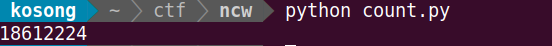<figcaption></figcaption></figure>

Flag : NCW22{18612224}

## Reinvent the Wheel (499 pts)

### Description

\-

### Solution

Diberikan file elf 64 bit. Kami membukanya menggunakan IDA

<figure>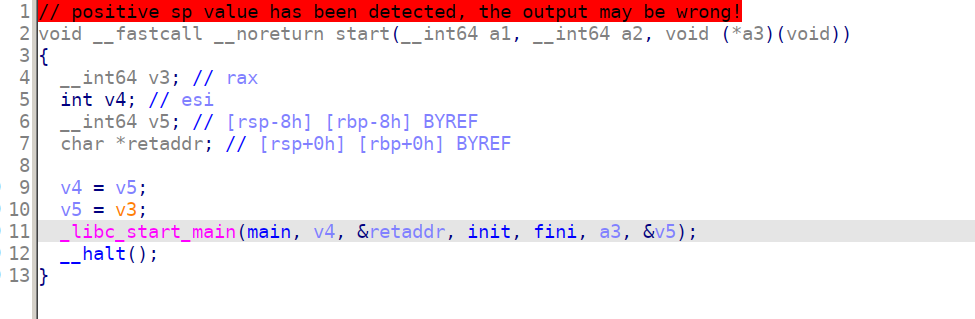<figcaption></figcaption></figure>

<figure>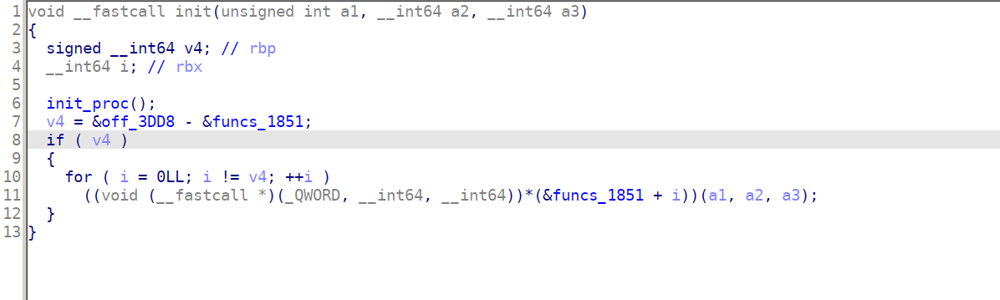<figcaption></figcaption></figure>

Pada start terlihat ada pemanggilan fungsi init dan fungsi init mengeksekusi fungsi anti debug

<figure>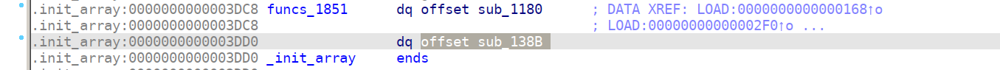<figcaption></figcaption></figure>

<figure>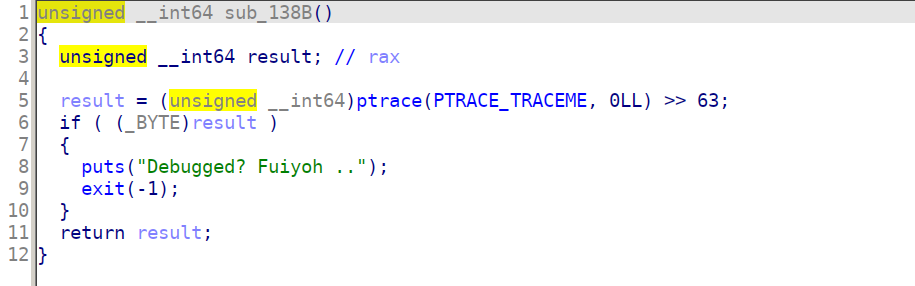<figcaption></figcaption></figure>

Jadi lakukan bypass terhadap pengecekan debug tersebut ketika melakukan dynamic analysis dengan gdb.

<figure>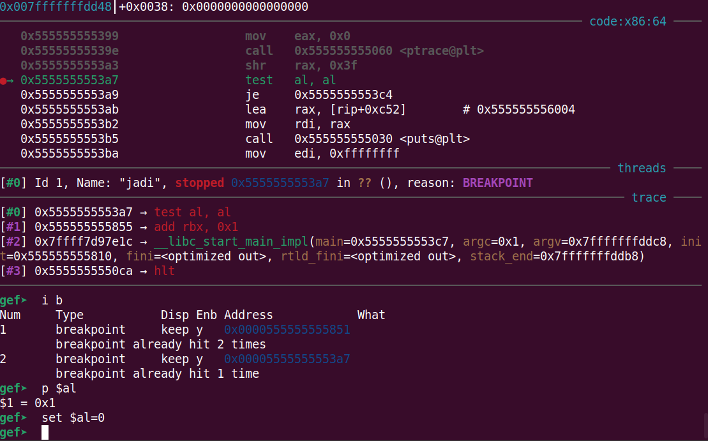<figcaption></figcaption></figure>

Setelah bypass maka kita akan masuk ke fungsi main.

<figure>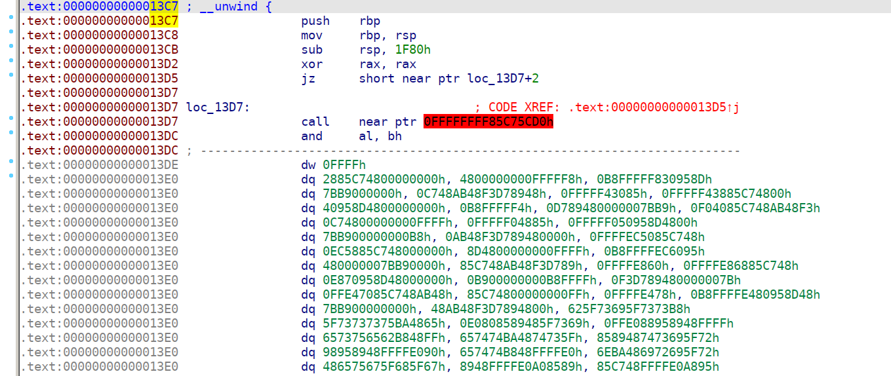<figcaption></figcaption></figure>

Terlihat pada IDA terdapat anti dissasembly pada fungsi main. Maka kita perlu lakukan sedikit dynamic analysis untuk ini.&#x20;

<figure>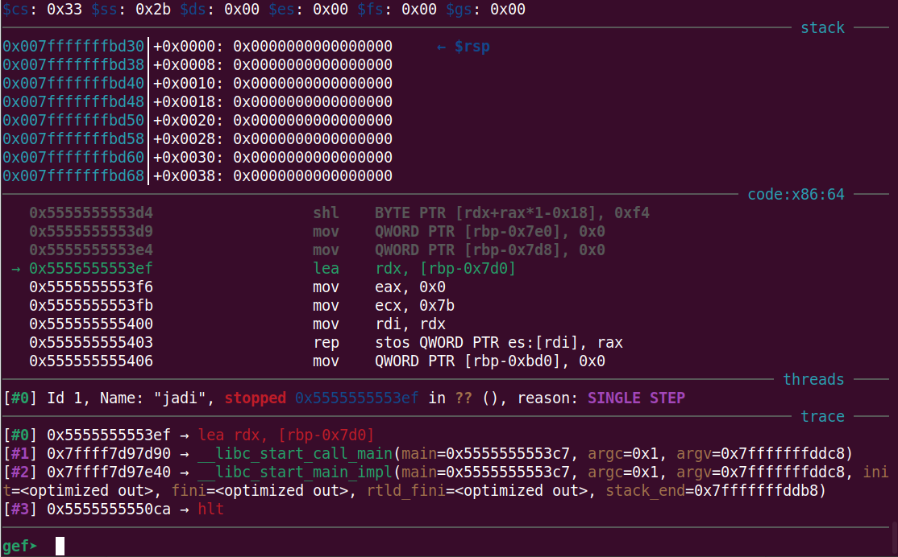<figcaption></figcaption></figure>

Setelah masuk fungsi main lakukan next instruction sampai masuk ke alamat yang tidak bisa disassembly pada IDA. Jika sudah, cek instruksi pertama kali yang bisa di disassembly pada main (GDB) di alamat yang tidak bisa di disassembly pada IDA.&#x20;

<figure>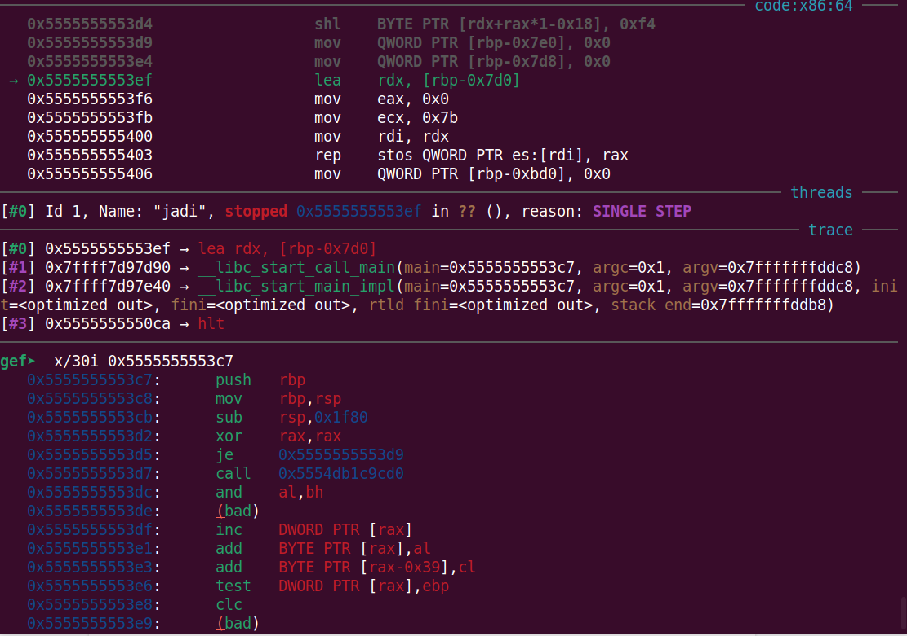<figcaption></figcaption></figure>

<figure>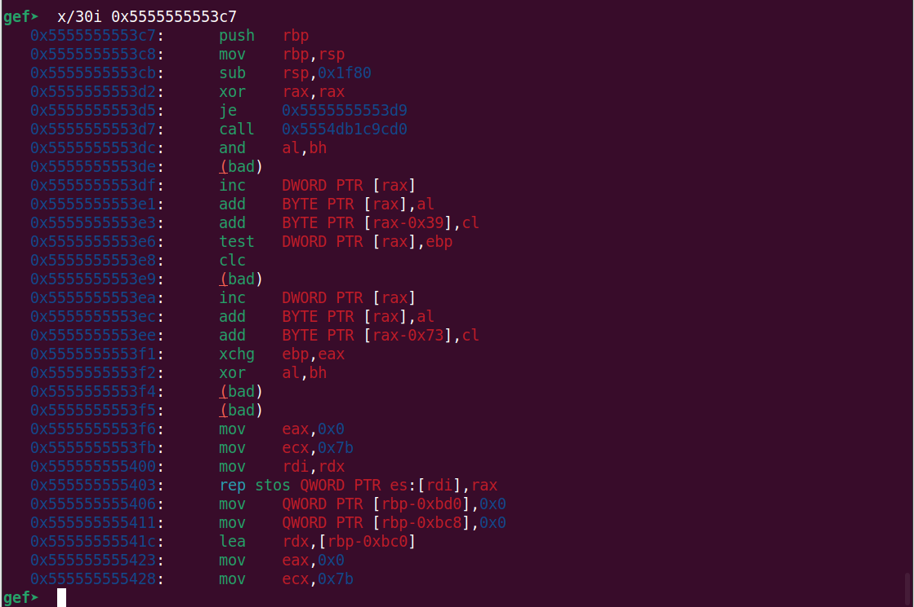<figcaption></figcaption></figure>

Terlihat pada 0x5555555553f6 sudah bisa didissassembly dengan benar, maka convert ke assembly mulai dari address tersebut lalu create new function pada address tersebut.

<figure>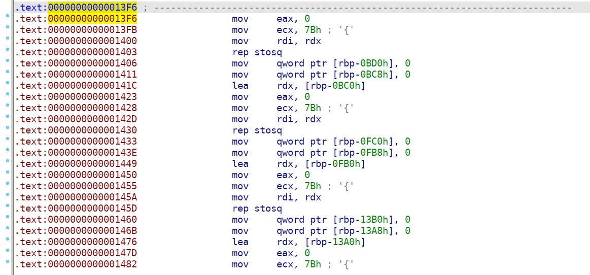<figcaption></figcaption></figure>

<figure>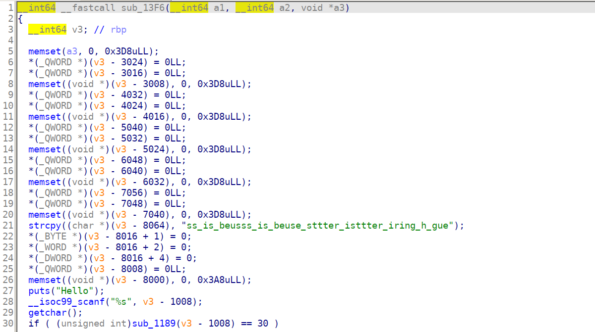<figcaption></figcaption></figure>

Langkah selanjutnya analisis fungsi pengecekan, terlihat bahwa terdapat fungsi swap yang dilakukan pada algoritma diatas. Jadi karena algoritmanya hanya swap, maka kita bisa lakukan pemetaan dengan cara menginputkan nilai yang berbeda sebesar 30 bytes dan set breakpoint pada 0x017CE .&#x20;

<figure>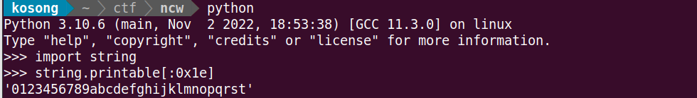<figcaption></figcaption></figure>

<figure>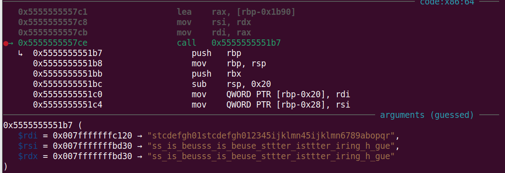<figcaption></figcaption></figure>

Berikut solver yang kami gunakan untuk mendapatkan input yang valid.

```python
import string

ori = string.printable[:0x1e]
mapp = "stcdefgh01stcdefgh012345ijklmn45ijklmn6789abopqr"

ct = "ss_is_beusss_is_beuse_sttter_isttter_iring_h_gue"
index = []
flag = [0 for i in range(0x1e)]
for i in mapp:
	index.append(ori.index(i))
for i in range(len(ct)):
	flag[index[i]] = ct[i]
print(''.join(flag))
```

<figure>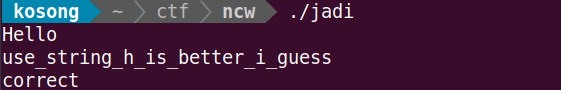<figcaption></figcaption></figure>

Flag : NCW22{use\_string\_h\_is\_better\_i\_guess}
