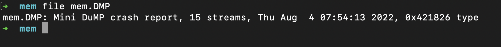

# Forensic

<!-- challenge-index: 4398836b911d0f8c -->

| Challenge | Topic |
| --- | --- |
| [BABY\_4 (484 pts)🥇](#baby_4-484-pts) | Memory Dump Analysis |

<!-- /challenge-index -->

## BABY\_4 (484 pts)

### Description

\-

### Solution

Given .DMP file.

<figure><figcaption></figcaption></figure>

We can analyze DMP file using IDA, i used this [reference](https://www.youtube.com/watch?v=BmsRukM7x4s) to do it.

TBU
