# Reverse Engineering

<!-- challenge-index: 96a2e99b873e9592 -->

| Challenge | Topic |
| --- | --- |
| [WARMUP (244 pts)](#warmup-244-pts) | RC4, XOR |
| [OXYGEN (481 pts)](#oxygen-481-pts) | Binary Patching, Input Validation |

<!-- /challenge-index -->

## WARMUP (244 pts)

### Description

\-

### Solution

Given PE file, open it using IDA.

<figure>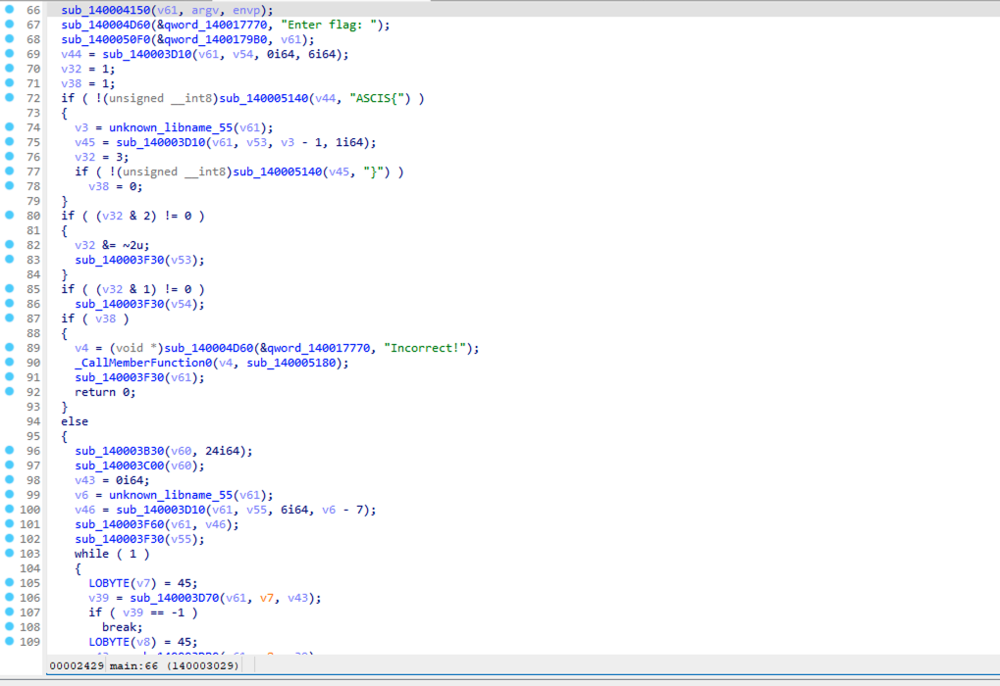<figcaption></figcaption></figure>

We can see on main function most of the function called looks like "stripped". If we take a look on one of those called functions (sub\_140004d60) we can see that it looks like statically compiled then stripped.&#x20;

<figure>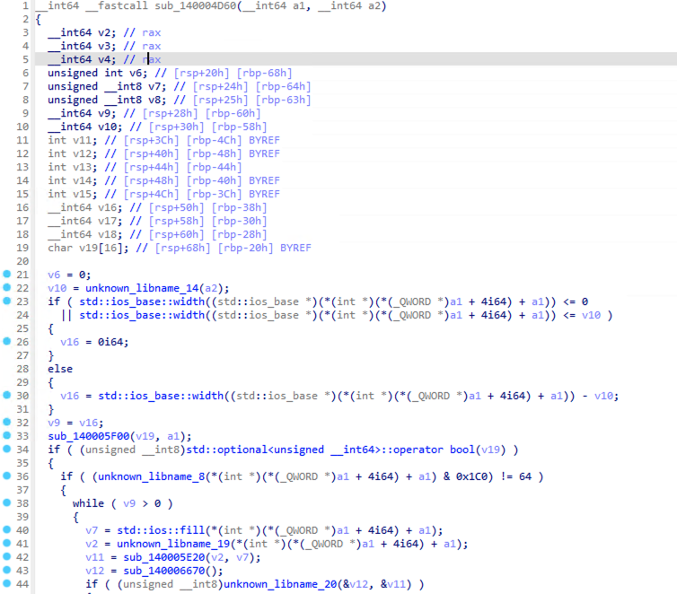<figcaption></figcaption></figure>

To recover the function name i did debugging then analyze the input and output. After knowing what the function do i rename the function name to make it easier to understand.

```c
int __cdecl main(int argc, const char **argv, const char **envp)
{
  __int64 v3; // rax
  void *v4; // rax
  __int64 v6; // rax
  __int64 v7; // rdx
  __int64 v8; // rdx
  void *v9; // rax
  __int64 value_array; // rax
  _QWORD *v11; // rax
  _BYTE *v12; // rax
  void *v13; // rax
  __int64 v14; // rax
  _QWORD *v15; // rax
  _QWORD *v16; // rax
  _BYTE *v17; // rax
  void *v18; // rax
  __int64 v19; // rax
  __int64 v20; // rax
  void *v21; // rax
  __int64 v22; // rax
  _QWORD *v23; // rax
  _QWORD *v24; // rax
  _BYTE *v25; // rax
  void *v26; // rax
  __int64 v27; // rax
  _QWORD *v28; // rax
  _QWORD *v29; // rax
  _BYTE *v30; // rax
  void *v31; // rax
  char v32; // [rsp+20h] [rbp-2E8h]
  char v33; // [rsp+25h] [rbp-2E3h]
  int j; // [rsp+28h] [rbp-2E0h]
  int k; // [rsp+2Ch] [rbp-2DCh]
  int m; // [rsp+30h] [rbp-2D8h]
  int i; // [rsp+34h] [rbp-2D4h]
  bool v38; // [rsp+38h] [rbp-2D0h]
  __int64 v39; // [rsp+40h] [rbp-2C8h]
  char v40; // [rsp+54h] [rbp-2B4h]
  char v41; // [rsp+60h] [rbp-2A8h]
  char v42; // [rsp+68h] [rbp-2A0h]
  __int64 v43; // [rsp+78h] [rbp-290h]
  char *Str1; // [rsp+88h] [rbp-280h]
  char *v45; // [rsp+98h] [rbp-270h]
  __int64 v46; // [rsp+A0h] [rbp-268h]
  __int64 v47; // [rsp+B0h] [rbp-258h]
  __int64 v48; // [rsp+E0h] [rbp-228h]
  __int64 v49; // [rsp+F8h] [rbp-210h]
  __int64 key; // [rsp+108h] [rbp-200h]
  __int64 ciphertext; // [rsp+110h] [rbp-1F8h]
  char *plaintext_; // [rsp+120h] [rbp-1E8h]
  char v53[32]; // [rsp+158h] [rbp-1B0h] BYREF
  char v54[32]; // [rsp+178h] [rbp-190h] BYREF
  char v55[32]; // [rsp+198h] [rbp-170h] BYREF
  char v56[32]; // [rsp+1B8h] [rbp-150h] BYREF
  char plaintext[32]; // [rsp+1D8h] [rbp-130h] BYREF
  char v58[32]; // [rsp+1F8h] [rbp-110h] BYREF
  char v59[32]; // [rsp+218h] [rbp-F0h] BYREF
  char v60[24]; // [rsp+238h] [rbp-D0h] BYREF
  char v61[32]; // [rsp+250h] [rbp-B8h] BYREF
  char v62[32]; // [rsp+270h] [rbp-98h] BYREF
  char v63[32]; // [rsp+290h] [rbp-78h] BYREF
  char v64[32]; // [rsp+2B0h] [rbp-58h] BYREF
  char v65[32]; // [rsp+2D0h] [rbp-38h] BYREF

  sub_7FF661CD4150(v61);
  printf_(&Format, "Enter flag: ");
  sub_7FF661CD50F0(&qword_7FF661CE79B0, v61);
  Str1 = (char *)substring_(v61, v54, 0i64, 6i64);
  v32 = 1;
  v38 = 1;
  if ( !(unsigned __int8)strcmp_(Str1, "ASCIS{") )
  {
    v3 = unknown_libname_55(v61);
    v45 = (char *)substring_(v61, v53, v3 - 1, 1i64);
    v32 = 3;
    if ( !(unsigned __int8)strcmp_(v45, "}") )
      v38 = 0;
  }
  if ( (v32 & 2) != 0 )
  {
    v32 &= ~2u;
    sub_7FF661CD3F30(v53);
  }
  if ( (v32 & 1) != 0 )
    sub_7FF661CD3F30(v54);
  if ( v38 )
  {
    v4 = (void *)printf_(&Format, "Incorrect!");
    _CallMemberFunction0(v4, sub_7FF661CD5180);
    sub_7FF661CD3F30(v61);
    return 0;
  }
  else
  {
    sub_7FF661CD3B30(v60, 24i64);
    sub_7FF661CD3C00(v60);
    v43 = 0i64;
    v6 = unknown_libname_55(v61);
    v46 = substring_(v61, v55, 6i64, v6 - 7);
    sub_7FF661CD3F60(v61, v46);
    sub_7FF661CD3F30(v55);
    while ( 1 )
    {
      LOBYTE(v7) = '-';
      v39 = sub_7FF661CD3D70(v61, v7, v43);
      if ( v39 == -1 )
        break;
      LOBYTE(v8) = '-';
      v43 = sub_7FF661CD3DB0(v61, v8, v39);
      v47 = substring_(v61, v56, v39, v43 - v39);
      sub_7FF661CD3BB0((__int64)v60, v47);
      sub_7FF661CD3F30(v56);
    }
    if ( sub_7FF661CD3B80(v60) == 6 )           // split by - and check length
    {
      sub_7FF661CD4040(v62, &unk_7FF661CE2B15);
      for ( i = 0; ; ++i )
      {
        value_array = get_value_at_index(v60, 5i64);
        if ( i >= (unsigned __int64)unknown_libname_55(value_array) )
          break;
        v11 = (_QWORD *)get_value_at_index(v60, 5i64);
        v12 = (_BYTE *)get_byte(v11, i);
        std::string::operator+=(v62, *v12 ^ 0x69u);
      }
      if ( !(unsigned __int8)strcmp_(v62, byte_7FF661CE2B44) )
      {
        sub_7FF661CD4040(v63, &unk_7FF661CE2B16);
        for ( j = 0; ; ++j )
        {
          v14 = get_value_at_index(v60, 4i64);
          if ( j >= (unsigned __int64)unknown_libname_55(v14) )
            break;
          v15 = (_QWORD *)get_value_at_index(v60, 4i64);
          v40 = *(_BYTE *)get_byte(v15, j);
          v16 = (_QWORD *)get_value_at_index(v60, 5i64);
          v17 = (_BYTE *)get_byte(v16, j);
          std::string::operator+=(v63, (unsigned __int8)(*v17 ^ v40));
        }
        if ( !(unsigned __int8)strcmp_(v63, &byte_7FF661CE2B5C) )
        {
          v48 = get_value_at_index(v60, 5i64);
          v19 = get_value_at_index(v60, 4i64);
          key = string_concat_((__int64)v59, v19, v48);
          v49 = get_value_at_index(v60, 3i64);
          v20 = get_value_at_index(v60, 2i64);
          ciphertext = string_concat_((__int64)v58, v20, v49);
          plaintext_ = (char *)RC4((__int64)plaintext, ciphertext, key);
          v33 = strcmp_(plaintext_, byte_7FF661CE2B78);
          sub_7FF661CD3F30(plaintext);
          if ( v33 )
          {
            v21 = (void *)printf_(&Format, "Incorrect!");
            _CallMemberFunction0(v21, sub_7FF661CD5180);
            sub_7FF661CD3F30(v63);
            sub_7FF661CD3F30(v62);
            sub_7FF661CD3BE0(v60);
            sub_7FF661CD3F30(v61);
            return 0;
          }
          else
          {
            sub_7FF661CD4040(v64, &unk_7FF661CE2B17);
            for ( k = 0; ; ++k )
            {
              v22 = get_value_at_index(v60, 1i64);
              if ( k >= (unsigned __int64)unknown_libname_55(v22) )
                break;
              v23 = (_QWORD *)get_value_at_index(v60, 1i64);
              v41 = *(_BYTE *)get_byte(v23, k);
              v24 = (_QWORD *)get_value_at_index(v60, 2i64);
              v25 = (_BYTE *)get_byte(v24, k);
              std::string::operator+=(v64, (unsigned __int8)(*v25 + v41));
            }
            if ( !(unsigned __int8)strcmp_(v64, &byte_7FF661CE2B94) )
            {
              sub_7FF661CD4040(v65, &unk_7FF661CE2B1F);
              for ( m = 0; ; ++m )
              {
                v27 = get_value_at_index(v60, 0i64);
                if ( m >= (unsigned __int64)unknown_libname_55(v27) )
                  break;
                v28 = (_QWORD *)get_value_at_index(v60, 0i64);
                v42 = *(_BYTE *)get_byte(v28, m);
                v29 = (_QWORD *)get_value_at_index(v60, 3i64);
                v30 = (_BYTE *)get_byte(v29, m);
                std::string::operator+=(v65, (unsigned __int8)(v42 - *v30));
              }
              if ( !(unsigned __int8)strcmp_(v65, &byte_7FF661CE2BAC) )
                v31 = (void *)printf_(&Format, "Correct!");
              else
                v31 = (void *)printf_(&Format, "Incorrect!");
              _CallMemberFunction0(v31, sub_7FF661CD5180);
              sub_7FF661CD3F30(v65);
              sub_7FF661CD3F30(v64);
              sub_7FF661CD3F30(v63);
              sub_7FF661CD3F30(v62);
              sub_7FF661CD3BE0(v60);
              sub_7FF661CD3F30(v61);
              return 0;
            }
            else
            {
              v26 = (void *)printf_(&Format, "Incorrect!");
              _CallMemberFunction0(v26, sub_7FF661CD5180);
              sub_7FF661CD3F30(v64);
              sub_7FF661CD3F30(v63);
              sub_7FF661CD3F30(v62);
              sub_7FF661CD3BE0(v60);
              sub_7FF661CD3F30(v61);
              return 0;
            }
          }
        }
        else
        {
          v18 = (void *)printf_(&Format, "Incorrect!");
          _CallMemberFunction0(v18, sub_7FF661CD5180);
          sub_7FF661CD3F30(v63);
          sub_7FF661CD3F30(v62);
          sub_7FF661CD3BE0(v60);
          sub_7FF661CD3F30(v61);
          return 0;
        }
      }
      else
      {
        v13 = (void *)printf_(&Format, "Incorrect!");
        _CallMemberFunction0(v13, sub_7FF661CD5180);
        sub_7FF661CD3F30(v62);
        sub_7FF661CD3BE0(v60);
        sub_7FF661CD3F30(v61);
        return 0;
      }
    }
    else
    {
      v9 = (void *)printf_(&Format, "Incorrect!");
      _CallMemberFunction0(v9, sub_7FF661CD5180);
      sub_7FF661CD3BE0(v60);
      sub_7FF661CD3F30(v61);
      return 0;
    }
  }
}
```

* Program validate if input has preifx ASCIS and suffix }
* Split value wrapped by ASCIS by -
  * There must be 6 value after splitted
* Each index on splitted value will be processed with several operation like xor, add, rc4, and substraction

Because all operation are reversible, we just need to reverse the operation and leak value index by index to get the flag.

1. Get flag5&#x20;
2. Get flag4 because we know flag5
3. Get flag2 and flag3 because we know flag4 and flag5
4. Get flag1 because we know flag2
5. Get flag0 because we know flag3

Here is my solver

```python
from arc4 import ARC4

flag = ["" for i in range(6)]

byte_7FF661CE2B44 = [0x5A, 0x5B, 0x0B, 0x0A, 0x5E, 0x5F]

for i in byte_7FF661CE2B44:
	flag[5] += chr(i ^ 0x69)

byte_7FF661CE2B5C = [0x5,0x1,0x6,0x5B,0x5,0x2]

for i in range(len(byte_7FF661CE2B5C)):
	flag[4] += chr(ord(flag[5][i]) ^ byte_7FF661CE2B5C[i])

byte_7FF661CE2B78 = [0x60, 0xE0, 0xE4, 0x2D, 0xFF, 0x97, 0xDD, 0x13, 0xEE, 0xA0, 0x55, 0xF4]
ct = bytes(byte_7FF661CE2B78)

key = flag[4] + flag[5]
rc4 = ARC4(key.encode())

tmp = rc4.decrypt(ct).decode()
flag[2] = tmp[:6]
flag[3] = tmp[6:12]

byte_7FF661CE2B94 = [0x95, 0xC8, 0x95, 0x9D, 0x69, 0x68]

for i in range(len(byte_7FF661CE2B94)):
	flag[1] += chr(byte_7FF661CE2B94[i] - ord(flag[2][i]))

byte_7FF661CE2BAC = [0x01, 0xFA, 0x06, 0xD2, 0xFF, 0xCE]

for i in range(len(byte_7FF661CE2BAC)):
	flag[0] += chr((ord(flag[3][i]) + byte_7FF661CE2BAC[i])&0xff)

print("ASCIS{" + "-".join(flag) + "}")
```

<figure>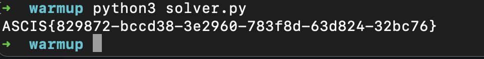<figcaption></figcaption></figure>

<figure>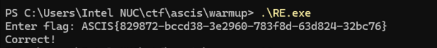<figcaption></figcaption></figure>

Flag: ASCIS{829872-bccd38-3e2960-783f8d-63d824-32bc76}

## OXYGEN (481 pts)

### Description

\-

### Solution

Given PE file, open it using IDA. IDA can't detect main function but there is start function.

<figure>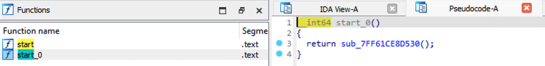<figcaption></figcaption></figure>

Analyzing start function i can't find "main" function, so i tried to look at available strings.&#x20;

<figure>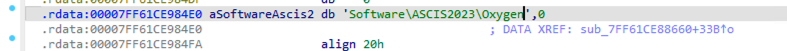<figcaption></figcaption></figure>

Go to address for each reference, we will find out that the main function is sub\_7FF61CE8D7A0.

<figure>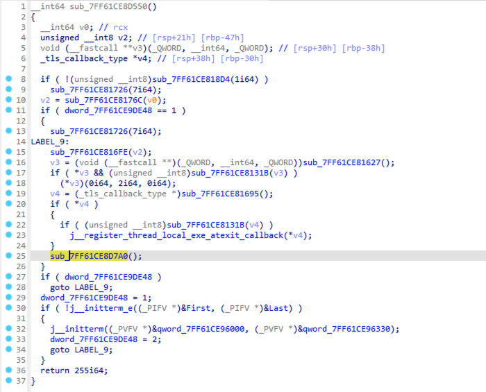<figcaption></figcaption></figure>

There is something weird on decompiled code (sub\_7FF61CE8B8E0).&#x20;

<figure>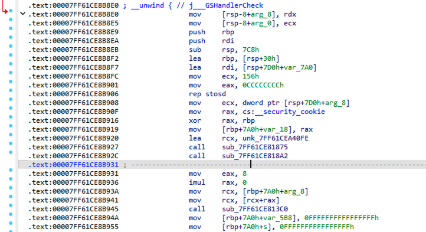<figcaption></figcaption></figure>

<figure>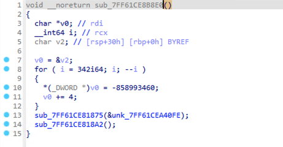<figcaption></figcaption></figure>

<figure>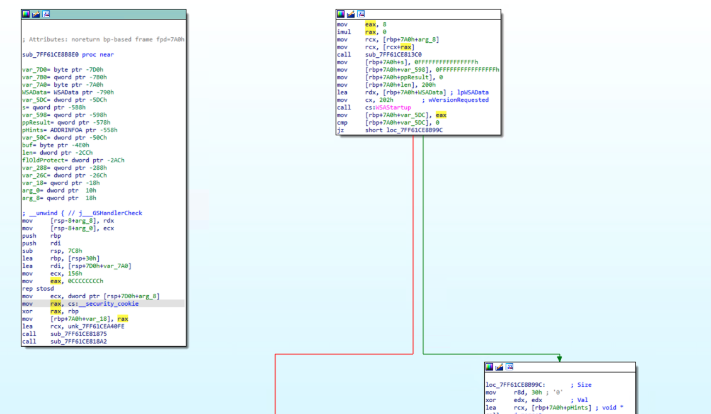<figcaption></figcaption></figure>

Through trial and error i found the solution, we can just put change the second call to nop then decompile again.

<figure>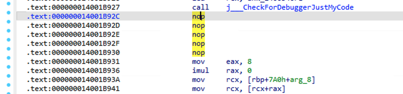<figcaption></figcaption></figure>

```c
int __fastcall __noreturn main_0(int argc, const char **argv, const char **envp)
{
  char *v3; // rdi
  __int64 i; // rcx
  int v6; // eax
  char v7; // [rsp+30h] [rbp+0h] BYREF
  struct WSAData WSAData; // [rsp+40h] [rbp+10h] BYREF
  int v9; // [rsp+1F4h] [rbp+1C4h]
  SOCKET v10; // [rsp+218h] [rbp+1E8h]
  SOCKET s; // [rsp+238h] [rbp+208h]
  PADDRINFOA ppResult; // [rsp+258h] [rbp+228h] BYREF
  ADDRINFOA pHints; // [rsp+278h] [rbp+248h] BYREF
  int v14; // [rsp+2C4h] [rbp+294h]
  char buf[532]; // [rsp+2F0h] [rbp+2C0h] BYREF
  int len; // [rsp+504h] [rbp+4D4h]
  DWORD flOldProtect[9]; // [rsp+524h] [rbp+4F4h] BYREF
  __int64 (__fastcall *v18)(char *, _QWORD, char *); // [rsp+548h] [rbp+518h]
  int v19; // [rsp+564h] [rbp+534h]

  v3 = &v7;
  for ( i = 342i64; i; --i )
  {
    *(_DWORD *)v3 = -858993460;
    v3 += 4;
  }
  j___CheckForDebuggerJustMyCode((__int64)&unk_1400340FE, (__int64)argv, (__int64)envp);
  sub_1400113C0(*argv);
  v10 = -1i64;
  s = -1i64;
  ppResult = 0i64;
  len = 512;
  v9 = WSAStartup(0x202u, &WSAData);
  if ( v9 )
    return 1;
  j_memset(&pHints, 0, sizeof(pHints));
  pHints.ai_family = 2;
  pHints.ai_socktype = 1;
  pHints.ai_protocol = 6;
  pHints.ai_flags = 1;
  v9 = getaddrinfo(0i64, "1337", &pHints, &ppResult);
  if ( v9 )
  {
    WSACleanup();
    return 1;
  }
  else
  {
    v10 = socket(ppResult->ai_family, ppResult->ai_socktype, ppResult->ai_protocol);
    if ( v10 == -1i64 )
    {
      freeaddrinfo(ppResult);
      WSACleanup();
      return 1;
    }
    else
    {
      v9 = bind(v10, ppResult->ai_addr, ppResult->ai_addrlen);
      if ( v9 == -1 )
      {
        freeaddrinfo(ppResult);
        closesocket(v10);
        WSACleanup();
        return 1;
      }
      else
      {
        puts("gimme oxygen!");
        freeaddrinfo(ppResult);
        v9 = listen(v10, 0x7FFFFFFF);
        if ( v9 == -1 || (s = accept(v10, 0i64, 0i64), s == -1i64) )
        {
          closesocket(v10);
          WSACleanup();
          return 1;
        }
        else
        {
          closesocket(v10);
          VirtualProtect(&unk_14002D000, 0x7Bui64, 0x40u, flOldProtect);
          v18 = (__int64 (__fastcall *)(char *, _QWORD, char *))&unk_14002D000;
          do
          {
            v9 = recv(s, buf, len, 0);
            if ( v9 <= 0 )
              goto LABEL_24;
            v19 = v18(buf, (unsigned int)len, aNCQrm);
            if ( v19 == 1 )
            {
              puts("congratz");
              sub_1400114C9((unsigned int)&unk_14002D090, 39, (unsigned int)buf, 11, (__int64)::buf);
              v6 = j_strlen(::buf);
              v14 = send(s, ::buf, v6, 0);
              if ( v14 == -1 )
                goto LABEL_24;
            }
            else
            {
              puts("oops");
            }
          }
          while ( v9 > 0 );
          v9 = shutdown(s, 1);
          if ( v9 == -1 )
          {
LABEL_24:
            closesocket(s);
            WSACleanup();
            return 1;
          }
          closesocket(s);
          WSACleanup();
          return 0;
        }
      }
    }
  }
}
```

* Program will listening at port 1337
* If there is connection, it will print "gimmy oxygen!"
  * Program will receive our input and call function unk\_14002D000
  * if function unk\_14002D000 return 1, it will call sub\_1400114C9 (RC4)

From above analysis we can conclude that we need to find input that return 1 for function unk\_14002D000. At first i tried to disassemble unk\_14002D000 and it looks like not a valid assembly.

<figure>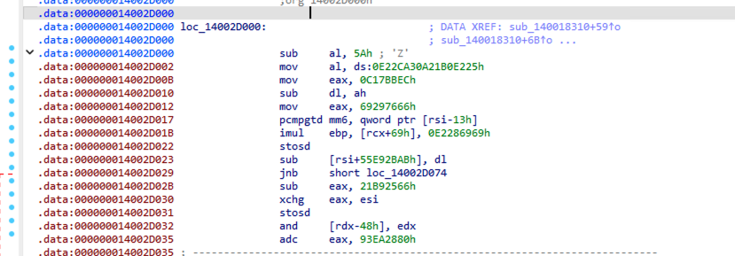<figcaption></figcaption></figure>

So lets take a look on cross reference.

<figure>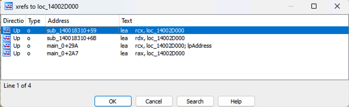<figcaption></figcaption></figure>

<figure>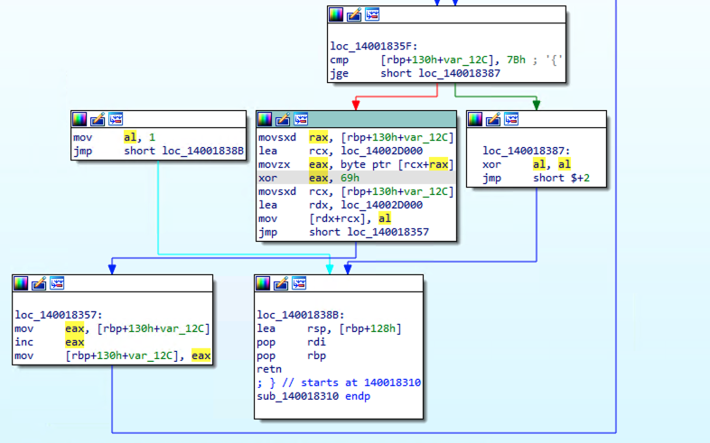<figcaption></figcaption></figure>

Looks like it just basic xor, use idapython to automatically patch the values.

```python
start = 0x14002D000

for i in range(0x7b):
	val = get_bytes(start+i, 1)
	new_val = val[0] ^ 0x69
	patch_byte(start+i, new_val)
```

&#x20;

<figure>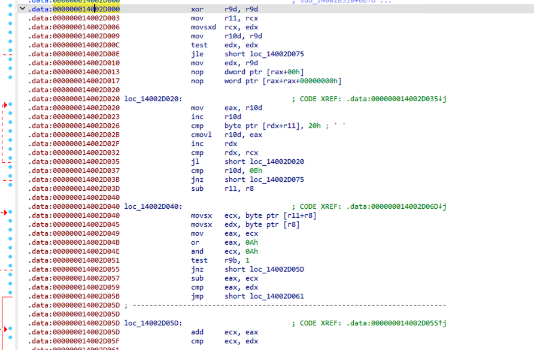<figcaption></figcaption></figure>

Now it looks like valid assembly, lets decompile the code and rename known variables.&#x20;

<figure>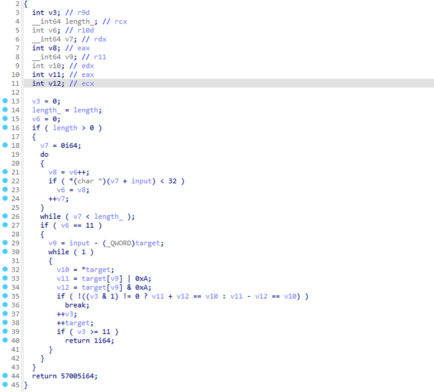<figcaption></figcaption></figure>

* v9 = input - target
  * target\[v9] == target + input - target
  * target\[v9] == input
* if counter is odd, substract
* if counter is even, add

Now, lets write the script to bruteforce valid input.

```python
import string

target = b"n[}>}C]qRm["

poss = []
for i in range(len(target)):
	poss_tmp = []
	for j in string.printable[:-6]:
		tmp = ord(j) | 0xa
		tmp2 = ord(j) & 0xa
		tmp3 = (tmp - tmp2)&0xff
		tmp4 = (tmp + tmp2)&0xff
		if(i%2 == 0):
			if(tmp3 == target[i]):
				poss_tmp.append(j)
		else:
			if(tmp4 == target[i]):
				poss_tmp.append(j)
	poss.append(poss_tmp)

key = ""
for i in poss:
	key += i[0]
print(key)
```

<figure>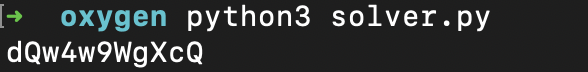<figcaption></figcaption></figure>

Finally put the generated key to the service.

<figure>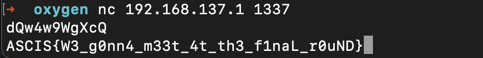<figcaption></figcaption></figure>

Flag: ASCIS{W3\_g0nn4\_m33t\_4t\_th3\_f1naL\_r0uND}
