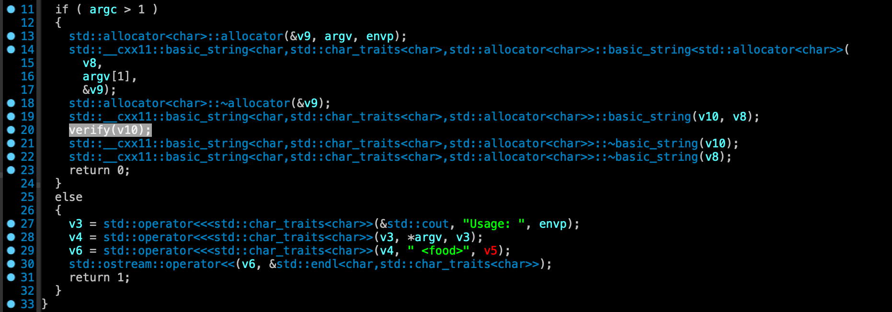
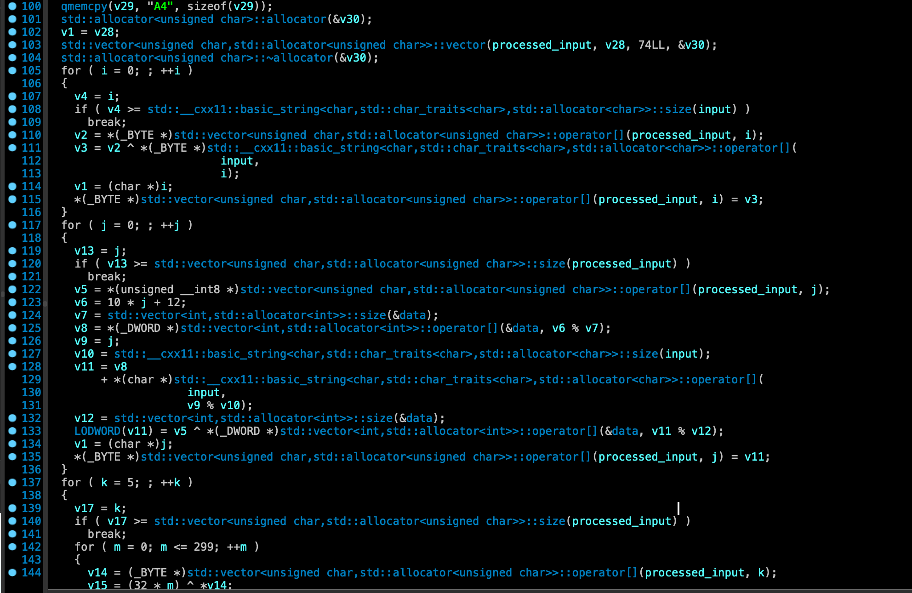
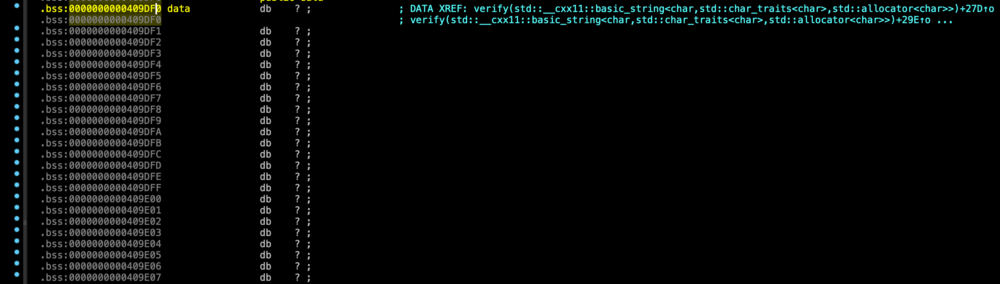
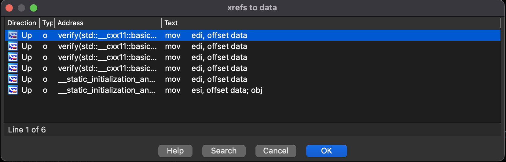
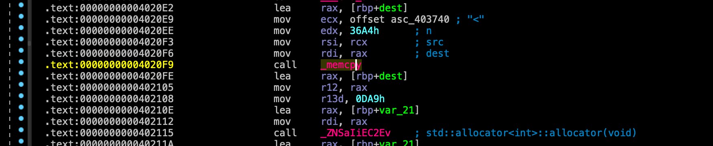

# Reverse Engineering

<!-- challenge-index: b1f5870c15776146 -->

| Challenge | Topic |
| --- | --- |
| [rox (464 pts)](#rox-464-pts) | FreeBSD, Static Analysis |

<!-- /challenge-index -->

## rox (464 pts)

### Description

I'm trying to find the password in a sea of flags... something's weird about this file.

Note: please enclose the flag in csawctf{} before submitting, i.e. csawctf{fake\_flag}

### Solution

We need freebsd operating system to debug the binary. Since i don't have `freebsd` virtual machine i just do `static analysis` to solve the challenge. Taking a look on main function

<figure><figcaption></figcaption></figure>

Verify function processed our input with some algorithm and at the end it compared our processed input with static value which is `"flag{ph3w...u finaLly g0t it! jump into cell wHen U g3t t0 the next cha11}"`

<figure><figcaption></figcaption></figure>

We know `v28` values but there are data variable that we don't know the value since the variable not initialized in `verify` function. By clicking the `data` variable we will go to the `bss section` that stored data variable

<figure><figcaption></figcaption></figure>

There are some functions that use data as operand, take a look on `corss reference` we will see list like below

<figure><figcaption></figcaption></figure>

We can see that there is function `__static_initialization_and_destruction_0` that use `data` variable, go to that function&#x20;

<figure><figcaption></figcaption></figure>

`memcpy` function copy values from `asc_403740` to data variable, so for now we have all values needed for the algorithm. Next we just need to reconstruct the code in `python`

```python
v28 = [0 for i in range(74)]
v28[0] = 0x3F
v28[1] = 0x42
v28[2] = 0x38
v28[3] = 0x5F
v28[4] = 0x7A
v28[5] = 0x57
v28[6] = 0x71
v28[7] = 0x74
v28[8] = 0x66
v28[9] = 0x44
v28[10] = 0x47
v28[11] = 0x32
v28[12] = 0x3D
v28[13] = 22
v28[14] = 99
v28[15] = 31
v28[16] = 18
v28[17] = 26
v28[18] = 18
v28[19] = 92
v28[20] = 42
v28[21] = 3
v28[22] = 100
v28[23] = 28
v28[24] = 21
v28[25] = 64
v28[26] = 1
v28[27] = 63
v28[28] = 76
v28[29] = 2
v28[30] = 58
v28[31] = 48
v28[32] = 29
v28[33] = 124
v28[34] = 105
v28[35] = 77
v28[36] = 25
v28[37] = 95
v28[38] = 72
v28[39] = 94
v28[40] = 32
v28[41] = 3
v28[42] = 23
v28[43] = 9
v28[44] = 82
v28[45] = 107
v28[46] = 76
v28[47] = 101
v28[48] = 111
v28[49] = 72
v28[50] = 6
v28[51] = 91
v28[52] = 43
v28[53] = 40
v28[54] = 64
v28[55] = 46
v28[56] = 78
v28[57] = 11
v28[58] = 22
v28[59] = 49
v28[60] = 48
v28[61] = 86
v28[62] = 33
v28[63] = 110
v28[64] = 45
v28[65] = 48
v28[66] = 75
v28[67] = 28
v28[68] = 16
v28[69] = 4
v28[70] = 63
v28[71] = 24
v28[72] = ord('A')
v28[73] = ord('4')

data = [  0x3C, 0x00, 0x00, 0x00, 0x64, 0x00, 0x00, 0x00, 0x58, 0x00, 
  0x00, 0x00, 0x29, 0x00, 0x00, 0x00, 0x5A, 0x00, 0x00, 0x00, 
  0x62, 0x00, 0x00, 0x00, 0x2E, 0x00, 0x00, 0x00, 0x47, 0x00, 
  0x00, 0x00, 0x57, 0x00, 0x00, 0x00, 0x32, 0x00, 0x00, 0x00, 
  0x1B, 0x00, 0x00, 0x00, 0x1C, 0x00, 0x00, 0x00, 0x4A, 0x00, 
  0x00, 0x00, 0x15, 0x00, 0x00, 0x00, 0x5E, 0x00, 0x00, 0x00, 
  0x70, 0x00, 0x00, 0x00, 0x7C, 0x00, 0x00, 0x00, 0x75, 0x00, 
  0x00, 0x00, 0x68, 0x00, 0x00, 0x00, 0x30, 0x00, 0x00, 0x00, 
  0x02, 0x00, 0x00, 0x00, 0x7E, 0x00, 0x00, 0x00, 0x74, 0x00, 
  0x00, 0x00, 0x66, 0x00, 0x00, 0x00, 0x1D, 0x00, 0x00, 0x00, 
  0x1A, 0x00, 0x00, 0x00, 0x3F, 0x00, 0x00, 0x00, 0x26, 0x00, 
  0x00, 0x00, 0x19, 0x00, 0x00, 0x00, 0x7A, 0x00, 0x00, 0x00, 
  0x13, 0x00, 0x00, 0x00, 0x55, 0x00, 0x00, 0x00, 0x4E, 0x00, 
  0x00, 0x00, 0x51, 0x00, 0x00, 0x00, 0x4C, 0x00, 0x00, 0x00, 
  0x60, 0x00, 0x00, 0x00, 0x12, 0x00, 0x00, 0x00, 0x69, 0x00, 
  0x00, 0x00, 0x54, 0x00, 0x00, 0x00, 0x05, 0x00, 0x00, 0x00, 
  0x38, 0x00, 0x00, 0x00, 0x6E, 0x00, 0x00, 0x00, 0x63, 0x00, 
  0x00, 0x00, 0x0D, 0x00, 0x00, 0x00, 0x0E, 0x00, 0x00, 0x00, 
  0x24, 0x00, 0x00, 0x00, 0x4B, 0x00, 0x00, 0x00, 0x3E, 0x00, 
  0x00, 0x00, 0x77, 0x00, 0x00, 0x00, 0x4F, 0x00, 0x00, 0x00, 
  0x07, 0x00, 0x00, 0x00, 0x28, 0x00, 0x00, 0x00, 0x6A, 0x00, 
  0x00, 0x00, 0x21, 0x00, 0x00, 0x00, 0x09, 0x00, 0x00, 0x00, 
  0x5D, 0x00, 0x00, 0x00, 0x6F, 0x00, 0x00, 0x00, 0x65, 0x00, 
  0x00, 0x00, 0x35, 0x00, 0x00, 0x00, 0x76, 0x00, 0x00, 0x00, 
  0x2B, 0x00, 0x00, 0x00, 0x2A, 0x00, 0x00, 0x00, 0x7D, 0x00, 
  0x00, 0x00, 0x78, 0x00, 0x00, 0x00, 0x50, 0x00, 0x00, 0x00, 
  0x11, 0x00, 0x00, 0x00, 0x71, 0x00, 0x00, 0x00, 0x6C, 0x00, 
  0x00, 0x00, 0x22, 0x00, 0x00, 0x00, 0x3A, 0x00, 0x00, 0x00, 
  0x49, 0x00, 0x00, 0x00, 0x03, 0x00, 0x00, 0x00, 0x14, 0x00, 
  0x00, 0x00, 0x52, 0x00, 0x00, 0x00, 0x7B, 0x00, 0x00, 0x00, 
  0x25, 0x00, 0x00, 0x00, 0x06, 0x00, 0x00, 0x00, 0x61, 0x00, 
  0x00, 0x00, 0x01, 0x00, 0x00, 0x00, 0x45, 0x00, 0x00, 0x00, 
  0x2D, 0x00, 0x00, 0x00, 0x10, 0x00, 0x00, 0x00, 0x0A, 0x00, 
  0x00, 0x00, 0x6D, 0x00, 0x00, 0x00, 0x1E, 0x00, 0x00, 0x00, 
  0x5C, 0x00, 0x00, 0x00, 0x53, 0x00, 0x00, 0x00, 0x33, 0x00, 
  0x00, 0x00, 0x0C, 0x00, 0x00, 0x00, 0x42, 0x00, 0x00, 0x00, 
  0x5F, 0x00, 0x00, 0x00, 0x73, 0x00, 0x00, 0x00, 0x43, 0x00, 
  0x00, 0x00, 0x2F, 0x00, 0x00, 0x00, 0x41, 0x00, 0x00, 0x00, 
  0x08, 0x00, 0x00, 0x00, 0x1F, 0x00, 0x00, 0x00, 0x39, 0x00, 
  0x00, 0x00, 0x36, 0x00, 0x00, 0x00, 0x34, 0x00, 0x00, 0x00, 
  0x1A, 0x00, 0x00, 0x00, 0x4B, 0x00, 0x00, 0x00, 0x09, 0x00, 
  0x00, 0x00, 0x2D, 0x00, 0x00, 0x00, 0x22, 0x00, 0x00, 0x00, 
  0x18, 0x00, 0x00, 0x00, 0x5C, 0x00, 0x00, 0x00, 0x6C, 0x00, 
  0x00, 0x00, 0x51, 0x00, 0x00, 0x00, 0x0A, 0x00, 0x00, 0x00, 
  0x0F, 0x00, 0x00, 0x00, 0x6E, 0x00, 0x00, 0x00, 0x7E, 0x00, 
  0x00, 0x00, 0x25, 0x00, 0x00, 0x00, 0x11, 0x00, 0x00, 0x00, 
  0x2A, 0x00, 0x00, 0x00, 0x52, 0x00, 0x00, 0x00, 0x50, 0x00, 
  0x00, 0x00, 0x66, 0x00, 0x00, 0x00, 0x57, 0x00, 0x00, 0x00, 
  0x00, 0x00, 0x00, 0x00, 0x3F, 0x00, 0x00, 0x00, 0x5A, 0x00, 
  0x00, 0x00, 0x34, 0x00, 0x00, 0x00, 0x78, 0x00, 0x00, 0x00, 
  0x62, 0x00, 0x00, 0x00, 0x69, 0x00, 0x00, 0x00, 0x1E, 0x00, 
  0x00, 0x00, 0x0C, 0x00, 0x00, 0x00, 0x06, 0x00, 0x00, 0x00, 
  0x3A, 0x00, 0x00, 0x00, 0x58, 0x00, 0x00, 0x00, 0x2E, 0x00, 
  0x00, 0x00, 0x3C, 0x00, 0x00, 0x00, 0x6B, 0x00, 0x00, 0x00, 
  0x77, 0x00, 0x00, 0x00, 0x3D, 0x00, 0x00, 0x00, 0x17, 0x00, 
  0x00, 0x00, 0x63, 0x00, 0x00, 0x00, 0x59, 0x00, 0x00, 0x00, 
  0x49, 0x00, 0x00, 0x00, 0x64, 0x00, 0x00, 0x00, 0x15, 0x00, 
  0x00, 0x00, 0x04, 0x00, 0x00, 0x00, 0x0E, 0x00, 0x00, 0x00, 
  0x53, 0x00, 0x00, 0x00, 0x1B, 0x00, 0x00, 0x00, 0x26, 0x00, 
  0x00, 0x00, 0x61, 0x00, 0x00, 0x00, 0x0D, 0x00, 0x00, 0x00, 
  0x47, 0x00, 0x00, 0x00, 0x21, 0x00, 0x00, 0x00, 0x16, 0x00, 
  0x00, 0x00, 0x19, 0x00, 0x00, 0x00, 0x42, 0x00, 0x00, 0x00, 
  0x7C, 0x00, 0x00, 0x00, 0x27, 0x00, 0x00, 0x00, 0x2C, 0x00, 
  0x00, 0x00, 0x5B, 0x00, 0x00, 0x00, 0x1D, 0x00, 0x00, 0x00, 
  0x01, 0x00, 0x00, 0x00, 0x30, 0x00, 0x00, 0x00, 0x56, 0x00, 
  0x00, 0x00, 0x2B, 0x00, 0x00, 0x00, 0x45, 0x00, 0x00, 0x00, 
  0x6D, 0x00, 0x00, 0x00, 0x37, 0x00, 0x00, 0x00, 0x24, 0x00, 
  0x00, 0x00, 0x48, 0x00, 0x00, 0x00, 0x7D, 0x00, 0x00, 0x00, 
  0x08, 0x00, 0x00, 0x00, 0x38, 0x00, 0x00, 0x00, 0x4E, 0x00, 
  0x00, 0x00, 0x12, 0x00, 0x00, 0x00, 0x72, 0x00, 0x00, 0x00, 
  0x05, 0x00, 0x00, 0x00, 0x73, 0x00, 0x00, 0x00, 0x35, 0x00, 
  0x00, 0x00, 0x68, 0x00, 0x00, 0x00, 0x10, 0x00, 0x00, 0x00, 
  0x5E, 0x00, 0x00, 0x00, 0x29, 0x00, 0x00, 0x00, 0x6A, 0x00, 
  0x00, 0x00, 0x70, 0x00, 0x00, 0x00, 0x31, 0x00, 0x00, 0x00, 
  0x75, 0x00, 0x00, 0x00, 0x3B, 0x00, 0x00, 0x00, 0x55, 0x00, 
  0x00, 0x00, 0x0B, 0x00, 0x00, 0x00, 0x13, 0x00, 0x00, 0x00, 
  0x1F, 0x00, 0x00, 0x00, 0x1C, 0x00, 0x00, 0x00, 0x41, 0x00, 
  0x00, 0x00, 0x4A, 0x00, 0x00, 0x00, 0x60, 0x00, 0x00, 0x00, 
  0x4C, 0x00, 0x00, 0x00, 0x5F, 0x00, 0x00, 0x00, 0x5D, 0x00, 
  0x00, 0x00, 0x4D, 0x00, 0x00, 0x00, 0x28, 0x00, 0x00, 0x00, 
  0x65, 0x00, 0x00, 0x00, 0x67, 0x00, 0x00, 0x00, 0x22, 0x00, 
  0x00, 0x00, 0x0E, 0x00, 0x00, 0x00, 0x66, 0x00, 0x00, 0x00, 
  0x4E, 0x00, 0x00, 0x00, 0x4F, 0x00, 0x00, 0x00, 0x54, 0x00, 
  0x00, 0x00, 0x3B, 0x00, 0x00, 0x00, 0x48, 0x00, 0x00, 0x00, 
  0x69, 0x00, 0x00, 0x00, 0x52, 0x00, 0x00, 0x00, 0x25, 0x00, 
  0x00, 0x00, 0x06, 0x00, 0x00, 0x00, 0x24, 0x00, 0x00, 0x00, 
  0x4C, 0x00, 0x00, 0x00, 0x18, 0x00, 0x00, 0x00, 0x44, 0x00, 
  0x00, 0x00, 0x7C, 0x00, 0x00, 0x00, 0x5D, 0x00, 0x00, 0x00, 
  0x09, 0x00, 0x00, 0x00, 0x49, 0x00, 0x00, 0x00, 0x7B, 0x00, 
  0x00, 0x00, 0x2C, 0x00, 0x00, 0x00, 0x6E, 0x00, 0x00, 0x00, 
  0x23, 0x00, 0x00, 0x00, 0x42, 0x00, 0x00, 0x00, 0x4B, 0x00, 
  0x00, 0x00, 0x59, 0x00, 0x00, 0x00, 0x21, 0x00, 0x00, 0x00, 
  0x29, 0x00, 0x00, 0x00, 0x08, 0x00, 0x00, 0x00, 0x13, 0x00, 
  0x00, 0x00, 0x78, 0x00, 0x00, 0x00, 0x1C, 0x00, 0x00, 0x00, 
  0x35, 0x00, 0x00, 0x00, 0x7D, 0x00, 0x00, 0x00, 0x7A, 0x00, 
  0x00, 0x00, 0x32, 0x00, 0x00, 0x00, 0x36, 0x00, 0x00, 0x00, 
  0x05, 0x00, 0x00, 0x00, 0x33, 0x00, 0x00, 0x00, 0x45, 0x00, 
  0x00, 0x00, 0x01, 0x00, 0x00, 0x00, 0x57, 0x00, 0x00, 0x00, 
  0x0C, 0x00, 0x00, 0x00, 0x60, 0x00, 0x00, 0x00, 0x6F, 0x00, 
  0x00, 0x00, 0x2B, 0x00, 0x00, 0x00, 0x1E, 0x00, 0x00, 0x00, 
  0x28, 0x00, 0x00, 0x00, 0x56, 0x00, 0x00, 0x00, 0x41, 0x00, 
  0x00, 0x00, 0x00, 0x00, 0x00, 0x00, 0x1A, 0x00, 0x00, 0x00, 
  0x6D, 0x00, 0x00, 0x00, 0x0F, 0x00, 0x00, 0x00, 0x16, 0x00, 
  0x00, 0x00, 0x5B, 0x00, 0x00, 0x00, 0x10, 0x00, 0x00, 0x00, 
  0x4D, 0x00, 0x00, 0x00, 0x5E, 0x00, 0x00, 0x00, 0x4A, 0x00, 
  0x00, 0x00, 0x38, 0x00, 0x00, 0x00, 0x7F, 0x00, 0x00, 0x00, 
  0x1B, 0x00, 0x00, 0x00, 0x04, 0x00, 0x00, 0x00, 0x76, 0x00, 
  0x00, 0x00, 0x15, 0x00, 0x00, 0x00, 0x71, 0x00, 0x00, 0x00, 
  0x17, 0x00, 0x00, 0x00, 0x31, 0x00, 0x00, 0x00, 0x47, 0x00, 
  0x00, 0x00, 0x12, 0x00, 0x00, 0x00, 0x43, 0x00, 0x00, 0x00, 
  0x02, 0x00, 0x00, 0x00, 0x3F, 0x00, 0x00, 0x00, 0x37, 0x00, 
  0x00, 0x00, 0x6B, 0x00, 0x00, 0x00, 0x14, 0x00, 0x00, 0x00, 
  0x30, 0x00, 0x00, 0x00, 0x74, 0x00, 0x00, 0x00, 0x61, 0x00, 
  0x00, 0x00, 0x7E, 0x00, 0x00, 0x00, 0x2D, 0x00, 0x00, 0x00, 
  0x55, 0x00, 0x00, 0x00, 0x1F, 0x00, 0x00, 0x00, 0x03, 0x00, 
  0x00, 0x00, 0x3E, 0x00, 0x00, 0x00, 0x70, 0x00, 0x00, 0x00, 
  0x5A, 0x00, 0x00, 0x00, 0x6A, 0x00, 0x00, 0x00, 0x0D, 0x00, 
  0x00, 0x00, 0x6C, 0x00, 0x00, 0x00, 0x46, 0x00, 0x00, 0x00, 
  0x19, 0x00, 0x00, 0x00, 0x3D, 0x00, 0x00, 0x00, 0x62, 0x00, 
  0x00, 0x00, 0x73, 0x00, 0x00, 0x00, 0x77, 0x00, 0x00, 0x00, 
  0x74, 0x00, 0x00, 0x00, 0x65, 0x00, 0x00, 0x00, 0x69, 0x00, 
  0x00, 0x00, 0x48, 0x00, 0x00, 0x00, 0x3F, 0x00, 0x00, 0x00, 
  0x79, 0x00, 0x00, 0x00, 0x55, 0x00, 0x00, 0x00, 0x2C, 0x00, 
  0x00, 0x00, 0x6B, 0x00, 0x00, 0x00, 0x7D, 0x00, 0x00, 0x00, 
  0x35, 0x00, 0x00, 0x00, 0x70, 0x00, 0x00, 0x00, 0x27, 0x00, 
  0x00, 0x00, 0x59, 0x00, 0x00, 0x00, 0x31, 0x00, 0x00, 0x00, 
  0x02, 0x00, 0x00, 0x00, 0x05, 0x00, 0x00, 0x00, 0x56, 0x00, 
  0x00, 0x00, 0x57, 0x00, 0x00, 0x00, 0x7C, 0x00, 0x00, 0x00, 
  0x58, 0x00, 0x00, 0x00, 0x4D, 0x00, 0x00, 0x00, 0x1F, 0x00, 
  0x00, 0x00, 0x4E, 0x00, 0x00, 0x00, 0x08, 0x00, 0x00, 0x00, 
  0x1D, 0x00, 0x00, 0x00, 0x61, 0x00, 0x00, 0x00, 0x24, 0x00, 
  0x00, 0x00, 0x14, 0x00, 0x00, 0x00, 0x67, 0x00, 0x00, 0x00, 
  0x71, 0x00, 0x00, 0x00, 0x3D, 0x00, 0x00, 0x00, 0x43, 0x00, 
  0x00, 0x00, 0x53, 0x00, 0x00, 0x00, 0x1A, 0x00, 0x00, 0x00, 
  0x5D, 0x00, 0x00, 0x00, 0x6F, 0x00, 0x00, 0x00, 0x01, 0x00, 
  0x00, 0x00, 0x40, 0x00, 0x00, 0x00, 0x66, 0x00, 0x00, 0x00, 
  0x4F, 0x00, 0x00, 0x00, 0x68, 0x00, 0x00, 0x00, 0x18, 0x00, 
  0x00, 0x00, 0x2F, 0x00, 0x00, 0x00, 0x5E, 0x00, 0x00, 0x00, 
  0x12, 0x00, 0x00, 0x00, 0x2E, 0x00, 0x00, 0x00, 0x29, 0x00, 
  0x00, 0x00, 0x10, 0x00, 0x00, 0x00, 0x54, 0x00, 0x00, 0x00, 
  0x5A, 0x00, 0x00, 0x00, 0x41, 0x00, 0x00, 0x00, 0x78, 0x00, 
  0x00, 0x00, 0x38, 0x00, 0x00, 0x00, 0x45, 0x00, 0x00, 0x00, 
  0x03, 0x00, 0x00, 0x00, 0x3C, 0x00, 0x00, 0x00, 0x26, 0x00, 
  0x00, 0x00, 0x3B, 0x00, 0x00, 0x00, 0x19, 0x00, 0x00, 0x00, 
  0x04, 0x00, 0x00, 0x00, 0x72, 0x00, 0x00, 0x00, 0x64, 0x00, 
  0x00, 0x00, 0x2D, 0x00, 0x00, 0x00, 0x7A, 0x00, 0x00, 0x00, 
  0x1E, 0x00, 0x00, 0x00, 0x25, 0x00, 0x00, 0x00, 0x75, 0x00, 
  0x00, 0x00, 0x4A, 0x00, 0x00, 0x00, 0x23, 0x00, 0x00, 0x00, 
  0x0C, 0x00, 0x00, 0x00, 0x33, 0x00, 0x00, 0x00, 0x28, 0x00, 
  0x00, 0x00, 0x0A, 0x00, 0x00, 0x00, 0x51, 0x00, 0x00, 0x00, 
  0x7B, 0x00, 0x00, 0x00, 0x4B, 0x00, 0x00, 0x00, 0x77, 0x00, 
  0x00, 0x00, 0x06, 0x00, 0x00, 0x00, 0x44, 0x00, 0x00, 0x00, 
  0x60, 0x00, 0x00, 0x00, 0x47, 0x00, 0x00, 0x00, 0x5B, 0x00, 
  0x00, 0x00, 0x39, 0x00, 0x00, 0x00, 0x63, 0x00, 0x00, 0x00, 
  0x07, 0x00, 0x00, 0x00, 0x0E, 0x00, 0x00, 0x00, 0x52, 0x00, 
  0x00, 0x00, 0x22, 0x00, 0x00, 0x00, 0x0B, 0x00, 0x00, 0x00, 
  0x46, 0x00, 0x00, 0x00, 0x7E, 0x00, 0x00, 0x00, 0x37, 0x00, 
  0x00, 0x00, 0x62, 0x00, 0x00, 0x00, 0x09, 0x00, 0x00, 0x00, 
  0x49, 0x00, 0x00, 0x00, 0x34, 0x00, 0x00, 0x00, 0x5F, 0x00, 
  0x00, 0x00, 0x0D, 0x00, 0x00, 0x00, 0x1B, 0x00, 0x00, 0x00, 
  0x22, 0x00, 0x00, 0x00, 0x4A, 0x00, 0x00, 0x00, 0x1E, 0x00, 
  0x00, 0x00, 0x14, 0x00, 0x00, 0x00, 0x04, 0x00, 0x00, 0x00, 
  0x2A, 0x00, 0x00, 0x00, 0x1B, 0x00, 0x00, 0x00, 0x54, 0x00, 
  0x00, 0x00, 0x31, 0x00, 0x00, 0x00, 0x65, 0x00, 0x00, 0x00, 
  0x34, 0x00, 0x00, 0x00, 0x75, 0x00, 0x00, 0x00, 0x0A, 0x00, 
  0x00, 0x00, 0x77, 0x00, 0x00, 0x00, 0x42, 0x00, 0x00, 0x00, 
  0x5A, 0x00, 0x00, 0x00, 0x69, 0x00, 0x00, 0x00, 0x41, 0x00, 
  0x00, 0x00, 0x08, 0x00, 0x00, 0x00, 0x3E, 0x00, 0x00, 0x00, 
  0x44, 0x00, 0x00, 0x00, 0x17, 0x00, 0x00, 0x00, 0x0D, 0x00, 
  0x00, 0x00, 0x21, 0x00, 0x00, 0x00, 0x7D, 0x00, 0x00, 0x00, 
  0x45, 0x00, 0x00, 0x00, 0x53, 0x00, 0x00, 0x00, 0x01, 0x00, 
  0x00, 0x00, 0x32, 0x00, 0x00, 0x00, 0x48, 0x00, 0x00, 0x00, 
  0x43, 0x00, 0x00, 0x00, 0x3C, 0x00, 0x00, 0x00, 0x70, 0x00, 
  0x00, 0x00, 0x7F, 0x00, 0x00, 0x00, 0x5E, 0x00, 0x00, 0x00, 
  0x1A, 0x00, 0x00, 0x00, 0x68, 0x00, 0x00, 0x00, 0x6D, 0x00, 
  0x00, 0x00, 0x5F, 0x00, 0x00, 0x00, 0x11, 0x00, 0x00, 0x00, 
  0x4C, 0x00, 0x00, 0x00, 0x2E, 0x00, 0x00, 0x00, 0x61, 0x00, 
  0x00, 0x00, 0x06, 0x00, 0x00, 0x00, 0x49, 0x00, 0x00, 0x00, 
  0x71, 0x00, 0x00, 0x00, 0x7C, 0x00, 0x00, 0x00, 0x15, 0x00, 
  0x00, 0x00, 0x3F, 0x00, 0x00, 0x00, 0x0C, 0x00, 0x00, 0x00, 
  0x00, 0x00, 0x00, 0x00, 0x5C, 0x00, 0x00, 0x00, 0x4F, 0x00, 
  0x00, 0x00, 0x29, 0x00, 0x00, 0x00, 0x35, 0x00, 0x00, 0x00, 
  0x18, 0x00, 0x00, 0x00, 0x30, 0x00, 0x00, 0x00, 0x16, 0x00, 
  0x00, 0x00, 0x5D, 0x00, 0x00, 0x00, 0x33, 0x00, 0x00, 0x00, 
  0x67, 0x00, 0x00, 0x00, 0x03, 0x00, 0x00, 0x00, 0x7B, 0x00, 
  0x00, 0x00, 0x2C, 0x00, 0x00, 0x00, 0x56, 0x00, 0x00, 0x00, 
  0x50, 0x00, 0x00, 0x00, 0x59, 0x00, 0x00, 0x00, 0x6F, 0x00, 
  0x00, 0x00, 0x23, 0x00, 0x00, 0x00, 0x27, 0x00, 0x00, 0x00, 
  0x3D, 0x00, 0x00, 0x00, 0x07, 0x00, 0x00, 0x00, 0x1D, 0x00, 
  0x00, 0x00, 0x3A, 0x00, 0x00, 0x00, 0x79, 0x00, 0x00, 0x00, 
  0x6A, 0x00, 0x00, 0x00, 0x4D, 0x00, 0x00, 0x00, 0x55, 0x00, 
  0x00, 0x00, 0x6B, 0x00, 0x00, 0x00, 0x36, 0x00, 0x00, 0x00, 
  0x0E, 0x00, 0x00, 0x00, 0x62, 0x00, 0x00, 0x00, 0x19, 0x00, 
  0x00, 0x00, 0x10, 0x00, 0x00, 0x00, 0x2D, 0x00, 0x00, 0x00, 
  0x73, 0x00, 0x00, 0x00, 0x12, 0x00, 0x00, 0x00, 0x38, 0x00, 
  0x00, 0x00, 0x63, 0x00, 0x00, 0x00, 0x05, 0x00, 0x00, 0x00, 
  0x39, 0x00, 0x00, 0x00, 0x24, 0x00, 0x00, 0x00, 0x37, 0x00, 
  0x00, 0x00, 0x0F, 0x00, 0x00, 0x00, 0x60, 0x00, 0x00, 0x00, 
  0x7E, 0x00, 0x00, 0x00, 0x4B, 0x00, 0x00, 0x00, 0x28, 0x00, 
  0x00, 0x00, 0x0B, 0x00, 0x00, 0x00, 0x47, 0x00, 0x00, 0x00, 
  0x13, 0x00, 0x00, 0x00, 0x0E, 0x00, 0x00, 0x00, 0x5F, 0x00, 
  0x00, 0x00, 0x1B, 0x00, 0x00, 0x00, 0x71, 0x00, 0x00, 0x00, 
  0x52, 0x00, 0x00, 0x00, 0x3A, 0x00, 0x00, 0x00, 0x4E, 0x00, 
  0x00, 0x00, 0x53, 0x00, 0x00, 0x00, 0x3B, 0x00, 0x00, 0x00, 
  0x75, 0x00, 0x00, 0x00, 0x28, 0x00, 0x00, 0x00, 0x32, 0x00, 
  0x00, 0x00, 0x3C, 0x00, 0x00, 0x00, 0x25, 0x00, 0x00, 0x00, 
  0x18, 0x00, 0x00, 0x00, 0x70, 0x00, 0x00, 0x00, 0x43, 0x00, 
  0x00, 0x00, 0x4F, 0x00, 0x00, 0x00, 0x74, 0x00, 0x00, 0x00, 
  0x64, 0x00, 0x00, 0x00, 0x65, 0x00, 0x00, 0x00, 0x6A, 0x00, 
  0x00, 0x00, 0x7A, 0x00, 0x00, 0x00, 0x10, 0x00, 0x00, 0x00, 
  0x11, 0x00, 0x00, 0x00, 0x2F, 0x00, 0x00, 0x00, 0x07, 0x00, 
  0x00, 0x00, 0x3D, 0x00, 0x00, 0x00, 0x14, 0x00, 0x00, 0x00, 
  0x05, 0x00, 0x00, 0x00, 0x30, 0x00, 0x00, 0x00, 0x7B, 0x00, 
  0x00, 0x00, 0x1C, 0x00, 0x00, 0x00, 0x59, 0x00, 0x00, 0x00, 
  0x6B, 0x00, 0x00, 0x00, 0x2E, 0x00, 0x00, 0x00, 0x36, 0x00, 
  0x00, 0x00, 0x67, 0x00, 0x00, 0x00, 0x63, 0x00, 0x00, 0x00, 
  0x54, 0x00, 0x00, 0x00, 0x4D, 0x00, 0x00, 0x00, 0x29, 0x00, 
  0x00, 0x00, 0x5B, 0x00, 0x00, 0x00, 0x0A, 0x00, 0x00, 0x00, 
  0x22, 0x00, 0x00, 0x00, 0x77, 0x00, 0x00, 0x00, 0x15, 0x00, 
  0x00, 0x00, 0x12, 0x00, 0x00, 0x00, 0x0F, 0x00, 0x00, 0x00, 
  0x69, 0x00, 0x00, 0x00, 0x78, 0x00, 0x00, 0x00, 0x08, 0x00, 
  0x00, 0x00, 0x40, 0x00, 0x00, 0x00, 0x6E, 0x00, 0x00, 0x00, 
  0x5D, 0x00, 0x00, 0x00, 0x1E, 0x00, 0x00, 0x00, 0x60, 0x00, 
  0x00, 0x00, 0x7F, 0x00, 0x00, 0x00, 0x39, 0x00, 0x00, 0x00, 
  0x4A, 0x00, 0x00, 0x00, 0x2A, 0x00, 0x00, 0x00, 0x31, 0x00, 
  0x00, 0x00, 0x26, 0x00, 0x00, 0x00, 0x3E, 0x00, 0x00, 0x00, 
  0x46, 0x00, 0x00, 0x00, 0x6D, 0x00, 0x00, 0x00, 0x5E, 0x00, 
  0x00, 0x00, 0x79, 0x00, 0x00, 0x00, 0x21, 0x00, 0x00, 0x00, 
  0x24, 0x00, 0x00, 0x00, 0x1D, 0x00, 0x00, 0x00, 0x19, 0x00, 
  0x00, 0x00, 0x44, 0x00, 0x00, 0x00, 0x3F, 0x00, 0x00, 0x00, 
  0x02, 0x00, 0x00, 0x00, 0x33, 0x00, 0x00, 0x00, 0x2D, 0x00, 
  0x00, 0x00, 0x6F, 0x00, 0x00, 0x00, 0x2B, 0x00, 0x00, 0x00, 
  0x76, 0x00, 0x00, 0x00, 0x16, 0x00, 0x00, 0x00, 0x7C, 0x00, 
  0x00, 0x00, 0x68, 0x00, 0x00, 0x00, 0x0B, 0x00, 0x00, 0x00, 
  0x42, 0x00, 0x00, 0x00, 0x61, 0x00, 0x00, 0x00, 0x0C, 0x00, 
  0x00, 0x00, 0x55, 0x00, 0x00, 0x00, 0x38, 0x00, 0x00, 0x00, 
  0x27, 0x00, 0x00, 0x00, 0x7D, 0x00, 0x00, 0x00, 0x01, 0x00, 
  0x00, 0x00, 0x41, 0x00, 0x00, 0x00, 0x50, 0x00, 0x00, 0x00, 
  0x04, 0x00, 0x00, 0x00, 0x17, 0x00, 0x00, 0x00, 0x23, 0x00, 
  0x00, 0x00, 0x00, 0x00, 0x00, 0x00, 0x72, 0x00, 0x00, 0x00, 
  0x2F, 0x00, 0x00, 0x00, 0x64, 0x00, 0x00, 0x00, 0x01, 0x00, 
  0x00, 0x00, 0x0A, 0x00, 0x00, 0x00, 0x50, 0x00, 0x00, 0x00, 
  0x17, 0x00, 0x00, 0x00, 0x45, 0x00, 0x00, 0x00, 0x11, 0x00, 
  0x00, 0x00, 0x2D, 0x00, 0x00, 0x00, 0x0D, 0x00, 0x00, 0x00, 
  0x06, 0x00, 0x00, 0x00, 0x00, 0x00, 0x00, 0x00, 0x53, 0x00, 
  0x00, 0x00, 0x47, 0x00, 0x00, 0x00, 0x58, 0x00, 0x00, 0x00, 
  0x70, 0x00, 0x00, 0x00, 0x4E, 0x00, 0x00, 0x00, 0x51, 0x00, 
  0x00, 0x00, 0x49, 0x00, 0x00, 0x00, 0x4B, 0x00, 0x00, 0x00, 
  0x3A, 0x00, 0x00, 0x00, 0x43, 0x00, 0x00, 0x00, 0x7D, 0x00, 
  0x00, 0x00, 0x16, 0x00, 0x00, 0x00, 0x55, 0x00, 0x00, 0x00, 
  0x09, 0x00, 0x00, 0x00, 0x7A, 0x00, 0x00, 0x00, 0x08, 0x00, 
  0x00, 0x00, 0x2A, 0x00, 0x00, 0x00, 0x04, 0x00, 0x00, 0x00, 
  0x19, 0x00, 0x00, 0x00, 0x37, 0x00, 0x00, 0x00, 0x38, 0x00, 
  0x00, 0x00, 0x61, 0x00, 0x00, 0x00, 0x5B, 0x00, 0x00, 0x00, 
  0x5A, 0x00, 0x00, 0x00, 0x73, 0x00, 0x00, 0x00, 0x48, 0x00, 
  0x00, 0x00, 0x24, 0x00, 0x00, 0x00, 0x3B, 0x00, 0x00, 0x00, 
  0x6C, 0x00, 0x00, 0x00, 0x46, 0x00, 0x00, 0x00, 0x13, 0x00, 
  0x00, 0x00, 0x41, 0x00, 0x00, 0x00, 0x68, 0x00, 0x00, 0x00, 
  0x71, 0x00, 0x00, 0x00, 0x23, 0x00, 0x00, 0x00, 0x6E, 0x00, 
  0x00, 0x00, 0x1E, 0x00, 0x00, 0x00, 0x3C, 0x00, 0x00, 0x00, 
  0x12, 0x00, 0x00, 0x00, 0x59, 0x00, 0x00, 0x00, 0x5F, 0x00, 
  0x00, 0x00, 0x29, 0x00, 0x00, 0x00, 0x0B, 0x00, 0x00, 0x00, 
  0x1A, 0x00, 0x00, 0x00, 0x42, 0x00, 0x00, 0x00, 0x1C, 0x00, 
  0x00, 0x00, 0x30, 0x00, 0x00, 0x00, 0x1B, 0x00, 0x00, 0x00, 
  0x67, 0x00, 0x00, 0x00, 0x26, 0x00, 0x00, 0x00, 0x72, 0x00, 
  0x00, 0x00, 0x05, 0x00, 0x00, 0x00, 0x69, 0x00, 0x00, 0x00, 
  0x0C, 0x00, 0x00, 0x00, 0x02, 0x00, 0x00, 0x00, 0x5D, 0x00, 
  0x00, 0x00, 0x76, 0x00, 0x00, 0x00, 0x7B, 0x00, 0x00, 0x00, 
  0x03, 0x00, 0x00, 0x00, 0x1F, 0x00, 0x00, 0x00, 0x31, 0x00, 
  0x00, 0x00, 0x18, 0x00, 0x00, 0x00, 0x5C, 0x00, 0x00, 0x00, 
  0x77, 0x00, 0x00, 0x00, 0x4C, 0x00, 0x00, 0x00, 0x52, 0x00, 
  0x00, 0x00, 0x7E, 0x00, 0x00, 0x00, 0x74, 0x00, 0x00, 0x00, 
  0x35, 0x00, 0x00, 0x00, 0x62, 0x00, 0x00, 0x00, 0x20, 0x00, 
  0x00, 0x00, 0x4F, 0x00, 0x00, 0x00, 0x3E, 0x00, 0x00, 0x00, 
  0x4A, 0x00, 0x00, 0x00, 0x2C, 0x00, 0x00, 0x00, 0x39, 0x00, 
  0x00, 0x00, 0x6D, 0x00, 0x00, 0x00, 0x07, 0x00, 0x00, 0x00, 
  0x78, 0x00, 0x00, 0x00, 0x15, 0x00, 0x00, 0x00, 0x5E, 0x00, 
  0x00, 0x00, 0x33, 0x00, 0x00, 0x00, 0x28, 0x00, 0x00, 0x00, 
  0x44, 0x00, 0x00, 0x00, 0x36, 0x00, 0x00, 0x00, 0x3F, 0x00, 
  0x00, 0x00, 0x2B, 0x00, 0x00, 0x00, 0x6B, 0x00, 0x00, 0x00, 
  0x4A, 0x00, 0x00, 0x00, 0x09, 0x00, 0x00, 0x00, 0x19, 0x00, 
  0x00, 0x00, 0x37, 0x00, 0x00, 0x00, 0x02, 0x00, 0x00, 0x00, 
  0x39, 0x00, 0x00, 0x00, 0x26, 0x00, 0x00, 0x00, 0x01, 0x00, 
  0x00, 0x00, 0x3D, 0x00, 0x00, 0x00, 0x5F, 0x00, 0x00, 0x00, 
  0x5D, 0x00, 0x00, 0x00, 0x28, 0x00, 0x00, 0x00, 0x4B, 0x00, 
  0x00, 0x00, 0x08, 0x00, 0x00, 0x00, 0x35, 0x00, 0x00, 0x00, 
  0x1E, 0x00, 0x00, 0x00, 0x36, 0x00, 0x00, 0x00, 0x2E, 0x00, 
  0x00, 0x00, 0x00, 0x00, 0x00, 0x00, 0x71, 0x00, 0x00, 0x00, 
  0x4D, 0x00, 0x00, 0x00, 0x49, 0x00, 0x00, 0x00, 0x78, 0x00, 
  0x00, 0x00, 0x79, 0x00, 0x00, 0x00, 0x13, 0x00, 0x00, 0x00, 
  0x61, 0x00, 0x00, 0x00, 0x24, 0x00, 0x00, 0x00, 0x68, 0x00, 
  0x00, 0x00, 0x57, 0x00, 0x00, 0x00, 0x7F, 0x00, 0x00, 0x00, 
  0x5B, 0x00, 0x00, 0x00, 0x3E, 0x00, 0x00, 0x00, 0x50, 0x00, 
  0x00, 0x00, 0x23, 0x00, 0x00, 0x00, 0x03, 0x00, 0x00, 0x00, 
  0x44, 0x00, 0x00, 0x00, 0x31, 0x00, 0x00, 0x00, 0x04, 0x00, 
  0x00, 0x00, 0x0D, 0x00, 0x00, 0x00, 0x1F, 0x00, 0x00, 0x00, 
  0x2F, 0x00, 0x00, 0x00, 0x0A, 0x00, 0x00, 0x00, 0x2D, 0x00, 
  0x00, 0x00, 0x7B, 0x00, 0x00, 0x00, 0x6A, 0x00, 0x00, 0x00, 
  0x33, 0x00, 0x00, 0x00, 0x7A, 0x00, 0x00, 0x00, 0x47, 0x00, 
  0x00, 0x00, 0x07, 0x00, 0x00, 0x00, 0x4F, 0x00, 0x00, 0x00, 
  0x3A, 0x00, 0x00, 0x00, 0x14, 0x00, 0x00, 0x00, 0x45, 0x00, 
  0x00, 0x00, 0x52, 0x00, 0x00, 0x00, 0x0B, 0x00, 0x00, 0x00, 
  0x18, 0x00, 0x00, 0x00, 0x66, 0x00, 0x00, 0x00, 0x43, 0x00, 
  0x00, 0x00, 0x56, 0x00, 0x00, 0x00, 0x3B, 0x00, 0x00, 0x00, 
  0x2B, 0x00, 0x00, 0x00, 0x5E, 0x00, 0x00, 0x00, 0x42, 0x00, 
  0x00, 0x00, 0x3C, 0x00, 0x00, 0x00, 0x29, 0x00, 0x00, 0x00, 
  0x51, 0x00, 0x00, 0x00, 0x7C, 0x00, 0x00, 0x00, 0x12, 0x00, 
  0x00, 0x00, 0x6C, 0x00, 0x00, 0x00, 0x1B, 0x00, 0x00, 0x00, 
  0x1D, 0x00, 0x00, 0x00, 0x38, 0x00, 0x00, 0x00, 0x11, 0x00, 
  0x00, 0x00, 0x32, 0x00, 0x00, 0x00, 0x15, 0x00, 0x00, 0x00, 
  0x70, 0x00, 0x00, 0x00, 0x46, 0x00, 0x00, 0x00, 0x67, 0x00, 
  0x00, 0x00, 0x0C, 0x00, 0x00, 0x00, 0x76, 0x00, 0x00, 0x00, 
  0x05, 0x00, 0x00, 0x00, 0x69, 0x00, 0x00, 0x00, 0x06, 0x00, 
  0x00, 0x00, 0x21, 0x00, 0x00, 0x00, 0x54, 0x00, 0x00, 0x00, 
  0x6F, 0x00, 0x00, 0x00, 0x55, 0x00, 0x00, 0x00, 0x2A, 0x00, 
  0x00, 0x00, 0x10, 0x00, 0x00, 0x00, 0x22, 0x00, 0x00, 0x00, 
  0x73, 0x00, 0x00, 0x00, 0x5C, 0x00, 0x00, 0x00, 0x4C, 0x00, 
  0x00, 0x00, 0x3F, 0x00, 0x00, 0x00, 0x6E, 0x00, 0x00, 0x00, 
  0x34, 0x00, 0x00, 0x00, 0x48, 0x00, 0x00, 0x00, 0x7E, 0x00, 
  0x00, 0x00, 0x7D, 0x00, 0x00, 0x00, 0x59, 0x00, 0x00, 0x00, 
  0x3F, 0x00, 0x00, 0x00, 0x53, 0x00, 0x00, 0x00, 0x39, 0x00, 
  0x00, 0x00, 0x6C, 0x00, 0x00, 0x00, 0x33, 0x00, 0x00, 0x00, 
  0x24, 0x00, 0x00, 0x00, 0x66, 0x00, 0x00, 0x00, 0x05, 0x00, 
  0x00, 0x00, 0x0A, 0x00, 0x00, 0x00, 0x29, 0x00, 0x00, 0x00, 
  0x20, 0x00, 0x00, 0x00, 0x25, 0x00, 0x00, 0x00, 0x6D, 0x00, 
  0x00, 0x00, 0x4D, 0x00, 0x00, 0x00, 0x08, 0x00, 0x00, 0x00, 
  0x71, 0x00, 0x00, 0x00, 0x03, 0x00, 0x00, 0x00, 0x7F, 0x00, 
  0x00, 0x00, 0x28, 0x00, 0x00, 0x00, 0x2B, 0x00, 0x00, 0x00, 
  0x48, 0x00, 0x00, 0x00, 0x62, 0x00, 0x00, 0x00, 0x09, 0x00, 
  0x00, 0x00, 0x2A, 0x00, 0x00, 0x00, 0x3C, 0x00, 0x00, 0x00, 
  0x36, 0x00, 0x00, 0x00, 0x3A, 0x00, 0x00, 0x00, 0x6F, 0x00, 
  0x00, 0x00, 0x07, 0x00, 0x00, 0x00, 0x32, 0x00, 0x00, 0x00, 
  0x65, 0x00, 0x00, 0x00, 0x49, 0x00, 0x00, 0x00, 0x38, 0x00, 
  0x00, 0x00, 0x61, 0x00, 0x00, 0x00, 0x31, 0x00, 0x00, 0x00, 
  0x41, 0x00, 0x00, 0x00, 0x5F, 0x00, 0x00, 0x00, 0x64, 0x00, 
  0x00, 0x00, 0x5D, 0x00, 0x00, 0x00, 0x6A, 0x00, 0x00, 0x00, 
  0x55, 0x00, 0x00, 0x00, 0x1F, 0x00, 0x00, 0x00, 0x43, 0x00, 
  0x00, 0x00, 0x1D, 0x00, 0x00, 0x00, 0x30, 0x00, 0x00, 0x00, 
  0x3B, 0x00, 0x00, 0x00, 0x0C, 0x00, 0x00, 0x00, 0x58, 0x00, 
  0x00, 0x00, 0x42, 0x00, 0x00, 0x00, 0x6B, 0x00, 0x00, 0x00, 
  0x46, 0x00, 0x00, 0x00, 0x1C, 0x00, 0x00, 0x00, 0x57, 0x00, 
  0x00, 0x00, 0x0D, 0x00, 0x00, 0x00, 0x5E, 0x00, 0x00, 0x00, 
  0x5C, 0x00, 0x00, 0x00, 0x2F, 0x00, 0x00, 0x00, 0x78, 0x00, 
  0x00, 0x00, 0x00, 0x00, 0x00, 0x00, 0x70, 0x00, 0x00, 0x00, 
  0x3E, 0x00, 0x00, 0x00, 0x3D, 0x00, 0x00, 0x00, 0x10, 0x00, 
  0x00, 0x00, 0x4F, 0x00, 0x00, 0x00, 0x6E, 0x00, 0x00, 0x00, 
  0x15, 0x00, 0x00, 0x00, 0x59, 0x00, 0x00, 0x00, 0x60, 0x00, 
  0x00, 0x00, 0x75, 0x00, 0x00, 0x00, 0x7E, 0x00, 0x00, 0x00, 
  0x7C, 0x00, 0x00, 0x00, 0x40, 0x00, 0x00, 0x00, 0x27, 0x00, 
  0x00, 0x00, 0x50, 0x00, 0x00, 0x00, 0x7D, 0x00, 0x00, 0x00, 
  0x06, 0x00, 0x00, 0x00, 0x2D, 0x00, 0x00, 0x00, 0x4E, 0x00, 
  0x00, 0x00, 0x47, 0x00, 0x00, 0x00, 0x2E, 0x00, 0x00, 0x00, 
  0x14, 0x00, 0x00, 0x00, 0x63, 0x00, 0x00, 0x00, 0x52, 0x00, 
  0x00, 0x00, 0x74, 0x00, 0x00, 0x00, 0x77, 0x00, 0x00, 0x00, 
  0x4B, 0x00, 0x00, 0x00, 0x1E, 0x00, 0x00, 0x00, 0x23, 0x00, 
  0x00, 0x00, 0x22, 0x00, 0x00, 0x00, 0x68, 0x00, 0x00, 0x00, 
  0x04, 0x00, 0x00, 0x00, 0x72, 0x00, 0x00, 0x00, 0x7A, 0x00, 
  0x00, 0x00, 0x1B, 0x00, 0x00, 0x00, 0x44, 0x00, 0x00, 0x00, 
  0x37, 0x00, 0x00, 0x00, 0x11, 0x00, 0x00, 0x00, 0x21, 0x00, 
  0x00, 0x00, 0x56, 0x00, 0x00, 0x00, 0x1A, 0x00, 0x00, 0x00, 
  0x43, 0x00, 0x00, 0x00, 0x69, 0x00, 0x00, 0x00, 0x7B, 0x00, 
  0x00, 0x00, 0x49, 0x00, 0x00, 0x00, 0x7A, 0x00, 0x00, 0x00, 
  0x3B, 0x00, 0x00, 0x00, 0x19, 0x00, 0x00, 0x00, 0x38, 0x00, 
  0x00, 0x00, 0x5C, 0x00, 0x00, 0x00, 0x50, 0x00, 0x00, 0x00, 
  0x17, 0x00, 0x00, 0x00, 0x06, 0x00, 0x00, 0x00, 0x3C, 0x00, 
  0x00, 0x00, 0x4F, 0x00, 0x00, 0x00, 0x00, 0x00, 0x00, 0x00, 
  0x3A, 0x00, 0x00, 0x00, 0x58, 0x00, 0x00, 0x00, 0x5D, 0x00, 
  0x00, 0x00, 0x51, 0x00, 0x00, 0x00, 0x10, 0x00, 0x00, 0x00, 
  0x52, 0x00, 0x00, 0x00, 0x0A, 0x00, 0x00, 0x00, 0x76, 0x00, 
  0x00, 0x00, 0x03, 0x00, 0x00, 0x00, 0x68, 0x00, 0x00, 0x00, 
  0x37, 0x00, 0x00, 0x00, 0x31, 0x00, 0x00, 0x00, 0x70, 0x00, 
  0x00, 0x00, 0x29, 0x00, 0x00, 0x00, 0x59, 0x00, 0x00, 0x00, 
  0x04, 0x00, 0x00, 0x00, 0x48, 0x00, 0x00, 0x00, 0x6E, 0x00, 
  0x00, 0x00, 0x4D, 0x00, 0x00, 0x00, 0x08, 0x00, 0x00, 0x00, 
  0x78, 0x00, 0x00, 0x00, 0x28, 0x00, 0x00, 0x00, 0x2B, 0x00, 
  0x00, 0x00, 0x3E, 0x00, 0x00, 0x00, 0x46, 0x00, 0x00, 0x00, 
  0x4A, 0x00, 0x00, 0x00, 0x4C, 0x00, 0x00, 0x00, 0x72, 0x00, 
  0x00, 0x00, 0x22, 0x00, 0x00, 0x00, 0x09, 0x00, 0x00, 0x00, 
  0x54, 0x00, 0x00, 0x00, 0x0C, 0x00, 0x00, 0x00, 0x35, 0x00, 
  0x00, 0x00, 0x73, 0x00, 0x00, 0x00, 0x1D, 0x00, 0x00, 0x00, 
  0x7E, 0x00, 0x00, 0x00, 0x4B, 0x00, 0x00, 0x00, 0x39, 0x00, 
  0x00, 0x00, 0x61, 0x00, 0x00, 0x00, 0x11, 0x00, 0x00, 0x00, 
  0x57, 0x00, 0x00, 0x00, 0x40, 0x00, 0x00, 0x00, 0x42, 0x00, 
  0x00, 0x00, 0x6A, 0x00, 0x00, 0x00, 0x12, 0x00, 0x00, 0x00, 
  0x44, 0x00, 0x00, 0x00, 0x6B, 0x00, 0x00, 0x00, 0x79, 0x00, 
  0x00, 0x00, 0x16, 0x00, 0x00, 0x00, 0x21, 0x00, 0x00, 0x00, 
  0x62, 0x00, 0x00, 0x00, 0x30, 0x00, 0x00, 0x00, 0x1F, 0x00, 
  0x00, 0x00, 0x55, 0x00, 0x00, 0x00, 0x15, 0x00, 0x00, 0x00, 
  0x02, 0x00, 0x00, 0x00, 0x33, 0x00, 0x00, 0x00, 0x41, 0x00, 
  0x00, 0x00, 0x34, 0x00, 0x00, 0x00, 0x26, 0x00, 0x00, 0x00, 
  0x14, 0x00, 0x00, 0x00, 0x2C, 0x00, 0x00, 0x00, 0x36, 0x00, 
  0x00, 0x00, 0x5E, 0x00, 0x00, 0x00, 0x1C, 0x00, 0x00, 0x00, 
  0x65, 0x00, 0x00, 0x00, 0x1E, 0x00, 0x00, 0x00, 0x0B, 0x00, 
  0x00, 0x00, 0x2E, 0x00, 0x00, 0x00, 0x1A, 0x00, 0x00, 0x00, 
  0x74, 0x00, 0x00, 0x00, 0x2A, 0x00, 0x00, 0x00, 0x6F, 0x00, 
  0x00, 0x00, 0x05, 0x00, 0x00, 0x00, 0x75, 0x00, 0x00, 0x00, 
  0x2D, 0x00, 0x00, 0x00, 0x53, 0x00, 0x00, 0x00, 0x67, 0x00, 
  0x00, 0x00, 0x13, 0x00, 0x00, 0x00, 0x64, 0x00, 0x00, 0x00, 
  0x3F, 0x00, 0x00, 0x00, 0x60, 0x00, 0x00, 0x00, 0x5F, 0x00, 
  0x00, 0x00, 0x25, 0x00, 0x00, 0x00, 0x6C, 0x00, 0x00, 0x00, 
  0x75, 0x00, 0x00, 0x00, 0x08, 0x00, 0x00, 0x00, 0x02, 0x00, 
  0x00, 0x00, 0x77, 0x00, 0x00, 0x00, 0x59, 0x00, 0x00, 0x00, 
  0x46, 0x00, 0x00, 0x00, 0x36, 0x00, 0x00, 0x00, 0x3A, 0x00, 
  0x00, 0x00, 0x4F, 0x00, 0x00, 0x00, 0x19, 0x00, 0x00, 0x00, 
  0x06, 0x00, 0x00, 0x00, 0x2C, 0x00, 0x00, 0x00, 0x71, 0x00, 
  0x00, 0x00, 0x51, 0x00, 0x00, 0x00, 0x49, 0x00, 0x00, 0x00, 
  0x6D, 0x00, 0x00, 0x00, 0x6A, 0x00, 0x00, 0x00, 0x68, 0x00, 
  0x00, 0x00, 0x37, 0x00, 0x00, 0x00, 0x76, 0x00, 0x00, 0x00, 
  0x35, 0x00, 0x00, 0x00, 0x17, 0x00, 0x00, 0x00, 0x41, 0x00, 
  0x00, 0x00, 0x42, 0x00, 0x00, 0x00, 0x23, 0x00, 0x00, 0x00, 
  0x25, 0x00, 0x00, 0x00, 0x22, 0x00, 0x00, 0x00, 0x45, 0x00, 
  0x00, 0x00, 0x47, 0x00, 0x00, 0x00, 0x62, 0x00, 0x00, 0x00, 
  0x03, 0x00, 0x00, 0x00, 0x18, 0x00, 0x00, 0x00, 0x15, 0x00, 
  0x00, 0x00, 0x3F, 0x00, 0x00, 0x00, 0x4D, 0x00, 0x00, 0x00, 
  0x3B, 0x00, 0x00, 0x00, 0x04, 0x00, 0x00, 0x00, 0x57, 0x00, 
  0x00, 0x00, 0x7E, 0x00, 0x00, 0x00, 0x12, 0x00, 0x00, 0x00, 
  0x4A, 0x00, 0x00, 0x00, 0x00, 0x00, 0x00, 0x00, 0x7B, 0x00, 
  0x00, 0x00, 0x10, 0x00, 0x00, 0x00, 0x74, 0x00, 0x00, 0x00, 
  0x09, 0x00, 0x00, 0x00, 0x5D, 0x00, 0x00, 0x00, 0x4B, 0x00, 
  0x00, 0x00, 0x20, 0x00, 0x00, 0x00, 0x27, 0x00, 0x00, 0x00, 
  0x16, 0x00, 0x00, 0x00, 0x11, 0x00, 0x00, 0x00, 0x13, 0x00, 
  0x00, 0x00, 0x50, 0x00, 0x00, 0x00, 0x3E, 0x00, 0x00, 0x00, 
  0x2B, 0x00, 0x00, 0x00, 0x72, 0x00, 0x00, 0x00, 0x66, 0x00, 
  0x00, 0x00, 0x21, 0x00, 0x00, 0x00, 0x3D, 0x00, 0x00, 0x00, 
  0x5C, 0x00, 0x00, 0x00, 0x26, 0x00, 0x00, 0x00, 0x5B, 0x00, 
  0x00, 0x00, 0x58, 0x00, 0x00, 0x00, 0x3C, 0x00, 0x00, 0x00, 
  0x1E, 0x00, 0x00, 0x00, 0x30, 0x00, 0x00, 0x00, 0x0A, 0x00, 
  0x00, 0x00, 0x65, 0x00, 0x00, 0x00, 0x70, 0x00, 0x00, 0x00, 
  0x63, 0x00, 0x00, 0x00, 0x52, 0x00, 0x00, 0x00, 0x43, 0x00, 
  0x00, 0x00, 0x07, 0x00, 0x00, 0x00, 0x29, 0x00, 0x00, 0x00, 
  0x2D, 0x00, 0x00, 0x00, 0x1D, 0x00, 0x00, 0x00, 0x5A, 0x00, 
  0x00, 0x00, 0x24, 0x00, 0x00, 0x00, 0x0F, 0x00, 0x00, 0x00, 
  0x55, 0x00, 0x00, 0x00, 0x7C, 0x00, 0x00, 0x00, 0x53, 0x00, 
  0x00, 0x00, 0x31, 0x00, 0x00, 0x00, 0x34, 0x00, 0x00, 0x00, 
  0x14, 0x00, 0x00, 0x00, 0x6F, 0x00, 0x00, 0x00, 0x1C, 0x00, 
  0x00, 0x00, 0x1B, 0x00, 0x00, 0x00, 0x60, 0x00, 0x00, 0x00, 
  0x39, 0x00, 0x00, 0x00, 0x67, 0x00, 0x00, 0x00, 0x38, 0x00, 
  0x00, 0x00, 0x73, 0x00, 0x00, 0x00, 0x2F, 0x00, 0x00, 0x00, 
  0x79, 0x00, 0x00, 0x00, 0x1A, 0x00, 0x00, 0x00, 0x0B, 0x00, 
  0x00, 0x00, 0x05, 0x00, 0x00, 0x00, 0x7D, 0x00, 0x00, 0x00, 
  0x7A, 0x00, 0x00, 0x00, 0x57, 0x00, 0x00, 0x00, 0x1A, 0x00, 
  0x00, 0x00, 0x4B, 0x00, 0x00, 0x00, 0x4E, 0x00, 0x00, 0x00, 
  0x16, 0x00, 0x00, 0x00, 0x4C, 0x00, 0x00, 0x00, 0x3C, 0x00, 
  0x00, 0x00, 0x73, 0x00, 0x00, 0x00, 0x37, 0x00, 0x00, 0x00, 
  0x11, 0x00, 0x00, 0x00, 0x33, 0x00, 0x00, 0x00, 0x29, 0x00, 
  0x00, 0x00, 0x63, 0x00, 0x00, 0x00, 0x42, 0x00, 0x00, 0x00, 
  0x3D, 0x00, 0x00, 0x00, 0x14, 0x00, 0x00, 0x00, 0x24, 0x00, 
  0x00, 0x00, 0x66, 0x00, 0x00, 0x00, 0x59, 0x00, 0x00, 0x00, 
  0x32, 0x00, 0x00, 0x00, 0x62, 0x00, 0x00, 0x00, 0x61, 0x00, 
  0x00, 0x00, 0x5E, 0x00, 0x00, 0x00, 0x6F, 0x00, 0x00, 0x00, 
  0x52, 0x00, 0x00, 0x00, 0x18, 0x00, 0x00, 0x00, 0x15, 0x00, 
  0x00, 0x00, 0x04, 0x00, 0x00, 0x00, 0x4F, 0x00, 0x00, 0x00, 
  0x30, 0x00, 0x00, 0x00, 0x23, 0x00, 0x00, 0x00, 0x0F, 0x00, 
  0x00, 0x00, 0x08, 0x00, 0x00, 0x00, 0x3B, 0x00, 0x00, 0x00, 
  0x20, 0x00, 0x00, 0x00, 0x5F, 0x00, 0x00, 0x00, 0x43, 0x00, 
  0x00, 0x00, 0x00, 0x00, 0x00, 0x00, 0x39, 0x00, 0x00, 0x00, 
  0x4D, 0x00, 0x00, 0x00, 0x44, 0x00, 0x00, 0x00, 0x76, 0x00, 
  0x00, 0x00, 0x4A, 0x00, 0x00, 0x00, 0x5D, 0x00, 0x00, 0x00, 
  0x09, 0x00, 0x00, 0x00, 0x74, 0x00, 0x00, 0x00, 0x56, 0x00, 
  0x00, 0x00, 0x7E, 0x00, 0x00, 0x00, 0x64, 0x00, 0x00, 0x00, 
  0x53, 0x00, 0x00, 0x00, 0x0B, 0x00, 0x00, 0x00, 0x28, 0x00, 
  0x00, 0x00, 0x36, 0x00, 0x00, 0x00, 0x31, 0x00, 0x00, 0x00, 
  0x7D, 0x00, 0x00, 0x00, 0x2C, 0x00, 0x00, 0x00, 0x58, 0x00, 
  0x00, 0x00, 0x19, 0x00, 0x00, 0x00, 0x79, 0x00, 0x00, 0x00, 
  0x02, 0x00, 0x00, 0x00, 0x6A, 0x00, 0x00, 0x00, 0x54, 0x00, 
  0x00, 0x00, 0x68, 0x00, 0x00, 0x00, 0x1E, 0x00, 0x00, 0x00, 
  0x40, 0x00, 0x00, 0x00, 0x34, 0x00, 0x00, 0x00, 0x5B, 0x00, 
  0x00, 0x00, 0x51, 0x00, 0x00, 0x00, 0x3A, 0x00, 0x00, 0x00, 
  0x0A, 0x00, 0x00, 0x00, 0x01, 0x00, 0x00, 0x00, 0x38, 0x00, 
  0x00, 0x00, 0x0C, 0x00, 0x00, 0x00, 0x3E, 0x00, 0x00, 0x00, 
  0x10, 0x00, 0x00, 0x00, 0x67, 0x00, 0x00, 0x00, 0x26, 0x00, 
  0x00, 0x00, 0x5A, 0x00, 0x00, 0x00, 0x05, 0x00, 0x00, 0x00, 
  0x60, 0x00, 0x00, 0x00, 0x2B, 0x00, 0x00, 0x00, 0x46, 0x00, 
  0x00, 0x00, 0x47, 0x00, 0x00, 0x00, 0x7B, 0x00, 0x00, 0x00, 
  0x71, 0x00, 0x00, 0x00, 0x49, 0x00, 0x00, 0x00, 0x13, 0x00, 
  0x00, 0x00, 0x2F, 0x00, 0x00, 0x00, 0x45, 0x00, 0x00, 0x00, 
  0x72, 0x00, 0x00, 0x00, 0x22, 0x00, 0x00, 0x00, 0x1F, 0x00, 
  0x00, 0x00, 0x7C, 0x00, 0x00, 0x00, 0x55, 0x00, 0x00, 0x00, 
  0x25, 0x00, 0x00, 0x00, 0x70, 0x00, 0x00, 0x00, 0x0E, 0x00, 
  0x00, 0x00, 0x75, 0x00, 0x00, 0x00, 0x2A, 0x00, 0x00, 0x00, 
  0x77, 0x00, 0x00, 0x00, 0x4E, 0x00, 0x00, 0x00, 0x5A, 0x00, 
  0x00, 0x00, 0x37, 0x00, 0x00, 0x00, 0x07, 0x00, 0x00, 0x00, 
  0x2B, 0x00, 0x00, 0x00, 0x5B, 0x00, 0x00, 0x00, 0x56, 0x00, 
  0x00, 0x00, 0x71, 0x00, 0x00, 0x00, 0x39, 0x00, 0x00, 0x00, 
  0x2C, 0x00, 0x00, 0x00, 0x4C, 0x00, 0x00, 0x00, 0x59, 0x00, 
  0x00, 0x00, 0x4B, 0x00, 0x00, 0x00, 0x58, 0x00, 0x00, 0x00, 
  0x72, 0x00, 0x00, 0x00, 0x09, 0x00, 0x00, 0x00, 0x14, 0x00, 
  0x00, 0x00, 0x76, 0x00, 0x00, 0x00, 0x69, 0x00, 0x00, 0x00, 
  0x53, 0x00, 0x00, 0x00, 0x0C, 0x00, 0x00, 0x00, 0x61, 0x00, 
  0x00, 0x00, 0x5D, 0x00, 0x00, 0x00, 0x55, 0x00, 0x00, 0x00, 
  0x5C, 0x00, 0x00, 0x00, 0x52, 0x00, 0x00, 0x00, 0x3D, 0x00, 
  0x00, 0x00, 0x33, 0x00, 0x00, 0x00, 0x1E, 0x00, 0x00, 0x00, 
  0x44, 0x00, 0x00, 0x00, 0x02, 0x00, 0x00, 0x00, 0x4D, 0x00, 
  0x00, 0x00, 0x25, 0x00, 0x00, 0x00, 0x60, 0x00, 0x00, 0x00, 
  0x34, 0x00, 0x00, 0x00, 0x06, 0x00, 0x00, 0x00, 0x3A, 0x00, 
  0x00, 0x00, 0x49, 0x00, 0x00, 0x00, 0x24, 0x00, 0x00, 0x00, 
  0x11, 0x00, 0x00, 0x00, 0x03, 0x00, 0x00, 0x00, 0x15, 0x00, 
  0x00, 0x00, 0x13, 0x00, 0x00, 0x00, 0x1D, 0x00, 0x00, 0x00, 
  0x12, 0x00, 0x00, 0x00, 0x28, 0x00, 0x00, 0x00, 0x26, 0x00, 
  0x00, 0x00, 0x1C, 0x00, 0x00, 0x00, 0x7F, 0x00, 0x00, 0x00, 
  0x4F, 0x00, 0x00, 0x00, 0x45, 0x00, 0x00, 0x00, 0x63, 0x00, 
  0x00, 0x00, 0x17, 0x00, 0x00, 0x00, 0x4A, 0x00, 0x00, 0x00, 
  0x47, 0x00, 0x00, 0x00, 0x7E, 0x00, 0x00, 0x00, 0x35, 0x00, 
  0x00, 0x00, 0x0F, 0x00, 0x00, 0x00, 0x16, 0x00, 0x00, 0x00, 
  0x1F, 0x00, 0x00, 0x00, 0x18, 0x00, 0x00, 0x00, 0x6D, 0x00, 
  0x00, 0x00, 0x08, 0x00, 0x00, 0x00, 0x1A, 0x00, 0x00, 0x00, 
  0x79, 0x00, 0x00, 0x00, 0x0B, 0x00, 0x00, 0x00, 0x6A, 0x00, 
  0x00, 0x00, 0x30, 0x00, 0x00, 0x00, 0x7A, 0x00, 0x00, 0x00, 
  0x7B, 0x00, 0x00, 0x00, 0x2E, 0x00, 0x00, 0x00, 0x6C, 0x00, 
  0x00, 0x00, 0x04, 0x00, 0x00, 0x00, 0x46, 0x00, 0x00, 0x00, 
  0x19, 0x00, 0x00, 0x00, 0x51, 0x00, 0x00, 0x00, 0x64, 0x00, 
  0x00, 0x00, 0x23, 0x00, 0x00, 0x00, 0x66, 0x00, 0x00, 0x00, 
  0x01, 0x00, 0x00, 0x00, 0x6B, 0x00, 0x00, 0x00, 0x22, 0x00, 
  0x00, 0x00, 0x20, 0x00, 0x00, 0x00, 0x38, 0x00, 0x00, 0x00, 
  0x0E, 0x00, 0x00, 0x00, 0x3F, 0x00, 0x00, 0x00, 0x42, 0x00, 
  0x00, 0x00, 0x36, 0x00, 0x00, 0x00, 0x21, 0x00, 0x00, 0x00, 
  0x27, 0x00, 0x00, 0x00, 0x70, 0x00, 0x00, 0x00, 0x3C, 0x00, 
  0x00, 0x00, 0x41, 0x00, 0x00, 0x00, 0x62, 0x00, 0x00, 0x00, 
  0x2D, 0x00, 0x00, 0x00, 0x43, 0x00, 0x00, 0x00, 0x78, 0x00, 
  0x00, 0x00, 0x67, 0x00, 0x00, 0x00, 0x0D, 0x00, 0x00, 0x00, 
  0x02, 0x00, 0x00, 0x00, 0x33, 0x00, 0x00, 0x00, 0x08, 0x00, 
  0x00, 0x00, 0x31, 0x00, 0x00, 0x00, 0x7C, 0x00, 0x00, 0x00, 
  0x1C, 0x00, 0x00, 0x00, 0x1A, 0x00, 0x00, 0x00, 0x26, 0x00, 
  0x00, 0x00, 0x09, 0x00, 0x00, 0x00, 0x62, 0x00, 0x00, 0x00, 
  0x24, 0x00, 0x00, 0x00, 0x65, 0x00, 0x00, 0x00, 0x61, 0x00, 
  0x00, 0x00, 0x23, 0x00, 0x00, 0x00, 0x1B, 0x00, 0x00, 0x00, 
  0x11, 0x00, 0x00, 0x00, 0x6D, 0x00, 0x00, 0x00, 0x54, 0x00, 
  0x00, 0x00, 0x46, 0x00, 0x00, 0x00, 0x10, 0x00, 0x00, 0x00, 
  0x5D, 0x00, 0x00, 0x00, 0x71, 0x00, 0x00, 0x00, 0x20, 0x00, 
  0x00, 0x00, 0x35, 0x00, 0x00, 0x00, 0x3D, 0x00, 0x00, 0x00, 
  0x5E, 0x00, 0x00, 0x00, 0x6A, 0x00, 0x00, 0x00, 0x67, 0x00, 
  0x00, 0x00, 0x47, 0x00, 0x00, 0x00, 0x58, 0x00, 0x00, 0x00, 
  0x2E, 0x00, 0x00, 0x00, 0x51, 0x00, 0x00, 0x00, 0x3A, 0x00, 
  0x00, 0x00, 0x74, 0x00, 0x00, 0x00, 0x43, 0x00, 0x00, 0x00, 
  0x32, 0x00, 0x00, 0x00, 0x6C, 0x00, 0x00, 0x00, 0x0D, 0x00, 
  0x00, 0x00, 0x0C, 0x00, 0x00, 0x00, 0x7D, 0x00, 0x00, 0x00, 
  0x0E, 0x00, 0x00, 0x00, 0x06, 0x00, 0x00, 0x00, 0x76, 0x00, 
  0x00, 0x00, 0x50, 0x00, 0x00, 0x00, 0x78, 0x00, 0x00, 0x00, 
  0x44, 0x00, 0x00, 0x00, 0x3C, 0x00, 0x00, 0x00, 0x1F, 0x00, 
  0x00, 0x00, 0x21, 0x00, 0x00, 0x00, 0x37, 0x00, 0x00, 0x00, 
  0x4C, 0x00, 0x00, 0x00, 0x73, 0x00, 0x00, 0x00, 0x15, 0x00, 
  0x00, 0x00, 0x05, 0x00, 0x00, 0x00, 0x7E, 0x00, 0x00, 0x00, 
  0x2B, 0x00, 0x00, 0x00, 0x22, 0x00, 0x00, 0x00, 0x3E, 0x00, 
  0x00, 0x00, 0x75, 0x00, 0x00, 0x00, 0x6F, 0x00, 0x00, 0x00, 
  0x4A, 0x00, 0x00, 0x00, 0x5C, 0x00, 0x00, 0x00, 0x53, 0x00, 
  0x00, 0x00, 0x41, 0x00, 0x00, 0x00, 0x60, 0x00, 0x00, 0x00, 
  0x45, 0x00, 0x00, 0x00, 0x25, 0x00, 0x00, 0x00, 0x0F, 0x00, 
  0x00, 0x00, 0x19, 0x00, 0x00, 0x00, 0x17, 0x00, 0x00, 0x00, 
  0x42, 0x00, 0x00, 0x00, 0x3B, 0x00, 0x00, 0x00, 0x77, 0x00, 
  0x00, 0x00, 0x13, 0x00, 0x00, 0x00, 0x48, 0x00, 0x00, 0x00, 
  0x0A, 0x00, 0x00, 0x00, 0x55, 0x00, 0x00, 0x00, 0x1D, 0x00, 
  0x00, 0x00, 0x40, 0x00, 0x00, 0x00, 0x70, 0x00, 0x00, 0x00, 
  0x4B, 0x00, 0x00, 0x00, 0x6B, 0x00, 0x00, 0x00, 0x14, 0x00, 
  0x00, 0x00, 0x27, 0x00, 0x00, 0x00, 0x5F, 0x00, 0x00, 0x00, 
  0x2F, 0x00, 0x00, 0x00, 0x01, 0x00, 0x00, 0x00, 0x3F, 0x00, 
  0x00, 0x00, 0x72, 0x00, 0x00, 0x00, 0x63, 0x00, 0x00, 0x00, 
  0x66, 0x00, 0x00, 0x00, 0x36, 0x00, 0x00, 0x00, 0x52, 0x00, 
  0x00, 0x00, 0x57, 0x00, 0x00, 0x00, 0x64, 0x00, 0x00, 0x00, 
  0x4E, 0x00, 0x00, 0x00, 0x00, 0x00, 0x00, 0x00, 0x16, 0x00, 
  0x00, 0x00, 0x7A, 0x00, 0x00, 0x00, 0x79, 0x00, 0x00, 0x00, 
  0x14, 0x00, 0x00, 0x00, 0x5E, 0x00, 0x00, 0x00, 0x26, 0x00, 
  0x00, 0x00, 0x4B, 0x00, 0x00, 0x00, 0x79, 0x00, 0x00, 0x00, 
  0x16, 0x00, 0x00, 0x00, 0x68, 0x00, 0x00, 0x00, 0x41, 0x00, 
  0x00, 0x00, 0x5F, 0x00, 0x00, 0x00, 0x05, 0x00, 0x00, 0x00, 
  0x61, 0x00, 0x00, 0x00, 0x08, 0x00, 0x00, 0x00, 0x57, 0x00, 
  0x00, 0x00, 0x1A, 0x00, 0x00, 0x00, 0x35, 0x00, 0x00, 0x00, 
  0x7D, 0x00, 0x00, 0x00, 0x51, 0x00, 0x00, 0x00, 0x49, 0x00, 
  0x00, 0x00, 0x2A, 0x00, 0x00, 0x00, 0x38, 0x00, 0x00, 0x00, 
  0x66, 0x00, 0x00, 0x00, 0x58, 0x00, 0x00, 0x00, 0x47, 0x00, 
  0x00, 0x00, 0x15, 0x00, 0x00, 0x00, 0x5C, 0x00, 0x00, 0x00, 
  0x10, 0x00, 0x00, 0x00, 0x11, 0x00, 0x00, 0x00, 0x44, 0x00, 
  0x00, 0x00, 0x6C, 0x00, 0x00, 0x00, 0x53, 0x00, 0x00, 0x00, 
  0x0B, 0x00, 0x00, 0x00, 0x54, 0x00, 0x00, 0x00, 0x45, 0x00, 
  0x00, 0x00, 0x06, 0x00, 0x00, 0x00, 0x50, 0x00, 0x00, 0x00, 
  0x4D, 0x00, 0x00, 0x00, 0x60, 0x00, 0x00, 0x00, 0x3F, 0x00, 
  0x00, 0x00, 0x34, 0x00, 0x00, 0x00, 0x69, 0x00, 0x00, 0x00, 
  0x70, 0x00, 0x00, 0x00, 0x07, 0x00, 0x00, 0x00, 0x19, 0x00, 
  0x00, 0x00, 0x4A, 0x00, 0x00, 0x00, 0x6F, 0x00, 0x00, 0x00, 
  0x0E, 0x00, 0x00, 0x00, 0x04, 0x00, 0x00, 0x00, 0x2F, 0x00, 
  0x00, 0x00, 0x3B, 0x00, 0x00, 0x00, 0x29, 0x00, 0x00, 0x00, 
  0x3A, 0x00, 0x00, 0x00, 0x3C, 0x00, 0x00, 0x00, 0x6A, 0x00, 
  0x00, 0x00, 0x1C, 0x00, 0x00, 0x00, 0x31, 0x00, 0x00, 0x00, 
  0x1F, 0x00, 0x00, 0x00, 0x33, 0x00, 0x00, 0x00, 0x3E, 0x00, 
  0x00, 0x00, 0x64, 0x00, 0x00, 0x00, 0x3D, 0x00, 0x00, 0x00, 
  0x1E, 0x00, 0x00, 0x00, 0x09, 0x00, 0x00, 0x00, 0x6E, 0x00, 
  0x00, 0x00, 0x23, 0x00, 0x00, 0x00, 0x43, 0x00, 0x00, 0x00, 
  0x7B, 0x00, 0x00, 0x00, 0x52, 0x00, 0x00, 0x00, 0x30, 0x00, 
  0x00, 0x00, 0x2B, 0x00, 0x00, 0x00, 0x7C, 0x00, 0x00, 0x00, 
  0x5A, 0x00, 0x00, 0x00, 0x1D, 0x00, 0x00, 0x00, 0x6D, 0x00, 
  0x00, 0x00, 0x4E, 0x00, 0x00, 0x00, 0x76, 0x00, 0x00, 0x00, 
  0x39, 0x00, 0x00, 0x00, 0x17, 0x00, 0x00, 0x00, 0x0D, 0x00, 
  0x00, 0x00, 0x2E, 0x00, 0x00, 0x00, 0x24, 0x00, 0x00, 0x00, 
  0x0C, 0x00, 0x00, 0x00, 0x36, 0x00, 0x00, 0x00, 0x03, 0x00, 
  0x00, 0x00, 0x48, 0x00, 0x00, 0x00, 0x37, 0x00, 0x00, 0x00, 
  0x42, 0x00, 0x00, 0x00, 0x63, 0x00, 0x00, 0x00, 0x40, 0x00, 
  0x00, 0x00, 0x78, 0x00, 0x00, 0x00, 0x62, 0x00, 0x00, 0x00, 
  0x00, 0x00, 0x00, 0x00, 0x7F, 0x00, 0x00, 0x00, 0x22, 0x00, 
  0x00, 0x00, 0x01, 0x00, 0x00, 0x00, 0x20, 0x00, 0x00, 0x00, 
  0x73, 0x00, 0x00, 0x00, 0x72, 0x00, 0x00, 0x00, 0x7E, 0x00, 
  0x00, 0x00, 0x0A, 0x00, 0x00, 0x00, 0x12, 0x00, 0x00, 0x00, 
  0x29, 0x00, 0x00, 0x00, 0x35, 0x00, 0x00, 0x00, 0x71, 0x00, 
  0x00, 0x00, 0x65, 0x00, 0x00, 0x00, 0x42, 0x00, 0x00, 0x00, 
  0x64, 0x00, 0x00, 0x00, 0x7F, 0x00, 0x00, 0x00, 0x00, 0x00, 
  0x00, 0x00, 0x17, 0x00, 0x00, 0x00, 0x73, 0x00, 0x00, 0x00, 
  0x21, 0x00, 0x00, 0x00, 0x2A, 0x00, 0x00, 0x00, 0x72, 0x00, 
  0x00, 0x00, 0x54, 0x00, 0x00, 0x00, 0x1C, 0x00, 0x00, 0x00, 
  0x41, 0x00, 0x00, 0x00, 0x26, 0x00, 0x00, 0x00, 0x5D, 0x00, 
  0x00, 0x00, 0x3B, 0x00, 0x00, 0x00, 0x44, 0x00, 0x00, 0x00, 
  0x4A, 0x00, 0x00, 0x00, 0x7E, 0x00, 0x00, 0x00, 0x40, 0x00, 
  0x00, 0x00, 0x4F, 0x00, 0x00, 0x00, 0x04, 0x00, 0x00, 0x00, 
  0x20, 0x00, 0x00, 0x00, 0x61, 0x00, 0x00, 0x00, 0x03, 0x00, 
  0x00, 0x00, 0x2F, 0x00, 0x00, 0x00, 0x45, 0x00, 0x00, 0x00, 
  0x1E, 0x00, 0x00, 0x00, 0x0B, 0x00, 0x00, 0x00, 0x51, 0x00, 
  0x00, 0x00, 0x47, 0x00, 0x00, 0x00, 0x10, 0x00, 0x00, 0x00, 
  0x4D, 0x00, 0x00, 0x00, 0x31, 0x00, 0x00, 0x00, 0x12, 0x00, 
  0x00, 0x00, 0x68, 0x00, 0x00, 0x00, 0x67, 0x00, 0x00, 0x00, 
  0x4C, 0x00, 0x00, 0x00, 0x1B, 0x00, 0x00, 0x00, 0x76, 0x00, 
  0x00, 0x00, 0x7A, 0x00, 0x00, 0x00, 0x3D, 0x00, 0x00, 0x00, 
  0x6B, 0x00, 0x00, 0x00, 0x02, 0x00, 0x00, 0x00, 0x1F, 0x00, 
  0x00, 0x00, 0x60, 0x00, 0x00, 0x00, 0x09, 0x00, 0x00, 0x00, 
  0x34, 0x00, 0x00, 0x00, 0x70, 0x00, 0x00, 0x00, 0x5E, 0x00, 
  0x00, 0x00, 0x3A, 0x00, 0x00, 0x00, 0x6F, 0x00, 0x00, 0x00, 
  0x7C, 0x00, 0x00, 0x00, 0x11, 0x00, 0x00, 0x00, 0x4E, 0x00, 
  0x00, 0x00, 0x0F, 0x00, 0x00, 0x00, 0x24, 0x00, 0x00, 0x00, 
  0x48, 0x00, 0x00, 0x00, 0x0C, 0x00, 0x00, 0x00, 0x25, 0x00, 
  0x00, 0x00, 0x5C, 0x00, 0x00, 0x00, 0x6A, 0x00, 0x00, 0x00, 
  0x4B, 0x00, 0x00, 0x00, 0x08, 0x00, 0x00, 0x00, 0x77, 0x00, 
  0x00, 0x00, 0x27, 0x00, 0x00, 0x00, 0x38, 0x00, 0x00, 0x00, 
  0x5F, 0x00, 0x00, 0x00, 0x15, 0x00, 0x00, 0x00, 0x32, 0x00, 
  0x00, 0x00, 0x58, 0x00, 0x00, 0x00, 0x50, 0x00, 0x00, 0x00, 
  0x56, 0x00, 0x00, 0x00, 0x28, 0x00, 0x00, 0x00, 0x0D, 0x00, 
  0x00, 0x00, 0x55, 0x00, 0x00, 0x00, 0x23, 0x00, 0x00, 0x00, 
  0x43, 0x00, 0x00, 0x00, 0x19, 0x00, 0x00, 0x00, 0x13, 0x00, 
  0x00, 0x00, 0x52, 0x00, 0x00, 0x00, 0x6D, 0x00, 0x00, 0x00, 
  0x3F, 0x00, 0x00, 0x00, 0x18, 0x00, 0x00, 0x00, 0x2B, 0x00, 
  0x00, 0x00, 0x79, 0x00, 0x00, 0x00, 0x6C, 0x00, 0x00, 0x00, 
  0x7B, 0x00, 0x00, 0x00, 0x07, 0x00, 0x00, 0x00, 0x1D, 0x00, 
  0x00, 0x00, 0x01, 0x00, 0x00, 0x00, 0x2D, 0x00, 0x00, 0x00, 
  0x06, 0x00, 0x00, 0x00, 0x05, 0x00, 0x00, 0x00, 0x14, 0x00, 
  0x00, 0x00, 0x37, 0x00, 0x00, 0x00, 0x3E, 0x00, 0x00, 0x00, 
  0x02, 0x00, 0x00, 0x00, 0x12, 0x00, 0x00, 0x00, 0x3A, 0x00, 
  0x00, 0x00, 0x6F, 0x00, 0x00, 0x00, 0x2D, 0x00, 0x00, 0x00, 
  0x48, 0x00, 0x00, 0x00, 0x1F, 0x00, 0x00, 0x00, 0x7B, 0x00, 
  0x00, 0x00, 0x2F, 0x00, 0x00, 0x00, 0x72, 0x00, 0x00, 0x00, 
  0x31, 0x00, 0x00, 0x00, 0x1D, 0x00, 0x00, 0x00, 0x58, 0x00, 
  0x00, 0x00, 0x19, 0x00, 0x00, 0x00, 0x03, 0x00, 0x00, 0x00, 
  0x09, 0x00, 0x00, 0x00, 0x0A, 0x00, 0x00, 0x00, 0x55, 0x00, 
  0x00, 0x00, 0x3C, 0x00, 0x00, 0x00, 0x0F, 0x00, 0x00, 0x00, 
  0x16, 0x00, 0x00, 0x00, 0x36, 0x00, 0x00, 0x00, 0x42, 0x00, 
  0x00, 0x00, 0x44, 0x00, 0x00, 0x00, 0x34, 0x00, 0x00, 0x00, 
  0x62, 0x00, 0x00, 0x00, 0x67, 0x00, 0x00, 0x00, 0x07, 0x00, 
  0x00, 0x00, 0x26, 0x00, 0x00, 0x00, 0x73, 0x00, 0x00, 0x00, 
  0x4B, 0x00, 0x00, 0x00, 0x70, 0x00, 0x00, 0x00, 0x5D, 0x00, 
  0x00, 0x00, 0x65, 0x00, 0x00, 0x00, 0x46, 0x00, 0x00, 0x00, 
  0x0C, 0x00, 0x00, 0x00, 0x21, 0x00, 0x00, 0x00, 0x05, 0x00, 
  0x00, 0x00, 0x0B, 0x00, 0x00, 0x00, 0x20, 0x00, 0x00, 0x00, 
  0x64, 0x00, 0x00, 0x00, 0x5C, 0x00, 0x00, 0x00, 0x32, 0x00, 
  0x00, 0x00, 0x7D, 0x00, 0x00, 0x00, 0x0D, 0x00, 0x00, 0x00, 
  0x5F, 0x00, 0x00, 0x00, 0x3F, 0x00, 0x00, 0x00, 0x6E, 0x00, 
  0x00, 0x00, 0x39, 0x00, 0x00, 0x00, 0x5B, 0x00, 0x00, 0x00, 
  0x18, 0x00, 0x00, 0x00, 0x4E, 0x00, 0x00, 0x00, 0x41, 0x00, 
  0x00, 0x00, 0x47, 0x00, 0x00, 0x00, 0x1A, 0x00, 0x00, 0x00, 
  0x4A, 0x00, 0x00, 0x00, 0x57, 0x00, 0x00, 0x00, 0x01, 0x00, 
  0x00, 0x00, 0x33, 0x00, 0x00, 0x00, 0x4C, 0x00, 0x00, 0x00, 
  0x74, 0x00, 0x00, 0x00, 0x52, 0x00, 0x00, 0x00, 0x5A, 0x00, 
  0x00, 0x00, 0x4D, 0x00, 0x00, 0x00, 0x75, 0x00, 0x00, 0x00, 
  0x2E, 0x00, 0x00, 0x00, 0x08, 0x00, 0x00, 0x00, 0x69, 0x00, 
  0x00, 0x00, 0x14, 0x00, 0x00, 0x00, 0x00, 0x00, 0x00, 0x00, 
  0x68, 0x00, 0x00, 0x00, 0x7A, 0x00, 0x00, 0x00, 0x10, 0x00, 
  0x00, 0x00, 0x13, 0x00, 0x00, 0x00, 0x25, 0x00, 0x00, 0x00, 
  0x76, 0x00, 0x00, 0x00, 0x3D, 0x00, 0x00, 0x00, 0x63, 0x00, 
  0x00, 0x00, 0x54, 0x00, 0x00, 0x00, 0x38, 0x00, 0x00, 0x00, 
  0x53, 0x00, 0x00, 0x00, 0x6B, 0x00, 0x00, 0x00, 0x60, 0x00, 
  0x00, 0x00, 0x49, 0x00, 0x00, 0x00, 0x27, 0x00, 0x00, 0x00, 
  0x7F, 0x00, 0x00, 0x00, 0x6C, 0x00, 0x00, 0x00, 0x50, 0x00, 
  0x00, 0x00, 0x78, 0x00, 0x00, 0x00, 0x24, 0x00, 0x00, 0x00, 
  0x45, 0x00, 0x00, 0x00, 0x1C, 0x00, 0x00, 0x00, 0x2C, 0x00, 
  0x00, 0x00, 0x29, 0x00, 0x00, 0x00, 0x79, 0x00, 0x00, 0x00, 
  0x1E, 0x00, 0x00, 0x00, 0x43, 0x00, 0x00, 0x00, 0x28, 0x00, 
  0x00, 0x00, 0x66, 0x00, 0x00, 0x00, 0x23, 0x00, 0x00, 0x00, 
  0x06, 0x00, 0x00, 0x00, 0x7E, 0x00, 0x00, 0x00, 0x0D, 0x00, 
  0x00, 0x00, 0x5A, 0x00, 0x00, 0x00, 0x14, 0x00, 0x00, 0x00, 
  0x35, 0x00, 0x00, 0x00, 0x13, 0x00, 0x00, 0x00, 0x22, 0x00, 
  0x00, 0x00, 0x7A, 0x00, 0x00, 0x00, 0x40, 0x00, 0x00, 0x00, 
  0x54, 0x00, 0x00, 0x00, 0x5B, 0x00, 0x00, 0x00, 0x6D, 0x00, 
  0x00, 0x00, 0x58, 0x00, 0x00, 0x00, 0x7F, 0x00, 0x00, 0x00, 
  0x1A, 0x00, 0x00, 0x00, 0x47, 0x00, 0x00, 0x00, 0x23, 0x00, 
  0x00, 0x00, 0x20, 0x00, 0x00, 0x00, 0x3F, 0x00, 0x00, 0x00, 
  0x79, 0x00, 0x00, 0x00, 0x2A, 0x00, 0x00, 0x00, 0x1C, 0x00, 
  0x00, 0x00, 0x07, 0x00, 0x00, 0x00, 0x1F, 0x00, 0x00, 0x00, 
  0x4E, 0x00, 0x00, 0x00, 0x74, 0x00, 0x00, 0x00, 0x37, 0x00, 
  0x00, 0x00, 0x64, 0x00, 0x00, 0x00, 0x08, 0x00, 0x00, 0x00, 
  0x53, 0x00, 0x00, 0x00, 0x78, 0x00, 0x00, 0x00, 0x30, 0x00, 
  0x00, 0x00, 0x77, 0x00, 0x00, 0x00, 0x27, 0x00, 0x00, 0x00, 
  0x69, 0x00, 0x00, 0x00, 0x56, 0x00, 0x00, 0x00, 0x3D, 0x00, 
  0x00, 0x00, 0x73, 0x00, 0x00, 0x00, 0x28, 0x00, 0x00, 0x00, 
  0x0A, 0x00, 0x00, 0x00, 0x3A, 0x00, 0x00, 0x00, 0x11, 0x00, 
  0x00, 0x00, 0x49, 0x00, 0x00, 0x00, 0x4C, 0x00, 0x00, 0x00, 
  0x0F, 0x00, 0x00, 0x00, 0x6F, 0x00, 0x00, 0x00, 0x3C, 0x00, 
  0x00, 0x00, 0x2D, 0x00, 0x00, 0x00, 0x45, 0x00, 0x00, 0x00, 
  0x19, 0x00, 0x00, 0x00, 0x66, 0x00, 0x00, 0x00, 0x32, 0x00, 
  0x00, 0x00, 0x04, 0x00, 0x00, 0x00, 0x39, 0x00, 0x00, 0x00, 
  0x5C, 0x00, 0x00, 0x00, 0x5D, 0x00, 0x00, 0x00, 0x29, 0x00, 
  0x00, 0x00, 0x7D, 0x00, 0x00, 0x00, 0x52, 0x00, 0x00, 0x00, 
  0x1D, 0x00, 0x00, 0x00, 0x51, 0x00, 0x00, 0x00, 0x2C, 0x00, 
  0x00, 0x00, 0x01, 0x00, 0x00, 0x00, 0x7C, 0x00, 0x00, 0x00, 
  0x5E, 0x00, 0x00, 0x00, 0x3E, 0x00, 0x00, 0x00, 0x4A, 0x00, 
  0x00, 0x00, 0x6E, 0x00, 0x00, 0x00, 0x18, 0x00, 0x00, 0x00, 
  0x1E, 0x00, 0x00, 0x00, 0x5F, 0x00, 0x00, 0x00, 0x48, 0x00, 
  0x00, 0x00, 0x61, 0x00, 0x00, 0x00, 0x50, 0x00, 0x00, 0x00, 
  0x24, 0x00, 0x00, 0x00, 0x4F, 0x00, 0x00, 0x00, 0x76, 0x00, 
  0x00, 0x00, 0x55, 0x00, 0x00, 0x00, 0x62, 0x00, 0x00, 0x00, 
  0x67, 0x00, 0x00, 0x00, 0x63, 0x00, 0x00, 0x00, 0x6A, 0x00, 
  0x00, 0x00, 0x71, 0x00, 0x00, 0x00, 0x42, 0x00, 0x00, 0x00, 
  0x36, 0x00, 0x00, 0x00, 0x4B, 0x00, 0x00, 0x00, 0x25, 0x00, 
  0x00, 0x00, 0x3B, 0x00, 0x00, 0x00, 0x7B, 0x00, 0x00, 0x00, 
  0x0C, 0x00, 0x00, 0x00, 0x10, 0x00, 0x00, 0x00, 0x57, 0x00, 
  0x00, 0x00, 0x2B, 0x00, 0x00, 0x00, 0x44, 0x00, 0x00, 0x00, 
  0x75, 0x00, 0x00, 0x00, 0x2E, 0x00, 0x00, 0x00, 0x59, 0x00, 
  0x00, 0x00, 0x02, 0x00, 0x00, 0x00, 0x72, 0x00, 0x00, 0x00, 
  0x72, 0x00, 0x00, 0x00, 0x67, 0x00, 0x00, 0x00, 0x44, 0x00, 
  0x00, 0x00, 0x53, 0x00, 0x00, 0x00, 0x6C, 0x00, 0x00, 0x00, 
  0x2D, 0x00, 0x00, 0x00, 0x4D, 0x00, 0x00, 0x00, 0x2E, 0x00, 
  0x00, 0x00, 0x70, 0x00, 0x00, 0x00, 0x28, 0x00, 0x00, 0x00, 
  0x03, 0x00, 0x00, 0x00, 0x4C, 0x00, 0x00, 0x00, 0x25, 0x00, 
  0x00, 0x00, 0x57, 0x00, 0x00, 0x00, 0x6F, 0x00, 0x00, 0x00, 
  0x1F, 0x00, 0x00, 0x00, 0x5B, 0x00, 0x00, 0x00, 0x46, 0x00, 
  0x00, 0x00, 0x1E, 0x00, 0x00, 0x00, 0x52, 0x00, 0x00, 0x00, 
  0x17, 0x00, 0x00, 0x00, 0x05, 0x00, 0x00, 0x00, 0x2F, 0x00, 
  0x00, 0x00, 0x04, 0x00, 0x00, 0x00, 0x4F, 0x00, 0x00, 0x00, 
  0x5F, 0x00, 0x00, 0x00, 0x12, 0x00, 0x00, 0x00, 0x31, 0x00, 
  0x00, 0x00, 0x7D, 0x00, 0x00, 0x00, 0x29, 0x00, 0x00, 0x00, 
  0x14, 0x00, 0x00, 0x00, 0x78, 0x00, 0x00, 0x00, 0x15, 0x00, 
  0x00, 0x00, 0x38, 0x00, 0x00, 0x00, 0x5D, 0x00, 0x00, 0x00, 
  0x3B, 0x00, 0x00, 0x00, 0x37, 0x00, 0x00, 0x00, 0x75, 0x00, 
  0x00, 0x00, 0x55, 0x00, 0x00, 0x00, 0x40, 0x00, 0x00, 0x00, 
  0x51, 0x00, 0x00, 0x00, 0x76, 0x00, 0x00, 0x00, 0x22, 0x00, 
  0x00, 0x00, 0x0A, 0x00, 0x00, 0x00, 0x1C, 0x00, 0x00, 0x00, 
  0x68, 0x00, 0x00, 0x00, 0x1D, 0x00, 0x00, 0x00, 0x66, 0x00, 
  0x00, 0x00, 0x30, 0x00, 0x00, 0x00, 0x5C, 0x00, 0x00, 0x00, 
  0x19, 0x00, 0x00, 0x00, 0x45, 0x00, 0x00, 0x00, 0x32, 0x00, 
  0x00, 0x00, 0x54, 0x00, 0x00, 0x00, 0x26, 0x00, 0x00, 0x00, 
  0x4A, 0x00, 0x00, 0x00, 0x20, 0x00, 0x00, 0x00, 0x2C, 0x00, 
  0x00, 0x00, 0x0E, 0x00, 0x00, 0x00, 0x2A, 0x00, 0x00, 0x00, 
  0x2B, 0x00, 0x00, 0x00, 0x39, 0x00, 0x00, 0x00, 0x6A, 0x00, 
  0x00, 0x00, 0x71, 0x00, 0x00, 0x00, 0x0B, 0x00, 0x00, 0x00, 
  0x56, 0x00, 0x00, 0x00, 0x11, 0x00, 0x00, 0x00, 0x77, 0x00, 
  0x00, 0x00, 0x6E, 0x00, 0x00, 0x00, 0x0C, 0x00, 0x00, 0x00, 
  0x7E, 0x00, 0x00, 0x00, 0x58, 0x00, 0x00, 0x00, 0x5A, 0x00, 
  0x00, 0x00, 0x60, 0x00, 0x00, 0x00, 0x13, 0x00, 0x00, 0x00, 
  0x73, 0x00, 0x00, 0x00, 0x43, 0x00, 0x00, 0x00, 0x01, 0x00, 
  0x00, 0x00, 0x69, 0x00, 0x00, 0x00, 0x6D, 0x00, 0x00, 0x00, 
  0x6B, 0x00, 0x00, 0x00, 0x47, 0x00, 0x00, 0x00, 0x21, 0x00, 
  0x00, 0x00, 0x7F, 0x00, 0x00, 0x00, 0x0F, 0x00, 0x00, 0x00, 
  0x0D, 0x00, 0x00, 0x00, 0x34, 0x00, 0x00, 0x00, 0x06, 0x00, 
  0x00, 0x00, 0x36, 0x00, 0x00, 0x00, 0x3A, 0x00, 0x00, 0x00, 
  0x07, 0x00, 0x00, 0x00, 0x00, 0x00, 0x00, 0x00, 0x62, 0x00, 
  0x00, 0x00, 0x24, 0x00, 0x00, 0x00, 0x18, 0x00, 0x00, 0x00, 
  0x5E, 0x00, 0x00, 0x00, 0x50, 0x00, 0x00, 0x00, 0x3E, 0x00, 
  0x00, 0x00, 0x61, 0x00, 0x00, 0x00, 0x7C, 0x00, 0x00, 0x00, 
  0x56, 0x00, 0x00, 0x00, 0x36, 0x00, 0x00, 0x00, 0x18, 0x00, 
  0x00, 0x00, 0x0A, 0x00, 0x00, 0x00, 0x07, 0x00, 0x00, 0x00, 
  0x1D, 0x00, 0x00, 0x00, 0x5E, 0x00, 0x00, 0x00, 0x49, 0x00, 
  0x00, 0x00, 0x33, 0x00, 0x00, 0x00, 0x22, 0x00, 0x00, 0x00, 
  0x4C, 0x00, 0x00, 0x00, 0x4E, 0x00, 0x00, 0x00, 0x21, 0x00, 
  0x00, 0x00, 0x05, 0x00, 0x00, 0x00, 0x60, 0x00, 0x00, 0x00, 
  0x79, 0x00, 0x00, 0x00, 0x61, 0x00, 0x00, 0x00, 0x34, 0x00, 
  0x00, 0x00, 0x46, 0x00, 0x00, 0x00, 0x7A, 0x00, 0x00, 0x00, 
  0x66, 0x00, 0x00, 0x00, 0x47, 0x00, 0x00, 0x00, 0x64, 0x00, 
  0x00, 0x00, 0x58, 0x00, 0x00, 0x00, 0x02, 0x00, 0x00, 0x00, 
  0x14, 0x00, 0x00, 0x00, 0x06, 0x00, 0x00, 0x00, 0x16, 0x00, 
  0x00, 0x00, 0x2C, 0x00, 0x00, 0x00, 0x3C, 0x00, 0x00, 0x00, 
  0x50, 0x00, 0x00, 0x00, 0x65, 0x00, 0x00, 0x00, 0x5B, 0x00, 
  0x00, 0x00, 0x6D, 0x00, 0x00, 0x00, 0x70, 0x00, 0x00, 0x00, 
  0x4F, 0x00, 0x00, 0x00, 0x5A, 0x00, 0x00, 0x00, 0x62, 0x00, 
  0x00, 0x00, 0x7F, 0x00, 0x00, 0x00, 0x09, 0x00, 0x00, 0x00, 
  0x7C, 0x00, 0x00, 0x00, 0x0E, 0x00, 0x00, 0x00, 0x3E, 0x00, 
  0x00, 0x00, 0x48, 0x00, 0x00, 0x00, 0x44, 0x00, 0x00, 0x00, 
  0x71, 0x00, 0x00, 0x00, 0x52, 0x00, 0x00, 0x00, 0x69, 0x00, 
  0x00, 0x00, 0x1F, 0x00, 0x00, 0x00, 0x45, 0x00, 0x00, 0x00, 
  0x26, 0x00, 0x00, 0x00, 0x53, 0x00, 0x00, 0x00, 0x00, 0x00, 
  0x00, 0x00, 0x17, 0x00, 0x00, 0x00, 0x19, 0x00, 0x00, 0x00, 
  0x57, 0x00, 0x00, 0x00, 0x67, 0x00, 0x00, 0x00, 0x0B, 0x00, 
  0x00, 0x00, 0x43, 0x00, 0x00, 0x00, 0x42, 0x00, 0x00, 0x00, 
  0x27, 0x00, 0x00, 0x00, 0x4D, 0x00, 0x00, 0x00, 0x55, 0x00, 
  0x00, 0x00, 0x54, 0x00, 0x00, 0x00, 0x24, 0x00, 0x00, 0x00, 
  0x03, 0x00, 0x00, 0x00, 0x5C, 0x00, 0x00, 0x00, 0x40, 0x00, 
  0x00, 0x00, 0x0F, 0x00, 0x00, 0x00, 0x1A, 0x00, 0x00, 0x00, 
  0x6E, 0x00, 0x00, 0x00, 0x41, 0x00, 0x00, 0x00, 0x1B, 0x00, 
  0x00, 0x00, 0x13, 0x00, 0x00, 0x00, 0x12, 0x00, 0x00, 0x00, 
  0x6F, 0x00, 0x00, 0x00, 0x5D, 0x00, 0x00, 0x00, 0x01, 0x00, 
  0x00, 0x00, 0x31, 0x00, 0x00, 0x00, 0x63, 0x00, 0x00, 0x00, 
  0x32, 0x00, 0x00, 0x00, 0x0D, 0x00, 0x00, 0x00, 0x2A, 0x00, 
  0x00, 0x00, 0x78, 0x00, 0x00, 0x00, 0x74, 0x00, 0x00, 0x00, 
  0x2B, 0x00, 0x00, 0x00, 0x38, 0x00, 0x00, 0x00, 0x51, 0x00, 
  0x00, 0x00, 0x25, 0x00, 0x00, 0x00, 0x73, 0x00, 0x00, 0x00, 
  0x30, 0x00, 0x00, 0x00, 0x59, 0x00, 0x00, 0x00, 0x3F, 0x00, 
  0x00, 0x00, 0x77, 0x00, 0x00, 0x00, 0x7D, 0x00, 0x00, 0x00, 
  0x3B, 0x00, 0x00, 0x00, 0x7E, 0x00, 0x00, 0x00, 0x28, 0x00, 
  0x00, 0x00, 0x2E, 0x00, 0x00, 0x00, 0x1E, 0x00, 0x00, 0x00, 
  0x5C, 0x00, 0x00, 0x00, 0x12, 0x00, 0x00, 0x00, 0x14, 0x00, 
  0x00, 0x00, 0x1A, 0x00, 0x00, 0x00, 0x1E, 0x00, 0x00, 0x00, 
  0x0B, 0x00, 0x00, 0x00, 0x74, 0x00, 0x00, 0x00, 0x00, 0x00, 
  0x00, 0x00, 0x78, 0x00, 0x00, 0x00, 0x37, 0x00, 0x00, 0x00, 
  0x11, 0x00, 0x00, 0x00, 0x08, 0x00, 0x00, 0x00, 0x71, 0x00, 
  0x00, 0x00, 0x1F, 0x00, 0x00, 0x00, 0x3A, 0x00, 0x00, 0x00, 
  0x24, 0x00, 0x00, 0x00, 0x72, 0x00, 0x00, 0x00, 0x3D, 0x00, 
  0x00, 0x00, 0x4E, 0x00, 0x00, 0x00, 0x7C, 0x00, 0x00, 0x00, 
  0x2A, 0x00, 0x00, 0x00, 0x40, 0x00, 0x00, 0x00, 0x01, 0x00, 
  0x00, 0x00, 0x4F, 0x00, 0x00, 0x00, 0x22, 0x00, 0x00, 0x00, 
  0x6B, 0x00, 0x00, 0x00, 0x05, 0x00, 0x00, 0x00, 0x3E, 0x00, 
  0x00, 0x00, 0x0F, 0x00, 0x00, 0x00, 0x64, 0x00, 0x00, 0x00, 
  0x77, 0x00, 0x00, 0x00, 0x07, 0x00, 0x00, 0x00, 0x39, 0x00, 
  0x00, 0x00, 0x79, 0x00, 0x00, 0x00, 0x03, 0x00, 0x00, 0x00, 
  0x46, 0x00, 0x00, 0x00, 0x29, 0x00, 0x00, 0x00, 0x62, 0x00, 
  0x00, 0x00, 0x16, 0x00, 0x00, 0x00, 0x45, 0x00, 0x00, 0x00, 
  0x43, 0x00, 0x00, 0x00, 0x68, 0x00, 0x00, 0x00, 0x5F, 0x00, 
  0x00, 0x00, 0x21, 0x00, 0x00, 0x00, 0x2E, 0x00, 0x00, 0x00, 
  0x34, 0x00, 0x00, 0x00, 0x42, 0x00, 0x00, 0x00, 0x50, 0x00, 
  0x00, 0x00, 0x55, 0x00, 0x00, 0x00, 0x57, 0x00, 0x00, 0x00, 
  0x7E, 0x00, 0x00, 0x00, 0x56, 0x00, 0x00, 0x00, 0x0C, 0x00, 
  0x00, 0x00, 0x38, 0x00, 0x00, 0x00, 0x53, 0x00, 0x00, 0x00, 
  0x63, 0x00, 0x00, 0x00, 0x70, 0x00, 0x00, 0x00, 0x61, 0x00, 
  0x00, 0x00, 0x6C, 0x00, 0x00, 0x00, 0x5B, 0x00, 0x00, 0x00, 
  0x58, 0x00, 0x00, 0x00, 0x7D, 0x00, 0x00, 0x00, 0x6E, 0x00, 
  0x00, 0x00, 0x65, 0x00, 0x00, 0x00, 0x27, 0x00, 0x00, 0x00, 
  0x66, 0x00, 0x00, 0x00, 0x7B, 0x00, 0x00, 0x00, 0x67, 0x00, 
  0x00, 0x00, 0x5A, 0x00, 0x00, 0x00, 0x2D, 0x00, 0x00, 0x00, 
  0x4A, 0x00, 0x00, 0x00, 0x4D, 0x00, 0x00, 0x00, 0x2C, 0x00, 
  0x00, 0x00, 0x76, 0x00, 0x00, 0x00, 0x0E, 0x00, 0x00, 0x00, 
  0x75, 0x00, 0x00, 0x00, 0x3C, 0x00, 0x00, 0x00, 0x26, 0x00, 
  0x00, 0x00, 0x15, 0x00, 0x00, 0x00, 0x4B, 0x00, 0x00, 0x00, 
  0x10, 0x00, 0x00, 0x00, 0x52, 0x00, 0x00, 0x00, 0x7A, 0x00, 
  0x00, 0x00, 0x48, 0x00, 0x00, 0x00, 0x1D, 0x00, 0x00, 0x00, 
  0x35, 0x00, 0x00, 0x00, 0x19, 0x00, 0x00, 0x00, 0x73, 0x00, 
  0x00, 0x00, 0x18, 0x00, 0x00, 0x00, 0x06, 0x00, 0x00, 0x00, 
  0x32, 0x00, 0x00, 0x00, 0x60, 0x00, 0x00, 0x00, 0x1C, 0x00, 
  0x00, 0x00, 0x5D, 0x00, 0x00, 0x00, 0x54, 0x00, 0x00, 0x00, 
  0x59, 0x00, 0x00, 0x00, 0x5E, 0x00, 0x00, 0x00, 0x0D, 0x00, 
  0x00, 0x00, 0x09, 0x00, 0x00, 0x00, 0x31, 0x00, 0x00, 0x00, 
  0x1E, 0x00, 0x00, 0x00, 0x49, 0x00, 0x00, 0x00, 0x19, 0x00, 
  0x00, 0x00, 0x31, 0x00, 0x00, 0x00, 0x42, 0x00, 0x00, 0x00, 
  0x2A, 0x00, 0x00, 0x00, 0x55, 0x00, 0x00, 0x00, 0x74, 0x00, 
  0x00, 0x00, 0x02, 0x00, 0x00, 0x00, 0x06, 0x00, 0x00, 0x00, 
  0x48, 0x00, 0x00, 0x00, 0x77, 0x00, 0x00, 0x00, 0x3B, 0x00, 
  0x00, 0x00, 0x7B, 0x00, 0x00, 0x00, 0x52, 0x00, 0x00, 0x00, 
  0x66, 0x00, 0x00, 0x00, 0x4A, 0x00, 0x00, 0x00, 0x35, 0x00, 
  0x00, 0x00, 0x2C, 0x00, 0x00, 0x00, 0x64, 0x00, 0x00, 0x00, 
  0x0F, 0x00, 0x00, 0x00, 0x4E, 0x00, 0x00, 0x00, 0x36, 0x00, 
  0x00, 0x00, 0x3F, 0x00, 0x00, 0x00, 0x68, 0x00, 0x00, 0x00, 
  0x00, 0x00, 0x00, 0x00, 0x28, 0x00, 0x00, 0x00, 0x1C, 0x00, 
  0x00, 0x00, 0x12, 0x00, 0x00, 0x00, 0x47, 0x00, 0x00, 0x00, 
  0x01, 0x00, 0x00, 0x00, 0x33, 0x00, 0x00, 0x00, 0x07, 0x00, 
  0x00, 0x00, 0x69, 0x00, 0x00, 0x00, 0x23, 0x00, 0x00, 0x00, 
  0x7E, 0x00, 0x00, 0x00, 0x6A, 0x00, 0x00, 0x00, 0x5D, 0x00, 
  0x00, 0x00, 0x62, 0x00, 0x00, 0x00, 0x1B, 0x00, 0x00, 0x00, 
  0x11, 0x00, 0x00, 0x00, 0x53, 0x00, 0x00, 0x00, 0x37, 0x00, 
  0x00, 0x00, 0x78, 0x00, 0x00, 0x00, 0x04, 0x00, 0x00, 0x00, 
  0x1D, 0x00, 0x00, 0x00, 0x7D, 0x00, 0x00, 0x00, 0x43, 0x00, 
  0x00, 0x00, 0x3C, 0x00, 0x00, 0x00, 0x22, 0x00, 0x00, 0x00, 
  0x0D, 0x00, 0x00, 0x00, 0x2D, 0x00, 0x00, 0x00, 0x09, 0x00, 
  0x00, 0x00, 0x5A, 0x00, 0x00, 0x00, 0x76, 0x00, 0x00, 0x00, 
  0x58, 0x00, 0x00, 0x00, 0x60, 0x00, 0x00, 0x00, 0x1A, 0x00, 
  0x00, 0x00, 0x24, 0x00, 0x00, 0x00, 0x3D, 0x00, 0x00, 0x00, 
  0x0C, 0x00, 0x00, 0x00, 0x39, 0x00, 0x00, 0x00, 0x15, 0x00, 
  0x00, 0x00, 0x0A, 0x00, 0x00, 0x00, 0x45, 0x00, 0x00, 0x00, 
  0x56, 0x00, 0x00, 0x00, 0x73, 0x00, 0x00, 0x00, 0x6C, 0x00, 
  0x00, 0x00, 0x32, 0x00, 0x00, 0x00, 0x79, 0x00, 0x00, 0x00, 
  0x30, 0x00, 0x00, 0x00, 0x2E, 0x00, 0x00, 0x00, 0x72, 0x00, 
  0x00, 0x00, 0x75, 0x00, 0x00, 0x00, 0x26, 0x00, 0x00, 0x00, 
  0x7F, 0x00, 0x00, 0x00, 0x05, 0x00, 0x00, 0x00, 0x59, 0x00, 
  0x00, 0x00, 0x6F, 0x00, 0x00, 0x00, 0x63, 0x00, 0x00, 0x00, 
  0x3A, 0x00, 0x00, 0x00, 0x44, 0x00, 0x00, 0x00, 0x4F, 0x00, 
  0x00, 0x00, 0x21, 0x00, 0x00, 0x00, 0x25, 0x00, 0x00, 0x00, 
  0x6D, 0x00, 0x00, 0x00, 0x7A, 0x00, 0x00, 0x00, 0x50, 0x00, 
  0x00, 0x00, 0x5C, 0x00, 0x00, 0x00, 0x20, 0x00, 0x00, 0x00, 
  0x4C, 0x00, 0x00, 0x00, 0x5B, 0x00, 0x00, 0x00, 0x29, 0x00, 
  0x00, 0x00, 0x41, 0x00, 0x00, 0x00, 0x03, 0x00, 0x00, 0x00, 
  0x3E, 0x00, 0x00, 0x00, 0x0E, 0x00, 0x00, 0x00, 0x17, 0x00, 
  0x00, 0x00, 0x27, 0x00, 0x00, 0x00, 0x65, 0x00, 0x00, 0x00, 
  0x4D, 0x00, 0x00, 0x00, 0x5A, 0x00, 0x00, 0x00, 0x3B, 0x00, 
  0x00, 0x00, 0x2E, 0x00, 0x00, 0x00, 0x0A, 0x00, 0x00, 0x00, 
  0x50, 0x00, 0x00, 0x00, 0x77, 0x00, 0x00, 0x00, 0x7B, 0x00, 
  0x00, 0x00, 0x4A, 0x00, 0x00, 0x00, 0x52, 0x00, 0x00, 0x00, 
  0x6B, 0x00, 0x00, 0x00, 0x1D, 0x00, 0x00, 0x00, 0x7A, 0x00, 
  0x00, 0x00, 0x5D, 0x00, 0x00, 0x00, 0x45, 0x00, 0x00, 0x00, 
  0x2A, 0x00, 0x00, 0x00, 0x39, 0x00, 0x00, 0x00, 0x21, 0x00, 
  0x00, 0x00, 0x65, 0x00, 0x00, 0x00, 0x2D, 0x00, 0x00, 0x00, 
  0x0D, 0x00, 0x00, 0x00, 0x1C, 0x00, 0x00, 0x00, 0x19, 0x00, 
  0x00, 0x00, 0x5E, 0x00, 0x00, 0x00, 0x67, 0x00, 0x00, 0x00, 
  0x2F, 0x00, 0x00, 0x00, 0x18, 0x00, 0x00, 0x00, 0x11, 0x00, 
  0x00, 0x00, 0x40, 0x00, 0x00, 0x00, 0x1F, 0x00, 0x00, 0x00, 
  0x70, 0x00, 0x00, 0x00, 0x44, 0x00, 0x00, 0x00, 0x68, 0x00, 
  0x00, 0x00, 0x35, 0x00, 0x00, 0x00, 0x54, 0x00, 0x00, 0x00, 
  0x55, 0x00, 0x00, 0x00, 0x15, 0x00, 0x00, 0x00, 0x59, 0x00, 
  0x00, 0x00, 0x57, 0x00, 0x00, 0x00, 0x5B, 0x00, 0x00, 0x00, 
  0x7D, 0x00, 0x00, 0x00, 0x37, 0x00, 0x00, 0x00, 0x05, 0x00, 
  0x00, 0x00, 0x00, 0x00, 0x00, 0x00, 0x0F, 0x00, 0x00, 0x00, 
  0x79, 0x00, 0x00, 0x00, 0x6D, 0x00, 0x00, 0x00, 0x1B, 0x00, 
  0x00, 0x00, 0x4C, 0x00, 0x00, 0x00, 0x2C, 0x00, 0x00, 0x00, 
  0x6F, 0x00, 0x00, 0x00, 0x78, 0x00, 0x00, 0x00, 0x75, 0x00, 
  0x00, 0x00, 0x24, 0x00, 0x00, 0x00, 0x12, 0x00, 0x00, 0x00, 
  0x13, 0x00, 0x00, 0x00, 0x42, 0x00, 0x00, 0x00, 0x31, 0x00, 
  0x00, 0x00, 0x43, 0x00, 0x00, 0x00, 0x09, 0x00, 0x00, 0x00, 
  0x53, 0x00, 0x00, 0x00, 0x6E, 0x00, 0x00, 0x00, 0x6A, 0x00, 
  0x00, 0x00, 0x2B, 0x00, 0x00, 0x00, 0x64, 0x00, 0x00, 0x00, 
  0x38, 0x00, 0x00, 0x00, 0x26, 0x00, 0x00, 0x00, 0x06, 0x00, 
  0x00, 0x00, 0x0E, 0x00, 0x00, 0x00, 0x7C, 0x00, 0x00, 0x00, 
  0x0B, 0x00, 0x00, 0x00, 0x1E, 0x00, 0x00, 0x00, 0x3E, 0x00, 
  0x00, 0x00, 0x01, 0x00, 0x00, 0x00, 0x32, 0x00, 0x00, 0x00, 
  0x3C, 0x00, 0x00, 0x00, 0x3F, 0x00, 0x00, 0x00, 0x20, 0x00, 
  0x00, 0x00, 0x08, 0x00, 0x00, 0x00, 0x16, 0x00, 0x00, 0x00, 
  0x04, 0x00, 0x00, 0x00, 0x03, 0x00, 0x00, 0x00, 0x4F, 0x00, 
  0x00, 0x00, 0x69, 0x00, 0x00, 0x00, 0x07, 0x00, 0x00, 0x00, 
  0x49, 0x00, 0x00, 0x00, 0x0C, 0x00, 0x00, 0x00, 0x5F, 0x00, 
  0x00, 0x00, 0x02, 0x00, 0x00, 0x00, 0x58, 0x00, 0x00, 0x00, 
  0x23, 0x00, 0x00, 0x00, 0x1A, 0x00, 0x00, 0x00, 0x51, 0x00, 
  0x00, 0x00, 0x63, 0x00, 0x00, 0x00, 0x47, 0x00, 0x00, 0x00, 
  0x48, 0x00, 0x00, 0x00, 0x27, 0x00, 0x00, 0x00, 0x3D, 0x00, 
  0x00, 0x00, 0x46, 0x00, 0x00, 0x00, 0x74, 0x00, 0x00, 0x00, 
  0x05, 0x00, 0x00, 0x00, 0x15, 0x00, 0x00, 0x00, 0x5D, 0x00, 
  0x00, 0x00, 0x5A, 0x00, 0x00, 0x00, 0x4C, 0x00, 0x00, 0x00, 
  0x25, 0x00, 0x00, 0x00, 0x22, 0x00, 0x00, 0x00, 0x4F, 0x00, 
  0x00, 0x00, 0x02, 0x00, 0x00, 0x00, 0x4A, 0x00, 0x00, 0x00, 
  0x2B, 0x00, 0x00, 0x00, 0x46, 0x00, 0x00, 0x00, 0x1E, 0x00, 
  0x00, 0x00, 0x63, 0x00, 0x00, 0x00, 0x7F, 0x00, 0x00, 0x00, 
  0x17, 0x00, 0x00, 0x00, 0x6F, 0x00, 0x00, 0x00, 0x52, 0x00, 
  0x00, 0x00, 0x45, 0x00, 0x00, 0x00, 0x6B, 0x00, 0x00, 0x00, 
  0x1B, 0x00, 0x00, 0x00, 0x7C, 0x00, 0x00, 0x00, 0x0B, 0x00, 
  0x00, 0x00, 0x31, 0x00, 0x00, 0x00, 0x0E, 0x00, 0x00, 0x00, 
  0x03, 0x00, 0x00, 0x00, 0x2D, 0x00, 0x00, 0x00, 0x66, 0x00, 
  0x00, 0x00, 0x53, 0x00, 0x00, 0x00, 0x5B, 0x00, 0x00, 0x00, 
  0x01, 0x00, 0x00, 0x00, 0x75, 0x00, 0x00, 0x00, 0x50, 0x00, 
  0x00, 0x00, 0x76, 0x00, 0x00, 0x00, 0x26, 0x00, 0x00, 0x00, 
  0x2E, 0x00, 0x00, 0x00, 0x58, 0x00, 0x00, 0x00, 0x42, 0x00, 
  0x00, 0x00, 0x0F, 0x00, 0x00, 0x00, 0x39, 0x00, 0x00, 0x00, 
  0x7A, 0x00, 0x00, 0x00, 0x4D, 0x00, 0x00, 0x00, 0x2C, 0x00, 
  0x00, 0x00, 0x5C, 0x00, 0x00, 0x00, 0x71, 0x00, 0x00, 0x00, 
  0x1A, 0x00, 0x00, 0x00, 0x0C, 0x00, 0x00, 0x00, 0x19, 0x00, 
  0x00, 0x00, 0x6D, 0x00, 0x00, 0x00, 0x73, 0x00, 0x00, 0x00, 
  0x77, 0x00, 0x00, 0x00, 0x09, 0x00, 0x00, 0x00, 0x29, 0x00, 
  0x00, 0x00, 0x37, 0x00, 0x00, 0x00, 0x33, 0x00, 0x00, 0x00, 
  0x3C, 0x00, 0x00, 0x00, 0x7B, 0x00, 0x00, 0x00, 0x2F, 0x00, 
  0x00, 0x00, 0x10, 0x00, 0x00, 0x00, 0x5E, 0x00, 0x00, 0x00, 
  0x35, 0x00, 0x00, 0x00, 0x57, 0x00, 0x00, 0x00, 0x0A, 0x00, 
  0x00, 0x00, 0x40, 0x00, 0x00, 0x00, 0x3D, 0x00, 0x00, 0x00, 
  0x49, 0x00, 0x00, 0x00, 0x65, 0x00, 0x00, 0x00, 0x54, 0x00, 
  0x00, 0x00, 0x7D, 0x00, 0x00, 0x00, 0x16, 0x00, 0x00, 0x00, 
  0x62, 0x00, 0x00, 0x00, 0x74, 0x00, 0x00, 0x00, 0x34, 0x00, 
  0x00, 0x00, 0x27, 0x00, 0x00, 0x00, 0x56, 0x00, 0x00, 0x00, 
  0x18, 0x00, 0x00, 0x00, 0x48, 0x00, 0x00, 0x00, 0x69, 0x00, 
  0x00, 0x00, 0x4E, 0x00, 0x00, 0x00, 0x68, 0x00, 0x00, 0x00, 
  0x4B, 0x00, 0x00, 0x00, 0x70, 0x00, 0x00, 0x00, 0x07, 0x00, 
  0x00, 0x00, 0x30, 0x00, 0x00, 0x00, 0x55, 0x00, 0x00, 0x00, 
  0x24, 0x00, 0x00, 0x00, 0x00, 0x00, 0x00, 0x00, 0x5F, 0x00, 
  0x00, 0x00, 0x23, 0x00, 0x00, 0x00, 0x51, 0x00, 0x00, 0x00, 
  0x1F, 0x00, 0x00, 0x00, 0x08, 0x00, 0x00, 0x00, 0x3F, 0x00, 
  0x00, 0x00, 0x6C, 0x00, 0x00, 0x00, 0x60, 0x00, 0x00, 0x00, 
  0x38, 0x00, 0x00, 0x00, 0x1C, 0x00, 0x00, 0x00, 0x44, 0x00, 
  0x00, 0x00, 0x1D, 0x00, 0x00, 0x00, 0x79, 0x00, 0x00, 0x00, 
  0x17, 0x00, 0x00, 0x00, 0x44, 0x00, 0x00, 0x00, 0x20, 0x00, 
  0x00, 0x00, 0x58, 0x00, 0x00, 0x00, 0x7B, 0x00, 0x00, 0x00, 
  0x09, 0x00, 0x00, 0x00, 0x5D, 0x00, 0x00, 0x00, 0x4D, 0x00, 
  0x00, 0x00, 0x3C, 0x00, 0x00, 0x00, 0x00, 0x00, 0x00, 0x00, 
  0x3D, 0x00, 0x00, 0x00, 0x72, 0x00, 0x00, 0x00, 0x56, 0x00, 
  0x00, 0x00, 0x7A, 0x00, 0x00, 0x00, 0x7F, 0x00, 0x00, 0x00, 
  0x6D, 0x00, 0x00, 0x00, 0x39, 0x00, 0x00, 0x00, 0x1D, 0x00, 
  0x00, 0x00, 0x69, 0x00, 0x00, 0x00, 0x6E, 0x00, 0x00, 0x00, 
  0x68, 0x00, 0x00, 0x00, 0x50, 0x00, 0x00, 0x00, 0x6C, 0x00, 
  0x00, 0x00, 0x02, 0x00, 0x00, 0x00, 0x08, 0x00, 0x00, 0x00, 
  0x60, 0x00, 0x00, 0x00, 0x65, 0x00, 0x00, 0x00, 0x37, 0x00, 
  0x00, 0x00, 0x59, 0x00, 0x00, 0x00, 0x10, 0x00, 0x00, 0x00, 
  0x3E, 0x00, 0x00, 0x00, 0x0F, 0x00, 0x00, 0x00, 0x48, 0x00, 
  0x00, 0x00, 0x3A, 0x00, 0x00, 0x00, 0x27, 0x00, 0x00, 0x00, 
  0x62, 0x00, 0x00, 0x00, 0x21, 0x00, 0x00, 0x00, 0x71, 0x00, 
  0x00, 0x00, 0x06, 0x00, 0x00, 0x00, 0x53, 0x00, 0x00, 0x00, 
  0x4F, 0x00, 0x00, 0x00, 0x30, 0x00, 0x00, 0x00, 0x24, 0x00, 
  0x00, 0x00, 0x4A, 0x00, 0x00, 0x00, 0x19, 0x00, 0x00, 0x00, 
  0x75, 0x00, 0x00, 0x00, 0x3B, 0x00, 0x00, 0x00, 0x23, 0x00, 
  0x00, 0x00, 0x73, 0x00, 0x00, 0x00, 0x14, 0x00, 0x00, 0x00, 
  0x42, 0x00, 0x00, 0x00, 0x70, 0x00, 0x00, 0x00, 0x11, 0x00, 
  0x00, 0x00, 0x35, 0x00, 0x00, 0x00, 0x76, 0x00, 0x00, 0x00, 
  0x18, 0x00, 0x00, 0x00, 0x5A, 0x00, 0x00, 0x00, 0x2C, 0x00, 
  0x00, 0x00, 0x2F, 0x00, 0x00, 0x00, 0x31, 0x00, 0x00, 0x00, 
  0x3F, 0x00, 0x00, 0x00, 0x7C, 0x00, 0x00, 0x00, 0x6F, 0x00, 
  0x00, 0x00, 0x16, 0x00, 0x00, 0x00, 0x0E, 0x00, 0x00, 0x00, 
  0x61, 0x00, 0x00, 0x00, 0x5B, 0x00, 0x00, 0x00, 0x26, 0x00, 
  0x00, 0x00, 0x6B, 0x00, 0x00, 0x00, 0x4C, 0x00, 0x00, 0x00, 
  0x63, 0x00, 0x00, 0x00, 0x32, 0x00, 0x00, 0x00, 0x2B, 0x00, 
  0x00, 0x00, 0x1E, 0x00, 0x00, 0x00, 0x07, 0x00, 0x00, 0x00, 
  0x2A, 0x00, 0x00, 0x00, 0x7D, 0x00, 0x00, 0x00, 0x52, 0x00, 
  0x00, 0x00, 0x0C, 0x00, 0x00, 0x00, 0x47, 0x00, 0x00, 0x00, 
  0x34, 0x00, 0x00, 0x00, 0x28, 0x00, 0x00, 0x00, 0x33, 0x00, 
  0x00, 0x00, 0x5F, 0x00, 0x00, 0x00, 0x05, 0x00, 0x00, 0x00, 
  0x4E, 0x00, 0x00, 0x00, 0x45, 0x00, 0x00, 0x00, 0x25, 0x00, 
  0x00, 0x00, 0x49, 0x00, 0x00, 0x00, 0x0A, 0x00, 0x00, 0x00, 
  0x40, 0x00, 0x00, 0x00, 0x66, 0x00, 0x00, 0x00, 0x57, 0x00, 
  0x00, 0x00, 0x1F, 0x00, 0x00, 0x00, 0x7E, 0x00, 0x00, 0x00, 
  0x77, 0x00, 0x00, 0x00, 0x22, 0x00, 0x00, 0x00, 0x0B, 0x00, 
  0x00, 0x00, 0x51, 0x00, 0x00, 0x00, 0x74, 0x00, 0x00, 0x00, 
  0x10, 0x00, 0x00, 0x00, 0x48, 0x00, 0x00, 0x00, 0x7A, 0x00, 
  0x00, 0x00, 0x26, 0x00, 0x00, 0x00, 0x2A, 0x00, 0x00, 0x00, 
  0x1C, 0x00, 0x00, 0x00, 0x57, 0x00, 0x00, 0x00, 0x77, 0x00, 
  0x00, 0x00, 0x4C, 0x00, 0x00, 0x00, 0x75, 0x00, 0x00, 0x00, 
  0x65, 0x00, 0x00, 0x00, 0x74, 0x00, 0x00, 0x00, 0x1F, 0x00, 
  0x00, 0x00, 0x5B, 0x00, 0x00, 0x00, 0x22, 0x00, 0x00, 0x00, 
  0x50, 0x00, 0x00, 0x00, 0x00, 0x00, 0x00, 0x00, 0x7F, 0x00, 
  0x00, 0x00, 0x3D, 0x00, 0x00, 0x00, 0x01, 0x00, 0x00, 0x00, 
  0x3E, 0x00, 0x00, 0x00, 0x47, 0x00, 0x00, 0x00, 0x56, 0x00, 
  0x00, 0x00, 0x66, 0x00, 0x00, 0x00, 0x16, 0x00, 0x00, 0x00, 
  0x5E, 0x00, 0x00, 0x00, 0x20, 0x00, 0x00, 0x00, 0x2E, 0x00, 
  0x00, 0x00, 0x6C, 0x00, 0x00, 0x00, 0x1B, 0x00, 0x00, 0x00, 
  0x53, 0x00, 0x00, 0x00, 0x71, 0x00, 0x00, 0x00, 0x5A, 0x00, 
  0x00, 0x00, 0x1D, 0x00, 0x00, 0x00, 0x7B, 0x00, 0x00, 0x00, 
  0x51, 0x00, 0x00, 0x00, 0x7D, 0x00, 0x00, 0x00, 0x58, 0x00, 
  0x00, 0x00, 0x0C, 0x00, 0x00, 0x00, 0x28, 0x00, 0x00, 0x00, 
  0x18, 0x00, 0x00, 0x00, 0x11, 0x00, 0x00, 0x00, 0x6B, 0x00, 
  0x00, 0x00, 0x5D, 0x00, 0x00, 0x00, 0x3A, 0x00, 0x00, 0x00, 
  0x32, 0x00, 0x00, 0x00, 0x46, 0x00, 0x00, 0x00, 0x0A, 0x00, 
  0x00, 0x00, 0x24, 0x00, 0x00, 0x00, 0x68, 0x00, 0x00, 0x00, 
  0x4F, 0x00, 0x00, 0x00, 0x21, 0x00, 0x00, 0x00, 0x34, 0x00, 
  0x00, 0x00, 0x7C, 0x00, 0x00, 0x00, 0x70, 0x00, 0x00, 0x00, 
  0x35, 0x00, 0x00, 0x00, 0x2B, 0x00, 0x00, 0x00, 0x37, 0x00, 
  0x00, 0x00, 0x14, 0x00, 0x00, 0x00, 0x3F, 0x00, 0x00, 0x00, 
  0x6A, 0x00, 0x00, 0x00, 0x02, 0x00, 0x00, 0x00, 0x67, 0x00, 
  0x00, 0x00, 0x4D, 0x00, 0x00, 0x00, 0x0E, 0x00, 0x00, 0x00, 
  0x2F, 0x00, 0x00, 0x00, 0x2D, 0x00, 0x00, 0x00, 0x29, 0x00, 
  0x00, 0x00, 0x07, 0x00, 0x00, 0x00, 0x27, 0x00, 0x00, 0x00, 
  0x60, 0x00, 0x00, 0x00, 0x73, 0x00, 0x00, 0x00, 0x6F, 0x00, 
  0x00, 0x00, 0x12, 0x00, 0x00, 0x00, 0x40, 0x00, 0x00, 0x00, 
  0x3B, 0x00, 0x00, 0x00, 0x4B, 0x00, 0x00, 0x00, 0x30, 0x00, 
  0x00, 0x00, 0x38, 0x00, 0x00, 0x00, 0x76, 0x00, 0x00, 0x00, 
  0x49, 0x00, 0x00, 0x00, 0x5F, 0x00, 0x00, 0x00, 0x7E, 0x00, 
  0x00, 0x00, 0x41, 0x00, 0x00, 0x00, 0x23, 0x00, 0x00, 0x00, 
  0x08, 0x00, 0x00, 0x00, 0x0B, 0x00, 0x00, 0x00, 0x78, 0x00, 
  0x00, 0x00, 0x33, 0x00, 0x00, 0x00, 0x19, 0x00, 0x00, 0x00, 
  0x05, 0x00, 0x00, 0x00, 0x31, 0x00, 0x00, 0x00, 0x5C, 0x00, 
  0x00, 0x00, 0x6D, 0x00, 0x00, 0x00, 0x72, 0x00, 0x00, 0x00, 
  0x25, 0x00, 0x00, 0x00, 0x64, 0x00, 0x00, 0x00, 0x52, 0x00, 
  0x00, 0x00, 0x45, 0x00, 0x00, 0x00, 0x3C, 0x00, 0x00, 0x00, 
  0x1C, 0x00, 0x00, 0x00, 0x0E, 0x00, 0x00, 0x00, 0x79, 0x00, 
  0x00, 0x00, 0x72, 0x00, 0x00, 0x00, 0x06, 0x00, 0x00, 0x00, 
  0x0F, 0x00, 0x00, 0x00, 0x3B, 0x00, 0x00, 0x00, 0x5C, 0x00, 
  0x00, 0x00, 0x0D, 0x00, 0x00, 0x00, 0x03, 0x00, 0x00, 0x00, 
  0x55, 0x00, 0x00, 0x00, 0x7D, 0x00, 0x00, 0x00, 0x6A, 0x00, 
  0x00, 0x00, 0x7C, 0x00, 0x00, 0x00, 0x22, 0x00, 0x00, 0x00, 
  0x6C, 0x00, 0x00, 0x00, 0x6D, 0x00, 0x00, 0x00, 0x2C, 0x00, 
  0x00, 0x00, 0x3E, 0x00, 0x00, 0x00, 0x54, 0x00, 0x00, 0x00, 
  0x66, 0x00, 0x00, 0x00, 0x23, 0x00, 0x00, 0x00, 0x77, 0x00, 
  0x00, 0x00, 0x34, 0x00, 0x00, 0x00, 0x32, 0x00, 0x00, 0x00, 
  0x61, 0x00, 0x00, 0x00, 0x5F, 0x00, 0x00, 0x00, 0x41, 0x00, 
  0x00, 0x00, 0x35, 0x00, 0x00, 0x00, 0x4D, 0x00, 0x00, 0x00, 
  0x4A, 0x00, 0x00, 0x00, 0x6F, 0x00, 0x00, 0x00, 0x5E, 0x00, 
  0x00, 0x00, 0x43, 0x00, 0x00, 0x00, 0x74, 0x00, 0x00, 0x00, 
  0x24, 0x00, 0x00, 0x00, 0x3A, 0x00, 0x00, 0x00, 0x4F, 0x00, 
  0x00, 0x00, 0x2D, 0x00, 0x00, 0x00, 0x76, 0x00, 0x00, 0x00, 
  0x11, 0x00, 0x00, 0x00, 0x0A, 0x00, 0x00, 0x00, 0x4E, 0x00, 
  0x00, 0x00, 0x15, 0x00, 0x00, 0x00, 0x6E, 0x00, 0x00, 0x00, 
  0x51, 0x00, 0x00, 0x00, 0x50, 0x00, 0x00, 0x00, 0x56, 0x00, 
  0x00, 0x00, 0x16, 0x00, 0x00, 0x00, 0x19, 0x00, 0x00, 0x00, 
  0x49, 0x00, 0x00, 0x00, 0x2B, 0x00, 0x00, 0x00, 0x27, 0x00, 
  0x00, 0x00, 0x1B, 0x00, 0x00, 0x00, 0x52, 0x00, 0x00, 0x00, 
  0x20, 0x00, 0x00, 0x00, 0x57, 0x00, 0x00, 0x00, 0x5D, 0x00, 
  0x00, 0x00, 0x71, 0x00, 0x00, 0x00, 0x0C, 0x00, 0x00, 0x00, 
  0x62, 0x00, 0x00, 0x00, 0x18, 0x00, 0x00, 0x00, 0x10, 0x00, 
  0x00, 0x00, 0x29, 0x00, 0x00, 0x00, 0x73, 0x00, 0x00, 0x00, 
  0x64, 0x00, 0x00, 0x00, 0x1F, 0x00, 0x00, 0x00, 0x65, 0x00, 
  0x00, 0x00, 0x30, 0x00, 0x00, 0x00, 0x26, 0x00, 0x00, 0x00, 
  0x3F, 0x00, 0x00, 0x00, 0x05, 0x00, 0x00, 0x00, 0x2E, 0x00, 
  0x00, 0x00, 0x01, 0x00, 0x00, 0x00, 0x67, 0x00, 0x00, 0x00, 
  0x63, 0x00, 0x00, 0x00, 0x58, 0x00, 0x00, 0x00, 0x2F, 0x00, 
  0x00, 0x00, 0x1D, 0x00, 0x00, 0x00, 0x13, 0x00, 0x00, 0x00, 
  0x7B, 0x00, 0x00, 0x00, 0x3C, 0x00, 0x00, 0x00, 0x21, 0x00, 
  0x00, 0x00, 0x02, 0x00, 0x00, 0x00, 0x5B, 0x00, 0x00, 0x00, 
  0x4B, 0x00, 0x00, 0x00, 0x09, 0x00, 0x00, 0x00, 0x68, 0x00, 
  0x00, 0x00, 0x5A, 0x00, 0x00, 0x00, 0x40, 0x00, 0x00, 0x00, 
  0x33, 0x00, 0x00, 0x00, 0x2A, 0x00, 0x00, 0x00, 0x36, 0x00, 
  0x00, 0x00, 0x17, 0x00, 0x00, 0x00, 0x31, 0x00, 0x00, 0x00, 
  0x70, 0x00, 0x00, 0x00, 0x38, 0x00, 0x00, 0x00, 0x47, 0x00, 
  0x00, 0x00, 0x7A, 0x00, 0x00, 0x00, 0x07, 0x00, 0x00, 0x00, 
  0x21, 0x00, 0x00, 0x00, 0x29, 0x00, 0x00, 0x00, 0x04, 0x00, 
  0x00, 0x00, 0x48, 0x00, 0x00, 0x00, 0x4E, 0x00, 0x00, 0x00, 
  0x7D, 0x00, 0x00, 0x00, 0x69, 0x00, 0x00, 0x00, 0x7C, 0x00, 
  0x00, 0x00, 0x7A, 0x00, 0x00, 0x00, 0x23, 0x00, 0x00, 0x00, 
  0x09, 0x00, 0x00, 0x00, 0x6E, 0x00, 0x00, 0x00, 0x67, 0x00, 
  0x00, 0x00, 0x78, 0x00, 0x00, 0x00, 0x66, 0x00, 0x00, 0x00, 
  0x5A, 0x00, 0x00, 0x00, 0x14, 0x00, 0x00, 0x00, 0x6B, 0x00, 
  0x00, 0x00, 0x1F, 0x00, 0x00, 0x00, 0x40, 0x00, 0x00, 0x00, 
  0x01, 0x00, 0x00, 0x00, 0x77, 0x00, 0x00, 0x00, 0x20, 0x00, 
  0x00, 0x00, 0x1E, 0x00, 0x00, 0x00, 0x72, 0x00, 0x00, 0x00, 
  0x42, 0x00, 0x00, 0x00, 0x56, 0x00, 0x00, 0x00, 0x37, 0x00, 
  0x00, 0x00, 0x06, 0x00, 0x00, 0x00, 0x57, 0x00, 0x00, 0x00, 
  0x6D, 0x00, 0x00, 0x00, 0x10, 0x00, 0x00, 0x00, 0x03, 0x00, 
  0x00, 0x00, 0x55, 0x00, 0x00, 0x00, 0x1B, 0x00, 0x00, 0x00, 
  0x75, 0x00, 0x00, 0x00, 0x6C, 0x00, 0x00, 0x00, 0x1C, 0x00, 
  0x00, 0x00, 0x49, 0x00, 0x00, 0x00, 0x7B, 0x00, 0x00, 0x00, 
  0x0D, 0x00, 0x00, 0x00, 0x2B, 0x00, 0x00, 0x00, 0x65, 0x00, 
  0x00, 0x00, 0x31, 0x00, 0x00, 0x00, 0x76, 0x00, 0x00, 0x00, 
  0x70, 0x00, 0x00, 0x00, 0x43, 0x00, 0x00, 0x00, 0x3A, 0x00, 
  0x00, 0x00, 0x4F, 0x00, 0x00, 0x00, 0x63, 0x00, 0x00, 0x00, 
  0x15, 0x00, 0x00, 0x00, 0x35, 0x00, 0x00, 0x00, 0x39, 0x00, 
  0x00, 0x00, 0x22, 0x00, 0x00, 0x00, 0x30, 0x00, 0x00, 0x00, 
  0x25, 0x00, 0x00, 0x00, 0x02, 0x00, 0x00, 0x00, 0x60, 0x00, 
  0x00, 0x00, 0x3E, 0x00, 0x00, 0x00, 0x5D, 0x00, 0x00, 0x00, 
  0x53, 0x00, 0x00, 0x00, 0x6D, 0x00, 0x00, 0x00, 0x61, 0x00, 
  0x00, 0x00, 0x53, 0x00, 0x00, 0x00, 0x1C, 0x00, 0x00, 0x00, 
  0x7B, 0x00, 0x00, 0x00, 0x59, 0x00, 0x00, 0x00, 0x07, 0x00, 
  0x00, 0x00, 0x3F, 0x00, 0x00, 0x00, 0x2D, 0x00, 0x00, 0x00, 
  0x69, 0x00, 0x00, 0x00, 0x76, 0x00, 0x00, 0x00, 0x09, 0x00, 
  0x00, 0x00, 0x1E, 0x00, 0x00, 0x00, 0x19, 0x00, 0x00, 0x00, 
  0x1B, 0x00, 0x00, 0x00, 0x36, 0x00, 0x00, 0x00, 0x41, 0x00, 
  0x00, 0x00, 0x7B, 0x00, 0x00, 0x00, 0x32, 0x00, 0x00, 0x00, 
  0x16, 0x00, 0x00, 0x00, 0x46, 0x00, 0x00, 0x00, 0x38, 0x00, 
  0x00, 0x00, 0x23, 0x00, 0x00, 0x00, 0x4D, 0x00, 0x00, 0x00, 
  0x71, 0x00, 0x00, 0x00, 0x14, 0x00, 0x00, 0x00, 0x62, 0x00, 
  0x00, 0x00, 0x59, 0x00, 0x00, 0x00, 0x5C, 0x00, 0x00, 0x00, 
  0x3B, 0x00, 0x00, 0x00, 0x2F, 0x00, 0x00, 0x00, 0x42, 0x00, 
  0x00, 0x00, 0x2E, 0x00, 0x00, 0x00, 0x47, 0x00, 0x00, 0x00, 
  0x65, 0x00, 0x00, 0x00, 0x3F, 0x00, 0x00, 0x00, 0xF6, 0x00, 
  0x00, 0x00, 0x10, 0x00, 0x00, 0x00, 0x7D, 0x00, 0x00, 0x00, 
  0x2B, 0x00, 0x00, 0x00, 0x45, 0x00, 0x00, 0x00, 0x25, 0x00, 
  0x00, 0x00, 0x6E, 0x00, 0x00, 0x00, 0x2D, 0x00, 0x00, 0x00, 
  0x0E, 0x00, 0x00, 0x00, 0x36, 0x00, 0x00, 0x00, 0x3E, 0x00, 
  0x00, 0x00, 0x5A, 0x00, 0x00, 0x00, 0x38, 0x00, 0x00, 0x00, 
  0x0D, 0x00, 0x00, 0x00, 0x09, 0x00, 0x00, 0x00, 0x7A, 0x00, 
  0x00, 0x00, 0x0F, 0x00, 0x00, 0x00, 0x0C, 0x00, 0x00, 0x00, 
  0x23, 0x00, 0x00, 0x00, 0x17, 0x00, 0x00, 0x00, 0x74, 0x00, 
  0x00, 0x00, 0x6A, 0x00, 0x00, 0x00, 0x1C, 0x00, 0x00, 0x00, 
  0x5E, 0x00, 0x00, 0x00, 0x61, 0x00, 0x00, 0x00, 0x51, 0x00, 
  0x00, 0x00, 0x1D, 0x00, 0x00, 0x00, 0x28, 0x00, 0x00, 0x00, 
  0x18, 0x00, 0x00, 0x00, 0x0B, 0x00, 0x00, 0x00, 0x48, 0x00, 
  0x00, 0x00, 0x60, 0x00, 0x00, 0x00, 0x10, 0x00, 0x00, 0x00, 
  0x3C, 0x00, 0x00, 0x00, 0x64, 0x00, 0x00, 0x00, 0x0B, 0x00, 
  0x00, 0x00, 0x77, 0x00, 0x00, 0x00, 0x33, 0x00, 0x00, 0x00, 
  0x4E, 0x00, 0x00, 0x00, 0x17, 0x00, 0x00, 0x00, 0x28, 0x00, 
  0x00, 0x00, 0x6B, 0x00, 0x00, 0x00, 0x50, 0x00, 0x00, 0x00, 
  0x03, 0x00, 0x00, 0x00, 0x29, 0x00, 0x00, 0x00, 0x12, 0x00, 
  0x00, 0x00, 0x61, 0x00, 0x00, 0x00, 0x1F, 0x00, 0x00, 0x00, 
  0x57, 0x00, 0x00, 0x00, 0x6E, 0x00, 0x00, 0x00, 0x1D, 0x00, 
  0x00, 0x00, 0x13, 0x00, 0x00, 0x00, 0x79, 0x00, 0x00, 0x00, 
  0x24, 0x00, 0x00, 0x00, 0x43, 0x00, 0x00, 0x00, 0x54, 0x00, 
  0x00, 0x00, 0x63, 0x00, 0x00, 0x00, 0x05, 0x00, 0x00, 0x00, 
  0x1C, 0x00, 0x00, 0x00, 0x34, 0x00, 0x00, 0x00, 0x75, 0x00, 
  0x00, 0x00, 0x4F, 0x00, 0x00, 0x00, 0x55, 0x00, 0x00, 0x00, 
  0x39, 0x00, 0x00, 0x00, 0x52, 0x00, 0x00, 0x00, 0x3D, 0x00, 
  0x00, 0x00, 0x04, 0x00, 0x00, 0x00, 0x53, 0x00, 0x00, 0x00, 
  0x4A, 0x00, 0x00, 0x00, 0x66, 0x00, 0x00, 0x00, 0x3A, 0x00, 
  0x00, 0x00, 0x5B, 0x00, 0x00, 0x00, 0x2C, 0x00, 0x00, 0x00, 
  0x48, 0x00, 0x00, 0x00, 0x25, 0x00, 0x00, 0x00, 0x0D, 0x00, 
  0x00, 0x00, 0x44, 0x00, 0x00, 0x00, 0x30, 0x00, 0x00, 0x00, 
  0x6A, 0x00, 0x00, 0x00, 0x20, 0x00, 0x00, 0x00, 0x0E, 0x00, 
  0x00, 0x00, 0x6F, 0x00, 0x00, 0x00, 0x27, 0x00, 0x00, 0x00, 
  0x51, 0x00, 0x00, 0x00, 0x06, 0x00, 0x00, 0x00, 0x2B, 0x00, 
  0x00, 0x00, 0x0A, 0x00, 0x00, 0x00, 0x0F, 0x00, 0x00, 0x00, 
  0x7C, 0x00, 0x00, 0x00, 0x49, 0x00, 0x00, 0x00, 0x78, 0x00, 
  0x00, 0x00, 0x08, 0x00, 0x00, 0x00, 0x74, 0x00, 0x00, 0x00, 
  0x56, 0x00, 0x00, 0x00, 0x5D, 0x00, 0x00, 0x00, 0x40, 0x00, 
  0x00, 0x00, 0x7F, 0x00, 0x00, 0x00, 0x35, 0x00, 0x00, 0x00, 
  0x73, 0x00, 0x00, 0x00, 0x1A, 0x00, 0x00, 0x00, 0x6A, 0x00, 
  0x00, 0x00, 0x35, 0x00, 0x00, 0x00, 0x2A, 0x00, 0x00, 0x00, 
  0x77, 0x00, 0x00, 0x00, 0x04, 0x00, 0x00, 0x00, 0x4B, 0x00, 
  0x00, 0x00, 0x54, 0x00, 0x00, 0x00, 0x00, 0x00, 0x00, 0x00, 
  0x47, 0x00, 0x00, 0x00, 0x6B, 0x00, 0x00, 0x00, 0x39, 0x00, 
  0x00, 0x00, 0x23, 0x00, 0x00, 0x00, 0x52, 0x00, 0x00, 0x00, 
  0x7E, 0x00, 0x00, 0x00, 0x01, 0x00, 0x00, 0x00, 0x67, 0x00, 
  0x00, 0x00, 0x48, 0x00, 0x00, 0x00, 0x13, 0x00, 0x00, 0x00, 
  0x32, 0x00, 0x00, 0x00, 0x64, 0x00, 0x00, 0x00, 0x2E, 0x00, 
  0x00, 0x00, 0x0B, 0x00, 0x00, 0x00, 0x27, 0x00, 0x00, 0x00, 
  0x1D, 0x00, 0x00, 0x00, 0x0A, 0x00, 0x00, 0x00, 0x6E, 0x00, 
  0x00, 0x00, 0x5C, 0x00, 0x00, 0x00, 0x50, 0x00, 0x00, 0x00, 
  0x4C, 0x00, 0x00, 0x00, 0x29, 0x00, 0x00, 0x00, 0x44, 0x00, 
  0x00, 0x00, 0x1B, 0x00, 0x00, 0x00, 0x5D, 0x00, 0x00, 0x00, 
  0x16, 0x00, 0x00, 0x00, 0x46, 0x00, 0x00, 0x00, 0x68, 0x00, 
  0x00, 0x00, 0x53, 0x00, 0x00, 0x00, 0x10, 0x00, 0x00, 0x00, 
  0x30, 0x00, 0x00, 0x00, 0x56, 0x00, 0x00, 0x00, 0x40, 0x00, 
  0x00, 0x00, 0x42, 0x00, 0x00, 0x00, 0x7F, 0x00, 0x00, 0x00, 
  0x2C, 0x00, 0x00, 0x00, 0x07, 0x00, 0x00, 0x00, 0x58, 0x00, 
  0x00, 0x00, 0x71, 0x00, 0x00, 0x00, 0x20, 0x00, 0x00, 0x00, 
  0x62, 0x00, 0x00, 0x00, 0x17, 0x00, 0x00, 0x00, 0x4D, 0x00, 
  0x00, 0x00, 0x38, 0x00, 0x00, 0x00, 0x3C, 0x00, 0x00, 0x00, 
  0x2B, 0x00, 0x00, 0x00, 0x5F, 0x00, 0x00, 0x00, 0x05, 0x00, 
  0x00, 0x00, 0x0E, 0x00, 0x00, 0x00, 0x12, 0x00, 0x00, 0x00, 
  0x02, 0x00, 0x00, 0x00, 0x0D, 0x00, 0x00, 0x00, 0x1E, 0x00, 
  0x00, 0x00, 0x60, 0x00, 0x00, 0x00, 0x14, 0x00, 0x00, 0x00, 
  0x72, 0x00, 0x00, 0x00, 0x69, 0x00, 0x00, 0x00, 0x11, 0x00, 
  0x00, 0x00, 0x73, 0x00, 0x00, 0x00, 0x3B, 0x00, 0x00, 0x00, 
  0x41, 0x00, 0x00, 0x00, 0x3D, 0x00, 0x00, 0x00, 0x26, 0x00, 
  0x00, 0x00, 0x18, 0x00, 0x00, 0x00, 0x3E, 0x00, 0x00, 0x00, 
  0x70, 0x00, 0x00, 0x00, 0x76, 0x00, 0x00, 0x00, 0x6C, 0x00, 
  0x00, 0x00, 0x59, 0x00, 0x00, 0x00, 0x36, 0x00, 0x00, 0x00, 
  0x43, 0x00, 0x00, 0x00, 0x74, 0x00, 0x00, 0x00, 0x03, 0x00, 
  0x00, 0x00, 0x34, 0x00, 0x00, 0x00, 0x65, 0x00, 0x00, 0x00, 
  0x1F, 0x00, 0x00, 0x00, 0x31, 0x00, 0x00, 0x00, 0x25, 0x00, 
  0x00, 0x00, 0x57, 0x00, 0x00, 0x00, 0x3F, 0x00, 0x00, 0x00, 
  0x2D, 0x00, 0x00, 0x00, 0x5B, 0x00, 0x00, 0x00, 0x1A, 0x00, 
  0x00, 0x00, 0x4F, 0x00, 0x00, 0x00, 0x28, 0x00, 0x00, 0x00, 
  0x21, 0x00, 0x00, 0x00, 0x0F, 0x00, 0x00, 0x00, 0x24, 0x00, 
  0x00, 0x00, 0x7B, 0x00, 0x00, 0x00, 0x2F, 0x00, 0x00, 0x00, 
  0x7D, 0x00, 0x00, 0x00, 0x5E, 0x00, 0x00, 0x00, 0x0B, 0x00, 
  0x00, 0x00, 0x70, 0x00, 0x00, 0x00, 0x4E, 0x00, 0x00, 0x00, 
  0x2C, 0x00, 0x00, 0x00, 0x1F, 0x00, 0x00, 0x00, 0x51, 0x00, 
  0x00, 0x00, 0x25, 0x00, 0x00, 0x00, 0x34, 0x00, 0x00, 0x00, 
  0x54, 0x00, 0x00, 0x00, 0x12, 0x00, 0x00, 0x00, 0x14, 0x00, 
  0x00, 0x00, 0x4F, 0x00, 0x00, 0x00, 0x63, 0x00, 0x00, 0x00, 
  0x21, 0x00, 0x00, 0x00, 0x72, 0x00, 0x00, 0x00, 0x1D, 0x00, 
  0x00, 0x00, 0x59, 0x00, 0x00, 0x00, 0x64, 0x00, 0x00, 0x00, 
  0x46, 0x00, 0x00, 0x00, 0x4A, 0x00, 0x00, 0x00, 0x0D, 0x00, 
  0x00, 0x00, 0x58, 0x00, 0x00, 0x00, 0x7F, 0x00, 0x00, 0x00, 
  0x73, 0x00, 0x00, 0x00, 0x55, 0x00, 0x00, 0x00, 0x76, 0x00, 
  0x00, 0x00, 0x66, 0x00, 0x00, 0x00, 0x08, 0x00, 0x00, 0x00, 
  0x6F, 0x00, 0x00, 0x00, 0x65, 0x00, 0x00, 0x00, 0x23, 0x00, 
  0x00, 0x00, 0x4D, 0x00, 0x00, 0x00, 0x5C, 0x00, 0x00, 0x00, 
  0x56, 0x00, 0x00, 0x00, 0x47, 0x00, 0x00, 0x00, 0x67, 0x00, 
  0x00, 0x00, 0x4C, 0x00, 0x00, 0x00, 0x6C, 0x00, 0x00, 0x00, 
  0x1A, 0x00, 0x00, 0x00, 0x44, 0x00, 0x00, 0x00, 0x0C, 0x00, 
  0x00, 0x00, 0x38, 0x00, 0x00, 0x00, 0x1C, 0x00, 0x00, 0x00, 
  0x68, 0x00, 0x00, 0x00, 0x43, 0x00, 0x00, 0x00, 0x19, 0x00, 
  0x00, 0x00, 0x30, 0x00, 0x00, 0x00, 0x26, 0x00, 0x00, 0x00, 
  0x15, 0x00, 0x00, 0x00, 0x52, 0x00, 0x00, 0x00, 0x16, 0x00, 
  0x00, 0x00, 0x3E, 0x00, 0x00, 0x00, 0x71, 0x00, 0x00, 0x00, 
  0x62, 0x00, 0x00, 0x00, 0x31, 0x00, 0x00, 0x00, 0x5F, 0x00, 
  0x00, 0x00, 0x7D, 0x00, 0x00, 0x00, 0x77, 0x00, 0x00, 0x00, 
  0x5E, 0x00, 0x00, 0x00, 0x13, 0x00, 0x00, 0x00, 0x3C, 0x00, 
  0x00, 0x00, 0x01, 0x00, 0x00, 0x00, 0x37, 0x00, 0x00, 0x00, 
  0x50, 0x00, 0x00, 0x00, 0x48, 0x00, 0x00, 0x00, 0x45, 0x00, 
  0x00, 0x00, 0x1B, 0x00, 0x00, 0x00, 0x75, 0x00, 0x00, 0x00, 
  0x04, 0x00, 0x00, 0x00, 0x60, 0x00, 0x00, 0x00, 0x6D, 0x00, 
  0x00, 0x00, 0x32, 0x00, 0x00, 0x00, 0x42, 0x00, 0x00, 0x00, 
  0x5B, 0x00, 0x00, 0x00, 0x53, 0x00, 0x00, 0x00, 0x28, 0x00, 
  0x00, 0x00, 0x11, 0x00, 0x00, 0x00, 0x0A, 0x00, 0x00, 0x00, 
  0x35, 0x00, 0x00, 0x00, 0x79, 0x00, 0x00, 0x00, 0x4B, 0x00, 
  0x00, 0x00, 0x2E, 0x00, 0x00, 0x00, 0x40, 0x00, 0x00, 0x00, 
  0x69, 0x00, 0x00, 0x00, 0x49, 0x00, 0x00, 0x00, 0x2D, 0x00, 
  0x00, 0x00, 0x22, 0x00, 0x00, 0x00, 0x02, 0x00, 0x00, 0x00, 
  0x7A, 0x00, 0x00, 0x00, 0x3F, 0x00, 0x00, 0x00, 0x17, 0x00, 
  0x00, 0x00, 0x03, 0x00, 0x00, 0x00, 0x1E, 0x00, 0x00, 0x00, 
  0x2B, 0x00, 0x00, 0x00, 0x18, 0x00, 0x00, 0x00, 0x7C, 0x00, 
  0x00, 0x00, 0x41, 0x00, 0x00, 0x00, 0x24, 0x00, 0x00, 0x00, 
  0x05, 0x00, 0x00, 0x00, 0x36, 0x00, 0x00, 0x00, 0x52, 0x00, 
  0x00, 0x00, 0x50, 0x00, 0x00, 0x00, 0x5B, 0x00, 0x00, 0x00, 
  0x74, 0x00, 0x00, 0x00, 0x54, 0x00, 0x00, 0x00, 0x70, 0x00, 
  0x00, 0x00, 0x3E, 0x00, 0x00, 0x00, 0x59, 0x00, 0x00, 0x00, 
  0x0B, 0x00, 0x00, 0x00, 0x5C, 0x00, 0x00, 0x00, 0x2E, 0x00, 
  0x00, 0x00, 0x6E, 0x00, 0x00, 0x00, 0x53, 0x00, 0x00, 0x00, 
  0x69, 0x00, 0x00, 0x00, 0x16, 0x00, 0x00, 0x00, 0x2C, 0x00, 
  0x00, 0x00, 0x44, 0x00, 0x00, 0x00, 0x0F, 0x00, 0x00, 0x00, 
  0x1C, 0x00, 0x00, 0x00, 0x57, 0x00, 0x00, 0x00, 0x0D, 0x00, 
  0x00, 0x00, 0x08, 0x00, 0x00, 0x00, 0x04, 0x00, 0x00, 0x00, 
  0x6F, 0x00, 0x00, 0x00, 0x21, 0x00, 0x00, 0x00, 0x33, 0x00, 
  0x00, 0x00, 0x37, 0x00, 0x00, 0x00, 0x6C, 0x00, 0x00, 0x00, 
  0x28, 0x00, 0x00, 0x00, 0x43, 0x00, 0x00, 0x00, 0x24, 0x00, 
  0x00, 0x00, 0x78, 0x00, 0x00, 0x00, 0x62, 0x00, 0x00, 0x00, 
  0x0A, 0x00, 0x00, 0x00, 0x29, 0x00, 0x00, 0x00, 0x19, 0x00, 
  0x00, 0x00, 0x2B, 0x00, 0x00, 0x00, 0x1D, 0x00, 0x00, 0x00, 
  0x00, 0x00, 0x00, 0x00, 0x4A, 0x00, 0x00, 0x00, 0x34, 0x00, 
  0x00, 0x00, 0x45, 0x00, 0x00, 0x00, 0x42, 0x00, 0x00, 0x00, 
  0x26, 0x00, 0x00, 0x00, 0x65, 0x00, 0x00, 0x00, 0x68, 0x00, 
  0x00, 0x00, 0x27, 0x00, 0x00, 0x00, 0x3D, 0x00, 0x00, 0x00, 
  0x6D, 0x00, 0x00, 0x00, 0x18, 0x00, 0x00, 0x00, 0x58, 0x00, 
  0x00, 0x00, 0x14, 0x00, 0x00, 0x00, 0x0C, 0x00, 0x00, 0x00, 
  0x4B, 0x00, 0x00, 0x00, 0x05, 0x00, 0x00, 0x00, 0x1E, 0x00, 
  0x00, 0x00, 0x7B, 0x00, 0x00, 0x00, 0x72, 0x00, 0x00, 0x00, 
  0x11, 0x00, 0x00, 0x00, 0x63, 0x00, 0x00, 0x00, 0x6B, 0x00, 
  0x00, 0x00, 0x20, 0x00, 0x00, 0x00, 0x06, 0x00, 0x00, 0x00, 
  0x10, 0x00, 0x00, 0x00, 0x56, 0x00, 0x00, 0x00, 0x39, 0x00, 
  0x00, 0x00, 0x5D, 0x00, 0x00, 0x00, 0x61, 0x00, 0x00, 0x00, 
  0x3A, 0x00, 0x00, 0x00, 0x66, 0x00, 0x00, 0x00, 0x12, 0x00, 
  0x00, 0x00, 0x46, 0x00, 0x00, 0x00, 0x75, 0x00, 0x00, 0x00, 
  0x17, 0x00, 0x00, 0x00, 0x3C, 0x00, 0x00, 0x00, 0x4C, 0x00, 
  0x00, 0x00, 0x5A, 0x00, 0x00, 0x00, 0x76, 0x00, 0x00, 0x00, 
  0x49, 0x00, 0x00, 0x00, 0x2F, 0x00, 0x00, 0x00, 0x5F, 0x00, 
  0x00, 0x00, 0x79, 0x00, 0x00, 0x00, 0x7F, 0x00, 0x00, 0x00, 
  0x25, 0x00, 0x00, 0x00, 0x7E, 0x00, 0x00, 0x00, 0x7C, 0x00, 
  0x00, 0x00, 0x51, 0x00, 0x00, 0x00, 0x40, 0x00, 0x00, 0x00, 
  0x5E, 0x00, 0x00, 0x00, 0x1F, 0x00, 0x00, 0x00, 0x0E, 0x00, 
  0x00, 0x00, 0x01, 0x00, 0x00, 0x00, 0x38, 0x00, 0x00, 0x00, 
  0x03, 0x00, 0x00, 0x00, 0x07, 0x00, 0x00, 0x00, 0x77, 0x00, 
  0x00, 0x00, 0x4E, 0x00, 0x00, 0x00, 0x4F, 0x00, 0x00, 0x00, 
  0x6A, 0x00, 0x00, 0x00, 0x1A, 0x00, 0x00, 0x00, 0x74, 0x00, 
  0x00, 0x00, 0x6E, 0x00, 0x00, 0x00, 0x1C, 0x00, 0x00, 0x00, 
  0x38, 0x00, 0x00, 0x00, 0x57, 0x00, 0x00, 0x00, 0x2D, 0x00, 
  0x00, 0x00, 0x5E, 0x00, 0x00, 0x00, 0x2A, 0x00, 0x00, 0x00, 
  0x73, 0x00, 0x00, 0x00, 0x76, 0x00, 0x00, 0x00, 0x0F, 0x00, 
  0x00, 0x00, 0x62, 0x00, 0x00, 0x00, 0x5B, 0x00, 0x00, 0x00, 
  0x3F, 0x00, 0x00, 0x00, 0x3C, 0x00, 0x00, 0x00, 0x1B, 0x00, 
  0x00, 0x00, 0x2F, 0x00, 0x00, 0x00, 0x0D, 0x00, 0x00, 0x00, 
  0x70, 0x00, 0x00, 0x00, 0x00, 0x00, 0x00, 0x00, 0x48, 0x00, 
  0x00, 0x00, 0x7E, 0x00, 0x00, 0x00, 0x1A, 0x00, 0x00, 0x00, 
  0x55, 0x00, 0x00, 0x00, 0x30, 0x00, 0x00, 0x00, 0x7A, 0x00, 
  0x00, 0x00, 0x66, 0x00, 0x00, 0x00, 0x29, 0x00, 0x00, 0x00, 
  0x28, 0x00, 0x00, 0x00, 0x69, 0x00, 0x00, 0x00, 0x60, 0x00, 
  0x00, 0x00, 0x54, 0x00, 0x00, 0x00, 0x20, 0x00, 0x00, 0x00, 
  0x0B, 0x00, 0x00, 0x00, 0x01, 0x00, 0x00, 0x00, 0x45, 0x00, 
  0x00, 0x00, 0x75, 0x00, 0x00, 0x00, 0x15, 0x00, 0x00, 0x00, 
  0x59, 0x00, 0x00, 0x00, 0x14, 0x00, 0x00, 0x00, 0x42, 0x00, 
  0x00, 0x00, 0x03, 0x00, 0x00, 0x00, 0x37, 0x00, 0x00, 0x00, 
  0x64, 0x00, 0x00, 0x00, 0x58, 0x00, 0x00, 0x00, 0x11, 0x00, 
  0x00, 0x00, 0x3D, 0x00, 0x00, 0x00, 0x44, 0x00, 0x00, 0x00, 
  0x0E, 0x00, 0x00, 0x00, 0x56, 0x00, 0x00, 0x00, 0x23, 0x00, 
  0x00, 0x00, 0x4C, 0x00, 0x00, 0x00, 0x3E, 0x00, 0x00, 0x00, 
  0x7C, 0x00, 0x00, 0x00, 0x6F, 0x00, 0x00, 0x00, 0x4F, 0x00, 
  0x00, 0x00, 0x36, 0x00, 0x00, 0x00, 0x5C, 0x00, 0x00, 0x00, 
  0x78, 0x00, 0x00, 0x00, 0x4B, 0x00, 0x00, 0x00, 0x13, 0x00, 
  0x00, 0x00, 0x25, 0x00, 0x00, 0x00, 0x7F, 0x00, 0x00, 0x00, 
  0x1F, 0x00, 0x00, 0x00, 0x51, 0x00, 0x00, 0x00, 0x39, 0x00, 
  0x00, 0x00, 0x2C, 0x00, 0x00, 0x00, 0x21, 0x00, 0x00, 0x00, 
  0x08, 0x00, 0x00, 0x00, 0x6A, 0x00, 0x00, 0x00, 0x10, 0x00, 
  0x00, 0x00, 0x6B, 0x00, 0x00, 0x00, 0x26, 0x00, 0x00, 0x00, 
  0x43, 0x00, 0x00, 0x00, 0x22, 0x00, 0x00, 0x00, 0x0A, 0x00, 
  0x00, 0x00, 0x6D, 0x00, 0x00, 0x00, 0x4A, 0x00, 0x00, 0x00, 
  0x06, 0x00, 0x00, 0x00, 0x49, 0x00, 0x00, 0x00, 0x04, 0x00, 
  0x00, 0x00, 0x50, 0x00, 0x00, 0x00, 0x5D, 0x00, 0x00, 0x00, 
  0x61, 0x00, 0x00, 0x00, 0x41, 0x00, 0x00, 0x00, 0x4E, 0x00, 
  0x00, 0x00, 0x68, 0x00, 0x00, 0x00, 0x63, 0x00, 0x00, 0x00, 
  0x1E, 0x00, 0x00, 0x00, 0x31, 0x00, 0x00, 0x00, 0x47, 0x00, 
  0x00, 0x00, 0x67, 0x00, 0x00, 0x00, 0x18, 0x00, 0x00, 0x00, 
  0x24, 0x00, 0x00, 0x00, 0x07, 0x00, 0x00, 0x00, 0x65, 0x00, 
  0x00, 0x00, 0x1D, 0x00, 0x00, 0x00, 0x33, 0x00, 0x00, 0x00, 
  0x77, 0x00, 0x00, 0x00, 0x16, 0x00, 0x00, 0x00, 0x61, 0x00, 
  0x00, 0x00, 0x19, 0x00, 0x00, 0x00, 0x4C, 0x00, 0x00, 0x00, 
  0x66, 0x00, 0x00, 0x00, 0x65, 0x00, 0x00, 0x00, 0x24, 0x00, 
  0x00, 0x00, 0x11, 0x00, 0x00, 0x00, 0x01, 0x00, 0x00, 0x00, 
  0x7E, 0x00, 0x00, 0x00, 0x72, 0x00, 0x00, 0x00, 0x51, 0x00, 
  0x00, 0x00, 0x27, 0x00, 0x00, 0x00, 0x58, 0x00, 0x00, 0x00, 
  0x3F, 0x00, 0x00, 0x00, 0x20, 0x00, 0x00, 0x00, 0x69, 0x00, 
  0x00, 0x00, 0x3B, 0x00, 0x00, 0x00, 0x0B, 0x00, 0x00, 0x00, 
  0x5D, 0x00, 0x00, 0x00, 0x25, 0x00, 0x00, 0x00, 0x2D, 0x00, 
  0x00, 0x00, 0x3E, 0x00, 0x00, 0x00, 0x17, 0x00, 0x00, 0x00, 
  0x30, 0x00, 0x00, 0x00, 0x1C, 0x00, 0x00, 0x00, 0x55, 0x00, 
  0x00, 0x00, 0x00, 0x00, 0x00, 0x00, 0x7C, 0x00, 0x00, 0x00, 
  0x05, 0x00, 0x00, 0x00, 0x1D, 0x00, 0x00, 0x00, 0x5E, 0x00, 
  0x00, 0x00, 0x78, 0x00, 0x00, 0x00, 0x3D, 0x00, 0x00, 0x00, 
  0x3A, 0x00, 0x00, 0x00, 0x4A, 0x00, 0x00, 0x00, 0x7D, 0x00, 
  0x00, 0x00, 0x47, 0x00, 0x00, 0x00, 0x77, 0x00, 0x00, 0x00, 
  0x7F, 0x00, 0x00, 0x00, 0x39, 0x00, 0x00, 0x00, 0x7A, 0x00, 
  0x00, 0x00, 0x21, 0x00, 0x00, 0x00, 0x48, 0x00, 0x00, 0x00, 
  0x2F, 0x00, 0x00, 0x00, 0x40, 0x00, 0x00, 0x00, 0x5A, 0x00, 
  0x00, 0x00, 0x14, 0x00, 0x00, 0x00, 0x26, 0x00, 0x00, 0x00, 
  0x63, 0x00, 0x00, 0x00, 0x46, 0x00, 0x00, 0x00, 0x49, 0x00, 
  0x00, 0x00, 0x68, 0x00, 0x00, 0x00, 0x6F, 0x00, 0x00, 0x00, 
  0x5F, 0x00, 0x00, 0x00, 0x6B, 0x00, 0x00, 0x00, 0x6E, 0x00, 
  0x00, 0x00, 0x04, 0x00, 0x00, 0x00, 0x10, 0x00, 0x00, 0x00, 
  0x2B, 0x00, 0x00, 0x00, 0x62, 0x00, 0x00, 0x00, 0x2A, 0x00, 
  0x00, 0x00, 0x16, 0x00, 0x00, 0x00, 0x31, 0x00, 0x00, 0x00, 
  0x5B, 0x00, 0x00, 0x00, 0x15, 0x00, 0x00, 0x00, 0x56, 0x00, 
  0x00, 0x00, 0x79, 0x00, 0x00, 0x00, 0x76, 0x00, 0x00, 0x00, 
  0x57, 0x00, 0x00, 0x00, 0x45, 0x00, 0x00, 0x00, 0x75, 0x00, 
  0x00, 0x00, 0x1F, 0x00, 0x00, 0x00, 0x35, 0x00, 0x00, 0x00, 
  0x5C, 0x00, 0x00, 0x00, 0x0F, 0x00, 0x00, 0x00, 0x60, 0x00, 
  0x00, 0x00, 0x71, 0x00, 0x00, 0x00, 0x0C, 0x00, 0x00, 0x00, 
  0x74, 0x00, 0x00, 0x00, 0x2E, 0x00, 0x00, 0x00, 0x07, 0x00, 
  0x00, 0x00, 0x73, 0x00, 0x00, 0x00, 0x36, 0x00, 0x00, 0x00, 
  0x29, 0x00, 0x00, 0x00, 0x18, 0x00, 0x00, 0x00, 0x42, 0x00, 
  0x00, 0x00, 0x6D, 0x00, 0x00, 0x00, 0x6C, 0x00, 0x00, 0x00, 
  0x34, 0x00, 0x00, 0x00, 0x38, 0x00, 0x00, 0x00, 0x59, 0x00, 
  0x00, 0x00, 0x02, 0x00, 0x00, 0x00, 0x53, 0x00, 0x00, 0x00, 
  0x54, 0x00, 0x00, 0x00, 0x52, 0x00, 0x00, 0x00, 0x23, 0x00, 
  0x00, 0x00, 0x0E, 0x00, 0x00, 0x00, 0x4B, 0x00, 0x00, 0x00, 
  0x13, 0x00, 0x00, 0x00, 0x67, 0x00, 0x00, 0x00, 0x5C, 0x00, 
  0x00, 0x00, 0x47, 0x00, 0x00, 0x00, 0x6C, 0x00, 0x00, 0x00, 
  0x5A, 0x00, 0x00, 0x00, 0x06, 0x00, 0x00, 0x00, 0x1C, 0x00, 
  0x00, 0x00, 0x34, 0x00, 0x00, 0x00, 0x4B, 0x00, 0x00, 0x00, 
  0x18, 0x00, 0x00, 0x00, 0x49, 0x00, 0x00, 0x00, 0x4F, 0x00, 
  0x00, 0x00, 0x25, 0x00, 0x00, 0x00, 0x3D, 0x00, 0x00, 0x00, 
  0x00, 0x00, 0x00, 0x00, 0x2A, 0x00, 0x00, 0x00, 0x68, 0x00, 
  0x00, 0x00, 0x1B, 0x00, 0x00, 0x00, 0x77, 0x00, 0x00, 0x00, 
  0x1D, 0x00, 0x00, 0x00, 0x38, 0x00, 0x00, 0x00, 0x3B, 0x00, 
  0x00, 0x00, 0x0C, 0x00, 0x00, 0x00, 0x3E, 0x00, 0x00, 0x00, 
  0x6D, 0x00, 0x00, 0x00, 0x43, 0x00, 0x00, 0x00, 0x3F, 0x00, 
  0x00, 0x00, 0x13, 0x00, 0x00, 0x00, 0x5E, 0x00, 0x00, 0x00, 
  0x26, 0x00, 0x00, 0x00, 0x75, 0x00, 0x00, 0x00, 0x5B, 0x00, 
  0x00, 0x00, 0x41, 0x00, 0x00, 0x00, 0x2D, 0x00, 0x00, 0x00, 
  0x6E, 0x00, 0x00, 0x00, 0x79, 0x00, 0x00, 0x00, 0x65, 0x00, 
  0x00, 0x00, 0x12, 0x00, 0x00, 0x00, 0x60, 0x00, 0x00, 0x00, 
  0x7E, 0x00, 0x00, 0x00, 0x7D, 0x00, 0x00, 0x00, 0x0D, 0x00, 
  0x00, 0x00, 0x53, 0x00, 0x00, 0x00, 0x57, 0x00, 0x00, 0x00, 
  0x08, 0x00, 0x00, 0x00, 0x69, 0x00, 0x00, 0x00, 0x16, 0x00, 
  0x00, 0x00, 0x0F, 0x00, 0x00, 0x00, 0x5F, 0x00, 0x00, 0x00, 
  0x51, 0x00, 0x00, 0x00, 0x58, 0x00, 0x00, 0x00, 0x6A, 0x00, 
  0x00, 0x00, 0x39, 0x00, 0x00, 0x00, 0x44, 0x00, 0x00, 0x00, 
  0x71, 0x00, 0x00, 0x00, 0x2C, 0x00, 0x00, 0x00, 0x5D, 0x00, 
  0x00, 0x00, 0x76, 0x00, 0x00, 0x00, 0x40, 0x00, 0x00, 0x00, 
  0x27, 0x00, 0x00, 0x00, 0x3A, 0x00, 0x00, 0x00, 0x64, 0x00, 
  0x00, 0x00, 0x7C, 0x00, 0x00, 0x00, 0x30, 0x00, 0x00, 0x00, 
  0x07, 0x00, 0x00, 0x00, 0x04, 0x00, 0x00, 0x00, 0x09, 0x00, 
  0x00, 0x00, 0x19, 0x00, 0x00, 0x00, 0x74, 0x00, 0x00, 0x00, 
  0x33, 0x00, 0x00, 0x00, 0x0A, 0x00, 0x00, 0x00, 0x63, 0x00, 
  0x00, 0x00, 0x4C, 0x00, 0x00, 0x00, 0x59, 0x00, 0x00, 0x00, 
  0x4E, 0x00, 0x00, 0x00, 0x0B, 0x00, 0x00, 0x00, 0x73, 0x00, 
  0x00, 0x00, 0x4D, 0x00, 0x00, 0x00, 0x32, 0x00, 0x00, 0x00, 
  0x15, 0x00, 0x00, 0x00, 0x23, 0x00, 0x00, 0x00, 0x03, 0x00, 
  0x00, 0x00, 0x14, 0x00, 0x00, 0x00, 0x4A, 0x00, 0x00, 0x00, 
  0x72, 0x00, 0x00, 0x00, 0x52, 0x00, 0x00, 0x00, 0x7F, 0x00, 
  0x00, 0x00, 0x3C, 0x00, 0x00, 0x00, 0x31, 0x00, 0x00, 0x00, 
  0x48, 0x00, 0x00, 0x00, 0x2B, 0x00, 0x00, 0x00, 0x6B, 0x00, 
  0x00, 0x00, 0x56, 0x00, 0x00, 0x00, 0x2E, 0x00, 0x00, 0x00, 
  0x35, 0x00, 0x00, 0x00, 0x24, 0x00, 0x00, 0x00, 0x01, 0x00, 
  0x00, 0x00, 0x7A, 0x00, 0x00, 0x00, 0x6F, 0x00, 0x00, 0x00, 
  0x36, 0x00, 0x00, 0x00, 0x78, 0x00, 0x00, 0x00]

data2 = []
for i in range(0, len(data),4):
  data2.append(data[i])

a1 = b"A"*74 # our input

for i in range(len(v28)):
  v28[i] ^= a1[i]

for j in range(len(v28)):
  v5 = v28[j]
  v6 = 10 * j + 124
  v8 = data2[v6 % len(data2)]
  v11 = v8 + a1[j % len(a1)]
  v11 = v5 ^ data2[v11 % len(data2)]
  v28[j] = v11

for k in range(5, len(v28)):
  for m in range(300):
    v14 = v28[k]
    v15 = (32*m) ^ v14
    tmp = (v28[k-15] == 110)
    if(tmp == True):
      v16 = v15 ^ 1
    else:
      v16 = v15
    v28[k] = v16

v26 = b'flag{ph3w...u finaLly g0t it! jump into cell wHen U g3t t0 the next cha11}'
for i in range(len(v26)):
  if(v26[i] == v28[i]):
    print("nice", i)
  else:
    print("lol", i)
```

Analyzing the input and output we can confirm that the algorithm processed our input each byte and validated it each byte. So to get the correct values we can just bruteforce each byte. Here is the solver

```python
v28 = [0 for i in range(74)]

data = [  0x3C, 0x00, 0x00, 0x00, 0x64, 0x00, 0x00, 0x00, 0x58, 0x00, 
  0x00, 0x00, 0x29, 0x00, 0x00, 0x00, 0x5A, 0x00, 0x00, 0x00, 
  0x62, 0x00, 0x00, 0x00, 0x2E, 0x00, 0x00, 0x00, 0x47, 0x00, 
  0x00, 0x00, 0x57, 0x00, 0x00, 0x00, 0x32, 0x00, 0x00, 0x00, 
  0x1B, 0x00, 0x00, 0x00, 0x1C, 0x00, 0x00, 0x00, 0x4A, 0x00, 
  0x00, 0x00, 0x15, 0x00, 0x00, 0x00, 0x5E, 0x00, 0x00, 0x00, 
  0x70, 0x00, 0x00, 0x00, 0x7C, 0x00, 0x00, 0x00, 0x75, 0x00, 
  0x00, 0x00, 0x68, 0x00, 0x00, 0x00, 0x30, 0x00, 0x00, 0x00, 
  0x02, 0x00, 0x00, 0x00, 0x7E, 0x00, 0x00, 0x00, 0x74, 0x00, 
  0x00, 0x00, 0x66, 0x00, 0x00, 0x00, 0x1D, 0x00, 0x00, 0x00, 
  0x1A, 0x00, 0x00, 0x00, 0x3F, 0x00, 0x00, 0x00, 0x26, 0x00, 
  0x00, 0x00, 0x19, 0x00, 0x00, 0x00, 0x7A, 0x00, 0x00, 0x00, 
  0x13, 0x00, 0x00, 0x00, 0x55, 0x00, 0x00, 0x00, 0x4E, 0x00, 
  0x00, 0x00, 0x51, 0x00, 0x00, 0x00, 0x4C, 0x00, 0x00, 0x00, 
  0x60, 0x00, 0x00, 0x00, 0x12, 0x00, 0x00, 0x00, 0x69, 0x00, 
  0x00, 0x00, 0x54, 0x00, 0x00, 0x00, 0x05, 0x00, 0x00, 0x00, 
  0x38, 0x00, 0x00, 0x00, 0x6E, 0x00, 0x00, 0x00, 0x63, 0x00, 
  0x00, 0x00, 0x0D, 0x00, 0x00, 0x00, 0x0E, 0x00, 0x00, 0x00, 
  0x24, 0x00, 0x00, 0x00, 0x4B, 0x00, 0x00, 0x00, 0x3E, 0x00, 
  0x00, 0x00, 0x77, 0x00, 0x00, 0x00, 0x4F, 0x00, 0x00, 0x00, 
  0x07, 0x00, 0x00, 0x00, 0x28, 0x00, 0x00, 0x00, 0x6A, 0x00, 
  0x00, 0x00, 0x21, 0x00, 0x00, 0x00, 0x09, 0x00, 0x00, 0x00, 
  0x5D, 0x00, 0x00, 0x00, 0x6F, 0x00, 0x00, 0x00, 0x65, 0x00, 
  0x00, 0x00, 0x35, 0x00, 0x00, 0x00, 0x76, 0x00, 0x00, 0x00, 
  0x2B, 0x00, 0x00, 0x00, 0x2A, 0x00, 0x00, 0x00, 0x7D, 0x00, 
  0x00, 0x00, 0x78, 0x00, 0x00, 0x00, 0x50, 0x00, 0x00, 0x00, 
  0x11, 0x00, 0x00, 0x00, 0x71, 0x00, 0x00, 0x00, 0x6C, 0x00, 
  0x00, 0x00, 0x22, 0x00, 0x00, 0x00, 0x3A, 0x00, 0x00, 0x00, 
  0x49, 0x00, 0x00, 0x00, 0x03, 0x00, 0x00, 0x00, 0x14, 0x00, 
  0x00, 0x00, 0x52, 0x00, 0x00, 0x00, 0x7B, 0x00, 0x00, 0x00, 
  0x25, 0x00, 0x00, 0x00, 0x06, 0x00, 0x00, 0x00, 0x61, 0x00, 
  0x00, 0x00, 0x01, 0x00, 0x00, 0x00, 0x45, 0x00, 0x00, 0x00, 
  0x2D, 0x00, 0x00, 0x00, 0x10, 0x00, 0x00, 0x00, 0x0A, 0x00, 
  0x00, 0x00, 0x6D, 0x00, 0x00, 0x00, 0x1E, 0x00, 0x00, 0x00, 
  0x5C, 0x00, 0x00, 0x00, 0x53, 0x00, 0x00, 0x00, 0x33, 0x00, 
  0x00, 0x00, 0x0C, 0x00, 0x00, 0x00, 0x42, 0x00, 0x00, 0x00, 
  0x5F, 0x00, 0x00, 0x00, 0x73, 0x00, 0x00, 0x00, 0x43, 0x00, 
  0x00, 0x00, 0x2F, 0x00, 0x00, 0x00, 0x41, 0x00, 0x00, 0x00, 
  0x08, 0x00, 0x00, 0x00, 0x1F, 0x00, 0x00, 0x00, 0x39, 0x00, 
  0x00, 0x00, 0x36, 0x00, 0x00, 0x00, 0x34, 0x00, 0x00, 0x00, 
  0x1A, 0x00, 0x00, 0x00, 0x4B, 0x00, 0x00, 0x00, 0x09, 0x00, 
  0x00, 0x00, 0x2D, 0x00, 0x00, 0x00, 0x22, 0x00, 0x00, 0x00, 
  0x18, 0x00, 0x00, 0x00, 0x5C, 0x00, 0x00, 0x00, 0x6C, 0x00, 
  0x00, 0x00, 0x51, 0x00, 0x00, 0x00, 0x0A, 0x00, 0x00, 0x00, 
  0x0F, 0x00, 0x00, 0x00, 0x6E, 0x00, 0x00, 0x00, 0x7E, 0x00, 
  0x00, 0x00, 0x25, 0x00, 0x00, 0x00, 0x11, 0x00, 0x00, 0x00, 
  0x2A, 0x00, 0x00, 0x00, 0x52, 0x00, 0x00, 0x00, 0x50, 0x00, 
  0x00, 0x00, 0x66, 0x00, 0x00, 0x00, 0x57, 0x00, 0x00, 0x00, 
  0x00, 0x00, 0x00, 0x00, 0x3F, 0x00, 0x00, 0x00, 0x5A, 0x00, 
  0x00, 0x00, 0x34, 0x00, 0x00, 0x00, 0x78, 0x00, 0x00, 0x00, 
  0x62, 0x00, 0x00, 0x00, 0x69, 0x00, 0x00, 0x00, 0x1E, 0x00, 
  0x00, 0x00, 0x0C, 0x00, 0x00, 0x00, 0x06, 0x00, 0x00, 0x00, 
  0x3A, 0x00, 0x00, 0x00, 0x58, 0x00, 0x00, 0x00, 0x2E, 0x00, 
  0x00, 0x00, 0x3C, 0x00, 0x00, 0x00, 0x6B, 0x00, 0x00, 0x00, 
  0x77, 0x00, 0x00, 0x00, 0x3D, 0x00, 0x00, 0x00, 0x17, 0x00, 
  0x00, 0x00, 0x63, 0x00, 0x00, 0x00, 0x59, 0x00, 0x00, 0x00, 
  0x49, 0x00, 0x00, 0x00, 0x64, 0x00, 0x00, 0x00, 0x15, 0x00, 
  0x00, 0x00, 0x04, 0x00, 0x00, 0x00, 0x0E, 0x00, 0x00, 0x00, 
  0x53, 0x00, 0x00, 0x00, 0x1B, 0x00, 0x00, 0x00, 0x26, 0x00, 
  0x00, 0x00, 0x61, 0x00, 0x00, 0x00, 0x0D, 0x00, 0x00, 0x00, 
  0x47, 0x00, 0x00, 0x00, 0x21, 0x00, 0x00, 0x00, 0x16, 0x00, 
  0x00, 0x00, 0x19, 0x00, 0x00, 0x00, 0x42, 0x00, 0x00, 0x00, 
  0x7C, 0x00, 0x00, 0x00, 0x27, 0x00, 0x00, 0x00, 0x2C, 0x00, 
  0x00, 0x00, 0x5B, 0x00, 0x00, 0x00, 0x1D, 0x00, 0x00, 0x00, 
  0x01, 0x00, 0x00, 0x00, 0x30, 0x00, 0x00, 0x00, 0x56, 0x00, 
  0x00, 0x00, 0x2B, 0x00, 0x00, 0x00, 0x45, 0x00, 0x00, 0x00, 
  0x6D, 0x00, 0x00, 0x00, 0x37, 0x00, 0x00, 0x00, 0x24, 0x00, 
  0x00, 0x00, 0x48, 0x00, 0x00, 0x00, 0x7D, 0x00, 0x00, 0x00, 
  0x08, 0x00, 0x00, 0x00, 0x38, 0x00, 0x00, 0x00, 0x4E, 0x00, 
  0x00, 0x00, 0x12, 0x00, 0x00, 0x00, 0x72, 0x00, 0x00, 0x00, 
  0x05, 0x00, 0x00, 0x00, 0x73, 0x00, 0x00, 0x00, 0x35, 0x00, 
  0x00, 0x00, 0x68, 0x00, 0x00, 0x00, 0x10, 0x00, 0x00, 0x00, 
  0x5E, 0x00, 0x00, 0x00, 0x29, 0x00, 0x00, 0x00, 0x6A, 0x00, 
  0x00, 0x00, 0x70, 0x00, 0x00, 0x00, 0x31, 0x00, 0x00, 0x00, 
  0x75, 0x00, 0x00, 0x00, 0x3B, 0x00, 0x00, 0x00, 0x55, 0x00, 
  0x00, 0x00, 0x0B, 0x00, 0x00, 0x00, 0x13, 0x00, 0x00, 0x00, 
  0x1F, 0x00, 0x00, 0x00, 0x1C, 0x00, 0x00, 0x00, 0x41, 0x00, 
  0x00, 0x00, 0x4A, 0x00, 0x00, 0x00, 0x60, 0x00, 0x00, 0x00, 
  0x4C, 0x00, 0x00, 0x00, 0x5F, 0x00, 0x00, 0x00, 0x5D, 0x00, 
  0x00, 0x00, 0x4D, 0x00, 0x00, 0x00, 0x28, 0x00, 0x00, 0x00, 
  0x65, 0x00, 0x00, 0x00, 0x67, 0x00, 0x00, 0x00, 0x22, 0x00, 
  0x00, 0x00, 0x0E, 0x00, 0x00, 0x00, 0x66, 0x00, 0x00, 0x00, 
  0x4E, 0x00, 0x00, 0x00, 0x4F, 0x00, 0x00, 0x00, 0x54, 0x00, 
  0x00, 0x00, 0x3B, 0x00, 0x00, 0x00, 0x48, 0x00, 0x00, 0x00, 
  0x69, 0x00, 0x00, 0x00, 0x52, 0x00, 0x00, 0x00, 0x25, 0x00, 
  0x00, 0x00, 0x06, 0x00, 0x00, 0x00, 0x24, 0x00, 0x00, 0x00, 
  0x4C, 0x00, 0x00, 0x00, 0x18, 0x00, 0x00, 0x00, 0x44, 0x00, 
  0x00, 0x00, 0x7C, 0x00, 0x00, 0x00, 0x5D, 0x00, 0x00, 0x00, 
  0x09, 0x00, 0x00, 0x00, 0x49, 0x00, 0x00, 0x00, 0x7B, 0x00, 
  0x00, 0x00, 0x2C, 0x00, 0x00, 0x00, 0x6E, 0x00, 0x00, 0x00, 
  0x23, 0x00, 0x00, 0x00, 0x42, 0x00, 0x00, 0x00, 0x4B, 0x00, 
  0x00, 0x00, 0x59, 0x00, 0x00, 0x00, 0x21, 0x00, 0x00, 0x00, 
  0x29, 0x00, 0x00, 0x00, 0x08, 0x00, 0x00, 0x00, 0x13, 0x00, 
  0x00, 0x00, 0x78, 0x00, 0x00, 0x00, 0x1C, 0x00, 0x00, 0x00, 
  0x35, 0x00, 0x00, 0x00, 0x7D, 0x00, 0x00, 0x00, 0x7A, 0x00, 
  0x00, 0x00, 0x32, 0x00, 0x00, 0x00, 0x36, 0x00, 0x00, 0x00, 
  0x05, 0x00, 0x00, 0x00, 0x33, 0x00, 0x00, 0x00, 0x45, 0x00, 
  0x00, 0x00, 0x01, 0x00, 0x00, 0x00, 0x57, 0x00, 0x00, 0x00, 
  0x0C, 0x00, 0x00, 0x00, 0x60, 0x00, 0x00, 0x00, 0x6F, 0x00, 
  0x00, 0x00, 0x2B, 0x00, 0x00, 0x00, 0x1E, 0x00, 0x00, 0x00, 
  0x28, 0x00, 0x00, 0x00, 0x56, 0x00, 0x00, 0x00, 0x41, 0x00, 
  0x00, 0x00, 0x00, 0x00, 0x00, 0x00, 0x1A, 0x00, 0x00, 0x00, 
  0x6D, 0x00, 0x00, 0x00, 0x0F, 0x00, 0x00, 0x00, 0x16, 0x00, 
  0x00, 0x00, 0x5B, 0x00, 0x00, 0x00, 0x10, 0x00, 0x00, 0x00, 
  0x4D, 0x00, 0x00, 0x00, 0x5E, 0x00, 0x00, 0x00, 0x4A, 0x00, 
  0x00, 0x00, 0x38, 0x00, 0x00, 0x00, 0x7F, 0x00, 0x00, 0x00, 
  0x1B, 0x00, 0x00, 0x00, 0x04, 0x00, 0x00, 0x00, 0x76, 0x00, 
  0x00, 0x00, 0x15, 0x00, 0x00, 0x00, 0x71, 0x00, 0x00, 0x00, 
  0x17, 0x00, 0x00, 0x00, 0x31, 0x00, 0x00, 0x00, 0x47, 0x00, 
  0x00, 0x00, 0x12, 0x00, 0x00, 0x00, 0x43, 0x00, 0x00, 0x00, 
  0x02, 0x00, 0x00, 0x00, 0x3F, 0x00, 0x00, 0x00, 0x37, 0x00, 
  0x00, 0x00, 0x6B, 0x00, 0x00, 0x00, 0x14, 0x00, 0x00, 0x00, 
  0x30, 0x00, 0x00, 0x00, 0x74, 0x00, 0x00, 0x00, 0x61, 0x00, 
  0x00, 0x00, 0x7E, 0x00, 0x00, 0x00, 0x2D, 0x00, 0x00, 0x00, 
  0x55, 0x00, 0x00, 0x00, 0x1F, 0x00, 0x00, 0x00, 0x03, 0x00, 
  0x00, 0x00, 0x3E, 0x00, 0x00, 0x00, 0x70, 0x00, 0x00, 0x00, 
  0x5A, 0x00, 0x00, 0x00, 0x6A, 0x00, 0x00, 0x00, 0x0D, 0x00, 
  0x00, 0x00, 0x6C, 0x00, 0x00, 0x00, 0x46, 0x00, 0x00, 0x00, 
  0x19, 0x00, 0x00, 0x00, 0x3D, 0x00, 0x00, 0x00, 0x62, 0x00, 
  0x00, 0x00, 0x73, 0x00, 0x00, 0x00, 0x77, 0x00, 0x00, 0x00, 
  0x74, 0x00, 0x00, 0x00, 0x65, 0x00, 0x00, 0x00, 0x69, 0x00, 
  0x00, 0x00, 0x48, 0x00, 0x00, 0x00, 0x3F, 0x00, 0x00, 0x00, 
  0x79, 0x00, 0x00, 0x00, 0x55, 0x00, 0x00, 0x00, 0x2C, 0x00, 
  0x00, 0x00, 0x6B, 0x00, 0x00, 0x00, 0x7D, 0x00, 0x00, 0x00, 
  0x35, 0x00, 0x00, 0x00, 0x70, 0x00, 0x00, 0x00, 0x27, 0x00, 
  0x00, 0x00, 0x59, 0x00, 0x00, 0x00, 0x31, 0x00, 0x00, 0x00, 
  0x02, 0x00, 0x00, 0x00, 0x05, 0x00, 0x00, 0x00, 0x56, 0x00, 
  0x00, 0x00, 0x57, 0x00, 0x00, 0x00, 0x7C, 0x00, 0x00, 0x00, 
  0x58, 0x00, 0x00, 0x00, 0x4D, 0x00, 0x00, 0x00, 0x1F, 0x00, 
  0x00, 0x00, 0x4E, 0x00, 0x00, 0x00, 0x08, 0x00, 0x00, 0x00, 
  0x1D, 0x00, 0x00, 0x00, 0x61, 0x00, 0x00, 0x00, 0x24, 0x00, 
  0x00, 0x00, 0x14, 0x00, 0x00, 0x00, 0x67, 0x00, 0x00, 0x00, 
  0x71, 0x00, 0x00, 0x00, 0x3D, 0x00, 0x00, 0x00, 0x43, 0x00, 
  0x00, 0x00, 0x53, 0x00, 0x00, 0x00, 0x1A, 0x00, 0x00, 0x00, 
  0x5D, 0x00, 0x00, 0x00, 0x6F, 0x00, 0x00, 0x00, 0x01, 0x00, 
  0x00, 0x00, 0x40, 0x00, 0x00, 0x00, 0x66, 0x00, 0x00, 0x00, 
  0x4F, 0x00, 0x00, 0x00, 0x68, 0x00, 0x00, 0x00, 0x18, 0x00, 
  0x00, 0x00, 0x2F, 0x00, 0x00, 0x00, 0x5E, 0x00, 0x00, 0x00, 
  0x12, 0x00, 0x00, 0x00, 0x2E, 0x00, 0x00, 0x00, 0x29, 0x00, 
  0x00, 0x00, 0x10, 0x00, 0x00, 0x00, 0x54, 0x00, 0x00, 0x00, 
  0x5A, 0x00, 0x00, 0x00, 0x41, 0x00, 0x00, 0x00, 0x78, 0x00, 
  0x00, 0x00, 0x38, 0x00, 0x00, 0x00, 0x45, 0x00, 0x00, 0x00, 
  0x03, 0x00, 0x00, 0x00, 0x3C, 0x00, 0x00, 0x00, 0x26, 0x00, 
  0x00, 0x00, 0x3B, 0x00, 0x00, 0x00, 0x19, 0x00, 0x00, 0x00, 
  0x04, 0x00, 0x00, 0x00, 0x72, 0x00, 0x00, 0x00, 0x64, 0x00, 
  0x00, 0x00, 0x2D, 0x00, 0x00, 0x00, 0x7A, 0x00, 0x00, 0x00, 
  0x1E, 0x00, 0x00, 0x00, 0x25, 0x00, 0x00, 0x00, 0x75, 0x00, 
  0x00, 0x00, 0x4A, 0x00, 0x00, 0x00, 0x23, 0x00, 0x00, 0x00, 
  0x0C, 0x00, 0x00, 0x00, 0x33, 0x00, 0x00, 0x00, 0x28, 0x00, 
  0x00, 0x00, 0x0A, 0x00, 0x00, 0x00, 0x51, 0x00, 0x00, 0x00, 
  0x7B, 0x00, 0x00, 0x00, 0x4B, 0x00, 0x00, 0x00, 0x77, 0x00, 
  0x00, 0x00, 0x06, 0x00, 0x00, 0x00, 0x44, 0x00, 0x00, 0x00, 
  0x60, 0x00, 0x00, 0x00, 0x47, 0x00, 0x00, 0x00, 0x5B, 0x00, 
  0x00, 0x00, 0x39, 0x00, 0x00, 0x00, 0x63, 0x00, 0x00, 0x00, 
  0x07, 0x00, 0x00, 0x00, 0x0E, 0x00, 0x00, 0x00, 0x52, 0x00, 
  0x00, 0x00, 0x22, 0x00, 0x00, 0x00, 0x0B, 0x00, 0x00, 0x00, 
  0x46, 0x00, 0x00, 0x00, 0x7E, 0x00, 0x00, 0x00, 0x37, 0x00, 
  0x00, 0x00, 0x62, 0x00, 0x00, 0x00, 0x09, 0x00, 0x00, 0x00, 
  0x49, 0x00, 0x00, 0x00, 0x34, 0x00, 0x00, 0x00, 0x5F, 0x00, 
  0x00, 0x00, 0x0D, 0x00, 0x00, 0x00, 0x1B, 0x00, 0x00, 0x00, 
  0x22, 0x00, 0x00, 0x00, 0x4A, 0x00, 0x00, 0x00, 0x1E, 0x00, 
  0x00, 0x00, 0x14, 0x00, 0x00, 0x00, 0x04, 0x00, 0x00, 0x00, 
  0x2A, 0x00, 0x00, 0x00, 0x1B, 0x00, 0x00, 0x00, 0x54, 0x00, 
  0x00, 0x00, 0x31, 0x00, 0x00, 0x00, 0x65, 0x00, 0x00, 0x00, 
  0x34, 0x00, 0x00, 0x00, 0x75, 0x00, 0x00, 0x00, 0x0A, 0x00, 
  0x00, 0x00, 0x77, 0x00, 0x00, 0x00, 0x42, 0x00, 0x00, 0x00, 
  0x5A, 0x00, 0x00, 0x00, 0x69, 0x00, 0x00, 0x00, 0x41, 0x00, 
  0x00, 0x00, 0x08, 0x00, 0x00, 0x00, 0x3E, 0x00, 0x00, 0x00, 
  0x44, 0x00, 0x00, 0x00, 0x17, 0x00, 0x00, 0x00, 0x0D, 0x00, 
  0x00, 0x00, 0x21, 0x00, 0x00, 0x00, 0x7D, 0x00, 0x00, 0x00, 
  0x45, 0x00, 0x00, 0x00, 0x53, 0x00, 0x00, 0x00, 0x01, 0x00, 
  0x00, 0x00, 0x32, 0x00, 0x00, 0x00, 0x48, 0x00, 0x00, 0x00, 
  0x43, 0x00, 0x00, 0x00, 0x3C, 0x00, 0x00, 0x00, 0x70, 0x00, 
  0x00, 0x00, 0x7F, 0x00, 0x00, 0x00, 0x5E, 0x00, 0x00, 0x00, 
  0x1A, 0x00, 0x00, 0x00, 0x68, 0x00, 0x00, 0x00, 0x6D, 0x00, 
  0x00, 0x00, 0x5F, 0x00, 0x00, 0x00, 0x11, 0x00, 0x00, 0x00, 
  0x4C, 0x00, 0x00, 0x00, 0x2E, 0x00, 0x00, 0x00, 0x61, 0x00, 
  0x00, 0x00, 0x06, 0x00, 0x00, 0x00, 0x49, 0x00, 0x00, 0x00, 
  0x71, 0x00, 0x00, 0x00, 0x7C, 0x00, 0x00, 0x00, 0x15, 0x00, 
  0x00, 0x00, 0x3F, 0x00, 0x00, 0x00, 0x0C, 0x00, 0x00, 0x00, 
  0x00, 0x00, 0x00, 0x00, 0x5C, 0x00, 0x00, 0x00, 0x4F, 0x00, 
  0x00, 0x00, 0x29, 0x00, 0x00, 0x00, 0x35, 0x00, 0x00, 0x00, 
  0x18, 0x00, 0x00, 0x00, 0x30, 0x00, 0x00, 0x00, 0x16, 0x00, 
  0x00, 0x00, 0x5D, 0x00, 0x00, 0x00, 0x33, 0x00, 0x00, 0x00, 
  0x67, 0x00, 0x00, 0x00, 0x03, 0x00, 0x00, 0x00, 0x7B, 0x00, 
  0x00, 0x00, 0x2C, 0x00, 0x00, 0x00, 0x56, 0x00, 0x00, 0x00, 
  0x50, 0x00, 0x00, 0x00, 0x59, 0x00, 0x00, 0x00, 0x6F, 0x00, 
  0x00, 0x00, 0x23, 0x00, 0x00, 0x00, 0x27, 0x00, 0x00, 0x00, 
  0x3D, 0x00, 0x00, 0x00, 0x07, 0x00, 0x00, 0x00, 0x1D, 0x00, 
  0x00, 0x00, 0x3A, 0x00, 0x00, 0x00, 0x79, 0x00, 0x00, 0x00, 
  0x6A, 0x00, 0x00, 0x00, 0x4D, 0x00, 0x00, 0x00, 0x55, 0x00, 
  0x00, 0x00, 0x6B, 0x00, 0x00, 0x00, 0x36, 0x00, 0x00, 0x00, 
  0x0E, 0x00, 0x00, 0x00, 0x62, 0x00, 0x00, 0x00, 0x19, 0x00, 
  0x00, 0x00, 0x10, 0x00, 0x00, 0x00, 0x2D, 0x00, 0x00, 0x00, 
  0x73, 0x00, 0x00, 0x00, 0x12, 0x00, 0x00, 0x00, 0x38, 0x00, 
  0x00, 0x00, 0x63, 0x00, 0x00, 0x00, 0x05, 0x00, 0x00, 0x00, 
  0x39, 0x00, 0x00, 0x00, 0x24, 0x00, 0x00, 0x00, 0x37, 0x00, 
  0x00, 0x00, 0x0F, 0x00, 0x00, 0x00, 0x60, 0x00, 0x00, 0x00, 
  0x7E, 0x00, 0x00, 0x00, 0x4B, 0x00, 0x00, 0x00, 0x28, 0x00, 
  0x00, 0x00, 0x0B, 0x00, 0x00, 0x00, 0x47, 0x00, 0x00, 0x00, 
  0x13, 0x00, 0x00, 0x00, 0x0E, 0x00, 0x00, 0x00, 0x5F, 0x00, 
  0x00, 0x00, 0x1B, 0x00, 0x00, 0x00, 0x71, 0x00, 0x00, 0x00, 
  0x52, 0x00, 0x00, 0x00, 0x3A, 0x00, 0x00, 0x00, 0x4E, 0x00, 
  0x00, 0x00, 0x53, 0x00, 0x00, 0x00, 0x3B, 0x00, 0x00, 0x00, 
  0x75, 0x00, 0x00, 0x00, 0x28, 0x00, 0x00, 0x00, 0x32, 0x00, 
  0x00, 0x00, 0x3C, 0x00, 0x00, 0x00, 0x25, 0x00, 0x00, 0x00, 
  0x18, 0x00, 0x00, 0x00, 0x70, 0x00, 0x00, 0x00, 0x43, 0x00, 
  0x00, 0x00, 0x4F, 0x00, 0x00, 0x00, 0x74, 0x00, 0x00, 0x00, 
  0x64, 0x00, 0x00, 0x00, 0x65, 0x00, 0x00, 0x00, 0x6A, 0x00, 
  0x00, 0x00, 0x7A, 0x00, 0x00, 0x00, 0x10, 0x00, 0x00, 0x00, 
  0x11, 0x00, 0x00, 0x00, 0x2F, 0x00, 0x00, 0x00, 0x07, 0x00, 
  0x00, 0x00, 0x3D, 0x00, 0x00, 0x00, 0x14, 0x00, 0x00, 0x00, 
  0x05, 0x00, 0x00, 0x00, 0x30, 0x00, 0x00, 0x00, 0x7B, 0x00, 
  0x00, 0x00, 0x1C, 0x00, 0x00, 0x00, 0x59, 0x00, 0x00, 0x00, 
  0x6B, 0x00, 0x00, 0x00, 0x2E, 0x00, 0x00, 0x00, 0x36, 0x00, 
  0x00, 0x00, 0x67, 0x00, 0x00, 0x00, 0x63, 0x00, 0x00, 0x00, 
  0x54, 0x00, 0x00, 0x00, 0x4D, 0x00, 0x00, 0x00, 0x29, 0x00, 
  0x00, 0x00, 0x5B, 0x00, 0x00, 0x00, 0x0A, 0x00, 0x00, 0x00, 
  0x22, 0x00, 0x00, 0x00, 0x77, 0x00, 0x00, 0x00, 0x15, 0x00, 
  0x00, 0x00, 0x12, 0x00, 0x00, 0x00, 0x0F, 0x00, 0x00, 0x00, 
  0x69, 0x00, 0x00, 0x00, 0x78, 0x00, 0x00, 0x00, 0x08, 0x00, 
  0x00, 0x00, 0x40, 0x00, 0x00, 0x00, 0x6E, 0x00, 0x00, 0x00, 
  0x5D, 0x00, 0x00, 0x00, 0x1E, 0x00, 0x00, 0x00, 0x60, 0x00, 
  0x00, 0x00, 0x7F, 0x00, 0x00, 0x00, 0x39, 0x00, 0x00, 0x00, 
  0x4A, 0x00, 0x00, 0x00, 0x2A, 0x00, 0x00, 0x00, 0x31, 0x00, 
  0x00, 0x00, 0x26, 0x00, 0x00, 0x00, 0x3E, 0x00, 0x00, 0x00, 
  0x46, 0x00, 0x00, 0x00, 0x6D, 0x00, 0x00, 0x00, 0x5E, 0x00, 
  0x00, 0x00, 0x79, 0x00, 0x00, 0x00, 0x21, 0x00, 0x00, 0x00, 
  0x24, 0x00, 0x00, 0x00, 0x1D, 0x00, 0x00, 0x00, 0x19, 0x00, 
  0x00, 0x00, 0x44, 0x00, 0x00, 0x00, 0x3F, 0x00, 0x00, 0x00, 
  0x02, 0x00, 0x00, 0x00, 0x33, 0x00, 0x00, 0x00, 0x2D, 0x00, 
  0x00, 0x00, 0x6F, 0x00, 0x00, 0x00, 0x2B, 0x00, 0x00, 0x00, 
  0x76, 0x00, 0x00, 0x00, 0x16, 0x00, 0x00, 0x00, 0x7C, 0x00, 
  0x00, 0x00, 0x68, 0x00, 0x00, 0x00, 0x0B, 0x00, 0x00, 0x00, 
  0x42, 0x00, 0x00, 0x00, 0x61, 0x00, 0x00, 0x00, 0x0C, 0x00, 
  0x00, 0x00, 0x55, 0x00, 0x00, 0x00, 0x38, 0x00, 0x00, 0x00, 
  0x27, 0x00, 0x00, 0x00, 0x7D, 0x00, 0x00, 0x00, 0x01, 0x00, 
  0x00, 0x00, 0x41, 0x00, 0x00, 0x00, 0x50, 0x00, 0x00, 0x00, 
  0x04, 0x00, 0x00, 0x00, 0x17, 0x00, 0x00, 0x00, 0x23, 0x00, 
  0x00, 0x00, 0x00, 0x00, 0x00, 0x00, 0x72, 0x00, 0x00, 0x00, 
  0x2F, 0x00, 0x00, 0x00, 0x64, 0x00, 0x00, 0x00, 0x01, 0x00, 
  0x00, 0x00, 0x0A, 0x00, 0x00, 0x00, 0x50, 0x00, 0x00, 0x00, 
  0x17, 0x00, 0x00, 0x00, 0x45, 0x00, 0x00, 0x00, 0x11, 0x00, 
  0x00, 0x00, 0x2D, 0x00, 0x00, 0x00, 0x0D, 0x00, 0x00, 0x00, 
  0x06, 0x00, 0x00, 0x00, 0x00, 0x00, 0x00, 0x00, 0x53, 0x00, 
  0x00, 0x00, 0x47, 0x00, 0x00, 0x00, 0x58, 0x00, 0x00, 0x00, 
  0x70, 0x00, 0x00, 0x00, 0x4E, 0x00, 0x00, 0x00, 0x51, 0x00, 
  0x00, 0x00, 0x49, 0x00, 0x00, 0x00, 0x4B, 0x00, 0x00, 0x00, 
  0x3A, 0x00, 0x00, 0x00, 0x43, 0x00, 0x00, 0x00, 0x7D, 0x00, 
  0x00, 0x00, 0x16, 0x00, 0x00, 0x00, 0x55, 0x00, 0x00, 0x00, 
  0x09, 0x00, 0x00, 0x00, 0x7A, 0x00, 0x00, 0x00, 0x08, 0x00, 
  0x00, 0x00, 0x2A, 0x00, 0x00, 0x00, 0x04, 0x00, 0x00, 0x00, 
  0x19, 0x00, 0x00, 0x00, 0x37, 0x00, 0x00, 0x00, 0x38, 0x00, 
  0x00, 0x00, 0x61, 0x00, 0x00, 0x00, 0x5B, 0x00, 0x00, 0x00, 
  0x5A, 0x00, 0x00, 0x00, 0x73, 0x00, 0x00, 0x00, 0x48, 0x00, 
  0x00, 0x00, 0x24, 0x00, 0x00, 0x00, 0x3B, 0x00, 0x00, 0x00, 
  0x6C, 0x00, 0x00, 0x00, 0x46, 0x00, 0x00, 0x00, 0x13, 0x00, 
  0x00, 0x00, 0x41, 0x00, 0x00, 0x00, 0x68, 0x00, 0x00, 0x00, 
  0x71, 0x00, 0x00, 0x00, 0x23, 0x00, 0x00, 0x00, 0x6E, 0x00, 
  0x00, 0x00, 0x1E, 0x00, 0x00, 0x00, 0x3C, 0x00, 0x00, 0x00, 
  0x12, 0x00, 0x00, 0x00, 0x59, 0x00, 0x00, 0x00, 0x5F, 0x00, 
  0x00, 0x00, 0x29, 0x00, 0x00, 0x00, 0x0B, 0x00, 0x00, 0x00, 
  0x1A, 0x00, 0x00, 0x00, 0x42, 0x00, 0x00, 0x00, 0x1C, 0x00, 
  0x00, 0x00, 0x30, 0x00, 0x00, 0x00, 0x1B, 0x00, 0x00, 0x00, 
  0x67, 0x00, 0x00, 0x00, 0x26, 0x00, 0x00, 0x00, 0x72, 0x00, 
  0x00, 0x00, 0x05, 0x00, 0x00, 0x00, 0x69, 0x00, 0x00, 0x00, 
  0x0C, 0x00, 0x00, 0x00, 0x02, 0x00, 0x00, 0x00, 0x5D, 0x00, 
  0x00, 0x00, 0x76, 0x00, 0x00, 0x00, 0x7B, 0x00, 0x00, 0x00, 
  0x03, 0x00, 0x00, 0x00, 0x1F, 0x00, 0x00, 0x00, 0x31, 0x00, 
  0x00, 0x00, 0x18, 0x00, 0x00, 0x00, 0x5C, 0x00, 0x00, 0x00, 
  0x77, 0x00, 0x00, 0x00, 0x4C, 0x00, 0x00, 0x00, 0x52, 0x00, 
  0x00, 0x00, 0x7E, 0x00, 0x00, 0x00, 0x74, 0x00, 0x00, 0x00, 
  0x35, 0x00, 0x00, 0x00, 0x62, 0x00, 0x00, 0x00, 0x20, 0x00, 
  0x00, 0x00, 0x4F, 0x00, 0x00, 0x00, 0x3E, 0x00, 0x00, 0x00, 
  0x4A, 0x00, 0x00, 0x00, 0x2C, 0x00, 0x00, 0x00, 0x39, 0x00, 
  0x00, 0x00, 0x6D, 0x00, 0x00, 0x00, 0x07, 0x00, 0x00, 0x00, 
  0x78, 0x00, 0x00, 0x00, 0x15, 0x00, 0x00, 0x00, 0x5E, 0x00, 
  0x00, 0x00, 0x33, 0x00, 0x00, 0x00, 0x28, 0x00, 0x00, 0x00, 
  0x44, 0x00, 0x00, 0x00, 0x36, 0x00, 0x00, 0x00, 0x3F, 0x00, 
  0x00, 0x00, 0x2B, 0x00, 0x00, 0x00, 0x6B, 0x00, 0x00, 0x00, 
  0x4A, 0x00, 0x00, 0x00, 0x09, 0x00, 0x00, 0x00, 0x19, 0x00, 
  0x00, 0x00, 0x37, 0x00, 0x00, 0x00, 0x02, 0x00, 0x00, 0x00, 
  0x39, 0x00, 0x00, 0x00, 0x26, 0x00, 0x00, 0x00, 0x01, 0x00, 
  0x00, 0x00, 0x3D, 0x00, 0x00, 0x00, 0x5F, 0x00, 0x00, 0x00, 
  0x5D, 0x00, 0x00, 0x00, 0x28, 0x00, 0x00, 0x00, 0x4B, 0x00, 
  0x00, 0x00, 0x08, 0x00, 0x00, 0x00, 0x35, 0x00, 0x00, 0x00, 
  0x1E, 0x00, 0x00, 0x00, 0x36, 0x00, 0x00, 0x00, 0x2E, 0x00, 
  0x00, 0x00, 0x00, 0x00, 0x00, 0x00, 0x71, 0x00, 0x00, 0x00, 
  0x4D, 0x00, 0x00, 0x00, 0x49, 0x00, 0x00, 0x00, 0x78, 0x00, 
  0x00, 0x00, 0x79, 0x00, 0x00, 0x00, 0x13, 0x00, 0x00, 0x00, 
  0x61, 0x00, 0x00, 0x00, 0x24, 0x00, 0x00, 0x00, 0x68, 0x00, 
  0x00, 0x00, 0x57, 0x00, 0x00, 0x00, 0x7F, 0x00, 0x00, 0x00, 
  0x5B, 0x00, 0x00, 0x00, 0x3E, 0x00, 0x00, 0x00, 0x50, 0x00, 
  0x00, 0x00, 0x23, 0x00, 0x00, 0x00, 0x03, 0x00, 0x00, 0x00, 
  0x44, 0x00, 0x00, 0x00, 0x31, 0x00, 0x00, 0x00, 0x04, 0x00, 
  0x00, 0x00, 0x0D, 0x00, 0x00, 0x00, 0x1F, 0x00, 0x00, 0x00, 
  0x2F, 0x00, 0x00, 0x00, 0x0A, 0x00, 0x00, 0x00, 0x2D, 0x00, 
  0x00, 0x00, 0x7B, 0x00, 0x00, 0x00, 0x6A, 0x00, 0x00, 0x00, 
  0x33, 0x00, 0x00, 0x00, 0x7A, 0x00, 0x00, 0x00, 0x47, 0x00, 
  0x00, 0x00, 0x07, 0x00, 0x00, 0x00, 0x4F, 0x00, 0x00, 0x00, 
  0x3A, 0x00, 0x00, 0x00, 0x14, 0x00, 0x00, 0x00, 0x45, 0x00, 
  0x00, 0x00, 0x52, 0x00, 0x00, 0x00, 0x0B, 0x00, 0x00, 0x00, 
  0x18, 0x00, 0x00, 0x00, 0x66, 0x00, 0x00, 0x00, 0x43, 0x00, 
  0x00, 0x00, 0x56, 0x00, 0x00, 0x00, 0x3B, 0x00, 0x00, 0x00, 
  0x2B, 0x00, 0x00, 0x00, 0x5E, 0x00, 0x00, 0x00, 0x42, 0x00, 
  0x00, 0x00, 0x3C, 0x00, 0x00, 0x00, 0x29, 0x00, 0x00, 0x00, 
  0x51, 0x00, 0x00, 0x00, 0x7C, 0x00, 0x00, 0x00, 0x12, 0x00, 
  0x00, 0x00, 0x6C, 0x00, 0x00, 0x00, 0x1B, 0x00, 0x00, 0x00, 
  0x1D, 0x00, 0x00, 0x00, 0x38, 0x00, 0x00, 0x00, 0x11, 0x00, 
  0x00, 0x00, 0x32, 0x00, 0x00, 0x00, 0x15, 0x00, 0x00, 0x00, 
  0x70, 0x00, 0x00, 0x00, 0x46, 0x00, 0x00, 0x00, 0x67, 0x00, 
  0x00, 0x00, 0x0C, 0x00, 0x00, 0x00, 0x76, 0x00, 0x00, 0x00, 
  0x05, 0x00, 0x00, 0x00, 0x69, 0x00, 0x00, 0x00, 0x06, 0x00, 
  0x00, 0x00, 0x21, 0x00, 0x00, 0x00, 0x54, 0x00, 0x00, 0x00, 
  0x6F, 0x00, 0x00, 0x00, 0x55, 0x00, 0x00, 0x00, 0x2A, 0x00, 
  0x00, 0x00, 0x10, 0x00, 0x00, 0x00, 0x22, 0x00, 0x00, 0x00, 
  0x73, 0x00, 0x00, 0x00, 0x5C, 0x00, 0x00, 0x00, 0x4C, 0x00, 
  0x00, 0x00, 0x3F, 0x00, 0x00, 0x00, 0x6E, 0x00, 0x00, 0x00, 
  0x34, 0x00, 0x00, 0x00, 0x48, 0x00, 0x00, 0x00, 0x7E, 0x00, 
  0x00, 0x00, 0x7D, 0x00, 0x00, 0x00, 0x59, 0x00, 0x00, 0x00, 
  0x3F, 0x00, 0x00, 0x00, 0x53, 0x00, 0x00, 0x00, 0x39, 0x00, 
  0x00, 0x00, 0x6C, 0x00, 0x00, 0x00, 0x33, 0x00, 0x00, 0x00, 
  0x24, 0x00, 0x00, 0x00, 0x66, 0x00, 0x00, 0x00, 0x05, 0x00, 
  0x00, 0x00, 0x0A, 0x00, 0x00, 0x00, 0x29, 0x00, 0x00, 0x00, 
  0x20, 0x00, 0x00, 0x00, 0x25, 0x00, 0x00, 0x00, 0x6D, 0x00, 
  0x00, 0x00, 0x4D, 0x00, 0x00, 0x00, 0x08, 0x00, 0x00, 0x00, 
  0x71, 0x00, 0x00, 0x00, 0x03, 0x00, 0x00, 0x00, 0x7F, 0x00, 
  0x00, 0x00, 0x28, 0x00, 0x00, 0x00, 0x2B, 0x00, 0x00, 0x00, 
  0x48, 0x00, 0x00, 0x00, 0x62, 0x00, 0x00, 0x00, 0x09, 0x00, 
  0x00, 0x00, 0x2A, 0x00, 0x00, 0x00, 0x3C, 0x00, 0x00, 0x00, 
  0x36, 0x00, 0x00, 0x00, 0x3A, 0x00, 0x00, 0x00, 0x6F, 0x00, 
  0x00, 0x00, 0x07, 0x00, 0x00, 0x00, 0x32, 0x00, 0x00, 0x00, 
  0x65, 0x00, 0x00, 0x00, 0x49, 0x00, 0x00, 0x00, 0x38, 0x00, 
  0x00, 0x00, 0x61, 0x00, 0x00, 0x00, 0x31, 0x00, 0x00, 0x00, 
  0x41, 0x00, 0x00, 0x00, 0x5F, 0x00, 0x00, 0x00, 0x64, 0x00, 
  0x00, 0x00, 0x5D, 0x00, 0x00, 0x00, 0x6A, 0x00, 0x00, 0x00, 
  0x55, 0x00, 0x00, 0x00, 0x1F, 0x00, 0x00, 0x00, 0x43, 0x00, 
  0x00, 0x00, 0x1D, 0x00, 0x00, 0x00, 0x30, 0x00, 0x00, 0x00, 
  0x3B, 0x00, 0x00, 0x00, 0x0C, 0x00, 0x00, 0x00, 0x58, 0x00, 
  0x00, 0x00, 0x42, 0x00, 0x00, 0x00, 0x6B, 0x00, 0x00, 0x00, 
  0x46, 0x00, 0x00, 0x00, 0x1C, 0x00, 0x00, 0x00, 0x57, 0x00, 
  0x00, 0x00, 0x0D, 0x00, 0x00, 0x00, 0x5E, 0x00, 0x00, 0x00, 
  0x5C, 0x00, 0x00, 0x00, 0x2F, 0x00, 0x00, 0x00, 0x78, 0x00, 
  0x00, 0x00, 0x00, 0x00, 0x00, 0x00, 0x70, 0x00, 0x00, 0x00, 
  0x3E, 0x00, 0x00, 0x00, 0x3D, 0x00, 0x00, 0x00, 0x10, 0x00, 
  0x00, 0x00, 0x4F, 0x00, 0x00, 0x00, 0x6E, 0x00, 0x00, 0x00, 
  0x15, 0x00, 0x00, 0x00, 0x59, 0x00, 0x00, 0x00, 0x60, 0x00, 
  0x00, 0x00, 0x75, 0x00, 0x00, 0x00, 0x7E, 0x00, 0x00, 0x00, 
  0x7C, 0x00, 0x00, 0x00, 0x40, 0x00, 0x00, 0x00, 0x27, 0x00, 
  0x00, 0x00, 0x50, 0x00, 0x00, 0x00, 0x7D, 0x00, 0x00, 0x00, 
  0x06, 0x00, 0x00, 0x00, 0x2D, 0x00, 0x00, 0x00, 0x4E, 0x00, 
  0x00, 0x00, 0x47, 0x00, 0x00, 0x00, 0x2E, 0x00, 0x00, 0x00, 
  0x14, 0x00, 0x00, 0x00, 0x63, 0x00, 0x00, 0x00, 0x52, 0x00, 
  0x00, 0x00, 0x74, 0x00, 0x00, 0x00, 0x77, 0x00, 0x00, 0x00, 
  0x4B, 0x00, 0x00, 0x00, 0x1E, 0x00, 0x00, 0x00, 0x23, 0x00, 
  0x00, 0x00, 0x22, 0x00, 0x00, 0x00, 0x68, 0x00, 0x00, 0x00, 
  0x04, 0x00, 0x00, 0x00, 0x72, 0x00, 0x00, 0x00, 0x7A, 0x00, 
  0x00, 0x00, 0x1B, 0x00, 0x00, 0x00, 0x44, 0x00, 0x00, 0x00, 
  0x37, 0x00, 0x00, 0x00, 0x11, 0x00, 0x00, 0x00, 0x21, 0x00, 
  0x00, 0x00, 0x56, 0x00, 0x00, 0x00, 0x1A, 0x00, 0x00, 0x00, 
  0x43, 0x00, 0x00, 0x00, 0x69, 0x00, 0x00, 0x00, 0x7B, 0x00, 
  0x00, 0x00, 0x49, 0x00, 0x00, 0x00, 0x7A, 0x00, 0x00, 0x00, 
  0x3B, 0x00, 0x00, 0x00, 0x19, 0x00, 0x00, 0x00, 0x38, 0x00, 
  0x00, 0x00, 0x5C, 0x00, 0x00, 0x00, 0x50, 0x00, 0x00, 0x00, 
  0x17, 0x00, 0x00, 0x00, 0x06, 0x00, 0x00, 0x00, 0x3C, 0x00, 
  0x00, 0x00, 0x4F, 0x00, 0x00, 0x00, 0x00, 0x00, 0x00, 0x00, 
  0x3A, 0x00, 0x00, 0x00, 0x58, 0x00, 0x00, 0x00, 0x5D, 0x00, 
  0x00, 0x00, 0x51, 0x00, 0x00, 0x00, 0x10, 0x00, 0x00, 0x00, 
  0x52, 0x00, 0x00, 0x00, 0x0A, 0x00, 0x00, 0x00, 0x76, 0x00, 
  0x00, 0x00, 0x03, 0x00, 0x00, 0x00, 0x68, 0x00, 0x00, 0x00, 
  0x37, 0x00, 0x00, 0x00, 0x31, 0x00, 0x00, 0x00, 0x70, 0x00, 
  0x00, 0x00, 0x29, 0x00, 0x00, 0x00, 0x59, 0x00, 0x00, 0x00, 
  0x04, 0x00, 0x00, 0x00, 0x48, 0x00, 0x00, 0x00, 0x6E, 0x00, 
  0x00, 0x00, 0x4D, 0x00, 0x00, 0x00, 0x08, 0x00, 0x00, 0x00, 
  0x78, 0x00, 0x00, 0x00, 0x28, 0x00, 0x00, 0x00, 0x2B, 0x00, 
  0x00, 0x00, 0x3E, 0x00, 0x00, 0x00, 0x46, 0x00, 0x00, 0x00, 
  0x4A, 0x00, 0x00, 0x00, 0x4C, 0x00, 0x00, 0x00, 0x72, 0x00, 
  0x00, 0x00, 0x22, 0x00, 0x00, 0x00, 0x09, 0x00, 0x00, 0x00, 
  0x54, 0x00, 0x00, 0x00, 0x0C, 0x00, 0x00, 0x00, 0x35, 0x00, 
  0x00, 0x00, 0x73, 0x00, 0x00, 0x00, 0x1D, 0x00, 0x00, 0x00, 
  0x7E, 0x00, 0x00, 0x00, 0x4B, 0x00, 0x00, 0x00, 0x39, 0x00, 
  0x00, 0x00, 0x61, 0x00, 0x00, 0x00, 0x11, 0x00, 0x00, 0x00, 
  0x57, 0x00, 0x00, 0x00, 0x40, 0x00, 0x00, 0x00, 0x42, 0x00, 
  0x00, 0x00, 0x6A, 0x00, 0x00, 0x00, 0x12, 0x00, 0x00, 0x00, 
  0x44, 0x00, 0x00, 0x00, 0x6B, 0x00, 0x00, 0x00, 0x79, 0x00, 
  0x00, 0x00, 0x16, 0x00, 0x00, 0x00, 0x21, 0x00, 0x00, 0x00, 
  0x62, 0x00, 0x00, 0x00, 0x30, 0x00, 0x00, 0x00, 0x1F, 0x00, 
  0x00, 0x00, 0x55, 0x00, 0x00, 0x00, 0x15, 0x00, 0x00, 0x00, 
  0x02, 0x00, 0x00, 0x00, 0x33, 0x00, 0x00, 0x00, 0x41, 0x00, 
  0x00, 0x00, 0x34, 0x00, 0x00, 0x00, 0x26, 0x00, 0x00, 0x00, 
  0x14, 0x00, 0x00, 0x00, 0x2C, 0x00, 0x00, 0x00, 0x36, 0x00, 
  0x00, 0x00, 0x5E, 0x00, 0x00, 0x00, 0x1C, 0x00, 0x00, 0x00, 
  0x65, 0x00, 0x00, 0x00, 0x1E, 0x00, 0x00, 0x00, 0x0B, 0x00, 
  0x00, 0x00, 0x2E, 0x00, 0x00, 0x00, 0x1A, 0x00, 0x00, 0x00, 
  0x74, 0x00, 0x00, 0x00, 0x2A, 0x00, 0x00, 0x00, 0x6F, 0x00, 
  0x00, 0x00, 0x05, 0x00, 0x00, 0x00, 0x75, 0x00, 0x00, 0x00, 
  0x2D, 0x00, 0x00, 0x00, 0x53, 0x00, 0x00, 0x00, 0x67, 0x00, 
  0x00, 0x00, 0x13, 0x00, 0x00, 0x00, 0x64, 0x00, 0x00, 0x00, 
  0x3F, 0x00, 0x00, 0x00, 0x60, 0x00, 0x00, 0x00, 0x5F, 0x00, 
  0x00, 0x00, 0x25, 0x00, 0x00, 0x00, 0x6C, 0x00, 0x00, 0x00, 
  0x75, 0x00, 0x00, 0x00, 0x08, 0x00, 0x00, 0x00, 0x02, 0x00, 
  0x00, 0x00, 0x77, 0x00, 0x00, 0x00, 0x59, 0x00, 0x00, 0x00, 
  0x46, 0x00, 0x00, 0x00, 0x36, 0x00, 0x00, 0x00, 0x3A, 0x00, 
  0x00, 0x00, 0x4F, 0x00, 0x00, 0x00, 0x19, 0x00, 0x00, 0x00, 
  0x06, 0x00, 0x00, 0x00, 0x2C, 0x00, 0x00, 0x00, 0x71, 0x00, 
  0x00, 0x00, 0x51, 0x00, 0x00, 0x00, 0x49, 0x00, 0x00, 0x00, 
  0x6D, 0x00, 0x00, 0x00, 0x6A, 0x00, 0x00, 0x00, 0x68, 0x00, 
  0x00, 0x00, 0x37, 0x00, 0x00, 0x00, 0x76, 0x00, 0x00, 0x00, 
  0x35, 0x00, 0x00, 0x00, 0x17, 0x00, 0x00, 0x00, 0x41, 0x00, 
  0x00, 0x00, 0x42, 0x00, 0x00, 0x00, 0x23, 0x00, 0x00, 0x00, 
  0x25, 0x00, 0x00, 0x00, 0x22, 0x00, 0x00, 0x00, 0x45, 0x00, 
  0x00, 0x00, 0x47, 0x00, 0x00, 0x00, 0x62, 0x00, 0x00, 0x00, 
  0x03, 0x00, 0x00, 0x00, 0x18, 0x00, 0x00, 0x00, 0x15, 0x00, 
  0x00, 0x00, 0x3F, 0x00, 0x00, 0x00, 0x4D, 0x00, 0x00, 0x00, 
  0x3B, 0x00, 0x00, 0x00, 0x04, 0x00, 0x00, 0x00, 0x57, 0x00, 
  0x00, 0x00, 0x7E, 0x00, 0x00, 0x00, 0x12, 0x00, 0x00, 0x00, 
  0x4A, 0x00, 0x00, 0x00, 0x00, 0x00, 0x00, 0x00, 0x7B, 0x00, 
  0x00, 0x00, 0x10, 0x00, 0x00, 0x00, 0x74, 0x00, 0x00, 0x00, 
  0x09, 0x00, 0x00, 0x00, 0x5D, 0x00, 0x00, 0x00, 0x4B, 0x00, 
  0x00, 0x00, 0x20, 0x00, 0x00, 0x00, 0x27, 0x00, 0x00, 0x00, 
  0x16, 0x00, 0x00, 0x00, 0x11, 0x00, 0x00, 0x00, 0x13, 0x00, 
  0x00, 0x00, 0x50, 0x00, 0x00, 0x00, 0x3E, 0x00, 0x00, 0x00, 
  0x2B, 0x00, 0x00, 0x00, 0x72, 0x00, 0x00, 0x00, 0x66, 0x00, 
  0x00, 0x00, 0x21, 0x00, 0x00, 0x00, 0x3D, 0x00, 0x00, 0x00, 
  0x5C, 0x00, 0x00, 0x00, 0x26, 0x00, 0x00, 0x00, 0x5B, 0x00, 
  0x00, 0x00, 0x58, 0x00, 0x00, 0x00, 0x3C, 0x00, 0x00, 0x00, 
  0x1E, 0x00, 0x00, 0x00, 0x30, 0x00, 0x00, 0x00, 0x0A, 0x00, 
  0x00, 0x00, 0x65, 0x00, 0x00, 0x00, 0x70, 0x00, 0x00, 0x00, 
  0x63, 0x00, 0x00, 0x00, 0x52, 0x00, 0x00, 0x00, 0x43, 0x00, 
  0x00, 0x00, 0x07, 0x00, 0x00, 0x00, 0x29, 0x00, 0x00, 0x00, 
  0x2D, 0x00, 0x00, 0x00, 0x1D, 0x00, 0x00, 0x00, 0x5A, 0x00, 
  0x00, 0x00, 0x24, 0x00, 0x00, 0x00, 0x0F, 0x00, 0x00, 0x00, 
  0x55, 0x00, 0x00, 0x00, 0x7C, 0x00, 0x00, 0x00, 0x53, 0x00, 
  0x00, 0x00, 0x31, 0x00, 0x00, 0x00, 0x34, 0x00, 0x00, 0x00, 
  0x14, 0x00, 0x00, 0x00, 0x6F, 0x00, 0x00, 0x00, 0x1C, 0x00, 
  0x00, 0x00, 0x1B, 0x00, 0x00, 0x00, 0x60, 0x00, 0x00, 0x00, 
  0x39, 0x00, 0x00, 0x00, 0x67, 0x00, 0x00, 0x00, 0x38, 0x00, 
  0x00, 0x00, 0x73, 0x00, 0x00, 0x00, 0x2F, 0x00, 0x00, 0x00, 
  0x79, 0x00, 0x00, 0x00, 0x1A, 0x00, 0x00, 0x00, 0x0B, 0x00, 
  0x00, 0x00, 0x05, 0x00, 0x00, 0x00, 0x7D, 0x00, 0x00, 0x00, 
  0x7A, 0x00, 0x00, 0x00, 0x57, 0x00, 0x00, 0x00, 0x1A, 0x00, 
  0x00, 0x00, 0x4B, 0x00, 0x00, 0x00, 0x4E, 0x00, 0x00, 0x00, 
  0x16, 0x00, 0x00, 0x00, 0x4C, 0x00, 0x00, 0x00, 0x3C, 0x00, 
  0x00, 0x00, 0x73, 0x00, 0x00, 0x00, 0x37, 0x00, 0x00, 0x00, 
  0x11, 0x00, 0x00, 0x00, 0x33, 0x00, 0x00, 0x00, 0x29, 0x00, 
  0x00, 0x00, 0x63, 0x00, 0x00, 0x00, 0x42, 0x00, 0x00, 0x00, 
  0x3D, 0x00, 0x00, 0x00, 0x14, 0x00, 0x00, 0x00, 0x24, 0x00, 
  0x00, 0x00, 0x66, 0x00, 0x00, 0x00, 0x59, 0x00, 0x00, 0x00, 
  0x32, 0x00, 0x00, 0x00, 0x62, 0x00, 0x00, 0x00, 0x61, 0x00, 
  0x00, 0x00, 0x5E, 0x00, 0x00, 0x00, 0x6F, 0x00, 0x00, 0x00, 
  0x52, 0x00, 0x00, 0x00, 0x18, 0x00, 0x00, 0x00, 0x15, 0x00, 
  0x00, 0x00, 0x04, 0x00, 0x00, 0x00, 0x4F, 0x00, 0x00, 0x00, 
  0x30, 0x00, 0x00, 0x00, 0x23, 0x00, 0x00, 0x00, 0x0F, 0x00, 
  0x00, 0x00, 0x08, 0x00, 0x00, 0x00, 0x3B, 0x00, 0x00, 0x00, 
  0x20, 0x00, 0x00, 0x00, 0x5F, 0x00, 0x00, 0x00, 0x43, 0x00, 
  0x00, 0x00, 0x00, 0x00, 0x00, 0x00, 0x39, 0x00, 0x00, 0x00, 
  0x4D, 0x00, 0x00, 0x00, 0x44, 0x00, 0x00, 0x00, 0x76, 0x00, 
  0x00, 0x00, 0x4A, 0x00, 0x00, 0x00, 0x5D, 0x00, 0x00, 0x00, 
  0x09, 0x00, 0x00, 0x00, 0x74, 0x00, 0x00, 0x00, 0x56, 0x00, 
  0x00, 0x00, 0x7E, 0x00, 0x00, 0x00, 0x64, 0x00, 0x00, 0x00, 
  0x53, 0x00, 0x00, 0x00, 0x0B, 0x00, 0x00, 0x00, 0x28, 0x00, 
  0x00, 0x00, 0x36, 0x00, 0x00, 0x00, 0x31, 0x00, 0x00, 0x00, 
  0x7D, 0x00, 0x00, 0x00, 0x2C, 0x00, 0x00, 0x00, 0x58, 0x00, 
  0x00, 0x00, 0x19, 0x00, 0x00, 0x00, 0x79, 0x00, 0x00, 0x00, 
  0x02, 0x00, 0x00, 0x00, 0x6A, 0x00, 0x00, 0x00, 0x54, 0x00, 
  0x00, 0x00, 0x68, 0x00, 0x00, 0x00, 0x1E, 0x00, 0x00, 0x00, 
  0x40, 0x00, 0x00, 0x00, 0x34, 0x00, 0x00, 0x00, 0x5B, 0x00, 
  0x00, 0x00, 0x51, 0x00, 0x00, 0x00, 0x3A, 0x00, 0x00, 0x00, 
  0x0A, 0x00, 0x00, 0x00, 0x01, 0x00, 0x00, 0x00, 0x38, 0x00, 
  0x00, 0x00, 0x0C, 0x00, 0x00, 0x00, 0x3E, 0x00, 0x00, 0x00, 
  0x10, 0x00, 0x00, 0x00, 0x67, 0x00, 0x00, 0x00, 0x26, 0x00, 
  0x00, 0x00, 0x5A, 0x00, 0x00, 0x00, 0x05, 0x00, 0x00, 0x00, 
  0x60, 0x00, 0x00, 0x00, 0x2B, 0x00, 0x00, 0x00, 0x46, 0x00, 
  0x00, 0x00, 0x47, 0x00, 0x00, 0x00, 0x7B, 0x00, 0x00, 0x00, 
  0x71, 0x00, 0x00, 0x00, 0x49, 0x00, 0x00, 0x00, 0x13, 0x00, 
  0x00, 0x00, 0x2F, 0x00, 0x00, 0x00, 0x45, 0x00, 0x00, 0x00, 
  0x72, 0x00, 0x00, 0x00, 0x22, 0x00, 0x00, 0x00, 0x1F, 0x00, 
  0x00, 0x00, 0x7C, 0x00, 0x00, 0x00, 0x55, 0x00, 0x00, 0x00, 
  0x25, 0x00, 0x00, 0x00, 0x70, 0x00, 0x00, 0x00, 0x0E, 0x00, 
  0x00, 0x00, 0x75, 0x00, 0x00, 0x00, 0x2A, 0x00, 0x00, 0x00, 
  0x77, 0x00, 0x00, 0x00, 0x4E, 0x00, 0x00, 0x00, 0x5A, 0x00, 
  0x00, 0x00, 0x37, 0x00, 0x00, 0x00, 0x07, 0x00, 0x00, 0x00, 
  0x2B, 0x00, 0x00, 0x00, 0x5B, 0x00, 0x00, 0x00, 0x56, 0x00, 
  0x00, 0x00, 0x71, 0x00, 0x00, 0x00, 0x39, 0x00, 0x00, 0x00, 
  0x2C, 0x00, 0x00, 0x00, 0x4C, 0x00, 0x00, 0x00, 0x59, 0x00, 
  0x00, 0x00, 0x4B, 0x00, 0x00, 0x00, 0x58, 0x00, 0x00, 0x00, 
  0x72, 0x00, 0x00, 0x00, 0x09, 0x00, 0x00, 0x00, 0x14, 0x00, 
  0x00, 0x00, 0x76, 0x00, 0x00, 0x00, 0x69, 0x00, 0x00, 0x00, 
  0x53, 0x00, 0x00, 0x00, 0x0C, 0x00, 0x00, 0x00, 0x61, 0x00, 
  0x00, 0x00, 0x5D, 0x00, 0x00, 0x00, 0x55, 0x00, 0x00, 0x00, 
  0x5C, 0x00, 0x00, 0x00, 0x52, 0x00, 0x00, 0x00, 0x3D, 0x00, 
  0x00, 0x00, 0x33, 0x00, 0x00, 0x00, 0x1E, 0x00, 0x00, 0x00, 
  0x44, 0x00, 0x00, 0x00, 0x02, 0x00, 0x00, 0x00, 0x4D, 0x00, 
  0x00, 0x00, 0x25, 0x00, 0x00, 0x00, 0x60, 0x00, 0x00, 0x00, 
  0x34, 0x00, 0x00, 0x00, 0x06, 0x00, 0x00, 0x00, 0x3A, 0x00, 
  0x00, 0x00, 0x49, 0x00, 0x00, 0x00, 0x24, 0x00, 0x00, 0x00, 
  0x11, 0x00, 0x00, 0x00, 0x03, 0x00, 0x00, 0x00, 0x15, 0x00, 
  0x00, 0x00, 0x13, 0x00, 0x00, 0x00, 0x1D, 0x00, 0x00, 0x00, 
  0x12, 0x00, 0x00, 0x00, 0x28, 0x00, 0x00, 0x00, 0x26, 0x00, 
  0x00, 0x00, 0x1C, 0x00, 0x00, 0x00, 0x7F, 0x00, 0x00, 0x00, 
  0x4F, 0x00, 0x00, 0x00, 0x45, 0x00, 0x00, 0x00, 0x63, 0x00, 
  0x00, 0x00, 0x17, 0x00, 0x00, 0x00, 0x4A, 0x00, 0x00, 0x00, 
  0x47, 0x00, 0x00, 0x00, 0x7E, 0x00, 0x00, 0x00, 0x35, 0x00, 
  0x00, 0x00, 0x0F, 0x00, 0x00, 0x00, 0x16, 0x00, 0x00, 0x00, 
  0x1F, 0x00, 0x00, 0x00, 0x18, 0x00, 0x00, 0x00, 0x6D, 0x00, 
  0x00, 0x00, 0x08, 0x00, 0x00, 0x00, 0x1A, 0x00, 0x00, 0x00, 
  0x79, 0x00, 0x00, 0x00, 0x0B, 0x00, 0x00, 0x00, 0x6A, 0x00, 
  0x00, 0x00, 0x30, 0x00, 0x00, 0x00, 0x7A, 0x00, 0x00, 0x00, 
  0x7B, 0x00, 0x00, 0x00, 0x2E, 0x00, 0x00, 0x00, 0x6C, 0x00, 
  0x00, 0x00, 0x04, 0x00, 0x00, 0x00, 0x46, 0x00, 0x00, 0x00, 
  0x19, 0x00, 0x00, 0x00, 0x51, 0x00, 0x00, 0x00, 0x64, 0x00, 
  0x00, 0x00, 0x23, 0x00, 0x00, 0x00, 0x66, 0x00, 0x00, 0x00, 
  0x01, 0x00, 0x00, 0x00, 0x6B, 0x00, 0x00, 0x00, 0x22, 0x00, 
  0x00, 0x00, 0x20, 0x00, 0x00, 0x00, 0x38, 0x00, 0x00, 0x00, 
  0x0E, 0x00, 0x00, 0x00, 0x3F, 0x00, 0x00, 0x00, 0x42, 0x00, 
  0x00, 0x00, 0x36, 0x00, 0x00, 0x00, 0x21, 0x00, 0x00, 0x00, 
  0x27, 0x00, 0x00, 0x00, 0x70, 0x00, 0x00, 0x00, 0x3C, 0x00, 
  0x00, 0x00, 0x41, 0x00, 0x00, 0x00, 0x62, 0x00, 0x00, 0x00, 
  0x2D, 0x00, 0x00, 0x00, 0x43, 0x00, 0x00, 0x00, 0x78, 0x00, 
  0x00, 0x00, 0x67, 0x00, 0x00, 0x00, 0x0D, 0x00, 0x00, 0x00, 
  0x02, 0x00, 0x00, 0x00, 0x33, 0x00, 0x00, 0x00, 0x08, 0x00, 
  0x00, 0x00, 0x31, 0x00, 0x00, 0x00, 0x7C, 0x00, 0x00, 0x00, 
  0x1C, 0x00, 0x00, 0x00, 0x1A, 0x00, 0x00, 0x00, 0x26, 0x00, 
  0x00, 0x00, 0x09, 0x00, 0x00, 0x00, 0x62, 0x00, 0x00, 0x00, 
  0x24, 0x00, 0x00, 0x00, 0x65, 0x00, 0x00, 0x00, 0x61, 0x00, 
  0x00, 0x00, 0x23, 0x00, 0x00, 0x00, 0x1B, 0x00, 0x00, 0x00, 
  0x11, 0x00, 0x00, 0x00, 0x6D, 0x00, 0x00, 0x00, 0x54, 0x00, 
  0x00, 0x00, 0x46, 0x00, 0x00, 0x00, 0x10, 0x00, 0x00, 0x00, 
  0x5D, 0x00, 0x00, 0x00, 0x71, 0x00, 0x00, 0x00, 0x20, 0x00, 
  0x00, 0x00, 0x35, 0x00, 0x00, 0x00, 0x3D, 0x00, 0x00, 0x00, 
  0x5E, 0x00, 0x00, 0x00, 0x6A, 0x00, 0x00, 0x00, 0x67, 0x00, 
  0x00, 0x00, 0x47, 0x00, 0x00, 0x00, 0x58, 0x00, 0x00, 0x00, 
  0x2E, 0x00, 0x00, 0x00, 0x51, 0x00, 0x00, 0x00, 0x3A, 0x00, 
  0x00, 0x00, 0x74, 0x00, 0x00, 0x00, 0x43, 0x00, 0x00, 0x00, 
  0x32, 0x00, 0x00, 0x00, 0x6C, 0x00, 0x00, 0x00, 0x0D, 0x00, 
  0x00, 0x00, 0x0C, 0x00, 0x00, 0x00, 0x7D, 0x00, 0x00, 0x00, 
  0x0E, 0x00, 0x00, 0x00, 0x06, 0x00, 0x00, 0x00, 0x76, 0x00, 
  0x00, 0x00, 0x50, 0x00, 0x00, 0x00, 0x78, 0x00, 0x00, 0x00, 
  0x44, 0x00, 0x00, 0x00, 0x3C, 0x00, 0x00, 0x00, 0x1F, 0x00, 
  0x00, 0x00, 0x21, 0x00, 0x00, 0x00, 0x37, 0x00, 0x00, 0x00, 
  0x4C, 0x00, 0x00, 0x00, 0x73, 0x00, 0x00, 0x00, 0x15, 0x00, 
  0x00, 0x00, 0x05, 0x00, 0x00, 0x00, 0x7E, 0x00, 0x00, 0x00, 
  0x2B, 0x00, 0x00, 0x00, 0x22, 0x00, 0x00, 0x00, 0x3E, 0x00, 
  0x00, 0x00, 0x75, 0x00, 0x00, 0x00, 0x6F, 0x00, 0x00, 0x00, 
  0x4A, 0x00, 0x00, 0x00, 0x5C, 0x00, 0x00, 0x00, 0x53, 0x00, 
  0x00, 0x00, 0x41, 0x00, 0x00, 0x00, 0x60, 0x00, 0x00, 0x00, 
  0x45, 0x00, 0x00, 0x00, 0x25, 0x00, 0x00, 0x00, 0x0F, 0x00, 
  0x00, 0x00, 0x19, 0x00, 0x00, 0x00, 0x17, 0x00, 0x00, 0x00, 
  0x42, 0x00, 0x00, 0x00, 0x3B, 0x00, 0x00, 0x00, 0x77, 0x00, 
  0x00, 0x00, 0x13, 0x00, 0x00, 0x00, 0x48, 0x00, 0x00, 0x00, 
  0x0A, 0x00, 0x00, 0x00, 0x55, 0x00, 0x00, 0x00, 0x1D, 0x00, 
  0x00, 0x00, 0x40, 0x00, 0x00, 0x00, 0x70, 0x00, 0x00, 0x00, 
  0x4B, 0x00, 0x00, 0x00, 0x6B, 0x00, 0x00, 0x00, 0x14, 0x00, 
  0x00, 0x00, 0x27, 0x00, 0x00, 0x00, 0x5F, 0x00, 0x00, 0x00, 
  0x2F, 0x00, 0x00, 0x00, 0x01, 0x00, 0x00, 0x00, 0x3F, 0x00, 
  0x00, 0x00, 0x72, 0x00, 0x00, 0x00, 0x63, 0x00, 0x00, 0x00, 
  0x66, 0x00, 0x00, 0x00, 0x36, 0x00, 0x00, 0x00, 0x52, 0x00, 
  0x00, 0x00, 0x57, 0x00, 0x00, 0x00, 0x64, 0x00, 0x00, 0x00, 
  0x4E, 0x00, 0x00, 0x00, 0x00, 0x00, 0x00, 0x00, 0x16, 0x00, 
  0x00, 0x00, 0x7A, 0x00, 0x00, 0x00, 0x79, 0x00, 0x00, 0x00, 
  0x14, 0x00, 0x00, 0x00, 0x5E, 0x00, 0x00, 0x00, 0x26, 0x00, 
  0x00, 0x00, 0x4B, 0x00, 0x00, 0x00, 0x79, 0x00, 0x00, 0x00, 
  0x16, 0x00, 0x00, 0x00, 0x68, 0x00, 0x00, 0x00, 0x41, 0x00, 
  0x00, 0x00, 0x5F, 0x00, 0x00, 0x00, 0x05, 0x00, 0x00, 0x00, 
  0x61, 0x00, 0x00, 0x00, 0x08, 0x00, 0x00, 0x00, 0x57, 0x00, 
  0x00, 0x00, 0x1A, 0x00, 0x00, 0x00, 0x35, 0x00, 0x00, 0x00, 
  0x7D, 0x00, 0x00, 0x00, 0x51, 0x00, 0x00, 0x00, 0x49, 0x00, 
  0x00, 0x00, 0x2A, 0x00, 0x00, 0x00, 0x38, 0x00, 0x00, 0x00, 
  0x66, 0x00, 0x00, 0x00, 0x58, 0x00, 0x00, 0x00, 0x47, 0x00, 
  0x00, 0x00, 0x15, 0x00, 0x00, 0x00, 0x5C, 0x00, 0x00, 0x00, 
  0x10, 0x00, 0x00, 0x00, 0x11, 0x00, 0x00, 0x00, 0x44, 0x00, 
  0x00, 0x00, 0x6C, 0x00, 0x00, 0x00, 0x53, 0x00, 0x00, 0x00, 
  0x0B, 0x00, 0x00, 0x00, 0x54, 0x00, 0x00, 0x00, 0x45, 0x00, 
  0x00, 0x00, 0x06, 0x00, 0x00, 0x00, 0x50, 0x00, 0x00, 0x00, 
  0x4D, 0x00, 0x00, 0x00, 0x60, 0x00, 0x00, 0x00, 0x3F, 0x00, 
  0x00, 0x00, 0x34, 0x00, 0x00, 0x00, 0x69, 0x00, 0x00, 0x00, 
  0x70, 0x00, 0x00, 0x00, 0x07, 0x00, 0x00, 0x00, 0x19, 0x00, 
  0x00, 0x00, 0x4A, 0x00, 0x00, 0x00, 0x6F, 0x00, 0x00, 0x00, 
  0x0E, 0x00, 0x00, 0x00, 0x04, 0x00, 0x00, 0x00, 0x2F, 0x00, 
  0x00, 0x00, 0x3B, 0x00, 0x00, 0x00, 0x29, 0x00, 0x00, 0x00, 
  0x3A, 0x00, 0x00, 0x00, 0x3C, 0x00, 0x00, 0x00, 0x6A, 0x00, 
  0x00, 0x00, 0x1C, 0x00, 0x00, 0x00, 0x31, 0x00, 0x00, 0x00, 
  0x1F, 0x00, 0x00, 0x00, 0x33, 0x00, 0x00, 0x00, 0x3E, 0x00, 
  0x00, 0x00, 0x64, 0x00, 0x00, 0x00, 0x3D, 0x00, 0x00, 0x00, 
  0x1E, 0x00, 0x00, 0x00, 0x09, 0x00, 0x00, 0x00, 0x6E, 0x00, 
  0x00, 0x00, 0x23, 0x00, 0x00, 0x00, 0x43, 0x00, 0x00, 0x00, 
  0x7B, 0x00, 0x00, 0x00, 0x52, 0x00, 0x00, 0x00, 0x30, 0x00, 
  0x00, 0x00, 0x2B, 0x00, 0x00, 0x00, 0x7C, 0x00, 0x00, 0x00, 
  0x5A, 0x00, 0x00, 0x00, 0x1D, 0x00, 0x00, 0x00, 0x6D, 0x00, 
  0x00, 0x00, 0x4E, 0x00, 0x00, 0x00, 0x76, 0x00, 0x00, 0x00, 
  0x39, 0x00, 0x00, 0x00, 0x17, 0x00, 0x00, 0x00, 0x0D, 0x00, 
  0x00, 0x00, 0x2E, 0x00, 0x00, 0x00, 0x24, 0x00, 0x00, 0x00, 
  0x0C, 0x00, 0x00, 0x00, 0x36, 0x00, 0x00, 0x00, 0x03, 0x00, 
  0x00, 0x00, 0x48, 0x00, 0x00, 0x00, 0x37, 0x00, 0x00, 0x00, 
  0x42, 0x00, 0x00, 0x00, 0x63, 0x00, 0x00, 0x00, 0x40, 0x00, 
  0x00, 0x00, 0x78, 0x00, 0x00, 0x00, 0x62, 0x00, 0x00, 0x00, 
  0x00, 0x00, 0x00, 0x00, 0x7F, 0x00, 0x00, 0x00, 0x22, 0x00, 
  0x00, 0x00, 0x01, 0x00, 0x00, 0x00, 0x20, 0x00, 0x00, 0x00, 
  0x73, 0x00, 0x00, 0x00, 0x72, 0x00, 0x00, 0x00, 0x7E, 0x00, 
  0x00, 0x00, 0x0A, 0x00, 0x00, 0x00, 0x12, 0x00, 0x00, 0x00, 
  0x29, 0x00, 0x00, 0x00, 0x35, 0x00, 0x00, 0x00, 0x71, 0x00, 
  0x00, 0x00, 0x65, 0x00, 0x00, 0x00, 0x42, 0x00, 0x00, 0x00, 
  0x64, 0x00, 0x00, 0x00, 0x7F, 0x00, 0x00, 0x00, 0x00, 0x00, 
  0x00, 0x00, 0x17, 0x00, 0x00, 0x00, 0x73, 0x00, 0x00, 0x00, 
  0x21, 0x00, 0x00, 0x00, 0x2A, 0x00, 0x00, 0x00, 0x72, 0x00, 
  0x00, 0x00, 0x54, 0x00, 0x00, 0x00, 0x1C, 0x00, 0x00, 0x00, 
  0x41, 0x00, 0x00, 0x00, 0x26, 0x00, 0x00, 0x00, 0x5D, 0x00, 
  0x00, 0x00, 0x3B, 0x00, 0x00, 0x00, 0x44, 0x00, 0x00, 0x00, 
  0x4A, 0x00, 0x00, 0x00, 0x7E, 0x00, 0x00, 0x00, 0x40, 0x00, 
  0x00, 0x00, 0x4F, 0x00, 0x00, 0x00, 0x04, 0x00, 0x00, 0x00, 
  0x20, 0x00, 0x00, 0x00, 0x61, 0x00, 0x00, 0x00, 0x03, 0x00, 
  0x00, 0x00, 0x2F, 0x00, 0x00, 0x00, 0x45, 0x00, 0x00, 0x00, 
  0x1E, 0x00, 0x00, 0x00, 0x0B, 0x00, 0x00, 0x00, 0x51, 0x00, 
  0x00, 0x00, 0x47, 0x00, 0x00, 0x00, 0x10, 0x00, 0x00, 0x00, 
  0x4D, 0x00, 0x00, 0x00, 0x31, 0x00, 0x00, 0x00, 0x12, 0x00, 
  0x00, 0x00, 0x68, 0x00, 0x00, 0x00, 0x67, 0x00, 0x00, 0x00, 
  0x4C, 0x00, 0x00, 0x00, 0x1B, 0x00, 0x00, 0x00, 0x76, 0x00, 
  0x00, 0x00, 0x7A, 0x00, 0x00, 0x00, 0x3D, 0x00, 0x00, 0x00, 
  0x6B, 0x00, 0x00, 0x00, 0x02, 0x00, 0x00, 0x00, 0x1F, 0x00, 
  0x00, 0x00, 0x60, 0x00, 0x00, 0x00, 0x09, 0x00, 0x00, 0x00, 
  0x34, 0x00, 0x00, 0x00, 0x70, 0x00, 0x00, 0x00, 0x5E, 0x00, 
  0x00, 0x00, 0x3A, 0x00, 0x00, 0x00, 0x6F, 0x00, 0x00, 0x00, 
  0x7C, 0x00, 0x00, 0x00, 0x11, 0x00, 0x00, 0x00, 0x4E, 0x00, 
  0x00, 0x00, 0x0F, 0x00, 0x00, 0x00, 0x24, 0x00, 0x00, 0x00, 
  0x48, 0x00, 0x00, 0x00, 0x0C, 0x00, 0x00, 0x00, 0x25, 0x00, 
  0x00, 0x00, 0x5C, 0x00, 0x00, 0x00, 0x6A, 0x00, 0x00, 0x00, 
  0x4B, 0x00, 0x00, 0x00, 0x08, 0x00, 0x00, 0x00, 0x77, 0x00, 
  0x00, 0x00, 0x27, 0x00, 0x00, 0x00, 0x38, 0x00, 0x00, 0x00, 
  0x5F, 0x00, 0x00, 0x00, 0x15, 0x00, 0x00, 0x00, 0x32, 0x00, 
  0x00, 0x00, 0x58, 0x00, 0x00, 0x00, 0x50, 0x00, 0x00, 0x00, 
  0x56, 0x00, 0x00, 0x00, 0x28, 0x00, 0x00, 0x00, 0x0D, 0x00, 
  0x00, 0x00, 0x55, 0x00, 0x00, 0x00, 0x23, 0x00, 0x00, 0x00, 
  0x43, 0x00, 0x00, 0x00, 0x19, 0x00, 0x00, 0x00, 0x13, 0x00, 
  0x00, 0x00, 0x52, 0x00, 0x00, 0x00, 0x6D, 0x00, 0x00, 0x00, 
  0x3F, 0x00, 0x00, 0x00, 0x18, 0x00, 0x00, 0x00, 0x2B, 0x00, 
  0x00, 0x00, 0x79, 0x00, 0x00, 0x00, 0x6C, 0x00, 0x00, 0x00, 
  0x7B, 0x00, 0x00, 0x00, 0x07, 0x00, 0x00, 0x00, 0x1D, 0x00, 
  0x00, 0x00, 0x01, 0x00, 0x00, 0x00, 0x2D, 0x00, 0x00, 0x00, 
  0x06, 0x00, 0x00, 0x00, 0x05, 0x00, 0x00, 0x00, 0x14, 0x00, 
  0x00, 0x00, 0x37, 0x00, 0x00, 0x00, 0x3E, 0x00, 0x00, 0x00, 
  0x02, 0x00, 0x00, 0x00, 0x12, 0x00, 0x00, 0x00, 0x3A, 0x00, 
  0x00, 0x00, 0x6F, 0x00, 0x00, 0x00, 0x2D, 0x00, 0x00, 0x00, 
  0x48, 0x00, 0x00, 0x00, 0x1F, 0x00, 0x00, 0x00, 0x7B, 0x00, 
  0x00, 0x00, 0x2F, 0x00, 0x00, 0x00, 0x72, 0x00, 0x00, 0x00, 
  0x31, 0x00, 0x00, 0x00, 0x1D, 0x00, 0x00, 0x00, 0x58, 0x00, 
  0x00, 0x00, 0x19, 0x00, 0x00, 0x00, 0x03, 0x00, 0x00, 0x00, 
  0x09, 0x00, 0x00, 0x00, 0x0A, 0x00, 0x00, 0x00, 0x55, 0x00, 
  0x00, 0x00, 0x3C, 0x00, 0x00, 0x00, 0x0F, 0x00, 0x00, 0x00, 
  0x16, 0x00, 0x00, 0x00, 0x36, 0x00, 0x00, 0x00, 0x42, 0x00, 
  0x00, 0x00, 0x44, 0x00, 0x00, 0x00, 0x34, 0x00, 0x00, 0x00, 
  0x62, 0x00, 0x00, 0x00, 0x67, 0x00, 0x00, 0x00, 0x07, 0x00, 
  0x00, 0x00, 0x26, 0x00, 0x00, 0x00, 0x73, 0x00, 0x00, 0x00, 
  0x4B, 0x00, 0x00, 0x00, 0x70, 0x00, 0x00, 0x00, 0x5D, 0x00, 
  0x00, 0x00, 0x65, 0x00, 0x00, 0x00, 0x46, 0x00, 0x00, 0x00, 
  0x0C, 0x00, 0x00, 0x00, 0x21, 0x00, 0x00, 0x00, 0x05, 0x00, 
  0x00, 0x00, 0x0B, 0x00, 0x00, 0x00, 0x20, 0x00, 0x00, 0x00, 
  0x64, 0x00, 0x00, 0x00, 0x5C, 0x00, 0x00, 0x00, 0x32, 0x00, 
  0x00, 0x00, 0x7D, 0x00, 0x00, 0x00, 0x0D, 0x00, 0x00, 0x00, 
  0x5F, 0x00, 0x00, 0x00, 0x3F, 0x00, 0x00, 0x00, 0x6E, 0x00, 
  0x00, 0x00, 0x39, 0x00, 0x00, 0x00, 0x5B, 0x00, 0x00, 0x00, 
  0x18, 0x00, 0x00, 0x00, 0x4E, 0x00, 0x00, 0x00, 0x41, 0x00, 
  0x00, 0x00, 0x47, 0x00, 0x00, 0x00, 0x1A, 0x00, 0x00, 0x00, 
  0x4A, 0x00, 0x00, 0x00, 0x57, 0x00, 0x00, 0x00, 0x01, 0x00, 
  0x00, 0x00, 0x33, 0x00, 0x00, 0x00, 0x4C, 0x00, 0x00, 0x00, 
  0x74, 0x00, 0x00, 0x00, 0x52, 0x00, 0x00, 0x00, 0x5A, 0x00, 
  0x00, 0x00, 0x4D, 0x00, 0x00, 0x00, 0x75, 0x00, 0x00, 0x00, 
  0x2E, 0x00, 0x00, 0x00, 0x08, 0x00, 0x00, 0x00, 0x69, 0x00, 
  0x00, 0x00, 0x14, 0x00, 0x00, 0x00, 0x00, 0x00, 0x00, 0x00, 
  0x68, 0x00, 0x00, 0x00, 0x7A, 0x00, 0x00, 0x00, 0x10, 0x00, 
  0x00, 0x00, 0x13, 0x00, 0x00, 0x00, 0x25, 0x00, 0x00, 0x00, 
  0x76, 0x00, 0x00, 0x00, 0x3D, 0x00, 0x00, 0x00, 0x63, 0x00, 
  0x00, 0x00, 0x54, 0x00, 0x00, 0x00, 0x38, 0x00, 0x00, 0x00, 
  0x53, 0x00, 0x00, 0x00, 0x6B, 0x00, 0x00, 0x00, 0x60, 0x00, 
  0x00, 0x00, 0x49, 0x00, 0x00, 0x00, 0x27, 0x00, 0x00, 0x00, 
  0x7F, 0x00, 0x00, 0x00, 0x6C, 0x00, 0x00, 0x00, 0x50, 0x00, 
  0x00, 0x00, 0x78, 0x00, 0x00, 0x00, 0x24, 0x00, 0x00, 0x00, 
  0x45, 0x00, 0x00, 0x00, 0x1C, 0x00, 0x00, 0x00, 0x2C, 0x00, 
  0x00, 0x00, 0x29, 0x00, 0x00, 0x00, 0x79, 0x00, 0x00, 0x00, 
  0x1E, 0x00, 0x00, 0x00, 0x43, 0x00, 0x00, 0x00, 0x28, 0x00, 
  0x00, 0x00, 0x66, 0x00, 0x00, 0x00, 0x23, 0x00, 0x00, 0x00, 
  0x06, 0x00, 0x00, 0x00, 0x7E, 0x00, 0x00, 0x00, 0x0D, 0x00, 
  0x00, 0x00, 0x5A, 0x00, 0x00, 0x00, 0x14, 0x00, 0x00, 0x00, 
  0x35, 0x00, 0x00, 0x00, 0x13, 0x00, 0x00, 0x00, 0x22, 0x00, 
  0x00, 0x00, 0x7A, 0x00, 0x00, 0x00, 0x40, 0x00, 0x00, 0x00, 
  0x54, 0x00, 0x00, 0x00, 0x5B, 0x00, 0x00, 0x00, 0x6D, 0x00, 
  0x00, 0x00, 0x58, 0x00, 0x00, 0x00, 0x7F, 0x00, 0x00, 0x00, 
  0x1A, 0x00, 0x00, 0x00, 0x47, 0x00, 0x00, 0x00, 0x23, 0x00, 
  0x00, 0x00, 0x20, 0x00, 0x00, 0x00, 0x3F, 0x00, 0x00, 0x00, 
  0x79, 0x00, 0x00, 0x00, 0x2A, 0x00, 0x00, 0x00, 0x1C, 0x00, 
  0x00, 0x00, 0x07, 0x00, 0x00, 0x00, 0x1F, 0x00, 0x00, 0x00, 
  0x4E, 0x00, 0x00, 0x00, 0x74, 0x00, 0x00, 0x00, 0x37, 0x00, 
  0x00, 0x00, 0x64, 0x00, 0x00, 0x00, 0x08, 0x00, 0x00, 0x00, 
  0x53, 0x00, 0x00, 0x00, 0x78, 0x00, 0x00, 0x00, 0x30, 0x00, 
  0x00, 0x00, 0x77, 0x00, 0x00, 0x00, 0x27, 0x00, 0x00, 0x00, 
  0x69, 0x00, 0x00, 0x00, 0x56, 0x00, 0x00, 0x00, 0x3D, 0x00, 
  0x00, 0x00, 0x73, 0x00, 0x00, 0x00, 0x28, 0x00, 0x00, 0x00, 
  0x0A, 0x00, 0x00, 0x00, 0x3A, 0x00, 0x00, 0x00, 0x11, 0x00, 
  0x00, 0x00, 0x49, 0x00, 0x00, 0x00, 0x4C, 0x00, 0x00, 0x00, 
  0x0F, 0x00, 0x00, 0x00, 0x6F, 0x00, 0x00, 0x00, 0x3C, 0x00, 
  0x00, 0x00, 0x2D, 0x00, 0x00, 0x00, 0x45, 0x00, 0x00, 0x00, 
  0x19, 0x00, 0x00, 0x00, 0x66, 0x00, 0x00, 0x00, 0x32, 0x00, 
  0x00, 0x00, 0x04, 0x00, 0x00, 0x00, 0x39, 0x00, 0x00, 0x00, 
  0x5C, 0x00, 0x00, 0x00, 0x5D, 0x00, 0x00, 0x00, 0x29, 0x00, 
  0x00, 0x00, 0x7D, 0x00, 0x00, 0x00, 0x52, 0x00, 0x00, 0x00, 
  0x1D, 0x00, 0x00, 0x00, 0x51, 0x00, 0x00, 0x00, 0x2C, 0x00, 
  0x00, 0x00, 0x01, 0x00, 0x00, 0x00, 0x7C, 0x00, 0x00, 0x00, 
  0x5E, 0x00, 0x00, 0x00, 0x3E, 0x00, 0x00, 0x00, 0x4A, 0x00, 
  0x00, 0x00, 0x6E, 0x00, 0x00, 0x00, 0x18, 0x00, 0x00, 0x00, 
  0x1E, 0x00, 0x00, 0x00, 0x5F, 0x00, 0x00, 0x00, 0x48, 0x00, 
  0x00, 0x00, 0x61, 0x00, 0x00, 0x00, 0x50, 0x00, 0x00, 0x00, 
  0x24, 0x00, 0x00, 0x00, 0x4F, 0x00, 0x00, 0x00, 0x76, 0x00, 
  0x00, 0x00, 0x55, 0x00, 0x00, 0x00, 0x62, 0x00, 0x00, 0x00, 
  0x67, 0x00, 0x00, 0x00, 0x63, 0x00, 0x00, 0x00, 0x6A, 0x00, 
  0x00, 0x00, 0x71, 0x00, 0x00, 0x00, 0x42, 0x00, 0x00, 0x00, 
  0x36, 0x00, 0x00, 0x00, 0x4B, 0x00, 0x00, 0x00, 0x25, 0x00, 
  0x00, 0x00, 0x3B, 0x00, 0x00, 0x00, 0x7B, 0x00, 0x00, 0x00, 
  0x0C, 0x00, 0x00, 0x00, 0x10, 0x00, 0x00, 0x00, 0x57, 0x00, 
  0x00, 0x00, 0x2B, 0x00, 0x00, 0x00, 0x44, 0x00, 0x00, 0x00, 
  0x75, 0x00, 0x00, 0x00, 0x2E, 0x00, 0x00, 0x00, 0x59, 0x00, 
  0x00, 0x00, 0x02, 0x00, 0x00, 0x00, 0x72, 0x00, 0x00, 0x00, 
  0x72, 0x00, 0x00, 0x00, 0x67, 0x00, 0x00, 0x00, 0x44, 0x00, 
  0x00, 0x00, 0x53, 0x00, 0x00, 0x00, 0x6C, 0x00, 0x00, 0x00, 
  0x2D, 0x00, 0x00, 0x00, 0x4D, 0x00, 0x00, 0x00, 0x2E, 0x00, 
  0x00, 0x00, 0x70, 0x00, 0x00, 0x00, 0x28, 0x00, 0x00, 0x00, 
  0x03, 0x00, 0x00, 0x00, 0x4C, 0x00, 0x00, 0x00, 0x25, 0x00, 
  0x00, 0x00, 0x57, 0x00, 0x00, 0x00, 0x6F, 0x00, 0x00, 0x00, 
  0x1F, 0x00, 0x00, 0x00, 0x5B, 0x00, 0x00, 0x00, 0x46, 0x00, 
  0x00, 0x00, 0x1E, 0x00, 0x00, 0x00, 0x52, 0x00, 0x00, 0x00, 
  0x17, 0x00, 0x00, 0x00, 0x05, 0x00, 0x00, 0x00, 0x2F, 0x00, 
  0x00, 0x00, 0x04, 0x00, 0x00, 0x00, 0x4F, 0x00, 0x00, 0x00, 
  0x5F, 0x00, 0x00, 0x00, 0x12, 0x00, 0x00, 0x00, 0x31, 0x00, 
  0x00, 0x00, 0x7D, 0x00, 0x00, 0x00, 0x29, 0x00, 0x00, 0x00, 
  0x14, 0x00, 0x00, 0x00, 0x78, 0x00, 0x00, 0x00, 0x15, 0x00, 
  0x00, 0x00, 0x38, 0x00, 0x00, 0x00, 0x5D, 0x00, 0x00, 0x00, 
  0x3B, 0x00, 0x00, 0x00, 0x37, 0x00, 0x00, 0x00, 0x75, 0x00, 
  0x00, 0x00, 0x55, 0x00, 0x00, 0x00, 0x40, 0x00, 0x00, 0x00, 
  0x51, 0x00, 0x00, 0x00, 0x76, 0x00, 0x00, 0x00, 0x22, 0x00, 
  0x00, 0x00, 0x0A, 0x00, 0x00, 0x00, 0x1C, 0x00, 0x00, 0x00, 
  0x68, 0x00, 0x00, 0x00, 0x1D, 0x00, 0x00, 0x00, 0x66, 0x00, 
  0x00, 0x00, 0x30, 0x00, 0x00, 0x00, 0x5C, 0x00, 0x00, 0x00, 
  0x19, 0x00, 0x00, 0x00, 0x45, 0x00, 0x00, 0x00, 0x32, 0x00, 
  0x00, 0x00, 0x54, 0x00, 0x00, 0x00, 0x26, 0x00, 0x00, 0x00, 
  0x4A, 0x00, 0x00, 0x00, 0x20, 0x00, 0x00, 0x00, 0x2C, 0x00, 
  0x00, 0x00, 0x0E, 0x00, 0x00, 0x00, 0x2A, 0x00, 0x00, 0x00, 
  0x2B, 0x00, 0x00, 0x00, 0x39, 0x00, 0x00, 0x00, 0x6A, 0x00, 
  0x00, 0x00, 0x71, 0x00, 0x00, 0x00, 0x0B, 0x00, 0x00, 0x00, 
  0x56, 0x00, 0x00, 0x00, 0x11, 0x00, 0x00, 0x00, 0x77, 0x00, 
  0x00, 0x00, 0x6E, 0x00, 0x00, 0x00, 0x0C, 0x00, 0x00, 0x00, 
  0x7E, 0x00, 0x00, 0x00, 0x58, 0x00, 0x00, 0x00, 0x5A, 0x00, 
  0x00, 0x00, 0x60, 0x00, 0x00, 0x00, 0x13, 0x00, 0x00, 0x00, 
  0x73, 0x00, 0x00, 0x00, 0x43, 0x00, 0x00, 0x00, 0x01, 0x00, 
  0x00, 0x00, 0x69, 0x00, 0x00, 0x00, 0x6D, 0x00, 0x00, 0x00, 
  0x6B, 0x00, 0x00, 0x00, 0x47, 0x00, 0x00, 0x00, 0x21, 0x00, 
  0x00, 0x00, 0x7F, 0x00, 0x00, 0x00, 0x0F, 0x00, 0x00, 0x00, 
  0x0D, 0x00, 0x00, 0x00, 0x34, 0x00, 0x00, 0x00, 0x06, 0x00, 
  0x00, 0x00, 0x36, 0x00, 0x00, 0x00, 0x3A, 0x00, 0x00, 0x00, 
  0x07, 0x00, 0x00, 0x00, 0x00, 0x00, 0x00, 0x00, 0x62, 0x00, 
  0x00, 0x00, 0x24, 0x00, 0x00, 0x00, 0x18, 0x00, 0x00, 0x00, 
  0x5E, 0x00, 0x00, 0x00, 0x50, 0x00, 0x00, 0x00, 0x3E, 0x00, 
  0x00, 0x00, 0x61, 0x00, 0x00, 0x00, 0x7C, 0x00, 0x00, 0x00, 
  0x56, 0x00, 0x00, 0x00, 0x36, 0x00, 0x00, 0x00, 0x18, 0x00, 
  0x00, 0x00, 0x0A, 0x00, 0x00, 0x00, 0x07, 0x00, 0x00, 0x00, 
  0x1D, 0x00, 0x00, 0x00, 0x5E, 0x00, 0x00, 0x00, 0x49, 0x00, 
  0x00, 0x00, 0x33, 0x00, 0x00, 0x00, 0x22, 0x00, 0x00, 0x00, 
  0x4C, 0x00, 0x00, 0x00, 0x4E, 0x00, 0x00, 0x00, 0x21, 0x00, 
  0x00, 0x00, 0x05, 0x00, 0x00, 0x00, 0x60, 0x00, 0x00, 0x00, 
  0x79, 0x00, 0x00, 0x00, 0x61, 0x00, 0x00, 0x00, 0x34, 0x00, 
  0x00, 0x00, 0x46, 0x00, 0x00, 0x00, 0x7A, 0x00, 0x00, 0x00, 
  0x66, 0x00, 0x00, 0x00, 0x47, 0x00, 0x00, 0x00, 0x64, 0x00, 
  0x00, 0x00, 0x58, 0x00, 0x00, 0x00, 0x02, 0x00, 0x00, 0x00, 
  0x14, 0x00, 0x00, 0x00, 0x06, 0x00, 0x00, 0x00, 0x16, 0x00, 
  0x00, 0x00, 0x2C, 0x00, 0x00, 0x00, 0x3C, 0x00, 0x00, 0x00, 
  0x50, 0x00, 0x00, 0x00, 0x65, 0x00, 0x00, 0x00, 0x5B, 0x00, 
  0x00, 0x00, 0x6D, 0x00, 0x00, 0x00, 0x70, 0x00, 0x00, 0x00, 
  0x4F, 0x00, 0x00, 0x00, 0x5A, 0x00, 0x00, 0x00, 0x62, 0x00, 
  0x00, 0x00, 0x7F, 0x00, 0x00, 0x00, 0x09, 0x00, 0x00, 0x00, 
  0x7C, 0x00, 0x00, 0x00, 0x0E, 0x00, 0x00, 0x00, 0x3E, 0x00, 
  0x00, 0x00, 0x48, 0x00, 0x00, 0x00, 0x44, 0x00, 0x00, 0x00, 
  0x71, 0x00, 0x00, 0x00, 0x52, 0x00, 0x00, 0x00, 0x69, 0x00, 
  0x00, 0x00, 0x1F, 0x00, 0x00, 0x00, 0x45, 0x00, 0x00, 0x00, 
  0x26, 0x00, 0x00, 0x00, 0x53, 0x00, 0x00, 0x00, 0x00, 0x00, 
  0x00, 0x00, 0x17, 0x00, 0x00, 0x00, 0x19, 0x00, 0x00, 0x00, 
  0x57, 0x00, 0x00, 0x00, 0x67, 0x00, 0x00, 0x00, 0x0B, 0x00, 
  0x00, 0x00, 0x43, 0x00, 0x00, 0x00, 0x42, 0x00, 0x00, 0x00, 
  0x27, 0x00, 0x00, 0x00, 0x4D, 0x00, 0x00, 0x00, 0x55, 0x00, 
  0x00, 0x00, 0x54, 0x00, 0x00, 0x00, 0x24, 0x00, 0x00, 0x00, 
  0x03, 0x00, 0x00, 0x00, 0x5C, 0x00, 0x00, 0x00, 0x40, 0x00, 
  0x00, 0x00, 0x0F, 0x00, 0x00, 0x00, 0x1A, 0x00, 0x00, 0x00, 
  0x6E, 0x00, 0x00, 0x00, 0x41, 0x00, 0x00, 0x00, 0x1B, 0x00, 
  0x00, 0x00, 0x13, 0x00, 0x00, 0x00, 0x12, 0x00, 0x00, 0x00, 
  0x6F, 0x00, 0x00, 0x00, 0x5D, 0x00, 0x00, 0x00, 0x01, 0x00, 
  0x00, 0x00, 0x31, 0x00, 0x00, 0x00, 0x63, 0x00, 0x00, 0x00, 
  0x32, 0x00, 0x00, 0x00, 0x0D, 0x00, 0x00, 0x00, 0x2A, 0x00, 
  0x00, 0x00, 0x78, 0x00, 0x00, 0x00, 0x74, 0x00, 0x00, 0x00, 
  0x2B, 0x00, 0x00, 0x00, 0x38, 0x00, 0x00, 0x00, 0x51, 0x00, 
  0x00, 0x00, 0x25, 0x00, 0x00, 0x00, 0x73, 0x00, 0x00, 0x00, 
  0x30, 0x00, 0x00, 0x00, 0x59, 0x00, 0x00, 0x00, 0x3F, 0x00, 
  0x00, 0x00, 0x77, 0x00, 0x00, 0x00, 0x7D, 0x00, 0x00, 0x00, 
  0x3B, 0x00, 0x00, 0x00, 0x7E, 0x00, 0x00, 0x00, 0x28, 0x00, 
  0x00, 0x00, 0x2E, 0x00, 0x00, 0x00, 0x1E, 0x00, 0x00, 0x00, 
  0x5C, 0x00, 0x00, 0x00, 0x12, 0x00, 0x00, 0x00, 0x14, 0x00, 
  0x00, 0x00, 0x1A, 0x00, 0x00, 0x00, 0x1E, 0x00, 0x00, 0x00, 
  0x0B, 0x00, 0x00, 0x00, 0x74, 0x00, 0x00, 0x00, 0x00, 0x00, 
  0x00, 0x00, 0x78, 0x00, 0x00, 0x00, 0x37, 0x00, 0x00, 0x00, 
  0x11, 0x00, 0x00, 0x00, 0x08, 0x00, 0x00, 0x00, 0x71, 0x00, 
  0x00, 0x00, 0x1F, 0x00, 0x00, 0x00, 0x3A, 0x00, 0x00, 0x00, 
  0x24, 0x00, 0x00, 0x00, 0x72, 0x00, 0x00, 0x00, 0x3D, 0x00, 
  0x00, 0x00, 0x4E, 0x00, 0x00, 0x00, 0x7C, 0x00, 0x00, 0x00, 
  0x2A, 0x00, 0x00, 0x00, 0x40, 0x00, 0x00, 0x00, 0x01, 0x00, 
  0x00, 0x00, 0x4F, 0x00, 0x00, 0x00, 0x22, 0x00, 0x00, 0x00, 
  0x6B, 0x00, 0x00, 0x00, 0x05, 0x00, 0x00, 0x00, 0x3E, 0x00, 
  0x00, 0x00, 0x0F, 0x00, 0x00, 0x00, 0x64, 0x00, 0x00, 0x00, 
  0x77, 0x00, 0x00, 0x00, 0x07, 0x00, 0x00, 0x00, 0x39, 0x00, 
  0x00, 0x00, 0x79, 0x00, 0x00, 0x00, 0x03, 0x00, 0x00, 0x00, 
  0x46, 0x00, 0x00, 0x00, 0x29, 0x00, 0x00, 0x00, 0x62, 0x00, 
  0x00, 0x00, 0x16, 0x00, 0x00, 0x00, 0x45, 0x00, 0x00, 0x00, 
  0x43, 0x00, 0x00, 0x00, 0x68, 0x00, 0x00, 0x00, 0x5F, 0x00, 
  0x00, 0x00, 0x21, 0x00, 0x00, 0x00, 0x2E, 0x00, 0x00, 0x00, 
  0x34, 0x00, 0x00, 0x00, 0x42, 0x00, 0x00, 0x00, 0x50, 0x00, 
  0x00, 0x00, 0x55, 0x00, 0x00, 0x00, 0x57, 0x00, 0x00, 0x00, 
  0x7E, 0x00, 0x00, 0x00, 0x56, 0x00, 0x00, 0x00, 0x0C, 0x00, 
  0x00, 0x00, 0x38, 0x00, 0x00, 0x00, 0x53, 0x00, 0x00, 0x00, 
  0x63, 0x00, 0x00, 0x00, 0x70, 0x00, 0x00, 0x00, 0x61, 0x00, 
  0x00, 0x00, 0x6C, 0x00, 0x00, 0x00, 0x5B, 0x00, 0x00, 0x00, 
  0x58, 0x00, 0x00, 0x00, 0x7D, 0x00, 0x00, 0x00, 0x6E, 0x00, 
  0x00, 0x00, 0x65, 0x00, 0x00, 0x00, 0x27, 0x00, 0x00, 0x00, 
  0x66, 0x00, 0x00, 0x00, 0x7B, 0x00, 0x00, 0x00, 0x67, 0x00, 
  0x00, 0x00, 0x5A, 0x00, 0x00, 0x00, 0x2D, 0x00, 0x00, 0x00, 
  0x4A, 0x00, 0x00, 0x00, 0x4D, 0x00, 0x00, 0x00, 0x2C, 0x00, 
  0x00, 0x00, 0x76, 0x00, 0x00, 0x00, 0x0E, 0x00, 0x00, 0x00, 
  0x75, 0x00, 0x00, 0x00, 0x3C, 0x00, 0x00, 0x00, 0x26, 0x00, 
  0x00, 0x00, 0x15, 0x00, 0x00, 0x00, 0x4B, 0x00, 0x00, 0x00, 
  0x10, 0x00, 0x00, 0x00, 0x52, 0x00, 0x00, 0x00, 0x7A, 0x00, 
  0x00, 0x00, 0x48, 0x00, 0x00, 0x00, 0x1D, 0x00, 0x00, 0x00, 
  0x35, 0x00, 0x00, 0x00, 0x19, 0x00, 0x00, 0x00, 0x73, 0x00, 
  0x00, 0x00, 0x18, 0x00, 0x00, 0x00, 0x06, 0x00, 0x00, 0x00, 
  0x32, 0x00, 0x00, 0x00, 0x60, 0x00, 0x00, 0x00, 0x1C, 0x00, 
  0x00, 0x00, 0x5D, 0x00, 0x00, 0x00, 0x54, 0x00, 0x00, 0x00, 
  0x59, 0x00, 0x00, 0x00, 0x5E, 0x00, 0x00, 0x00, 0x0D, 0x00, 
  0x00, 0x00, 0x09, 0x00, 0x00, 0x00, 0x31, 0x00, 0x00, 0x00, 
  0x1E, 0x00, 0x00, 0x00, 0x49, 0x00, 0x00, 0x00, 0x19, 0x00, 
  0x00, 0x00, 0x31, 0x00, 0x00, 0x00, 0x42, 0x00, 0x00, 0x00, 
  0x2A, 0x00, 0x00, 0x00, 0x55, 0x00, 0x00, 0x00, 0x74, 0x00, 
  0x00, 0x00, 0x02, 0x00, 0x00, 0x00, 0x06, 0x00, 0x00, 0x00, 
  0x48, 0x00, 0x00, 0x00, 0x77, 0x00, 0x00, 0x00, 0x3B, 0x00, 
  0x00, 0x00, 0x7B, 0x00, 0x00, 0x00, 0x52, 0x00, 0x00, 0x00, 
  0x66, 0x00, 0x00, 0x00, 0x4A, 0x00, 0x00, 0x00, 0x35, 0x00, 
  0x00, 0x00, 0x2C, 0x00, 0x00, 0x00, 0x64, 0x00, 0x00, 0x00, 
  0x0F, 0x00, 0x00, 0x00, 0x4E, 0x00, 0x00, 0x00, 0x36, 0x00, 
  0x00, 0x00, 0x3F, 0x00, 0x00, 0x00, 0x68, 0x00, 0x00, 0x00, 
  0x00, 0x00, 0x00, 0x00, 0x28, 0x00, 0x00, 0x00, 0x1C, 0x00, 
  0x00, 0x00, 0x12, 0x00, 0x00, 0x00, 0x47, 0x00, 0x00, 0x00, 
  0x01, 0x00, 0x00, 0x00, 0x33, 0x00, 0x00, 0x00, 0x07, 0x00, 
  0x00, 0x00, 0x69, 0x00, 0x00, 0x00, 0x23, 0x00, 0x00, 0x00, 
  0x7E, 0x00, 0x00, 0x00, 0x6A, 0x00, 0x00, 0x00, 0x5D, 0x00, 
  0x00, 0x00, 0x62, 0x00, 0x00, 0x00, 0x1B, 0x00, 0x00, 0x00, 
  0x11, 0x00, 0x00, 0x00, 0x53, 0x00, 0x00, 0x00, 0x37, 0x00, 
  0x00, 0x00, 0x78, 0x00, 0x00, 0x00, 0x04, 0x00, 0x00, 0x00, 
  0x1D, 0x00, 0x00, 0x00, 0x7D, 0x00, 0x00, 0x00, 0x43, 0x00, 
  0x00, 0x00, 0x3C, 0x00, 0x00, 0x00, 0x22, 0x00, 0x00, 0x00, 
  0x0D, 0x00, 0x00, 0x00, 0x2D, 0x00, 0x00, 0x00, 0x09, 0x00, 
  0x00, 0x00, 0x5A, 0x00, 0x00, 0x00, 0x76, 0x00, 0x00, 0x00, 
  0x58, 0x00, 0x00, 0x00, 0x60, 0x00, 0x00, 0x00, 0x1A, 0x00, 
  0x00, 0x00, 0x24, 0x00, 0x00, 0x00, 0x3D, 0x00, 0x00, 0x00, 
  0x0C, 0x00, 0x00, 0x00, 0x39, 0x00, 0x00, 0x00, 0x15, 0x00, 
  0x00, 0x00, 0x0A, 0x00, 0x00, 0x00, 0x45, 0x00, 0x00, 0x00, 
  0x56, 0x00, 0x00, 0x00, 0x73, 0x00, 0x00, 0x00, 0x6C, 0x00, 
  0x00, 0x00, 0x32, 0x00, 0x00, 0x00, 0x79, 0x00, 0x00, 0x00, 
  0x30, 0x00, 0x00, 0x00, 0x2E, 0x00, 0x00, 0x00, 0x72, 0x00, 
  0x00, 0x00, 0x75, 0x00, 0x00, 0x00, 0x26, 0x00, 0x00, 0x00, 
  0x7F, 0x00, 0x00, 0x00, 0x05, 0x00, 0x00, 0x00, 0x59, 0x00, 
  0x00, 0x00, 0x6F, 0x00, 0x00, 0x00, 0x63, 0x00, 0x00, 0x00, 
  0x3A, 0x00, 0x00, 0x00, 0x44, 0x00, 0x00, 0x00, 0x4F, 0x00, 
  0x00, 0x00, 0x21, 0x00, 0x00, 0x00, 0x25, 0x00, 0x00, 0x00, 
  0x6D, 0x00, 0x00, 0x00, 0x7A, 0x00, 0x00, 0x00, 0x50, 0x00, 
  0x00, 0x00, 0x5C, 0x00, 0x00, 0x00, 0x20, 0x00, 0x00, 0x00, 
  0x4C, 0x00, 0x00, 0x00, 0x5B, 0x00, 0x00, 0x00, 0x29, 0x00, 
  0x00, 0x00, 0x41, 0x00, 0x00, 0x00, 0x03, 0x00, 0x00, 0x00, 
  0x3E, 0x00, 0x00, 0x00, 0x0E, 0x00, 0x00, 0x00, 0x17, 0x00, 
  0x00, 0x00, 0x27, 0x00, 0x00, 0x00, 0x65, 0x00, 0x00, 0x00, 
  0x4D, 0x00, 0x00, 0x00, 0x5A, 0x00, 0x00, 0x00, 0x3B, 0x00, 
  0x00, 0x00, 0x2E, 0x00, 0x00, 0x00, 0x0A, 0x00, 0x00, 0x00, 
  0x50, 0x00, 0x00, 0x00, 0x77, 0x00, 0x00, 0x00, 0x7B, 0x00, 
  0x00, 0x00, 0x4A, 0x00, 0x00, 0x00, 0x52, 0x00, 0x00, 0x00, 
  0x6B, 0x00, 0x00, 0x00, 0x1D, 0x00, 0x00, 0x00, 0x7A, 0x00, 
  0x00, 0x00, 0x5D, 0x00, 0x00, 0x00, 0x45, 0x00, 0x00, 0x00, 
  0x2A, 0x00, 0x00, 0x00, 0x39, 0x00, 0x00, 0x00, 0x21, 0x00, 
  0x00, 0x00, 0x65, 0x00, 0x00, 0x00, 0x2D, 0x00, 0x00, 0x00, 
  0x0D, 0x00, 0x00, 0x00, 0x1C, 0x00, 0x00, 0x00, 0x19, 0x00, 
  0x00, 0x00, 0x5E, 0x00, 0x00, 0x00, 0x67, 0x00, 0x00, 0x00, 
  0x2F, 0x00, 0x00, 0x00, 0x18, 0x00, 0x00, 0x00, 0x11, 0x00, 
  0x00, 0x00, 0x40, 0x00, 0x00, 0x00, 0x1F, 0x00, 0x00, 0x00, 
  0x70, 0x00, 0x00, 0x00, 0x44, 0x00, 0x00, 0x00, 0x68, 0x00, 
  0x00, 0x00, 0x35, 0x00, 0x00, 0x00, 0x54, 0x00, 0x00, 0x00, 
  0x55, 0x00, 0x00, 0x00, 0x15, 0x00, 0x00, 0x00, 0x59, 0x00, 
  0x00, 0x00, 0x57, 0x00, 0x00, 0x00, 0x5B, 0x00, 0x00, 0x00, 
  0x7D, 0x00, 0x00, 0x00, 0x37, 0x00, 0x00, 0x00, 0x05, 0x00, 
  0x00, 0x00, 0x00, 0x00, 0x00, 0x00, 0x0F, 0x00, 0x00, 0x00, 
  0x79, 0x00, 0x00, 0x00, 0x6D, 0x00, 0x00, 0x00, 0x1B, 0x00, 
  0x00, 0x00, 0x4C, 0x00, 0x00, 0x00, 0x2C, 0x00, 0x00, 0x00, 
  0x6F, 0x00, 0x00, 0x00, 0x78, 0x00, 0x00, 0x00, 0x75, 0x00, 
  0x00, 0x00, 0x24, 0x00, 0x00, 0x00, 0x12, 0x00, 0x00, 0x00, 
  0x13, 0x00, 0x00, 0x00, 0x42, 0x00, 0x00, 0x00, 0x31, 0x00, 
  0x00, 0x00, 0x43, 0x00, 0x00, 0x00, 0x09, 0x00, 0x00, 0x00, 
  0x53, 0x00, 0x00, 0x00, 0x6E, 0x00, 0x00, 0x00, 0x6A, 0x00, 
  0x00, 0x00, 0x2B, 0x00, 0x00, 0x00, 0x64, 0x00, 0x00, 0x00, 
  0x38, 0x00, 0x00, 0x00, 0x26, 0x00, 0x00, 0x00, 0x06, 0x00, 
  0x00, 0x00, 0x0E, 0x00, 0x00, 0x00, 0x7C, 0x00, 0x00, 0x00, 
  0x0B, 0x00, 0x00, 0x00, 0x1E, 0x00, 0x00, 0x00, 0x3E, 0x00, 
  0x00, 0x00, 0x01, 0x00, 0x00, 0x00, 0x32, 0x00, 0x00, 0x00, 
  0x3C, 0x00, 0x00, 0x00, 0x3F, 0x00, 0x00, 0x00, 0x20, 0x00, 
  0x00, 0x00, 0x08, 0x00, 0x00, 0x00, 0x16, 0x00, 0x00, 0x00, 
  0x04, 0x00, 0x00, 0x00, 0x03, 0x00, 0x00, 0x00, 0x4F, 0x00, 
  0x00, 0x00, 0x69, 0x00, 0x00, 0x00, 0x07, 0x00, 0x00, 0x00, 
  0x49, 0x00, 0x00, 0x00, 0x0C, 0x00, 0x00, 0x00, 0x5F, 0x00, 
  0x00, 0x00, 0x02, 0x00, 0x00, 0x00, 0x58, 0x00, 0x00, 0x00, 
  0x23, 0x00, 0x00, 0x00, 0x1A, 0x00, 0x00, 0x00, 0x51, 0x00, 
  0x00, 0x00, 0x63, 0x00, 0x00, 0x00, 0x47, 0x00, 0x00, 0x00, 
  0x48, 0x00, 0x00, 0x00, 0x27, 0x00, 0x00, 0x00, 0x3D, 0x00, 
  0x00, 0x00, 0x46, 0x00, 0x00, 0x00, 0x74, 0x00, 0x00, 0x00, 
  0x05, 0x00, 0x00, 0x00, 0x15, 0x00, 0x00, 0x00, 0x5D, 0x00, 
  0x00, 0x00, 0x5A, 0x00, 0x00, 0x00, 0x4C, 0x00, 0x00, 0x00, 
  0x25, 0x00, 0x00, 0x00, 0x22, 0x00, 0x00, 0x00, 0x4F, 0x00, 
  0x00, 0x00, 0x02, 0x00, 0x00, 0x00, 0x4A, 0x00, 0x00, 0x00, 
  0x2B, 0x00, 0x00, 0x00, 0x46, 0x00, 0x00, 0x00, 0x1E, 0x00, 
  0x00, 0x00, 0x63, 0x00, 0x00, 0x00, 0x7F, 0x00, 0x00, 0x00, 
  0x17, 0x00, 0x00, 0x00, 0x6F, 0x00, 0x00, 0x00, 0x52, 0x00, 
  0x00, 0x00, 0x45, 0x00, 0x00, 0x00, 0x6B, 0x00, 0x00, 0x00, 
  0x1B, 0x00, 0x00, 0x00, 0x7C, 0x00, 0x00, 0x00, 0x0B, 0x00, 
  0x00, 0x00, 0x31, 0x00, 0x00, 0x00, 0x0E, 0x00, 0x00, 0x00, 
  0x03, 0x00, 0x00, 0x00, 0x2D, 0x00, 0x00, 0x00, 0x66, 0x00, 
  0x00, 0x00, 0x53, 0x00, 0x00, 0x00, 0x5B, 0x00, 0x00, 0x00, 
  0x01, 0x00, 0x00, 0x00, 0x75, 0x00, 0x00, 0x00, 0x50, 0x00, 
  0x00, 0x00, 0x76, 0x00, 0x00, 0x00, 0x26, 0x00, 0x00, 0x00, 
  0x2E, 0x00, 0x00, 0x00, 0x58, 0x00, 0x00, 0x00, 0x42, 0x00, 
  0x00, 0x00, 0x0F, 0x00, 0x00, 0x00, 0x39, 0x00, 0x00, 0x00, 
  0x7A, 0x00, 0x00, 0x00, 0x4D, 0x00, 0x00, 0x00, 0x2C, 0x00, 
  0x00, 0x00, 0x5C, 0x00, 0x00, 0x00, 0x71, 0x00, 0x00, 0x00, 
  0x1A, 0x00, 0x00, 0x00, 0x0C, 0x00, 0x00, 0x00, 0x19, 0x00, 
  0x00, 0x00, 0x6D, 0x00, 0x00, 0x00, 0x73, 0x00, 0x00, 0x00, 
  0x77, 0x00, 0x00, 0x00, 0x09, 0x00, 0x00, 0x00, 0x29, 0x00, 
  0x00, 0x00, 0x37, 0x00, 0x00, 0x00, 0x33, 0x00, 0x00, 0x00, 
  0x3C, 0x00, 0x00, 0x00, 0x7B, 0x00, 0x00, 0x00, 0x2F, 0x00, 
  0x00, 0x00, 0x10, 0x00, 0x00, 0x00, 0x5E, 0x00, 0x00, 0x00, 
  0x35, 0x00, 0x00, 0x00, 0x57, 0x00, 0x00, 0x00, 0x0A, 0x00, 
  0x00, 0x00, 0x40, 0x00, 0x00, 0x00, 0x3D, 0x00, 0x00, 0x00, 
  0x49, 0x00, 0x00, 0x00, 0x65, 0x00, 0x00, 0x00, 0x54, 0x00, 
  0x00, 0x00, 0x7D, 0x00, 0x00, 0x00, 0x16, 0x00, 0x00, 0x00, 
  0x62, 0x00, 0x00, 0x00, 0x74, 0x00, 0x00, 0x00, 0x34, 0x00, 
  0x00, 0x00, 0x27, 0x00, 0x00, 0x00, 0x56, 0x00, 0x00, 0x00, 
  0x18, 0x00, 0x00, 0x00, 0x48, 0x00, 0x00, 0x00, 0x69, 0x00, 
  0x00, 0x00, 0x4E, 0x00, 0x00, 0x00, 0x68, 0x00, 0x00, 0x00, 
  0x4B, 0x00, 0x00, 0x00, 0x70, 0x00, 0x00, 0x00, 0x07, 0x00, 
  0x00, 0x00, 0x30, 0x00, 0x00, 0x00, 0x55, 0x00, 0x00, 0x00, 
  0x24, 0x00, 0x00, 0x00, 0x00, 0x00, 0x00, 0x00, 0x5F, 0x00, 
  0x00, 0x00, 0x23, 0x00, 0x00, 0x00, 0x51, 0x00, 0x00, 0x00, 
  0x1F, 0x00, 0x00, 0x00, 0x08, 0x00, 0x00, 0x00, 0x3F, 0x00, 
  0x00, 0x00, 0x6C, 0x00, 0x00, 0x00, 0x60, 0x00, 0x00, 0x00, 
  0x38, 0x00, 0x00, 0x00, 0x1C, 0x00, 0x00, 0x00, 0x44, 0x00, 
  0x00, 0x00, 0x1D, 0x00, 0x00, 0x00, 0x79, 0x00, 0x00, 0x00, 
  0x17, 0x00, 0x00, 0x00, 0x44, 0x00, 0x00, 0x00, 0x20, 0x00, 
  0x00, 0x00, 0x58, 0x00, 0x00, 0x00, 0x7B, 0x00, 0x00, 0x00, 
  0x09, 0x00, 0x00, 0x00, 0x5D, 0x00, 0x00, 0x00, 0x4D, 0x00, 
  0x00, 0x00, 0x3C, 0x00, 0x00, 0x00, 0x00, 0x00, 0x00, 0x00, 
  0x3D, 0x00, 0x00, 0x00, 0x72, 0x00, 0x00, 0x00, 0x56, 0x00, 
  0x00, 0x00, 0x7A, 0x00, 0x00, 0x00, 0x7F, 0x00, 0x00, 0x00, 
  0x6D, 0x00, 0x00, 0x00, 0x39, 0x00, 0x00, 0x00, 0x1D, 0x00, 
  0x00, 0x00, 0x69, 0x00, 0x00, 0x00, 0x6E, 0x00, 0x00, 0x00, 
  0x68, 0x00, 0x00, 0x00, 0x50, 0x00, 0x00, 0x00, 0x6C, 0x00, 
  0x00, 0x00, 0x02, 0x00, 0x00, 0x00, 0x08, 0x00, 0x00, 0x00, 
  0x60, 0x00, 0x00, 0x00, 0x65, 0x00, 0x00, 0x00, 0x37, 0x00, 
  0x00, 0x00, 0x59, 0x00, 0x00, 0x00, 0x10, 0x00, 0x00, 0x00, 
  0x3E, 0x00, 0x00, 0x00, 0x0F, 0x00, 0x00, 0x00, 0x48, 0x00, 
  0x00, 0x00, 0x3A, 0x00, 0x00, 0x00, 0x27, 0x00, 0x00, 0x00, 
  0x62, 0x00, 0x00, 0x00, 0x21, 0x00, 0x00, 0x00, 0x71, 0x00, 
  0x00, 0x00, 0x06, 0x00, 0x00, 0x00, 0x53, 0x00, 0x00, 0x00, 
  0x4F, 0x00, 0x00, 0x00, 0x30, 0x00, 0x00, 0x00, 0x24, 0x00, 
  0x00, 0x00, 0x4A, 0x00, 0x00, 0x00, 0x19, 0x00, 0x00, 0x00, 
  0x75, 0x00, 0x00, 0x00, 0x3B, 0x00, 0x00, 0x00, 0x23, 0x00, 
  0x00, 0x00, 0x73, 0x00, 0x00, 0x00, 0x14, 0x00, 0x00, 0x00, 
  0x42, 0x00, 0x00, 0x00, 0x70, 0x00, 0x00, 0x00, 0x11, 0x00, 
  0x00, 0x00, 0x35, 0x00, 0x00, 0x00, 0x76, 0x00, 0x00, 0x00, 
  0x18, 0x00, 0x00, 0x00, 0x5A, 0x00, 0x00, 0x00, 0x2C, 0x00, 
  0x00, 0x00, 0x2F, 0x00, 0x00, 0x00, 0x31, 0x00, 0x00, 0x00, 
  0x3F, 0x00, 0x00, 0x00, 0x7C, 0x00, 0x00, 0x00, 0x6F, 0x00, 
  0x00, 0x00, 0x16, 0x00, 0x00, 0x00, 0x0E, 0x00, 0x00, 0x00, 
  0x61, 0x00, 0x00, 0x00, 0x5B, 0x00, 0x00, 0x00, 0x26, 0x00, 
  0x00, 0x00, 0x6B, 0x00, 0x00, 0x00, 0x4C, 0x00, 0x00, 0x00, 
  0x63, 0x00, 0x00, 0x00, 0x32, 0x00, 0x00, 0x00, 0x2B, 0x00, 
  0x00, 0x00, 0x1E, 0x00, 0x00, 0x00, 0x07, 0x00, 0x00, 0x00, 
  0x2A, 0x00, 0x00, 0x00, 0x7D, 0x00, 0x00, 0x00, 0x52, 0x00, 
  0x00, 0x00, 0x0C, 0x00, 0x00, 0x00, 0x47, 0x00, 0x00, 0x00, 
  0x34, 0x00, 0x00, 0x00, 0x28, 0x00, 0x00, 0x00, 0x33, 0x00, 
  0x00, 0x00, 0x5F, 0x00, 0x00, 0x00, 0x05, 0x00, 0x00, 0x00, 
  0x4E, 0x00, 0x00, 0x00, 0x45, 0x00, 0x00, 0x00, 0x25, 0x00, 
  0x00, 0x00, 0x49, 0x00, 0x00, 0x00, 0x0A, 0x00, 0x00, 0x00, 
  0x40, 0x00, 0x00, 0x00, 0x66, 0x00, 0x00, 0x00, 0x57, 0x00, 
  0x00, 0x00, 0x1F, 0x00, 0x00, 0x00, 0x7E, 0x00, 0x00, 0x00, 
  0x77, 0x00, 0x00, 0x00, 0x22, 0x00, 0x00, 0x00, 0x0B, 0x00, 
  0x00, 0x00, 0x51, 0x00, 0x00, 0x00, 0x74, 0x00, 0x00, 0x00, 
  0x10, 0x00, 0x00, 0x00, 0x48, 0x00, 0x00, 0x00, 0x7A, 0x00, 
  0x00, 0x00, 0x26, 0x00, 0x00, 0x00, 0x2A, 0x00, 0x00, 0x00, 
  0x1C, 0x00, 0x00, 0x00, 0x57, 0x00, 0x00, 0x00, 0x77, 0x00, 
  0x00, 0x00, 0x4C, 0x00, 0x00, 0x00, 0x75, 0x00, 0x00, 0x00, 
  0x65, 0x00, 0x00, 0x00, 0x74, 0x00, 0x00, 0x00, 0x1F, 0x00, 
  0x00, 0x00, 0x5B, 0x00, 0x00, 0x00, 0x22, 0x00, 0x00, 0x00, 
  0x50, 0x00, 0x00, 0x00, 0x00, 0x00, 0x00, 0x00, 0x7F, 0x00, 
  0x00, 0x00, 0x3D, 0x00, 0x00, 0x00, 0x01, 0x00, 0x00, 0x00, 
  0x3E, 0x00, 0x00, 0x00, 0x47, 0x00, 0x00, 0x00, 0x56, 0x00, 
  0x00, 0x00, 0x66, 0x00, 0x00, 0x00, 0x16, 0x00, 0x00, 0x00, 
  0x5E, 0x00, 0x00, 0x00, 0x20, 0x00, 0x00, 0x00, 0x2E, 0x00, 
  0x00, 0x00, 0x6C, 0x00, 0x00, 0x00, 0x1B, 0x00, 0x00, 0x00, 
  0x53, 0x00, 0x00, 0x00, 0x71, 0x00, 0x00, 0x00, 0x5A, 0x00, 
  0x00, 0x00, 0x1D, 0x00, 0x00, 0x00, 0x7B, 0x00, 0x00, 0x00, 
  0x51, 0x00, 0x00, 0x00, 0x7D, 0x00, 0x00, 0x00, 0x58, 0x00, 
  0x00, 0x00, 0x0C, 0x00, 0x00, 0x00, 0x28, 0x00, 0x00, 0x00, 
  0x18, 0x00, 0x00, 0x00, 0x11, 0x00, 0x00, 0x00, 0x6B, 0x00, 
  0x00, 0x00, 0x5D, 0x00, 0x00, 0x00, 0x3A, 0x00, 0x00, 0x00, 
  0x32, 0x00, 0x00, 0x00, 0x46, 0x00, 0x00, 0x00, 0x0A, 0x00, 
  0x00, 0x00, 0x24, 0x00, 0x00, 0x00, 0x68, 0x00, 0x00, 0x00, 
  0x4F, 0x00, 0x00, 0x00, 0x21, 0x00, 0x00, 0x00, 0x34, 0x00, 
  0x00, 0x00, 0x7C, 0x00, 0x00, 0x00, 0x70, 0x00, 0x00, 0x00, 
  0x35, 0x00, 0x00, 0x00, 0x2B, 0x00, 0x00, 0x00, 0x37, 0x00, 
  0x00, 0x00, 0x14, 0x00, 0x00, 0x00, 0x3F, 0x00, 0x00, 0x00, 
  0x6A, 0x00, 0x00, 0x00, 0x02, 0x00, 0x00, 0x00, 0x67, 0x00, 
  0x00, 0x00, 0x4D, 0x00, 0x00, 0x00, 0x0E, 0x00, 0x00, 0x00, 
  0x2F, 0x00, 0x00, 0x00, 0x2D, 0x00, 0x00, 0x00, 0x29, 0x00, 
  0x00, 0x00, 0x07, 0x00, 0x00, 0x00, 0x27, 0x00, 0x00, 0x00, 
  0x60, 0x00, 0x00, 0x00, 0x73, 0x00, 0x00, 0x00, 0x6F, 0x00, 
  0x00, 0x00, 0x12, 0x00, 0x00, 0x00, 0x40, 0x00, 0x00, 0x00, 
  0x3B, 0x00, 0x00, 0x00, 0x4B, 0x00, 0x00, 0x00, 0x30, 0x00, 
  0x00, 0x00, 0x38, 0x00, 0x00, 0x00, 0x76, 0x00, 0x00, 0x00, 
  0x49, 0x00, 0x00, 0x00, 0x5F, 0x00, 0x00, 0x00, 0x7E, 0x00, 
  0x00, 0x00, 0x41, 0x00, 0x00, 0x00, 0x23, 0x00, 0x00, 0x00, 
  0x08, 0x00, 0x00, 0x00, 0x0B, 0x00, 0x00, 0x00, 0x78, 0x00, 
  0x00, 0x00, 0x33, 0x00, 0x00, 0x00, 0x19, 0x00, 0x00, 0x00, 
  0x05, 0x00, 0x00, 0x00, 0x31, 0x00, 0x00, 0x00, 0x5C, 0x00, 
  0x00, 0x00, 0x6D, 0x00, 0x00, 0x00, 0x72, 0x00, 0x00, 0x00, 
  0x25, 0x00, 0x00, 0x00, 0x64, 0x00, 0x00, 0x00, 0x52, 0x00, 
  0x00, 0x00, 0x45, 0x00, 0x00, 0x00, 0x3C, 0x00, 0x00, 0x00, 
  0x1C, 0x00, 0x00, 0x00, 0x0E, 0x00, 0x00, 0x00, 0x79, 0x00, 
  0x00, 0x00, 0x72, 0x00, 0x00, 0x00, 0x06, 0x00, 0x00, 0x00, 
  0x0F, 0x00, 0x00, 0x00, 0x3B, 0x00, 0x00, 0x00, 0x5C, 0x00, 
  0x00, 0x00, 0x0D, 0x00, 0x00, 0x00, 0x03, 0x00, 0x00, 0x00, 
  0x55, 0x00, 0x00, 0x00, 0x7D, 0x00, 0x00, 0x00, 0x6A, 0x00, 
  0x00, 0x00, 0x7C, 0x00, 0x00, 0x00, 0x22, 0x00, 0x00, 0x00, 
  0x6C, 0x00, 0x00, 0x00, 0x6D, 0x00, 0x00, 0x00, 0x2C, 0x00, 
  0x00, 0x00, 0x3E, 0x00, 0x00, 0x00, 0x54, 0x00, 0x00, 0x00, 
  0x66, 0x00, 0x00, 0x00, 0x23, 0x00, 0x00, 0x00, 0x77, 0x00, 
  0x00, 0x00, 0x34, 0x00, 0x00, 0x00, 0x32, 0x00, 0x00, 0x00, 
  0x61, 0x00, 0x00, 0x00, 0x5F, 0x00, 0x00, 0x00, 0x41, 0x00, 
  0x00, 0x00, 0x35, 0x00, 0x00, 0x00, 0x4D, 0x00, 0x00, 0x00, 
  0x4A, 0x00, 0x00, 0x00, 0x6F, 0x00, 0x00, 0x00, 0x5E, 0x00, 
  0x00, 0x00, 0x43, 0x00, 0x00, 0x00, 0x74, 0x00, 0x00, 0x00, 
  0x24, 0x00, 0x00, 0x00, 0x3A, 0x00, 0x00, 0x00, 0x4F, 0x00, 
  0x00, 0x00, 0x2D, 0x00, 0x00, 0x00, 0x76, 0x00, 0x00, 0x00, 
  0x11, 0x00, 0x00, 0x00, 0x0A, 0x00, 0x00, 0x00, 0x4E, 0x00, 
  0x00, 0x00, 0x15, 0x00, 0x00, 0x00, 0x6E, 0x00, 0x00, 0x00, 
  0x51, 0x00, 0x00, 0x00, 0x50, 0x00, 0x00, 0x00, 0x56, 0x00, 
  0x00, 0x00, 0x16, 0x00, 0x00, 0x00, 0x19, 0x00, 0x00, 0x00, 
  0x49, 0x00, 0x00, 0x00, 0x2B, 0x00, 0x00, 0x00, 0x27, 0x00, 
  0x00, 0x00, 0x1B, 0x00, 0x00, 0x00, 0x52, 0x00, 0x00, 0x00, 
  0x20, 0x00, 0x00, 0x00, 0x57, 0x00, 0x00, 0x00, 0x5D, 0x00, 
  0x00, 0x00, 0x71, 0x00, 0x00, 0x00, 0x0C, 0x00, 0x00, 0x00, 
  0x62, 0x00, 0x00, 0x00, 0x18, 0x00, 0x00, 0x00, 0x10, 0x00, 
  0x00, 0x00, 0x29, 0x00, 0x00, 0x00, 0x73, 0x00, 0x00, 0x00, 
  0x64, 0x00, 0x00, 0x00, 0x1F, 0x00, 0x00, 0x00, 0x65, 0x00, 
  0x00, 0x00, 0x30, 0x00, 0x00, 0x00, 0x26, 0x00, 0x00, 0x00, 
  0x3F, 0x00, 0x00, 0x00, 0x05, 0x00, 0x00, 0x00, 0x2E, 0x00, 
  0x00, 0x00, 0x01, 0x00, 0x00, 0x00, 0x67, 0x00, 0x00, 0x00, 
  0x63, 0x00, 0x00, 0x00, 0x58, 0x00, 0x00, 0x00, 0x2F, 0x00, 
  0x00, 0x00, 0x1D, 0x00, 0x00, 0x00, 0x13, 0x00, 0x00, 0x00, 
  0x7B, 0x00, 0x00, 0x00, 0x3C, 0x00, 0x00, 0x00, 0x21, 0x00, 
  0x00, 0x00, 0x02, 0x00, 0x00, 0x00, 0x5B, 0x00, 0x00, 0x00, 
  0x4B, 0x00, 0x00, 0x00, 0x09, 0x00, 0x00, 0x00, 0x68, 0x00, 
  0x00, 0x00, 0x5A, 0x00, 0x00, 0x00, 0x40, 0x00, 0x00, 0x00, 
  0x33, 0x00, 0x00, 0x00, 0x2A, 0x00, 0x00, 0x00, 0x36, 0x00, 
  0x00, 0x00, 0x17, 0x00, 0x00, 0x00, 0x31, 0x00, 0x00, 0x00, 
  0x70, 0x00, 0x00, 0x00, 0x38, 0x00, 0x00, 0x00, 0x47, 0x00, 
  0x00, 0x00, 0x7A, 0x00, 0x00, 0x00, 0x07, 0x00, 0x00, 0x00, 
  0x21, 0x00, 0x00, 0x00, 0x29, 0x00, 0x00, 0x00, 0x04, 0x00, 
  0x00, 0x00, 0x48, 0x00, 0x00, 0x00, 0x4E, 0x00, 0x00, 0x00, 
  0x7D, 0x00, 0x00, 0x00, 0x69, 0x00, 0x00, 0x00, 0x7C, 0x00, 
  0x00, 0x00, 0x7A, 0x00, 0x00, 0x00, 0x23, 0x00, 0x00, 0x00, 
  0x09, 0x00, 0x00, 0x00, 0x6E, 0x00, 0x00, 0x00, 0x67, 0x00, 
  0x00, 0x00, 0x78, 0x00, 0x00, 0x00, 0x66, 0x00, 0x00, 0x00, 
  0x5A, 0x00, 0x00, 0x00, 0x14, 0x00, 0x00, 0x00, 0x6B, 0x00, 
  0x00, 0x00, 0x1F, 0x00, 0x00, 0x00, 0x40, 0x00, 0x00, 0x00, 
  0x01, 0x00, 0x00, 0x00, 0x77, 0x00, 0x00, 0x00, 0x20, 0x00, 
  0x00, 0x00, 0x1E, 0x00, 0x00, 0x00, 0x72, 0x00, 0x00, 0x00, 
  0x42, 0x00, 0x00, 0x00, 0x56, 0x00, 0x00, 0x00, 0x37, 0x00, 
  0x00, 0x00, 0x06, 0x00, 0x00, 0x00, 0x57, 0x00, 0x00, 0x00, 
  0x6D, 0x00, 0x00, 0x00, 0x10, 0x00, 0x00, 0x00, 0x03, 0x00, 
  0x00, 0x00, 0x55, 0x00, 0x00, 0x00, 0x1B, 0x00, 0x00, 0x00, 
  0x75, 0x00, 0x00, 0x00, 0x6C, 0x00, 0x00, 0x00, 0x1C, 0x00, 
  0x00, 0x00, 0x49, 0x00, 0x00, 0x00, 0x7B, 0x00, 0x00, 0x00, 
  0x0D, 0x00, 0x00, 0x00, 0x2B, 0x00, 0x00, 0x00, 0x65, 0x00, 
  0x00, 0x00, 0x31, 0x00, 0x00, 0x00, 0x76, 0x00, 0x00, 0x00, 
  0x70, 0x00, 0x00, 0x00, 0x43, 0x00, 0x00, 0x00, 0x3A, 0x00, 
  0x00, 0x00, 0x4F, 0x00, 0x00, 0x00, 0x63, 0x00, 0x00, 0x00, 
  0x15, 0x00, 0x00, 0x00, 0x35, 0x00, 0x00, 0x00, 0x39, 0x00, 
  0x00, 0x00, 0x22, 0x00, 0x00, 0x00, 0x30, 0x00, 0x00, 0x00, 
  0x25, 0x00, 0x00, 0x00, 0x02, 0x00, 0x00, 0x00, 0x60, 0x00, 
  0x00, 0x00, 0x3E, 0x00, 0x00, 0x00, 0x5D, 0x00, 0x00, 0x00, 
  0x53, 0x00, 0x00, 0x00, 0x6D, 0x00, 0x00, 0x00, 0x61, 0x00, 
  0x00, 0x00, 0x53, 0x00, 0x00, 0x00, 0x1C, 0x00, 0x00, 0x00, 
  0x7B, 0x00, 0x00, 0x00, 0x59, 0x00, 0x00, 0x00, 0x07, 0x00, 
  0x00, 0x00, 0x3F, 0x00, 0x00, 0x00, 0x2D, 0x00, 0x00, 0x00, 
  0x69, 0x00, 0x00, 0x00, 0x76, 0x00, 0x00, 0x00, 0x09, 0x00, 
  0x00, 0x00, 0x1E, 0x00, 0x00, 0x00, 0x19, 0x00, 0x00, 0x00, 
  0x1B, 0x00, 0x00, 0x00, 0x36, 0x00, 0x00, 0x00, 0x41, 0x00, 
  0x00, 0x00, 0x7B, 0x00, 0x00, 0x00, 0x32, 0x00, 0x00, 0x00, 
  0x16, 0x00, 0x00, 0x00, 0x46, 0x00, 0x00, 0x00, 0x38, 0x00, 
  0x00, 0x00, 0x23, 0x00, 0x00, 0x00, 0x4D, 0x00, 0x00, 0x00, 
  0x71, 0x00, 0x00, 0x00, 0x14, 0x00, 0x00, 0x00, 0x62, 0x00, 
  0x00, 0x00, 0x59, 0x00, 0x00, 0x00, 0x5C, 0x00, 0x00, 0x00, 
  0x3B, 0x00, 0x00, 0x00, 0x2F, 0x00, 0x00, 0x00, 0x42, 0x00, 
  0x00, 0x00, 0x2E, 0x00, 0x00, 0x00, 0x47, 0x00, 0x00, 0x00, 
  0x65, 0x00, 0x00, 0x00, 0x3F, 0x00, 0x00, 0x00, 0xF6, 0x00, 
  0x00, 0x00, 0x10, 0x00, 0x00, 0x00, 0x7D, 0x00, 0x00, 0x00, 
  0x2B, 0x00, 0x00, 0x00, 0x45, 0x00, 0x00, 0x00, 0x25, 0x00, 
  0x00, 0x00, 0x6E, 0x00, 0x00, 0x00, 0x2D, 0x00, 0x00, 0x00, 
  0x0E, 0x00, 0x00, 0x00, 0x36, 0x00, 0x00, 0x00, 0x3E, 0x00, 
  0x00, 0x00, 0x5A, 0x00, 0x00, 0x00, 0x38, 0x00, 0x00, 0x00, 
  0x0D, 0x00, 0x00, 0x00, 0x09, 0x00, 0x00, 0x00, 0x7A, 0x00, 
  0x00, 0x00, 0x0F, 0x00, 0x00, 0x00, 0x0C, 0x00, 0x00, 0x00, 
  0x23, 0x00, 0x00, 0x00, 0x17, 0x00, 0x00, 0x00, 0x74, 0x00, 
  0x00, 0x00, 0x6A, 0x00, 0x00, 0x00, 0x1C, 0x00, 0x00, 0x00, 
  0x5E, 0x00, 0x00, 0x00, 0x61, 0x00, 0x00, 0x00, 0x51, 0x00, 
  0x00, 0x00, 0x1D, 0x00, 0x00, 0x00, 0x28, 0x00, 0x00, 0x00, 
  0x18, 0x00, 0x00, 0x00, 0x0B, 0x00, 0x00, 0x00, 0x48, 0x00, 
  0x00, 0x00, 0x60, 0x00, 0x00, 0x00, 0x10, 0x00, 0x00, 0x00, 
  0x3C, 0x00, 0x00, 0x00, 0x64, 0x00, 0x00, 0x00, 0x0B, 0x00, 
  0x00, 0x00, 0x77, 0x00, 0x00, 0x00, 0x33, 0x00, 0x00, 0x00, 
  0x4E, 0x00, 0x00, 0x00, 0x17, 0x00, 0x00, 0x00, 0x28, 0x00, 
  0x00, 0x00, 0x6B, 0x00, 0x00, 0x00, 0x50, 0x00, 0x00, 0x00, 
  0x03, 0x00, 0x00, 0x00, 0x29, 0x00, 0x00, 0x00, 0x12, 0x00, 
  0x00, 0x00, 0x61, 0x00, 0x00, 0x00, 0x1F, 0x00, 0x00, 0x00, 
  0x57, 0x00, 0x00, 0x00, 0x6E, 0x00, 0x00, 0x00, 0x1D, 0x00, 
  0x00, 0x00, 0x13, 0x00, 0x00, 0x00, 0x79, 0x00, 0x00, 0x00, 
  0x24, 0x00, 0x00, 0x00, 0x43, 0x00, 0x00, 0x00, 0x54, 0x00, 
  0x00, 0x00, 0x63, 0x00, 0x00, 0x00, 0x05, 0x00, 0x00, 0x00, 
  0x1C, 0x00, 0x00, 0x00, 0x34, 0x00, 0x00, 0x00, 0x75, 0x00, 
  0x00, 0x00, 0x4F, 0x00, 0x00, 0x00, 0x55, 0x00, 0x00, 0x00, 
  0x39, 0x00, 0x00, 0x00, 0x52, 0x00, 0x00, 0x00, 0x3D, 0x00, 
  0x00, 0x00, 0x04, 0x00, 0x00, 0x00, 0x53, 0x00, 0x00, 0x00, 
  0x4A, 0x00, 0x00, 0x00, 0x66, 0x00, 0x00, 0x00, 0x3A, 0x00, 
  0x00, 0x00, 0x5B, 0x00, 0x00, 0x00, 0x2C, 0x00, 0x00, 0x00, 
  0x48, 0x00, 0x00, 0x00, 0x25, 0x00, 0x00, 0x00, 0x0D, 0x00, 
  0x00, 0x00, 0x44, 0x00, 0x00, 0x00, 0x30, 0x00, 0x00, 0x00, 
  0x6A, 0x00, 0x00, 0x00, 0x20, 0x00, 0x00, 0x00, 0x0E, 0x00, 
  0x00, 0x00, 0x6F, 0x00, 0x00, 0x00, 0x27, 0x00, 0x00, 0x00, 
  0x51, 0x00, 0x00, 0x00, 0x06, 0x00, 0x00, 0x00, 0x2B, 0x00, 
  0x00, 0x00, 0x0A, 0x00, 0x00, 0x00, 0x0F, 0x00, 0x00, 0x00, 
  0x7C, 0x00, 0x00, 0x00, 0x49, 0x00, 0x00, 0x00, 0x78, 0x00, 
  0x00, 0x00, 0x08, 0x00, 0x00, 0x00, 0x74, 0x00, 0x00, 0x00, 
  0x56, 0x00, 0x00, 0x00, 0x5D, 0x00, 0x00, 0x00, 0x40, 0x00, 
  0x00, 0x00, 0x7F, 0x00, 0x00, 0x00, 0x35, 0x00, 0x00, 0x00, 
  0x73, 0x00, 0x00, 0x00, 0x1A, 0x00, 0x00, 0x00, 0x6A, 0x00, 
  0x00, 0x00, 0x35, 0x00, 0x00, 0x00, 0x2A, 0x00, 0x00, 0x00, 
  0x77, 0x00, 0x00, 0x00, 0x04, 0x00, 0x00, 0x00, 0x4B, 0x00, 
  0x00, 0x00, 0x54, 0x00, 0x00, 0x00, 0x00, 0x00, 0x00, 0x00, 
  0x47, 0x00, 0x00, 0x00, 0x6B, 0x00, 0x00, 0x00, 0x39, 0x00, 
  0x00, 0x00, 0x23, 0x00, 0x00, 0x00, 0x52, 0x00, 0x00, 0x00, 
  0x7E, 0x00, 0x00, 0x00, 0x01, 0x00, 0x00, 0x00, 0x67, 0x00, 
  0x00, 0x00, 0x48, 0x00, 0x00, 0x00, 0x13, 0x00, 0x00, 0x00, 
  0x32, 0x00, 0x00, 0x00, 0x64, 0x00, 0x00, 0x00, 0x2E, 0x00, 
  0x00, 0x00, 0x0B, 0x00, 0x00, 0x00, 0x27, 0x00, 0x00, 0x00, 
  0x1D, 0x00, 0x00, 0x00, 0x0A, 0x00, 0x00, 0x00, 0x6E, 0x00, 
  0x00, 0x00, 0x5C, 0x00, 0x00, 0x00, 0x50, 0x00, 0x00, 0x00, 
  0x4C, 0x00, 0x00, 0x00, 0x29, 0x00, 0x00, 0x00, 0x44, 0x00, 
  0x00, 0x00, 0x1B, 0x00, 0x00, 0x00, 0x5D, 0x00, 0x00, 0x00, 
  0x16, 0x00, 0x00, 0x00, 0x46, 0x00, 0x00, 0x00, 0x68, 0x00, 
  0x00, 0x00, 0x53, 0x00, 0x00, 0x00, 0x10, 0x00, 0x00, 0x00, 
  0x30, 0x00, 0x00, 0x00, 0x56, 0x00, 0x00, 0x00, 0x40, 0x00, 
  0x00, 0x00, 0x42, 0x00, 0x00, 0x00, 0x7F, 0x00, 0x00, 0x00, 
  0x2C, 0x00, 0x00, 0x00, 0x07, 0x00, 0x00, 0x00, 0x58, 0x00, 
  0x00, 0x00, 0x71, 0x00, 0x00, 0x00, 0x20, 0x00, 0x00, 0x00, 
  0x62, 0x00, 0x00, 0x00, 0x17, 0x00, 0x00, 0x00, 0x4D, 0x00, 
  0x00, 0x00, 0x38, 0x00, 0x00, 0x00, 0x3C, 0x00, 0x00, 0x00, 
  0x2B, 0x00, 0x00, 0x00, 0x5F, 0x00, 0x00, 0x00, 0x05, 0x00, 
  0x00, 0x00, 0x0E, 0x00, 0x00, 0x00, 0x12, 0x00, 0x00, 0x00, 
  0x02, 0x00, 0x00, 0x00, 0x0D, 0x00, 0x00, 0x00, 0x1E, 0x00, 
  0x00, 0x00, 0x60, 0x00, 0x00, 0x00, 0x14, 0x00, 0x00, 0x00, 
  0x72, 0x00, 0x00, 0x00, 0x69, 0x00, 0x00, 0x00, 0x11, 0x00, 
  0x00, 0x00, 0x73, 0x00, 0x00, 0x00, 0x3B, 0x00, 0x00, 0x00, 
  0x41, 0x00, 0x00, 0x00, 0x3D, 0x00, 0x00, 0x00, 0x26, 0x00, 
  0x00, 0x00, 0x18, 0x00, 0x00, 0x00, 0x3E, 0x00, 0x00, 0x00, 
  0x70, 0x00, 0x00, 0x00, 0x76, 0x00, 0x00, 0x00, 0x6C, 0x00, 
  0x00, 0x00, 0x59, 0x00, 0x00, 0x00, 0x36, 0x00, 0x00, 0x00, 
  0x43, 0x00, 0x00, 0x00, 0x74, 0x00, 0x00, 0x00, 0x03, 0x00, 
  0x00, 0x00, 0x34, 0x00, 0x00, 0x00, 0x65, 0x00, 0x00, 0x00, 
  0x1F, 0x00, 0x00, 0x00, 0x31, 0x00, 0x00, 0x00, 0x25, 0x00, 
  0x00, 0x00, 0x57, 0x00, 0x00, 0x00, 0x3F, 0x00, 0x00, 0x00, 
  0x2D, 0x00, 0x00, 0x00, 0x5B, 0x00, 0x00, 0x00, 0x1A, 0x00, 
  0x00, 0x00, 0x4F, 0x00, 0x00, 0x00, 0x28, 0x00, 0x00, 0x00, 
  0x21, 0x00, 0x00, 0x00, 0x0F, 0x00, 0x00, 0x00, 0x24, 0x00, 
  0x00, 0x00, 0x7B, 0x00, 0x00, 0x00, 0x2F, 0x00, 0x00, 0x00, 
  0x7D, 0x00, 0x00, 0x00, 0x5E, 0x00, 0x00, 0x00, 0x0B, 0x00, 
  0x00, 0x00, 0x70, 0x00, 0x00, 0x00, 0x4E, 0x00, 0x00, 0x00, 
  0x2C, 0x00, 0x00, 0x00, 0x1F, 0x00, 0x00, 0x00, 0x51, 0x00, 
  0x00, 0x00, 0x25, 0x00, 0x00, 0x00, 0x34, 0x00, 0x00, 0x00, 
  0x54, 0x00, 0x00, 0x00, 0x12, 0x00, 0x00, 0x00, 0x14, 0x00, 
  0x00, 0x00, 0x4F, 0x00, 0x00, 0x00, 0x63, 0x00, 0x00, 0x00, 
  0x21, 0x00, 0x00, 0x00, 0x72, 0x00, 0x00, 0x00, 0x1D, 0x00, 
  0x00, 0x00, 0x59, 0x00, 0x00, 0x00, 0x64, 0x00, 0x00, 0x00, 
  0x46, 0x00, 0x00, 0x00, 0x4A, 0x00, 0x00, 0x00, 0x0D, 0x00, 
  0x00, 0x00, 0x58, 0x00, 0x00, 0x00, 0x7F, 0x00, 0x00, 0x00, 
  0x73, 0x00, 0x00, 0x00, 0x55, 0x00, 0x00, 0x00, 0x76, 0x00, 
  0x00, 0x00, 0x66, 0x00, 0x00, 0x00, 0x08, 0x00, 0x00, 0x00, 
  0x6F, 0x00, 0x00, 0x00, 0x65, 0x00, 0x00, 0x00, 0x23, 0x00, 
  0x00, 0x00, 0x4D, 0x00, 0x00, 0x00, 0x5C, 0x00, 0x00, 0x00, 
  0x56, 0x00, 0x00, 0x00, 0x47, 0x00, 0x00, 0x00, 0x67, 0x00, 
  0x00, 0x00, 0x4C, 0x00, 0x00, 0x00, 0x6C, 0x00, 0x00, 0x00, 
  0x1A, 0x00, 0x00, 0x00, 0x44, 0x00, 0x00, 0x00, 0x0C, 0x00, 
  0x00, 0x00, 0x38, 0x00, 0x00, 0x00, 0x1C, 0x00, 0x00, 0x00, 
  0x68, 0x00, 0x00, 0x00, 0x43, 0x00, 0x00, 0x00, 0x19, 0x00, 
  0x00, 0x00, 0x30, 0x00, 0x00, 0x00, 0x26, 0x00, 0x00, 0x00, 
  0x15, 0x00, 0x00, 0x00, 0x52, 0x00, 0x00, 0x00, 0x16, 0x00, 
  0x00, 0x00, 0x3E, 0x00, 0x00, 0x00, 0x71, 0x00, 0x00, 0x00, 
  0x62, 0x00, 0x00, 0x00, 0x31, 0x00, 0x00, 0x00, 0x5F, 0x00, 
  0x00, 0x00, 0x7D, 0x00, 0x00, 0x00, 0x77, 0x00, 0x00, 0x00, 
  0x5E, 0x00, 0x00, 0x00, 0x13, 0x00, 0x00, 0x00, 0x3C, 0x00, 
  0x00, 0x00, 0x01, 0x00, 0x00, 0x00, 0x37, 0x00, 0x00, 0x00, 
  0x50, 0x00, 0x00, 0x00, 0x48, 0x00, 0x00, 0x00, 0x45, 0x00, 
  0x00, 0x00, 0x1B, 0x00, 0x00, 0x00, 0x75, 0x00, 0x00, 0x00, 
  0x04, 0x00, 0x00, 0x00, 0x60, 0x00, 0x00, 0x00, 0x6D, 0x00, 
  0x00, 0x00, 0x32, 0x00, 0x00, 0x00, 0x42, 0x00, 0x00, 0x00, 
  0x5B, 0x00, 0x00, 0x00, 0x53, 0x00, 0x00, 0x00, 0x28, 0x00, 
  0x00, 0x00, 0x11, 0x00, 0x00, 0x00, 0x0A, 0x00, 0x00, 0x00, 
  0x35, 0x00, 0x00, 0x00, 0x79, 0x00, 0x00, 0x00, 0x4B, 0x00, 
  0x00, 0x00, 0x2E, 0x00, 0x00, 0x00, 0x40, 0x00, 0x00, 0x00, 
  0x69, 0x00, 0x00, 0x00, 0x49, 0x00, 0x00, 0x00, 0x2D, 0x00, 
  0x00, 0x00, 0x22, 0x00, 0x00, 0x00, 0x02, 0x00, 0x00, 0x00, 
  0x7A, 0x00, 0x00, 0x00, 0x3F, 0x00, 0x00, 0x00, 0x17, 0x00, 
  0x00, 0x00, 0x03, 0x00, 0x00, 0x00, 0x1E, 0x00, 0x00, 0x00, 
  0x2B, 0x00, 0x00, 0x00, 0x18, 0x00, 0x00, 0x00, 0x7C, 0x00, 
  0x00, 0x00, 0x41, 0x00, 0x00, 0x00, 0x24, 0x00, 0x00, 0x00, 
  0x05, 0x00, 0x00, 0x00, 0x36, 0x00, 0x00, 0x00, 0x52, 0x00, 
  0x00, 0x00, 0x50, 0x00, 0x00, 0x00, 0x5B, 0x00, 0x00, 0x00, 
  0x74, 0x00, 0x00, 0x00, 0x54, 0x00, 0x00, 0x00, 0x70, 0x00, 
  0x00, 0x00, 0x3E, 0x00, 0x00, 0x00, 0x59, 0x00, 0x00, 0x00, 
  0x0B, 0x00, 0x00, 0x00, 0x5C, 0x00, 0x00, 0x00, 0x2E, 0x00, 
  0x00, 0x00, 0x6E, 0x00, 0x00, 0x00, 0x53, 0x00, 0x00, 0x00, 
  0x69, 0x00, 0x00, 0x00, 0x16, 0x00, 0x00, 0x00, 0x2C, 0x00, 
  0x00, 0x00, 0x44, 0x00, 0x00, 0x00, 0x0F, 0x00, 0x00, 0x00, 
  0x1C, 0x00, 0x00, 0x00, 0x57, 0x00, 0x00, 0x00, 0x0D, 0x00, 
  0x00, 0x00, 0x08, 0x00, 0x00, 0x00, 0x04, 0x00, 0x00, 0x00, 
  0x6F, 0x00, 0x00, 0x00, 0x21, 0x00, 0x00, 0x00, 0x33, 0x00, 
  0x00, 0x00, 0x37, 0x00, 0x00, 0x00, 0x6C, 0x00, 0x00, 0x00, 
  0x28, 0x00, 0x00, 0x00, 0x43, 0x00, 0x00, 0x00, 0x24, 0x00, 
  0x00, 0x00, 0x78, 0x00, 0x00, 0x00, 0x62, 0x00, 0x00, 0x00, 
  0x0A, 0x00, 0x00, 0x00, 0x29, 0x00, 0x00, 0x00, 0x19, 0x00, 
  0x00, 0x00, 0x2B, 0x00, 0x00, 0x00, 0x1D, 0x00, 0x00, 0x00, 
  0x00, 0x00, 0x00, 0x00, 0x4A, 0x00, 0x00, 0x00, 0x34, 0x00, 
  0x00, 0x00, 0x45, 0x00, 0x00, 0x00, 0x42, 0x00, 0x00, 0x00, 
  0x26, 0x00, 0x00, 0x00, 0x65, 0x00, 0x00, 0x00, 0x68, 0x00, 
  0x00, 0x00, 0x27, 0x00, 0x00, 0x00, 0x3D, 0x00, 0x00, 0x00, 
  0x6D, 0x00, 0x00, 0x00, 0x18, 0x00, 0x00, 0x00, 0x58, 0x00, 
  0x00, 0x00, 0x14, 0x00, 0x00, 0x00, 0x0C, 0x00, 0x00, 0x00, 
  0x4B, 0x00, 0x00, 0x00, 0x05, 0x00, 0x00, 0x00, 0x1E, 0x00, 
  0x00, 0x00, 0x7B, 0x00, 0x00, 0x00, 0x72, 0x00, 0x00, 0x00, 
  0x11, 0x00, 0x00, 0x00, 0x63, 0x00, 0x00, 0x00, 0x6B, 0x00, 
  0x00, 0x00, 0x20, 0x00, 0x00, 0x00, 0x06, 0x00, 0x00, 0x00, 
  0x10, 0x00, 0x00, 0x00, 0x56, 0x00, 0x00, 0x00, 0x39, 0x00, 
  0x00, 0x00, 0x5D, 0x00, 0x00, 0x00, 0x61, 0x00, 0x00, 0x00, 
  0x3A, 0x00, 0x00, 0x00, 0x66, 0x00, 0x00, 0x00, 0x12, 0x00, 
  0x00, 0x00, 0x46, 0x00, 0x00, 0x00, 0x75, 0x00, 0x00, 0x00, 
  0x17, 0x00, 0x00, 0x00, 0x3C, 0x00, 0x00, 0x00, 0x4C, 0x00, 
  0x00, 0x00, 0x5A, 0x00, 0x00, 0x00, 0x76, 0x00, 0x00, 0x00, 
  0x49, 0x00, 0x00, 0x00, 0x2F, 0x00, 0x00, 0x00, 0x5F, 0x00, 
  0x00, 0x00, 0x79, 0x00, 0x00, 0x00, 0x7F, 0x00, 0x00, 0x00, 
  0x25, 0x00, 0x00, 0x00, 0x7E, 0x00, 0x00, 0x00, 0x7C, 0x00, 
  0x00, 0x00, 0x51, 0x00, 0x00, 0x00, 0x40, 0x00, 0x00, 0x00, 
  0x5E, 0x00, 0x00, 0x00, 0x1F, 0x00, 0x00, 0x00, 0x0E, 0x00, 
  0x00, 0x00, 0x01, 0x00, 0x00, 0x00, 0x38, 0x00, 0x00, 0x00, 
  0x03, 0x00, 0x00, 0x00, 0x07, 0x00, 0x00, 0x00, 0x77, 0x00, 
  0x00, 0x00, 0x4E, 0x00, 0x00, 0x00, 0x4F, 0x00, 0x00, 0x00, 
  0x6A, 0x00, 0x00, 0x00, 0x1A, 0x00, 0x00, 0x00, 0x74, 0x00, 
  0x00, 0x00, 0x6E, 0x00, 0x00, 0x00, 0x1C, 0x00, 0x00, 0x00, 
  0x38, 0x00, 0x00, 0x00, 0x57, 0x00, 0x00, 0x00, 0x2D, 0x00, 
  0x00, 0x00, 0x5E, 0x00, 0x00, 0x00, 0x2A, 0x00, 0x00, 0x00, 
  0x73, 0x00, 0x00, 0x00, 0x76, 0x00, 0x00, 0x00, 0x0F, 0x00, 
  0x00, 0x00, 0x62, 0x00, 0x00, 0x00, 0x5B, 0x00, 0x00, 0x00, 
  0x3F, 0x00, 0x00, 0x00, 0x3C, 0x00, 0x00, 0x00, 0x1B, 0x00, 
  0x00, 0x00, 0x2F, 0x00, 0x00, 0x00, 0x0D, 0x00, 0x00, 0x00, 
  0x70, 0x00, 0x00, 0x00, 0x00, 0x00, 0x00, 0x00, 0x48, 0x00, 
  0x00, 0x00, 0x7E, 0x00, 0x00, 0x00, 0x1A, 0x00, 0x00, 0x00, 
  0x55, 0x00, 0x00, 0x00, 0x30, 0x00, 0x00, 0x00, 0x7A, 0x00, 
  0x00, 0x00, 0x66, 0x00, 0x00, 0x00, 0x29, 0x00, 0x00, 0x00, 
  0x28, 0x00, 0x00, 0x00, 0x69, 0x00, 0x00, 0x00, 0x60, 0x00, 
  0x00, 0x00, 0x54, 0x00, 0x00, 0x00, 0x20, 0x00, 0x00, 0x00, 
  0x0B, 0x00, 0x00, 0x00, 0x01, 0x00, 0x00, 0x00, 0x45, 0x00, 
  0x00, 0x00, 0x75, 0x00, 0x00, 0x00, 0x15, 0x00, 0x00, 0x00, 
  0x59, 0x00, 0x00, 0x00, 0x14, 0x00, 0x00, 0x00, 0x42, 0x00, 
  0x00, 0x00, 0x03, 0x00, 0x00, 0x00, 0x37, 0x00, 0x00, 0x00, 
  0x64, 0x00, 0x00, 0x00, 0x58, 0x00, 0x00, 0x00, 0x11, 0x00, 
  0x00, 0x00, 0x3D, 0x00, 0x00, 0x00, 0x44, 0x00, 0x00, 0x00, 
  0x0E, 0x00, 0x00, 0x00, 0x56, 0x00, 0x00, 0x00, 0x23, 0x00, 
  0x00, 0x00, 0x4C, 0x00, 0x00, 0x00, 0x3E, 0x00, 0x00, 0x00, 
  0x7C, 0x00, 0x00, 0x00, 0x6F, 0x00, 0x00, 0x00, 0x4F, 0x00, 
  0x00, 0x00, 0x36, 0x00, 0x00, 0x00, 0x5C, 0x00, 0x00, 0x00, 
  0x78, 0x00, 0x00, 0x00, 0x4B, 0x00, 0x00, 0x00, 0x13, 0x00, 
  0x00, 0x00, 0x25, 0x00, 0x00, 0x00, 0x7F, 0x00, 0x00, 0x00, 
  0x1F, 0x00, 0x00, 0x00, 0x51, 0x00, 0x00, 0x00, 0x39, 0x00, 
  0x00, 0x00, 0x2C, 0x00, 0x00, 0x00, 0x21, 0x00, 0x00, 0x00, 
  0x08, 0x00, 0x00, 0x00, 0x6A, 0x00, 0x00, 0x00, 0x10, 0x00, 
  0x00, 0x00, 0x6B, 0x00, 0x00, 0x00, 0x26, 0x00, 0x00, 0x00, 
  0x43, 0x00, 0x00, 0x00, 0x22, 0x00, 0x00, 0x00, 0x0A, 0x00, 
  0x00, 0x00, 0x6D, 0x00, 0x00, 0x00, 0x4A, 0x00, 0x00, 0x00, 
  0x06, 0x00, 0x00, 0x00, 0x49, 0x00, 0x00, 0x00, 0x04, 0x00, 
  0x00, 0x00, 0x50, 0x00, 0x00, 0x00, 0x5D, 0x00, 0x00, 0x00, 
  0x61, 0x00, 0x00, 0x00, 0x41, 0x00, 0x00, 0x00, 0x4E, 0x00, 
  0x00, 0x00, 0x68, 0x00, 0x00, 0x00, 0x63, 0x00, 0x00, 0x00, 
  0x1E, 0x00, 0x00, 0x00, 0x31, 0x00, 0x00, 0x00, 0x47, 0x00, 
  0x00, 0x00, 0x67, 0x00, 0x00, 0x00, 0x18, 0x00, 0x00, 0x00, 
  0x24, 0x00, 0x00, 0x00, 0x07, 0x00, 0x00, 0x00, 0x65, 0x00, 
  0x00, 0x00, 0x1D, 0x00, 0x00, 0x00, 0x33, 0x00, 0x00, 0x00, 
  0x77, 0x00, 0x00, 0x00, 0x16, 0x00, 0x00, 0x00, 0x61, 0x00, 
  0x00, 0x00, 0x19, 0x00, 0x00, 0x00, 0x4C, 0x00, 0x00, 0x00, 
  0x66, 0x00, 0x00, 0x00, 0x65, 0x00, 0x00, 0x00, 0x24, 0x00, 
  0x00, 0x00, 0x11, 0x00, 0x00, 0x00, 0x01, 0x00, 0x00, 0x00, 
  0x7E, 0x00, 0x00, 0x00, 0x72, 0x00, 0x00, 0x00, 0x51, 0x00, 
  0x00, 0x00, 0x27, 0x00, 0x00, 0x00, 0x58, 0x00, 0x00, 0x00, 
  0x3F, 0x00, 0x00, 0x00, 0x20, 0x00, 0x00, 0x00, 0x69, 0x00, 
  0x00, 0x00, 0x3B, 0x00, 0x00, 0x00, 0x0B, 0x00, 0x00, 0x00, 
  0x5D, 0x00, 0x00, 0x00, 0x25, 0x00, 0x00, 0x00, 0x2D, 0x00, 
  0x00, 0x00, 0x3E, 0x00, 0x00, 0x00, 0x17, 0x00, 0x00, 0x00, 
  0x30, 0x00, 0x00, 0x00, 0x1C, 0x00, 0x00, 0x00, 0x55, 0x00, 
  0x00, 0x00, 0x00, 0x00, 0x00, 0x00, 0x7C, 0x00, 0x00, 0x00, 
  0x05, 0x00, 0x00, 0x00, 0x1D, 0x00, 0x00, 0x00, 0x5E, 0x00, 
  0x00, 0x00, 0x78, 0x00, 0x00, 0x00, 0x3D, 0x00, 0x00, 0x00, 
  0x3A, 0x00, 0x00, 0x00, 0x4A, 0x00, 0x00, 0x00, 0x7D, 0x00, 
  0x00, 0x00, 0x47, 0x00, 0x00, 0x00, 0x77, 0x00, 0x00, 0x00, 
  0x7F, 0x00, 0x00, 0x00, 0x39, 0x00, 0x00, 0x00, 0x7A, 0x00, 
  0x00, 0x00, 0x21, 0x00, 0x00, 0x00, 0x48, 0x00, 0x00, 0x00, 
  0x2F, 0x00, 0x00, 0x00, 0x40, 0x00, 0x00, 0x00, 0x5A, 0x00, 
  0x00, 0x00, 0x14, 0x00, 0x00, 0x00, 0x26, 0x00, 0x00, 0x00, 
  0x63, 0x00, 0x00, 0x00, 0x46, 0x00, 0x00, 0x00, 0x49, 0x00, 
  0x00, 0x00, 0x68, 0x00, 0x00, 0x00, 0x6F, 0x00, 0x00, 0x00, 
  0x5F, 0x00, 0x00, 0x00, 0x6B, 0x00, 0x00, 0x00, 0x6E, 0x00, 
  0x00, 0x00, 0x04, 0x00, 0x00, 0x00, 0x10, 0x00, 0x00, 0x00, 
  0x2B, 0x00, 0x00, 0x00, 0x62, 0x00, 0x00, 0x00, 0x2A, 0x00, 
  0x00, 0x00, 0x16, 0x00, 0x00, 0x00, 0x31, 0x00, 0x00, 0x00, 
  0x5B, 0x00, 0x00, 0x00, 0x15, 0x00, 0x00, 0x00, 0x56, 0x00, 
  0x00, 0x00, 0x79, 0x00, 0x00, 0x00, 0x76, 0x00, 0x00, 0x00, 
  0x57, 0x00, 0x00, 0x00, 0x45, 0x00, 0x00, 0x00, 0x75, 0x00, 
  0x00, 0x00, 0x1F, 0x00, 0x00, 0x00, 0x35, 0x00, 0x00, 0x00, 
  0x5C, 0x00, 0x00, 0x00, 0x0F, 0x00, 0x00, 0x00, 0x60, 0x00, 
  0x00, 0x00, 0x71, 0x00, 0x00, 0x00, 0x0C, 0x00, 0x00, 0x00, 
  0x74, 0x00, 0x00, 0x00, 0x2E, 0x00, 0x00, 0x00, 0x07, 0x00, 
  0x00, 0x00, 0x73, 0x00, 0x00, 0x00, 0x36, 0x00, 0x00, 0x00, 
  0x29, 0x00, 0x00, 0x00, 0x18, 0x00, 0x00, 0x00, 0x42, 0x00, 
  0x00, 0x00, 0x6D, 0x00, 0x00, 0x00, 0x6C, 0x00, 0x00, 0x00, 
  0x34, 0x00, 0x00, 0x00, 0x38, 0x00, 0x00, 0x00, 0x59, 0x00, 
  0x00, 0x00, 0x02, 0x00, 0x00, 0x00, 0x53, 0x00, 0x00, 0x00, 
  0x54, 0x00, 0x00, 0x00, 0x52, 0x00, 0x00, 0x00, 0x23, 0x00, 
  0x00, 0x00, 0x0E, 0x00, 0x00, 0x00, 0x4B, 0x00, 0x00, 0x00, 
  0x13, 0x00, 0x00, 0x00, 0x67, 0x00, 0x00, 0x00, 0x5C, 0x00, 
  0x00, 0x00, 0x47, 0x00, 0x00, 0x00, 0x6C, 0x00, 0x00, 0x00, 
  0x5A, 0x00, 0x00, 0x00, 0x06, 0x00, 0x00, 0x00, 0x1C, 0x00, 
  0x00, 0x00, 0x34, 0x00, 0x00, 0x00, 0x4B, 0x00, 0x00, 0x00, 
  0x18, 0x00, 0x00, 0x00, 0x49, 0x00, 0x00, 0x00, 0x4F, 0x00, 
  0x00, 0x00, 0x25, 0x00, 0x00, 0x00, 0x3D, 0x00, 0x00, 0x00, 
  0x00, 0x00, 0x00, 0x00, 0x2A, 0x00, 0x00, 0x00, 0x68, 0x00, 
  0x00, 0x00, 0x1B, 0x00, 0x00, 0x00, 0x77, 0x00, 0x00, 0x00, 
  0x1D, 0x00, 0x00, 0x00, 0x38, 0x00, 0x00, 0x00, 0x3B, 0x00, 
  0x00, 0x00, 0x0C, 0x00, 0x00, 0x00, 0x3E, 0x00, 0x00, 0x00, 
  0x6D, 0x00, 0x00, 0x00, 0x43, 0x00, 0x00, 0x00, 0x3F, 0x00, 
  0x00, 0x00, 0x13, 0x00, 0x00, 0x00, 0x5E, 0x00, 0x00, 0x00, 
  0x26, 0x00, 0x00, 0x00, 0x75, 0x00, 0x00, 0x00, 0x5B, 0x00, 
  0x00, 0x00, 0x41, 0x00, 0x00, 0x00, 0x2D, 0x00, 0x00, 0x00, 
  0x6E, 0x00, 0x00, 0x00, 0x79, 0x00, 0x00, 0x00, 0x65, 0x00, 
  0x00, 0x00, 0x12, 0x00, 0x00, 0x00, 0x60, 0x00, 0x00, 0x00, 
  0x7E, 0x00, 0x00, 0x00, 0x7D, 0x00, 0x00, 0x00, 0x0D, 0x00, 
  0x00, 0x00, 0x53, 0x00, 0x00, 0x00, 0x57, 0x00, 0x00, 0x00, 
  0x08, 0x00, 0x00, 0x00, 0x69, 0x00, 0x00, 0x00, 0x16, 0x00, 
  0x00, 0x00, 0x0F, 0x00, 0x00, 0x00, 0x5F, 0x00, 0x00, 0x00, 
  0x51, 0x00, 0x00, 0x00, 0x58, 0x00, 0x00, 0x00, 0x6A, 0x00, 
  0x00, 0x00, 0x39, 0x00, 0x00, 0x00, 0x44, 0x00, 0x00, 0x00, 
  0x71, 0x00, 0x00, 0x00, 0x2C, 0x00, 0x00, 0x00, 0x5D, 0x00, 
  0x00, 0x00, 0x76, 0x00, 0x00, 0x00, 0x40, 0x00, 0x00, 0x00, 
  0x27, 0x00, 0x00, 0x00, 0x3A, 0x00, 0x00, 0x00, 0x64, 0x00, 
  0x00, 0x00, 0x7C, 0x00, 0x00, 0x00, 0x30, 0x00, 0x00, 0x00, 
  0x07, 0x00, 0x00, 0x00, 0x04, 0x00, 0x00, 0x00, 0x09, 0x00, 
  0x00, 0x00, 0x19, 0x00, 0x00, 0x00, 0x74, 0x00, 0x00, 0x00, 
  0x33, 0x00, 0x00, 0x00, 0x0A, 0x00, 0x00, 0x00, 0x63, 0x00, 
  0x00, 0x00, 0x4C, 0x00, 0x00, 0x00, 0x59, 0x00, 0x00, 0x00, 
  0x4E, 0x00, 0x00, 0x00, 0x0B, 0x00, 0x00, 0x00, 0x73, 0x00, 
  0x00, 0x00, 0x4D, 0x00, 0x00, 0x00, 0x32, 0x00, 0x00, 0x00, 
  0x15, 0x00, 0x00, 0x00, 0x23, 0x00, 0x00, 0x00, 0x03, 0x00, 
  0x00, 0x00, 0x14, 0x00, 0x00, 0x00, 0x4A, 0x00, 0x00, 0x00, 
  0x72, 0x00, 0x00, 0x00, 0x52, 0x00, 0x00, 0x00, 0x7F, 0x00, 
  0x00, 0x00, 0x3C, 0x00, 0x00, 0x00, 0x31, 0x00, 0x00, 0x00, 
  0x48, 0x00, 0x00, 0x00, 0x2B, 0x00, 0x00, 0x00, 0x6B, 0x00, 
  0x00, 0x00, 0x56, 0x00, 0x00, 0x00, 0x2E, 0x00, 0x00, 0x00, 
  0x35, 0x00, 0x00, 0x00, 0x24, 0x00, 0x00, 0x00, 0x01, 0x00, 
  0x00, 0x00, 0x7A, 0x00, 0x00, 0x00, 0x6F, 0x00, 0x00, 0x00, 
  0x36, 0x00, 0x00, 0x00, 0x78, 0x00, 0x00, 0x00]

data2 = []
for i in range(0, len(data),4):
  data2.append(data[i])

import string

res = [0 for _ in range(74)]
a1 = [0 for _ in range(74)]

for x in range(74):
  poss = []
  for y in string.printable:
    v28[0] = 0x3F
    v28[1] = 0x42
    v28[2] = 0x38
    v28[3] = 0x5F
    v28[4] = 0x7A
    v28[5] = 0x57
    v28[6] = 0x71
    v28[7] = 0x74
    v28[8] = 0x66
    v28[9] = 0x44
    v28[10] = 0x47
    v28[11] = 0x32
    v28[12] = 0x3D
    v28[13] = 22
    v28[14] = 99
    v28[15] = 31
    v28[16] = 18
    v28[17] = 26
    v28[18] = 18
    v28[19] = 92
    v28[20] = 42
    v28[21] = 3
    v28[22] = 100
    v28[23] = 28
    v28[24] = 21
    v28[25] = 64
    v28[26] = 1
    v28[27] = 63
    v28[28] = 76
    v28[29] = 2
    v28[30] = 58
    v28[31] = 48
    v28[32] = 29
    v28[33] = 124
    v28[34] = 105
    v28[35] = 77
    v28[36] = 25
    v28[37] = 95
    v28[38] = 72
    v28[39] = 94
    v28[40] = 32
    v28[41] = 3
    v28[42] = 23
    v28[43] = 9
    v28[44] = 82
    v28[45] = 107
    v28[46] = 76
    v28[47] = 101
    v28[48] = 111
    v28[49] = 72
    v28[50] = 6
    v28[51] = 91
    v28[52] = 43
    v28[53] = 40
    v28[54] = 64
    v28[55] = 46
    v28[56] = 78
    v28[57] = 11
    v28[58] = 22
    v28[59] = 49
    v28[60] = 48
    v28[61] = 86
    v28[62] = 33
    v28[63] = 110
    v28[64] = 45
    v28[65] = 48
    v28[66] = 75
    v28[67] = 28
    v28[68] = 16
    v28[69] = 4
    v28[70] = 63
    v28[71] = 24
    v28[72] = ord('A')
    v28[73] = ord('4')
    
    a1[x] = ord(y)
    
    for i in range(len(v28)):
      v28[i] ^= a1[i]
    
    for j in range(len(v28)):
      v5 = v28[j]
      v6 = 10 * j + 12
      v8 = data2[v6 % len(data2)]
      v11 = v8 + a1[j % len(a1)]
      v11 = v5 ^ data2[v11 % len(data2)]
      v28[j] = v11&0xff
    
    for k in range(5, len(v28)):
      for m in range(300):
        v14 = v28[k]
        v15 = (32 * m) ^ v14
        tmp = (v28[k-5] == 110)
        if(tmp == True):
          v16 = v15 ^ 1
        else:
          v16 = v15
        v28[k] = v16
    
    v26 = b'flag{ph3w...u finaLly g0t it! jump into cell wHen U g3t t0 the next cha11}'
    
    if(v26[x] == v28[x]):
      poss.append(y)
  res[x] = poss

for i in res:
  print(i)
```

Flag : csawctf{aN0ther\_HeRRing\_or\_iS\_tHis\_iT}
