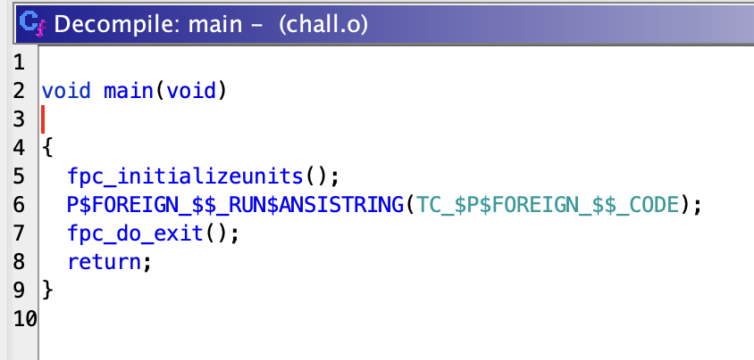
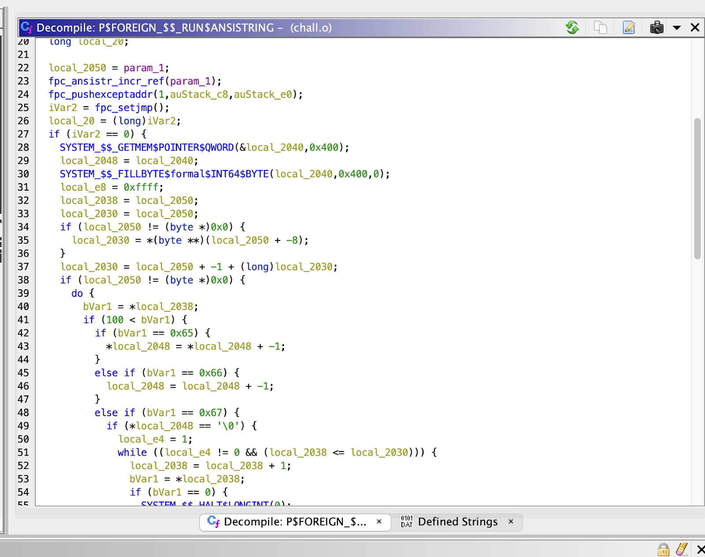
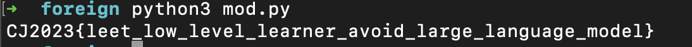
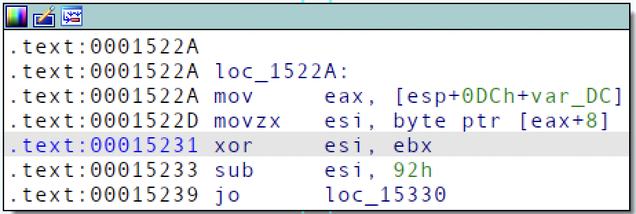
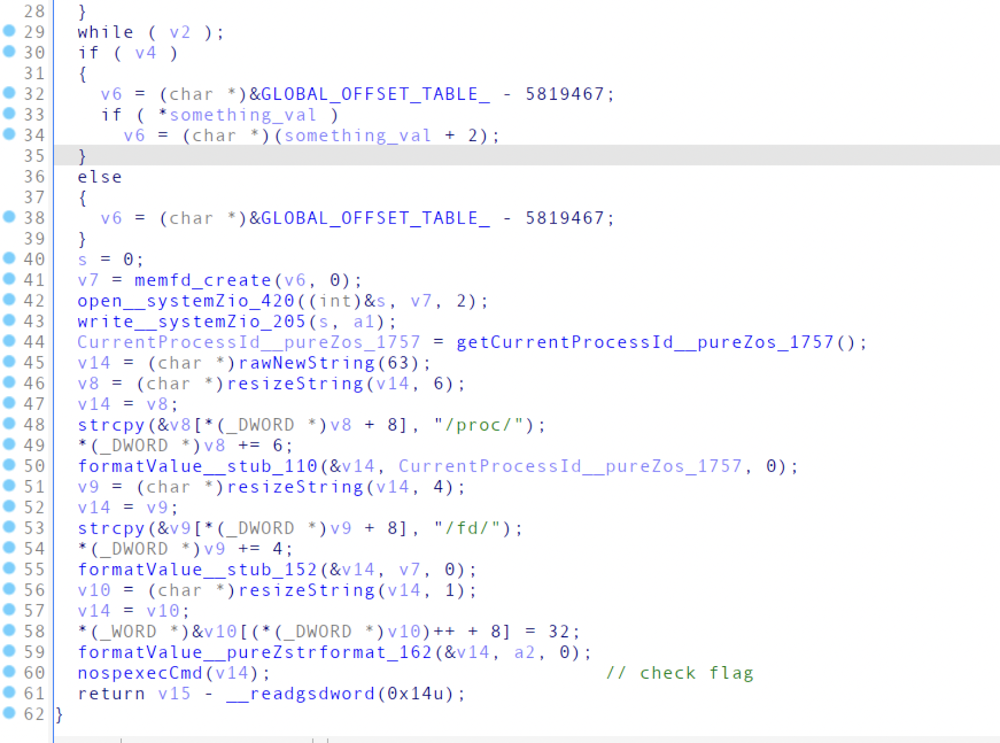
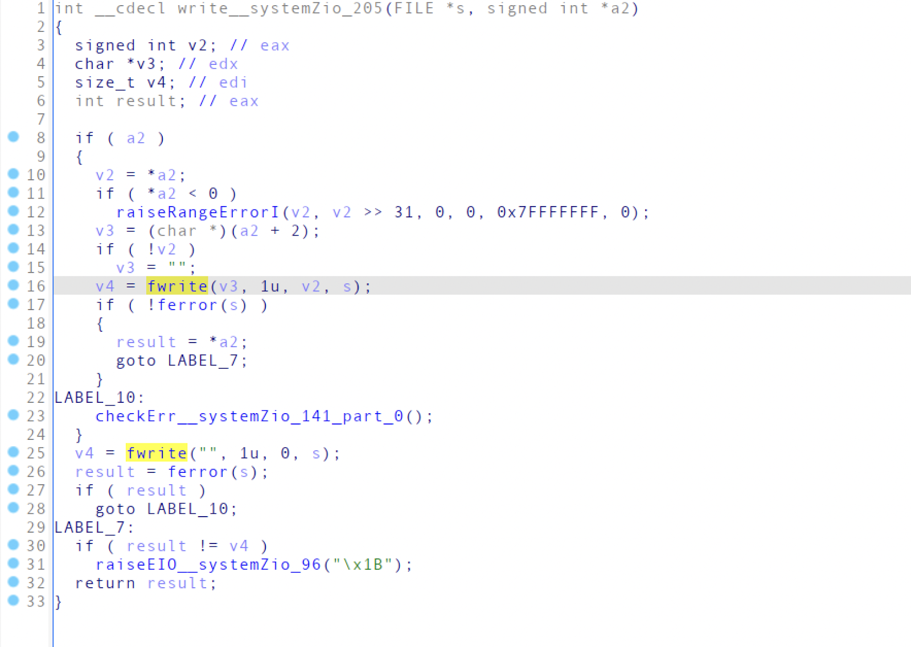
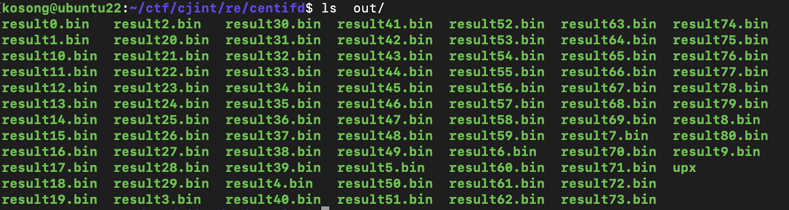
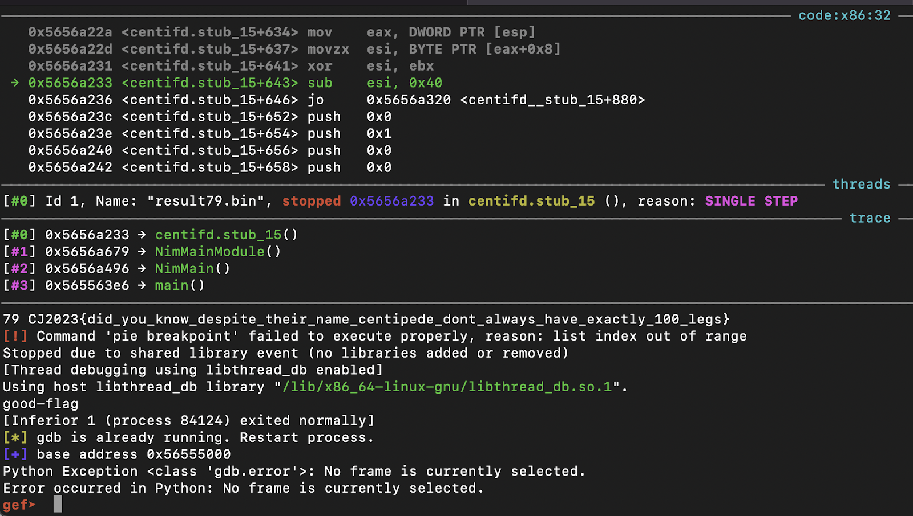

# Reverse Engineering

<!-- challenge-index: 7f3c2423e76f517e -->

| Challenge | Topic |
| --- | --- |
| [Foreign (499 pts)](#foreign-244-pts) | AArch64, Assembly |
| [Centifd (500 pts) 🥇](#centifd-500-pts) | UPX, Anti-Debugging |

<!-- /challenge-index -->

## Foreign (244 pts)

### Description

\-

### Solution

We try to compile it but fail, the far step we do only converting it to object file using command “aarch64-linux-gnu-as -o chall.o asm.s” in kali linux aarch64. After getting the object file we use ghidra to decompile it.&#x20;

<figure><figcaption></figcaption></figure>

<figure><figcaption></figcaption></figure>

Since the algorithm is not too complex, we try reimplement the code in python and then run it to get flag. Actually we try to use ida also but somehow it doesn’t produce the flag. Here is reimplement code in python&#x20;

```python
import string

a = "zvpjzcpsrwrtlplhjvrkzcjrlvkxalrzaksrhjjmdtcbmrlazhturpvurwchbvrahpwlgpbodpcjdrpywldzqowdrlhmsuhrbrbkdkjzuxvoxclbymjsrdpjxyczmsrzlkqyxaraumhkzyrsmavzjrqrsxwqwvxptqrczkzkodjjaarhpqrxawwqtajjrubsyzwrqzpubqqsbrprwxxrschxbbpmuzrskqkrzyklyyvkwyrtlfzjsvpftttwbfzdqfkbypezpjjuxnyopzjmomxwbsdcocxvlykjwekezwvvpyyespzmdsiajlramrhzkvlrcwydrsmkvpamsrpzvyrqvmysbmmlkrqjcmhmpuzilyppcmssqfccyrjjyuaytrdyuqltlqtdrqcmlmybzwrvydsttrhhlahqxudrzwthtwjwsrqhtudrzvaqqumyjrmpkptcvpqrjktrzqcsbcrxpycrbajrjkqkzmcyyaryujtjhzrdutjapjtcrphavjrptwkrlrlxidqssajdeddtscvluvewksmljkazivaprtzxrmptqvbxqpyimvzurpaptqxyiqsuoyotrwyajtamzarbraqrldxtwmrmysryjhcwtxtdrdmsxddtaswrmvhjqarukrxdruxrkuykrcjclydrmrhqsjrdlxjrkuxvwxvxmrhprlqwpbldyruudsjrxrlmqkycrxlsdcsyibmewuvlcwzvezzqteteqsmpybhdseztdytsblkwemkbzyljdttezumxaezbelhzblmzqwekbatzeyexmdvesueqwjkbjvaqexiwmmxypevuvlckeuwdaqeclskpemuwzhkqeuespxkzjvxebyhvycwixhcwhcysyitrapmruckppbrvublqhuzujrmpuhsdqrsrvzhrbudlprzbaylvrdrtdkdlyzswrmzsjpkkqapratmmudrlmchsmdrsjmxlxxajrzbujjiszsycfxlpbrjrhmrqtsvaksyujrmuypmmdxvrvqzdqllhrlrstralyzukmmcbrjbmbutapjrvpjmbcrpsuypxsrlcbzbspyazrsbzpjbrshjxkyrcxjdhurjmyryjssdtrbckrvcypsqqaptrprqxvibyolkxwemtutaxlemuscehelybwmeyedbklzcpdwbekqjqzwekyiwurmaxrhvcbdurqvyvbsjivuyzpuryjvzjxrubrmbrxclltvsruzvrpphmmjrptvvrdzjqyvximcvatcpapxfuycqikomvdvxubzeqzbyyzwcextxyexxcxcxujejhptupjdehvhmzkwejealmxxykwxqealxxwzmeykacpazyjeulmpmzcevapabaxijvfpclrartwzuuumdytrwylumhdddkrmvktddbvbbrtjyrjssdxsmziqhcjssosabbqrpjpzjcruxjzrvbcwjxpbmrpluwurvjjwrmtzhasvuumrwvrcmuwarsjsmqwrxjbjvzciykmskfjihmzdcrmvbrjcrmthysjsrjhrplbtumramrwhtdiwqbehsbmavwxeusbpeyzxxvehecsedmyeuezetypllzjdbqemdscucsdqlewaxmewswsdetupuhsjiqqquwkhuovhtvyezeulxvyletspqhqesklmyksexvuzhhvkauejjkwqxxuuqecyejtweudeahibzfljrmxlkrpvsrhdvxtzmaryrxuxxrpybibzeseyppeccxthpxvezlcbhiyovrjzltvtdrtvldbhbtcrjzxtsdyqkrtyvpbmwxdcrmturhydxhzmpxqispycaxtueuewckwqeajbkjwetsqzsvmviutxsjxblqmfqlyhhddzpurymazzhtxrcxqwcdxwwlrmddxbtdxybrwtxaiwjovwxtzjckkrvxrqysrjlswddwwljrhucvqvilpflqzzbleblbwykcqkjeyazwqwejkhsbdxcexlppwehwykxceqpcmvmbasiktcstlkuccrxpsruycydjadihlyvovuqrpxqtlpthxrxbujvxphrvzxsyyraxbltlxwdipbhedzdwtzlklkepqwzdhwwwejjxsmsetwuledevluuwudlsestvzuchqimqqexydzylepejbejbuahqhmsetbuhkejtwwihjqtpuvfvjtcjrmksljpvvrzjluwluzrjuzbiyvbmlzpwuebcyuqbmuedhvekztdytquuaeqetvbyicbobhcsqbruwrvhtxhrkipmbtldhbyaflwddhrpdykxwswrpisskhocsrwrultujwlsklrxkwwxwdwxwrbwhzcrtrylkqtbdiyvfqzbkhrsrdbmzvwrldssaruxumrarzhbxpsdxdiapapwdclqebjcyeplassismeddwamadepeycdwyhlwtwejbcytxyexktejsvauaqvimzvjkojekemqzvkehxyutqexqqzuethzlwhjjqpextmyzisjblvfdkkhukcrtwjxvlzmrwjhzjvqipbsxamvcodwjtsmzxrvurwssxtjqxciwttsdkxfbcrtyjbarhpxrkztujkjwzwrlkdxyhhprtxrjvmdvpdqaiyosdvrvzlttrzpldcvaqhbrqsjksyjhbvraywzrtywrvazxsxpdarjkilakzctdfmuvmwapkbqettdjyvkzxemtpcbcsbevmehajluqcehdvuvmmbdjetmmbihxacwrkyqsjayyurtrchrxhzwujpwsrakmkuctuljrdstitcmeduwaxpekzbhhdihbzkpdebassulmuqdetjxzewzvwwaqypqeyexslextkxdishvyvoxmeklesbxlpavzekeqdmxexcbvelqehptvmmhhdeuyizduppraaazsbrassiqvuabkfvyzahrzkrsqmzmtmwlrajyxjshxkrdprcuiqrvimyyzlomxubjuezzsjkadmebmwbajqhsebucmiacpkdarptakkjkrvzycalvtktrxxzqztsputrzkxzvraspxxkraqmhqsryrvjxkkqvrvcyujkmrkrpxvuvurdzcqartvwyzqdkasrxcvrmvzhblrxvyczrtktsdptvwiutbmdfq"

i = 0
memory = [0 for _ in range(1024)]
v26 = [0 for _ in range(1000)]
v22 = 0 # memory counter
v27 = -1
flag = ""
list_char = "??ABCDEFGHIJIKLMNOPQR0123456789?_{}????????????????????"
while i < len(a):
	v24 = ord(a[i])
	if(v24 >= 0x65):
		v5 = v24 - 101
		if(v24 == 101):
			memory[v22] -= 1
		elif(v24 == 102):	
			v22 -= 1
		elif(v24 == 103):
			if(memory[v22] == 0):
				v28 = 1
				while(v28 != 0 and i <= len(a)):
					i += 1
					if(i < len(a)):
						v24 = ord(a[i])
						if(v24 == 103):
							v28 += 1
						elif(v24 == 110):
							v28 -= 1
					else:
						print("done")
						exit()
			else:
				v27 += 1
				v26[v27] = i
		elif(v24 == 105):
			# print("out", memory[v22])
			flag += chr(memory[v22])
		elif(v24 == 110):
			if(memory[v22] == 0):
				v27 -= 1
			else:
				i = v26[v27]
		elif(v24 == 111):
			v22 += 1
		elif(v24 == 114):
			memory[v22] += 1
	i += 1
print(flag)

```

<figure><figcaption></figcaption></figure>

Flag : CJ2023{leet\_low\_level\_learner\_avoid\_large\_language\_model}

## Centifd (500 pts)

### Description

\-

### Solution

Given elf 32 bit and packed with upx new version. Here we used upx-4.0.2-amd64\_linux version. After unpacking the binary we try to decompile it using ida. Basically we try to find out where our input processed by doing dynamic analysis with hardware breakpoint. At the end we found that our input processed in address 0x15231 (xored) and then on 0x15233 (substracted) which is on centifd\_\_stub\_15

<figure><figcaption></figcaption></figure>

After that there is something like debugger detection with ptrace but we can easily bypass it. Looking at another function after centifd\_\_stub\_15 we found that the binary write another binary on memfd then execute it , including our input.

<figure><figcaption></figcaption></figure>

So to dump the binary we can breakpoint on address inside write\_\_system which is fwrite

<figure><figcaption></figcaption></figure>

After that just dump the binary. When we manually dump the binary and then unpack the dumped binary then we found that the binary is “typical”. So the next step is we automate the process for dumping the binary using script below

```python
#!/usr/bin/python3
import os
import time

static_val=[]
class SolverEquation(gdb.Command):
    def __init__ (self):
        super (SolverEquation, self).__init__ ("solve-equation",gdb.COMMAND_OBSCURE)

    def invoke (self, arg, from_tty):
        # for i in range(100):
        for i in range(80):
            counter = i
            gdb.execute(f"file out/result{counter}.bin")
            gdb.execute("pie del")
            gdb.execute("pie b 0x25db")
            gdb.execute("pie run A")
            start_mem = parse(gdb.execute("x/wx $esp", to_string=True))[0]
            length = parse(gdb.execute("x/wx $esp+0x8", to_string=True))[0]
            gdb.execute(f"dump binary memory out/result{counter}.bin {hex(start_mem)} {hex(start_mem+length)}")
            os.system(f"out/upx -d out/result{counter}.bin")
            os.system(f"chmod +x out/result{counter}.bin")
            time.sleep(1)
            gdb.execute(f"file out/result{counter}.bin")

def parse(f):
    f = f.split("\n")
    result = []
    for i in f:
        tmp = i.split("\t")
        for j in range(1,len(tmp)):
            result.append(int(tmp[j],16))
    return result

def addr2num(addr):
    try:
        return int(addr)  # Python 3
    except:
        return long(addr) # Python 2
SolverEquation()

```

<figure><figcaption></figcaption></figure>

After that we get the xor value and the subtract value through scripting then reverse it to get the flag. Here is script we used during the competition

```python
#!/usr/bin/python3
import os
import time

class SolverEquation(gdb.Command):
    def __init__ (self):
        super (SolverEquation, self).__init__ ("solve-equation",gdb.COMMAND_OBSCURE)

    def invoke (self, arg, from_tty):
        xor = []
        sub = []
        flag = ['C', 'J', '2']
        for i in range(41):
            counter = i
            gdb.execute(f"file out/result{counter}.bin")
            gdb.execute("pie del")
            gdb.execute("pie b 0x15231") # xor
            gdb.execute("pie run A")
            ebx = addr2num(gdb.selected_frame().read_register("ebx"))
            gdb.execute("ni")
            arch = gdb.selected_frame().architecture()
            current_pc = addr2num(gdb.selected_frame().read_register("pc"))
            disa = arch.disassemble(current_pc)[0]
            tmp = int(disa["asm"].split(",")[-1],16)
            xor.append(ebx)
            sub.append(tmp)
            flag.append(chr(ebx ^ tmp))
            print(counter, ''.join(flag))
        flag.append(chr(112)) # error 41 (no substract)
        for i in range(42, 81):
            counter = i
            gdb.execute(f"file out/result{counter}.bin")
            gdb.execute("pie del")
            gdb.execute("pie b 0x15231") # xor
            gdb.execute("pie run A")
            ebx = addr2num(gdb.selected_frame().read_register("ebx"))
            gdb.execute("ni")
            arch = gdb.selected_frame().architecture()
            current_pc = addr2num(gdb.selected_frame().read_register("pc"))
            disa = arch.disassemble(current_pc)[0]
            tmp = int(disa["asm"].split(",")[-1],16)
            xor.append(ebx)
            sub.append(tmp)
            flag.append(chr(ebx ^ tmp))
            print(counter, ''.join(flag))

def parse(f):
    f = f.split("\n")
    result = []
    for i in f:
        tmp = i.split("\t")
        for j in range(1,len(tmp)):
            result.append(int(tmp[j],16))
    return result

def addr2num(addr):
    try:
        return int(addr)  # Python 3
    except:
        return long(addr) # Python 2
SolverEquation()

```

We also facing issue during iteration on 41 since it doesn’t have subtract operation (only xor). But we can skip it by changing the range of iteration without 41.

<figure><figcaption></figcaption></figure>

Flag : CJ2023{did\_you\_know\_despite\_their\_name\_centipede\_dont\_always\_have\_exactly\_100\_legs}<br>
