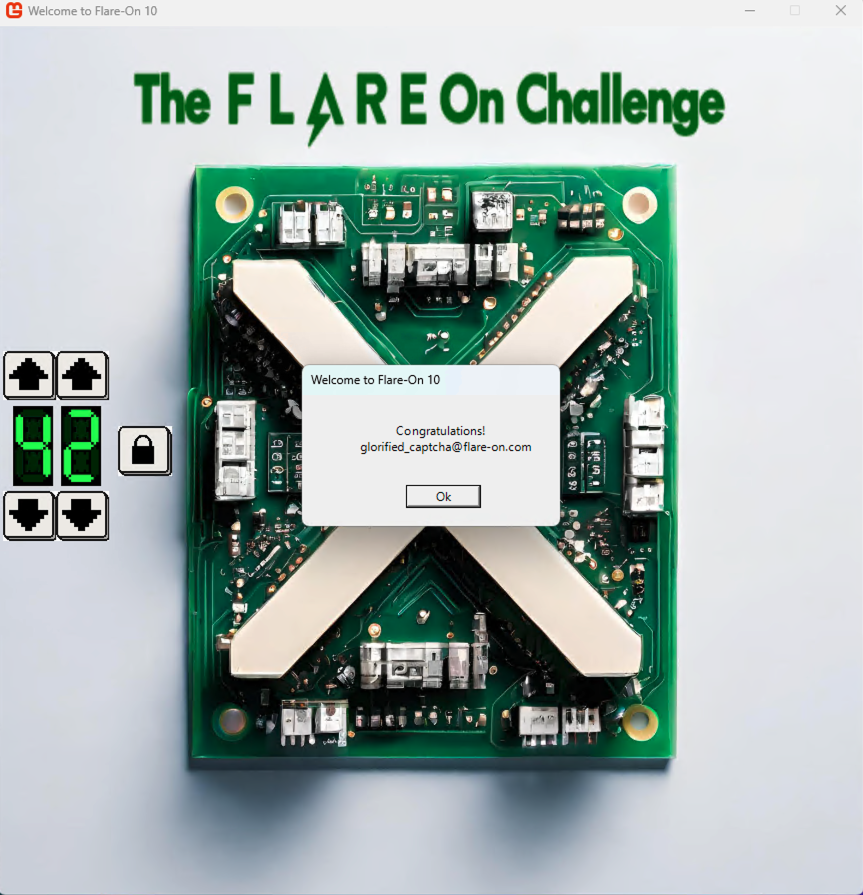
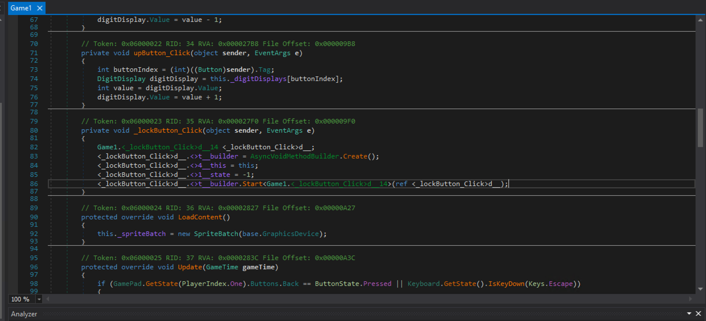
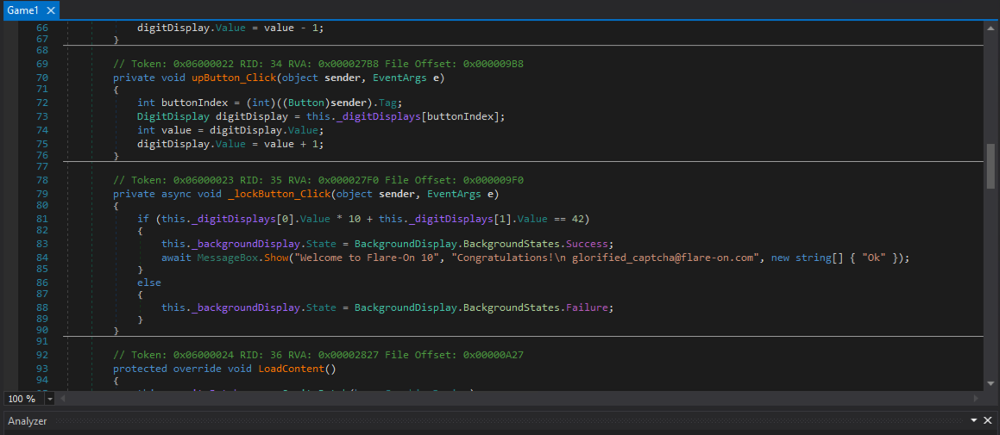

# Challenge #1 - X

### Description

Welcome to the 10th Annual Flare-On Challenge!

Statistically, you probably won’t finish every challenge. Every journey toward excellence starts somewhere though, and yours starts here. Maybe it ends here too.

This package contains many files and, I can’t believe i’m saying this, click the one with the “.exe” file extension to launch the program. Maybe focus your “reverse engineering” efforts on that one too.

### Solution

Since the pin only 2 digits, i bruteforce it manually.

<figure><figcaption></figcaption></figure>

Another solution is by decompiling the program using dnspy. At the time of competition  i used old version of [dnspy](https://github.com/dnSpy/dnSpy) which didn't produce the actual code. But after competition i notice that there is a new version of [dnspy](https://github.com/dnSpyEx/dnSpy) that maintained by another user. Download the latest version from the repository and then decompile the X.dll.

<figure><figcaption>
old version of dnspy
</figcaption></figure>

<figure><figcaption>
new version of dnspy
</figcaption></figure>

By executing the program we know that the flag will be shown if we input valid 2 digits and click the "lock" button. Based on the function structure name, the function lockButton\_Click will be the called function when we click the "lock" button. So by looking at decompiler result we can get the flag directly in plaintext.

Flag : <glorified_captcha@flare-on.com>
