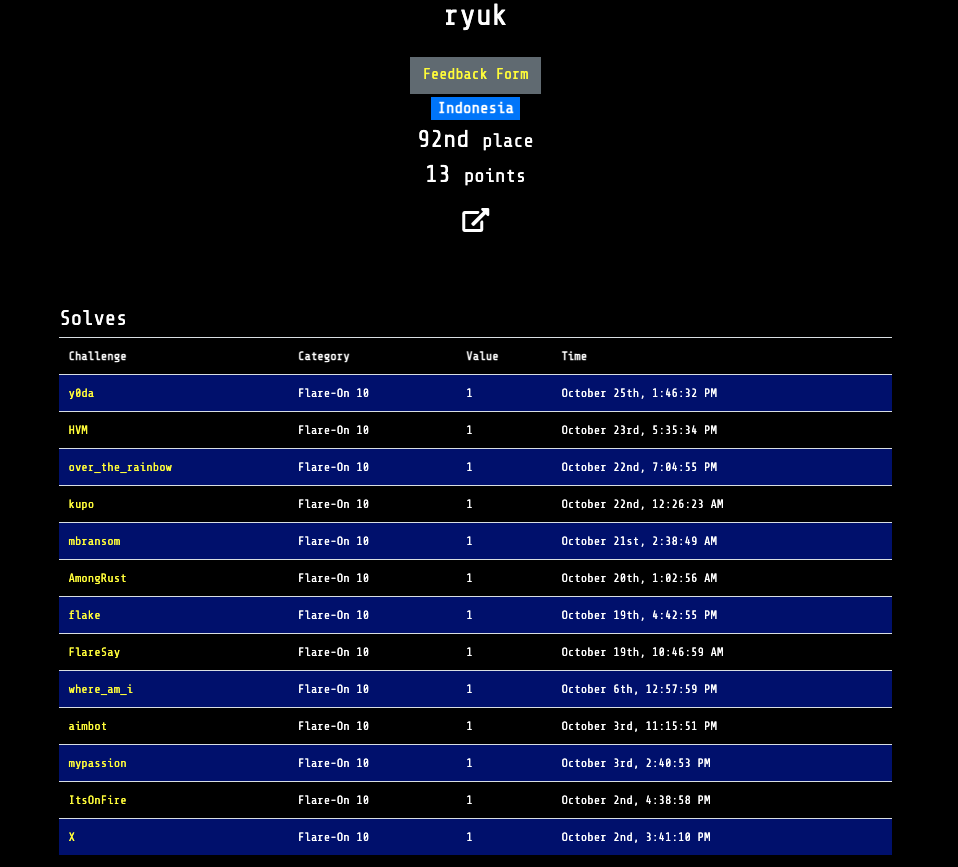

# Flare-On 10


Participated as ryuk. Got 99th place in worldwide and 1st place in Indonesia.&#x20;


<figure><figcaption></figcaption></figure>

<!-- challenge-index: 0537b4d1c51854a4 -->

| Challenge | Topic |
| --- | --- |
| [Challenge #1 - X](/posts/write-up/2023/flare-on-10/challenge-1-x/) | .NET, PIN Validation |
| [Challenge #2 - ItsOnFire](/posts/write-up/2023/flare-on-10/challenge-2-itsonfire/) | Android, CRC32, AES |
| [Challenge #3 - mypassion](/posts/write-up/2023/flare-on-10/challenge-3-mypassion/) | PE Analysis, Input Validation |
| [Challenge #4 - aimbot](/posts/write-up/2023/flare-on-10/challenge-4-aimbot/) | Game Reversing |
| [Challenge #5 - where\_am\_i](/posts/write-up/2023/flare-on-10/challenge-5-where_am_i/) | Reverse Engineering |
| [Challenge #6 - FlareSay](/posts/write-up/2023/flare-on-10/challenge-6-flaresay/) | Retro Game Reversing |
| [Challenge #7 - flake](/posts/write-up/2023/flare-on-10/challenge-7-flake/) | Game Reversing, Score Validation |
| [Challenge #8 - AmongRust](/posts/write-up/2023/flare-on-10/challenge-8-amongrust/) | Malware Analysis |
| [Challenge #9 - mbransom](/posts/write-up/2023/flare-on-10/challenge-9-mbransom/) | Boot Sector, Ransomware |
| [Challenge #10 - kupo](/posts/write-up/2023/flare-on-10/challenge-10-kupo/) | PDP-11, Forth |
| [Challenge #11 - over\_the\_rainbow](/posts/write-up/2023/flare-on-10/challenge-11-over_the_rainbow/) | Reverse Engineering |
| [Challenge #12 - HVM](/posts/write-up/2023/flare-on-10/challenge-12-hvm/) | Reverse Engineering |
| [Challenge #13 - y0da](/posts/write-up/2023/flare-on-10/challenge-13-y0da/) | Reverse Engineering |

<!-- /challenge-index -->
