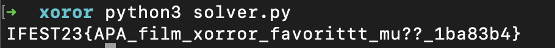

# Cryptography

<!-- challenge-index: 430b9c25b89b51bc -->

| Challenge | Topic |
| --- | --- |
| [Xorror (300 pts)](#xorror-300-pts) | Bit Rotation, XOR |
| [Buka Rekening (340 pts)](#buka-rekening-340-pts) | Modular Arithmetic, Factorization |

<!-- /challenge-index -->

## Xorror (300 pts)

### Description

\-

### Solution

Diberikan source code sebagai berikut

```python
import random
from Crypto.Util.number import *

def roror(m):
    for i in range(m, 1234567891011121314151617):
        m^=i
    return m

msg = open('message.txt','rb').read()

f = open('output.txt','w')
x = [random.randint(1,9) for i in range(len(msg))]
n = getPrime(64)
enc = [n]
for i in range(len(msg)):
    enc.append(msg[i]^((x[i]*roror(x[i]))%n))
f.write(str(enc))
f.write('\n')
f.close()
```

Roror akan memakan waktu yang ckup lama untuk dijalankan, namun dari analisis yang dilakukan diketahui bahwa fungsi roror dapat dioptimasi dengan cara berikut

```
known = 1234567891011121314151617
tmp = max(i) - 1
x = 1 -> tmp ^ 1
x = 2 -> tmp ^ 1 ^ 2
x = 3 -> tmp ^ 1 ^ 2 ^ 3
dst
```

Jadi selanjutnya tinggal implementasi dan bruteforce 9 kemungkinan yang ada untuk setiap byte msg. Ambil nilai terkecil untuk setiap byte karena itu nilai valid msg. Berikut solver yang kami gunakan

```python
from Crypto.Util.number import *

tmp = [16514816009011879549, 8460772314775398290, 11281029753033864562, 406728620538917158, 6047243497055849560, 8460772314775398287, 5640514876516932266, 8867500935314315566, 2820257438258466097, 8460772314775398298, 6047243497055849563, 406728620538917154, 6047243497055849556, 11281029753033864530, 3226986058797383403, 3226986058797383406, 14101287191292330527, 406728620538917180, 2820257438258466098, 8460772314775398324, 8460772314775398313, 2820257438258466104, 3226986058797383405, 14101287191292330496, 3226986058797383389, 406728620538917125, 8867500935314315644, 11281029753033864514, 14101287191292330525, 11281029753033864518, 5640514876516932337, 406728620538917143, 14101287191292330502, 8867500935314315625, 5640514876516932295, 5640514876516932341, 5640514876516932333, 6047243497055849524, 11281029753033864459, 6047243497055849556, 8460772314775398378, 3226986058797383392, 6047243497055849578, 6047243497055849523, 2820257438258466169, 14101287191292330512, 8867500935314315561, 5640514876516932325]

n = tmp[0]
ct = tmp[1:]
known = 1234567891011121314151617

poss = {}

for i in range(1,10):
	lol = known-1
	for j in range(1,i+1):
		lol ^= j
	poss[i] = lol

flag = []
for j in ct:
	tmp_res = []
	for i in poss:		
		tmp_res.append(j^((i*poss[i])%n))
	flag.append(tmp_res)
	
real_flag = ""
for i in flag:
	real_flag += chr(min(i))
print(real_flag)
```

<figure><figcaption></figcaption></figure>

Flag : IFEST23{APA\_film\_xorror\_favorittt\_mu??\_1ba83b4}

## Buka Rekening (340 pts)

### Description

\-

### Solution

Diberikan source code sebagai berikut

```python
from Crypto.Util.number import *
import random


flag = b'IFEST23{REDACTED}'

p = getPrime(2048)
q = getPrime(2048)
e = 65537
n = p*q

rand = getPrime(1024)
rand1 = random.randint(21, 300)

eksponen = (inverse(e, (p-1)*(q-1))-1)//(2**rand1)
ppow = pow(random.randint(1, rand)*p**rand1 + 1, eksponen, n)

enkripsi = pow(bytes_to_long(flag),e,n)
print(f'n = {n}')
print(f'e = {e}')
print(f'ppow = {ppow}')
print(f'enkripsi = {enkripsi}')

```

Jabarkan persamaan yang didapat (ppow)

```python
x = random1
y = random2
ppow = x*(p^y)+1 
n = p*q

ppow - 1 = x*(p^y)
gcd(ppow-1,n) = p
```

Dengan berasumsi bahwa nilai nilai x\*(p^y)+1 < n maka kita bisa langsung dapatkan nilai p atau faktornya. Berikut solver yang kami gunakan

```python
import math
from Crypto.Util.number import *

n = 359137226031195651301629100595114539658488226917724001516837745109986666673903580600335175189520047849201703213958597763064107580360092949277212255482167065022392036461357557853308917707554834857171582251358334934880826651395516343808379802442758892934127273627079404929956590697149802049128030352979559552411197718083991447055580796458312098439410115563471417575086569969372626305630694455401185030068539305829191662070667702108830206248762427469640485982977937671944625035381136432125719076659726852327908366028399191146133039423102315111812703505576686715798445522261066725250666883153123053276187743286640192604157142915479377883865710712859023386791002648508967824887332510395673722129800413191666966424440549301884078768477558488394772863441567721136849220098827142412501256403291182177118788891718408026079357776435600298288066674267730383041501837494981576766323254560547563407710348260822581419479039325218218362653886577375039477472983667803674973590367082103738265846630489525290565100305561061188187425187109121170525927992109806226041002404483048187699345445218947556589258586152125873526474742184012348518573029267816783222517894329542313565005033177628100771186175538646885257943902178227067616139348145593778257069671
e = 65537
ppow = 162570295834632812957730886797489688266965561915375412710318297183456273733589796536186192143434916883043170340540099484390662036196773050608208939767444113771368634075981186435839481077294072735999232686813846358547833337933739061506175409385954500120582904171479529119064040758684952777600989062833026679126155541320385276915718086782732538840357740232818850951291595773313196725358889226757236304113489172294723211772814388378390902278116744203895435323070941957891114311501765179929548563190107294486330179071796663142379981554211307978338020424459266079619146094600594112028444771115427880533916507193450672217406873759019071165550223293569715380219455655231800574943910448995789161342343235268768352843342105989697283417345252066429432008803446776030267910254592755871788691521162301735768123605025519906929243193319723316508802385418481534518724355252769584942655251492630326602386394937735904230841226826264697711515167271175596173274286065755672699196150968014740467446494908623227942424883140546209142336790523828049585259219387090990524172666154394306891566582123036703744690415597473810306744813104044208326853737354821798223361405186833094038050977992084407995188280010291479706059522409874835279015613977358405000231601
enkripsi = 27779736408472255327344823711752811854474529634360045594483948524337398732502901638287064838061972823377055284317623364146125787188769777037279511529301971292714106550771941530910478069785091671973143852821390988390136061238603628926621136995176300704134282420423520270248819997928737551585596502511180671385780835733009410284768064299865667074701392356327250042128225258864034129132630607006690595367693368840958359370127221883543855301525778797961798081303906053294892281957702866207909589139576016555902593813695519418077168573418793539722772590168431602580022063596058325269508749265763660756617906926315881607521523789696157341307151653232946574430912426302339004418771848430673679482112510728705987287791523691128635779786047123995779903457130371024071491864163114292027878752353888440116771243784459289074802543669537380704363620218292267337101893405042141406410001486706760766603016746230869267263938613438760784811067498090064456202769428402707834183526192990420658908376838190355915676495262052750105493745559961688246379784672177935135414038617486517384820773739489548191191044974344277566407667598568447891377526532982261831531682504589022453951831643118359865846059550301774563519130167149684594416906499156924847748983


p = math.gcd(ppow-1, n)
q = n // p

assert(p*q == n)

phi = (p-1)*(q-1)
d = inverse(e, phi)

print(long_to_bytes(pow(enkripsi,d,n)))
```

<figure><figcaption></figcaption></figure>

Flag : IFEST23{m4s1\_tr4ns4ksi\_p3rt4ma\_l4\_y4\_c3c1ng\_c3c1ng}
