# Reverse Engineering

<!-- challenge-index: cab2f16a7423021d -->

| Challenge | Topic |
| --- | --- |
| [Broken Shop 🏬 (320 pts)](#broken-shop-320-pts) | Windows Debugging, Game State |
| [isHeReact? (380 pts)](#ishereact-380-pts) | React Native, JavaScript |
| [Broken PM (400 pts)](#broken-pm-400-pts) | Android, Root Detection, Frida |

<!-- /challenge-index -->

## Broken Shop 🏬 (320 pts)

### Description

\-

### Solution

Diberikan file PE, buka dengan ida. Terdapat beberapa fungsi yang dibuat oleh probset, ubah variable yang menyimpan fungsi untuk mempermudah tracing

<figure>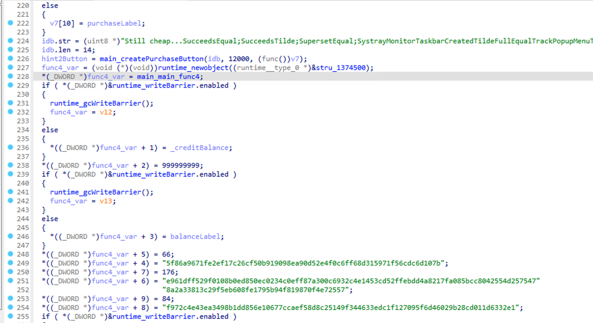<figcaption></figcaption></figure>

<figure>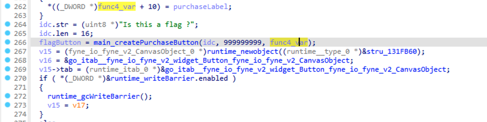<figcaption></figcaption></figure>

Diketahui bahwa func4 merupakan fungsi flag, karena uang kita 0 dan hanya bisa menambah 1 setiap klik maka cara paling mudah adalah bypass validasi pengecekan uang.&#x20;

<figure>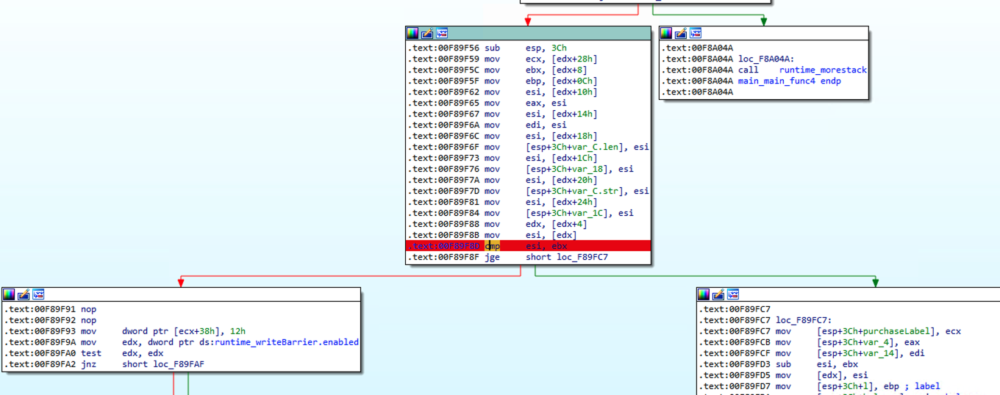<figcaption></figcaption></figure>

Run program lalu ubah nilai esi == ebx pada breakpoint 0xf89f8d

<figure>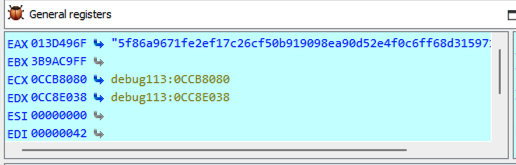<figcaption></figcaption></figure>

<figure>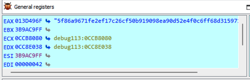<figcaption></figcaption></figure>

Lalu lanjutkan

<figure>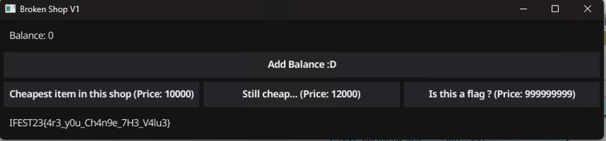<figcaption></figcaption></figure>

Flag : IFEST23{4r3\_y0u\_Ch4n9e\_7H3\_V4lu3}

## isHeReact? (380 pts)

### Description

\-

### Solution

Diberikan APK yang dibuat dengan react native, lakukand extract terhadap file apk dan dapatkan index.android.bundle pada assets.

<figure>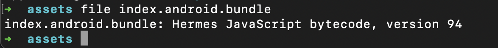<figcaption></figcaption></figure>

Diketahui bahwa file tersebut merupakan hermes javascript bytecode, cari di internet untuk cara decompilenya dan didapatkan repo berikut <https://github.com/P1sec/hermes-dec> . Lakukan decompile dengan hermes-dec.

<figure>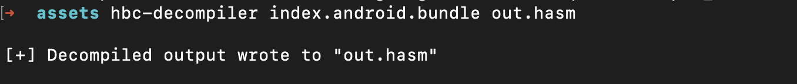<figcaption></figcaption></figure>

Saat menjalan APK diketahui bahwa terdapat output “flag value is false” ketika menginputkan nilai random. Jadi cari string tersebut

<figure>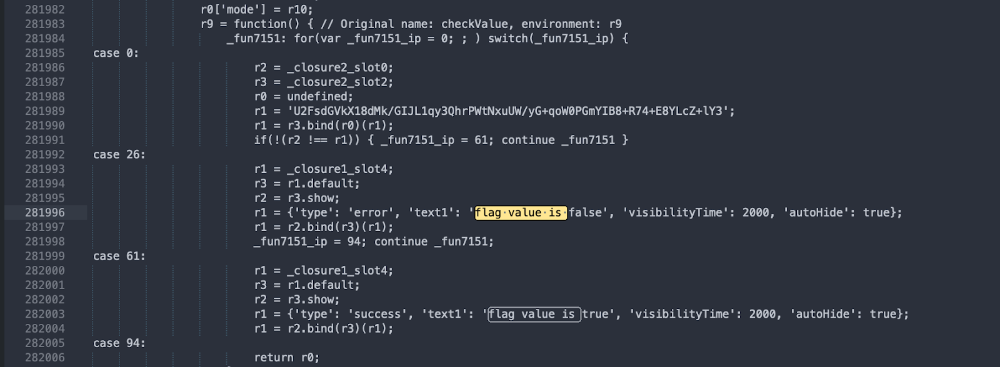<figcaption></figcaption></figure>

Setelah didapatkan cek baris kode sebelumnya yang melakukan validasi. Diketahui terdapat beberapa ciphertext yang memiliki format Salted\_\_ (sama seperti keluaran dari openssl). Scroll keatas lagi dan didapatkan potongan kode berikut

<figure>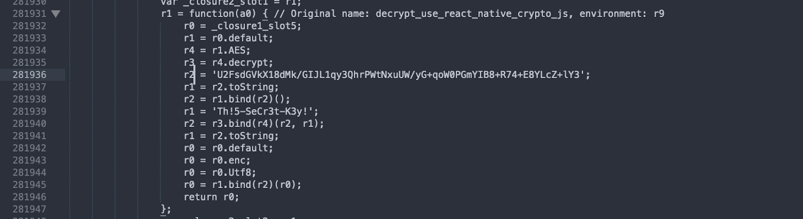<figcaption></figcaption></figure>

Terlihat bahwa terdapat fungsi aes decrypt dari crypto js dan key juga terlihat. Jadi tinggal decrypt dengan crypto-js

```javascript
var CryptoJS = require("crypto-js");

ciphertext = 'U2FsdGVkX18dMk/GIJL1qy3QhrPWtNxuUW/yG+qoW0PGmYIB8+R74+E8YLcZ+lY3';

var bytes  = CryptoJS.AES.decrypt(ciphertext, 'Th!5-SeCr3t-K3y!');
var originalText = bytes.toString(CryptoJS.enc.Utf8);

console.log(originalText);
```

<figure>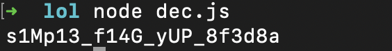<figcaption></figcaption></figure>

Flag : IFEST23{s1Mp13\_f14G\_yUP\_8f3d8a}

## Broken PM (400 pts)

### Description

\-

### Solution

Diberikan APK, lakukan decompile dengan JADX-GUI.

<figure>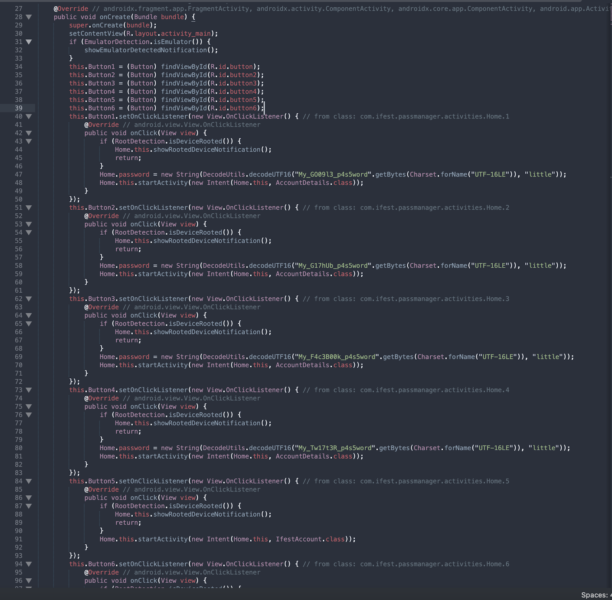<figcaption></figcaption></figure>

Pada Home.java terdapat pengecekan emulator dan rooted device.&#x20;

<figure>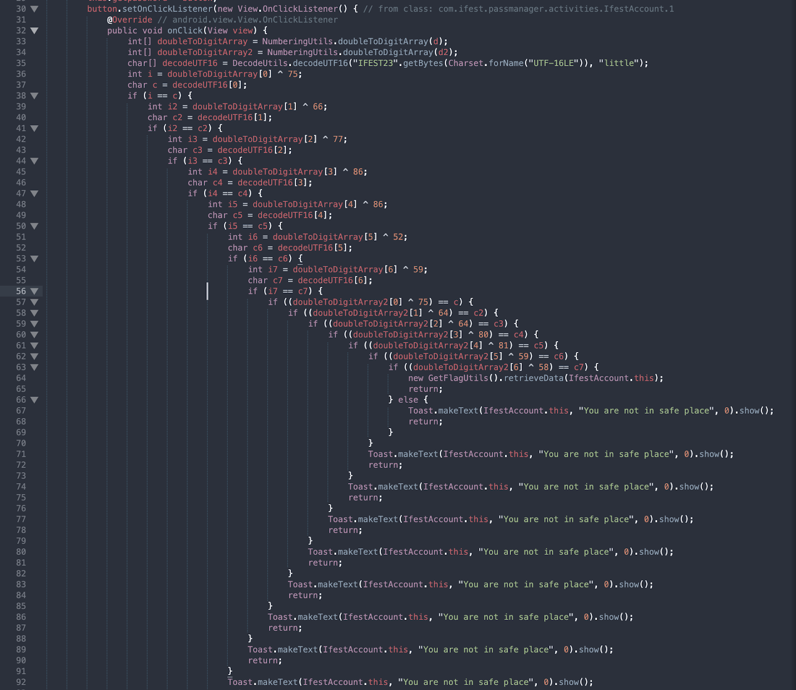<figcaption></figcaption></figure>

Pada ifestaccount terdapat pemanggilan flag jika location sesuai. Langkah yang kami lakukan pertama adalah melakukan patch terhadap smali untuk melakukan bypass terhadap rooted device, entah kenapa deteksi emulator tidak mendeteksi emulator saya (avd).&#x20;

<figure>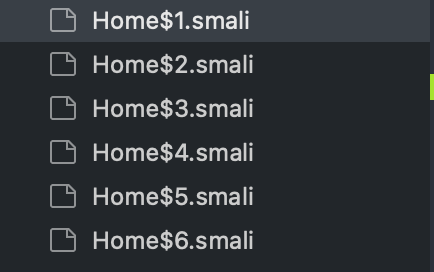<figcaption></figcaption></figure>

<figure>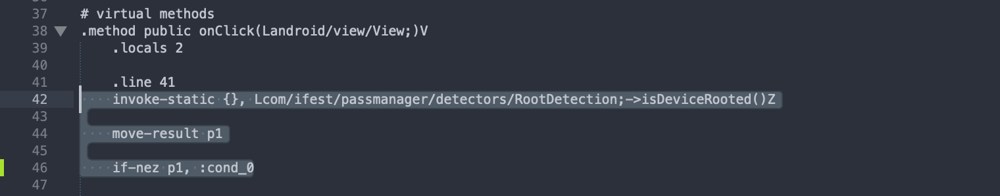<figcaption></figcaption></figure>

Pada masing-masing smali di Home$n smali ubah pengecekan menjadi if-nez. Selanjutnya compile kembali dengan “apktool b SecureApp” dan sign dengan uber signer. Setelah di sign selanjutnya tinggal gunakan frida untuk trigger pemanggilan terhadap getFlag saat salah satu fungsi di trigger dimana disini kami trigger getflag ketika fungsi doubleToDigitArray dijalankan. Berikut script yang kami gunakan

```javascript
//frida -U -f com.ifest.passmanager -l hook.js
Java.perform(function x() { 

    var tmp = Java.use("com.ifest.passmanager.utils.NumberingUtils");
    var zz = Java.use('com.ifest.passmanager.utils.GetFlagUtils');
    tmp.doubleToDigitArray.implementation = function (x) {
        console.log("doubleToDigitArray(" + x + ")");
        var ret_value = this.doubleToDigitArray(248568);
        var currentApplication = Java.use('android.app.ActivityThread').currentApplication();
        var context = currentApplication.getApplicationContext();
        console.log(zz.$new().retrieveData(context));
        console.log("ret(" + ret_value + ")");
        return ret_value;
    }
});
```

<figure>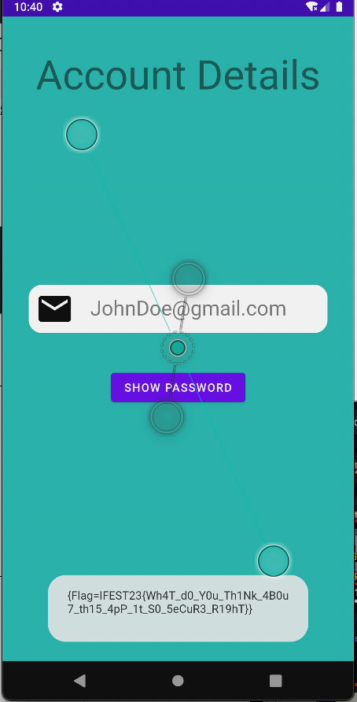<figcaption></figcaption></figure>

Flag : IFEST23{Wh4T\_d0\_Y0u\_Th1Nk\_4B0u7\_th15\_4pP\_1t\_S0\_5eCuR3\_R19hT}
