# Reverse Engineering

<!-- challenge-index: 3a4b15c37231a4a7 -->

| Challenge | Topic |
| --- | --- |
| [NFC (275 pts)🥇](#nfc-275-pts) | GDB Scripting, Bytewise Validation |
| [32t8 (475 pts)🥇](#32t8-475-pts) | Boolean Circuits, Z3 |
| [NoJS (475 pts)🥇](#nojs-475-pts) | Packaged JavaScript, Deobfuscation |
| [VA (496 pts)🥇](#va-496-pts) | Windows Binaries, XOR |

<!-- /challenge-index -->

## NFC (275 pts)

### Description

\-

### Solution

Diberikan file ELF 64 bit, lakukan decompile

<figure>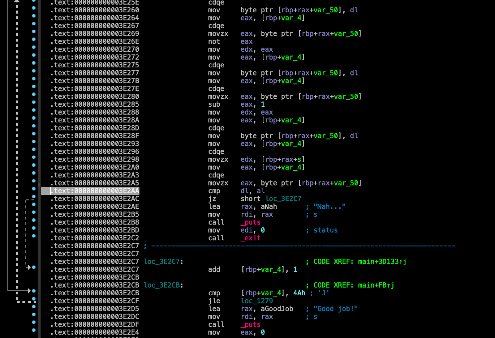<figcaption></figcaption></figure>

Pada address 0x3e2aa diketahui terdapat pengecekan nilai dl al yang mana jika tidak sesuai akan print nah namun jika sesuai akan dilakukan increment pada avriable rbp+var\_4 sampai totalnya 0x4a. Set breakpoint pada address 0x3e2aa dan disini kami gunakan input “A”\*0x4a

<figure>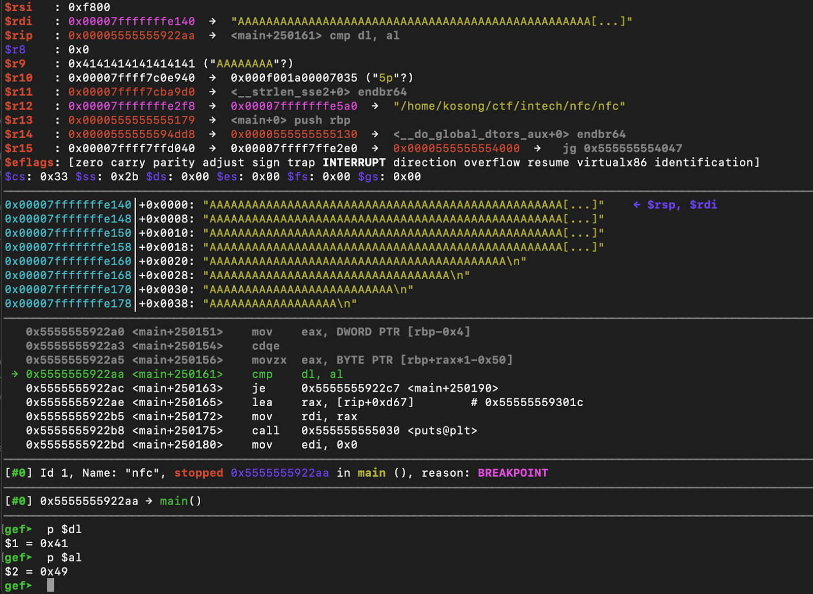<figcaption></figcaption></figure>

Dapat dilihat bahwa input (al) tidak dilakukan proses apapun. Jadi selanjutnya tinggal scripting saja untuk leak semua value. Saat proses leak set nilai al==dl supaya bisa lanjut ke iterasi selanjutnya. Berikut script yang kami gunakan

```python
#!/usr/bin/python3
import string

class SolverEquation(gdb.Command):
    def __init__ (self):
        super (SolverEquation, self).__init__ ("solve-equation",gdb.COMMAND_OBSCURE)
    
    def invoke (self, arg, from_tty):
        f = open("x.txt","w")
        f.write(string.printable[:0x4b])
        f.close()
        gdb.execute("pie del")
        
        gdb.execute("pie b 0x3e2aa")
        gdb.execute("pie run < x.txt")        
        arch = gdb.selected_frame().architecture()
        list_dl = []
        list_al = []
        
        for i in range(0x4b):
            dl = addr2num(gdb.selected_frame().read_register("dl"))
            al = addr2num(gdb.selected_frame().read_register("al"))
            list_al.append(al)
            list_dl.append(dl)
            gdb.execute("set $dl = $al")
            gdb.execute("c")
        
        print(list_dl)
        print(list_al)
        print(''.join(map(chr,list_al)))

        
def addr2num(addr):
    try:
        return int(addr)  # Python 3
    except:
        return long(addr) # Python 2
SolverEquation()

```

<figure>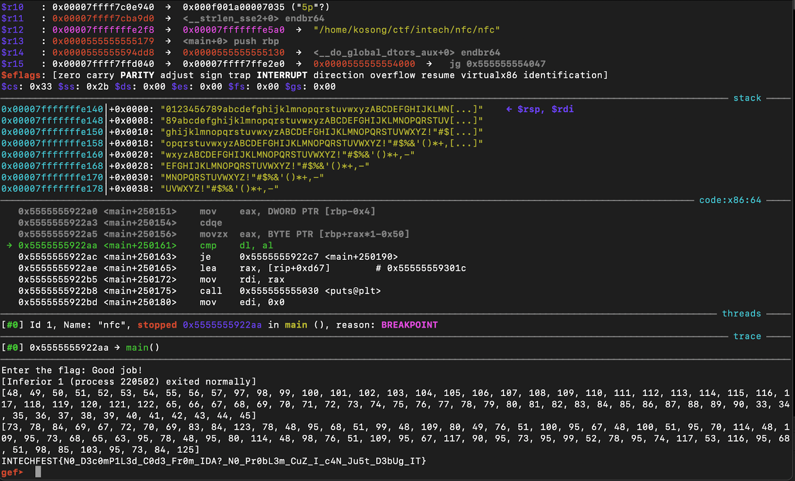<figcaption></figcaption></figure>

Flag : INTECHFEST{N0\_D3c0mP1L3d\_C0d3\_Fr0m\_IDA?\_N0\_Pr0bL3m\_CuZ\_I\_c4N\_Ju5t\_D3bUg\_IT}<br>

## 32t8 (475 pts)

### Description

\-

### Solution

Diberikan file JSON, prettify dengan jq

<figure>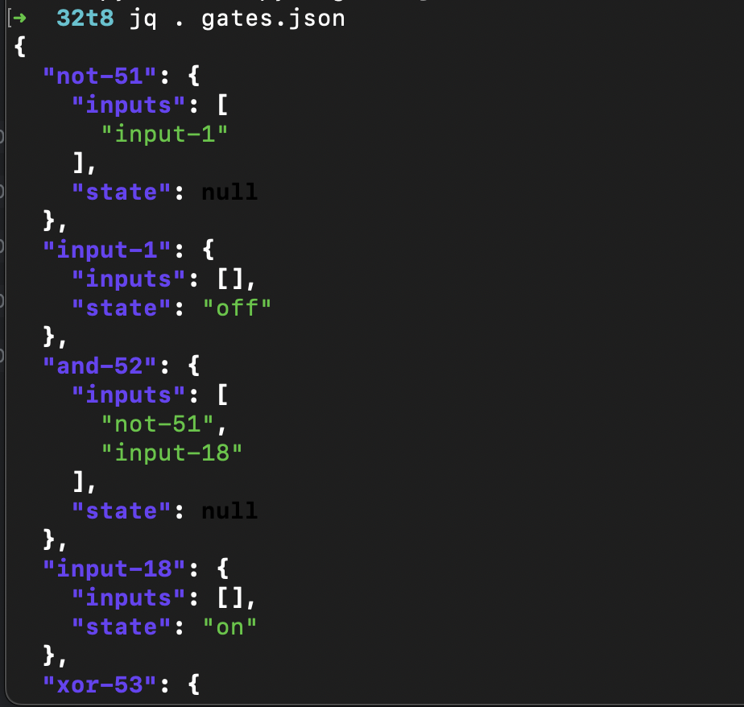<figcaption></figcaption></figure>

Dapat dilihat bahwa key dari json tersebut berupa operasi logika dan input-i. Untuk key yang merupakan operasi logika terdapat inputs yang berisi nilai yang dioperasikan. Dengan informasi tersebut maka lakukan parsing terhadap file json tersebut dan gunakan z3 untuk otomatis mendapatkan nilai yang valid. Penggunaan bitvec 1 karena nilainya hanya 1 bit (0 atau 1)

```python
import json
from z3 import *

f = open("gates.json", "r").read()
s = Solver()
a1 = [BitVec("x{}".format(i), 1) for i in range(32)]
data = json.loads(f)

data2 = {}

for i in data:
	if("input-" in i):
		tmp = i.split('-')
		exec(f"{i.replace('-','_')} = a1[{int(tmp[1]) - 1}]")
		continue
	else:
		data2[i] = data[i]

while True:
	data3 = {}
	for i in data2:
		try:
			tmp = i.split("-")
			if(tmp[0] == "not"):
				constraint = f"{i.replace('-','_')} = (~{data2[i]['inputs'][0].replace('-','_')}&0x1)"
			elif(tmp[0] == "and3"):
				constraint = f"{i.replace('-','_')} = ({data2[i]['inputs'][0].replace('-','_')} & {data2[i]['inputs'][1].replace('-','_')} & {data2[i]['inputs'][2].replace('-','_')})"
			elif(tmp[0] == "and"):
				constraint = f"{i.replace('-','_')} = ({data2[i]['inputs'][0].replace('-','_')} & {data2[i]['inputs'][1].replace('-','_')})"
			elif(tmp[0] == "xor"):
				constraint = f"{i.replace('-','_')} = ({data2[i]['inputs'][0].replace('-','_')} ^ {data2[i]['inputs'][1].replace('-','_')})"
			elif(tmp[0] == "output"):
				constraint = f"{i.replace('-','_')} = ({data2[i]['inputs'][0].replace('-','_')})"

			elif(tmp[0] == "nor"):
				constraint = f"{i.replace('-','_')} = (~({data2[i]['inputs'][0].replace('-','_')} | {data2[i]['inputs'][1].replace('-','_')})&0x1)"
			elif(tmp[0] == "or"):
				constraint = f"{i.replace('-','_')} = ({data2[i]['inputs'][0].replace('-','_')} | {data2[i]['inputs'][1].replace('-','_')})"
			else:
				print("??", i)
				break
			
			if(tmp[0] == "output"):
				exec(f"{constraint}")
				exec(f"s.add({i.replace('-','_')} == 1)")
			else:
				exec(f"{constraint}")
		except Exception as e:
			print(e)
			data3[i] = data2[i]
	if(len(data3) == 0):
		break
		
print(s)
print(s.check())
model = s.model()
flag = ""
for i in a1:
	if(model[i] == None):
		flag += '?'
	else:
		flag += str(model[i].as_long())

print(flag)

```

<figure>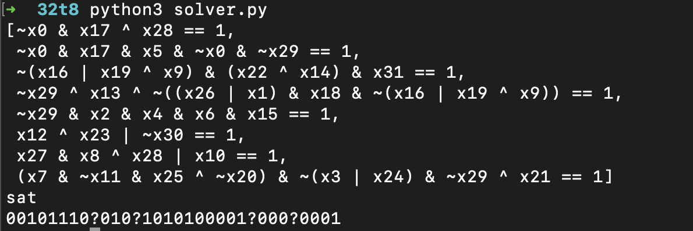<figcaption></figcaption></figure>

Didapatkan output 00101110?010?1010100001?000?0001. Nilai ? pada input dapat diisikan dengan nilai bebas (0 atau 1), jadi pilih salah satu sebagai input dan submit sebagai flag (karena flag menggunakan regex).

Flag : INTECHFEST{00101110101011010100001100010001}

## NoJS (475 pts)

### Description

\-

### Solution

Diberikan file PE, lakukan decompile dengan IDA. Disini kita perlu tahu bagaimana cara file js dicompile/pack menjadi executable. Mencari string yang menarik disini kami menemukan string “runneradmin”

<figure>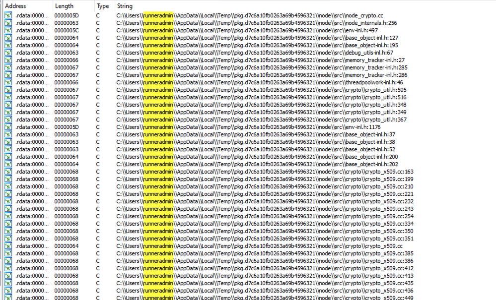<figcaption></figcaption></figure>

Terdapat direktori pkg.\<hex> , disini kami coba cari node pkg dan menemukan bahwa aplikasi tersebut digunakan untuk melakukan compile ke executable

<figure>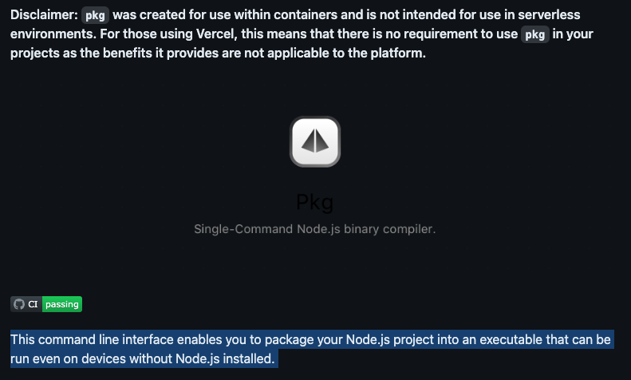<figcaption></figcaption></figure>

Hal tersebut juga kami validasi dengan melakukan compile sendiri dengan pkg.&#x20;

<figure>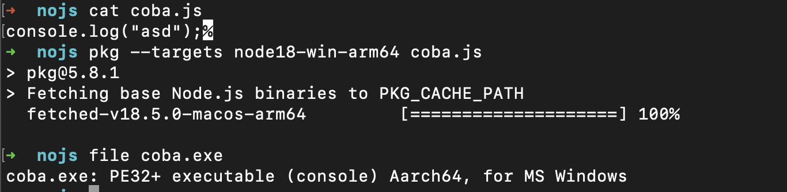<figcaption></figcaption></figure>

<figure>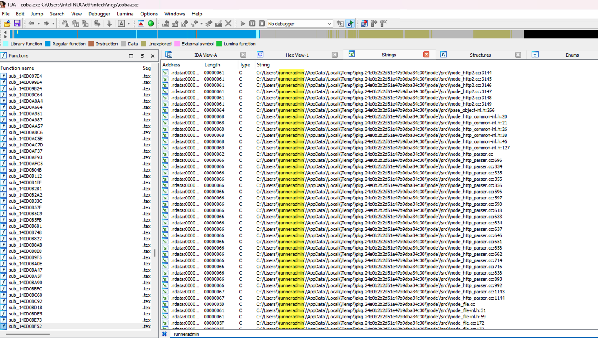<figcaption></figcaption></figure>

Selanjutnya cari cara decompile/extract JS dari executable tersebut dan menemukan repo berikut ​​<https://github.com/LockBlock-dev/pkg-unpacker> .&#x20;

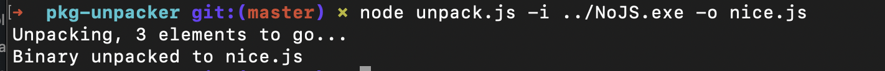

<figure>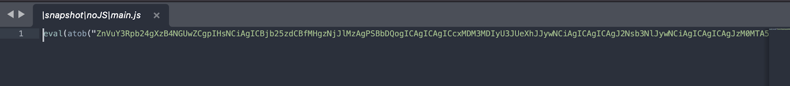<figcaption></figcaption></figure>

Lakukan decode terhadap base64 tersebut (argument dari atob)

<figure>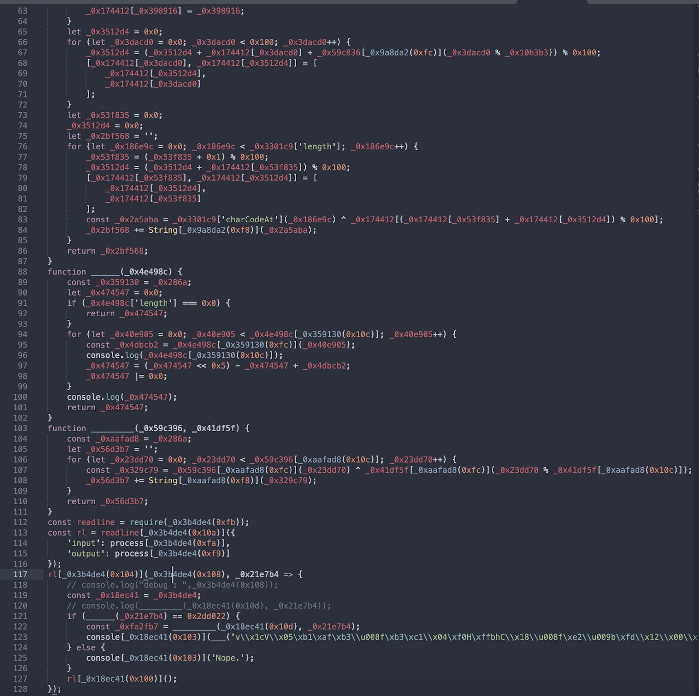<figcaption></figcaption></figure>

Dari debugging (menambahkan console.log)  javascript yang ada diketahui bahwa algoritma yang memproses input kita sebagai berikut

```python
init = 0
for i in inp:
	init = (init << 0x5) - init + ord(i)
Init == 0x2dd022
```

Untuk menghasilkan nilai init dengan panjang bit yang sama hanya diperlukan 4 karakter input (4 byte) jadi tinggal bruteforce saja.&#x20;

```python
inp = 'ABCDF'
init = 0
target = 0x2dd022
print(f"target bitlen -> {target.bit_length()}")

for i in inp:
	init = (init << 0x5) - init + ord(i)
	print(i,init.bit_length())
```

```python
# _0x474547 = (_0x474547 << 0x5) - _0x474547 + _0x4dbcb2;
from itertools import product
import string

nice = []
for inp in product(string.printable[:-6], repeat = 4):
	init = 0
	for i in inp:
		init = (init << 0x5) - init + ord(i)
	if(init == 0x2dd022):
		res = ''.join(inp)
		nice.append(res)
		print(res)
print(nice)
```

<figure>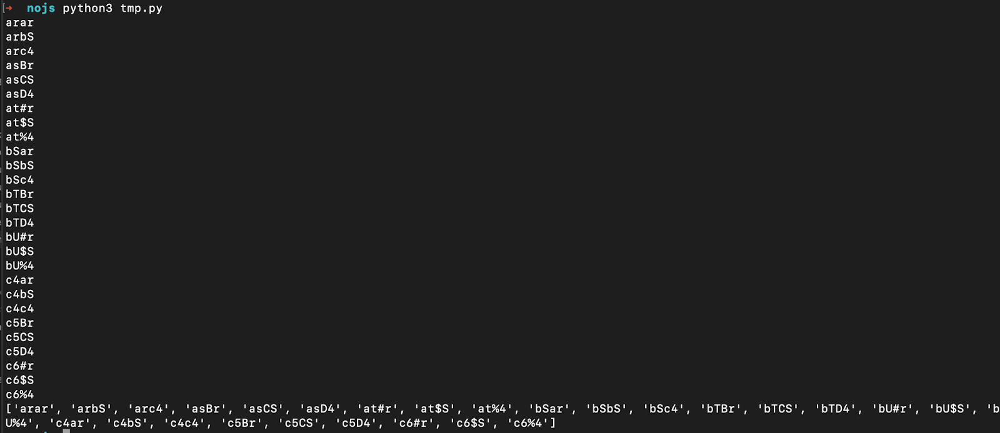<figcaption></figcaption></figure>

Ternyata ada lebih dari satu input yang valid, langsung jalankan saja pada executable target

```python
import os
from subprocess import Popen, PIPE

inp = ['arar', 'arbS', 'arc4', 'asBr', 'asCS', 'asD4', 'at#r', 'at$S', 'at%4', 'bSar', 'bSbS', 'bSc4', 'bTBr', 'bTCS', 'bTD4', 'bU#r', 'bU$S', 'bU%4', 'c4ar', 'c4bS', 'c4c4', 'c5Br', 'c5CS', 'c5D4', 'c6#r', 'c6$S', 'c6%4']
for i in inp:
		p = Popen('NoJS.exe', stdin=PIPE, stdout=PIPE) #NOTE: no shell=True here
		out = p.communicate(i.encode() + b'\n')[0]
		if(b'INTECHFEST' in out):
			print(i,out)
```

<figure>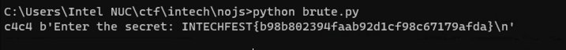<figcaption></figcaption></figure>

Flag  : INTECHFEST{b98b802394faab92d1cf98c67179afda}

## VA (496 pts)

### Description

\-

### Solution

Diberikan file PE, coba jalankan file tersebut

<figure>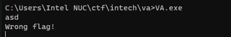<figcaption></figcaption></figure>

Program tersebut melakukan validasi flag, selanjutnya decompile dengan IDA

<figure>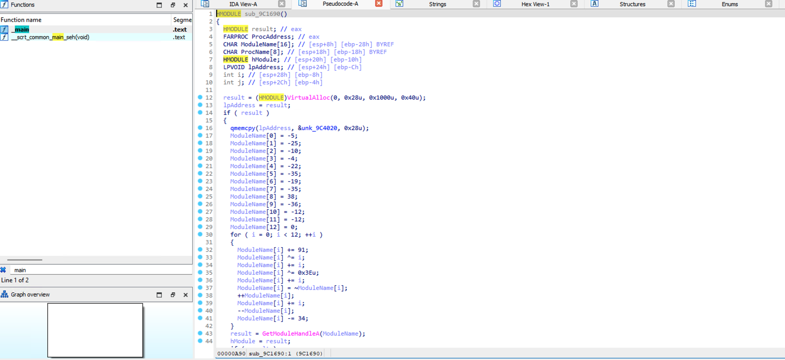<figcaption></figcaption></figure>

Jadi program tersebut diobfuscate, hal pertama yang kami cari adalah dimana kode program untuk menerima input user. Setelah melakukan debugging kami menemukan letak kode untuk meminta input user yaitu pada address 0x5919AF (dynamic base address)

<figure>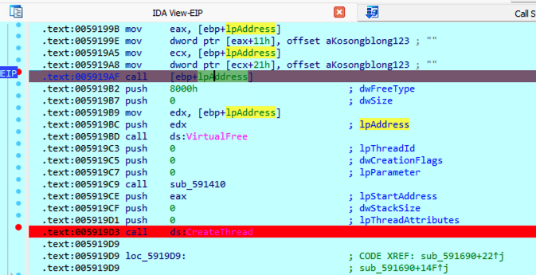<figcaption></figcaption></figure>

Masukkan input dan kita bisa mengetahui letak input kita yaitu pada offset 0x005943B0 (yang sudah saya rename)

<figure>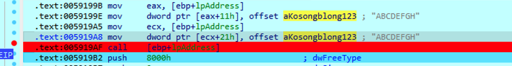<figcaption></figcaption></figure>

<figure>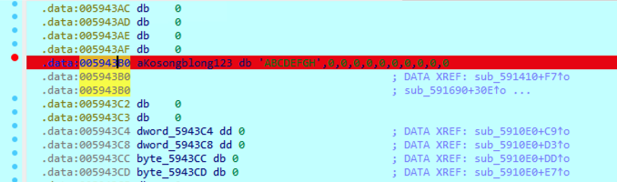<figcaption></figcaption></figure>

Selanjutnya lakukan read breakpoint pada address tersebut

<figure>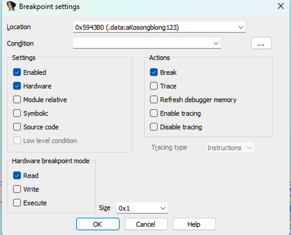<figcaption></figcaption></figure>

Selanjutnya continue dan akan keluar popup bahwa breakpoint kita ke trigger

<figure>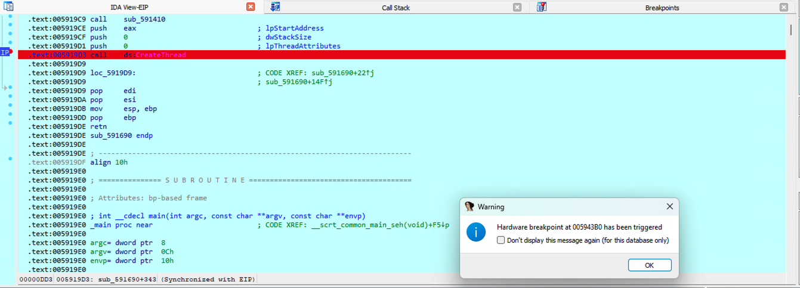<figcaption></figcaption></figure>

<figure>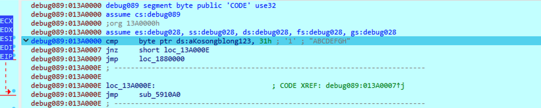<figcaption></figcaption></figure>

Untuk langkah selanjutnya saya lakukan manual, yaitu mencatat setiap perbandingan/algoritma dan melakukan jump ke instruksi yang benar. Disini saya menggunakan input 0123456789abcdefghijklmnopqrstuvwxyzABCDEFGHIJKLMN saat proses debugnya

<figure>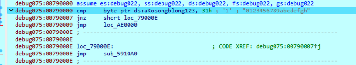<figcaption></figcaption></figure>

<figure>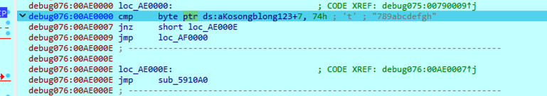<figcaption></figcaption></figure>

<figure>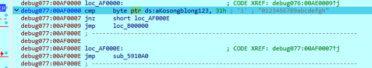<figcaption></figcaption></figure>

<figure>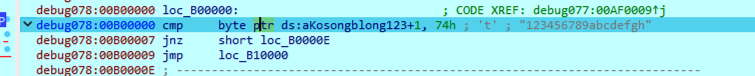<figcaption></figcaption></figure>

<figure>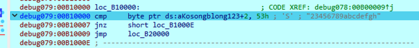<figcaption></figcaption></figure>

<figure>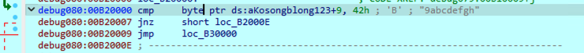<figcaption></figcaption></figure>

<figure>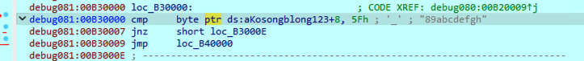<figcaption></figcaption></figure>

<figure>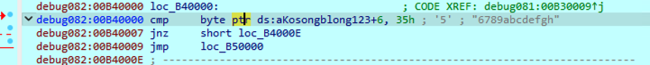<figcaption></figcaption></figure>

<figure>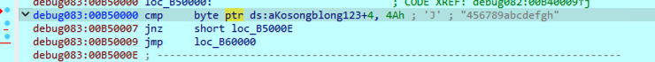<figcaption></figcaption></figure>

<figure>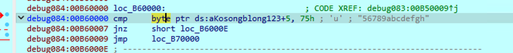<figcaption></figcaption></figure>

<figure>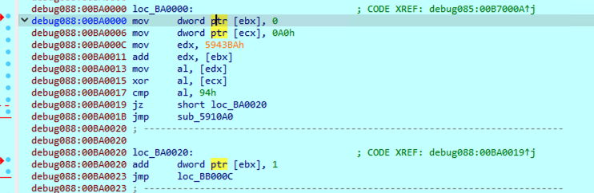<figcaption></figcaption></figure>

<figure>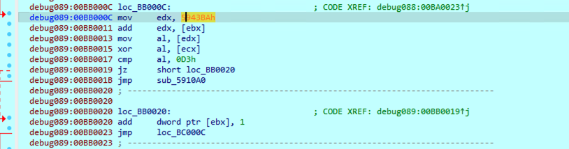<figcaption></figcaption></figure>

<figure>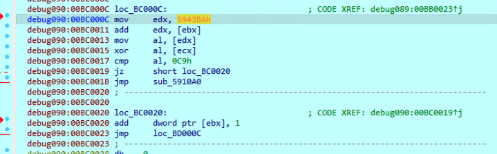<figcaption></figcaption></figure>

<figure>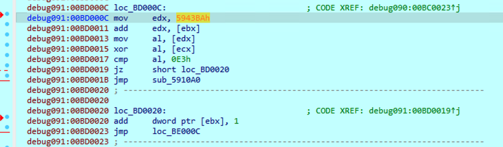<figcaption></figcaption></figure>

<figure>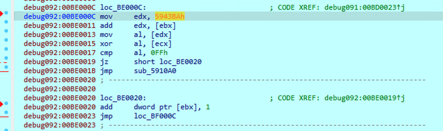<figcaption></figcaption></figure>

<figure>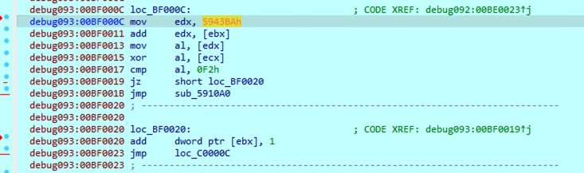<figcaption></figcaption></figure>

<figure>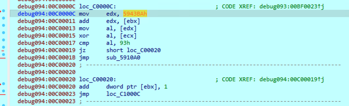<figcaption></figcaption></figure>

<figure>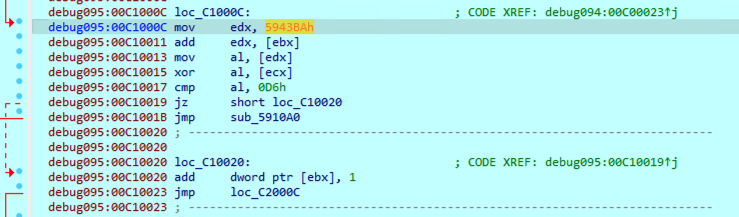<figcaption></figcaption></figure>

<figure>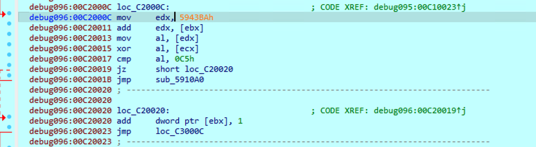<figcaption></figcaption></figure>

<figure>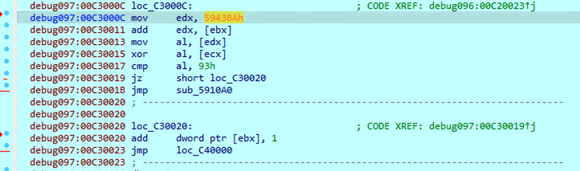<figcaption></figcaption></figure>

<figure>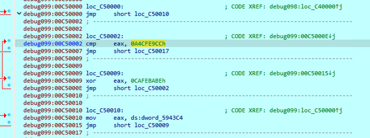<figcaption></figcaption></figure>

<figure>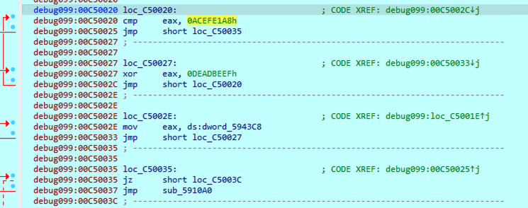<figcaption></figcaption></figure>

<figure>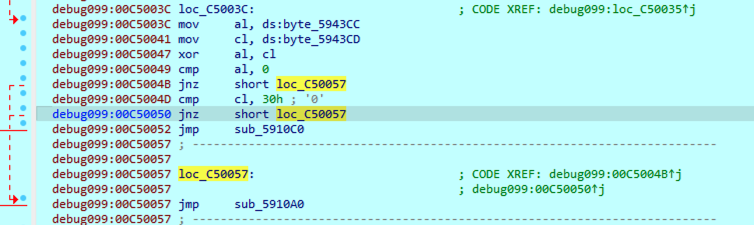<figcaption></figcaption></figure>

<figure>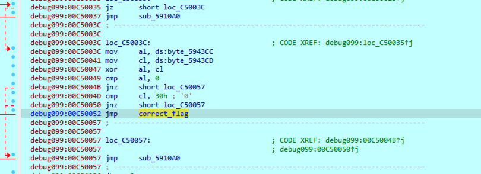<figcaption></figcaption></figure>

Ringkasan dari keseluruhan proses sebagai berikut

* xor 4 bytes value (0xdeadbeef, 0xcafebabe)
* xor dengan static value (0xa0)
* Pengecekan input berdasarkan index

Reverse semua proses dan tuliskan pada script python

```python
from Crypto.Util.number import *
charset = "0123456789abcdefghijklmnopqrstuvwxyzABCDEFGHIJKLMN"

flag = ['?' for _ in range(100)]

inp = ['1', '0', 't', '7', '1', '0', 't', '1', 'S', '2', 'B', '9', '_', '8', '5', '6', 'J', '4', 'u', '5']

for i in range(0,len(inp), 2):
	flag[charset.index(inp[i+1])] = inp[i]

arr = [0x0D3,0x0C9,0x0E3,0x0FF,0x0F2,0x93,0x0D6,0x0C5,0x93]

counter = 11
for i in range(len(arr)):
	flag[counter] = chr(arr[i] ^ 0xa0)
	counter += 1

arr2 = [long_to_bytes(0x0CAFEBABE ^ 0x0A4CFE9CC)[::-1], long_to_bytes(0xACEFE1A8 ^ 0x0DEADBEEF)[::-1]]

for i in arr2:
	for j in i:
		flag[counter] = chr(j)
		counter += 1
flag[counter] = '0'
flag[counter+1] = '0'
print(''.join(flag))

```

<figure>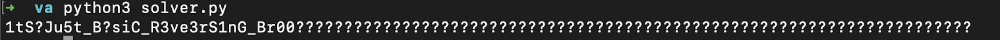<figcaption></figcaption></figure>

Ada beberapa char yang tidak ditemukan pada saat debugging namun bisa ditebak, sehingga mendapatkan flag yang valid yaitu&#x20;

<figure>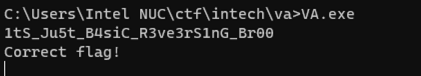<figcaption></figcaption></figure>

Flag : INTECHFEST{1tS\_Ju5t\_B4siC\_R3ve3rS1nG\_Br00}
