# Reverse Engineering

<!-- challenge-index: 36cccea0ea5bdccc -->

| Challenge | Topic |
| --- | --- |
| [Braggart (469 pts)](https://hyggehalcyon.gitbook.io/page/ctfs/2023/tenable-ctf-2023/pwn-braggart) | Binary Exploitation |
| [Brick Breaker (473 pts) 🥇](#brick-breaker-473-pts) | Nintendo DS, ROM Analysis |

<!-- /challenge-index -->

## Brick Breaker (473 pts)

### Description

Stole some resources from public domain and made a brick breaker clone. Collision detection is bad and it's pretty hard, but see if you can find the hidden message!

### Solution

Given DS file, since i dont know how to reverse engineering DS file i search on google and found this article <https://www.starcubelabs.com/reverse-engineering-ds/> . First, i extract the arm9.bin using DSLazy tool.&#x20;

```
1. Load nds file
2. Click nds unpack
```

<figure>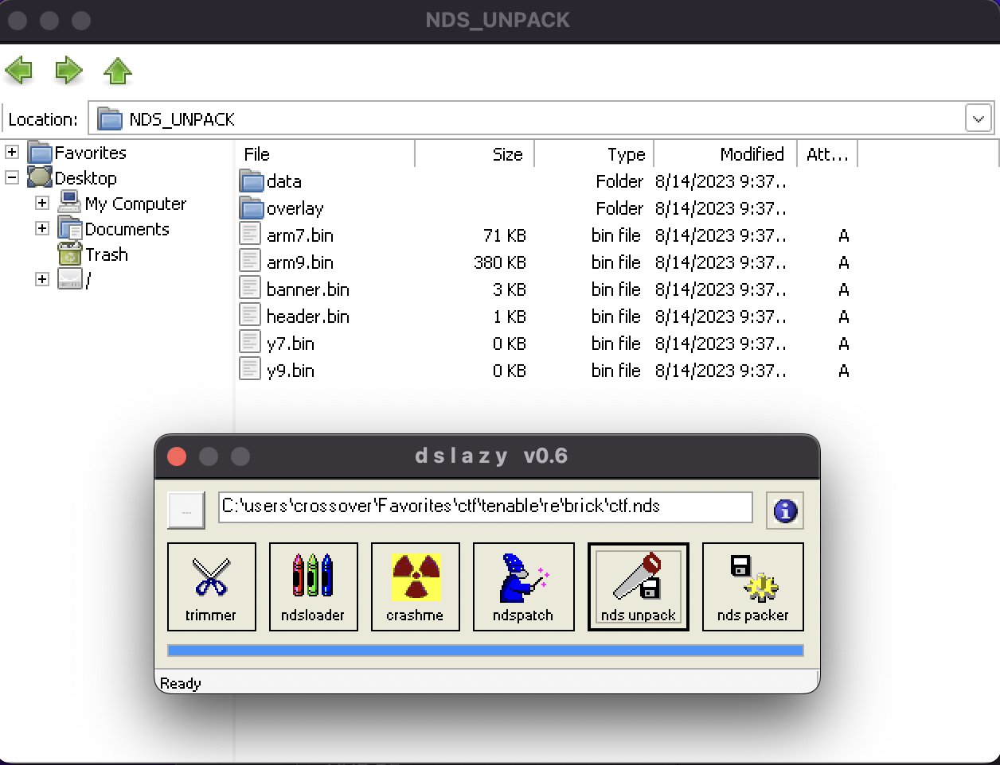<figcaption></figcaption></figure>

So the unpacked nds will be available on directory NDS\_UNPACK. File we need to reverse is arm9.bin, we can open the binary using ghidra. Take a look on list string we found some interesting string like below

<figure>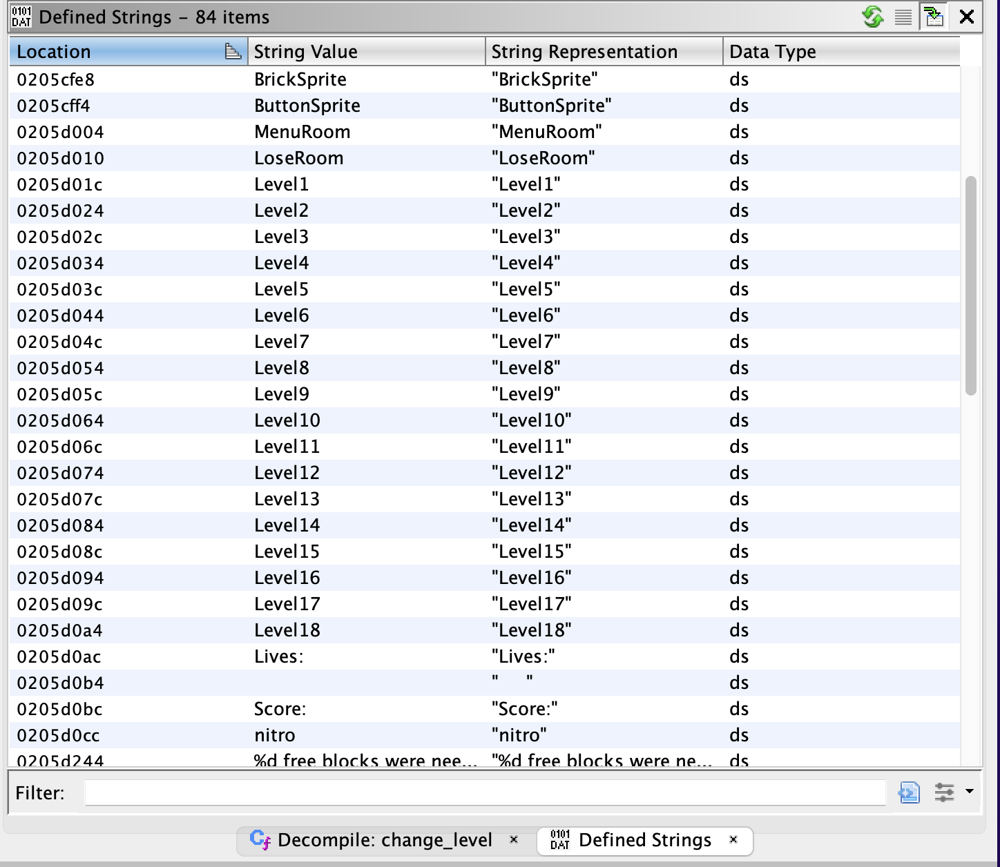<figcaption></figcaption></figure>

Next step, i open nds file using DeSmuME then play until game over

<figure>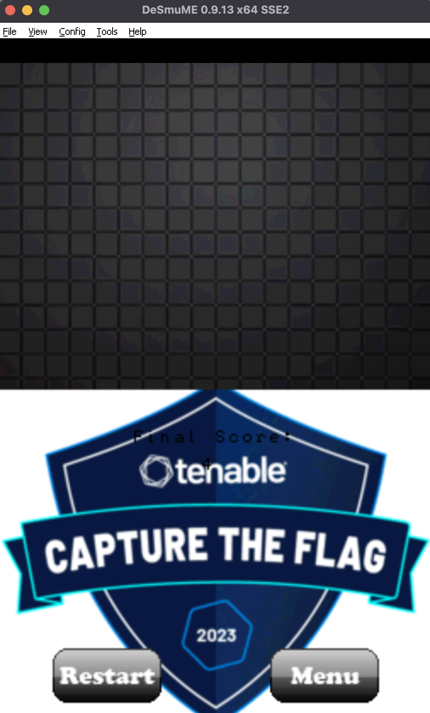<figcaption></figcaption></figure>

We can see that there is text "Final score:" on screen. Searching on ghidra we found the reference for that text (i've already rename the function)

<figure>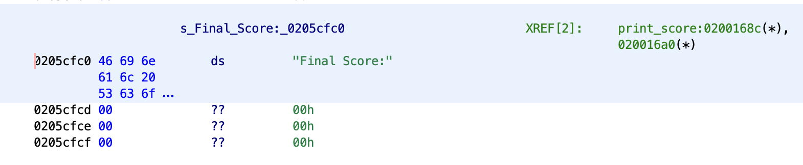<figcaption></figcaption></figure>

<figure>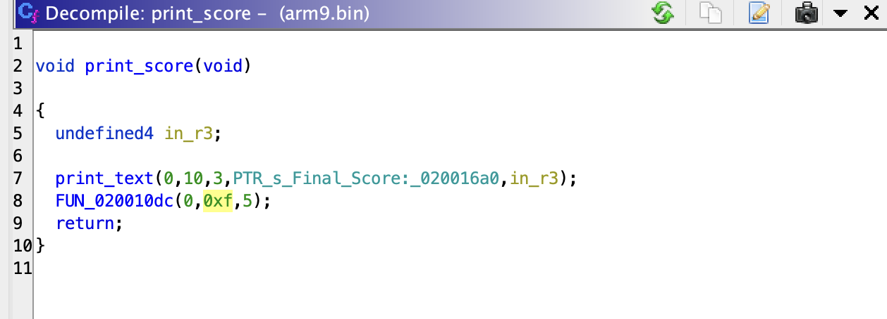<figcaption></figcaption></figure>

<figure>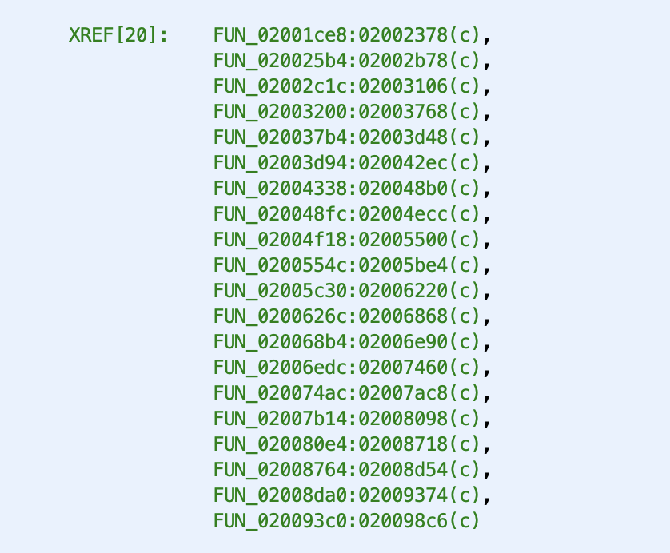<figcaption></figcaption></figure>

On image above we can see that print\_score has so many references and based on "level" string we know that there are 18 levels. Since most of the code looks like same, i just tried to set breakpoint on  one of those reference which is 0x020098c6.&#x20;

```
1. Click tools > disassembler
2. Close ARM7 Dissassembler
3. Put 020098C6 on "breakpoint" field then click "Add Breakpoint"
4. Put 020098C6 on "Go to" field then click GO
```

<figure>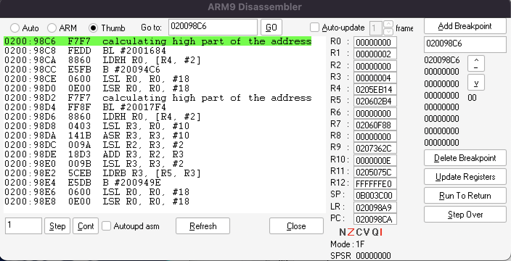<figcaption></figcaption></figure>

Line 0200:98c6 color becomes green, it means that the breakpoint triggered. So the next step is finding reference for FUN\_020093c0

<figure>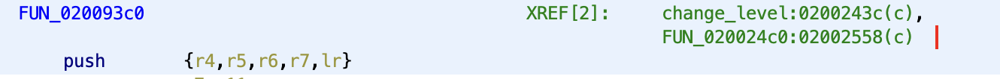<figcaption></figcaption></figure>

<figure>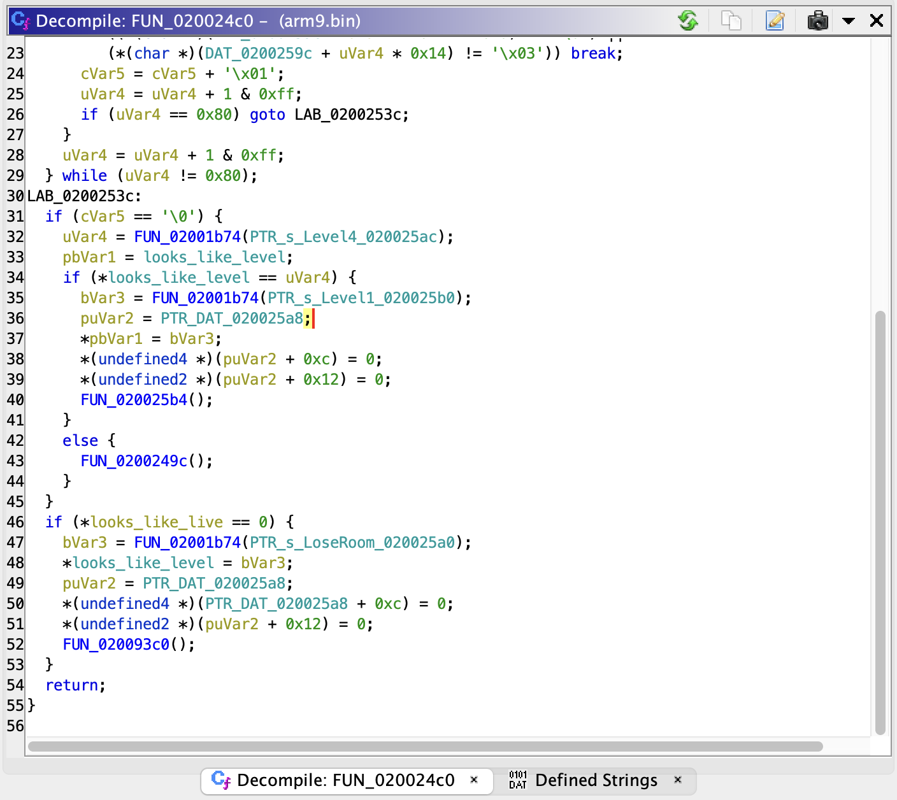<figcaption></figcaption></figure>

Looking at FUN\_020024c0, we found some interesting variable. With some dynamic analysis (using disassembler like previous process) we rename some variable and confirmed what are those variables.

```c
looks_like_live  = 0x02002590 -> 0x02060DB8
looks_like_level = 0x02060DBA
```

We can see on decompiler result that the level do infinity looping (from level 1 until level 4) and from the block we can see that each level show flag character. So basically, by playing the game we can get the flag but until level 4 and of course it should be hard since we only have a few lives. In this challenge, my approach to get the flag by cheating (modifying life and level) until i get all flag characters.&#x20;

```
1. Start the game (1st level view)
2. Click tools > view memory
3. Put 02060DB8 on Address field then click Go
4. Change 05 to FF
5. Put 02060DBA on Address field then click Go
6. Change 02 to 06, 06 is our target level since we already known "flag{" part

Repeat the modifying level process until we get all flag characters
```

<figure>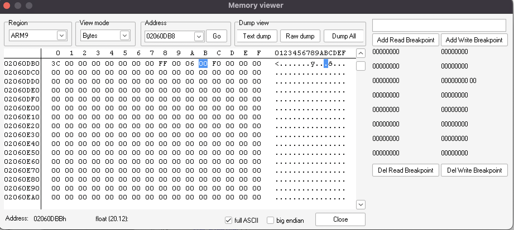<figcaption></figcaption></figure>

<figure>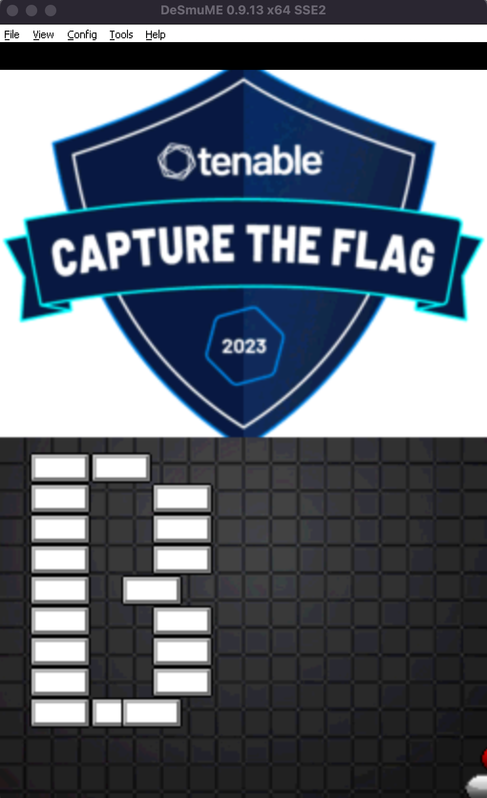<figcaption></figcaption></figure>

Flag : flag{Br3Ak0U7!!1}
