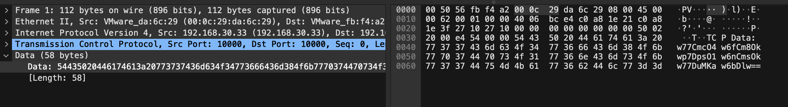
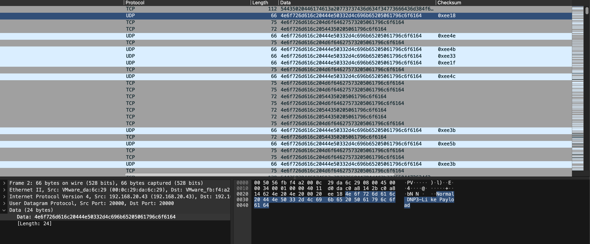
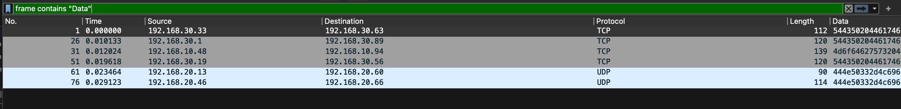
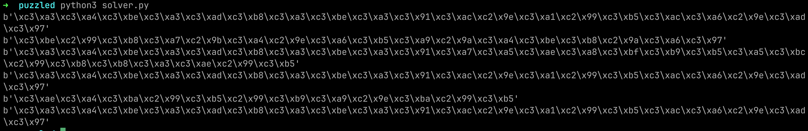
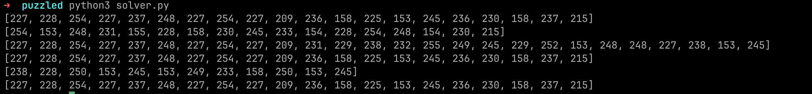
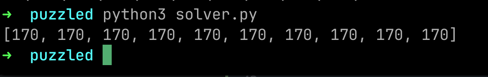
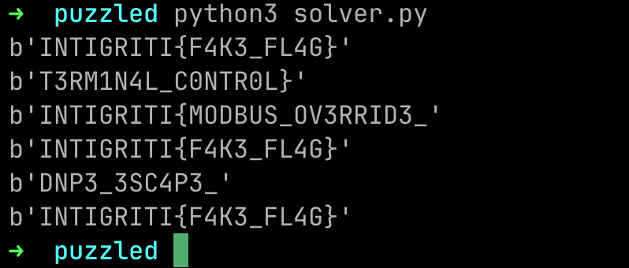

# Forensic

<!-- challenge-index: dbb28ed38f1570b9 -->

| Challenge | Topic |
| --- | --- |
| [Logging (100 pts)](https://github.com/intigriti/CTF/blob/main/2024/forensics/Logging/solution/README.md "Official solution") | SQL Log Analysis |
| [The Puzzled Protocol (495 pts)](#the-puzzled-protocol-495-pts) | PCAP, Protocol Decoding |

*Links to GitHub open the challenge authors’ official solutions.*

<!-- /challenge-index -->

## The Puzzled Protocol (495 pts)

### Description

In a world where the machines talk in codes, Two protocols clash on their invisible roads. One speaks control, the other knows the grid, Hidden among them, a secret is hide.

Modbus whispers commands to open the gate, DNP3 listens and alters its fate. Some signals are true, some meant to deceive, Only the sharp-eyed can truly perceive.

Flags are fragmented, scattered in disguise, The real one’s elusive, behind layers of lies. Find the whispers that tell the right tale, Or be lost in the noise, destined to fail.

### Solution

Given PCAP file, open it using wireshark. At first frame, we can see some suspicious data

<figure><figcaption></figcaption></figure>

It looks like different with the others.

<figure><figcaption></figcaption></figure>

After knowing this information, i tried to filter only packet that consist "Data" string.

```
frame contains "Data"
```

<figure><figcaption></figcaption></figure>

Copying all the values now left only guessing part. Lets decode the base64 ciphertext

```python
import base64

def dec(a):
	a = bytes.fromhex(a).split(b' ')[-1]
	a = base64.b64decode(a)
	return a

arr = ["54435020446174613a2077365044704d4f2b7736504472634f347736504476734f6a77354844724d4b65773648436d634f3177367a4470734b65773633446c773d3d"]
arr.append("54435020446174613a20773737436d634f34773666436d384f6b7770374470734f3177366e436d734f6b77373744754d4b61773662446c773d3d")
arr.append("4d6f6462757320446174613a2077365044704d4f2b7736504472634f347736504476734f6a7735484470384f6c77363744714d4f2f77376e4474634f6c77377a436d634f3477376a446f384f7577706e4474513d3d")
arr.append("54435020446174613a2077365044704d4f2b7736504472634f347736504476734f6a77354844724d4b65773648436d634f3177367a4470734b65773633446c773d3d")
arr.append("444e50332d4c696b6520446174613a2077363744704d4f3677706e4474634b5a77376e4471634b65773772436d634f31")
arr.append("444e50332d4c696b6520446174613a2077365044704d4f2b7736504472634f347736504476734f6a77354844724d4b65773648436d634f3177367a4470734b65773633446c773d3d")

for i in arr:
	print(dec(i))
```

<figure><figcaption></figcaption></figure>

All the values consist of byte like \xc3,\xc2, etc. We know that it can be caused by the process of encoding of char in python. So lets convert it to the actual values.

```python
import base64

def dec(a):
	a = bytes.fromhex(a).split(b' ')[-1]
	a = base64.b64decode(a)
	a = a.decode()
	act_val = []
	for i in a:
		act_val.append(ord(i))
	return act_val

arr = ["54435020446174613a2077365044704d4f2b7736504472634f347736504476734f6a77354844724d4b65773648436d634f3177367a4470734b65773633446c773d3d"]
arr.append("54435020446174613a20773737436d634f34773666436d384f6b7770374470734f3177366e436d734f6b77373744754d4b61773662446c773d3d")
arr.append("4d6f6462757320446174613a2077365044704d4f2b7736504472634f347736504476734f6a7735484470384f6c77363744714d4f2f77376e4474634f6c77377a436d634f3477376a446f384f7577706e4474513d3d")
arr.append("54435020446174613a2077365044704d4f2b7736504472634f347736504476734f6a77354844724d4b65773648436d634f3177367a4470734b65773633446c773d3d")
arr.append("444e50332d4c696b6520446174613a2077363744704d4f3677706e4474634b5a77376e4471634b65773772436d634f31")
arr.append("444e50332d4c696b6520446174613a2077365044704d4f2b7736504472634f347736504476734f6a77354844724d4b65773648436d634f3177367a4470734b65773633446c773d3d")

for i in arr:
	print(dec(i))
```

<figure><figcaption></figcaption></figure>

Continue the guessing,  we know the format flag which is "INTIGRITI{", lets do some known operation such as xor, sub, add, etc.

```python
def dec(a):
	a = bytes.fromhex(a).split(b' ')[-1]
	a = base64.b64decode(a)
	a = a.decode()
	act_val = []
	for i in a:
		act_val.append(ord(i))
	return act_val

arr = ["54435020446174613a2077365044704d4f2b7736504472634f347736504476734f6a77354844724d4b65773648436d634f3177367a4470734b65773633446c773d3d"]
arr.append("54435020446174613a20773737436d634f34773666436d384f6b7770374470734f3177366e436d734f6b77373744754d4b61773662446c773d3d")
arr.append("4d6f6462757320446174613a2077365044704d4f2b7736504472634f347736504476734f6a7735484470384f6c77363744714d4f2f77376e4474634f6c77377a436d634f3477376a446f384f7577706e4474513d3d")
arr.append("54435020446174613a2077365044704d4f2b7736504472634f347736504476734f6a77354844724d4b65773648436d634f3177367a4470734b65773633446c773d3d")
arr.append("444e50332d4c696b6520446174613a2077363744704d4f3677706e4474634b5a77376e4471634b65773772436d634f31")
arr.append("444e50332d4c696b6520446174613a2077365044704d4f2b7736504472634f347736504476734f6a77354844724d4b65773648436d634f3177367a4470734b65773633446c773d3d")

known = b"INTIGRITI{"
for i in arr:
	tmp = []
	tmp2 = dec(i)
	for j in range(len(known)):
		tmp.append(known[j] ^ tmp2[j])
	print(tmp)
	break
```

<figure><figcaption></figcaption></figure>

Uh, look suspicious. Looks like we found the valid key and valid operation. Lets implement the algorithm for all values.

```python
import base64

def dec(a):
	a = bytes.fromhex(a).split(b' ')[-1]
	a = base64.b64decode(a)
	a = a.decode()
	act_val = []
	for i in a:
		act_val.append(ord(i) ^ 170)
	return act_val

arr = ["54435020446174613a2077365044704d4f2b7736504472634f347736504476734f6a77354844724d4b65773648436d634f3177367a4470734b65773633446c773d3d"]
arr.append("54435020446174613a20773737436d634f34773666436d384f6b7770374470734f3177366e436d734f6b77373744754d4b61773662446c773d3d")
arr.append("4d6f6462757320446174613a2077365044704d4f2b7736504472634f347736504476734f6a7735484470384f6c77363744714d4f2f77376e4474634f6c77377a436d634f3477376a446f384f7577706e4474513d3d")
arr.append("54435020446174613a2077365044704d4f2b7736504472634f347736504476734f6a77354844724d4b65773648436d634f3177367a4470734b65773633446c773d3d")
arr.append("444e50332d4c696b6520446174613a2077363744704d4f3677706e4474634b5a77376e4471634b65773772436d634f31")
arr.append("444e50332d4c696b6520446174613a2077365044704d4f2b7736504472634f347736504476734f6a77354844724d4b65773648436d634f3177367a4470734b65773633446c773d3d")

# known = b"INTIGRITI{"

for i in arr:
	print(bytes(dec(i)))
```

<figure><figcaption></figcaption></figure>

Flag: INTIGRITI{MODBUS\_OV3RRID3\_DNP3\_3SC4P3\_T3RM1N4L\_C0NTR0L}
