# Mobile

<!-- challenge-index: f7a416bb463999d1 -->

| Challenge | Topic |
| --- | --- |
| [Quiz (100 pts)](https://github.com/intigriti/CTF/blob/main/2024/mobile/Quiz/solution/writeup%20(Mogfrat).pdf "Official solution") | Android APK, Quiz Validation |
| [Where's my APK? (499 pts) 🥉](#wheres-my-apk-499-pts) | Android App Bundle, Flutter |

*Links to GitHub open the challenge authors’ official solutions.*

<!-- /challenge-index -->

## Where's my APK? (499 pts)

### Description

Can you achieve a leet download speed?

* Note 1: Flag is not in the usual format.&#x20;
* Note 2: Only non password protected files can be opened with the app.

### Solution

Given .aab file, through googling i found a way to convert it to a single APK

* <https://stackoverflow.com/a/68752831>

```bash
brew install bundletool
bundletool build-apks --mode universal --bundle ./app-release.aab --output ./app.apks
mv app.apks app.zip
unzip app.zip
```

Through decompiling using apktool, i found that this APK is using flutter.

<figure>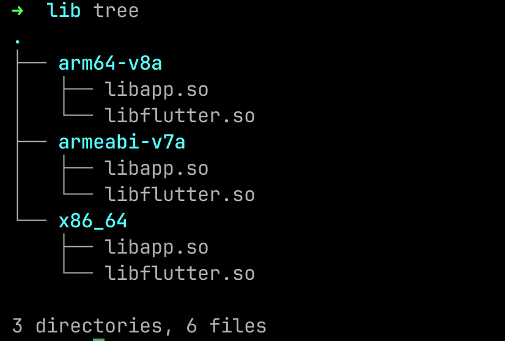<figcaption></figcaption></figure>

So the source code will not be in .dex file, it shuold be in libapp.so. Previously i've been read some article regarding flutter reverse engineering and i found that this tools is very useful.

* <https://github.com/worawit/blutter>

So lets use blutter on our target

<figure>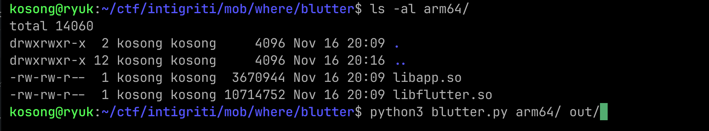<figcaption></figcaption></figure>

Now we have some information about the target. In this case i use ida script to recover the function name and object pool. Do a little modify to make the script work fully

<figure>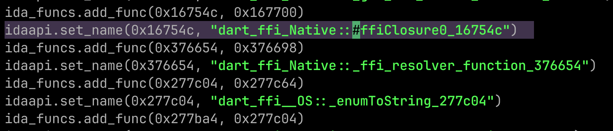<figcaption></figcaption></figure>

* change # to any value (for example \_)

After that load the script and we will see almost all functions are renamed. Lets filter the function name with cybersharing.

<figure>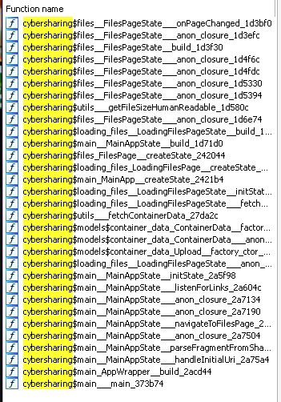<figcaption></figcaption></figure>

Back to the application, we need to find some string to get the reference.

<figure><figcaption></figcaption></figure>

There is a string, so let's search it on the object pool.

<figure>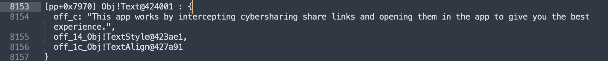<figcaption></figcaption></figure>

Next, go the structures then ctrl+g and put the 0x7970 as the address.

<figure>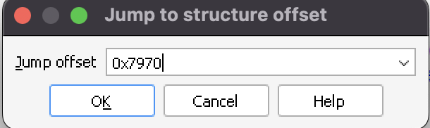<figcaption></figcaption></figure>

<figure>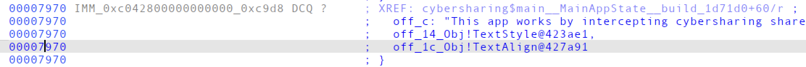<figcaption></figcaption></figure>

We can see that there is XREF, click it and we will see the code that use the value.

<figure>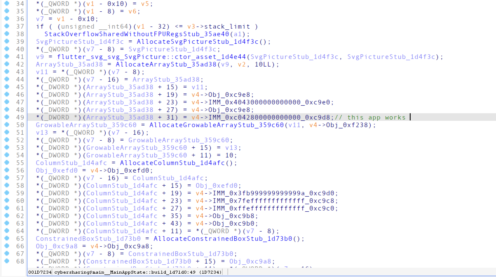<figcaption></figcaption></figure>

Now the problem is, i cannot open any cybersharing.net/s/ URL with the application. So i decided to take a look on the AndroidManifest.

<figure>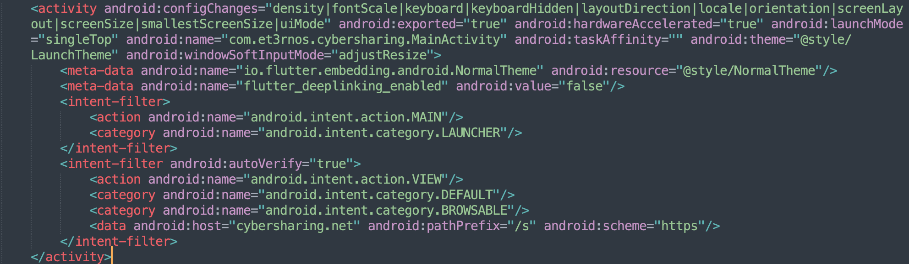<figcaption></figcaption></figure>

From AndroidManifest i tried to create a command to spawn the Activity including the data used.

```bash
adb shell am start -W \
    -c android.intent.category.BROWSABLE \
    -n com.et3rnos.cybersharing/.MainActivity \
    -d "https://cybersharing.net/s/630ca91826267dee"
```

Now i can continue the the next Activity.

<figure>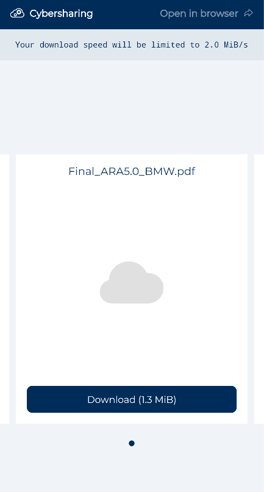<figcaption></figcaption></figure>

We see some new information in current activity. Let's try to findout which function that show the current screen.

* cybersharing\_files\_\_FilesPageState::build\_1d3f30

We can confirm it by looking at the object used in the function, such as below

&#x20;

<figure>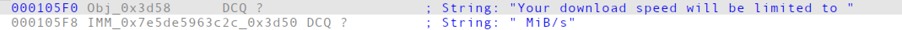<figcaption></figcaption></figure>

<figure>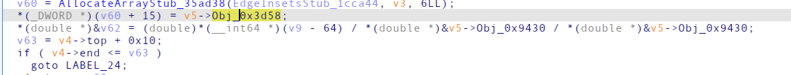<figcaption></figcaption></figure>

Looking the code, i found something suspicious.

<figure>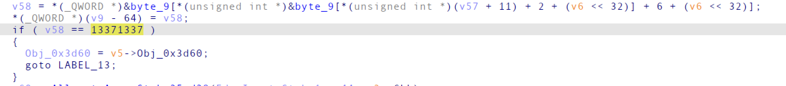<figcaption></figcaption></figure>

We can see there is value 13371337 used as comparation which is not common. Through the analysis i conclude the logic below

* if value == 13371337
  * Show string @Obj\_0x3d60 -> WLGOOQNAWWPLSEA
* else
  * Show string \<speed> + MiB/s

Back to the challenge description, i also found that there is "leet" mentioned. So lets try to found another 13371337 value. Use search immediate value in IDA

<figure>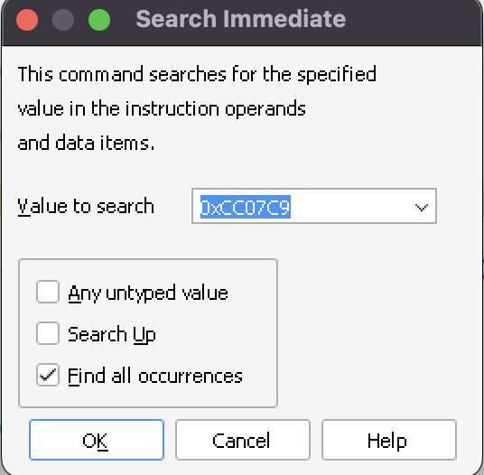<figcaption></figcaption></figure>

<figure>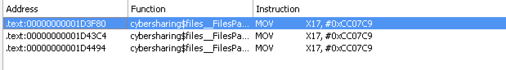<figcaption></figcaption></figure>

There are 3 instructions that load value 13371337. Lets check each instruction

*

<figure>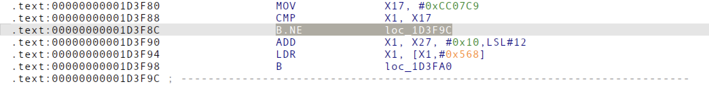<figcaption></figcaption></figure>

*

<figure>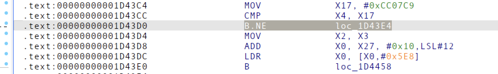<figcaption></figcaption></figure>

*

<figure>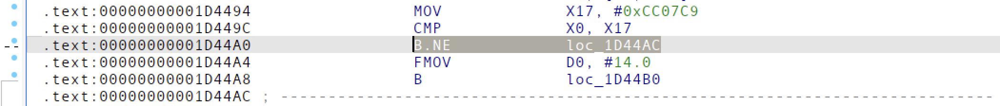<figcaption></figcaption></figure>

After looking at each instruction, i've idea. The idea is patching the library so it will do the behaviour like if the value is 13371337. The easiest way to do that is by changing the B.NE to B.EQ, the problem is this is not x64 architecture so it would not that easy to change the assembly. But we've shell-storm as our savior.&#x20;

* <https://shell-storm.org/online/Online-Assembler-and-Disassembler/>

Copy the bytecode for each B.NE \<jump\_location> to the shell-storm then disassemble it.

<figure>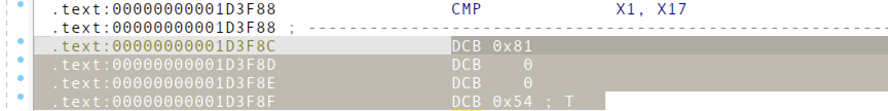<figcaption></figcaption></figure>

<figure>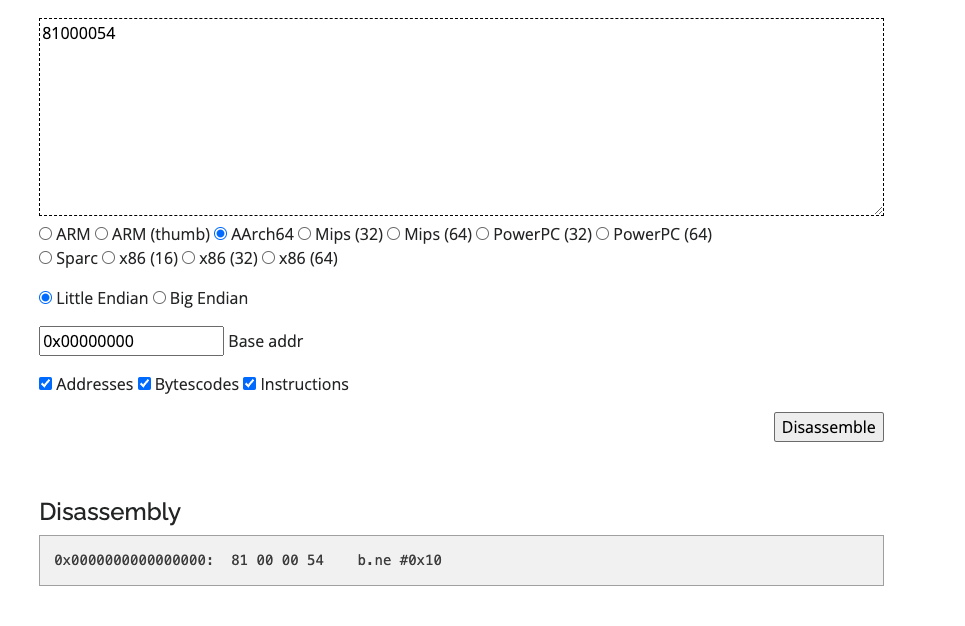<figcaption></figcaption></figure>

After that copy the assembly then change from b.ne to b.eq

<figure>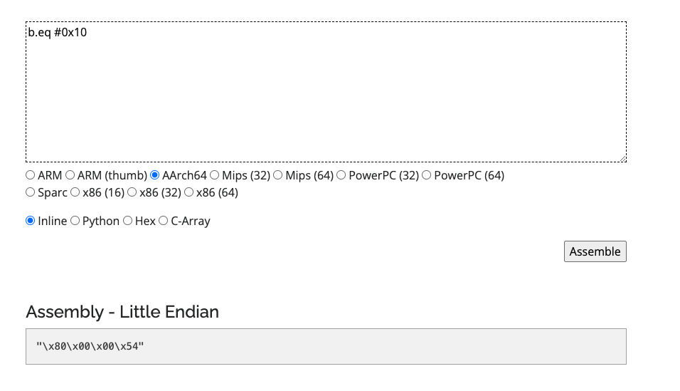<figcaption></figcaption></figure>

Now, we've the pattern which is decrement the first byte by 1 for changing fro B.NE to B.EQ. So do that for all the rest instructions.

* &#x20;

  <figure>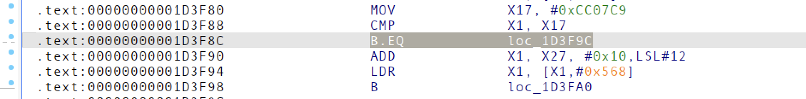<figcaption></figcaption></figure>
*

<figure>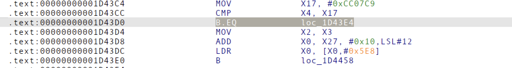<figcaption></figcaption></figure>

*

<figure>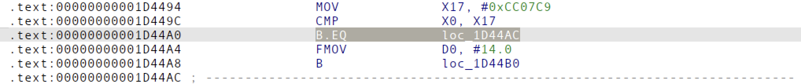<figcaption></figcaption></figure>

The last step just compile the APK and sign it.

```bash
apktool b universal
cd universal/dist
uber-apk-signer --allowResign -a universal.apk
# install universal-aligned-debugSigned.apk
```

After that install the new APK and trigger the activity again.

```bash
adb shell am start -W \
    -c android.intent.category.BROWSABLE \
    -n com.et3rnos.cybersharing/.MainActivity \
    -d "https://cybersharing.net/s/630ca91826267dee"
```

<figure>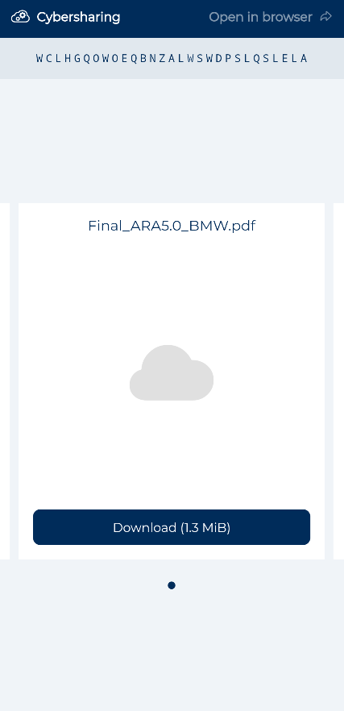<figcaption></figcaption></figure>

Now the flag will shown in the topbar.

Flag: WCLHGQOWOEQBNZALWSWDPSLQSLELA
