# Reverse Engineering

<!-- challenge-index: 2b83037a921d225b -->

| Challenge | Topic |
| --- | --- |
| [compyled (100 pts)](#compyled-50-pts) | CPython Bytecode |
| [YaraReTa (250 pts)🥇](#yarareta-250-pts) | YARA Bytecode, Custom VM |
| [Command Runner (250 pts)](#command-runner-250-pts) | PNG Chunks, CRC32 |
| [Sneaky VEH (400 pts)](#sneaky-veh-400-pts) | Windows Exception Handling, Z3 |

<!-- /challenge-index -->

## compyled (50 pts)

### Description

It's just a compiled Python. It won't hurt me...

### Solution

Given `run.pyc` file, try to decompile using `pycdc`.

<figure>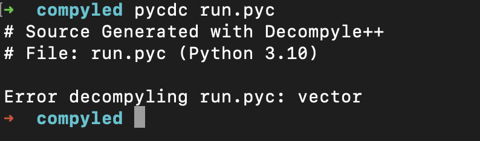<figcaption><p>run pycdc</p></figcaption></figure>

`pycdc` failed to decompile `run.pyc`, so the next step i do is `disassembling` pyc file using `pycdas`.

<figure>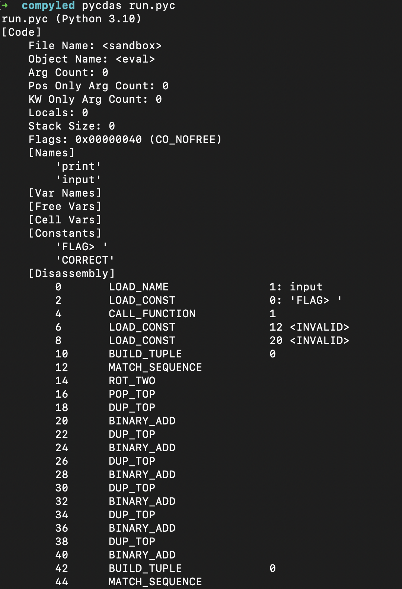<figcaption><p>run pycdas (1)</p></figcaption></figure>

<figure>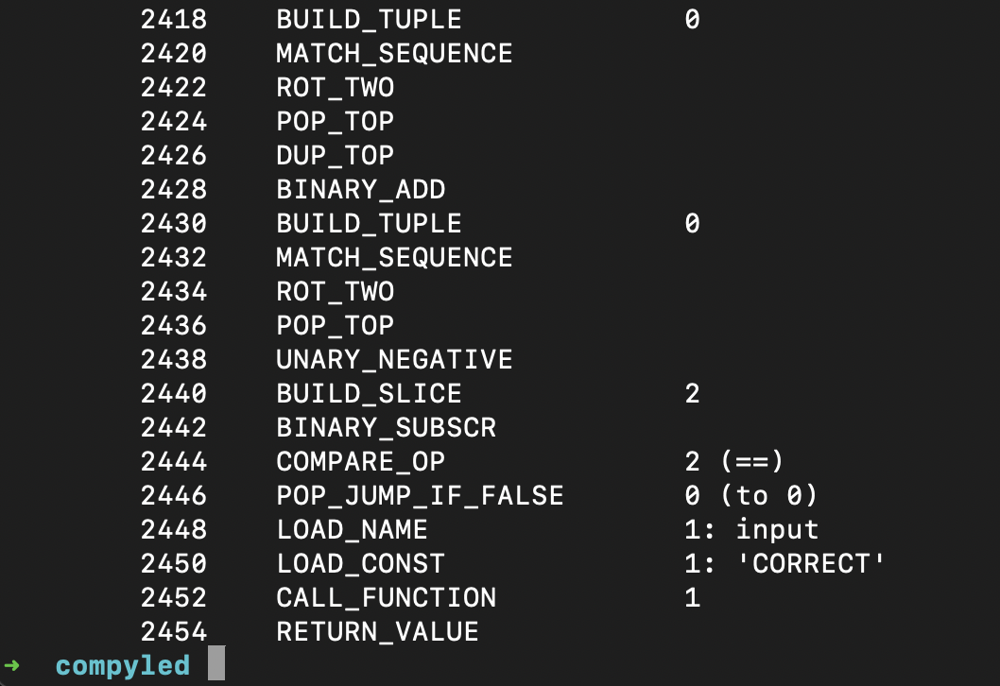<figcaption><p>run pycdas (2)</p></figcaption></figure>

It has so many lines and should take times if i manually convert it to python code. So my approach is by building `custom python executable` that printout value in specific `opcode`. In this case i try to dump the values during `COMPARE_OP` execution. Clone spesific version `(3.10)`.

```bash
git clone -b 3.10 https://github.com/python/cpython.git
```

<pre class="language-c" data-title="Python/ceval.c" data-line-numbers><code class="lang-c">...
<strong>static void reprint(PyObject *obj) {
</strong><strong>    PyObject* repr = PyObject_Repr(obj);
</strong><strong>    PyObject* str = PyUnicode_AsEncodedString(repr, "utf-8", "~E~");
</strong><strong>    const char *bytes = PyBytes_AS_STRING(str);
</strong><strong>
</strong><strong>    printf("REPR: %s\n", bytes);
</strong><strong>
</strong><strong>    Py_XDECREF(repr);
</strong><strong>    Py_XDECREF(str);
</strong><strong>}
</strong>...
PyObject* _Py_HOT_FUNCTION
_PyEval_EvalFrameDefault(PyThreadState *tstate, PyFrameObject *f, int throwflag)
{
    _Py_EnsureTstateNotNULL(tstate);
...
case TARGET(COMPARE_OP): {
            assert(oparg &#x3C;= Py_GE);
            PyObject *right = POP();
            PyObject *left = TOP();

<strong>            printf("Left: %s\n", Py_TYPE(left)->tp_name);
</strong><strong>            printf("Right %s\n", Py_TYPE(right)->tp_name);
</strong>            
<strong>            if(strcmp(Py_TYPE(left)->tp_name, "str") == 0 ){
</strong><strong>                reprint(left);
</strong><strong>            }
</strong>            
<strong>            if(strcmp(Py_TYPE(right)->tp_name, "str") == 0 ){
</strong><strong>                reprint(right);
</strong><strong>            }
</strong>            
            PyObject *res = PyObject_RichCompare(left, right, oparg);
            SET_TOP(res);
            Py_DECREF(left);
            Py_DECREF(right);
            if (res == NULL)
                goto error;
            PREDICT(POP_JUMP_IF_FALSE);
            PREDICT(POP_JUMP_IF_TRUE);
            DISPATCH();
        }
...
</code></pre>

* Line 2-11: function to print value for string data type
* Line 23-32: print data type and value if data type is string

There is different way to print each type data in python internal, in this case `reprint` work for `string` type data which is used in `COMPARED_OP`.  Next,  just `compile` the python

```bash
./configure
make
```

Execute `run.pyc` with new compiled python and we will get the flag which is value compared in `COMPARED_OP` with string type data.

```bash
./python run.pyc
```

<figure>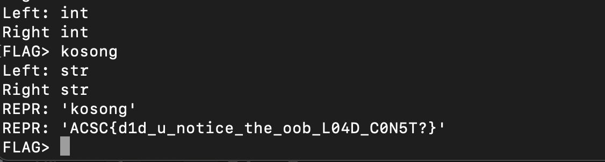<figcaption><p>run modified python</p></figcaption></figure>

Flag: ACSC{d1d\_u\_notice\_the\_oob\_L04D\_C0N5T?}

## YaraReTa (250 pts)

### Description

Yara... Re... Ta...

### Solution

Given 5 files as follows.

<figure>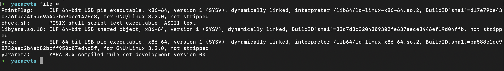<figcaption><p>list files</p></figcaption></figure>

Files overview:

* yara
  * Yara executable
* libyara.so.10
  * Library for yara executable
* yarareta
  * Compiled yara rules
* PrintFlag
  * Executable that decrypt the flag
* check.sh
  * Wrapper for running yara with library, compiled yara rules, and file target

Running the `wrapper` (check.sh), we will get the following output

<figure><figcaption><p>run wrapper</p></figcaption></figure>

From the output and the `PrintFlag` binary i assume that the objective is to find the `correct key`.

<figure>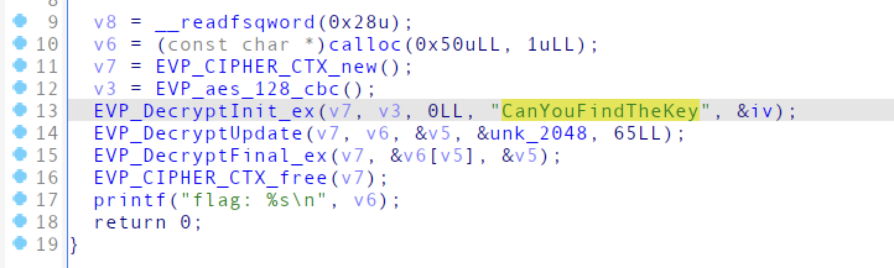<figcaption><p>decompile PrintFlag</p></figcaption></figure>

At first, i tried to find any reference regarding `yara compiled rules reverse engineering` and i just found this [reference](https://bnbdr.github.io/posts/swisscheese/). The article explain about `yara internal` including the `VM` and its structure. From that article i got information that function that becomes VM executor/runner `yr_execute_code` in libyara/exec. Because yara is `open source` and the version of Yara is known, so i tried to create `modified yara`.

<pre class="language-c" data-title="libyara/exec.c" data-line-numbers><code class="lang-c">...
#if YR_PARANOID_EXEC
  memset(mem, 0, MEM_SIZE * sizeof(mem[0]));
#endif
<strong>  char *opcode_name[] = {"OP_ERROR", "OP_AND", "OP_OR", "OP_NOT", "OP_BITWISE_NOT", "OP_BITWISE_AND", "OP_BITWISE_OR", "OP_BITWISE_XOR", "OP_SHL", "OP_SHR", "OP_MOD", "OP_INT_TO_DBL", "OP_STR_TO_BOOL", "OP_PUSH", "OP_POP", "OP_CALL", "OP_OBJ_LOAD", "OP_OBJ_VALUE", "OP_OBJ_FIELD", "OP_INDEX_ARRAY", "OP_COUNT", "OP_LENGTH", "OP_FOUND", "OP_FOUND_AT", "OP_FOUND_IN", "OP_OFFSET", "OP_OF", "OP_PUSH_RULE", "OP_INIT_RULE", "OP_MATCH_RULE", "OP_INCR_M", "OP_CLEAR_M", "OP_ADD_M", "OP_POP_M", "OP_PUSH_M", "OP_SET_M", "OP_SWAPUNDEF", "OP_FILESIZE", "OP_ENTRYPOINT", "OP_UNUSED", "OP_MATCHES", "OP_IMPORT", "OP_LOOKUP_DICT", "OP_JUNDEF", "OP_JUNDEF_P", "OP_JNUNDEF", "OP_JNUNDEF_P", "OP_JFALSE", "OP_JFALSE_P", "OP_JTRUE", "OP_JTRUE_P", "OP_JL_P", "OP_JLE_P", "OP_ITER_NEXT", "OP_ITER_START_ARRAY", "OP_ITER_START_DICT", "OP_ITER_START_INT_RANGE", "OP_ITER_START_INT_ENUM", "OP_ITER_START_STRING_SET", "OP_ITER_CONDITION", "OP_ITER_END", "OP_JZ", "OP_JZ_P", "OP_PUSH_8", "OP_PUSH_16", "OP_PUSH_32", "OP_PUSH_U", "OP_CONTAINS", "OP_STARTSWITH", "OP_ENDSWITH", "OP_ICONTAINS", "OP_ISTARTSWITH", "OP_IENDSWITH", "OP_IEQUALS", "OP_OF_PERCENT", "OP_OF_FOUND_IN", "OP_COUNT_IN", "OP_DEFINED", "OP_ITER_START_TEXT_STRING_SET", "OP_OF_FOUND_AT", "UNK", "UNK", "UNK", "UNK", "UNK", "UNK", "UNK", "UNK", "UNK", "UNK", "UNK", "UNK", "UNK", "UNK", "UNK", "UNK", "UNK", "UNK", "UNK", "UNK", "UNK", "UNK", "UNK", "UNK", "UNK", "UNK", "UNK", "UNK", "UNK", "UNK", "UNK", "UNK", "UNK", "UNK", "UNK", "UNK", "UNK", "UNK", "UNK", "UNK", "UNK", "UNK", "UNK", "UNK", "UNK", "UNK", "UNK", "UNK", "UNK", "UNK", "UNK", "UNK", "UNK", "UNK", "UNK", "UNK", "UNK", "UNK", "UNK", "UNK", "OP_STR_BEGIN", "UNK", "UNK", "UNK", "UNK", "UNK", "UNK", "UNK", "UNK", "UNK", "UNK", "UNK", "UNK", "UNK", "UNK", "UNK", "UNK", "UNK", "UNK", "UNK", "UNK", "UNK", "UNK", "UNK", "UNK", "UNK", "UNK", "UNK", "UNK", "UNK", "UNK", "UNK", "UNK", "UNK", "UNK", "UNK", "UNK", "UNK", "UNK", "UNK", "UNK", "UNK", "UNK", "UNK", "UNK", "UNK", "UNK", "UNK", "UNK", "UNK", "UNK", "UNK", "UNK", "UNK", "UNK", "UNK", "UNK", "UNK", "UNK", "UNK", "UNK", "UNK", "UNK", "UNK", "UNK", "UNK", "UNK", "UNK", "UNK", "UNK", "UNK", "UNK", "UNK", "UNK", "UNK", "UNK", "UNK", "UNK", "UNK", "UNK", "UNK", "UNK", "UNK", "UNK", "UNK", "UNK", "UNK", "UNK", "UNK", "UNK", "UNK", "UNK", "UNK", "UNK", "UNK", "UNK", "UNK", "UNK", "UNK", "UNK", "UNK", "UNK", "UNK", "UNK", "UNK", "UNK", "UNK", "UNK", "UNK", "UNK", "UNK", "UNK", "UNK", "UNK", "OP_NOP", "OP_HALT"};
</strong>
  while (!stop)
  {
    // Read the opcode from the address indicated by the instruction pointer.
    opcode = *ip;
<strong>    printf("OPCODE: %s\n", opcode_name[opcode&#x26;0xff]);
</strong>    // Advance the instruction pointer, which now points past the opcode.
    ip++;

    switch (opcode)
    {
    case OP_NOP:
...
</code></pre>

* Line 5 and 11: dump the OPCODE during execution process

```bash
./build.sh # wrapper to compile yara
```

After executing build.sh there will be yara executable which is bash script (wrapper for new compiled yara). Executing yarareta rule with new yara will generated output below

<figure><figcaption><p>run modified yara</p></figcaption></figure>

There is an error when we run yarareta with our new yara. Back to given library, i tried to dump the opcode by using `gdb scripting`. &#x20;

```python
#!/usr/bin/python3

class SolverEquation(gdb.Command):
    def __init__ (self):
        super (SolverEquation, self).__init__ ("solve-equation",gdb.COMMAND_OBSCURE)
    
    def invoke (self, arg, from_tty):        
        arr = []
        gdb.execute("set environment LD_PRELOAD=./libyara.so.10")
        gdb.execute("b yr_scanner_scan_fd")
        gdb.execute("r -C yarareta PrintFlag")
        gdb.execute("b *yr_execute_code+232") # mov    rdx, rax
        gdb.execute("c")
        for i in range(51):
            rax = addr2num(gdb.selected_frame().read_register("rax"))
            arr.append(rax)
            gdb.execute("c")
        gdb.execute("del")
        print(arr)

def addr2num(addr):
    try:
        return int(addr)  # Python 3
    except:
        return long(addr) # Python 2
SolverEquation()
```

<figure>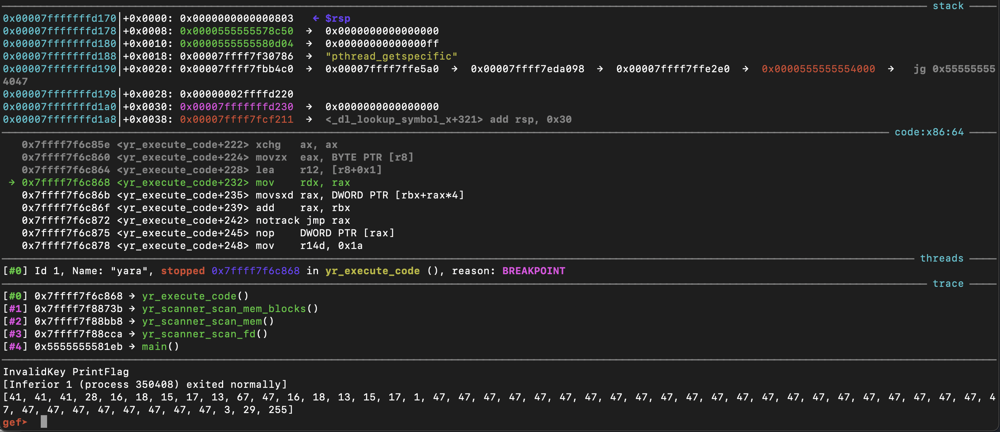<figcaption><p>gdb scripting output</p></figcaption></figure>

Using given library and yara executable there is `no error`, so there is something wrong with new library or new yara. Reading the source code again, i tried to dump the module name loaded with `OP_IMPORT`.

<pre class="language-c" data-title="libyara/exec.c" data-line-numbers><code class="lang-c">...
        case OP_IMPORT:
      YR_DEBUG_FPRINTF(2, stderr, "- case OP_IMPORT: // %s()\n", __FUNCTION__);
      r1.i = yr_unaligned_u64(ip);
      ip += sizeof(uint64_t);

<strong>      printf("MODULE: %s\n", r1.p);
</strong>
#if YR_PARANOID_EXEC
      ensure_within_rules_arena(r1.p);
#endif

      result = yr_modules_load((char*) r1.p, context);

      if (result != ERROR_SUCCESS)
        stop = true;

      break;
...
</code></pre>

* Line 7: print module name

```bash
make # compile yara
```

<figure><figcaption><p>run modified yara</p></figcaption></figure>

From image above we can see that yara tried to load acsc module which is not available in our new yara. Based on yara [documentation](https://yara.readthedocs.io/en/v3.5.0/writingmodules.html) , i tried to create `fake module` with name `acsc`.

* create folder `libyara/modules/acsc/`
* copy `libyara/modules/demo/demo.c` to `libyara/modules/acsc/acsc.c`

<pre class="language-c" data-title="libyara/modules/acsc/acsc.c" data-line-numbers><code class="lang-c">#include &#x3C;yara/modules.h>

<strong>#define MODULE_NAME acsc
</strong>
begin_declarations
  declare_string("greeting");
end_declarations


int module_initialize(YR_MODULE* module)
{
  return ERROR_SUCCESS;
}
...
</code></pre>

* line 3: change MODULE\_NAME to acsc

Next, add module to `libyara/modules/module_list` and `Makefile.am`.

<pre class="language-c" data-title="libyara/modules/module_list" data-line-numbers><code class="lang-c">MODULE(tests)
MODULE(pe)
MODULE(elf)
MODULE(math)
MODULE(time)
MODULE(console)
MODULE(string)
<strong>MODULE(acsc)
</strong>
#ifdef DOTNET_MODULE
...
</code></pre>

* Line 8: add acsc module

<pre class="language-c" data-title="Makefile.am" data-line-numbers><code class="lang-c">MODULES =  libyara/modules/tests/tests.c

MODULES += libyara/modules/elf/elf.c

MODULES += libyara/modules/math/math.c

MODULES += libyara/modules/time/time.c

MODULES += libyara/modules/pe/pe.c
MODULES += libyara/modules/pe/pe_utils.c

MODULES += libyara/modules/console/console.c

MODULES += libyara/modules/string/string.c

<strong>MODULES += libyara/modules/acsc/acsc.c
</strong>
if CUCKOO_MODULE
...
</code></pre>

* Line 16: add acsc.c in MODULES variable

Finally just compile yara using `make` command and run yara again.

<figure>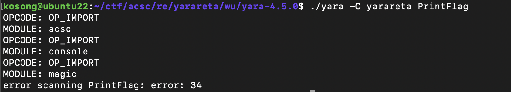<figcaption><p>run modified yara</p></figcaption></figure>

Now it has different error but in same opcode which is `OP_IMPORT`. Failed module to load is `magic` but magic is not custom module. It included in yara source code but not automatically included during basic compilation. From this [reference](https://yara.readthedocs.io/en/v3.5.0/gettingstarted.html#compiling-yara), basically we just need to add argument `--enable-magic` when running `configure` script.&#x20;

```bash
sudo apt install libmagic-dev
./configure --enable-magic
make
```

<figure>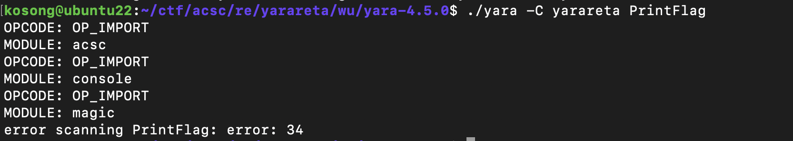<figcaption><p>run modified yara</p></figcaption></figure>

Somehow it still error on me, so i decided to manually modify `module_list` and `Makefile.am`.

<pre class="language-c" data-title="libyara/modules/module_list" data-line-numbers><code class="lang-c">...
#ifdef CUCKOO_MODULE
MODULE(cuckoo)
#endif

<strong>MODULE(magic)
</strong>
#ifdef HASH_MODULE
MODULE(hash)
#endif
...
</code></pre>

* Line 6: uncomment magic module

<pre class="language-c" data-title="Makefile.am" data-line-numbers><code class="lang-c">...
MODULES += libyara/modules/acsc/acsc.c

if CUCKOO_MODULE
MODULES += libyara/modules/cuckoo/cuckoo.c
endif

<strong>MODULES += libyara/modules/magic/magic.c
</strong>
if HASH_MODULE
MODULES += libyara/modules/hash/hash.c
endif
...
</code></pre>

* Line 8: uncomment magic module

Run make command and run yara again.

<figure>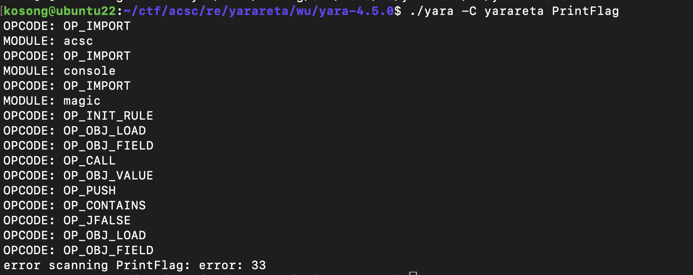<figcaption><p>run modified yara</p></figcaption></figure>

Now there is no error during opcode `OP_IMPORT` but there is an error during opcode `OP_OBJ_FIELD`.



```c
...
case OP_OBJ_FIELD:
      YR_DEBUG_FPRINTF(
          2, stderr, "- case OP_OBJ_FIELD: // %s()\n", __FUNCTION__);

      identifier = yr_unaligned_char_ptr(ip);
      printf("IDENTIFIER: %s\n", identifier);
      ip += sizeof(uint64_t);

#if YR_PARANOID_EXEC
      ensure_within_rules_arena(identifier);
  ...
```



* Line 7: add print identifier

<figure>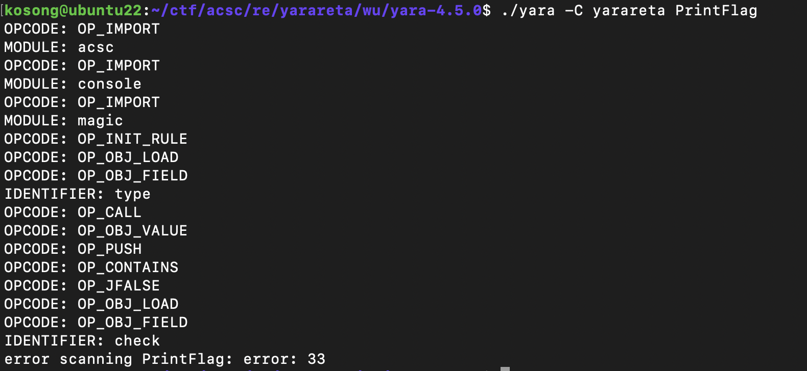<figcaption><p>run modified yara</p></figcaption></figure>

From image above we can see that there is an error caused by `invalid identifier` (identifier not found).  Until this step, we must note there are 2 identifiers shown on image which are `type` and `check`. Besides that, `acsc` and `magic` import process are not error again so those modules should be stored in yara or library. Based on simple check, i found that  `"Hello World!"` from my `acsc` module is stored on `libyara.so.10`.

<figure>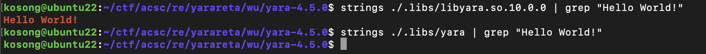<figcaption><p>check string on library</p></figcaption></figure>

Decompiling my own library, it shown that cross reference to "Hello World!" is `acsc__load`

<figure><figcaption><p>string location</p></figcaption></figure>

<figure>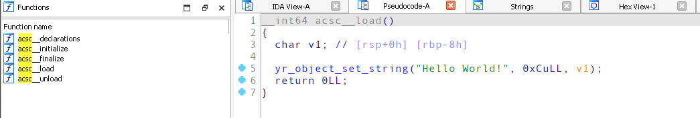<figcaption><p>acsc__load function</p></figcaption></figure>

Searching `acsc` on function name also shown that there are some function named `"acsc_*"` on my libyara.so.10. Lets compare with `magic` module.

<figure>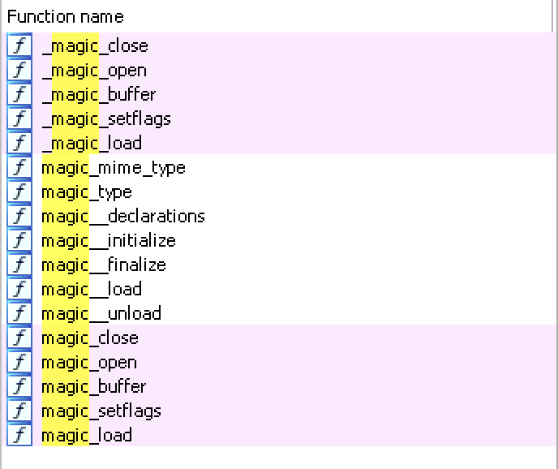<figcaption><p>search function with prefix magic</p></figcaption></figure>

<figure>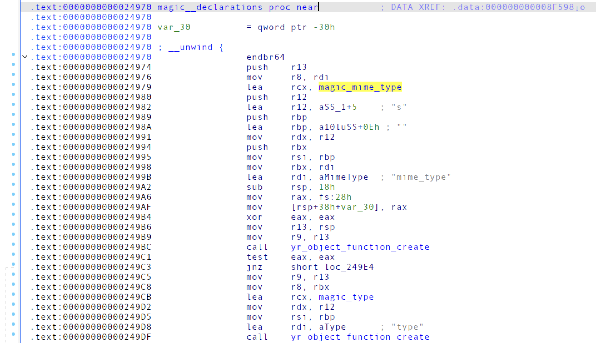<figcaption><p>magic__declarations function</p></figcaption></figure>



```c
...
define_function(magic_mime_type)
{
  YR_SCAN_CONTEXT* context = yr_scan_context();
  YR_MEMORY_BLOCK* block;
  MAGIC_CACHE* cache;

  const uint8_t* block_data;

  if (context->flags & SCAN_FLAGS_PROCESS_MEMORY)
    return_string(YR_UNDEFINED);

  FAIL_ON_ERROR(get_cache(&cache));
...
define_function(magic_type)
{
  MAGIC_CACHE* cache;
  YR_MEMORY_BLOCK* block;
  YR_SCAN_CONTEXT* context = yr_scan_context();

  const uint8_t* block_data;

  if (context->flags & SCAN_FLAGS_PROCESS_MEMORY)
    return_string(YR_UNDEFINED);
...
begin_declarations
  declare_function("mime_type", "", "s", magic_mime_type);
  declare_function("type", "", "s", magic_type);
end_declarations
...
```



We can see that there are 2 functions declaration which are `mime_type` -> `magic_mime_type` and `type` -> `magic_type`. So we can conclude that identifier during `OP_OBJ_FIELD` execution is `function name` or `attribute name` that the rule try to load from library.

```c
import "acsc"
import "magic"

rule TestingAcsc
{
    condition:
        acsc.greeting == "Hello World!"
}

rule TestingMagic
{
    condition:
        magic.type() contains "ELF"
}
```

<figure>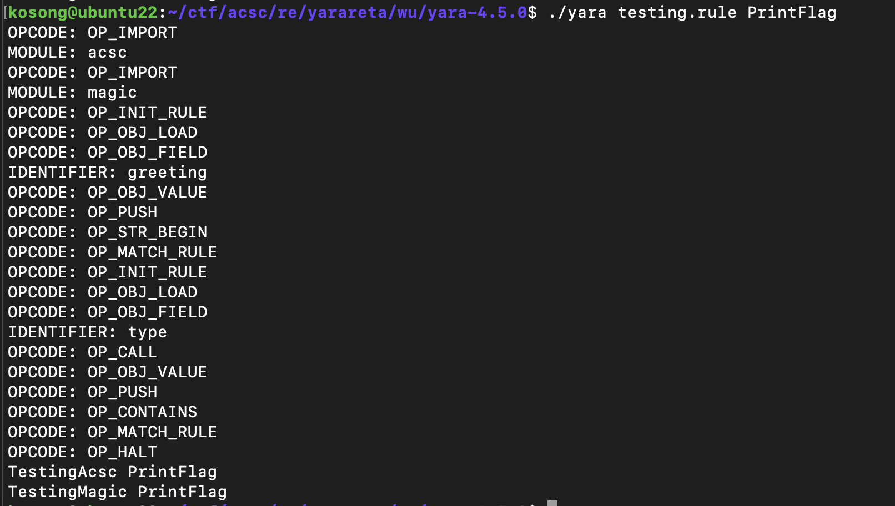<figcaption><p>run modified yara</p></figcaption></figure>

Now take a look on acsc modules inside `libyara.so.10` from the challenge.

<figure>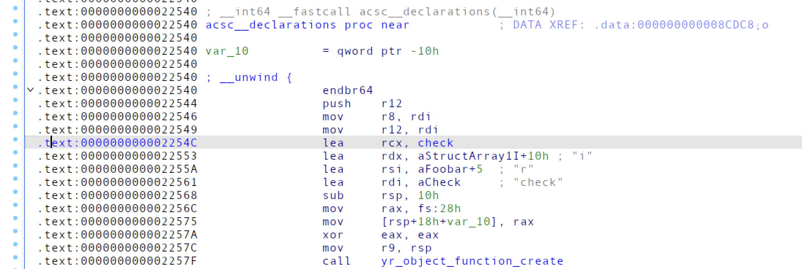<figcaption><p>acsc__declaration function</p></figcaption></figure>

From image above we can reconstruct `declare_function` for `acsc.check` which should be `declare_function("check", "r", "i", check)`.  From this [reference](https://yara.readthedocs.io/en/v3.5.0/writingmodules.html#declaring-functions), we know that the check function take `regex` as argument and use `integer` type for return value. Now, lets write `fake function` for our `fake module`.

```c
...
#define MODULE_NAME acsc

define_function(check)
{
  int result = 0;
  YR_SCAN_CONTEXT* ctx = yr_scan_context();
  
  if (yr_re_match(ctx, regexp_argument(1), "ABCDEFGHIJKLMNOP") > 0) {
        result = 1;
  }
  return_integer(result);
}

begin_declarations
  declare_string("greeting");
  declare_function("check", "r", "i", check);
end_declarations
...
```

Compile with make and run yara again

<figure>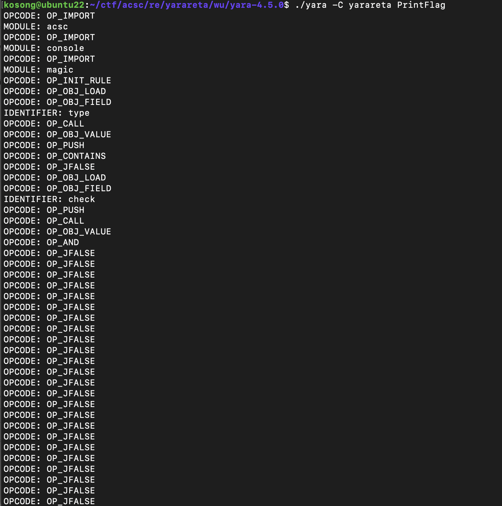<figcaption><p>run modified yara</p></figcaption></figure>

Now there is no error and we can see some branches (`OP_JFALSE`). Before branch, there is `OP_CALL` and `OP_OBJ_VALUE` which indicates calling of function and usage of return value. My assumption is it becomes `false` because the return value from function call is `false`. Lets back to the given library and validate the assumption.

```python
#!/usr/bin/python3

class SolverEquation(gdb.Command):
    def __init__ (self):
        super (SolverEquation, self).__init__ ("solve-equation",gdb.COMMAND_OBSCURE)
    
    def invoke (self, arg, from_tty):        
        gdb.execute("set environment LD_PRELOAD=./libyara.so.10")
        gdb.execute("b yr_scanner_scan_fd")
        gdb.execute("r -C ./yarareta PrintFlag")
        gdb.execute("b *(check+82)")
        gdb.execute("c")
        gdb.execute("del")

def addr2num(addr):
    try:
        return int(addr)  # Python 3
    except:
        return long(addr) # Python 2
SolverEquation()
```

<figure>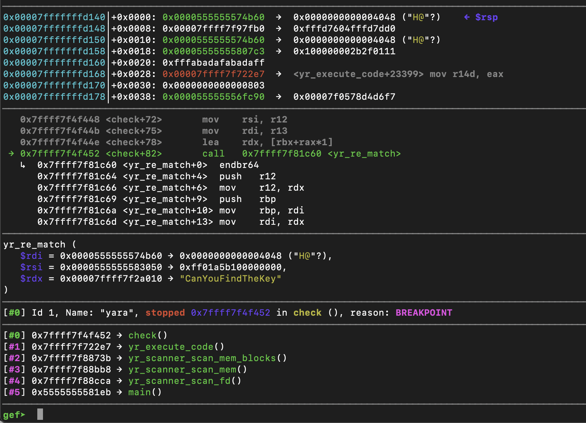<figcaption><p>debug check function</p></figcaption></figure>

<pre class="language-c" data-title="check" data-line-numbers><code class="lang-c">...
return_value = yr_re_match(a2, v8, v11 + integer); // &#x3C;check+82>
    v22 = *(_QWORD *)(a3 + 32);
<strong>    if ( return_value == -1 )
</strong>    {
      if ( *(_BYTE *)(v22 + 4) == 1 )
      {
        v23 = 0;
        return yr_object_set_integer(v23, v22, 0, v19, v20, v21, a7);
      }
      v25 = 23LL;
    }
<strong>    else
</strong>    {
      if ( *(_BYTE *)(v22 + 4) == 1 )
      {
        v23 = 1;
        return yr_object_set_integer(v23, v22, 0, v19, v20, v21, a7);
      }
      v25 = 21LL;
    }
...
</code></pre>

* On check+82 (call yr\_re\_match) we can see each argument value and the last argument is the `key` on PrintFlag (value that will be validated)
* On line 4 we can see that there is checking for return value from yr\_re\_match function.
  * If return value == -1, check will return `0` (v23)
  * else, check will return `1` (v23)

First, lets try to dump the regex value. yr\_re\_match will pass the argument to `yr_re_exec`. `yr_re_exec` will act as VM executor for regex. Each `regex opcode` can be found on `libyara/include/yara/re.h`.



```c
#define RE_NODE_LITERAL            1
#define RE_NODE_MASKED_LITERAL     2
#define RE_NODE_ANY                3
#define RE_NODE_CONCAT             4
#define RE_NODE_ALT                5
#define RE_NODE_RANGE              6
#define RE_NODE_STAR               7
#define RE_NODE_PLUS               8
#define RE_NODE_CLASS              9
#define RE_NODE_WORD_CHAR          10
#define RE_NODE_NON_WORD_CHAR      11
#define RE_NODE_SPACE              12
#define RE_NODE_NON_SPACE          13
#define RE_NODE_DIGIT              14
#define RE_NODE_NON_DIGIT          15
...
```



Lets dump executed regex opcode. Change code below and compile using make.

<pre class="language-c" data-title="libyara/re.c" data-line-numbers><code class="lang-c">...
fiber = fibers.head;

    while (fiber != NULL)
    {
      ip = fiber->ip;
      action = ACTION_NONE;
<strong>      char *regex_name[] = {"UNK", "RE_NODE_LITERAL", "RE_FLAGS_FAST_REGEXP", "RE_NODE_ANY", "RE_FLAGS_BACKWARDS", "RE_NODE_ALT", "RE_NODE_RANGE", "RE_NODE_STAR", "RE_FLAGS_EXHAUSTIVE", "RE_NODE_CLASS", "RE_NODE_WORD_CHAR", "RE_NODE_NON_WORD_CHAR", "RE_NODE_SPACE", "RE_NODE_NON_SPACE", "RE_NODE_DIGIT", "RE_NODE_NON_DIGIT", "RE_FLAGS_WIDE", "RE_NODE_ANCHOR_START", "RE_NODE_ANCHOR_END", "RE_NODE_WORD_BOUNDARY", "RE_NODE_NON_WORD_BOUNDARY", "RE_NODE_RANGE_ANY", "RE_NODE_NOT_LITERAL", "RE_NODE_MASKED_NOT_LITERAL", "UNK", "UNK", "UNK", "UNK", "UNK", "UNK", "UNK", "UNK", "RE_FLAGS_NO_CASE", "UNK", "UNK", "UNK", "UNK", "UNK", "UNK", "UNK", "UNK", "UNK", "UNK", "UNK", "UNK", "UNK", "UNK", "UNK", "UNK", "UNK", "UNK", "UNK", "UNK", "UNK", "UNK", "UNK", "UNK", "UNK", "UNK", "UNK", "UNK", "UNK", "UNK", "UNK", "RE_FLAGS_SCAN", "UNK", "UNK", "UNK", "UNK", "UNK", "UNK", "UNK", "UNK", "UNK", "UNK", "UNK", "UNK", "UNK", "UNK", "UNK", "UNK", "UNK", "UNK", "UNK", "UNK", "UNK", "UNK", "UNK", "UNK", "UNK", "UNK", "UNK", "UNK", "UNK", "UNK", "UNK", "UNK", "UNK", "UNK", "UNK", "UNK", "UNK", "UNK", "UNK", "UNK", "UNK", "UNK", "UNK", "UNK", "UNK", "UNK", "UNK", "UNK", "UNK", "UNK", "UNK", "UNK", "UNK", "UNK", "UNK", "UNK", "UNK", "UNK", "UNK", "UNK", "UNK", "UNK", "UNK", "RE_FLAGS_DOT_ALL", "UNK", "UNK", "UNK", "UNK", "UNK", "UNK", "UNK", "UNK", "UNK", "UNK", "UNK", "UNK", "UNK", "UNK", "UNK", "UNK", "UNK", "UNK", "UNK", "UNK", "UNK", "UNK", "UNK", "UNK", "UNK", "UNK", "UNK", "UNK", "UNK", "UNK", "UNK", "RE_OPCODE_ANY", "UNK", "RE_OPCODE_LITERAL", "UNK", "RE_OPCODE_MASKED_LITERAL", "RE_OPCODE_CLASS", "UNK", "RE_OPCODE_WORD_CHAR", "RE_OPCODE_NON_WORD_CHAR", "RE_OPCODE_SPACE", "RE_OPCODE_NON_SPACE", "RE_OPCODE_DIGIT", "RE_OPCODE_NON_DIGIT", "RE_OPCODE_MATCH", "RE_OPCODE_NOT_LITERAL", "RE_OPCODE_MASKED_NOT_LITERAL", "RE_OPCODE_MATCH_AT_END", "RE_OPCODE_MATCH_AT_START", "RE_OPCODE_WORD_BOUNDARY", "RE_OPCODE_NON_WORD_BOUNDARY", "RE_OPCODE_REPEAT_ANY_GREEDY", "RE_OPCODE_REPEAT_ANY_UNGREEDY", "UNK", "UNK", "UNK", "UNK", "UNK", "UNK", "UNK", "UNK", "UNK", "UNK", "RE_OPCODE_SPLIT_A", "RE_OPCODE_SPLIT_B", "RE_OPCODE_JUMP", "RE_OPCODE_REPEAT_START_GREEDY", "RE_OPCODE_REPEAT_END_GREEDY", "RE_OPCODE_REPEAT_START_UNGREEDY", "RE_OPCODE_REPEAT_END_UNGREEDY", "UNK", "UNK", "UNK", "UNK", "UNK", "UNK", "UNK", "UNK", "UNK", "UNK", "UNK", "UNK", "UNK", "UNK", "UNK", "UNK", "UNK", "UNK", "UNK", "UNK", "UNK", "UNK", "UNK", "UNK", "UNK", "UNK", "UNK", "UNK", "UNK", "UNK", "UNK", "UNK", "UNK", "UNK", "UNK", "UNK", "UNK", "UNK", "UNK", "UNK", "UNK", "UNK", "UNK", "UNK", "UNK", "UNK", "UNK", "UNK", "UNK", "UNK", "UNK", "UNK", "UNK", "UNK", "UNK", "UNK", "UNK"};
</strong><strong>      printf("REGEX: %s\n", regex_name[*ip]);
</strong>      switch (*ip)
      {
      case RE_OPCODE_ANY:
        prolog;
        match = (flags &#x26; RE_FLAGS_DOT_ALL) || (*input != 0x0A);
        action = match ? ACTION_NONE : ACTION_KILL;
        fiber->ip += 1;
        break;

      case RE_OPCODE_REPEAT_ANY_GREEDY:
...
</code></pre>

* Line 8-9: print executed regex opcode.

<figure>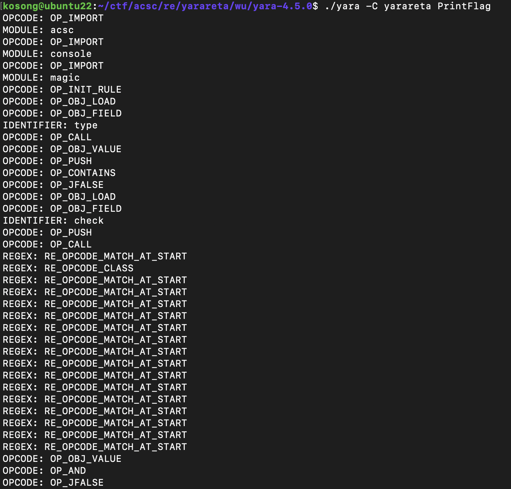<figcaption><p>run modified yara</p></figcaption></figure>

After successfully dump `regex opcode`, next we will try to change the return of `yr_re_match` so the return of check function will be changed also. In this step, we assume that it continue the process if return is `true` (1).

```python
#!/usr/bin/python3


class SolverEquation(gdb.Command):
    def __init__ (self):
        super (SolverEquation, self).__init__ ("solve-equation",gdb.COMMAND_OBSCURE)
    
    def invoke (self, arg, from_tty):        
        gdb.execute("set environment LD_PRELOAD=./libyara.so.10")
        gdb.execute("b yr_scanner_scan_fd")
        gdb.execute("r -C ./yarareta PrintFlag")
        gdb.execute("b *(check+82)")
        gdb.execute("c")

def addr2num(addr):
    try:
        return int(addr)  # Python 3
    except:
        return long(addr) # Python 2
SolverEquation()
```

* Original value returned (0xffffffff)

<figure>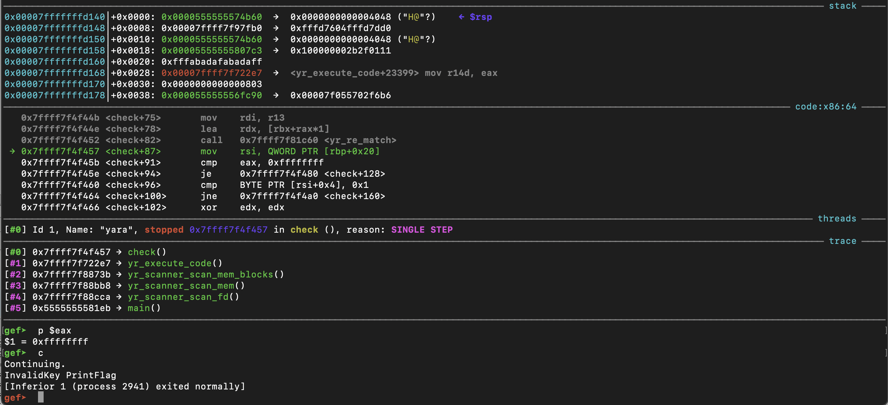<figcaption><p>original flow</p></figcaption></figure>

* Change value returned (to 0x0)

<figure>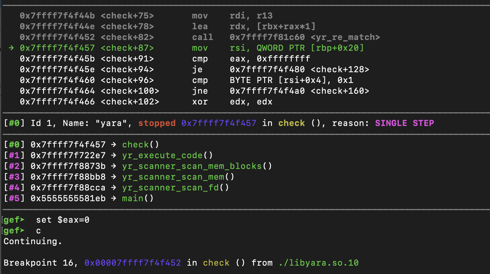<figcaption><p>modified flow</p></figcaption></figure>

My assumption is `correct`, the process will continue if return is `true`. Now create `fake module` always return `true`, so we will know all the regex opcode.

<pre class="language-c" data-title="libyara/modules/acsc/acsc.c" data-line-numbers><code class="lang-c">...
define_function(check)
{
<strong>  int result = 1;
</strong>  YR_SCAN_CONTEXT* ctx = yr_scan_context();
  
  if (yr_re_match(ctx, regexp_argument(1), "ABCDEFGHIJKLMNOP") > 0) {
        result = 1;
  }
  return_integer(result);
}
...
</code></pre>

* Line 4: make result always true

<figure>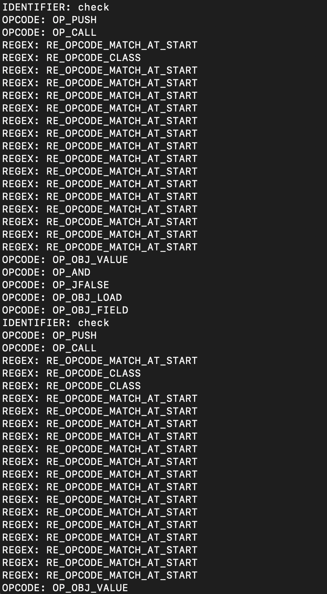<figcaption><p>run modified yara</p></figcaption></figure>

We can see that used regex are `RE_OPCODE_MATCH_AT_START` and `RE_OPCODE_CLASS`. Through searching on testing i found that it was like `^[value]`.

```c
import "acsc"
import "magic"

rule TestingAcsc
{
    condition:
        acsc.check(/^[A-Z]/)
}

rule TestingMagic
{
    condition:
        magic.type() contains "ELF"
}
```

<figure>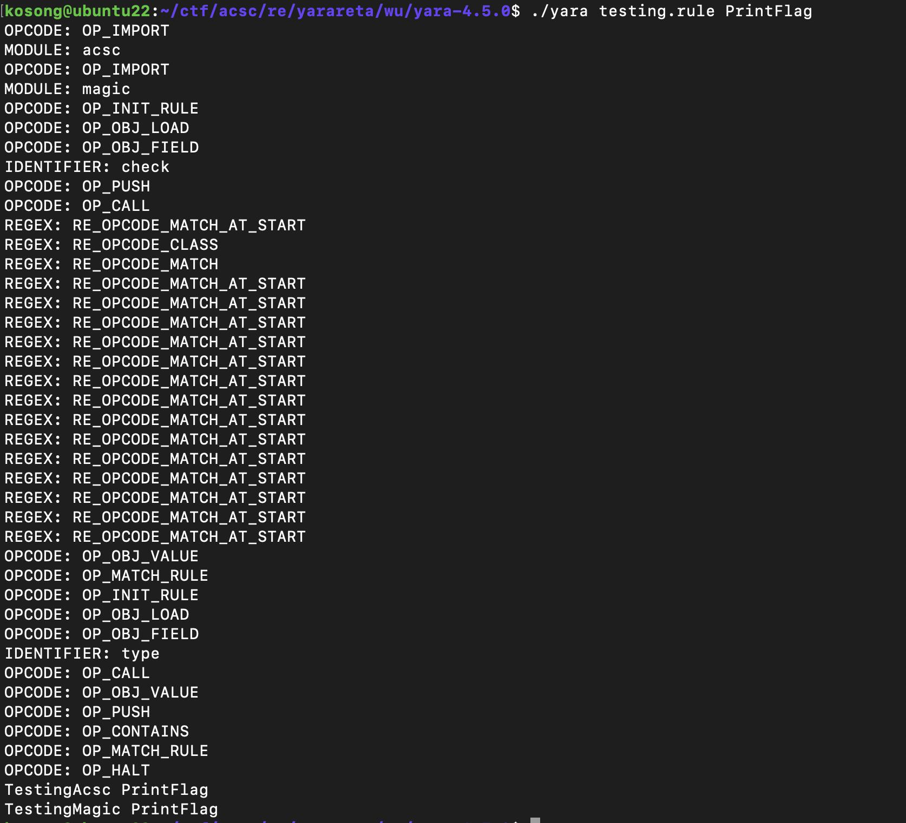<figcaption><p>run modified yara with custom rule</p></figcaption></figure>

Take a look on executed regex opcode, in `RE_OPCODE_CLASS` i found there is call of function `_yr_re_is_char_in_class`.  `_yr_re_is_char_in_class` will validate is it target (chr) in range of class or not. There is also another `flags` such as `case_insensitive` and `negated`. In this step, my idea is try to dump all valid values by bruteforcing value in `CHAR_IN_CLASS` function. Last, to make the regex process continue, hard code the result variable to `1` (always return true).

<pre class="language-c" data-title="libyara/re.c" data-line-numbers><code class="lang-c">...
static bool _yr_re_is_char_in_class(
    RE_CLASS* re_class,
    uint8_t chr,
    int case_insensitive)
{
<strong>  printf("%x valid_char: ", chr);
</strong><strong>  for (int i = 0; i &#x3C; 0x100; ++i)
</strong><strong>  {
</strong><strong>    if CHAR_IN_CLASS(re_class->bitmap, i){
</strong><strong>      printf("%d, ", i);
</strong><strong>    }
</strong><strong>  }
</strong>
  int result = CHAR_IN_CLASS(re_class->bitmap, chr);

  if (case_insensitive){
<strong>    printf("|case_insensitive");
</strong>    result |= CHAR_IN_CLASS(re_class->bitmap, yr_altercase[chr]);
  }

  if (re_class->negated){
<strong>    printf("|negated");
</strong>    result = !result;
  }
  printf("\n");
<strong>  result = 1;
</strong>  return result;
}
...
</code></pre>

* Line 7-13: brute and print valid char and target char
* Line 18: identifier if regex is case insensitive
* Line 23: identifier if regex is negated
* Line 27: make \_yr\_re\_is\_char\_in\_class always return true

<figure>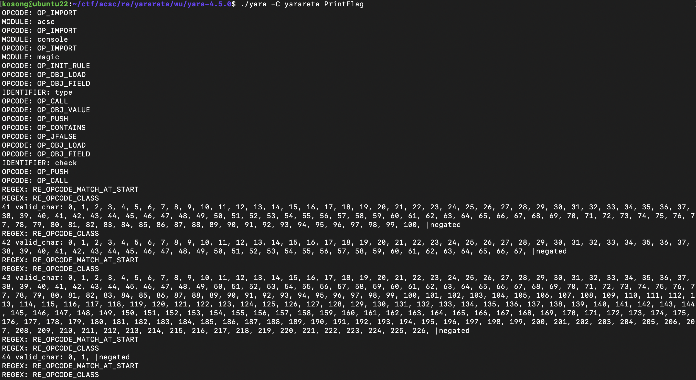<figcaption><p>run modified yara</p></figcaption></figure>

`Negated` means the value should not be in those valid chars. Next, store all dump data to text file and parse it to get the valid key. Because our checked key in fake module is `ABCDEFGHIJKLMNOP` (all different), we can use this to trace what char validated for each regex. After getting the key just decrypt the ciphertext using `AES CBC`.



```python
from Crypto.Cipher import AES

ct = [0x2F, 0x93, 0xF5, 0xA9, 0xD4, 0x7E, 0x84, 0xE1, 0x4C, 0x79, 
  0xB6, 0xCD, 0xEC, 0x7B, 0x15, 0xA1, 0xB0, 0x63, 0x59, 0x06, 
  0x98, 0x23, 0xED, 0x85, 0xDD, 0xE1, 0x3D, 0x13, 0xA3, 0x1C, 
  0x26, 0xF3, 0xB0, 0x6C, 0x37, 0x80, 0x45, 0x17, 0x48, 0x69, 
  0xA0, 0x1D, 0x23, 0x32, 0xCF, 0xDC, 0xCF, 0x86, 0xA7, 0xEC, 
  0x49, 0x30, 0x15, 0x7C, 0xA2, 0x1B, 0x63, 0x0F, 0x90, 0x89, 
  0x21, 0x37, 0xAA, 0x18]
iv = [0xA3,0x9D,0x6C,0xE2,0xD4,0xA6,0x17,0xE1,0x32,0xCC,0x59,0x57,0xFE,0xA3,0x59,0x44]

f = open("dump.txt", "r").read().split("\n")

ori = "ABCDEFGHIJKLMNOP"
poss = [[i for i in range(0x100)] for j in range(len(ori))]

for i in f:
	if "valid_char" in i:
		tmp = i.split(" valid_char: ")
		inp = int(tmp[0], 16)
		index = ori.index(chr(inp))
		if ("negated" in i):
			tmp2 = tmp[1].split(", |negated")[0]
			tmp3 = list(map(int, tmp2.split(", ")))
			for j in tmp3:
				poss[index][j] = 0

key = b""
for i in poss:
	for j in i:
		if(j != 0):
			key += bytes([j])

assert len(key) % 16 == 0

aes = AES.new(key, AES.MODE_CBC, bytes(iv))
print(aes.decrypt(bytes(ct)))
```



<figure><figcaption><p>run solver</p></figcaption></figure>

Flag: ACSC{YaraHasTwoVirtualMachines\_92b2c97ac28dd9fcbdf26ae7a7c906fe}

## Command Runner (250 pts)

### Description

This binary runs your command! Just find a flag file from the server and read it! nc command-runner.chal.2024.ctf.acsc.asia 10801

### Solution

Given 2 files, PNG and ELF.

<figure>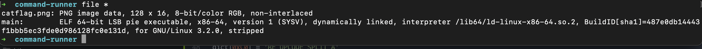<figcaption><p>list files</p></figcaption></figure>

Decompile `ELF` file using IDA.&#x20;

<figure>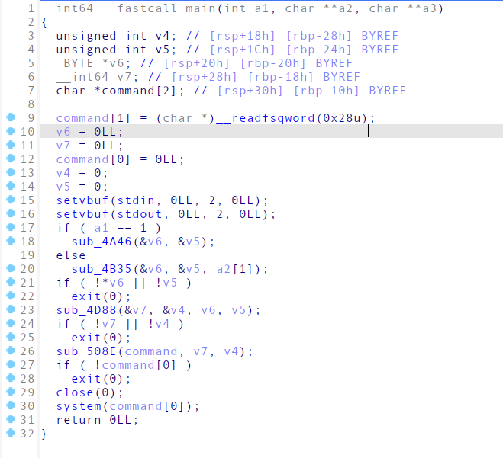<figcaption><p>main function</p></figcaption></figure>

Lets analyze each function

* sub\_4A46

  * If program argument length is `one` (no argument provided), program will read data from `stdin` and store it at `first function argument`.
  *

  <figure>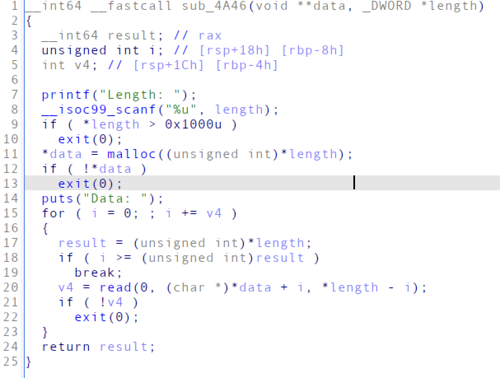<figcaption><p>sub_4a46 function</p></figcaption></figure>
* sub\_4B35

  * If program argument is `not one`, program will use second program argument as `filename` and read the file given. Data read by the program will be stored at `first function argument`.
  *

  <figure>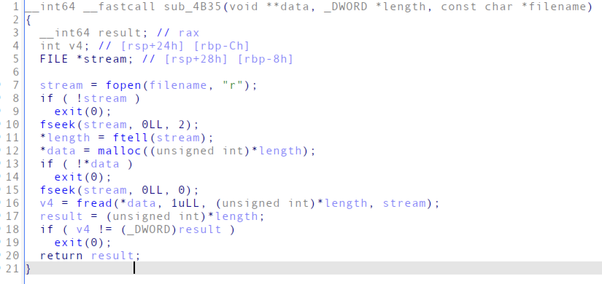<figcaption><p>sub_4b35 function</p></figcaption></figure>
* sub\_4D88

  * There are some well known `PNG chunk` in this function such as `IHDR`, `IDAT`, `IEND` and it is used to compare with `stored data` (third function argument).
  *

  <figure>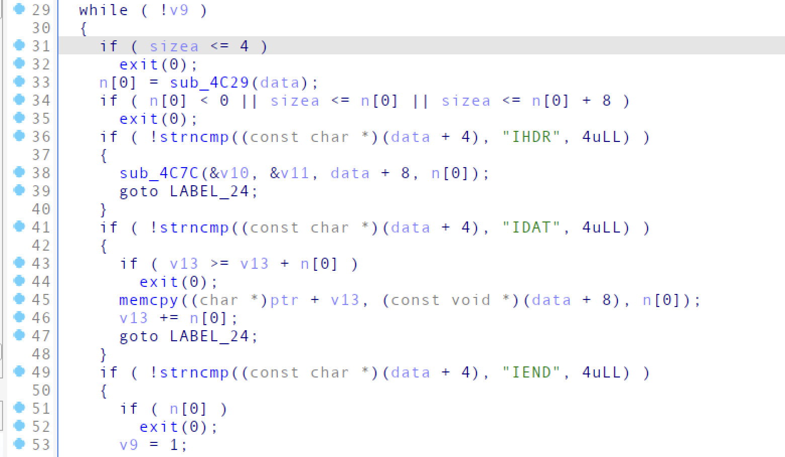<figcaption><p>sub_4d88 function</p></figcaption></figure>
* sub\_508E

  * Compare `&unk_8020 + 32 * m` with `s`. `s` variable constructed from second function argument and third function argument
  * First function argument will store the result and used as argument for command function
  *

  <figure>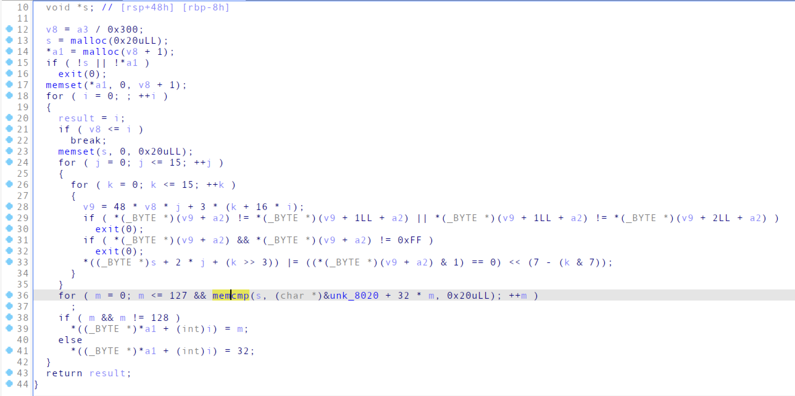<figcaption><p>sub_508e function</p></figcaption></figure>

From overview above, I changed the variable and function names available in main function.

<figure>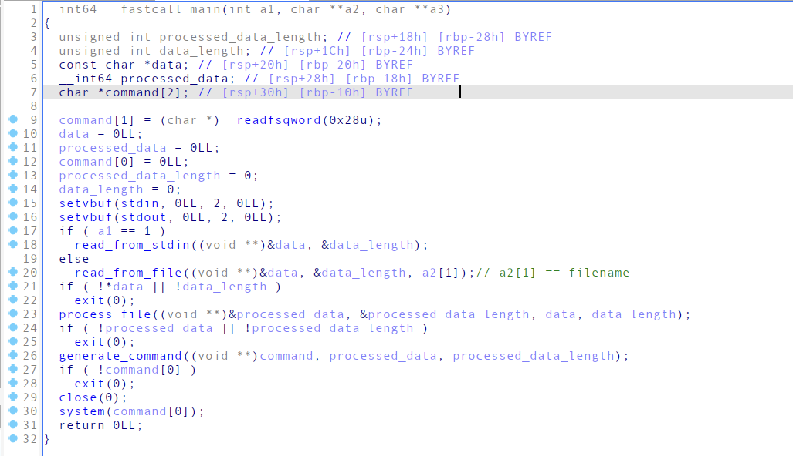<figcaption><p>renamed main function</p></figcaption></figure>

`read_from_stdin` and `read_from_file` are clear. So the next step i do is analyzing `process_file`. Below is initial analysis i did

* Compare extension, must be `.PNG`
* Find chunk `IHDR`, `IDAT`, and `IEND` and process each chunk.&#x20;
  * From this behaviour it looks like `PNG parser` behaviour, so search for a png parser reference. This [reference](https://pyokagan.name/blog/2019-10-14-png/) will help a lot to understanding the parser flow. Remove `assertion` in code to let the program analyze the whole given PNG.
  * sub\_4C7C basically just do assertion to ensure the chunks is a valid IHDR chunk. Besides that it also return `width` and `height` in first and second function argument
    \*

    <figure>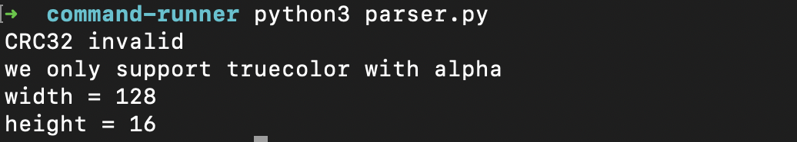<figcaption><p>print width and eight</p></figcaption></figure>

    \*

    <figure>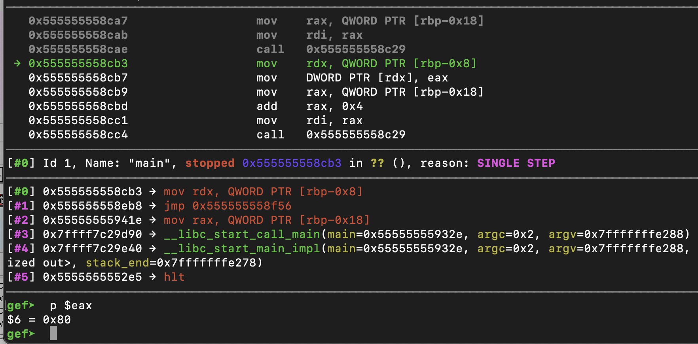<figcaption><p>debug width</p></figcaption></figure>

    \*

    <figure>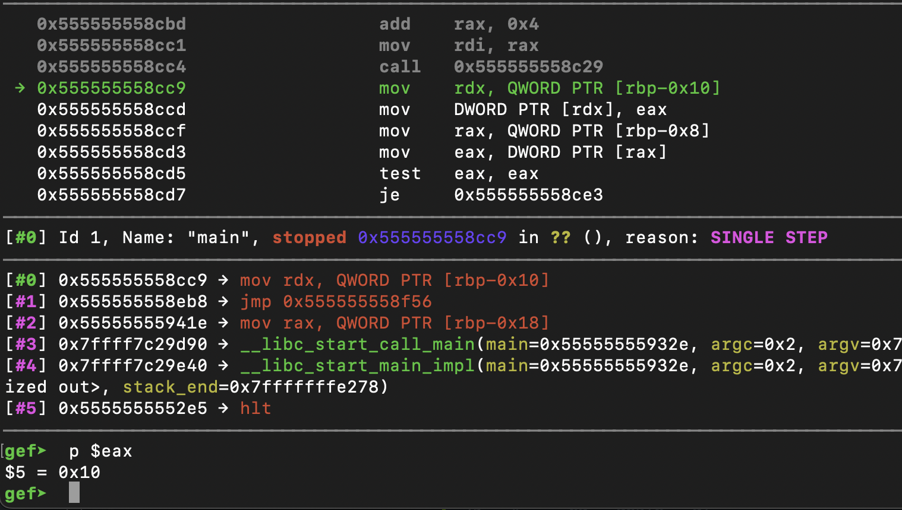<figcaption><p>debug height</p></figcaption></figure>
  * `memcpy` (0x4F12)  is copying IDAT data
    \*

    <figure>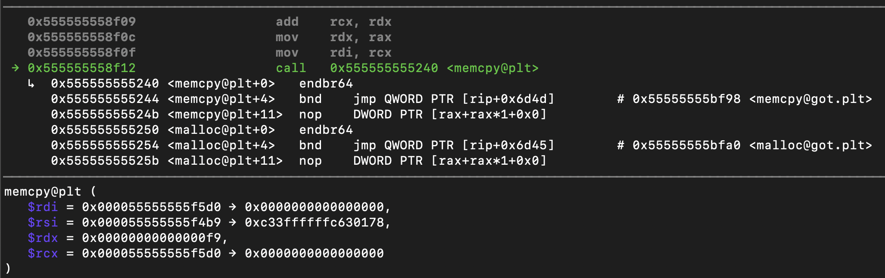<figcaption><p>debug IDAT data</p></figcaption></figure>

    \*

    <figure>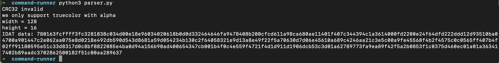<figcaption><p>print IDAT data</p></figcaption></figure>

Rename known data and function, below is the `process_file` function after initial analysis

```c
unsigned __int64 __fastcall process_file(
        void **processed_data,
        _DWORD *processed_data_length,
        const char *a3,
        unsigned int a4)
{
  unsigned int sizea; // [rsp+4h] [rbp-5Ch]
  char *data; // [rsp+8h] [rbp-58h]
  char v9; // [rsp+2Fh] [rbp-31h]
  unsigned int width; // [rsp+30h] [rbp-30h] BYREF
  unsigned int height; // [rsp+34h] [rbp-2Ch] BYREF
  int v12; // [rsp+38h] [rbp-28h] BYREF
  unsigned int IDAT_length; // [rsp+3Ch] [rbp-24h]
  unsigned int width_height; // [rsp+40h] [rbp-20h]
  int n[3]; // [rsp+44h] [rbp-1Ch] BYREF
  void *IDAT_data; // [rsp+50h] [rbp-10h]
  unsigned __int64 v17; // [rsp+58h] [rbp-8h]

  v17 = __readfsqword(0x28u);
  width = 0;
  height = 0;
  v9 = 0;
  if ( a4 <= 8 )
    exit(0);
  if ( strncmp(a3, &s2, 8uLL) )                 // compare extension
    exit(0);
  IDAT_data = malloc(a4);
  IDAT_length = 0;
  if ( !IDAT_data )
    exit(0);
  data = (char *)(a3 + 8);
  sizea = a4 - 8;
  while ( !v9 )
  {
    if ( sizea <= 4 )
      exit(0);
    n[0] = byteswp((unsigned int *)data);
    if ( n[0] < 0 || sizea <= n[0] || sizea <= n[0] + 8 )
      exit(0);
    if ( !strncmp(data + 4, "IHDR", 4uLL) )
    {
      check_valid_ihdr(&width, &height, (__int64)(data + 8), n[0]);
      goto LABEL_24;
    }
    if ( !strncmp(data + 4, "IDAT", 4uLL) )
    {
      if ( IDAT_length >= IDAT_length + n[0] )
        exit(0);
      memcpy((char *)IDAT_data + IDAT_length, data + 8, (unsigned int)n[0]);
      IDAT_length += n[0];
      goto LABEL_24;
    }
    if ( !strncmp(data + 4, "IEND", 4uLL) )
    {
      if ( n[0] )
        exit(0);
      v9 = 1;
LABEL_24:
      data += (unsigned int)(n[0] + 12);
      sizea = sizea - n[0] - 12;
    }
  }
  if ( sizea )
    exit(0);
  width_height = calculate_height_width(width, height, 8);
  *(_QWORD *)&n[1] = 0LL;
  v12 = 0;
  sub_2F82(&n[1], &v12, width_height, (unsigned __int8 *)IDAT_data, IDAT_length);
  if ( !*(_QWORD *)&n[1] || !v12 )
    exit(0);
  free(IDAT_data);
  *processed_data_length = calculate_actual_length(width, height);
  *processed_data = malloc((unsigned int)*processed_data_length);
  if ( !*processed_data )
    exit(0);
  memset(*processed_data, 0, (unsigned int)*processed_data_length);
  sub_4960(*processed_data, *(_QWORD *)&n[1], width, height);
  free(*(void **)&n[1]);
  return v17 - __readfsqword(0x28u);
}
```

Now, lets take a look on `sub_2F82` that process IDAT data.

<figure>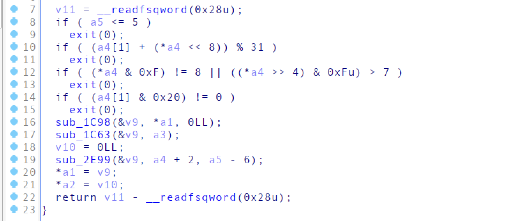<figcaption><p>sub_2f82 function</p></figcaption></figure>

`sub_2F82` consist of so many function call, because the flow looks like PNG parser i tried to find any algorithm that process IDAT data. I used available `constant` (0x6120) on sub\_2933 function to find `similar algorithm`.&#x20;

* <https://github.com/search?q=1%2C+2%2C+3%2C+4%2C+5%2C+7%2C+9%2C+13%2C+17%2C+25%2C+33%2C+49%2C+65%2C+97%2C+129+PNG+idat&type=code>.&#x20;

<figure>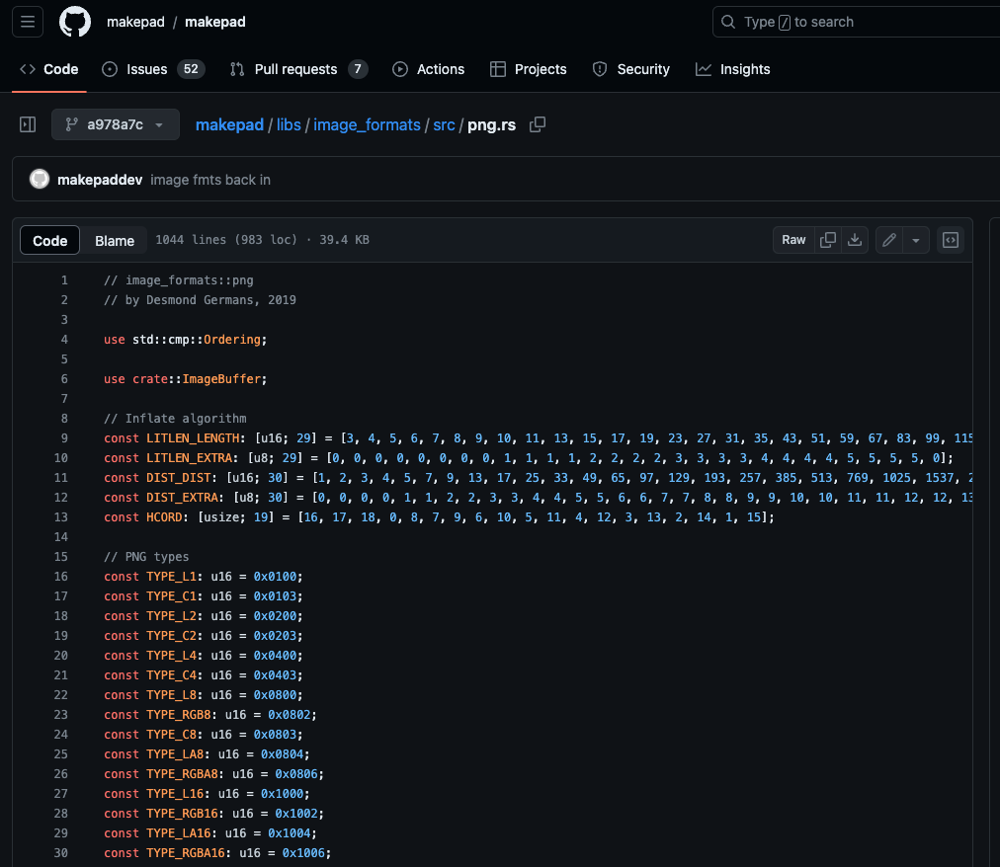<figcaption><p>similar algorithm</p></figcaption></figure>

Looking at the code i found some information, `DIST_DIST` variable processed if `block_type` is `1` or `2`. `Block_type` `1` and `2` used table generated by function `create_huffman_tables`. Function name is `inflate` and from PNG parser script we found previously IDAT data `decompressed` before IDAT data is processed. Search about `inflate/deflate` using `huffman coding` related with PNG i found this [reference](https://www.w3.org/TR/PNG-Compression.html). Detail information about `compression algorithm` can we found at [rfc1951](https://www.ietf.org/rfc/rfc1951.txt).&#x20;

<figure>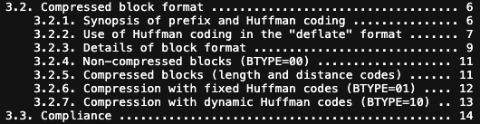<figcaption><p>rfc 1951</p></figcaption></figure>

From `rfc1951`, i found that there are 3 header bits used in decompress process.&#x20;

<figure>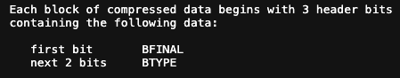<figcaption><p>3 header bits</p></figcaption></figure>

<figure>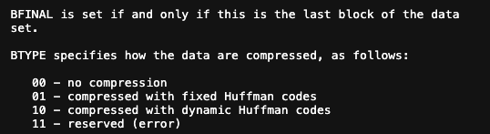<figcaption><p>kind of BTYPE</p></figcaption></figure>

Back to the binary, set breakpoint on first function that process compressed data on `sub_2e99`.

<figure>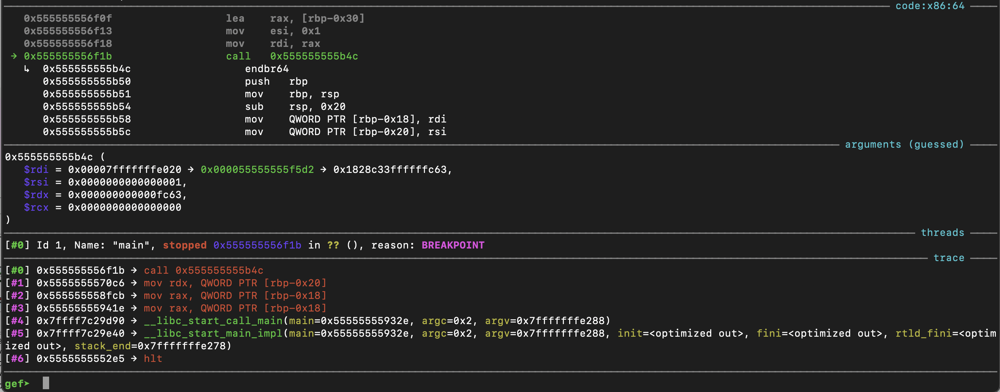<figcaption><p>debug BTYPE (1)</p></figcaption></figure>

<figure>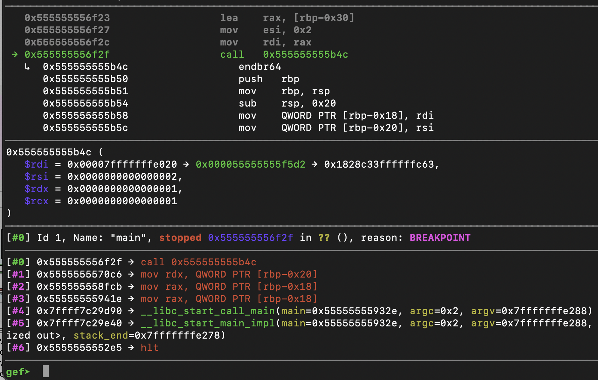<figcaption><p>debug BTYPE (2)</p></figcaption></figure>

* `0x555555556f1b`: process compressed\_data, return eax = 0x1
* `0x555555556f2f`: process compressed\_data, return eax = 0x1

Lets check 3 bits from compressed\_data

<figure><figcaption><p>convert to binary</p></figcaption></figure>

* `bit 1`: 1 -> 1
* `bit 2-3`: 01 -> 1

From above information i know that data those 2 data are `BFINAL` and `BTYPE`, lets rename available function and variable in `sub_2e99`.

<figure>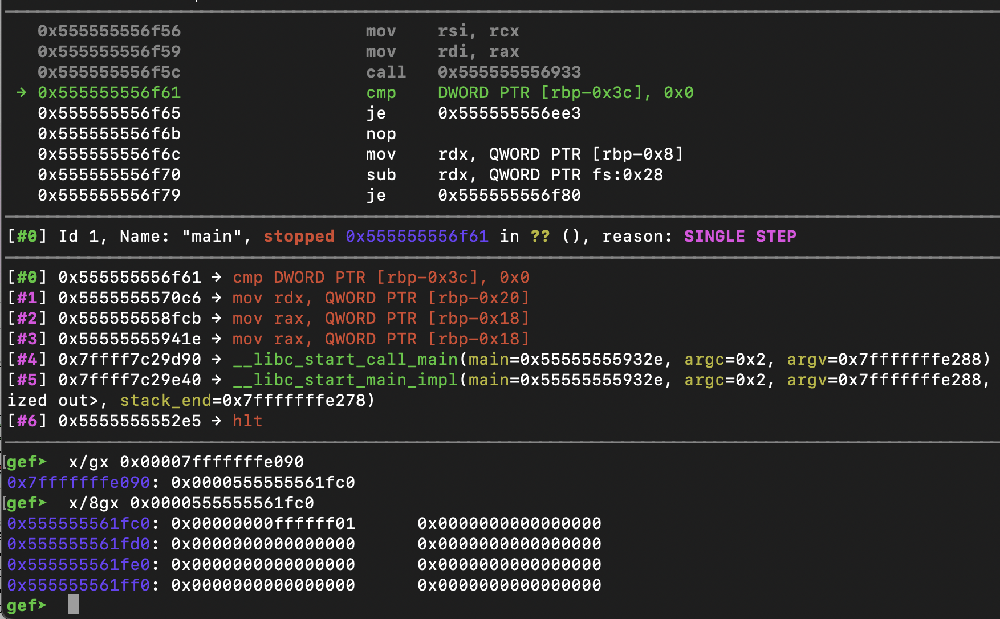<figcaption><p>decompressed data</p></figcaption></figure>

```c
__int64 __fastcall process_idat(__int64 *decompressed_data, __int64 a2, __int64 a3)
{
  __int64 result; // rax
  int BFINAL; // [rsp+24h] [rbp-3Ch]
  int BTYPE; // [rsp+2Ch] [rbp-34h]
  char compressed_data[16]; // [rsp+30h] [rbp-30h] BYREF
  __int64 v7; // [rsp+40h] [rbp-20h]
  __int64 v8; // [rsp+48h] [rbp-18h]
  unsigned __int64 v9; // [rsp+58h] [rbp-8h]

  v9 = __readfsqword(0x28u);
  BFINAL = 0;
  result = sub_1434((__int64)compressed_data, a2, a3);
  while ( !BFINAL )
  {
    if ( (unsigned __int64)(v7 - v8) <= 2 )
      exit(0);
    sub_14F2((__int64)compressed_data);
    BFINAL = read_bits(compressed_data, 1LL);
    BTYPE = read_bits(compressed_data, 2LL);
    if ( (BTYPE & 1) == 0 )
      exit(0);
    result = decompress(decompressed_data, (__int64)compressed_data, BTYPE); // call   0x555555556933
  }
  return result;
}
```

Using GDB, we know that the decompressed data start with `0x00000000ffffff01`. `zlib.decompress` do the same thing with decompress function (sub\_2933).

<figure>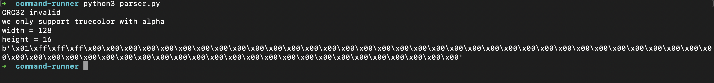<figcaption><p>zlib.decompress </p></figcaption></figure>

Continue the flow, decompressed data will be processed again in function sub\_4960.&#x20;

<figure>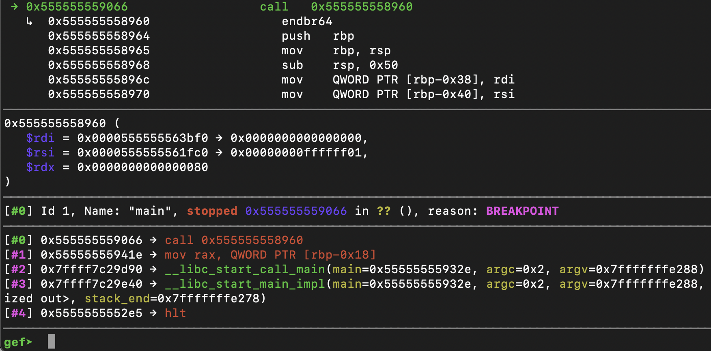<figcaption><p>debug decompressed data (1)</p></figcaption></figure>

<figure>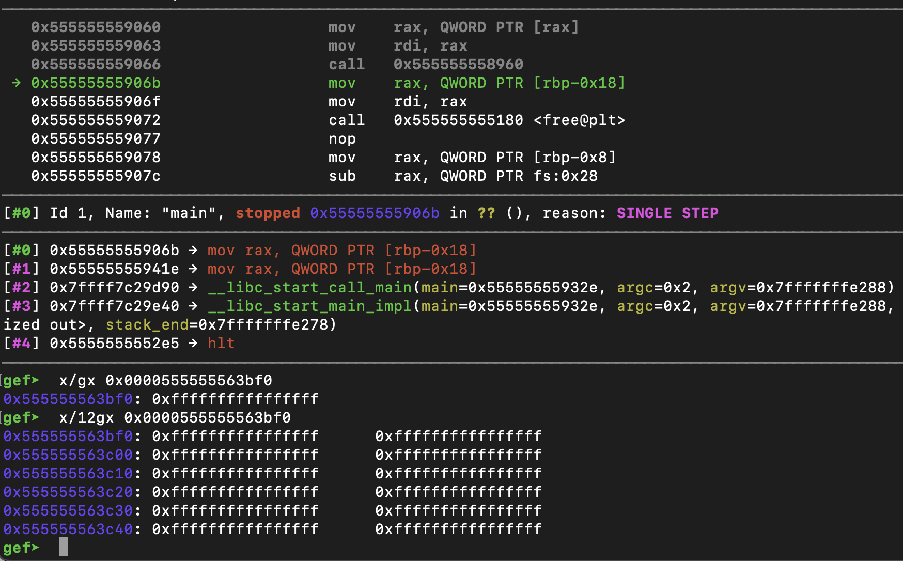<figcaption><p>debug decompressed data (2)</p></figcaption></figure>

`sub_4960` will convert the decompressed data to data with prefix `0xffffffff`. Looking at more data, i found that there is not only `0xffffffff` but there is `0x00000000`. `0xffffffff` and `0x00000000` are well known value in pixel color, which are `white` and `black`. Lets validate using `PIL` module

```python
from PIL import Image

im = Image.open('catflag.png')
pix = im.load()
for i in range(3):
	for j in range(16):
		print(pix[i,j])
```

<figure>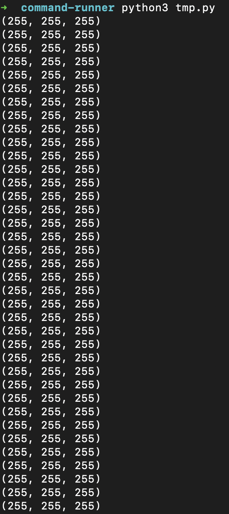<figcaption><p>extract pixel color</p></figcaption></figure>

From image above we can see that a few bytes pixel color is same like in GDB. So i assume that `sub_4960` convert decompressed data to `pixel` value. Continue to next function, `generate_command` (sub\_508E) convert the pixel values to `system` argument (command).

<figure>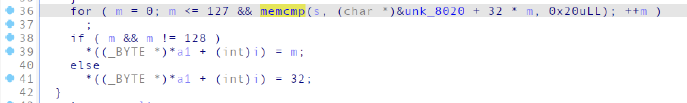<figcaption><p>generate_command function</p></figcaption></figure>

The conversion basically convert the pixel values for each `block` (16x16) to 32 bytes value and validated it with data on `&unk_8020`. Data stored on `&unk_8020` is 32 bytes value for each possible character (0 - 127). Looking at `&unk_8020`, there are 2 cross references wich are decompress and generate\_command function.&#x20;

<figure><figcaption><p>decompress function</p></figcaption></figure>

On `decompress` function, it will check the `third function argument` of decompress. If third function argument is `1` so it will `remove` any mapped 32 bytes on unk\_8020 except for character `"catflg"`. So if we input "ls" picture the program will only detect "l" since the mapped value for "s" on unk\_8020 has been nulled/removed. After understanding program flow, i tried to create script to generate image which contains command we want.

```python
import numpy as np
from PIL import Image

# unk_8020
pix_data = [0x0, 0x0, 0x0, 0x0, 0x0, 0x0, 0x0, 0x0, 0x0, 0x0, 0x0, 0x0, 0x0, 0x0, 0x0, 0x0, 0x0, 0x0, 0x0, 0x0, 0x0, 0x0, 0x0, 0x0, 0x0, 0x0, 0x0, 0x0, 0x0, 0x0, 0x0, 0x0, 0x0, 0x0, 0x0, 0x0, 0x0, 0x0, 0x0, 0x0, 0x0, 0x0, 0x0, 0x0, 0x0, 0x0, 0x0, 0x0, 0x0, 0x0, 0x0, 0x0, 0x0, 0x0, 0x0, 0x0, 0x0, 0x0, 0x0, 0x0, 0x0, 0x0, 0x0, 0x0, 0x0, 0x0, 0x0, 0x0, 0x0, 0x0, 0x0, 0x0, 0x0, 0x0, 0x0, 0x0, 0x0, 0x0, 0x0, 0x0, 0x0, 0x0, 0x0, 0x0, 0x0, 0x0, 0x0, 0x0, 0x0, 0x0, 0x0, 0x0, 0x0, 0x0, 0x0, 0x0, 0x0, 0x0, 0x0, 0x0, 0x0, 0x0, 0x0, 0x0, 0x0, 0x0, 0x0, 0x0, 0x0, 0x0, 0x0, 0x0, 0x0, 0x0, 0x0, 0x0, 0x0, 0x0, 0x0, 0x0, 0x0, 0x0, 0x0, 0x0, 0x0, 0x0, 0x0, 0x0, 0x0, 0x0, 0x0, 0x0, 0x0, 0x0, 0x0, 0x0, 0x0, 0x0, 0x0, 0x0, 0x0, 0x0, 0x0, 0x0, 0x0, 0x0, 0x0, 0x0, 0x0, 0x0, 0x0, 0x0, 0x0, 0x0, 0x0, 0x0, 0x0, 0x0, 0x0, 0x0, 0x0, 0x0, 0x0, 0x0, 0x0, 0x0, 0x0, 0x0, 0x0, 0x0, 0x0, 0x0, 0x0, 0x0, 0x0, 0x0, 0x0, 0x0, 0x0, 0x0, 0x0, 0x0, 0x0, 0x0, 0x0, 0x0, 0x0, 0x0, 0x0, 0x0, 0x0, 0x0, 0x0, 0x0, 0x0, 0x0, 0x0, 0x0, 0x0, 0x0, 0x0, 0x0, 0x0, 0x0, 0x0, 0x0, 0x0, 0x0, 0x0, 0x0, 0x0, 0x0, 0x0, 0x0, 0x0, 0x0, 0x0, 0x0, 0x0, 0x0, 0x0, 0x0, 0x0, 0x0, 0x0, 0x0, 0x0, 0x0, 0x0, 0x0, 0x0, 0x0, 0x0, 0x0, 0x0, 0x0, 0x0, 0x0, 0x0, 0x0, 0x0, 0x0, 0x0, 0x0, 0x0, 0x0, 0x0, 0x0, 0x0, 0x0, 0x0, 0x0, 0x0, 0x0, 0x0, 0x0, 0x0, 0x0, 0x0, 0x0, 0x0, 0x0, 0x0, 0x0, 0x0, 0x0, 0x0, 0x0, 0x0, 0x0, 0x0, 0x0, 0x0, 0x0, 0x0, 0x0, 0x0, 0x0, 0x0, 0x0, 0x0, 0x0, 0x0, 0x0, 0x0, 0x0, 0x0, 0x0, 0x0, 0x0, 0x0, 0x0, 0x0, 0x0, 0x0, 0x0, 0x0, 0x0, 0x0, 0x0, 0x0, 0x0, 0x0, 0x0, 0x0, 0x0, 0x0, 0x0, 0x0, 0x0, 0x0, 0x0, 0x0, 0x0, 0x0, 0x0, 0x0, 0x0, 0x0, 0x0, 0x0, 0x0, 0x0, 0x0, 0x0, 0x0, 0x0, 0x0, 0x0, 0x0, 0x0, 0x0, 0x0, 0x0, 0x0, 0x0, 0x0, 0x0, 0x0, 0x0, 0x0, 0x0, 0x0, 0x0, 0x0, 0x0, 0x0, 0x0, 0x0, 0x0, 0x0, 0x0, 0x0, 0x0, 0x0, 0x0, 0x0, 0x0, 0x0, 0x0, 0x0, 0x0, 0x0, 0x0, 0x0, 0x0, 0x0, 0x0, 0x0, 0x0, 0x0, 0x0, 0x0, 0x0, 0x0, 0x0, 0x0, 0x0, 0x0, 0x0, 0x0, 0x0, 0x0, 0x0, 0x0, 0x0, 0x0, 0x0, 0x0, 0x0, 0x0, 0x0, 0x0, 0x0, 0x0, 0x0, 0x0, 0x0, 0x0, 0x0, 0x0, 0x0, 0x0, 0x0, 0x0, 0x0, 0x0, 0x0, 0x0, 0x0, 0x0, 0x0, 0x0, 0x0, 0x0, 0x0, 0x0, 0x0, 0x0, 0x0, 0x0, 0x0, 0x0, 0x0, 0x0, 0x0, 0x0, 0x0, 0x0, 0x0, 0x0, 0x0, 0x0, 0x0, 0x0, 0x0, 0x0, 0x0, 0x0, 0x0, 0x0, 0x0, 0x0, 0x0, 0x0, 0x0, 0x0, 0x0, 0x0, 0x0, 0x0, 0x0, 0x0, 0x0, 0x0, 0x0, 0x0, 0x0, 0x0, 0x0, 0x0, 0x0, 0x0, 0x0, 0x0, 0x0, 0x0, 0x0, 0x0, 0x0, 0x0, 0x0, 0x0, 0x0, 0x0, 0x0, 0x0, 0x0, 0x0, 0x0, 0x0, 0x0, 0x0, 0x0, 0x0, 0x0, 0x0, 0x0, 0x0, 0x0, 0x0, 0x0, 0x0, 0x0, 0x0, 0x0, 0x0, 0x0, 0x0, 0x0, 0x0, 0x0, 0x0, 0x0, 0x0, 0x0, 0x0, 0x0, 0x0, 0x0, 0x0, 0x0, 0x0, 0x0, 0x0, 0x0, 0x0, 0x0, 0x0, 0x0, 0x0, 0x0, 0x0, 0x0, 0x0, 0x0, 0x0, 0x0, 0x0, 0x0, 0x0, 0x0, 0x0, 0x0, 0x0, 0x0, 0x0, 0x0, 0x0, 0x0, 0x0, 0x0, 0x0, 0x0, 0x0, 0x0, 0x0, 0x0, 0x0, 0x0, 0x0, 0x0, 0x0, 0x0, 0x0, 0x0, 0x0, 0x0, 0x0, 0x0, 0x0, 0x0, 0x0, 0x0, 0x0, 0x0, 0x0, 0x0, 0x0, 0x0, 0x0, 0x0, 0x0, 0x0, 0x0, 0x0, 0x0, 0x0, 0x0, 0x0, 0x0, 0x0, 0x0, 0x0, 0x0, 0x0, 0x0, 0x0, 0x0, 0x0, 0x0, 0x0, 0x0, 0x0, 0x0, 0x0, 0x0, 0x0, 0x0, 0x0, 0x0, 0x0, 0x0, 0x0, 0x0, 0x0, 0x0, 0x0, 0x0, 0x0, 0x0, 0x0, 0x0, 0x0, 0x0, 0x0, 0x0, 0x0, 0x0, 0x0, 0x0, 0x0, 0x0, 0x0, 0x0, 0x0, 0x0, 0x0, 0x0, 0x0, 0x0, 0x0, 0x0, 0x0, 0x0, 0x0, 0x0, 0x0, 0x0, 0x0, 0x0, 0x0, 0x0, 0x0, 0x0, 0x0, 0x0, 0x0, 0x0, 0x0, 0x0, 0x0, 0x0, 0x0, 0x0, 0x0, 0x0, 0x0, 0x0, 0x0, 0x0, 0x0, 0x0, 0x0, 0x0, 0x0, 0x0, 0x0, 0x0, 0x0, 0x0, 0x0, 0x0, 0x0, 0x0, 0x0, 0x0, 0x0, 0x0, 0x0, 0x0, 0x0, 0x0, 0x0, 0x0, 0x0, 0x0, 0x0, 0x0, 0x0, 0x0, 0x0, 0x0, 0x0, 0x0, 0x0, 0x0, 0x0, 0x0, 0x0, 0x0, 0x0, 0x0, 0x0, 0x0, 0x0, 0x0, 0x0, 0x0, 0x0, 0x0, 0x0, 0x0, 0x0, 0x0, 0x0, 0x0, 0x0, 0x0, 0x0, 0x0, 0x0, 0x0, 0x0, 0x0, 0x0, 0x0, 0x0, 0x0, 0x0, 0x0, 0x0, 0x0, 0x0, 0x0, 0x0, 0x0, 0x0, 0x0, 0x0, 0x0, 0x0, 0x0, 0x0, 0x0, 0x0, 0x0, 0x0, 0x0, 0x0, 0x0, 0x0, 0x0, 0x0, 0x0, 0x0, 0x0, 0x0, 0x0, 0x0, 0x0, 0x0, 0x0, 0x0, 0x0, 0x0, 0x0, 0x0, 0x0, 0x0, 0x0, 0x0, 0x0, 0x0, 0x0, 0x0, 0x0, 0x0, 0x0, 0x0, 0x0, 0x0, 0x0, 0x0, 0x0, 0x0, 0x0, 0x0, 0x0, 0x0, 0x0, 0x0, 0x0, 0x0, 0x0, 0x0, 0x0, 0x0, 0x0, 0x0, 0x0, 0x0, 0x0, 0x0, 0x0, 0x0, 0x0, 0x0, 0x0, 0x0, 0x0, 0x0, 0x0, 0x0, 0x0, 0x0, 0x0, 0x0, 0x0, 0x0, 0x0, 0x0, 0x0, 0x0, 0x0, 0x0, 0x0, 0x0, 0x0, 0x0, 0x0, 0x0, 0x0, 0x0, 0x0, 0x0, 0x0, 0x0, 0x0, 0x0, 0x0, 0x0, 0x0, 0x0, 0x0, 0x0, 0x0, 0x0, 0x0, 0x0, 0x0, 0x0, 0x0, 0x0, 0x0, 0x0, 0x0, 0x0, 0x0, 0x0, 0x0, 0x0, 0x0, 0x0, 0x0, 0x0, 0x0, 0x0, 0x0, 0x0, 0x0, 0x0, 0x0, 0x0, 0x0, 0x0, 0x0, 0x0, 0x0, 0x0, 0x0, 0x0, 0x0, 0x0, 0x0, 0x0, 0x0, 0x0, 0x0, 0x0, 0x0, 0x0, 0x0, 0x0, 0x0, 0x0, 0x0, 0x0, 0x0, 0x0, 0x0, 0x0, 0x0, 0x0, 0x0, 0x0, 0x0, 0x0, 0x0, 0x0, 0x0, 0x0, 0x0, 0x0, 0x0, 0x0, 0x0, 0x0, 0x0, 0x0, 0x0, 0x0, 0x0, 0x0, 0x0, 0x0, 0x0, 0x0, 0x0, 0x0, 0x0, 0x0, 0x0, 0x0, 0x0, 0x0, 0x0, 0x0, 0x0, 0x0, 0x0, 0x0, 0x0, 0x0, 0x0, 0x0, 0x0, 0x0, 0x0, 0x0, 0x0, 0x0, 0x0, 0x0, 0x0, 0x0, 0x0, 0x0, 0x0, 0x0, 0x0, 0x0, 0x0, 0x0, 0x0, 0x0, 0x0, 0x0, 0x0, 0x0, 0x0, 0x0, 0x0, 0x0, 0x0, 0x0, 0x0, 0x0, 0x0, 0x0, 0x0, 0x0, 0x0, 0x0, 0x0, 0x0, 0x0, 0x0, 0x0, 0x0, 0x0, 0x0, 0x0, 0x0, 0x0, 0x0, 0x0, 0x0, 0x0, 0x0, 0x0, 0x0, 0x0, 0x0, 0x0, 0x0, 0x0, 0x0, 0x0, 0x0, 0x0, 0x0, 0x0, 0x0, 0x0, 0x0, 0x0, 0x0, 0x0, 0x0, 0x0, 0x0, 0x0, 0x0, 0x0, 0x0, 0x0, 0x0, 0x0, 0x0, 0x0, 0x0, 0x0, 0x0, 0x0, 0x0, 0x0, 0x0, 0x0, 0x0, 0x0, 0x0, 0x0, 0x0, 0x0, 0x0, 0x0, 0x0, 0x0, 0x0, 0x0, 0x0, 0x0, 0x0, 0x0, 0x0, 0x0, 0x0, 0x0, 0x0, 0x0, 0x0, 0x2, 0x0, 0x2, 0x0, 0x2, 0x0, 0x2, 0x0, 0x2, 0x0, 0x2, 0x0, 0x0, 0x0, 0x0, 0x0, 0x0, 0x0, 0x3, 0x0, 0x0, 0x0, 0x0, 0x0, 0x0, 0x0, 0x0, 0x0, 0x0, 0x0, 0x0, 0x0, 0xd, 0x80, 0xd, 0x80, 0x4, 0x80, 0x4, 0x80, 0x4, 0x80, 0x0, 0x0, 0x0, 0x0, 0x0, 0x0, 0x0, 0x0, 0x0, 0x0, 0x0, 0x0, 0x0, 0x0, 0x0, 0x0, 0x0, 0x0, 0x0, 0x0, 0x4, 0x80, 0x5, 0x0, 0x5, 0x0, 0x5, 0x0, 0xf, 0xc0, 0x5, 0x0, 0x1f, 0xc0, 0x5, 0x0, 0x5, 0x0, 0x5, 0x0, 0x5, 0x0, 0x0, 0x0, 0x0, 0x0, 0x0, 0x0, 0x0, 0x0, 0x0, 0x0, 0x2, 0x0, 0x5, 0x80, 0x8, 0x0, 0x8, 0x0, 0x6, 0x0, 0x1, 0x80, 0x0, 0x40, 0x8, 0x40, 0x7, 0x80, 0x2, 0x0, 0x2, 0x0, 0x0, 0x0, 0x0, 0x0, 0x0, 0x0, 0x0, 0x0, 0x0, 0x0, 0x0, 0x0, 0x6, 0x0, 0x9, 0x0, 0x11, 0x0, 0xa, 0x0, 0x4, 0xc0, 0x7, 0x0, 0x9, 0x80, 0x2, 0x40, 0x4, 0x40, 0x3, 0x80, 0x0, 0x0, 0x0, 0x0, 0x0, 0x0, 0x0, 0x0, 0x0, 0x0, 0x0, 0x0, 0x0, 0x0, 0x7, 0x0, 0x8, 0x0, 0x4, 0x0, 0x4, 0x0, 0xa, 0xc0, 0xa, 0x80, 0x9, 0x0, 0xf, 0xc0, 0x0, 0x0, 0x0, 0x0, 0x0, 0x0, 0x0, 0x0, 0x0, 0x0, 0x0, 0x0, 0x0, 0x0, 0x3, 0x0, 0x3, 0x0, 0x3, 0x0, 0x2, 0x0, 0x2, 0x0, 0x0, 0x0, 0x0, 0x0, 0x0, 0x0, 0x0, 0x0, 0x0, 0x0, 0x0, 0x0, 0x0, 0x0, 0x0, 0x0, 0x0, 0x0, 0x0, 0x0, 0x0, 0x0, 0x0, 0x0, 0x0, 0x80, 0x1, 0x0, 0x1, 0x0, 0x1, 0x0, 0x1, 0x0, 0x1, 0x0, 0x1, 0x0, 0x1, 0x0, 0x1, 0x0, 0x0, 0x80, 0x0, 0x80, 0x0, 0x0, 0x0, 0x0, 0x0, 0x0, 0x0, 0x0, 0x8, 0x0, 0x4, 0x0, 0x4, 0x0, 0x4, 0x0, 0x2, 0x0, 0x2, 0x0, 0x2, 0x0, 0x2, 0x0, 0x2, 0x0, 0x4, 0x0, 0x4, 0x0, 0x8, 0x0, 0x0, 0x0, 0x0, 0x0, 0x0, 0x0, 0x0, 0x0, 0x0, 0x0, 0x2, 0x0, 0xa, 0x40, 0x7, 0x80, 0x5, 0x0, 0x4, 0x80, 0x0, 0x0, 0x0, 0x0, 0x0, 0x0, 0x0, 0x0, 0x0, 0x0, 0x0, 0x0, 0x0, 0x0, 0x0, 0x0, 0x0, 0x0, 0x0, 0x0, 0x0, 0x0, 0x2, 0x0, 0x2, 0x0, 0x2, 0x0, 0x1f, 0xc0, 0x2, 0x0, 0x2, 0x0, 0x2, 0x0, 0x0, 0x0, 0x0, 0x0, 0x0, 0x0, 0x0, 0x0, 0x0, 0x0, 0x0, 0x0, 0x0, 0x0, 0x0, 0x0, 0x0, 0x0, 0x0, 0x0, 0x0, 0x0, 0x0, 0x0, 0x0, 0x0, 0x0, 0x0, 0x0, 0x0, 0x6, 0x0, 0x4, 0x0, 0x4, 0x0, 0x8, 0x0, 0x0, 0x0, 0x0, 0x0, 0x0, 0x0, 0x0, 0x0, 0x0, 0x0, 0x0, 0x0, 0x0, 0x0, 0x0, 0x0, 0x0, 0x0, 0x0, 0x0, 0x1f, 0xc0, 0x0, 0x0, 0x0, 0x0, 0x0, 0x0, 0x0, 0x0, 0x0, 0x0, 0x0, 0x0, 0x0, 0x0, 0x0, 0x0, 0x0, 0x0, 0x0, 0x0, 0x0, 0x0, 0x0, 0x0, 0x0, 0x0, 0x0, 0x0, 0x0, 0x0, 0x0, 0x0, 0x0, 0x0, 0x0, 0x0, 0x3, 0x0, 0x3, 0x0, 0x0, 0x0, 0x0, 0x0, 0x0, 0x0, 0x0, 0x0, 0x0, 0x0, 0x0, 0x40, 0x0, 0x80, 0x0, 0x80, 0x1, 0x0, 0x1, 0x0, 0x1, 0x0, 0x2, 0x0, 0x2, 0x0, 0x4, 0x0, 0x4, 0x0, 0x8, 0x0, 0x8, 0x0, 0x0, 0x0, 0x0, 0x0, 0x0, 0x0, 0x0, 0x0, 0x0, 0x0, 0x7, 0x0, 0x8, 0x80, 0x8, 0x40, 0x8, 0x40, 0x8, 0x40, 0x8, 0x40, 0x8, 0x40, 0x8, 0x40, 0x8, 0x80, 0x7, 0x80, 0x0, 0x0, 0x0, 0x0, 0x0, 0x0, 0x0, 0x0, 0x0, 0x0, 0x0, 0x0, 0x2, 0x0, 0x6, 0x0, 0xa, 0x0, 0x2, 0x0, 0x2, 0x0, 0x2, 0x0, 0x2, 0x0, 0x2, 0x0, 0x2, 0x0, 0xf, 0xc0, 0x0, 0x0, 0x0, 0x0, 0x0, 0x0, 0x0, 0x0, 0x0, 0x0, 0x0, 0x0, 0x7, 0x0, 0x8, 0x80, 0x0, 0x40, 0x0, 0x80, 0x0, 0x80, 0x1, 0x0, 0x2, 0x0, 0x4, 0x0, 0x8, 0x40, 0x1f, 0xc0, 0x0, 0x0, 0x0, 0x0, 0x0, 0x0, 0x0, 0x0, 0x0, 0x0, 0x0, 0x0, 0x7, 0x0, 0x8, 0x80, 0x0, 0x40, 0x0, 0x80, 0x3, 0x80, 0x0, 0x80, 0x0, 0x40, 0x0, 0x40, 0x0, 0x40, 0xf, 0x80, 0x0, 0x0, 0x0, 0x0, 0x0, 0x0, 0x0, 0x0, 0x0, 0x0, 0x0, 0x0, 0x1, 0x80, 0x2, 0x80, 0x2, 0x80, 0x4, 0x80, 0x4, 0x80, 0x8, 0x80, 0x8, 0x80, 0x7, 0x80, 0x0, 0x80, 0x3, 0xc0, 0x0, 0x0, 0x0, 0x0, 0x0, 0x0, 0x0, 0x0, 0x0, 0x0, 0x0, 0x0, 0xf, 0x80, 0x8, 0x0, 0x8, 0x0, 0x8, 0x0, 0xf, 0x80, 0x0, 0x40, 0x0, 0x40, 0x0, 0x40, 0x0, 0x40, 0xf, 0x80, 0x0, 0x0, 0x0, 0x0, 0x0, 0x0, 0x0, 0x0, 0x0, 0x0, 0x0, 0x0, 0x1, 0xc0, 0x2, 0x0, 0x4, 0x0, 0x8, 0x0, 0xb, 0x80, 0xc, 0x40, 0x8, 0x40, 0x8, 0x40, 0x4, 0x40, 0x3, 0x80, 0x0, 0x0, 0x0, 0x0, 0x0, 0x0, 0x0, 0x0, 0x0, 0x0, 0x0, 0x0, 0xf, 0xc0, 0x8, 0x40, 0x0, 0x80, 0x0, 0x80, 0x0, 0x80, 0x1, 0x0, 0x1, 0x0, 0x1, 0x0, 0x2, 0x0, 0x2, 0x0, 0x0, 0x0, 0x0, 0x0, 0x0, 0x0, 0x0, 0x0, 0x0, 0x0, 0x0, 0x0, 0x7, 0x0, 0x8, 0x80, 0x8, 0x40, 0x8, 0x80, 0x4, 0x80, 0x7, 0x80, 0x8, 0x40, 0x8, 0x40, 0x8, 0x40, 0x7, 0x80, 0x0, 0x0, 0x0, 0x0, 0x0, 0x0, 0x0, 0x0, 0x0, 0x0, 0x0, 0x0, 0x3, 0x0, 0xc, 0x80, 0x8, 0x40, 0x8, 0x40, 0x8, 0xc0, 0x7, 0xc0, 0x0, 0x40, 0x0, 0x40, 0x0, 0x80, 0xf, 0x0, 0x0, 0x0, 0x0, 0x0, 0x0, 0x0, 0x0, 0x0, 0x0, 0x0, 0x0, 0x0, 0x0, 0x0, 0x0, 0x0, 0x0, 0x0, 0x2, 0x0, 0x3, 0x0, 0x0, 0x0, 0x0, 0x0, 0x0, 0x0, 0x3, 0x0, 0x3, 0x0, 0x0, 0x0, 0x0, 0x0, 0x0, 0x0, 0x0, 0x0, 0x0, 0x0, 0x0, 0x0, 0x0, 0x0, 0x0, 0x0, 0x0, 0x0, 0x2, 0x0, 0x7, 0x0, 0x0, 0x0, 0x0, 0x0, 0x0, 0x0, 0x6, 0x0, 0x6, 0x0, 0x4, 0x0, 0x8, 0x0, 0x0, 0x0, 0x0, 0x0, 0x0, 0x0, 0x0, 0x0, 0x0, 0x0, 0x0, 0x40, 0x1, 0x80, 0x6, 0x0, 0x18, 0x0, 0xc, 0x0, 0x3, 0x0, 0x0, 0xc0, 0x0, 0x0, 0x0, 0x0, 0x0, 0x0, 0x0, 0x0, 0x0, 0x0, 0x0, 0x0, 0x0, 0x0, 0x0, 0x0, 0x0, 0x0, 0x0, 0x0, 0x0, 0x0, 0x0, 0x0, 0x1f, 0xe0, 0x0, 0x0, 0x1f, 0xe0, 0x0, 0x0, 0x0, 0x0, 0x0, 0x0, 0x0, 0x0, 0x0, 0x0, 0x0, 0x0, 0x0, 0x0, 0x0, 0x0, 0x0, 0x0, 0x0, 0x0, 0x8, 0x0, 0x6, 0x0, 0x1, 0x80, 0x0, 0x40, 0x1, 0x80, 0x2, 0x0, 0xc, 0x0, 0x0, 0x0, 0x0, 0x0, 0x0, 0x0, 0x0, 0x0, 0x0, 0x0, 0x0, 0x0, 0x0, 0x0, 0x0, 0x0, 0xf, 0x80, 0x8, 0x40, 0x0, 0x40, 0x0, 0x80, 0x1, 0x0, 0x2, 0x0, 0x0, 0x0, 0x0, 0x0, 0x3, 0x0, 0x0, 0x0, 0x0, 0x0, 0x0, 0x0, 0x0, 0x0, 0x0, 0x0, 0x0, 0x0, 0x0, 0x0, 0x7, 0x0, 0x8, 0x80, 0x8, 0x80, 0x8, 0x80, 0xb, 0x80, 0xa, 0x80, 0xa, 0x80, 0x9, 0xc0, 0x8, 0x0, 0x8, 0x0, 0x7, 0x80, 0x0, 0x0, 0x0, 0x0, 0x0, 0x0, 0x0, 0x0, 0x0, 0x0, 0xe, 0x0, 0x5, 0x0, 0x5, 0x0, 0x4, 0x80, 0x8, 0x80, 0xf, 0x80, 0x10, 0x40, 0x10, 0x40, 0x38, 0xe0, 0x0, 0x0, 0x0, 0x0, 0x0, 0x0, 0x0, 0x0, 0x0, 0x0, 0x0, 0x0, 0x0, 0x0, 0x1f, 0x80, 0x8, 0x40, 0x8, 0x40, 0x8, 0x40, 0xf, 0x80, 0x8, 0x40, 0x8, 0x20, 0x8, 0x40, 0x1f, 0xc0, 0x0, 0x0, 0x0, 0x0, 0x0, 0x0, 0x0, 0x0, 0x0, 0x0, 0x0, 0x0, 0x0, 0x0, 0x7, 0xc0, 0x8, 0x40, 0x10, 0x0, 0x10, 0x0, 0x10, 0x0, 0x10, 0x0, 0x10, 0x0, 0x8, 0x40, 0x7, 0x80, 0x0, 0x0, 0x0, 0x0, 0x0, 0x0, 0x0, 0x0, 0x0, 0x0, 0x0, 0x0, 0x0, 0x0, 0x1f, 0x0, 0x10, 0xc0, 0x10, 0x40, 0x10, 0x40, 0x10, 0x40, 0x10, 0x40, 0x10, 0x40, 0x10, 0x40, 0x1f, 0x80, 0x0, 0x0, 0x0, 0x0, 0x0, 0x0, 0x0, 0x0, 0x0, 0x0, 0x0, 0x0, 0x0, 0x0, 0x1f, 0xc0, 0x8, 0x40, 0x8, 0x40, 0x9, 0x0, 0xf, 0x0, 0x9, 0x0, 0x8, 0x0, 0x8, 0x40, 0x1f, 0xc0, 0x0, 0x0, 0x0, 0x0, 0x0, 0x0, 0x0, 0x0, 0x0, 0x0, 0x0, 0x0, 0x0, 0x0, 0x1f, 0xc0, 0x8, 0x40, 0x8, 0x0, 0x9, 0x0, 0xf, 0x0, 0x9, 0x0, 0x8, 0x0, 0x8, 0x0, 0x1e, 0x0, 0x0, 0x0, 0x0, 0x0, 0x0, 0x0, 0x0, 0x0, 0x0, 0x0, 0x0, 0x0, 0x0, 0x0, 0x7, 0xc0, 0x8, 0x40, 0x10, 0x0, 0x10, 0x0, 0x10, 0x0, 0x11, 0xe0, 0x10, 0x40, 0x10, 0x40, 0xf, 0xc0, 0x0, 0x0, 0x0, 0x0, 0x0, 0x0, 0x0, 0x0, 0x0, 0x0, 0x0, 0x0, 0x0, 0x0, 0x1c, 0xc0, 0x8, 0x40, 0x8, 0x40, 0x8, 0x40, 0xf, 0xc0, 0x8, 0x40, 0x8, 0x40, 0x8, 0x40, 0x1c, 0xe0, 0x0, 0x0, 0x0, 0x0, 0x0, 0x0, 0x0, 0x0, 0x0, 0x0, 0x0, 0x0, 0x0, 0x0, 0xf, 0xc0, 0x2, 0x0, 0x2, 0x0, 0x2, 0x0, 0x2, 0x0, 0x2, 0x0, 0x2, 0x0, 0x2, 0x0, 0xf, 0xc0, 0x0, 0x0, 0x0, 0x0, 0x0, 0x0, 0x0, 0x0, 0x0, 0x0, 0x0, 0x0, 0x0, 0x0, 0x3, 0xe0, 0x0, 0x80, 0x0, 0x80, 0x0, 0x80, 0x0, 0x80, 0x10, 0x80, 0x10, 0x80, 0x10, 0x80, 0xf, 0x0, 0x0, 0x0, 0x0, 0x0, 0x0, 0x0, 0x0, 0x0, 0x0, 0x0, 0x0, 0x0, 0x0, 0x0, 0x1c, 0xe0, 0x8, 0x80, 0x9, 0x0, 0xa, 0x0, 0xf, 0x0, 0x8, 0x80, 0x8, 0x80, 0x8, 0x80, 0x1c, 0x60, 0x0, 0x0, 0x0, 0x0, 0x0, 0x0, 0x0, 0x0, 0x0, 0x0, 0x0, 0x0, 0x0, 0x0, 0x1f, 0x0, 0x4, 0x0, 0x4, 0x0, 0x4, 0x0, 0x4, 0x0, 0x4, 0x20, 0x4, 0x20, 0x4, 0x20, 0x1f, 0xe0, 0x0, 0x0, 0x0, 0x0, 0x0, 0x0, 0x0, 0x0, 0x0, 0x0, 0x0, 0x0, 0x0, 0x0, 0x38, 0x60, 0x18, 0xa0, 0x18, 0xa0, 0x15, 0x20, 0x15, 0x20, 0x13, 0x20, 0x10, 0x20, 0x10, 0x20, 0x38, 0xe0, 0x0, 0x0, 0x0, 0x0, 0x0, 0x0, 0x0, 0x0, 0x0, 0x0, 0x0, 0x0, 0x0, 0x0, 0x38, 0xe0, 0x18, 0x40, 0x14, 0x40, 0x12, 0x40, 0x12, 0x40, 0x11, 0x40, 0x11, 0x40, 0x10, 0xc0, 0x1c, 0x40, 0x0, 0x0, 0x0, 0x0, 0x0, 0x0, 0x0, 0x0, 0x0, 0x0, 0x0, 0x0, 0x0, 0x0, 0x7, 0x80, 0x8, 0x40, 0x10, 0x40, 0x10, 0x20, 0x10, 0x20, 0x10, 0x20, 0x10, 0x40, 0x8, 0x40, 0x7, 0x80, 0x0, 0x0, 0x0, 0x0, 0x0, 0x0, 0x0, 0x0, 0x0, 0x0, 0x0, 0x0, 0x0, 0x0, 0x1f, 0x80, 0x8, 0x40, 0x8, 0x40, 0x8, 0x40, 0x8, 0x80, 0xf, 0x0, 0x8, 0x0, 0x8, 0x0, 0x1e, 0x0, 0x0, 0x0, 0x0, 0x0, 0x0, 0x0, 0x0, 0x0, 0x0, 0x0, 0x0, 0x0, 0x0, 0x0, 0x7, 0x80, 0x8, 0x40, 0x10, 0x40, 0x10, 0x20, 0x10, 0x20, 0x10, 0x20, 0x10, 0x40, 0x8, 0x40, 0x4, 0x80, 0x3, 0x0, 0xd, 0xc0, 0x0, 0x0, 0x0, 0x0, 0x0, 0x0, 0x0, 0x0, 0x0, 0x0, 0x1f, 0x80, 0x8, 0x40, 0x8, 0x40, 0x8, 0x40, 0xf, 0x80, 0x8, 0x80, 0x8, 0x80, 0x8, 0x40, 0x1c, 0x20, 0x0, 0x0, 0x0, 0x0, 0x0, 0x0, 0x0, 0x0, 0x0, 0x0, 0x0, 0x0, 0x0, 0x0, 0x7, 0xc0, 0x8, 0x40, 0x8, 0x0, 0x8, 0x0, 0x7, 0x80, 0x0, 0x40, 0x0, 0x40, 0x10, 0x40, 0x1f, 0x80, 0x0, 0x0, 0x0, 0x0, 0x0, 0x0, 0x0, 0x0, 0x0, 0x0, 0x0, 0x0, 0x0, 0x0, 0x1f, 0xc0, 0x12, 0x40, 0x2, 0x0, 0x2, 0x0, 0x2, 0x0, 0x2, 0x0, 0x2, 0x0, 0x2, 0x0, 0xf, 0x80, 0x0, 0x0, 0x0, 0x0, 0x0, 0x0, 0x0, 0x0, 0x0, 0x0, 0x0, 0x0, 0x0, 0x0, 0x1c, 0xe0, 0x10, 0x40, 0x10, 0x40, 0x10, 0x40, 0x10, 0x40, 0x10, 0x40, 0x10, 0x40, 0x8, 0x40, 0x7, 0x80, 0x0, 0x0, 0x0, 0x0, 0x0, 0x0, 0x0, 0x0, 0x0, 0x0, 0x0, 0x0, 0x0, 0x0, 0x38, 0xe0, 0x10, 0x40, 0x10, 0x40, 0x8, 0x80, 0x8, 0x80, 0x4, 0x80, 0x5, 0x0, 0x5, 0x0, 0x2, 0x0, 0x0, 0x0, 0x0, 0x0, 0x0, 0x0, 0x0, 0x0, 0x0, 0x0, 0x0, 0x0, 0x0, 0x0, 0x3c, 0xe0, 0x10, 0x20, 0x12, 0x40, 0x13, 0x40, 0x15, 0x40, 0x15, 0x40, 0x14, 0xc0, 0x18, 0xc0, 0x8, 0xc0, 0x0, 0x0, 0x0, 0x0, 0x0, 0x0, 0x0, 0x0, 0x0, 0x0, 0x0, 0x0, 0x0, 0x0, 0x18, 0xe0, 0x8, 0x80, 0x4, 0x80, 0x3, 0x0, 0x2, 0x0, 0x5, 0x0, 0x4, 0x80, 0x8, 0x40, 0x1c, 0xe0, 0x0, 0x0, 0x0, 0x0, 0x0, 0x0, 0x0, 0x0, 0x0, 0x0, 0x0, 0x0, 0x0, 0x0, 0x18, 0xe0, 0x8, 0x80, 0x4, 0x80, 0x5, 0x0, 0x2, 0x0, 0x2, 0x0, 0x2, 0x0, 0x2, 0x0, 0xf, 0x80, 0x0, 0x0, 0x0, 0x0, 0x0, 0x0, 0x0, 0x0, 0x0, 0x0, 0x0, 0x0, 0x0, 0x0, 0xf, 0xc0, 0x8, 0x80, 0x9, 0x0, 0x1, 0x0, 0x2, 0x0, 0x4, 0x0, 0x4, 0x40, 0x8, 0x40, 0xf, 0xc0, 0x0, 0x0, 0x0, 0x0, 0x0, 0x0, 0x0, 0x0, 0x0, 0x0, 0x0, 0x0, 0x0, 0x0, 0x3, 0x80, 0x2, 0x0, 0x2, 0x0, 0x2, 0x0, 0x2, 0x0, 0x2, 0x0, 0x2, 0x0, 0x2, 0x0, 0x2, 0x0, 0x2, 0x0, 0x2, 0x0, 0x3, 0x80, 0x0, 0x0, 0x0, 0x0, 0x0, 0x0, 0x0, 0x0, 0x8, 0x0, 0x8, 0x0, 0x4, 0x0, 0x4, 0x0, 0x2, 0x0, 0x2, 0x0, 0x1, 0x0, 0x1, 0x0, 0x0, 0x80, 0x0, 0x80, 0x0, 0x40, 0x0, 0x0, 0x0, 0x0, 0x0, 0x0, 0x0, 0x0, 0x0, 0x0, 0x6, 0x0, 0x2, 0x0, 0x2, 0x0, 0x2, 0x0, 0x2, 0x0, 0x2, 0x0, 0x2, 0x0, 0x2, 0x0, 0x2, 0x0, 0x2, 0x0, 0x2, 0x0, 0x6, 0x0, 0x0, 0x0, 0x0, 0x0, 0x0, 0x0, 0x0, 0x0, 0x0, 0x0, 0x3, 0x0, 0x4, 0x80, 0x8, 0x80, 0x0, 0x0, 0x0, 0x0, 0x0, 0x0, 0x0, 0x0, 0x0, 0x0, 0x0, 0x0, 0x0, 0x0, 0x0, 0x0, 0x0, 0x0, 0x0, 0x0, 0x0, 0x0, 0x0, 0x0, 0x0, 0x0, 0x0, 0x0, 0x0, 0x0, 0x0, 0x0, 0x0, 0x0, 0x0, 0x0, 0x0, 0x0, 0x0, 0x0, 0x0, 0x0, 0x0, 0x0, 0x0, 0x0, 0x3f, 0xf0, 0x0, 0x0, 0x0, 0x0, 0x0, 0x0, 0x4, 0x0, 0x2, 0x0, 0x0, 0x0, 0x0, 0x0, 0x0, 0x0, 0x0, 0x0, 0x0, 0x0, 0x0, 0x0, 0x0, 0x0, 0x0, 0x0, 0x0, 0x0, 0x0, 0x0, 0x0, 0x0, 0x0, 0x0, 0x0, 0x0, 0x0, 0x0, 0x0, 0x0, 0x0, 0x0, 0x0, 0x0, 0x0, 0x0, 0x7, 0x0, 0x8, 0x80, 0x0, 0x80, 0xf, 0x80, 0x10, 0x80, 0x10, 0x80, 0xf, 0x60, 0x0, 0x0, 0x0, 0x0, 0x0, 0x0, 0x0, 0x0, 0x0, 0x0, 0x0, 0x0, 0x30, 0x0, 0x10, 0x0, 0x10, 0x0, 0x13, 0x80, 0xc, 0x40, 0x8, 0x40, 0x10, 0x20, 0x10, 0x20, 0x8, 0x40, 0x37, 0x80, 0x0, 0x0, 0x0, 0x0, 0x0, 0x0, 0x0, 0x0, 0x0, 0x0, 0x0, 0x0, 0x0, 0x0, 0x0, 0x0, 0x0, 0x0, 0x7, 0x80, 0x8, 0x40, 0x10, 0x0, 0x10, 0x0, 0x10, 0x0, 0x8, 0x20, 0x7, 0xc0, 0x0, 0x0, 0x0, 0x0, 0x0, 0x0, 0x0, 0x0, 0x0, 0x0, 0x0, 0x0, 0x0, 0xc0, 0x0, 0x40, 0x0, 0x40, 0x7, 0x40, 0x8, 0xc0, 0x10, 0x40, 0x10, 0x40, 0x10, 0x40, 0x10, 0x40, 0xf, 0xe0, 0x0, 0x0, 0x0, 0x0, 0x0, 0x0, 0x0, 0x0, 0x0, 0x0, 0x0, 0x0, 0x0, 0x0, 0x0, 0x0, 0x0, 0x0, 0x7, 0x0, 0x8, 0xc0, 0x10, 0x40, 0x1f, 0xc0, 0x10, 0x0, 0x10, 0x0, 0xf, 0xc0, 0x0, 0x0, 0x0, 0x0, 0x0, 0x0, 0x0, 0x0, 0x0, 0x0, 0x0, 0x0, 0x1, 0xc0, 0x2, 0x0, 0x4, 0x0, 0xf, 0xc0, 0x4, 0x0, 0x4, 0x0, 0x4, 0x0, 0x4, 0x0, 0x4, 0x0, 0xf, 0xc0, 0x0, 0x0, 0x0, 0x0, 0x0, 0x0, 0x0, 0x0, 0x0, 0x0, 0x0, 0x0, 0x0, 0x0, 0x0, 0x0, 0x0, 0x0, 0x7, 0x60, 0x18, 0xc0, 0x10, 0x40, 0x10, 0x40, 0x10, 0x40, 0x8, 0xc0, 0x7, 0x40, 0x0, 0x40, 0x0, 0x80, 0x7, 0x80, 0x0, 0x0, 0x0, 0x0, 0x0, 0x0, 0x18, 0x0, 0x8, 0x0, 0x8, 0x0, 0xb, 0x80, 0xc, 0x80, 0x8, 0x40, 0x8, 0x40, 0x8, 0x40, 0x8, 0x40, 0x1c, 0xe0, 0x0, 0x0, 0x0, 0x0, 0x0, 0x0, 0x0, 0x0, 0x0, 0x0, 0x0, 0x0, 0x2, 0x0, 0x2, 0x0, 0x0, 0x0, 0xe, 0x0, 0x2, 0x0, 0x2, 0x0, 0x2, 0x0, 0x2, 0x0, 0x2, 0x0, 0xf, 0xc0, 0x0, 0x0, 0x0, 0x0, 0x0, 0x0, 0x0, 0x0, 0x0, 0x0, 0x0, 0x0, 0x1, 0x0, 0x1, 0x0, 0x0, 0x0, 0xf, 0x80, 0x0, 0x80, 0x0, 0x80, 0x0, 0x80, 0x0, 0x80, 0x0, 0x80, 0x0, 0x80, 0x0, 0x80, 0x0, 0x80, 0xf, 0x0, 0x0, 0x0, 0x0, 0x0, 0x0, 0x0, 0x18, 0x0, 0x8, 0x0, 0x8, 0x0, 0x9, 0xc0, 0x9, 0x0, 0xa, 0x0, 0xe, 0x0, 0x9, 0x0, 0x8, 0x80, 0x18, 0xe0, 0x0, 0x0, 0x0, 0x0, 0x0, 0x0, 0x0, 0x0, 0x0, 0x0, 0x0, 0x0, 0xe, 0x0, 0x2, 0x0, 0x2, 0x0, 0x2, 0x0, 0x2, 0x0, 0x2, 0x0, 0x2, 0x0, 0x2, 0x0, 0x2, 0x0, 0xf, 0xc0, 0x0, 0x0, 0x0, 0x0, 0x0, 0x0, 0x0, 0x0, 0x0, 0x0, 0x0, 0x0, 0x0, 0x0, 0x0, 0x0, 0x0, 0x0, 0x3e, 0xc0, 0x13, 0x40, 0x12, 0x20, 0x12, 0x20, 0x12, 0x20, 0x12, 0x20, 0x39, 0x20, 0x0, 0x0, 0x0, 0x0, 0x0, 0x0, 0x0, 0x0, 0x0, 0x0, 0x0, 0x0, 0x0, 0x0, 0x0, 0x0, 0x0, 0x0, 0x1b, 0x80, 0xc, 0x40, 0x8, 0x40, 0x8, 0x40, 0x8, 0x40, 0x8, 0x40, 0x1c, 0xe0, 0x0, 0x0, 0x0, 0x0, 0x0, 0x0, 0x0, 0x0, 0x0, 0x0, 0x0, 0x0, 0x0, 0x0, 0x0, 0x0, 0x0, 0x0, 0x7, 0x80, 0x8, 0x40, 0x10, 0x40, 0x10, 0x40, 0x10, 0x40, 0x10, 0x40, 0xf, 0x80, 0x0, 0x0, 0x0, 0x0, 0x0, 0x0, 0x0, 0x0, 0x0, 0x0, 0x0, 0x0, 0x0, 0x0, 0x0, 0x0, 0x0, 0x0, 0x33, 0x80, 0xc, 0x40, 0x10, 0x20, 0x10, 0x20, 0x8, 0x20, 0x8, 0x40, 0x17, 0x80, 0x10, 0x0, 0x10, 0x0, 0x3c, 0x0, 0x0, 0x0, 0x0, 0x0, 0x0, 0x0, 0x0, 0x0, 0x0, 0x0, 0x0, 0x0, 0x7, 0x60, 0x8, 0xc0, 0x10, 0x40, 0x10, 0x40, 0x10, 0x40, 0x8, 0xc0, 0x7, 0x40, 0x0, 0x40, 0x0, 0x40, 0x1, 0xe0, 0x0, 0x0, 0x0, 0x0, 0x0, 0x0, 0x0, 0x0, 0x0, 0x0, 0x0, 0x0, 0xc, 0xc0, 0x7, 0x0, 0x4, 0x0, 0x4, 0x0, 0x4, 0x0, 0x4, 0x0, 0x1f, 0x80, 0x0, 0x0, 0x0, 0x0, 0x0, 0x0, 0x0, 0x0, 0x0, 0x0, 0x0, 0x0, 0x0, 0x0, 0x0, 0x0, 0x0, 0x0, 0x7, 0x40, 0x8, 0xc0, 0x8, 0x0, 0x7, 0x80, 0x0, 0x40, 0x8, 0x40, 0xf, 0x80, 0x0, 0x0, 0x0, 0x0, 0x0, 0x0, 0x0, 0x0, 0x0, 0x0, 0x0, 0x0, 0x8, 0x0, 0x8, 0x0, 0x1f, 0x80, 0x8, 0x0, 0x8, 0x0, 0x8, 0x0, 0x8, 0x0, 0x8, 0x0, 0x7, 0xc0, 0x0, 0x0, 0x0, 0x0, 0x0, 0x0, 0x0, 0x0, 0x0, 0x0, 0x0, 0x0, 0x0, 0x0, 0x0, 0x0, 0x0, 0x0, 0x0, 0x0, 0x19, 0xc0, 0x8, 0x40, 0x8, 0x40, 0x8, 0x40, 0x8, 0x40, 0x8, 0x40, 0xf, 0xe0, 0x0, 0x0, 0x0, 0x0, 0x0, 0x0, 0x0, 0x0, 0x0, 0x0, 0x0, 0x0, 0x0, 0x0, 0x0, 0x0, 0x0, 0x0, 0x1c, 0xe0, 0x8, 0x40, 0x8, 0x80, 0x8, 0x80, 0x5, 0x0, 0x5, 0x0, 0x3, 0x0, 0x0, 0x0, 0x0, 0x0, 0x0, 0x0, 0x0, 0x0, 0x0, 0x0, 0x0, 0x0, 0x0, 0x0, 0x0, 0x0, 0x0, 0x0, 0x18, 0x60, 0x10, 0x40, 0x12, 0x40, 0x13, 0x40, 0xd, 0x40, 0xd, 0x80, 0xc, 0x80, 0x0, 0x0, 0x0, 0x0, 0x0, 0x0, 0x0, 0x0, 0x0, 0x0, 0x0, 0x0, 0x0, 0x0, 0x0, 0x0, 0x0, 0x0, 0x1c, 0xc0, 0x8, 0x80, 0x5, 0x0, 0x2, 0x0, 0x5, 0x0, 0x8, 0x80, 0x1c, 0xe0, 0x0, 0x0, 0x0, 0x0, 0x0, 0x0, 0x0, 0x0, 0x0, 0x0, 0x0, 0x0, 0x0, 0x0, 0x0, 0x0, 0x0, 0x0, 0x18, 0xe0, 0x8, 0x40, 0x8, 0x80, 0x8, 0x80, 0x5, 0x0, 0x5, 0x0, 0x2, 0x0, 0x2, 0x0, 0x4, 0x0, 0x1e, 0x0, 0x0, 0x0, 0x0, 0x0, 0x0, 0x0, 0x0, 0x0, 0x0, 0x0, 0x0, 0x0, 0xf, 0xc0, 0x8, 0x80, 0x1, 0x0, 0x2, 0x0, 0x4, 0x0, 0x8, 0x40, 0xf, 0xc0, 0x0, 0x0, 0x0, 0x0, 0x0, 0x0, 0x0, 0x0, 0x0, 0x0, 0x0, 0x0, 0x1, 0x80, 0x2, 0x0, 0x2, 0x0, 0x2, 0x0, 0x2, 0x0, 0x2, 0x0, 0x6, 0x0, 0x2, 0x0, 0x2, 0x0, 0x2, 0x0, 0x2, 0x0, 0x1, 0x80, 0x0, 0x0, 0x0, 0x0, 0x0, 0x0, 0x0, 0x0, 0x0, 0x0, 0x2, 0x0, 0x2, 0x0, 0x2, 0x0, 0x2, 0x0, 0x2, 0x0, 0x2, 0x0, 0x2, 0x0, 0x2, 0x0, 0x2, 0x0, 0x2, 0x0, 0x2, 0x0, 0x0, 0x0, 0x0, 0x0, 0x0, 0x0, 0x0, 0x0, 0x4, 0x0, 0x2, 0x0, 0x2, 0x0, 0x2, 0x0, 0x2, 0x0, 0x1, 0x0, 0x1, 0x80, 0x2, 0x0, 0x2, 0x0, 0x2, 0x0, 0x2, 0x0, 0x6, 0x0, 0x0, 0x0, 0x0, 0x0, 0x0, 0x0, 0x0, 0x0, 0x0, 0x0, 0x0, 0x0, 0x0, 0x0, 0x0, 0x0, 0x4, 0x0, 0xa, 0x40, 0x1, 0x80, 0x0, 0x0, 0x0, 0x0, 0x0, 0x0, 0x0, 0x0, 0x0, 0x0, 0x0, 0x0, 0x0, 0x0, 0x0, 0x0, 0x0, 0x0, 0x0, 0x0, 0x0, 0x0, 0x0, 0x0, 0x0, 0x0, 0x0, 0x0, 0x0, 0x0, 0x0, 0x0, 0x0, 0x0, 0x0, 0x0, 0x0, 0x0, 0x0, 0x0, 0x0, 0x0, 0x0, 0x0]

def generate_pixel(inp):
    arr = []
    for i in inp:
        arr.append(bytes(pix_data[i * 32: i * 32 + 32]))
    return arr

target = generate_pixel(b"cat")
arr = []
for tmp in target: # reverse sub_508E
	for i in range(0, len(tmp), 2):
		tmp_data = []
		
		for j in range(8):
			tmp2 = tmp[i] >> (7 - (j & 7)) & 1
			if(tmp2 == 0):
				tmp_data.append([255, 255, 255])
			else:
				tmp_data.append([0, 0, 0])
		
		for j in range(8):
			tmp2 = tmp[i+1] >> (7 - (j & 7)) & 1
			if(tmp2 == 0):
				tmp_data.append([255, 255, 255])
			else:
				tmp_data.append([0, 0, 0])
		arr.append(tmp_data)

new_arr = [[] for _ in range(16)]

for j in range(16):
	for i in range(0, len(arr), len(arr)//len(target)):
		new_arr[j] += arr[i + j]

array = np.array(new_arr, dtype=np.uint8)
image = Image.fromarray(array)
image.save('fix.png')
```

<figure><figcaption><p>generated image</p></figcaption></figure>

When i tried to pass the image to executable, it failed to generate command. When i check decompression process i notice that it use different `BTYPE`.

<figure><figcaption></figcaption></figure>

Looks like the executable only support `BTYPE 1` decompression process, so my idea is try to manually put the pixel data to an image. In this case i tried to find reference how to compress data with the same method like `BTYPE 01`, this [reference](https://stackoverflow.com/questions/69603064/how-to-get-zlib-or-another-library-to-create-type-01-deflate-block) gave much help. Below is compression validation.

```python
import numpy as np
from PIL import Image
import zlib
import struct
from Crypto.Util.number import *

# unk_8020
pix_data = [0x0, 0x0, 0x0, 0x0, 0x0, 0x0, 0x0, 0x0, 0x0, 0x0, 0x0, 0x0, 0x0, 0x0, 0x0, 0x0, 0x0, 0x0, 0x0, 0x0, 0x0, 0x0, 0x0, 0x0, 0x0, 0x0, 0x0, 0x0, 0x0, 0x0, 0x0, 0x0, 0x0, 0x0, 0x0, 0x0, 0x0, 0x0, 0x0, 0x0, 0x0, 0x0, 0x0, 0x0, 0x0, 0x0, 0x0, 0x0, 0x0, 0x0, 0x0, 0x0, 0x0, 0x0, 0x0, 0x0, 0x0, 0x0, 0x0, 0x0, 0x0, 0x0, 0x0, 0x0, 0x0, 0x0, 0x0, 0x0, 0x0, 0x0, 0x0, 0x0, 0x0, 0x0, 0x0, 0x0, 0x0, 0x0, 0x0, 0x0, 0x0, 0x0, 0x0, 0x0, 0x0, 0x0, 0x0, 0x0, 0x0, 0x0, 0x0, 0x0, 0x0, 0x0, 0x0, 0x0, 0x0, 0x0, 0x0, 0x0, 0x0, 0x0, 0x0, 0x0, 0x0, 0x0, 0x0, 0x0, 0x0, 0x0, 0x0, 0x0, 0x0, 0x0, 0x0, 0x0, 0x0, 0x0, 0x0, 0x0, 0x0, 0x0, 0x0, 0x0, 0x0, 0x0, 0x0, 0x0, 0x0, 0x0, 0x0, 0x0, 0x0, 0x0, 0x0, 0x0, 0x0, 0x0, 0x0, 0x0, 0x0, 0x0, 0x0, 0x0, 0x0, 0x0, 0x0, 0x0, 0x0, 0x0, 0x0, 0x0, 0x0, 0x0, 0x0, 0x0, 0x0, 0x0, 0x0, 0x0, 0x0, 0x0, 0x0, 0x0, 0x0, 0x0, 0x0, 0x0, 0x0, 0x0, 0x0, 0x0, 0x0, 0x0, 0x0, 0x0, 0x0, 0x0, 0x0, 0x0, 0x0, 0x0, 0x0, 0x0, 0x0, 0x0, 0x0, 0x0, 0x0, 0x0, 0x0, 0x0, 0x0, 0x0, 0x0, 0x0, 0x0, 0x0, 0x0, 0x0, 0x0, 0x0, 0x0, 0x0, 0x0, 0x0, 0x0, 0x0, 0x0, 0x0, 0x0, 0x0, 0x0, 0x0, 0x0, 0x0, 0x0, 0x0, 0x0, 0x0, 0x0, 0x0, 0x0, 0x0, 0x0, 0x0, 0x0, 0x0, 0x0, 0x0, 0x0, 0x0, 0x0, 0x0, 0x0, 0x0, 0x0, 0x0, 0x0, 0x0, 0x0, 0x0, 0x0, 0x0, 0x0, 0x0, 0x0, 0x0, 0x0, 0x0, 0x0, 0x0, 0x0, 0x0, 0x0, 0x0, 0x0, 0x0, 0x0, 0x0, 0x0, 0x0, 0x0, 0x0, 0x0, 0x0, 0x0, 0x0, 0x0, 0x0, 0x0, 0x0, 0x0, 0x0, 0x0, 0x0, 0x0, 0x0, 0x0, 0x0, 0x0, 0x0, 0x0, 0x0, 0x0, 0x0, 0x0, 0x0, 0x0, 0x0, 0x0, 0x0, 0x0, 0x0, 0x0, 0x0, 0x0, 0x0, 0x0, 0x0, 0x0, 0x0, 0x0, 0x0, 0x0, 0x0, 0x0, 0x0, 0x0, 0x0, 0x0, 0x0, 0x0, 0x0, 0x0, 0x0, 0x0, 0x0, 0x0, 0x0, 0x0, 0x0, 0x0, 0x0, 0x0, 0x0, 0x0, 0x0, 0x0, 0x0, 0x0, 0x0, 0x0, 0x0, 0x0, 0x0, 0x0, 0x0, 0x0, 0x0, 0x0, 0x0, 0x0, 0x0, 0x0, 0x0, 0x0, 0x0, 0x0, 0x0, 0x0, 0x0, 0x0, 0x0, 0x0, 0x0, 0x0, 0x0, 0x0, 0x0, 0x0, 0x0, 0x0, 0x0, 0x0, 0x0, 0x0, 0x0, 0x0, 0x0, 0x0, 0x0, 0x0, 0x0, 0x0, 0x0, 0x0, 0x0, 0x0, 0x0, 0x0, 0x0, 0x0, 0x0, 0x0, 0x0, 0x0, 0x0, 0x0, 0x0, 0x0, 0x0, 0x0, 0x0, 0x0, 0x0, 0x0, 0x0, 0x0, 0x0, 0x0, 0x0, 0x0, 0x0, 0x0, 0x0, 0x0, 0x0, 0x0, 0x0, 0x0, 0x0, 0x0, 0x0, 0x0, 0x0, 0x0, 0x0, 0x0, 0x0, 0x0, 0x0, 0x0, 0x0, 0x0, 0x0, 0x0, 0x0, 0x0, 0x0, 0x0, 0x0, 0x0, 0x0, 0x0, 0x0, 0x0, 0x0, 0x0, 0x0, 0x0, 0x0, 0x0, 0x0, 0x0, 0x0, 0x0, 0x0, 0x0, 0x0, 0x0, 0x0, 0x0, 0x0, 0x0, 0x0, 0x0, 0x0, 0x0, 0x0, 0x0, 0x0, 0x0, 0x0, 0x0, 0x0, 0x0, 0x0, 0x0, 0x0, 0x0, 0x0, 0x0, 0x0, 0x0, 0x0, 0x0, 0x0, 0x0, 0x0, 0x0, 0x0, 0x0, 0x0, 0x0, 0x0, 0x0, 0x0, 0x0, 0x0, 0x0, 0x0, 0x0, 0x0, 0x0, 0x0, 0x0, 0x0, 0x0, 0x0, 0x0, 0x0, 0x0, 0x0, 0x0, 0x0, 0x0, 0x0, 0x0, 0x0, 0x0, 0x0, 0x0, 0x0, 0x0, 0x0, 0x0, 0x0, 0x0, 0x0, 0x0, 0x0, 0x0, 0x0, 0x0, 0x0, 0x0, 0x0, 0x0, 0x0, 0x0, 0x0, 0x0, 0x0, 0x0, 0x0, 0x0, 0x0, 0x0, 0x0, 0x0, 0x0, 0x0, 0x0, 0x0, 0x0, 0x0, 0x0, 0x0, 0x0, 0x0, 0x0, 0x0, 0x0, 0x0, 0x0, 0x0, 0x0, 0x0, 0x0, 0x0, 0x0, 0x0, 0x0, 0x0, 0x0, 0x0, 0x0, 0x0, 0x0, 0x0, 0x0, 0x0, 0x0, 0x0, 0x0, 0x0, 0x0, 0x0, 0x0, 0x0, 0x0, 0x0, 0x0, 0x0, 0x0, 0x0, 0x0, 0x0, 0x0, 0x0, 0x0, 0x0, 0x0, 0x0, 0x0, 0x0, 0x0, 0x0, 0x0, 0x0, 0x0, 0x0, 0x0, 0x0, 0x0, 0x0, 0x0, 0x0, 0x0, 0x0, 0x0, 0x0, 0x0, 0x0, 0x0, 0x0, 0x0, 0x0, 0x0, 0x0, 0x0, 0x0, 0x0, 0x0, 0x0, 0x0, 0x0, 0x0, 0x0, 0x0, 0x0, 0x0, 0x0, 0x0, 0x0, 0x0, 0x0, 0x0, 0x0, 0x0, 0x0, 0x0, 0x0, 0x0, 0x0, 0x0, 0x0, 0x0, 0x0, 0x0, 0x0, 0x0, 0x0, 0x0, 0x0, 0x0, 0x0, 0x0, 0x0, 0x0, 0x0, 0x0, 0x0, 0x0, 0x0, 0x0, 0x0, 0x0, 0x0, 0x0, 0x0, 0x0, 0x0, 0x0, 0x0, 0x0, 0x0, 0x0, 0x0, 0x0, 0x0, 0x0, 0x0, 0x0, 0x0, 0x0, 0x0, 0x0, 0x0, 0x0, 0x0, 0x0, 0x0, 0x0, 0x0, 0x0, 0x0, 0x0, 0x0, 0x0, 0x0, 0x0, 0x0, 0x0, 0x0, 0x0, 0x0, 0x0, 0x0, 0x0, 0x0, 0x0, 0x0, 0x0, 0x0, 0x0, 0x0, 0x0, 0x0, 0x0, 0x0, 0x0, 0x0, 0x0, 0x0, 0x0, 0x0, 0x0, 0x0, 0x0, 0x0, 0x0, 0x0, 0x0, 0x0, 0x0, 0x0, 0x0, 0x0, 0x0, 0x0, 0x0, 0x0, 0x0, 0x0, 0x0, 0x0, 0x0, 0x0, 0x0, 0x0, 0x0, 0x0, 0x0, 0x0, 0x0, 0x0, 0x0, 0x0, 0x0, 0x0, 0x0, 0x0, 0x0, 0x0, 0x0, 0x0, 0x0, 0x0, 0x0, 0x0, 0x0, 0x0, 0x0, 0x0, 0x0, 0x0, 0x0, 0x0, 0x0, 0x0, 0x0, 0x0, 0x0, 0x0, 0x0, 0x0, 0x0, 0x0, 0x0, 0x0, 0x0, 0x0, 0x0, 0x0, 0x0, 0x0, 0x0, 0x0, 0x0, 0x0, 0x0, 0x0, 0x0, 0x0, 0x0, 0x0, 0x0, 0x0, 0x0, 0x0, 0x0, 0x0, 0x0, 0x0, 0x0, 0x0, 0x0, 0x0, 0x0, 0x0, 0x0, 0x0, 0x0, 0x0, 0x0, 0x0, 0x0, 0x0, 0x0, 0x0, 0x0, 0x0, 0x0, 0x0, 0x0, 0x0, 0x0, 0x0, 0x0, 0x0, 0x0, 0x0, 0x0, 0x0, 0x0, 0x0, 0x0, 0x0, 0x0, 0x0, 0x0, 0x0, 0x0, 0x0, 0x0, 0x0, 0x0, 0x0, 0x0, 0x0, 0x0, 0x0, 0x0, 0x0, 0x0, 0x0, 0x0, 0x0, 0x0, 0x0, 0x0, 0x0, 0x0, 0x0, 0x0, 0x0, 0x0, 0x0, 0x0, 0x0, 0x0, 0x0, 0x0, 0x0, 0x0, 0x0, 0x0, 0x0, 0x0, 0x0, 0x0, 0x0, 0x0, 0x0, 0x0, 0x0, 0x0, 0x0, 0x0, 0x0, 0x0, 0x0, 0x0, 0x0, 0x0, 0x0, 0x0, 0x0, 0x0, 0x0, 0x0, 0x0, 0x0, 0x0, 0x0, 0x0, 0x0, 0x0, 0x0, 0x0, 0x0, 0x0, 0x0, 0x0, 0x0, 0x0, 0x0, 0x0, 0x0, 0x0, 0x0, 0x0, 0x0, 0x0, 0x0, 0x0, 0x0, 0x0, 0x0, 0x0, 0x0, 0x0, 0x0, 0x0, 0x0, 0x0, 0x0, 0x0, 0x0, 0x0, 0x0, 0x0, 0x0, 0x0, 0x0, 0x0, 0x0, 0x0, 0x0, 0x0, 0x0, 0x0, 0x0, 0x0, 0x0, 0x0, 0x0, 0x0, 0x0, 0x0, 0x0, 0x0, 0x0, 0x0, 0x0, 0x0, 0x0, 0x0, 0x0, 0x0, 0x0, 0x0, 0x0, 0x0, 0x0, 0x0, 0x0, 0x0, 0x0, 0x0, 0x0, 0x0, 0x0, 0x0, 0x0, 0x0, 0x0, 0x0, 0x0, 0x0, 0x0, 0x0, 0x0, 0x0, 0x0, 0x0, 0x0, 0x0, 0x0, 0x0, 0x0, 0x0, 0x0, 0x0, 0x0, 0x0, 0x0, 0x0, 0x0, 0x0, 0x0, 0x0, 0x0, 0x0, 0x0, 0x0, 0x0, 0x0, 0x0, 0x0, 0x0, 0x0, 0x0, 0x0, 0x0, 0x0, 0x0, 0x0, 0x0, 0x0, 0x0, 0x0, 0x0, 0x0, 0x0, 0x0, 0x0, 0x0, 0x0, 0x0, 0x0, 0x0, 0x0, 0x0, 0x0, 0x0, 0x0, 0x0, 0x0, 0x0, 0x2, 0x0, 0x2, 0x0, 0x2, 0x0, 0x2, 0x0, 0x2, 0x0, 0x2, 0x0, 0x0, 0x0, 0x0, 0x0, 0x0, 0x0, 0x3, 0x0, 0x0, 0x0, 0x0, 0x0, 0x0, 0x0, 0x0, 0x0, 0x0, 0x0, 0x0, 0x0, 0xd, 0x80, 0xd, 0x80, 0x4, 0x80, 0x4, 0x80, 0x4, 0x80, 0x0, 0x0, 0x0, 0x0, 0x0, 0x0, 0x0, 0x0, 0x0, 0x0, 0x0, 0x0, 0x0, 0x0, 0x0, 0x0, 0x0, 0x0, 0x0, 0x0, 0x4, 0x80, 0x5, 0x0, 0x5, 0x0, 0x5, 0x0, 0xf, 0xc0, 0x5, 0x0, 0x1f, 0xc0, 0x5, 0x0, 0x5, 0x0, 0x5, 0x0, 0x5, 0x0, 0x0, 0x0, 0x0, 0x0, 0x0, 0x0, 0x0, 0x0, 0x0, 0x0, 0x2, 0x0, 0x5, 0x80, 0x8, 0x0, 0x8, 0x0, 0x6, 0x0, 0x1, 0x80, 0x0, 0x40, 0x8, 0x40, 0x7, 0x80, 0x2, 0x0, 0x2, 0x0, 0x0, 0x0, 0x0, 0x0, 0x0, 0x0, 0x0, 0x0, 0x0, 0x0, 0x0, 0x0, 0x6, 0x0, 0x9, 0x0, 0x11, 0x0, 0xa, 0x0, 0x4, 0xc0, 0x7, 0x0, 0x9, 0x80, 0x2, 0x40, 0x4, 0x40, 0x3, 0x80, 0x0, 0x0, 0x0, 0x0, 0x0, 0x0, 0x0, 0x0, 0x0, 0x0, 0x0, 0x0, 0x0, 0x0, 0x7, 0x0, 0x8, 0x0, 0x4, 0x0, 0x4, 0x0, 0xa, 0xc0, 0xa, 0x80, 0x9, 0x0, 0xf, 0xc0, 0x0, 0x0, 0x0, 0x0, 0x0, 0x0, 0x0, 0x0, 0x0, 0x0, 0x0, 0x0, 0x0, 0x0, 0x3, 0x0, 0x3, 0x0, 0x3, 0x0, 0x2, 0x0, 0x2, 0x0, 0x0, 0x0, 0x0, 0x0, 0x0, 0x0, 0x0, 0x0, 0x0, 0x0, 0x0, 0x0, 0x0, 0x0, 0x0, 0x0, 0x0, 0x0, 0x0, 0x0, 0x0, 0x0, 0x0, 0x0, 0x0, 0x80, 0x1, 0x0, 0x1, 0x0, 0x1, 0x0, 0x1, 0x0, 0x1, 0x0, 0x1, 0x0, 0x1, 0x0, 0x1, 0x0, 0x0, 0x80, 0x0, 0x80, 0x0, 0x0, 0x0, 0x0, 0x0, 0x0, 0x0, 0x0, 0x8, 0x0, 0x4, 0x0, 0x4, 0x0, 0x4, 0x0, 0x2, 0x0, 0x2, 0x0, 0x2, 0x0, 0x2, 0x0, 0x2, 0x0, 0x4, 0x0, 0x4, 0x0, 0x8, 0x0, 0x0, 0x0, 0x0, 0x0, 0x0, 0x0, 0x0, 0x0, 0x0, 0x0, 0x2, 0x0, 0xa, 0x40, 0x7, 0x80, 0x5, 0x0, 0x4, 0x80, 0x0, 0x0, 0x0, 0x0, 0x0, 0x0, 0x0, 0x0, 0x0, 0x0, 0x0, 0x0, 0x0, 0x0, 0x0, 0x0, 0x0, 0x0, 0x0, 0x0, 0x0, 0x0, 0x2, 0x0, 0x2, 0x0, 0x2, 0x0, 0x1f, 0xc0, 0x2, 0x0, 0x2, 0x0, 0x2, 0x0, 0x0, 0x0, 0x0, 0x0, 0x0, 0x0, 0x0, 0x0, 0x0, 0x0, 0x0, 0x0, 0x0, 0x0, 0x0, 0x0, 0x0, 0x0, 0x0, 0x0, 0x0, 0x0, 0x0, 0x0, 0x0, 0x0, 0x0, 0x0, 0x0, 0x0, 0x6, 0x0, 0x4, 0x0, 0x4, 0x0, 0x8, 0x0, 0x0, 0x0, 0x0, 0x0, 0x0, 0x0, 0x0, 0x0, 0x0, 0x0, 0x0, 0x0, 0x0, 0x0, 0x0, 0x0, 0x0, 0x0, 0x0, 0x0, 0x1f, 0xc0, 0x0, 0x0, 0x0, 0x0, 0x0, 0x0, 0x0, 0x0, 0x0, 0x0, 0x0, 0x0, 0x0, 0x0, 0x0, 0x0, 0x0, 0x0, 0x0, 0x0, 0x0, 0x0, 0x0, 0x0, 0x0, 0x0, 0x0, 0x0, 0x0, 0x0, 0x0, 0x0, 0x0, 0x0, 0x0, 0x0, 0x3, 0x0, 0x3, 0x0, 0x0, 0x0, 0x0, 0x0, 0x0, 0x0, 0x0, 0x0, 0x0, 0x0, 0x0, 0x40, 0x0, 0x80, 0x0, 0x80, 0x1, 0x0, 0x1, 0x0, 0x1, 0x0, 0x2, 0x0, 0x2, 0x0, 0x4, 0x0, 0x4, 0x0, 0x8, 0x0, 0x8, 0x0, 0x0, 0x0, 0x0, 0x0, 0x0, 0x0, 0x0, 0x0, 0x0, 0x0, 0x7, 0x0, 0x8, 0x80, 0x8, 0x40, 0x8, 0x40, 0x8, 0x40, 0x8, 0x40, 0x8, 0x40, 0x8, 0x40, 0x8, 0x80, 0x7, 0x80, 0x0, 0x0, 0x0, 0x0, 0x0, 0x0, 0x0, 0x0, 0x0, 0x0, 0x0, 0x0, 0x2, 0x0, 0x6, 0x0, 0xa, 0x0, 0x2, 0x0, 0x2, 0x0, 0x2, 0x0, 0x2, 0x0, 0x2, 0x0, 0x2, 0x0, 0xf, 0xc0, 0x0, 0x0, 0x0, 0x0, 0x0, 0x0, 0x0, 0x0, 0x0, 0x0, 0x0, 0x0, 0x7, 0x0, 0x8, 0x80, 0x0, 0x40, 0x0, 0x80, 0x0, 0x80, 0x1, 0x0, 0x2, 0x0, 0x4, 0x0, 0x8, 0x40, 0x1f, 0xc0, 0x0, 0x0, 0x0, 0x0, 0x0, 0x0, 0x0, 0x0, 0x0, 0x0, 0x0, 0x0, 0x7, 0x0, 0x8, 0x80, 0x0, 0x40, 0x0, 0x80, 0x3, 0x80, 0x0, 0x80, 0x0, 0x40, 0x0, 0x40, 0x0, 0x40, 0xf, 0x80, 0x0, 0x0, 0x0, 0x0, 0x0, 0x0, 0x0, 0x0, 0x0, 0x0, 0x0, 0x0, 0x1, 0x80, 0x2, 0x80, 0x2, 0x80, 0x4, 0x80, 0x4, 0x80, 0x8, 0x80, 0x8, 0x80, 0x7, 0x80, 0x0, 0x80, 0x3, 0xc0, 0x0, 0x0, 0x0, 0x0, 0x0, 0x0, 0x0, 0x0, 0x0, 0x0, 0x0, 0x0, 0xf, 0x80, 0x8, 0x0, 0x8, 0x0, 0x8, 0x0, 0xf, 0x80, 0x0, 0x40, 0x0, 0x40, 0x0, 0x40, 0x0, 0x40, 0xf, 0x80, 0x0, 0x0, 0x0, 0x0, 0x0, 0x0, 0x0, 0x0, 0x0, 0x0, 0x0, 0x0, 0x1, 0xc0, 0x2, 0x0, 0x4, 0x0, 0x8, 0x0, 0xb, 0x80, 0xc, 0x40, 0x8, 0x40, 0x8, 0x40, 0x4, 0x40, 0x3, 0x80, 0x0, 0x0, 0x0, 0x0, 0x0, 0x0, 0x0, 0x0, 0x0, 0x0, 0x0, 0x0, 0xf, 0xc0, 0x8, 0x40, 0x0, 0x80, 0x0, 0x80, 0x0, 0x80, 0x1, 0x0, 0x1, 0x0, 0x1, 0x0, 0x2, 0x0, 0x2, 0x0, 0x0, 0x0, 0x0, 0x0, 0x0, 0x0, 0x0, 0x0, 0x0, 0x0, 0x0, 0x0, 0x7, 0x0, 0x8, 0x80, 0x8, 0x40, 0x8, 0x80, 0x4, 0x80, 0x7, 0x80, 0x8, 0x40, 0x8, 0x40, 0x8, 0x40, 0x7, 0x80, 0x0, 0x0, 0x0, 0x0, 0x0, 0x0, 0x0, 0x0, 0x0, 0x0, 0x0, 0x0, 0x3, 0x0, 0xc, 0x80, 0x8, 0x40, 0x8, 0x40, 0x8, 0xc0, 0x7, 0xc0, 0x0, 0x40, 0x0, 0x40, 0x0, 0x80, 0xf, 0x0, 0x0, 0x0, 0x0, 0x0, 0x0, 0x0, 0x0, 0x0, 0x0, 0x0, 0x0, 0x0, 0x0, 0x0, 0x0, 0x0, 0x0, 0x0, 0x2, 0x0, 0x3, 0x0, 0x0, 0x0, 0x0, 0x0, 0x0, 0x0, 0x3, 0x0, 0x3, 0x0, 0x0, 0x0, 0x0, 0x0, 0x0, 0x0, 0x0, 0x0, 0x0, 0x0, 0x0, 0x0, 0x0, 0x0, 0x0, 0x0, 0x0, 0x0, 0x2, 0x0, 0x7, 0x0, 0x0, 0x0, 0x0, 0x0, 0x0, 0x0, 0x6, 0x0, 0x6, 0x0, 0x4, 0x0, 0x8, 0x0, 0x0, 0x0, 0x0, 0x0, 0x0, 0x0, 0x0, 0x0, 0x0, 0x0, 0x0, 0x40, 0x1, 0x80, 0x6, 0x0, 0x18, 0x0, 0xc, 0x0, 0x3, 0x0, 0x0, 0xc0, 0x0, 0x0, 0x0, 0x0, 0x0, 0x0, 0x0, 0x0, 0x0, 0x0, 0x0, 0x0, 0x0, 0x0, 0x0, 0x0, 0x0, 0x0, 0x0, 0x0, 0x0, 0x0, 0x0, 0x0, 0x1f, 0xe0, 0x0, 0x0, 0x1f, 0xe0, 0x0, 0x0, 0x0, 0x0, 0x0, 0x0, 0x0, 0x0, 0x0, 0x0, 0x0, 0x0, 0x0, 0x0, 0x0, 0x0, 0x0, 0x0, 0x0, 0x0, 0x8, 0x0, 0x6, 0x0, 0x1, 0x80, 0x0, 0x40, 0x1, 0x80, 0x2, 0x0, 0xc, 0x0, 0x0, 0x0, 0x0, 0x0, 0x0, 0x0, 0x0, 0x0, 0x0, 0x0, 0x0, 0x0, 0x0, 0x0, 0x0, 0x0, 0xf, 0x80, 0x8, 0x40, 0x0, 0x40, 0x0, 0x80, 0x1, 0x0, 0x2, 0x0, 0x0, 0x0, 0x0, 0x0, 0x3, 0x0, 0x0, 0x0, 0x0, 0x0, 0x0, 0x0, 0x0, 0x0, 0x0, 0x0, 0x0, 0x0, 0x0, 0x0, 0x7, 0x0, 0x8, 0x80, 0x8, 0x80, 0x8, 0x80, 0xb, 0x80, 0xa, 0x80, 0xa, 0x80, 0x9, 0xc0, 0x8, 0x0, 0x8, 0x0, 0x7, 0x80, 0x0, 0x0, 0x0, 0x0, 0x0, 0x0, 0x0, 0x0, 0x0, 0x0, 0xe, 0x0, 0x5, 0x0, 0x5, 0x0, 0x4, 0x80, 0x8, 0x80, 0xf, 0x80, 0x10, 0x40, 0x10, 0x40, 0x38, 0xe0, 0x0, 0x0, 0x0, 0x0, 0x0, 0x0, 0x0, 0x0, 0x0, 0x0, 0x0, 0x0, 0x0, 0x0, 0x1f, 0x80, 0x8, 0x40, 0x8, 0x40, 0x8, 0x40, 0xf, 0x80, 0x8, 0x40, 0x8, 0x20, 0x8, 0x40, 0x1f, 0xc0, 0x0, 0x0, 0x0, 0x0, 0x0, 0x0, 0x0, 0x0, 0x0, 0x0, 0x0, 0x0, 0x0, 0x0, 0x7, 0xc0, 0x8, 0x40, 0x10, 0x0, 0x10, 0x0, 0x10, 0x0, 0x10, 0x0, 0x10, 0x0, 0x8, 0x40, 0x7, 0x80, 0x0, 0x0, 0x0, 0x0, 0x0, 0x0, 0x0, 0x0, 0x0, 0x0, 0x0, 0x0, 0x0, 0x0, 0x1f, 0x0, 0x10, 0xc0, 0x10, 0x40, 0x10, 0x40, 0x10, 0x40, 0x10, 0x40, 0x10, 0x40, 0x10, 0x40, 0x1f, 0x80, 0x0, 0x0, 0x0, 0x0, 0x0, 0x0, 0x0, 0x0, 0x0, 0x0, 0x0, 0x0, 0x0, 0x0, 0x1f, 0xc0, 0x8, 0x40, 0x8, 0x40, 0x9, 0x0, 0xf, 0x0, 0x9, 0x0, 0x8, 0x0, 0x8, 0x40, 0x1f, 0xc0, 0x0, 0x0, 0x0, 0x0, 0x0, 0x0, 0x0, 0x0, 0x0, 0x0, 0x0, 0x0, 0x0, 0x0, 0x1f, 0xc0, 0x8, 0x40, 0x8, 0x0, 0x9, 0x0, 0xf, 0x0, 0x9, 0x0, 0x8, 0x0, 0x8, 0x0, 0x1e, 0x0, 0x0, 0x0, 0x0, 0x0, 0x0, 0x0, 0x0, 0x0, 0x0, 0x0, 0x0, 0x0, 0x0, 0x0, 0x7, 0xc0, 0x8, 0x40, 0x10, 0x0, 0x10, 0x0, 0x10, 0x0, 0x11, 0xe0, 0x10, 0x40, 0x10, 0x40, 0xf, 0xc0, 0x0, 0x0, 0x0, 0x0, 0x0, 0x0, 0x0, 0x0, 0x0, 0x0, 0x0, 0x0, 0x0, 0x0, 0x1c, 0xc0, 0x8, 0x40, 0x8, 0x40, 0x8, 0x40, 0xf, 0xc0, 0x8, 0x40, 0x8, 0x40, 0x8, 0x40, 0x1c, 0xe0, 0x0, 0x0, 0x0, 0x0, 0x0, 0x0, 0x0, 0x0, 0x0, 0x0, 0x0, 0x0, 0x0, 0x0, 0xf, 0xc0, 0x2, 0x0, 0x2, 0x0, 0x2, 0x0, 0x2, 0x0, 0x2, 0x0, 0x2, 0x0, 0x2, 0x0, 0xf, 0xc0, 0x0, 0x0, 0x0, 0x0, 0x0, 0x0, 0x0, 0x0, 0x0, 0x0, 0x0, 0x0, 0x0, 0x0, 0x3, 0xe0, 0x0, 0x80, 0x0, 0x80, 0x0, 0x80, 0x0, 0x80, 0x10, 0x80, 0x10, 0x80, 0x10, 0x80, 0xf, 0x0, 0x0, 0x0, 0x0, 0x0, 0x0, 0x0, 0x0, 0x0, 0x0, 0x0, 0x0, 0x0, 0x0, 0x0, 0x1c, 0xe0, 0x8, 0x80, 0x9, 0x0, 0xa, 0x0, 0xf, 0x0, 0x8, 0x80, 0x8, 0x80, 0x8, 0x80, 0x1c, 0x60, 0x0, 0x0, 0x0, 0x0, 0x0, 0x0, 0x0, 0x0, 0x0, 0x0, 0x0, 0x0, 0x0, 0x0, 0x1f, 0x0, 0x4, 0x0, 0x4, 0x0, 0x4, 0x0, 0x4, 0x0, 0x4, 0x20, 0x4, 0x20, 0x4, 0x20, 0x1f, 0xe0, 0x0, 0x0, 0x0, 0x0, 0x0, 0x0, 0x0, 0x0, 0x0, 0x0, 0x0, 0x0, 0x0, 0x0, 0x38, 0x60, 0x18, 0xa0, 0x18, 0xa0, 0x15, 0x20, 0x15, 0x20, 0x13, 0x20, 0x10, 0x20, 0x10, 0x20, 0x38, 0xe0, 0x0, 0x0, 0x0, 0x0, 0x0, 0x0, 0x0, 0x0, 0x0, 0x0, 0x0, 0x0, 0x0, 0x0, 0x38, 0xe0, 0x18, 0x40, 0x14, 0x40, 0x12, 0x40, 0x12, 0x40, 0x11, 0x40, 0x11, 0x40, 0x10, 0xc0, 0x1c, 0x40, 0x0, 0x0, 0x0, 0x0, 0x0, 0x0, 0x0, 0x0, 0x0, 0x0, 0x0, 0x0, 0x0, 0x0, 0x7, 0x80, 0x8, 0x40, 0x10, 0x40, 0x10, 0x20, 0x10, 0x20, 0x10, 0x20, 0x10, 0x40, 0x8, 0x40, 0x7, 0x80, 0x0, 0x0, 0x0, 0x0, 0x0, 0x0, 0x0, 0x0, 0x0, 0x0, 0x0, 0x0, 0x0, 0x0, 0x1f, 0x80, 0x8, 0x40, 0x8, 0x40, 0x8, 0x40, 0x8, 0x80, 0xf, 0x0, 0x8, 0x0, 0x8, 0x0, 0x1e, 0x0, 0x0, 0x0, 0x0, 0x0, 0x0, 0x0, 0x0, 0x0, 0x0, 0x0, 0x0, 0x0, 0x0, 0x0, 0x7, 0x80, 0x8, 0x40, 0x10, 0x40, 0x10, 0x20, 0x10, 0x20, 0x10, 0x20, 0x10, 0x40, 0x8, 0x40, 0x4, 0x80, 0x3, 0x0, 0xd, 0xc0, 0x0, 0x0, 0x0, 0x0, 0x0, 0x0, 0x0, 0x0, 0x0, 0x0, 0x1f, 0x80, 0x8, 0x40, 0x8, 0x40, 0x8, 0x40, 0xf, 0x80, 0x8, 0x80, 0x8, 0x80, 0x8, 0x40, 0x1c, 0x20, 0x0, 0x0, 0x0, 0x0, 0x0, 0x0, 0x0, 0x0, 0x0, 0x0, 0x0, 0x0, 0x0, 0x0, 0x7, 0xc0, 0x8, 0x40, 0x8, 0x0, 0x8, 0x0, 0x7, 0x80, 0x0, 0x40, 0x0, 0x40, 0x10, 0x40, 0x1f, 0x80, 0x0, 0x0, 0x0, 0x0, 0x0, 0x0, 0x0, 0x0, 0x0, 0x0, 0x0, 0x0, 0x0, 0x0, 0x1f, 0xc0, 0x12, 0x40, 0x2, 0x0, 0x2, 0x0, 0x2, 0x0, 0x2, 0x0, 0x2, 0x0, 0x2, 0x0, 0xf, 0x80, 0x0, 0x0, 0x0, 0x0, 0x0, 0x0, 0x0, 0x0, 0x0, 0x0, 0x0, 0x0, 0x0, 0x0, 0x1c, 0xe0, 0x10, 0x40, 0x10, 0x40, 0x10, 0x40, 0x10, 0x40, 0x10, 0x40, 0x10, 0x40, 0x8, 0x40, 0x7, 0x80, 0x0, 0x0, 0x0, 0x0, 0x0, 0x0, 0x0, 0x0, 0x0, 0x0, 0x0, 0x0, 0x0, 0x0, 0x38, 0xe0, 0x10, 0x40, 0x10, 0x40, 0x8, 0x80, 0x8, 0x80, 0x4, 0x80, 0x5, 0x0, 0x5, 0x0, 0x2, 0x0, 0x0, 0x0, 0x0, 0x0, 0x0, 0x0, 0x0, 0x0, 0x0, 0x0, 0x0, 0x0, 0x0, 0x0, 0x3c, 0xe0, 0x10, 0x20, 0x12, 0x40, 0x13, 0x40, 0x15, 0x40, 0x15, 0x40, 0x14, 0xc0, 0x18, 0xc0, 0x8, 0xc0, 0x0, 0x0, 0x0, 0x0, 0x0, 0x0, 0x0, 0x0, 0x0, 0x0, 0x0, 0x0, 0x0, 0x0, 0x18, 0xe0, 0x8, 0x80, 0x4, 0x80, 0x3, 0x0, 0x2, 0x0, 0x5, 0x0, 0x4, 0x80, 0x8, 0x40, 0x1c, 0xe0, 0x0, 0x0, 0x0, 0x0, 0x0, 0x0, 0x0, 0x0, 0x0, 0x0, 0x0, 0x0, 0x0, 0x0, 0x18, 0xe0, 0x8, 0x80, 0x4, 0x80, 0x5, 0x0, 0x2, 0x0, 0x2, 0x0, 0x2, 0x0, 0x2, 0x0, 0xf, 0x80, 0x0, 0x0, 0x0, 0x0, 0x0, 0x0, 0x0, 0x0, 0x0, 0x0, 0x0, 0x0, 0x0, 0x0, 0xf, 0xc0, 0x8, 0x80, 0x9, 0x0, 0x1, 0x0, 0x2, 0x0, 0x4, 0x0, 0x4, 0x40, 0x8, 0x40, 0xf, 0xc0, 0x0, 0x0, 0x0, 0x0, 0x0, 0x0, 0x0, 0x0, 0x0, 0x0, 0x0, 0x0, 0x0, 0x0, 0x3, 0x80, 0x2, 0x0, 0x2, 0x0, 0x2, 0x0, 0x2, 0x0, 0x2, 0x0, 0x2, 0x0, 0x2, 0x0, 0x2, 0x0, 0x2, 0x0, 0x2, 0x0, 0x3, 0x80, 0x0, 0x0, 0x0, 0x0, 0x0, 0x0, 0x0, 0x0, 0x8, 0x0, 0x8, 0x0, 0x4, 0x0, 0x4, 0x0, 0x2, 0x0, 0x2, 0x0, 0x1, 0x0, 0x1, 0x0, 0x0, 0x80, 0x0, 0x80, 0x0, 0x40, 0x0, 0x0, 0x0, 0x0, 0x0, 0x0, 0x0, 0x0, 0x0, 0x0, 0x6, 0x0, 0x2, 0x0, 0x2, 0x0, 0x2, 0x0, 0x2, 0x0, 0x2, 0x0, 0x2, 0x0, 0x2, 0x0, 0x2, 0x0, 0x2, 0x0, 0x2, 0x0, 0x6, 0x0, 0x0, 0x0, 0x0, 0x0, 0x0, 0x0, 0x0, 0x0, 0x0, 0x0, 0x3, 0x0, 0x4, 0x80, 0x8, 0x80, 0x0, 0x0, 0x0, 0x0, 0x0, 0x0, 0x0, 0x0, 0x0, 0x0, 0x0, 0x0, 0x0, 0x0, 0x0, 0x0, 0x0, 0x0, 0x0, 0x0, 0x0, 0x0, 0x0, 0x0, 0x0, 0x0, 0x0, 0x0, 0x0, 0x0, 0x0, 0x0, 0x0, 0x0, 0x0, 0x0, 0x0, 0x0, 0x0, 0x0, 0x0, 0x0, 0x0, 0x0, 0x0, 0x0, 0x3f, 0xf0, 0x0, 0x0, 0x0, 0x0, 0x0, 0x0, 0x4, 0x0, 0x2, 0x0, 0x0, 0x0, 0x0, 0x0, 0x0, 0x0, 0x0, 0x0, 0x0, 0x0, 0x0, 0x0, 0x0, 0x0, 0x0, 0x0, 0x0, 0x0, 0x0, 0x0, 0x0, 0x0, 0x0, 0x0, 0x0, 0x0, 0x0, 0x0, 0x0, 0x0, 0x0, 0x0, 0x0, 0x0, 0x0, 0x0, 0x7, 0x0, 0x8, 0x80, 0x0, 0x80, 0xf, 0x80, 0x10, 0x80, 0x10, 0x80, 0xf, 0x60, 0x0, 0x0, 0x0, 0x0, 0x0, 0x0, 0x0, 0x0, 0x0, 0x0, 0x0, 0x0, 0x30, 0x0, 0x10, 0x0, 0x10, 0x0, 0x13, 0x80, 0xc, 0x40, 0x8, 0x40, 0x10, 0x20, 0x10, 0x20, 0x8, 0x40, 0x37, 0x80, 0x0, 0x0, 0x0, 0x0, 0x0, 0x0, 0x0, 0x0, 0x0, 0x0, 0x0, 0x0, 0x0, 0x0, 0x0, 0x0, 0x0, 0x0, 0x7, 0x80, 0x8, 0x40, 0x10, 0x0, 0x10, 0x0, 0x10, 0x0, 0x8, 0x20, 0x7, 0xc0, 0x0, 0x0, 0x0, 0x0, 0x0, 0x0, 0x0, 0x0, 0x0, 0x0, 0x0, 0x0, 0x0, 0xc0, 0x0, 0x40, 0x0, 0x40, 0x7, 0x40, 0x8, 0xc0, 0x10, 0x40, 0x10, 0x40, 0x10, 0x40, 0x10, 0x40, 0xf, 0xe0, 0x0, 0x0, 0x0, 0x0, 0x0, 0x0, 0x0, 0x0, 0x0, 0x0, 0x0, 0x0, 0x0, 0x0, 0x0, 0x0, 0x0, 0x0, 0x7, 0x0, 0x8, 0xc0, 0x10, 0x40, 0x1f, 0xc0, 0x10, 0x0, 0x10, 0x0, 0xf, 0xc0, 0x0, 0x0, 0x0, 0x0, 0x0, 0x0, 0x0, 0x0, 0x0, 0x0, 0x0, 0x0, 0x1, 0xc0, 0x2, 0x0, 0x4, 0x0, 0xf, 0xc0, 0x4, 0x0, 0x4, 0x0, 0x4, 0x0, 0x4, 0x0, 0x4, 0x0, 0xf, 0xc0, 0x0, 0x0, 0x0, 0x0, 0x0, 0x0, 0x0, 0x0, 0x0, 0x0, 0x0, 0x0, 0x0, 0x0, 0x0, 0x0, 0x0, 0x0, 0x7, 0x60, 0x18, 0xc0, 0x10, 0x40, 0x10, 0x40, 0x10, 0x40, 0x8, 0xc0, 0x7, 0x40, 0x0, 0x40, 0x0, 0x80, 0x7, 0x80, 0x0, 0x0, 0x0, 0x0, 0x0, 0x0, 0x18, 0x0, 0x8, 0x0, 0x8, 0x0, 0xb, 0x80, 0xc, 0x80, 0x8, 0x40, 0x8, 0x40, 0x8, 0x40, 0x8, 0x40, 0x1c, 0xe0, 0x0, 0x0, 0x0, 0x0, 0x0, 0x0, 0x0, 0x0, 0x0, 0x0, 0x0, 0x0, 0x2, 0x0, 0x2, 0x0, 0x0, 0x0, 0xe, 0x0, 0x2, 0x0, 0x2, 0x0, 0x2, 0x0, 0x2, 0x0, 0x2, 0x0, 0xf, 0xc0, 0x0, 0x0, 0x0, 0x0, 0x0, 0x0, 0x0, 0x0, 0x0, 0x0, 0x0, 0x0, 0x1, 0x0, 0x1, 0x0, 0x0, 0x0, 0xf, 0x80, 0x0, 0x80, 0x0, 0x80, 0x0, 0x80, 0x0, 0x80, 0x0, 0x80, 0x0, 0x80, 0x0, 0x80, 0x0, 0x80, 0xf, 0x0, 0x0, 0x0, 0x0, 0x0, 0x0, 0x0, 0x18, 0x0, 0x8, 0x0, 0x8, 0x0, 0x9, 0xc0, 0x9, 0x0, 0xa, 0x0, 0xe, 0x0, 0x9, 0x0, 0x8, 0x80, 0x18, 0xe0, 0x0, 0x0, 0x0, 0x0, 0x0, 0x0, 0x0, 0x0, 0x0, 0x0, 0x0, 0x0, 0xe, 0x0, 0x2, 0x0, 0x2, 0x0, 0x2, 0x0, 0x2, 0x0, 0x2, 0x0, 0x2, 0x0, 0x2, 0x0, 0x2, 0x0, 0xf, 0xc0, 0x0, 0x0, 0x0, 0x0, 0x0, 0x0, 0x0, 0x0, 0x0, 0x0, 0x0, 0x0, 0x0, 0x0, 0x0, 0x0, 0x0, 0x0, 0x3e, 0xc0, 0x13, 0x40, 0x12, 0x20, 0x12, 0x20, 0x12, 0x20, 0x12, 0x20, 0x39, 0x20, 0x0, 0x0, 0x0, 0x0, 0x0, 0x0, 0x0, 0x0, 0x0, 0x0, 0x0, 0x0, 0x0, 0x0, 0x0, 0x0, 0x0, 0x0, 0x1b, 0x80, 0xc, 0x40, 0x8, 0x40, 0x8, 0x40, 0x8, 0x40, 0x8, 0x40, 0x1c, 0xe0, 0x0, 0x0, 0x0, 0x0, 0x0, 0x0, 0x0, 0x0, 0x0, 0x0, 0x0, 0x0, 0x0, 0x0, 0x0, 0x0, 0x0, 0x0, 0x7, 0x80, 0x8, 0x40, 0x10, 0x40, 0x10, 0x40, 0x10, 0x40, 0x10, 0x40, 0xf, 0x80, 0x0, 0x0, 0x0, 0x0, 0x0, 0x0, 0x0, 0x0, 0x0, 0x0, 0x0, 0x0, 0x0, 0x0, 0x0, 0x0, 0x0, 0x0, 0x33, 0x80, 0xc, 0x40, 0x10, 0x20, 0x10, 0x20, 0x8, 0x20, 0x8, 0x40, 0x17, 0x80, 0x10, 0x0, 0x10, 0x0, 0x3c, 0x0, 0x0, 0x0, 0x0, 0x0, 0x0, 0x0, 0x0, 0x0, 0x0, 0x0, 0x0, 0x0, 0x7, 0x60, 0x8, 0xc0, 0x10, 0x40, 0x10, 0x40, 0x10, 0x40, 0x8, 0xc0, 0x7, 0x40, 0x0, 0x40, 0x0, 0x40, 0x1, 0xe0, 0x0, 0x0, 0x0, 0x0, 0x0, 0x0, 0x0, 0x0, 0x0, 0x0, 0x0, 0x0, 0xc, 0xc0, 0x7, 0x0, 0x4, 0x0, 0x4, 0x0, 0x4, 0x0, 0x4, 0x0, 0x1f, 0x80, 0x0, 0x0, 0x0, 0x0, 0x0, 0x0, 0x0, 0x0, 0x0, 0x0, 0x0, 0x0, 0x0, 0x0, 0x0, 0x0, 0x0, 0x0, 0x7, 0x40, 0x8, 0xc0, 0x8, 0x0, 0x7, 0x80, 0x0, 0x40, 0x8, 0x40, 0xf, 0x80, 0x0, 0x0, 0x0, 0x0, 0x0, 0x0, 0x0, 0x0, 0x0, 0x0, 0x0, 0x0, 0x8, 0x0, 0x8, 0x0, 0x1f, 0x80, 0x8, 0x0, 0x8, 0x0, 0x8, 0x0, 0x8, 0x0, 0x8, 0x0, 0x7, 0xc0, 0x0, 0x0, 0x0, 0x0, 0x0, 0x0, 0x0, 0x0, 0x0, 0x0, 0x0, 0x0, 0x0, 0x0, 0x0, 0x0, 0x0, 0x0, 0x0, 0x0, 0x19, 0xc0, 0x8, 0x40, 0x8, 0x40, 0x8, 0x40, 0x8, 0x40, 0x8, 0x40, 0xf, 0xe0, 0x0, 0x0, 0x0, 0x0, 0x0, 0x0, 0x0, 0x0, 0x0, 0x0, 0x0, 0x0, 0x0, 0x0, 0x0, 0x0, 0x0, 0x0, 0x1c, 0xe0, 0x8, 0x40, 0x8, 0x80, 0x8, 0x80, 0x5, 0x0, 0x5, 0x0, 0x3, 0x0, 0x0, 0x0, 0x0, 0x0, 0x0, 0x0, 0x0, 0x0, 0x0, 0x0, 0x0, 0x0, 0x0, 0x0, 0x0, 0x0, 0x0, 0x0, 0x18, 0x60, 0x10, 0x40, 0x12, 0x40, 0x13, 0x40, 0xd, 0x40, 0xd, 0x80, 0xc, 0x80, 0x0, 0x0, 0x0, 0x0, 0x0, 0x0, 0x0, 0x0, 0x0, 0x0, 0x0, 0x0, 0x0, 0x0, 0x0, 0x0, 0x0, 0x0, 0x1c, 0xc0, 0x8, 0x80, 0x5, 0x0, 0x2, 0x0, 0x5, 0x0, 0x8, 0x80, 0x1c, 0xe0, 0x0, 0x0, 0x0, 0x0, 0x0, 0x0, 0x0, 0x0, 0x0, 0x0, 0x0, 0x0, 0x0, 0x0, 0x0, 0x0, 0x0, 0x0, 0x18, 0xe0, 0x8, 0x40, 0x8, 0x80, 0x8, 0x80, 0x5, 0x0, 0x5, 0x0, 0x2, 0x0, 0x2, 0x0, 0x4, 0x0, 0x1e, 0x0, 0x0, 0x0, 0x0, 0x0, 0x0, 0x0, 0x0, 0x0, 0x0, 0x0, 0x0, 0x0, 0xf, 0xc0, 0x8, 0x80, 0x1, 0x0, 0x2, 0x0, 0x4, 0x0, 0x8, 0x40, 0xf, 0xc0, 0x0, 0x0, 0x0, 0x0, 0x0, 0x0, 0x0, 0x0, 0x0, 0x0, 0x0, 0x0, 0x1, 0x80, 0x2, 0x0, 0x2, 0x0, 0x2, 0x0, 0x2, 0x0, 0x2, 0x0, 0x6, 0x0, 0x2, 0x0, 0x2, 0x0, 0x2, 0x0, 0x2, 0x0, 0x1, 0x80, 0x0, 0x0, 0x0, 0x0, 0x0, 0x0, 0x0, 0x0, 0x0, 0x0, 0x2, 0x0, 0x2, 0x0, 0x2, 0x0, 0x2, 0x0, 0x2, 0x0, 0x2, 0x0, 0x2, 0x0, 0x2, 0x0, 0x2, 0x0, 0x2, 0x0, 0x2, 0x0, 0x0, 0x0, 0x0, 0x0, 0x0, 0x0, 0x0, 0x0, 0x4, 0x0, 0x2, 0x0, 0x2, 0x0, 0x2, 0x0, 0x2, 0x0, 0x1, 0x0, 0x1, 0x80, 0x2, 0x0, 0x2, 0x0, 0x2, 0x0, 0x2, 0x0, 0x6, 0x0, 0x0, 0x0, 0x0, 0x0, 0x0, 0x0, 0x0, 0x0, 0x0, 0x0, 0x0, 0x0, 0x0, 0x0, 0x0, 0x0, 0x4, 0x0, 0xa, 0x40, 0x1, 0x80, 0x0, 0x0, 0x0, 0x0, 0x0, 0x0, 0x0, 0x0, 0x0, 0x0, 0x0, 0x0, 0x0, 0x0, 0x0, 0x0, 0x0, 0x0, 0x0, 0x0, 0x0, 0x0, 0x0, 0x0, 0x0, 0x0, 0x0, 0x0, 0x0, 0x0, 0x0, 0x0, 0x0, 0x0, 0x0, 0x0, 0x0, 0x0, 0x0, 0x0, 0x0, 0x0, 0x0, 0x0]

def generate_pixel(inp):
    arr = []
    for i in inp:
        arr.append(bytes(pix_data[i * 32: i * 32 + 32]))
    return arr

target = generate_pixel(b"cat")
arr = []
for tmp in target: # reverse sub_508E
	for i in range(0, len(tmp), 2):
		tmp_data = []
		
		for j in range(8):
			tmp2 = tmp[i] >> (7 - (j & 7)) & 1
			if(tmp2 == 0):
				tmp_data.append([255, 255, 255])
			else:
				tmp_data.append([0, 0, 0])
		
		for j in range(8):
			tmp2 = tmp[i+1] >> (7 - (j & 7)) & 1
			if(tmp2 == 0):
				tmp_data.append([255, 255, 255])
			else:
				tmp_data.append([0, 0, 0])
		arr.append(tmp_data)

new_arr = [[] for _ in range(16)]

for j in range(16):
	for i in range(0, len(arr), len(arr)//len(target)):
		new_arr[j] += arr[i + j]

array = np.array(new_arr, dtype=np.uint8)
image = Image.fromarray(array)
image.save('fix.png')

f = open('catflag.png', 'rb')

PngSignature = b'\x89PNG\r\n\x1a\n'
if f.read(len(PngSignature)) != PngSignature:
    raise Exception('Invalid PNG Signature')

def read_chunk(f):
    tmp = f.read(8)
    chunk_length, chunk_type = struct.unpack('>I4s', tmp)
    chunk_data = f.read(chunk_length)
    tmp2 = f.read(4)
    chunk_expected_crc, = struct.unpack('>I', tmp2)
    chunk_actual_crc = zlib.crc32(chunk_data, zlib.crc32(struct.pack('>4s', chunk_type)))
    return chunk_length, chunk_type, chunk_data, chunk_actual_crc

chunks = []
while True:
    chunk_length, chunk_type, chunk_data, chunk_actual_crc = read_chunk(f)
    chunks.append((chunk_length, chunk_type, chunk_data, chunk_actual_crc))
    if chunk_type == b'IEND':
        break

idat = chunks[1]
dec_idat = zlib.decompress(idat[2])

compressobj = zlib.compressobj(strategy=zlib.Z_FIXED)
chunk_data = compressobj.compress(dec_idat) + compressobj.flush()
print(idat[2] == chunk_data)
```

Next, change `IDAT` data to make it use `BTYPE=1` compression method.

```python
import numpy as np
from PIL import Image
import zlib
import struct
from Crypto.Util.number import *

# unk_8020
pix_data = [0x0, 0x0, 0x0, 0x0, 0x0, 0x0, 0x0, 0x0, 0x0, 0x0, 0x0, 0x0, 0x0, 0x0, 0x0, 0x0, 0x0, 0x0, 0x0, 0x0, 0x0, 0x0, 0x0, 0x0, 0x0, 0x0, 0x0, 0x0, 0x0, 0x0, 0x0, 0x0, 0x0, 0x0, 0x0, 0x0, 0x0, 0x0, 0x0, 0x0, 0x0, 0x0, 0x0, 0x0, 0x0, 0x0, 0x0, 0x0, 0x0, 0x0, 0x0, 0x0, 0x0, 0x0, 0x0, 0x0, 0x0, 0x0, 0x0, 0x0, 0x0, 0x0, 0x0, 0x0, 0x0, 0x0, 0x0, 0x0, 0x0, 0x0, 0x0, 0x0, 0x0, 0x0, 0x0, 0x0, 0x0, 0x0, 0x0, 0x0, 0x0, 0x0, 0x0, 0x0, 0x0, 0x0, 0x0, 0x0, 0x0, 0x0, 0x0, 0x0, 0x0, 0x0, 0x0, 0x0, 0x0, 0x0, 0x0, 0x0, 0x0, 0x0, 0x0, 0x0, 0x0, 0x0, 0x0, 0x0, 0x0, 0x0, 0x0, 0x0, 0x0, 0x0, 0x0, 0x0, 0x0, 0x0, 0x0, 0x0, 0x0, 0x0, 0x0, 0x0, 0x0, 0x0, 0x0, 0x0, 0x0, 0x0, 0x0, 0x0, 0x0, 0x0, 0x0, 0x0, 0x0, 0x0, 0x0, 0x0, 0x0, 0x0, 0x0, 0x0, 0x0, 0x0, 0x0, 0x0, 0x0, 0x0, 0x0, 0x0, 0x0, 0x0, 0x0, 0x0, 0x0, 0x0, 0x0, 0x0, 0x0, 0x0, 0x0, 0x0, 0x0, 0x0, 0x0, 0x0, 0x0, 0x0, 0x0, 0x0, 0x0, 0x0, 0x0, 0x0, 0x0, 0x0, 0x0, 0x0, 0x0, 0x0, 0x0, 0x0, 0x0, 0x0, 0x0, 0x0, 0x0, 0x0, 0x0, 0x0, 0x0, 0x0, 0x0, 0x0, 0x0, 0x0, 0x0, 0x0, 0x0, 0x0, 0x0, 0x0, 0x0, 0x0, 0x0, 0x0, 0x0, 0x0, 0x0, 0x0, 0x0, 0x0, 0x0, 0x0, 0x0, 0x0, 0x0, 0x0, 0x0, 0x0, 0x0, 0x0, 0x0, 0x0, 0x0, 0x0, 0x0, 0x0, 0x0, 0x0, 0x0, 0x0, 0x0, 0x0, 0x0, 0x0, 0x0, 0x0, 0x0, 0x0, 0x0, 0x0, 0x0, 0x0, 0x0, 0x0, 0x0, 0x0, 0x0, 0x0, 0x0, 0x0, 0x0, 0x0, 0x0, 0x0, 0x0, 0x0, 0x0, 0x0, 0x0, 0x0, 0x0, 0x0, 0x0, 0x0, 0x0, 0x0, 0x0, 0x0, 0x0, 0x0, 0x0, 0x0, 0x0, 0x0, 0x0, 0x0, 0x0, 0x0, 0x0, 0x0, 0x0, 0x0, 0x0, 0x0, 0x0, 0x0, 0x0, 0x0, 0x0, 0x0, 0x0, 0x0, 0x0, 0x0, 0x0, 0x0, 0x0, 0x0, 0x0, 0x0, 0x0, 0x0, 0x0, 0x0, 0x0, 0x0, 0x0, 0x0, 0x0, 0x0, 0x0, 0x0, 0x0, 0x0, 0x0, 0x0, 0x0, 0x0, 0x0, 0x0, 0x0, 0x0, 0x0, 0x0, 0x0, 0x0, 0x0, 0x0, 0x0, 0x0, 0x0, 0x0, 0x0, 0x0, 0x0, 0x0, 0x0, 0x0, 0x0, 0x0, 0x0, 0x0, 0x0, 0x0, 0x0, 0x0, 0x0, 0x0, 0x0, 0x0, 0x0, 0x0, 0x0, 0x0, 0x0, 0x0, 0x0, 0x0, 0x0, 0x0, 0x0, 0x0, 0x0, 0x0, 0x0, 0x0, 0x0, 0x0, 0x0, 0x0, 0x0, 0x0, 0x0, 0x0, 0x0, 0x0, 0x0, 0x0, 0x0, 0x0, 0x0, 0x0, 0x0, 0x0, 0x0, 0x0, 0x0, 0x0, 0x0, 0x0, 0x0, 0x0, 0x0, 0x0, 0x0, 0x0, 0x0, 0x0, 0x0, 0x0, 0x0, 0x0, 0x0, 0x0, 0x0, 0x0, 0x0, 0x0, 0x0, 0x0, 0x0, 0x0, 0x0, 0x0, 0x0, 0x0, 0x0, 0x0, 0x0, 0x0, 0x0, 0x0, 0x0, 0x0, 0x0, 0x0, 0x0, 0x0, 0x0, 0x0, 0x0, 0x0, 0x0, 0x0, 0x0, 0x0, 0x0, 0x0, 0x0, 0x0, 0x0, 0x0, 0x0, 0x0, 0x0, 0x0, 0x0, 0x0, 0x0, 0x0, 0x0, 0x0, 0x0, 0x0, 0x0, 0x0, 0x0, 0x0, 0x0, 0x0, 0x0, 0x0, 0x0, 0x0, 0x0, 0x0, 0x0, 0x0, 0x0, 0x0, 0x0, 0x0, 0x0, 0x0, 0x0, 0x0, 0x0, 0x0, 0x0, 0x0, 0x0, 0x0, 0x0, 0x0, 0x0, 0x0, 0x0, 0x0, 0x0, 0x0, 0x0, 0x0, 0x0, 0x0, 0x0, 0x0, 0x0, 0x0, 0x0, 0x0, 0x0, 0x0, 0x0, 0x0, 0x0, 0x0, 0x0, 0x0, 0x0, 0x0, 0x0, 0x0, 0x0, 0x0, 0x0, 0x0, 0x0, 0x0, 0x0, 0x0, 0x0, 0x0, 0x0, 0x0, 0x0, 0x0, 0x0, 0x0, 0x0, 0x0, 0x0, 0x0, 0x0, 0x0, 0x0, 0x0, 0x0, 0x0, 0x0, 0x0, 0x0, 0x0, 0x0, 0x0, 0x0, 0x0, 0x0, 0x0, 0x0, 0x0, 0x0, 0x0, 0x0, 0x0, 0x0, 0x0, 0x0, 0x0, 0x0, 0x0, 0x0, 0x0, 0x0, 0x0, 0x0, 0x0, 0x0, 0x0, 0x0, 0x0, 0x0, 0x0, 0x0, 0x0, 0x0, 0x0, 0x0, 0x0, 0x0, 0x0, 0x0, 0x0, 0x0, 0x0, 0x0, 0x0, 0x0, 0x0, 0x0, 0x0, 0x0, 0x0, 0x0, 0x0, 0x0, 0x0, 0x0, 0x0, 0x0, 0x0, 0x0, 0x0, 0x0, 0x0, 0x0, 0x0, 0x0, 0x0, 0x0, 0x0, 0x0, 0x0, 0x0, 0x0, 0x0, 0x0, 0x0, 0x0, 0x0, 0x0, 0x0, 0x0, 0x0, 0x0, 0x0, 0x0, 0x0, 0x0, 0x0, 0x0, 0x0, 0x0, 0x0, 0x0, 0x0, 0x0, 0x0, 0x0, 0x0, 0x0, 0x0, 0x0, 0x0, 0x0, 0x0, 0x0, 0x0, 0x0, 0x0, 0x0, 0x0, 0x0, 0x0, 0x0, 0x0, 0x0, 0x0, 0x0, 0x0, 0x0, 0x0, 0x0, 0x0, 0x0, 0x0, 0x0, 0x0, 0x0, 0x0, 0x0, 0x0, 0x0, 0x0, 0x0, 0x0, 0x0, 0x0, 0x0, 0x0, 0x0, 0x0, 0x0, 0x0, 0x0, 0x0, 0x0, 0x0, 0x0, 0x0, 0x0, 0x0, 0x0, 0x0, 0x0, 0x0, 0x0, 0x0, 0x0, 0x0, 0x0, 0x0, 0x0, 0x0, 0x0, 0x0, 0x0, 0x0, 0x0, 0x0, 0x0, 0x0, 0x0, 0x0, 0x0, 0x0, 0x0, 0x0, 0x0, 0x0, 0x0, 0x0, 0x0, 0x0, 0x0, 0x0, 0x0, 0x0, 0x0, 0x0, 0x0, 0x0, 0x0, 0x0, 0x0, 0x0, 0x0, 0x0, 0x0, 0x0, 0x0, 0x0, 0x0, 0x0, 0x0, 0x0, 0x0, 0x0, 0x0, 0x0, 0x0, 0x0, 0x0, 0x0, 0x0, 0x0, 0x0, 0x0, 0x0, 0x0, 0x0, 0x0, 0x0, 0x0, 0x0, 0x0, 0x0, 0x0, 0x0, 0x0, 0x0, 0x0, 0x0, 0x0, 0x0, 0x0, 0x0, 0x0, 0x0, 0x0, 0x0, 0x0, 0x0, 0x0, 0x0, 0x0, 0x0, 0x0, 0x0, 0x0, 0x0, 0x0, 0x0, 0x0, 0x0, 0x0, 0x0, 0x0, 0x0, 0x0, 0x0, 0x0, 0x0, 0x0, 0x0, 0x0, 0x0, 0x0, 0x0, 0x0, 0x0, 0x0, 0x0, 0x0, 0x0, 0x0, 0x0, 0x0, 0x0, 0x0, 0x0, 0x0, 0x0, 0x0, 0x0, 0x0, 0x0, 0x0, 0x0, 0x0, 0x0, 0x0, 0x0, 0x0, 0x0, 0x0, 0x0, 0x0, 0x0, 0x0, 0x0, 0x0, 0x0, 0x0, 0x0, 0x0, 0x0, 0x0, 0x0, 0x0, 0x0, 0x0, 0x0, 0x0, 0x0, 0x0, 0x0, 0x0, 0x0, 0x0, 0x0, 0x0, 0x0, 0x0, 0x0, 0x0, 0x0, 0x0, 0x0, 0x0, 0x0, 0x0, 0x0, 0x0, 0x0, 0x0, 0x0, 0x0, 0x0, 0x0, 0x0, 0x0, 0x0, 0x0, 0x0, 0x0, 0x0, 0x0, 0x0, 0x0, 0x0, 0x0, 0x0, 0x0, 0x0, 0x0, 0x0, 0x0, 0x0, 0x0, 0x0, 0x0, 0x0, 0x0, 0x0, 0x0, 0x0, 0x0, 0x0, 0x0, 0x0, 0x0, 0x0, 0x0, 0x0, 0x0, 0x0, 0x0, 0x0, 0x0, 0x0, 0x0, 0x0, 0x0, 0x0, 0x0, 0x0, 0x0, 0x0, 0x0, 0x0, 0x0, 0x0, 0x0, 0x0, 0x0, 0x0, 0x0, 0x0, 0x0, 0x0, 0x0, 0x0, 0x0, 0x0, 0x0, 0x0, 0x0, 0x0, 0x0, 0x0, 0x0, 0x0, 0x0, 0x0, 0x0, 0x0, 0x0, 0x0, 0x0, 0x0, 0x0, 0x0, 0x0, 0x0, 0x0, 0x0, 0x0, 0x0, 0x0, 0x0, 0x0, 0x0, 0x0, 0x0, 0x0, 0x0, 0x0, 0x0, 0x0, 0x0, 0x0, 0x0, 0x0, 0x0, 0x0, 0x0, 0x0, 0x0, 0x0, 0x0, 0x0, 0x0, 0x0, 0x0, 0x0, 0x0, 0x0, 0x0, 0x0, 0x0, 0x0, 0x0, 0x0, 0x0, 0x0, 0x0, 0x0, 0x0, 0x0, 0x0, 0x0, 0x0, 0x0, 0x0, 0x0, 0x0, 0x0, 0x0, 0x0, 0x0, 0x0, 0x0, 0x0, 0x0, 0x0, 0x0, 0x0, 0x0, 0x0, 0x0, 0x0, 0x0, 0x0, 0x0, 0x0, 0x0, 0x0, 0x0, 0x0, 0x0, 0x0, 0x0, 0x0, 0x0, 0x0, 0x0, 0x0, 0x0, 0x0, 0x0, 0x0, 0x0, 0x0, 0x0, 0x0, 0x0, 0x0, 0x0, 0x2, 0x0, 0x2, 0x0, 0x2, 0x0, 0x2, 0x0, 0x2, 0x0, 0x2, 0x0, 0x0, 0x0, 0x0, 0x0, 0x0, 0x0, 0x3, 0x0, 0x0, 0x0, 0x0, 0x0, 0x0, 0x0, 0x0, 0x0, 0x0, 0x0, 0x0, 0x0, 0xd, 0x80, 0xd, 0x80, 0x4, 0x80, 0x4, 0x80, 0x4, 0x80, 0x0, 0x0, 0x0, 0x0, 0x0, 0x0, 0x0, 0x0, 0x0, 0x0, 0x0, 0x0, 0x0, 0x0, 0x0, 0x0, 0x0, 0x0, 0x0, 0x0, 0x4, 0x80, 0x5, 0x0, 0x5, 0x0, 0x5, 0x0, 0xf, 0xc0, 0x5, 0x0, 0x1f, 0xc0, 0x5, 0x0, 0x5, 0x0, 0x5, 0x0, 0x5, 0x0, 0x0, 0x0, 0x0, 0x0, 0x0, 0x0, 0x0, 0x0, 0x0, 0x0, 0x2, 0x0, 0x5, 0x80, 0x8, 0x0, 0x8, 0x0, 0x6, 0x0, 0x1, 0x80, 0x0, 0x40, 0x8, 0x40, 0x7, 0x80, 0x2, 0x0, 0x2, 0x0, 0x0, 0x0, 0x0, 0x0, 0x0, 0x0, 0x0, 0x0, 0x0, 0x0, 0x0, 0x0, 0x6, 0x0, 0x9, 0x0, 0x11, 0x0, 0xa, 0x0, 0x4, 0xc0, 0x7, 0x0, 0x9, 0x80, 0x2, 0x40, 0x4, 0x40, 0x3, 0x80, 0x0, 0x0, 0x0, 0x0, 0x0, 0x0, 0x0, 0x0, 0x0, 0x0, 0x0, 0x0, 0x0, 0x0, 0x7, 0x0, 0x8, 0x0, 0x4, 0x0, 0x4, 0x0, 0xa, 0xc0, 0xa, 0x80, 0x9, 0x0, 0xf, 0xc0, 0x0, 0x0, 0x0, 0x0, 0x0, 0x0, 0x0, 0x0, 0x0, 0x0, 0x0, 0x0, 0x0, 0x0, 0x3, 0x0, 0x3, 0x0, 0x3, 0x0, 0x2, 0x0, 0x2, 0x0, 0x0, 0x0, 0x0, 0x0, 0x0, 0x0, 0x0, 0x0, 0x0, 0x0, 0x0, 0x0, 0x0, 0x0, 0x0, 0x0, 0x0, 0x0, 0x0, 0x0, 0x0, 0x0, 0x0, 0x0, 0x0, 0x80, 0x1, 0x0, 0x1, 0x0, 0x1, 0x0, 0x1, 0x0, 0x1, 0x0, 0x1, 0x0, 0x1, 0x0, 0x1, 0x0, 0x0, 0x80, 0x0, 0x80, 0x0, 0x0, 0x0, 0x0, 0x0, 0x0, 0x0, 0x0, 0x8, 0x0, 0x4, 0x0, 0x4, 0x0, 0x4, 0x0, 0x2, 0x0, 0x2, 0x0, 0x2, 0x0, 0x2, 0x0, 0x2, 0x0, 0x4, 0x0, 0x4, 0x0, 0x8, 0x0, 0x0, 0x0, 0x0, 0x0, 0x0, 0x0, 0x0, 0x0, 0x0, 0x0, 0x2, 0x0, 0xa, 0x40, 0x7, 0x80, 0x5, 0x0, 0x4, 0x80, 0x0, 0x0, 0x0, 0x0, 0x0, 0x0, 0x0, 0x0, 0x0, 0x0, 0x0, 0x0, 0x0, 0x0, 0x0, 0x0, 0x0, 0x0, 0x0, 0x0, 0x0, 0x0, 0x2, 0x0, 0x2, 0x0, 0x2, 0x0, 0x1f, 0xc0, 0x2, 0x0, 0x2, 0x0, 0x2, 0x0, 0x0, 0x0, 0x0, 0x0, 0x0, 0x0, 0x0, 0x0, 0x0, 0x0, 0x0, 0x0, 0x0, 0x0, 0x0, 0x0, 0x0, 0x0, 0x0, 0x0, 0x0, 0x0, 0x0, 0x0, 0x0, 0x0, 0x0, 0x0, 0x0, 0x0, 0x6, 0x0, 0x4, 0x0, 0x4, 0x0, 0x8, 0x0, 0x0, 0x0, 0x0, 0x0, 0x0, 0x0, 0x0, 0x0, 0x0, 0x0, 0x0, 0x0, 0x0, 0x0, 0x0, 0x0, 0x0, 0x0, 0x0, 0x0, 0x1f, 0xc0, 0x0, 0x0, 0x0, 0x0, 0x0, 0x0, 0x0, 0x0, 0x0, 0x0, 0x0, 0x0, 0x0, 0x0, 0x0, 0x0, 0x0, 0x0, 0x0, 0x0, 0x0, 0x0, 0x0, 0x0, 0x0, 0x0, 0x0, 0x0, 0x0, 0x0, 0x0, 0x0, 0x0, 0x0, 0x0, 0x0, 0x3, 0x0, 0x3, 0x0, 0x0, 0x0, 0x0, 0x0, 0x0, 0x0, 0x0, 0x0, 0x0, 0x0, 0x0, 0x40, 0x0, 0x80, 0x0, 0x80, 0x1, 0x0, 0x1, 0x0, 0x1, 0x0, 0x2, 0x0, 0x2, 0x0, 0x4, 0x0, 0x4, 0x0, 0x8, 0x0, 0x8, 0x0, 0x0, 0x0, 0x0, 0x0, 0x0, 0x0, 0x0, 0x0, 0x0, 0x0, 0x7, 0x0, 0x8, 0x80, 0x8, 0x40, 0x8, 0x40, 0x8, 0x40, 0x8, 0x40, 0x8, 0x40, 0x8, 0x40, 0x8, 0x80, 0x7, 0x80, 0x0, 0x0, 0x0, 0x0, 0x0, 0x0, 0x0, 0x0, 0x0, 0x0, 0x0, 0x0, 0x2, 0x0, 0x6, 0x0, 0xa, 0x0, 0x2, 0x0, 0x2, 0x0, 0x2, 0x0, 0x2, 0x0, 0x2, 0x0, 0x2, 0x0, 0xf, 0xc0, 0x0, 0x0, 0x0, 0x0, 0x0, 0x0, 0x0, 0x0, 0x0, 0x0, 0x0, 0x0, 0x7, 0x0, 0x8, 0x80, 0x0, 0x40, 0x0, 0x80, 0x0, 0x80, 0x1, 0x0, 0x2, 0x0, 0x4, 0x0, 0x8, 0x40, 0x1f, 0xc0, 0x0, 0x0, 0x0, 0x0, 0x0, 0x0, 0x0, 0x0, 0x0, 0x0, 0x0, 0x0, 0x7, 0x0, 0x8, 0x80, 0x0, 0x40, 0x0, 0x80, 0x3, 0x80, 0x0, 0x80, 0x0, 0x40, 0x0, 0x40, 0x0, 0x40, 0xf, 0x80, 0x0, 0x0, 0x0, 0x0, 0x0, 0x0, 0x0, 0x0, 0x0, 0x0, 0x0, 0x0, 0x1, 0x80, 0x2, 0x80, 0x2, 0x80, 0x4, 0x80, 0x4, 0x80, 0x8, 0x80, 0x8, 0x80, 0x7, 0x80, 0x0, 0x80, 0x3, 0xc0, 0x0, 0x0, 0x0, 0x0, 0x0, 0x0, 0x0, 0x0, 0x0, 0x0, 0x0, 0x0, 0xf, 0x80, 0x8, 0x0, 0x8, 0x0, 0x8, 0x0, 0xf, 0x80, 0x0, 0x40, 0x0, 0x40, 0x0, 0x40, 0x0, 0x40, 0xf, 0x80, 0x0, 0x0, 0x0, 0x0, 0x0, 0x0, 0x0, 0x0, 0x0, 0x0, 0x0, 0x0, 0x1, 0xc0, 0x2, 0x0, 0x4, 0x0, 0x8, 0x0, 0xb, 0x80, 0xc, 0x40, 0x8, 0x40, 0x8, 0x40, 0x4, 0x40, 0x3, 0x80, 0x0, 0x0, 0x0, 0x0, 0x0, 0x0, 0x0, 0x0, 0x0, 0x0, 0x0, 0x0, 0xf, 0xc0, 0x8, 0x40, 0x0, 0x80, 0x0, 0x80, 0x0, 0x80, 0x1, 0x0, 0x1, 0x0, 0x1, 0x0, 0x2, 0x0, 0x2, 0x0, 0x0, 0x0, 0x0, 0x0, 0x0, 0x0, 0x0, 0x0, 0x0, 0x0, 0x0, 0x0, 0x7, 0x0, 0x8, 0x80, 0x8, 0x40, 0x8, 0x80, 0x4, 0x80, 0x7, 0x80, 0x8, 0x40, 0x8, 0x40, 0x8, 0x40, 0x7, 0x80, 0x0, 0x0, 0x0, 0x0, 0x0, 0x0, 0x0, 0x0, 0x0, 0x0, 0x0, 0x0, 0x3, 0x0, 0xc, 0x80, 0x8, 0x40, 0x8, 0x40, 0x8, 0xc0, 0x7, 0xc0, 0x0, 0x40, 0x0, 0x40, 0x0, 0x80, 0xf, 0x0, 0x0, 0x0, 0x0, 0x0, 0x0, 0x0, 0x0, 0x0, 0x0, 0x0, 0x0, 0x0, 0x0, 0x0, 0x0, 0x0, 0x0, 0x0, 0x2, 0x0, 0x3, 0x0, 0x0, 0x0, 0x0, 0x0, 0x0, 0x0, 0x3, 0x0, 0x3, 0x0, 0x0, 0x0, 0x0, 0x0, 0x0, 0x0, 0x0, 0x0, 0x0, 0x0, 0x0, 0x0, 0x0, 0x0, 0x0, 0x0, 0x0, 0x0, 0x2, 0x0, 0x7, 0x0, 0x0, 0x0, 0x0, 0x0, 0x0, 0x0, 0x6, 0x0, 0x6, 0x0, 0x4, 0x0, 0x8, 0x0, 0x0, 0x0, 0x0, 0x0, 0x0, 0x0, 0x0, 0x0, 0x0, 0x0, 0x0, 0x40, 0x1, 0x80, 0x6, 0x0, 0x18, 0x0, 0xc, 0x0, 0x3, 0x0, 0x0, 0xc0, 0x0, 0x0, 0x0, 0x0, 0x0, 0x0, 0x0, 0x0, 0x0, 0x0, 0x0, 0x0, 0x0, 0x0, 0x0, 0x0, 0x0, 0x0, 0x0, 0x0, 0x0, 0x0, 0x0, 0x0, 0x1f, 0xe0, 0x0, 0x0, 0x1f, 0xe0, 0x0, 0x0, 0x0, 0x0, 0x0, 0x0, 0x0, 0x0, 0x0, 0x0, 0x0, 0x0, 0x0, 0x0, 0x0, 0x0, 0x0, 0x0, 0x0, 0x0, 0x8, 0x0, 0x6, 0x0, 0x1, 0x80, 0x0, 0x40, 0x1, 0x80, 0x2, 0x0, 0xc, 0x0, 0x0, 0x0, 0x0, 0x0, 0x0, 0x0, 0x0, 0x0, 0x0, 0x0, 0x0, 0x0, 0x0, 0x0, 0x0, 0x0, 0xf, 0x80, 0x8, 0x40, 0x0, 0x40, 0x0, 0x80, 0x1, 0x0, 0x2, 0x0, 0x0, 0x0, 0x0, 0x0, 0x3, 0x0, 0x0, 0x0, 0x0, 0x0, 0x0, 0x0, 0x0, 0x0, 0x0, 0x0, 0x0, 0x0, 0x0, 0x0, 0x7, 0x0, 0x8, 0x80, 0x8, 0x80, 0x8, 0x80, 0xb, 0x80, 0xa, 0x80, 0xa, 0x80, 0x9, 0xc0, 0x8, 0x0, 0x8, 0x0, 0x7, 0x80, 0x0, 0x0, 0x0, 0x0, 0x0, 0x0, 0x0, 0x0, 0x0, 0x0, 0xe, 0x0, 0x5, 0x0, 0x5, 0x0, 0x4, 0x80, 0x8, 0x80, 0xf, 0x80, 0x10, 0x40, 0x10, 0x40, 0x38, 0xe0, 0x0, 0x0, 0x0, 0x0, 0x0, 0x0, 0x0, 0x0, 0x0, 0x0, 0x0, 0x0, 0x0, 0x0, 0x1f, 0x80, 0x8, 0x40, 0x8, 0x40, 0x8, 0x40, 0xf, 0x80, 0x8, 0x40, 0x8, 0x20, 0x8, 0x40, 0x1f, 0xc0, 0x0, 0x0, 0x0, 0x0, 0x0, 0x0, 0x0, 0x0, 0x0, 0x0, 0x0, 0x0, 0x0, 0x0, 0x7, 0xc0, 0x8, 0x40, 0x10, 0x0, 0x10, 0x0, 0x10, 0x0, 0x10, 0x0, 0x10, 0x0, 0x8, 0x40, 0x7, 0x80, 0x0, 0x0, 0x0, 0x0, 0x0, 0x0, 0x0, 0x0, 0x0, 0x0, 0x0, 0x0, 0x0, 0x0, 0x1f, 0x0, 0x10, 0xc0, 0x10, 0x40, 0x10, 0x40, 0x10, 0x40, 0x10, 0x40, 0x10, 0x40, 0x10, 0x40, 0x1f, 0x80, 0x0, 0x0, 0x0, 0x0, 0x0, 0x0, 0x0, 0x0, 0x0, 0x0, 0x0, 0x0, 0x0, 0x0, 0x1f, 0xc0, 0x8, 0x40, 0x8, 0x40, 0x9, 0x0, 0xf, 0x0, 0x9, 0x0, 0x8, 0x0, 0x8, 0x40, 0x1f, 0xc0, 0x0, 0x0, 0x0, 0x0, 0x0, 0x0, 0x0, 0x0, 0x0, 0x0, 0x0, 0x0, 0x0, 0x0, 0x1f, 0xc0, 0x8, 0x40, 0x8, 0x0, 0x9, 0x0, 0xf, 0x0, 0x9, 0x0, 0x8, 0x0, 0x8, 0x0, 0x1e, 0x0, 0x0, 0x0, 0x0, 0x0, 0x0, 0x0, 0x0, 0x0, 0x0, 0x0, 0x0, 0x0, 0x0, 0x0, 0x7, 0xc0, 0x8, 0x40, 0x10, 0x0, 0x10, 0x0, 0x10, 0x0, 0x11, 0xe0, 0x10, 0x40, 0x10, 0x40, 0xf, 0xc0, 0x0, 0x0, 0x0, 0x0, 0x0, 0x0, 0x0, 0x0, 0x0, 0x0, 0x0, 0x0, 0x0, 0x0, 0x1c, 0xc0, 0x8, 0x40, 0x8, 0x40, 0x8, 0x40, 0xf, 0xc0, 0x8, 0x40, 0x8, 0x40, 0x8, 0x40, 0x1c, 0xe0, 0x0, 0x0, 0x0, 0x0, 0x0, 0x0, 0x0, 0x0, 0x0, 0x0, 0x0, 0x0, 0x0, 0x0, 0xf, 0xc0, 0x2, 0x0, 0x2, 0x0, 0x2, 0x0, 0x2, 0x0, 0x2, 0x0, 0x2, 0x0, 0x2, 0x0, 0xf, 0xc0, 0x0, 0x0, 0x0, 0x0, 0x0, 0x0, 0x0, 0x0, 0x0, 0x0, 0x0, 0x0, 0x0, 0x0, 0x3, 0xe0, 0x0, 0x80, 0x0, 0x80, 0x0, 0x80, 0x0, 0x80, 0x10, 0x80, 0x10, 0x80, 0x10, 0x80, 0xf, 0x0, 0x0, 0x0, 0x0, 0x0, 0x0, 0x0, 0x0, 0x0, 0x0, 0x0, 0x0, 0x0, 0x0, 0x0, 0x1c, 0xe0, 0x8, 0x80, 0x9, 0x0, 0xa, 0x0, 0xf, 0x0, 0x8, 0x80, 0x8, 0x80, 0x8, 0x80, 0x1c, 0x60, 0x0, 0x0, 0x0, 0x0, 0x0, 0x0, 0x0, 0x0, 0x0, 0x0, 0x0, 0x0, 0x0, 0x0, 0x1f, 0x0, 0x4, 0x0, 0x4, 0x0, 0x4, 0x0, 0x4, 0x0, 0x4, 0x20, 0x4, 0x20, 0x4, 0x20, 0x1f, 0xe0, 0x0, 0x0, 0x0, 0x0, 0x0, 0x0, 0x0, 0x0, 0x0, 0x0, 0x0, 0x0, 0x0, 0x0, 0x38, 0x60, 0x18, 0xa0, 0x18, 0xa0, 0x15, 0x20, 0x15, 0x20, 0x13, 0x20, 0x10, 0x20, 0x10, 0x20, 0x38, 0xe0, 0x0, 0x0, 0x0, 0x0, 0x0, 0x0, 0x0, 0x0, 0x0, 0x0, 0x0, 0x0, 0x0, 0x0, 0x38, 0xe0, 0x18, 0x40, 0x14, 0x40, 0x12, 0x40, 0x12, 0x40, 0x11, 0x40, 0x11, 0x40, 0x10, 0xc0, 0x1c, 0x40, 0x0, 0x0, 0x0, 0x0, 0x0, 0x0, 0x0, 0x0, 0x0, 0x0, 0x0, 0x0, 0x0, 0x0, 0x7, 0x80, 0x8, 0x40, 0x10, 0x40, 0x10, 0x20, 0x10, 0x20, 0x10, 0x20, 0x10, 0x40, 0x8, 0x40, 0x7, 0x80, 0x0, 0x0, 0x0, 0x0, 0x0, 0x0, 0x0, 0x0, 0x0, 0x0, 0x0, 0x0, 0x0, 0x0, 0x1f, 0x80, 0x8, 0x40, 0x8, 0x40, 0x8, 0x40, 0x8, 0x80, 0xf, 0x0, 0x8, 0x0, 0x8, 0x0, 0x1e, 0x0, 0x0, 0x0, 0x0, 0x0, 0x0, 0x0, 0x0, 0x0, 0x0, 0x0, 0x0, 0x0, 0x0, 0x0, 0x7, 0x80, 0x8, 0x40, 0x10, 0x40, 0x10, 0x20, 0x10, 0x20, 0x10, 0x20, 0x10, 0x40, 0x8, 0x40, 0x4, 0x80, 0x3, 0x0, 0xd, 0xc0, 0x0, 0x0, 0x0, 0x0, 0x0, 0x0, 0x0, 0x0, 0x0, 0x0, 0x1f, 0x80, 0x8, 0x40, 0x8, 0x40, 0x8, 0x40, 0xf, 0x80, 0x8, 0x80, 0x8, 0x80, 0x8, 0x40, 0x1c, 0x20, 0x0, 0x0, 0x0, 0x0, 0x0, 0x0, 0x0, 0x0, 0x0, 0x0, 0x0, 0x0, 0x0, 0x0, 0x7, 0xc0, 0x8, 0x40, 0x8, 0x0, 0x8, 0x0, 0x7, 0x80, 0x0, 0x40, 0x0, 0x40, 0x10, 0x40, 0x1f, 0x80, 0x0, 0x0, 0x0, 0x0, 0x0, 0x0, 0x0, 0x0, 0x0, 0x0, 0x0, 0x0, 0x0, 0x0, 0x1f, 0xc0, 0x12, 0x40, 0x2, 0x0, 0x2, 0x0, 0x2, 0x0, 0x2, 0x0, 0x2, 0x0, 0x2, 0x0, 0xf, 0x80, 0x0, 0x0, 0x0, 0x0, 0x0, 0x0, 0x0, 0x0, 0x0, 0x0, 0x0, 0x0, 0x0, 0x0, 0x1c, 0xe0, 0x10, 0x40, 0x10, 0x40, 0x10, 0x40, 0x10, 0x40, 0x10, 0x40, 0x10, 0x40, 0x8, 0x40, 0x7, 0x80, 0x0, 0x0, 0x0, 0x0, 0x0, 0x0, 0x0, 0x0, 0x0, 0x0, 0x0, 0x0, 0x0, 0x0, 0x38, 0xe0, 0x10, 0x40, 0x10, 0x40, 0x8, 0x80, 0x8, 0x80, 0x4, 0x80, 0x5, 0x0, 0x5, 0x0, 0x2, 0x0, 0x0, 0x0, 0x0, 0x0, 0x0, 0x0, 0x0, 0x0, 0x0, 0x0, 0x0, 0x0, 0x0, 0x0, 0x3c, 0xe0, 0x10, 0x20, 0x12, 0x40, 0x13, 0x40, 0x15, 0x40, 0x15, 0x40, 0x14, 0xc0, 0x18, 0xc0, 0x8, 0xc0, 0x0, 0x0, 0x0, 0x0, 0x0, 0x0, 0x0, 0x0, 0x0, 0x0, 0x0, 0x0, 0x0, 0x0, 0x18, 0xe0, 0x8, 0x80, 0x4, 0x80, 0x3, 0x0, 0x2, 0x0, 0x5, 0x0, 0x4, 0x80, 0x8, 0x40, 0x1c, 0xe0, 0x0, 0x0, 0x0, 0x0, 0x0, 0x0, 0x0, 0x0, 0x0, 0x0, 0x0, 0x0, 0x0, 0x0, 0x18, 0xe0, 0x8, 0x80, 0x4, 0x80, 0x5, 0x0, 0x2, 0x0, 0x2, 0x0, 0x2, 0x0, 0x2, 0x0, 0xf, 0x80, 0x0, 0x0, 0x0, 0x0, 0x0, 0x0, 0x0, 0x0, 0x0, 0x0, 0x0, 0x0, 0x0, 0x0, 0xf, 0xc0, 0x8, 0x80, 0x9, 0x0, 0x1, 0x0, 0x2, 0x0, 0x4, 0x0, 0x4, 0x40, 0x8, 0x40, 0xf, 0xc0, 0x0, 0x0, 0x0, 0x0, 0x0, 0x0, 0x0, 0x0, 0x0, 0x0, 0x0, 0x0, 0x0, 0x0, 0x3, 0x80, 0x2, 0x0, 0x2, 0x0, 0x2, 0x0, 0x2, 0x0, 0x2, 0x0, 0x2, 0x0, 0x2, 0x0, 0x2, 0x0, 0x2, 0x0, 0x2, 0x0, 0x3, 0x80, 0x0, 0x0, 0x0, 0x0, 0x0, 0x0, 0x0, 0x0, 0x8, 0x0, 0x8, 0x0, 0x4, 0x0, 0x4, 0x0, 0x2, 0x0, 0x2, 0x0, 0x1, 0x0, 0x1, 0x0, 0x0, 0x80, 0x0, 0x80, 0x0, 0x40, 0x0, 0x0, 0x0, 0x0, 0x0, 0x0, 0x0, 0x0, 0x0, 0x0, 0x6, 0x0, 0x2, 0x0, 0x2, 0x0, 0x2, 0x0, 0x2, 0x0, 0x2, 0x0, 0x2, 0x0, 0x2, 0x0, 0x2, 0x0, 0x2, 0x0, 0x2, 0x0, 0x6, 0x0, 0x0, 0x0, 0x0, 0x0, 0x0, 0x0, 0x0, 0x0, 0x0, 0x0, 0x3, 0x0, 0x4, 0x80, 0x8, 0x80, 0x0, 0x0, 0x0, 0x0, 0x0, 0x0, 0x0, 0x0, 0x0, 0x0, 0x0, 0x0, 0x0, 0x0, 0x0, 0x0, 0x0, 0x0, 0x0, 0x0, 0x0, 0x0, 0x0, 0x0, 0x0, 0x0, 0x0, 0x0, 0x0, 0x0, 0x0, 0x0, 0x0, 0x0, 0x0, 0x0, 0x0, 0x0, 0x0, 0x0, 0x0, 0x0, 0x0, 0x0, 0x0, 0x0, 0x3f, 0xf0, 0x0, 0x0, 0x0, 0x0, 0x0, 0x0, 0x4, 0x0, 0x2, 0x0, 0x0, 0x0, 0x0, 0x0, 0x0, 0x0, 0x0, 0x0, 0x0, 0x0, 0x0, 0x0, 0x0, 0x0, 0x0, 0x0, 0x0, 0x0, 0x0, 0x0, 0x0, 0x0, 0x0, 0x0, 0x0, 0x0, 0x0, 0x0, 0x0, 0x0, 0x0, 0x0, 0x0, 0x0, 0x0, 0x0, 0x7, 0x0, 0x8, 0x80, 0x0, 0x80, 0xf, 0x80, 0x10, 0x80, 0x10, 0x80, 0xf, 0x60, 0x0, 0x0, 0x0, 0x0, 0x0, 0x0, 0x0, 0x0, 0x0, 0x0, 0x0, 0x0, 0x30, 0x0, 0x10, 0x0, 0x10, 0x0, 0x13, 0x80, 0xc, 0x40, 0x8, 0x40, 0x10, 0x20, 0x10, 0x20, 0x8, 0x40, 0x37, 0x80, 0x0, 0x0, 0x0, 0x0, 0x0, 0x0, 0x0, 0x0, 0x0, 0x0, 0x0, 0x0, 0x0, 0x0, 0x0, 0x0, 0x0, 0x0, 0x7, 0x80, 0x8, 0x40, 0x10, 0x0, 0x10, 0x0, 0x10, 0x0, 0x8, 0x20, 0x7, 0xc0, 0x0, 0x0, 0x0, 0x0, 0x0, 0x0, 0x0, 0x0, 0x0, 0x0, 0x0, 0x0, 0x0, 0xc0, 0x0, 0x40, 0x0, 0x40, 0x7, 0x40, 0x8, 0xc0, 0x10, 0x40, 0x10, 0x40, 0x10, 0x40, 0x10, 0x40, 0xf, 0xe0, 0x0, 0x0, 0x0, 0x0, 0x0, 0x0, 0x0, 0x0, 0x0, 0x0, 0x0, 0x0, 0x0, 0x0, 0x0, 0x0, 0x0, 0x0, 0x7, 0x0, 0x8, 0xc0, 0x10, 0x40, 0x1f, 0xc0, 0x10, 0x0, 0x10, 0x0, 0xf, 0xc0, 0x0, 0x0, 0x0, 0x0, 0x0, 0x0, 0x0, 0x0, 0x0, 0x0, 0x0, 0x0, 0x1, 0xc0, 0x2, 0x0, 0x4, 0x0, 0xf, 0xc0, 0x4, 0x0, 0x4, 0x0, 0x4, 0x0, 0x4, 0x0, 0x4, 0x0, 0xf, 0xc0, 0x0, 0x0, 0x0, 0x0, 0x0, 0x0, 0x0, 0x0, 0x0, 0x0, 0x0, 0x0, 0x0, 0x0, 0x0, 0x0, 0x0, 0x0, 0x7, 0x60, 0x18, 0xc0, 0x10, 0x40, 0x10, 0x40, 0x10, 0x40, 0x8, 0xc0, 0x7, 0x40, 0x0, 0x40, 0x0, 0x80, 0x7, 0x80, 0x0, 0x0, 0x0, 0x0, 0x0, 0x0, 0x18, 0x0, 0x8, 0x0, 0x8, 0x0, 0xb, 0x80, 0xc, 0x80, 0x8, 0x40, 0x8, 0x40, 0x8, 0x40, 0x8, 0x40, 0x1c, 0xe0, 0x0, 0x0, 0x0, 0x0, 0x0, 0x0, 0x0, 0x0, 0x0, 0x0, 0x0, 0x0, 0x2, 0x0, 0x2, 0x0, 0x0, 0x0, 0xe, 0x0, 0x2, 0x0, 0x2, 0x0, 0x2, 0x0, 0x2, 0x0, 0x2, 0x0, 0xf, 0xc0, 0x0, 0x0, 0x0, 0x0, 0x0, 0x0, 0x0, 0x0, 0x0, 0x0, 0x0, 0x0, 0x1, 0x0, 0x1, 0x0, 0x0, 0x0, 0xf, 0x80, 0x0, 0x80, 0x0, 0x80, 0x0, 0x80, 0x0, 0x80, 0x0, 0x80, 0x0, 0x80, 0x0, 0x80, 0x0, 0x80, 0xf, 0x0, 0x0, 0x0, 0x0, 0x0, 0x0, 0x0, 0x18, 0x0, 0x8, 0x0, 0x8, 0x0, 0x9, 0xc0, 0x9, 0x0, 0xa, 0x0, 0xe, 0x0, 0x9, 0x0, 0x8, 0x80, 0x18, 0xe0, 0x0, 0x0, 0x0, 0x0, 0x0, 0x0, 0x0, 0x0, 0x0, 0x0, 0x0, 0x0, 0xe, 0x0, 0x2, 0x0, 0x2, 0x0, 0x2, 0x0, 0x2, 0x0, 0x2, 0x0, 0x2, 0x0, 0x2, 0x0, 0x2, 0x0, 0xf, 0xc0, 0x0, 0x0, 0x0, 0x0, 0x0, 0x0, 0x0, 0x0, 0x0, 0x0, 0x0, 0x0, 0x0, 0x0, 0x0, 0x0, 0x0, 0x0, 0x3e, 0xc0, 0x13, 0x40, 0x12, 0x20, 0x12, 0x20, 0x12, 0x20, 0x12, 0x20, 0x39, 0x20, 0x0, 0x0, 0x0, 0x0, 0x0, 0x0, 0x0, 0x0, 0x0, 0x0, 0x0, 0x0, 0x0, 0x0, 0x0, 0x0, 0x0, 0x0, 0x1b, 0x80, 0xc, 0x40, 0x8, 0x40, 0x8, 0x40, 0x8, 0x40, 0x8, 0x40, 0x1c, 0xe0, 0x0, 0x0, 0x0, 0x0, 0x0, 0x0, 0x0, 0x0, 0x0, 0x0, 0x0, 0x0, 0x0, 0x0, 0x0, 0x0, 0x0, 0x0, 0x7, 0x80, 0x8, 0x40, 0x10, 0x40, 0x10, 0x40, 0x10, 0x40, 0x10, 0x40, 0xf, 0x80, 0x0, 0x0, 0x0, 0x0, 0x0, 0x0, 0x0, 0x0, 0x0, 0x0, 0x0, 0x0, 0x0, 0x0, 0x0, 0x0, 0x0, 0x0, 0x33, 0x80, 0xc, 0x40, 0x10, 0x20, 0x10, 0x20, 0x8, 0x20, 0x8, 0x40, 0x17, 0x80, 0x10, 0x0, 0x10, 0x0, 0x3c, 0x0, 0x0, 0x0, 0x0, 0x0, 0x0, 0x0, 0x0, 0x0, 0x0, 0x0, 0x0, 0x0, 0x7, 0x60, 0x8, 0xc0, 0x10, 0x40, 0x10, 0x40, 0x10, 0x40, 0x8, 0xc0, 0x7, 0x40, 0x0, 0x40, 0x0, 0x40, 0x1, 0xe0, 0x0, 0x0, 0x0, 0x0, 0x0, 0x0, 0x0, 0x0, 0x0, 0x0, 0x0, 0x0, 0xc, 0xc0, 0x7, 0x0, 0x4, 0x0, 0x4, 0x0, 0x4, 0x0, 0x4, 0x0, 0x1f, 0x80, 0x0, 0x0, 0x0, 0x0, 0x0, 0x0, 0x0, 0x0, 0x0, 0x0, 0x0, 0x0, 0x0, 0x0, 0x0, 0x0, 0x0, 0x0, 0x7, 0x40, 0x8, 0xc0, 0x8, 0x0, 0x7, 0x80, 0x0, 0x40, 0x8, 0x40, 0xf, 0x80, 0x0, 0x0, 0x0, 0x0, 0x0, 0x0, 0x0, 0x0, 0x0, 0x0, 0x0, 0x0, 0x8, 0x0, 0x8, 0x0, 0x1f, 0x80, 0x8, 0x0, 0x8, 0x0, 0x8, 0x0, 0x8, 0x0, 0x8, 0x0, 0x7, 0xc0, 0x0, 0x0, 0x0, 0x0, 0x0, 0x0, 0x0, 0x0, 0x0, 0x0, 0x0, 0x0, 0x0, 0x0, 0x0, 0x0, 0x0, 0x0, 0x0, 0x0, 0x19, 0xc0, 0x8, 0x40, 0x8, 0x40, 0x8, 0x40, 0x8, 0x40, 0x8, 0x40, 0xf, 0xe0, 0x0, 0x0, 0x0, 0x0, 0x0, 0x0, 0x0, 0x0, 0x0, 0x0, 0x0, 0x0, 0x0, 0x0, 0x0, 0x0, 0x0, 0x0, 0x1c, 0xe0, 0x8, 0x40, 0x8, 0x80, 0x8, 0x80, 0x5, 0x0, 0x5, 0x0, 0x3, 0x0, 0x0, 0x0, 0x0, 0x0, 0x0, 0x0, 0x0, 0x0, 0x0, 0x0, 0x0, 0x0, 0x0, 0x0, 0x0, 0x0, 0x0, 0x0, 0x18, 0x60, 0x10, 0x40, 0x12, 0x40, 0x13, 0x40, 0xd, 0x40, 0xd, 0x80, 0xc, 0x80, 0x0, 0x0, 0x0, 0x0, 0x0, 0x0, 0x0, 0x0, 0x0, 0x0, 0x0, 0x0, 0x0, 0x0, 0x0, 0x0, 0x0, 0x0, 0x1c, 0xc0, 0x8, 0x80, 0x5, 0x0, 0x2, 0x0, 0x5, 0x0, 0x8, 0x80, 0x1c, 0xe0, 0x0, 0x0, 0x0, 0x0, 0x0, 0x0, 0x0, 0x0, 0x0, 0x0, 0x0, 0x0, 0x0, 0x0, 0x0, 0x0, 0x0, 0x0, 0x18, 0xe0, 0x8, 0x40, 0x8, 0x80, 0x8, 0x80, 0x5, 0x0, 0x5, 0x0, 0x2, 0x0, 0x2, 0x0, 0x4, 0x0, 0x1e, 0x0, 0x0, 0x0, 0x0, 0x0, 0x0, 0x0, 0x0, 0x0, 0x0, 0x0, 0x0, 0x0, 0xf, 0xc0, 0x8, 0x80, 0x1, 0x0, 0x2, 0x0, 0x4, 0x0, 0x8, 0x40, 0xf, 0xc0, 0x0, 0x0, 0x0, 0x0, 0x0, 0x0, 0x0, 0x0, 0x0, 0x0, 0x0, 0x0, 0x1, 0x80, 0x2, 0x0, 0x2, 0x0, 0x2, 0x0, 0x2, 0x0, 0x2, 0x0, 0x6, 0x0, 0x2, 0x0, 0x2, 0x0, 0x2, 0x0, 0x2, 0x0, 0x1, 0x80, 0x0, 0x0, 0x0, 0x0, 0x0, 0x0, 0x0, 0x0, 0x0, 0x0, 0x2, 0x0, 0x2, 0x0, 0x2, 0x0, 0x2, 0x0, 0x2, 0x0, 0x2, 0x0, 0x2, 0x0, 0x2, 0x0, 0x2, 0x0, 0x2, 0x0, 0x2, 0x0, 0x0, 0x0, 0x0, 0x0, 0x0, 0x0, 0x0, 0x0, 0x4, 0x0, 0x2, 0x0, 0x2, 0x0, 0x2, 0x0, 0x2, 0x0, 0x1, 0x0, 0x1, 0x80, 0x2, 0x0, 0x2, 0x0, 0x2, 0x0, 0x2, 0x0, 0x6, 0x0, 0x0, 0x0, 0x0, 0x0, 0x0, 0x0, 0x0, 0x0, 0x0, 0x0, 0x0, 0x0, 0x0, 0x0, 0x0, 0x0, 0x4, 0x0, 0xa, 0x40, 0x1, 0x80, 0x0, 0x0, 0x0, 0x0, 0x0, 0x0, 0x0, 0x0, 0x0, 0x0, 0x0, 0x0, 0x0, 0x0, 0x0, 0x0, 0x0, 0x0, 0x0, 0x0, 0x0, 0x0, 0x0, 0x0, 0x0, 0x0, 0x0, 0x0, 0x0, 0x0, 0x0, 0x0, 0x0, 0x0, 0x0, 0x0, 0x0, 0x0, 0x0, 0x0, 0x0, 0x0, 0x0, 0x0]

def generate_pixel(inp):
    arr = []
    for i in inp:
        arr.append(bytes(pix_data[i * 32: i * 32 + 32]))
    return arr

target = generate_pixel(b"cat f")
arr = []
for tmp in target: # reverse sub_508E
	for i in range(0, len(tmp), 2):
		tmp_data = []
		
		for j in range(8):
			tmp2 = tmp[i] >> (7 - (j & 7)) & 1
			if(tmp2 == 0):
				tmp_data.append([255, 255, 255])
			else:
				tmp_data.append([0, 0, 0])
		
		for j in range(8):
			tmp2 = tmp[i+1] >> (7 - (j & 7)) & 1
			if(tmp2 == 0):
				tmp_data.append([255, 255, 255])
			else:
				tmp_data.append([0, 0, 0])
		arr.append(tmp_data)

new_arr = [[] for _ in range(16)]

for j in range(16):
	for i in range(0, len(arr), len(arr)//len(target)):
		new_arr[j] += arr[i + j]

array = np.array(new_arr, dtype=np.uint8)
image = Image.fromarray(array)
image.save('fix.png')

f = open('fix.png', 'rb')

PngSignature = b'\x89PNG\r\n\x1a\n'
if f.read(len(PngSignature)) != PngSignature:
    raise Exception('Invalid PNG Signature')

def read_chunk(f):
    tmp = f.read(8)
    chunk_length, chunk_type = struct.unpack('>I4s', tmp)
    chunk_data = f.read(chunk_length)
    tmp2 = f.read(4)
    chunk_expected_crc, = struct.unpack('>I', tmp2)
    chunk_actual_crc = zlib.crc32(chunk_data, zlib.crc32(struct.pack('>4s', chunk_type)))
    return chunk_length, chunk_type, chunk_data, chunk_actual_crc

chunks = []
while True:
    chunk_length, chunk_type, chunk_data, chunk_actual_crc = read_chunk(f)
    chunks.append((chunk_length, chunk_type, chunk_data, chunk_actual_crc))
    if chunk_type == b'IEND':
        break

idat = chunks[1]
dec_idat = zlib.decompress(idat[2])

compressobj = zlib.compressobj(strategy=zlib.Z_FIXED)
chunk_data = compressobj.compress(dec_idat) + compressobj.flush()

chunk_length = len(chunk_data)
chunk_type = idat[1]
chunk_actual_crc = zlib.crc32(chunk_data, zlib.crc32(struct.pack('>4s', chunk_type)))

chunks[1] = (chunk_length, chunk_type, chunk_data, chunk_actual_crc)

new_png = open("fix2.png", "wb")
new_data = PngSignature

for i in chunks:
    chunk_length = long_to_bytes(i[0]).rjust(4, b"\x00")
    chunk_type = i[1]
    chunk_data = i[2]
    chunk_crc = long_to_bytes(i[3]).rjust(4, b"\x00")
    new_data += chunk_length + chunk_type + chunk_data + chunk_crc

new_png.write(new_data)
```

<figure><figcaption><p>execute generated image</p></figcaption></figure>

From image above we can see that it successfully executed. But now there is another problem, like we know on decompress function allowed character only `"catflg"` because other character are `nulled`. At first, i tried to find any possible command that i can use using "catflg" char. But at the end i can't find any useful command to get flag that consist only of those char. Look again on decompress function, i notice that there is validation of a3, if `a3 != 1` then no value will be nulled.

<figure><figcaption></figcaption></figure>

We can see also that after nulling char a3 will be set to 3. So why not directly put a3 with 3? actually there is no `BTYPE 3` so my idea is forcing `BTYPE 3` by changing the compressed object. In previous step we can see that `BTYPE 2` still processed as `BTYPE 1` in the binary, so i assume that using `BTYPE 3` it will skip the nulling process and still decompressing the `IDAT` with `BTYPE 1` mechanism. To do this, since `BTYPE` is 2-3 bit so we just need to change the 3rd bit to get `BTYPE 3`.

<figure><figcaption><p>change 3rd bit</p></figcaption></figure>

```python
import numpy as np
from PIL import Image
import zlib
import struct
from Crypto.Util.number import *

# unk_8020
pix_data = [0x0, 0x0, 0x0, 0x0, 0x0, 0x0, 0x0, 0x0, 0x0, 0x0, 0x0, 0x0, 0x0, 0x0, 0x0, 0x0, 0x0, 0x0, 0x0, 0x0, 0x0, 0x0, 0x0, 0x0, 0x0, 0x0, 0x0, 0x0, 0x0, 0x0, 0x0, 0x0, 0x0, 0x0, 0x0, 0x0, 0x0, 0x0, 0x0, 0x0, 0x0, 0x0, 0x0, 0x0, 0x0, 0x0, 0x0, 0x0, 0x0, 0x0, 0x0, 0x0, 0x0, 0x0, 0x0, 0x0, 0x0, 0x0, 0x0, 0x0, 0x0, 0x0, 0x0, 0x0, 0x0, 0x0, 0x0, 0x0, 0x0, 0x0, 0x0, 0x0, 0x0, 0x0, 0x0, 0x0, 0x0, 0x0, 0x0, 0x0, 0x0, 0x0, 0x0, 0x0, 0x0, 0x0, 0x0, 0x0, 0x0, 0x0, 0x0, 0x0, 0x0, 0x0, 0x0, 0x0, 0x0, 0x0, 0x0, 0x0, 0x0, 0x0, 0x0, 0x0, 0x0, 0x0, 0x0, 0x0, 0x0, 0x0, 0x0, 0x0, 0x0, 0x0, 0x0, 0x0, 0x0, 0x0, 0x0, 0x0, 0x0, 0x0, 0x0, 0x0, 0x0, 0x0, 0x0, 0x0, 0x0, 0x0, 0x0, 0x0, 0x0, 0x0, 0x0, 0x0, 0x0, 0x0, 0x0, 0x0, 0x0, 0x0, 0x0, 0x0, 0x0, 0x0, 0x0, 0x0, 0x0, 0x0, 0x0, 0x0, 0x0, 0x0, 0x0, 0x0, 0x0, 0x0, 0x0, 0x0, 0x0, 0x0, 0x0, 0x0, 0x0, 0x0, 0x0, 0x0, 0x0, 0x0, 0x0, 0x0, 0x0, 0x0, 0x0, 0x0, 0x0, 0x0, 0x0, 0x0, 0x0, 0x0, 0x0, 0x0, 0x0, 0x0, 0x0, 0x0, 0x0, 0x0, 0x0, 0x0, 0x0, 0x0, 0x0, 0x0, 0x0, 0x0, 0x0, 0x0, 0x0, 0x0, 0x0, 0x0, 0x0, 0x0, 0x0, 0x0, 0x0, 0x0, 0x0, 0x0, 0x0, 0x0, 0x0, 0x0, 0x0, 0x0, 0x0, 0x0, 0x0, 0x0, 0x0, 0x0, 0x0, 0x0, 0x0, 0x0, 0x0, 0x0, 0x0, 0x0, 0x0, 0x0, 0x0, 0x0, 0x0, 0x0, 0x0, 0x0, 0x0, 0x0, 0x0, 0x0, 0x0, 0x0, 0x0, 0x0, 0x0, 0x0, 0x0, 0x0, 0x0, 0x0, 0x0, 0x0, 0x0, 0x0, 0x0, 0x0, 0x0, 0x0, 0x0, 0x0, 0x0, 0x0, 0x0, 0x0, 0x0, 0x0, 0x0, 0x0, 0x0, 0x0, 0x0, 0x0, 0x0, 0x0, 0x0, 0x0, 0x0, 0x0, 0x0, 0x0, 0x0, 0x0, 0x0, 0x0, 0x0, 0x0, 0x0, 0x0, 0x0, 0x0, 0x0, 0x0, 0x0, 0x0, 0x0, 0x0, 0x0, 0x0, 0x0, 0x0, 0x0, 0x0, 0x0, 0x0, 0x0, 0x0, 0x0, 0x0, 0x0, 0x0, 0x0, 0x0, 0x0, 0x0, 0x0, 0x0, 0x0, 0x0, 0x0, 0x0, 0x0, 0x0, 0x0, 0x0, 0x0, 0x0, 0x0, 0x0, 0x0, 0x0, 0x0, 0x0, 0x0, 0x0, 0x0, 0x0, 0x0, 0x0, 0x0, 0x0, 0x0, 0x0, 0x0, 0x0, 0x0, 0x0, 0x0, 0x0, 0x0, 0x0, 0x0, 0x0, 0x0, 0x0, 0x0, 0x0, 0x0, 0x0, 0x0, 0x0, 0x0, 0x0, 0x0, 0x0, 0x0, 0x0, 0x0, 0x0, 0x0, 0x0, 0x0, 0x0, 0x0, 0x0, 0x0, 0x0, 0x0, 0x0, 0x0, 0x0, 0x0, 0x0, 0x0, 0x0, 0x0, 0x0, 0x0, 0x0, 0x0, 0x0, 0x0, 0x0, 0x0, 0x0, 0x0, 0x0, 0x0, 0x0, 0x0, 0x0, 0x0, 0x0, 0x0, 0x0, 0x0, 0x0, 0x0, 0x0, 0x0, 0x0, 0x0, 0x0, 0x0, 0x0, 0x0, 0x0, 0x0, 0x0, 0x0, 0x0, 0x0, 0x0, 0x0, 0x0, 0x0, 0x0, 0x0, 0x0, 0x0, 0x0, 0x0, 0x0, 0x0, 0x0, 0x0, 0x0, 0x0, 0x0, 0x0, 0x0, 0x0, 0x0, 0x0, 0x0, 0x0, 0x0, 0x0, 0x0, 0x0, 0x0, 0x0, 0x0, 0x0, 0x0, 0x0, 0x0, 0x0, 0x0, 0x0, 0x0, 0x0, 0x0, 0x0, 0x0, 0x0, 0x0, 0x0, 0x0, 0x0, 0x0, 0x0, 0x0, 0x0, 0x0, 0x0, 0x0, 0x0, 0x0, 0x0, 0x0, 0x0, 0x0, 0x0, 0x0, 0x0, 0x0, 0x0, 0x0, 0x0, 0x0, 0x0, 0x0, 0x0, 0x0, 0x0, 0x0, 0x0, 0x0, 0x0, 0x0, 0x0, 0x0, 0x0, 0x0, 0x0, 0x0, 0x0, 0x0, 0x0, 0x0, 0x0, 0x0, 0x0, 0x0, 0x0, 0x0, 0x0, 0x0, 0x0, 0x0, 0x0, 0x0, 0x0, 0x0, 0x0, 0x0, 0x0, 0x0, 0x0, 0x0, 0x0, 0x0, 0x0, 0x0, 0x0, 0x0, 0x0, 0x0, 0x0, 0x0, 0x0, 0x0, 0x0, 0x0, 0x0, 0x0, 0x0, 0x0, 0x0, 0x0, 0x0, 0x0, 0x0, 0x0, 0x0, 0x0, 0x0, 0x0, 0x0, 0x0, 0x0, 0x0, 0x0, 0x0, 0x0, 0x0, 0x0, 0x0, 0x0, 0x0, 0x0, 0x0, 0x0, 0x0, 0x0, 0x0, 0x0, 0x0, 0x0, 0x0, 0x0, 0x0, 0x0, 0x0, 0x0, 0x0, 0x0, 0x0, 0x0, 0x0, 0x0, 0x0, 0x0, 0x0, 0x0, 0x0, 0x0, 0x0, 0x0, 0x0, 0x0, 0x0, 0x0, 0x0, 0x0, 0x0, 0x0, 0x0, 0x0, 0x0, 0x0, 0x0, 0x0, 0x0, 0x0, 0x0, 0x0, 0x0, 0x0, 0x0, 0x0, 0x0, 0x0, 0x0, 0x0, 0x0, 0x0, 0x0, 0x0, 0x0, 0x0, 0x0, 0x0, 0x0, 0x0, 0x0, 0x0, 0x0, 0x0, 0x0, 0x0, 0x0, 0x0, 0x0, 0x0, 0x0, 0x0, 0x0, 0x0, 0x0, 0x0, 0x0, 0x0, 0x0, 0x0, 0x0, 0x0, 0x0, 0x0, 0x0, 0x0, 0x0, 0x0, 0x0, 0x0, 0x0, 0x0, 0x0, 0x0, 0x0, 0x0, 0x0, 0x0, 0x0, 0x0, 0x0, 0x0, 0x0, 0x0, 0x0, 0x0, 0x0, 0x0, 0x0, 0x0, 0x0, 0x0, 0x0, 0x0, 0x0, 0x0, 0x0, 0x0, 0x0, 0x0, 0x0, 0x0, 0x0, 0x0, 0x0, 0x0, 0x0, 0x0, 0x0, 0x0, 0x0, 0x0, 0x0, 0x0, 0x0, 0x0, 0x0, 0x0, 0x0, 0x0, 0x0, 0x0, 0x0, 0x0, 0x0, 0x0, 0x0, 0x0, 0x0, 0x0, 0x0, 0x0, 0x0, 0x0, 0x0, 0x0, 0x0, 0x0, 0x0, 0x0, 0x0, 0x0, 0x0, 0x0, 0x0, 0x0, 0x0, 0x0, 0x0, 0x0, 0x0, 0x0, 0x0, 0x0, 0x0, 0x0, 0x0, 0x0, 0x0, 0x0, 0x0, 0x0, 0x0, 0x0, 0x0, 0x0, 0x0, 0x0, 0x0, 0x0, 0x0, 0x0, 0x0, 0x0, 0x0, 0x0, 0x0, 0x0, 0x0, 0x0, 0x0, 0x0, 0x0, 0x0, 0x0, 0x0, 0x0, 0x0, 0x0, 0x0, 0x0, 0x0, 0x0, 0x0, 0x0, 0x0, 0x0, 0x0, 0x0, 0x0, 0x0, 0x0, 0x0, 0x0, 0x0, 0x0, 0x0, 0x0, 0x0, 0x0, 0x0, 0x0, 0x0, 0x0, 0x0, 0x0, 0x0, 0x0, 0x0, 0x0, 0x0, 0x0, 0x0, 0x0, 0x0, 0x0, 0x0, 0x0, 0x0, 0x0, 0x0, 0x0, 0x0, 0x0, 0x0, 0x0, 0x0, 0x0, 0x0, 0x0, 0x0, 0x0, 0x0, 0x0, 0x0, 0x0, 0x0, 0x0, 0x0, 0x0, 0x0, 0x0, 0x0, 0x0, 0x0, 0x0, 0x0, 0x0, 0x0, 0x0, 0x0, 0x0, 0x0, 0x0, 0x0, 0x0, 0x0, 0x0, 0x0, 0x0, 0x0, 0x0, 0x0, 0x0, 0x0, 0x0, 0x0, 0x0, 0x0, 0x0, 0x0, 0x0, 0x0, 0x0, 0x0, 0x0, 0x0, 0x0, 0x0, 0x0, 0x0, 0x0, 0x0, 0x0, 0x0, 0x0, 0x0, 0x0, 0x0, 0x0, 0x0, 0x0, 0x0, 0x0, 0x0, 0x0, 0x0, 0x0, 0x0, 0x0, 0x0, 0x0, 0x0, 0x0, 0x0, 0x0, 0x0, 0x0, 0x0, 0x0, 0x0, 0x0, 0x0, 0x0, 0x0, 0x0, 0x0, 0x0, 0x0, 0x0, 0x0, 0x0, 0x0, 0x0, 0x0, 0x0, 0x0, 0x0, 0x0, 0x0, 0x0, 0x0, 0x0, 0x0, 0x0, 0x0, 0x0, 0x0, 0x0, 0x0, 0x0, 0x0, 0x0, 0x0, 0x0, 0x0, 0x0, 0x0, 0x0, 0x0, 0x0, 0x0, 0x0, 0x0, 0x0, 0x0, 0x0, 0x0, 0x0, 0x0, 0x0, 0x0, 0x0, 0x0, 0x0, 0x0, 0x0, 0x0, 0x0, 0x0, 0x0, 0x0, 0x0, 0x0, 0x0, 0x0, 0x0, 0x0, 0x0, 0x0, 0x0, 0x0, 0x0, 0x0, 0x0, 0x0, 0x0, 0x0, 0x0, 0x0, 0x0, 0x0, 0x0, 0x0, 0x0, 0x0, 0x0, 0x0, 0x0, 0x0, 0x0, 0x0, 0x0, 0x0, 0x0, 0x0, 0x0, 0x0, 0x0, 0x0, 0x0, 0x0, 0x0, 0x0, 0x0, 0x0, 0x0, 0x0, 0x0, 0x0, 0x0, 0x0, 0x0, 0x0, 0x0, 0x0, 0x0, 0x0, 0x0, 0x0, 0x0, 0x0, 0x0, 0x0, 0x0, 0x0, 0x0, 0x0, 0x0, 0x0, 0x0, 0x0, 0x0, 0x0, 0x0, 0x0, 0x0, 0x0, 0x0, 0x0, 0x0, 0x0, 0x0, 0x2, 0x0, 0x2, 0x0, 0x2, 0x0, 0x2, 0x0, 0x2, 0x0, 0x2, 0x0, 0x0, 0x0, 0x0, 0x0, 0x0, 0x0, 0x3, 0x0, 0x0, 0x0, 0x0, 0x0, 0x0, 0x0, 0x0, 0x0, 0x0, 0x0, 0x0, 0x0, 0xd, 0x80, 0xd, 0x80, 0x4, 0x80, 0x4, 0x80, 0x4, 0x80, 0x0, 0x0, 0x0, 0x0, 0x0, 0x0, 0x0, 0x0, 0x0, 0x0, 0x0, 0x0, 0x0, 0x0, 0x0, 0x0, 0x0, 0x0, 0x0, 0x0, 0x4, 0x80, 0x5, 0x0, 0x5, 0x0, 0x5, 0x0, 0xf, 0xc0, 0x5, 0x0, 0x1f, 0xc0, 0x5, 0x0, 0x5, 0x0, 0x5, 0x0, 0x5, 0x0, 0x0, 0x0, 0x0, 0x0, 0x0, 0x0, 0x0, 0x0, 0x0, 0x0, 0x2, 0x0, 0x5, 0x80, 0x8, 0x0, 0x8, 0x0, 0x6, 0x0, 0x1, 0x80, 0x0, 0x40, 0x8, 0x40, 0x7, 0x80, 0x2, 0x0, 0x2, 0x0, 0x0, 0x0, 0x0, 0x0, 0x0, 0x0, 0x0, 0x0, 0x0, 0x0, 0x0, 0x0, 0x6, 0x0, 0x9, 0x0, 0x11, 0x0, 0xa, 0x0, 0x4, 0xc0, 0x7, 0x0, 0x9, 0x80, 0x2, 0x40, 0x4, 0x40, 0x3, 0x80, 0x0, 0x0, 0x0, 0x0, 0x0, 0x0, 0x0, 0x0, 0x0, 0x0, 0x0, 0x0, 0x0, 0x0, 0x7, 0x0, 0x8, 0x0, 0x4, 0x0, 0x4, 0x0, 0xa, 0xc0, 0xa, 0x80, 0x9, 0x0, 0xf, 0xc0, 0x0, 0x0, 0x0, 0x0, 0x0, 0x0, 0x0, 0x0, 0x0, 0x0, 0x0, 0x0, 0x0, 0x0, 0x3, 0x0, 0x3, 0x0, 0x3, 0x0, 0x2, 0x0, 0x2, 0x0, 0x0, 0x0, 0x0, 0x0, 0x0, 0x0, 0x0, 0x0, 0x0, 0x0, 0x0, 0x0, 0x0, 0x0, 0x0, 0x0, 0x0, 0x0, 0x0, 0x0, 0x0, 0x0, 0x0, 0x0, 0x0, 0x80, 0x1, 0x0, 0x1, 0x0, 0x1, 0x0, 0x1, 0x0, 0x1, 0x0, 0x1, 0x0, 0x1, 0x0, 0x1, 0x0, 0x0, 0x80, 0x0, 0x80, 0x0, 0x0, 0x0, 0x0, 0x0, 0x0, 0x0, 0x0, 0x8, 0x0, 0x4, 0x0, 0x4, 0x0, 0x4, 0x0, 0x2, 0x0, 0x2, 0x0, 0x2, 0x0, 0x2, 0x0, 0x2, 0x0, 0x4, 0x0, 0x4, 0x0, 0x8, 0x0, 0x0, 0x0, 0x0, 0x0, 0x0, 0x0, 0x0, 0x0, 0x0, 0x0, 0x2, 0x0, 0xa, 0x40, 0x7, 0x80, 0x5, 0x0, 0x4, 0x80, 0x0, 0x0, 0x0, 0x0, 0x0, 0x0, 0x0, 0x0, 0x0, 0x0, 0x0, 0x0, 0x0, 0x0, 0x0, 0x0, 0x0, 0x0, 0x0, 0x0, 0x0, 0x0, 0x2, 0x0, 0x2, 0x0, 0x2, 0x0, 0x1f, 0xc0, 0x2, 0x0, 0x2, 0x0, 0x2, 0x0, 0x0, 0x0, 0x0, 0x0, 0x0, 0x0, 0x0, 0x0, 0x0, 0x0, 0x0, 0x0, 0x0, 0x0, 0x0, 0x0, 0x0, 0x0, 0x0, 0x0, 0x0, 0x0, 0x0, 0x0, 0x0, 0x0, 0x0, 0x0, 0x0, 0x0, 0x6, 0x0, 0x4, 0x0, 0x4, 0x0, 0x8, 0x0, 0x0, 0x0, 0x0, 0x0, 0x0, 0x0, 0x0, 0x0, 0x0, 0x0, 0x0, 0x0, 0x0, 0x0, 0x0, 0x0, 0x0, 0x0, 0x0, 0x0, 0x1f, 0xc0, 0x0, 0x0, 0x0, 0x0, 0x0, 0x0, 0x0, 0x0, 0x0, 0x0, 0x0, 0x0, 0x0, 0x0, 0x0, 0x0, 0x0, 0x0, 0x0, 0x0, 0x0, 0x0, 0x0, 0x0, 0x0, 0x0, 0x0, 0x0, 0x0, 0x0, 0x0, 0x0, 0x0, 0x0, 0x0, 0x0, 0x3, 0x0, 0x3, 0x0, 0x0, 0x0, 0x0, 0x0, 0x0, 0x0, 0x0, 0x0, 0x0, 0x0, 0x0, 0x40, 0x0, 0x80, 0x0, 0x80, 0x1, 0x0, 0x1, 0x0, 0x1, 0x0, 0x2, 0x0, 0x2, 0x0, 0x4, 0x0, 0x4, 0x0, 0x8, 0x0, 0x8, 0x0, 0x0, 0x0, 0x0, 0x0, 0x0, 0x0, 0x0, 0x0, 0x0, 0x0, 0x7, 0x0, 0x8, 0x80, 0x8, 0x40, 0x8, 0x40, 0x8, 0x40, 0x8, 0x40, 0x8, 0x40, 0x8, 0x40, 0x8, 0x80, 0x7, 0x80, 0x0, 0x0, 0x0, 0x0, 0x0, 0x0, 0x0, 0x0, 0x0, 0x0, 0x0, 0x0, 0x2, 0x0, 0x6, 0x0, 0xa, 0x0, 0x2, 0x0, 0x2, 0x0, 0x2, 0x0, 0x2, 0x0, 0x2, 0x0, 0x2, 0x0, 0xf, 0xc0, 0x0, 0x0, 0x0, 0x0, 0x0, 0x0, 0x0, 0x0, 0x0, 0x0, 0x0, 0x0, 0x7, 0x0, 0x8, 0x80, 0x0, 0x40, 0x0, 0x80, 0x0, 0x80, 0x1, 0x0, 0x2, 0x0, 0x4, 0x0, 0x8, 0x40, 0x1f, 0xc0, 0x0, 0x0, 0x0, 0x0, 0x0, 0x0, 0x0, 0x0, 0x0, 0x0, 0x0, 0x0, 0x7, 0x0, 0x8, 0x80, 0x0, 0x40, 0x0, 0x80, 0x3, 0x80, 0x0, 0x80, 0x0, 0x40, 0x0, 0x40, 0x0, 0x40, 0xf, 0x80, 0x0, 0x0, 0x0, 0x0, 0x0, 0x0, 0x0, 0x0, 0x0, 0x0, 0x0, 0x0, 0x1, 0x80, 0x2, 0x80, 0x2, 0x80, 0x4, 0x80, 0x4, 0x80, 0x8, 0x80, 0x8, 0x80, 0x7, 0x80, 0x0, 0x80, 0x3, 0xc0, 0x0, 0x0, 0x0, 0x0, 0x0, 0x0, 0x0, 0x0, 0x0, 0x0, 0x0, 0x0, 0xf, 0x80, 0x8, 0x0, 0x8, 0x0, 0x8, 0x0, 0xf, 0x80, 0x0, 0x40, 0x0, 0x40, 0x0, 0x40, 0x0, 0x40, 0xf, 0x80, 0x0, 0x0, 0x0, 0x0, 0x0, 0x0, 0x0, 0x0, 0x0, 0x0, 0x0, 0x0, 0x1, 0xc0, 0x2, 0x0, 0x4, 0x0, 0x8, 0x0, 0xb, 0x80, 0xc, 0x40, 0x8, 0x40, 0x8, 0x40, 0x4, 0x40, 0x3, 0x80, 0x0, 0x0, 0x0, 0x0, 0x0, 0x0, 0x0, 0x0, 0x0, 0x0, 0x0, 0x0, 0xf, 0xc0, 0x8, 0x40, 0x0, 0x80, 0x0, 0x80, 0x0, 0x80, 0x1, 0x0, 0x1, 0x0, 0x1, 0x0, 0x2, 0x0, 0x2, 0x0, 0x0, 0x0, 0x0, 0x0, 0x0, 0x0, 0x0, 0x0, 0x0, 0x0, 0x0, 0x0, 0x7, 0x0, 0x8, 0x80, 0x8, 0x40, 0x8, 0x80, 0x4, 0x80, 0x7, 0x80, 0x8, 0x40, 0x8, 0x40, 0x8, 0x40, 0x7, 0x80, 0x0, 0x0, 0x0, 0x0, 0x0, 0x0, 0x0, 0x0, 0x0, 0x0, 0x0, 0x0, 0x3, 0x0, 0xc, 0x80, 0x8, 0x40, 0x8, 0x40, 0x8, 0xc0, 0x7, 0xc0, 0x0, 0x40, 0x0, 0x40, 0x0, 0x80, 0xf, 0x0, 0x0, 0x0, 0x0, 0x0, 0x0, 0x0, 0x0, 0x0, 0x0, 0x0, 0x0, 0x0, 0x0, 0x0, 0x0, 0x0, 0x0, 0x0, 0x2, 0x0, 0x3, 0x0, 0x0, 0x0, 0x0, 0x0, 0x0, 0x0, 0x3, 0x0, 0x3, 0x0, 0x0, 0x0, 0x0, 0x0, 0x0, 0x0, 0x0, 0x0, 0x0, 0x0, 0x0, 0x0, 0x0, 0x0, 0x0, 0x0, 0x0, 0x0, 0x2, 0x0, 0x7, 0x0, 0x0, 0x0, 0x0, 0x0, 0x0, 0x0, 0x6, 0x0, 0x6, 0x0, 0x4, 0x0, 0x8, 0x0, 0x0, 0x0, 0x0, 0x0, 0x0, 0x0, 0x0, 0x0, 0x0, 0x0, 0x0, 0x40, 0x1, 0x80, 0x6, 0x0, 0x18, 0x0, 0xc, 0x0, 0x3, 0x0, 0x0, 0xc0, 0x0, 0x0, 0x0, 0x0, 0x0, 0x0, 0x0, 0x0, 0x0, 0x0, 0x0, 0x0, 0x0, 0x0, 0x0, 0x0, 0x0, 0x0, 0x0, 0x0, 0x0, 0x0, 0x0, 0x0, 0x1f, 0xe0, 0x0, 0x0, 0x1f, 0xe0, 0x0, 0x0, 0x0, 0x0, 0x0, 0x0, 0x0, 0x0, 0x0, 0x0, 0x0, 0x0, 0x0, 0x0, 0x0, 0x0, 0x0, 0x0, 0x0, 0x0, 0x8, 0x0, 0x6, 0x0, 0x1, 0x80, 0x0, 0x40, 0x1, 0x80, 0x2, 0x0, 0xc, 0x0, 0x0, 0x0, 0x0, 0x0, 0x0, 0x0, 0x0, 0x0, 0x0, 0x0, 0x0, 0x0, 0x0, 0x0, 0x0, 0x0, 0xf, 0x80, 0x8, 0x40, 0x0, 0x40, 0x0, 0x80, 0x1, 0x0, 0x2, 0x0, 0x0, 0x0, 0x0, 0x0, 0x3, 0x0, 0x0, 0x0, 0x0, 0x0, 0x0, 0x0, 0x0, 0x0, 0x0, 0x0, 0x0, 0x0, 0x0, 0x0, 0x7, 0x0, 0x8, 0x80, 0x8, 0x80, 0x8, 0x80, 0xb, 0x80, 0xa, 0x80, 0xa, 0x80, 0x9, 0xc0, 0x8, 0x0, 0x8, 0x0, 0x7, 0x80, 0x0, 0x0, 0x0, 0x0, 0x0, 0x0, 0x0, 0x0, 0x0, 0x0, 0xe, 0x0, 0x5, 0x0, 0x5, 0x0, 0x4, 0x80, 0x8, 0x80, 0xf, 0x80, 0x10, 0x40, 0x10, 0x40, 0x38, 0xe0, 0x0, 0x0, 0x0, 0x0, 0x0, 0x0, 0x0, 0x0, 0x0, 0x0, 0x0, 0x0, 0x0, 0x0, 0x1f, 0x80, 0x8, 0x40, 0x8, 0x40, 0x8, 0x40, 0xf, 0x80, 0x8, 0x40, 0x8, 0x20, 0x8, 0x40, 0x1f, 0xc0, 0x0, 0x0, 0x0, 0x0, 0x0, 0x0, 0x0, 0x0, 0x0, 0x0, 0x0, 0x0, 0x0, 0x0, 0x7, 0xc0, 0x8, 0x40, 0x10, 0x0, 0x10, 0x0, 0x10, 0x0, 0x10, 0x0, 0x10, 0x0, 0x8, 0x40, 0x7, 0x80, 0x0, 0x0, 0x0, 0x0, 0x0, 0x0, 0x0, 0x0, 0x0, 0x0, 0x0, 0x0, 0x0, 0x0, 0x1f, 0x0, 0x10, 0xc0, 0x10, 0x40, 0x10, 0x40, 0x10, 0x40, 0x10, 0x40, 0x10, 0x40, 0x10, 0x40, 0x1f, 0x80, 0x0, 0x0, 0x0, 0x0, 0x0, 0x0, 0x0, 0x0, 0x0, 0x0, 0x0, 0x0, 0x0, 0x0, 0x1f, 0xc0, 0x8, 0x40, 0x8, 0x40, 0x9, 0x0, 0xf, 0x0, 0x9, 0x0, 0x8, 0x0, 0x8, 0x40, 0x1f, 0xc0, 0x0, 0x0, 0x0, 0x0, 0x0, 0x0, 0x0, 0x0, 0x0, 0x0, 0x0, 0x0, 0x0, 0x0, 0x1f, 0xc0, 0x8, 0x40, 0x8, 0x0, 0x9, 0x0, 0xf, 0x0, 0x9, 0x0, 0x8, 0x0, 0x8, 0x0, 0x1e, 0x0, 0x0, 0x0, 0x0, 0x0, 0x0, 0x0, 0x0, 0x0, 0x0, 0x0, 0x0, 0x0, 0x0, 0x0, 0x7, 0xc0, 0x8, 0x40, 0x10, 0x0, 0x10, 0x0, 0x10, 0x0, 0x11, 0xe0, 0x10, 0x40, 0x10, 0x40, 0xf, 0xc0, 0x0, 0x0, 0x0, 0x0, 0x0, 0x0, 0x0, 0x0, 0x0, 0x0, 0x0, 0x0, 0x0, 0x0, 0x1c, 0xc0, 0x8, 0x40, 0x8, 0x40, 0x8, 0x40, 0xf, 0xc0, 0x8, 0x40, 0x8, 0x40, 0x8, 0x40, 0x1c, 0xe0, 0x0, 0x0, 0x0, 0x0, 0x0, 0x0, 0x0, 0x0, 0x0, 0x0, 0x0, 0x0, 0x0, 0x0, 0xf, 0xc0, 0x2, 0x0, 0x2, 0x0, 0x2, 0x0, 0x2, 0x0, 0x2, 0x0, 0x2, 0x0, 0x2, 0x0, 0xf, 0xc0, 0x0, 0x0, 0x0, 0x0, 0x0, 0x0, 0x0, 0x0, 0x0, 0x0, 0x0, 0x0, 0x0, 0x0, 0x3, 0xe0, 0x0, 0x80, 0x0, 0x80, 0x0, 0x80, 0x0, 0x80, 0x10, 0x80, 0x10, 0x80, 0x10, 0x80, 0xf, 0x0, 0x0, 0x0, 0x0, 0x0, 0x0, 0x0, 0x0, 0x0, 0x0, 0x0, 0x0, 0x0, 0x0, 0x0, 0x1c, 0xe0, 0x8, 0x80, 0x9, 0x0, 0xa, 0x0, 0xf, 0x0, 0x8, 0x80, 0x8, 0x80, 0x8, 0x80, 0x1c, 0x60, 0x0, 0x0, 0x0, 0x0, 0x0, 0x0, 0x0, 0x0, 0x0, 0x0, 0x0, 0x0, 0x0, 0x0, 0x1f, 0x0, 0x4, 0x0, 0x4, 0x0, 0x4, 0x0, 0x4, 0x0, 0x4, 0x20, 0x4, 0x20, 0x4, 0x20, 0x1f, 0xe0, 0x0, 0x0, 0x0, 0x0, 0x0, 0x0, 0x0, 0x0, 0x0, 0x0, 0x0, 0x0, 0x0, 0x0, 0x38, 0x60, 0x18, 0xa0, 0x18, 0xa0, 0x15, 0x20, 0x15, 0x20, 0x13, 0x20, 0x10, 0x20, 0x10, 0x20, 0x38, 0xe0, 0x0, 0x0, 0x0, 0x0, 0x0, 0x0, 0x0, 0x0, 0x0, 0x0, 0x0, 0x0, 0x0, 0x0, 0x38, 0xe0, 0x18, 0x40, 0x14, 0x40, 0x12, 0x40, 0x12, 0x40, 0x11, 0x40, 0x11, 0x40, 0x10, 0xc0, 0x1c, 0x40, 0x0, 0x0, 0x0, 0x0, 0x0, 0x0, 0x0, 0x0, 0x0, 0x0, 0x0, 0x0, 0x0, 0x0, 0x7, 0x80, 0x8, 0x40, 0x10, 0x40, 0x10, 0x20, 0x10, 0x20, 0x10, 0x20, 0x10, 0x40, 0x8, 0x40, 0x7, 0x80, 0x0, 0x0, 0x0, 0x0, 0x0, 0x0, 0x0, 0x0, 0x0, 0x0, 0x0, 0x0, 0x0, 0x0, 0x1f, 0x80, 0x8, 0x40, 0x8, 0x40, 0x8, 0x40, 0x8, 0x80, 0xf, 0x0, 0x8, 0x0, 0x8, 0x0, 0x1e, 0x0, 0x0, 0x0, 0x0, 0x0, 0x0, 0x0, 0x0, 0x0, 0x0, 0x0, 0x0, 0x0, 0x0, 0x0, 0x7, 0x80, 0x8, 0x40, 0x10, 0x40, 0x10, 0x20, 0x10, 0x20, 0x10, 0x20, 0x10, 0x40, 0x8, 0x40, 0x4, 0x80, 0x3, 0x0, 0xd, 0xc0, 0x0, 0x0, 0x0, 0x0, 0x0, 0x0, 0x0, 0x0, 0x0, 0x0, 0x1f, 0x80, 0x8, 0x40, 0x8, 0x40, 0x8, 0x40, 0xf, 0x80, 0x8, 0x80, 0x8, 0x80, 0x8, 0x40, 0x1c, 0x20, 0x0, 0x0, 0x0, 0x0, 0x0, 0x0, 0x0, 0x0, 0x0, 0x0, 0x0, 0x0, 0x0, 0x0, 0x7, 0xc0, 0x8, 0x40, 0x8, 0x0, 0x8, 0x0, 0x7, 0x80, 0x0, 0x40, 0x0, 0x40, 0x10, 0x40, 0x1f, 0x80, 0x0, 0x0, 0x0, 0x0, 0x0, 0x0, 0x0, 0x0, 0x0, 0x0, 0x0, 0x0, 0x0, 0x0, 0x1f, 0xc0, 0x12, 0x40, 0x2, 0x0, 0x2, 0x0, 0x2, 0x0, 0x2, 0x0, 0x2, 0x0, 0x2, 0x0, 0xf, 0x80, 0x0, 0x0, 0x0, 0x0, 0x0, 0x0, 0x0, 0x0, 0x0, 0x0, 0x0, 0x0, 0x0, 0x0, 0x1c, 0xe0, 0x10, 0x40, 0x10, 0x40, 0x10, 0x40, 0x10, 0x40, 0x10, 0x40, 0x10, 0x40, 0x8, 0x40, 0x7, 0x80, 0x0, 0x0, 0x0, 0x0, 0x0, 0x0, 0x0, 0x0, 0x0, 0x0, 0x0, 0x0, 0x0, 0x0, 0x38, 0xe0, 0x10, 0x40, 0x10, 0x40, 0x8, 0x80, 0x8, 0x80, 0x4, 0x80, 0x5, 0x0, 0x5, 0x0, 0x2, 0x0, 0x0, 0x0, 0x0, 0x0, 0x0, 0x0, 0x0, 0x0, 0x0, 0x0, 0x0, 0x0, 0x0, 0x0, 0x3c, 0xe0, 0x10, 0x20, 0x12, 0x40, 0x13, 0x40, 0x15, 0x40, 0x15, 0x40, 0x14, 0xc0, 0x18, 0xc0, 0x8, 0xc0, 0x0, 0x0, 0x0, 0x0, 0x0, 0x0, 0x0, 0x0, 0x0, 0x0, 0x0, 0x0, 0x0, 0x0, 0x18, 0xe0, 0x8, 0x80, 0x4, 0x80, 0x3, 0x0, 0x2, 0x0, 0x5, 0x0, 0x4, 0x80, 0x8, 0x40, 0x1c, 0xe0, 0x0, 0x0, 0x0, 0x0, 0x0, 0x0, 0x0, 0x0, 0x0, 0x0, 0x0, 0x0, 0x0, 0x0, 0x18, 0xe0, 0x8, 0x80, 0x4, 0x80, 0x5, 0x0, 0x2, 0x0, 0x2, 0x0, 0x2, 0x0, 0x2, 0x0, 0xf, 0x80, 0x0, 0x0, 0x0, 0x0, 0x0, 0x0, 0x0, 0x0, 0x0, 0x0, 0x0, 0x0, 0x0, 0x0, 0xf, 0xc0, 0x8, 0x80, 0x9, 0x0, 0x1, 0x0, 0x2, 0x0, 0x4, 0x0, 0x4, 0x40, 0x8, 0x40, 0xf, 0xc0, 0x0, 0x0, 0x0, 0x0, 0x0, 0x0, 0x0, 0x0, 0x0, 0x0, 0x0, 0x0, 0x0, 0x0, 0x3, 0x80, 0x2, 0x0, 0x2, 0x0, 0x2, 0x0, 0x2, 0x0, 0x2, 0x0, 0x2, 0x0, 0x2, 0x0, 0x2, 0x0, 0x2, 0x0, 0x2, 0x0, 0x3, 0x80, 0x0, 0x0, 0x0, 0x0, 0x0, 0x0, 0x0, 0x0, 0x8, 0x0, 0x8, 0x0, 0x4, 0x0, 0x4, 0x0, 0x2, 0x0, 0x2, 0x0, 0x1, 0x0, 0x1, 0x0, 0x0, 0x80, 0x0, 0x80, 0x0, 0x40, 0x0, 0x0, 0x0, 0x0, 0x0, 0x0, 0x0, 0x0, 0x0, 0x0, 0x6, 0x0, 0x2, 0x0, 0x2, 0x0, 0x2, 0x0, 0x2, 0x0, 0x2, 0x0, 0x2, 0x0, 0x2, 0x0, 0x2, 0x0, 0x2, 0x0, 0x2, 0x0, 0x6, 0x0, 0x0, 0x0, 0x0, 0x0, 0x0, 0x0, 0x0, 0x0, 0x0, 0x0, 0x3, 0x0, 0x4, 0x80, 0x8, 0x80, 0x0, 0x0, 0x0, 0x0, 0x0, 0x0, 0x0, 0x0, 0x0, 0x0, 0x0, 0x0, 0x0, 0x0, 0x0, 0x0, 0x0, 0x0, 0x0, 0x0, 0x0, 0x0, 0x0, 0x0, 0x0, 0x0, 0x0, 0x0, 0x0, 0x0, 0x0, 0x0, 0x0, 0x0, 0x0, 0x0, 0x0, 0x0, 0x0, 0x0, 0x0, 0x0, 0x0, 0x0, 0x0, 0x0, 0x3f, 0xf0, 0x0, 0x0, 0x0, 0x0, 0x0, 0x0, 0x4, 0x0, 0x2, 0x0, 0x0, 0x0, 0x0, 0x0, 0x0, 0x0, 0x0, 0x0, 0x0, 0x0, 0x0, 0x0, 0x0, 0x0, 0x0, 0x0, 0x0, 0x0, 0x0, 0x0, 0x0, 0x0, 0x0, 0x0, 0x0, 0x0, 0x0, 0x0, 0x0, 0x0, 0x0, 0x0, 0x0, 0x0, 0x0, 0x0, 0x7, 0x0, 0x8, 0x80, 0x0, 0x80, 0xf, 0x80, 0x10, 0x80, 0x10, 0x80, 0xf, 0x60, 0x0, 0x0, 0x0, 0x0, 0x0, 0x0, 0x0, 0x0, 0x0, 0x0, 0x0, 0x0, 0x30, 0x0, 0x10, 0x0, 0x10, 0x0, 0x13, 0x80, 0xc, 0x40, 0x8, 0x40, 0x10, 0x20, 0x10, 0x20, 0x8, 0x40, 0x37, 0x80, 0x0, 0x0, 0x0, 0x0, 0x0, 0x0, 0x0, 0x0, 0x0, 0x0, 0x0, 0x0, 0x0, 0x0, 0x0, 0x0, 0x0, 0x0, 0x7, 0x80, 0x8, 0x40, 0x10, 0x0, 0x10, 0x0, 0x10, 0x0, 0x8, 0x20, 0x7, 0xc0, 0x0, 0x0, 0x0, 0x0, 0x0, 0x0, 0x0, 0x0, 0x0, 0x0, 0x0, 0x0, 0x0, 0xc0, 0x0, 0x40, 0x0, 0x40, 0x7, 0x40, 0x8, 0xc0, 0x10, 0x40, 0x10, 0x40, 0x10, 0x40, 0x10, 0x40, 0xf, 0xe0, 0x0, 0x0, 0x0, 0x0, 0x0, 0x0, 0x0, 0x0, 0x0, 0x0, 0x0, 0x0, 0x0, 0x0, 0x0, 0x0, 0x0, 0x0, 0x7, 0x0, 0x8, 0xc0, 0x10, 0x40, 0x1f, 0xc0, 0x10, 0x0, 0x10, 0x0, 0xf, 0xc0, 0x0, 0x0, 0x0, 0x0, 0x0, 0x0, 0x0, 0x0, 0x0, 0x0, 0x0, 0x0, 0x1, 0xc0, 0x2, 0x0, 0x4, 0x0, 0xf, 0xc0, 0x4, 0x0, 0x4, 0x0, 0x4, 0x0, 0x4, 0x0, 0x4, 0x0, 0xf, 0xc0, 0x0, 0x0, 0x0, 0x0, 0x0, 0x0, 0x0, 0x0, 0x0, 0x0, 0x0, 0x0, 0x0, 0x0, 0x0, 0x0, 0x0, 0x0, 0x7, 0x60, 0x18, 0xc0, 0x10, 0x40, 0x10, 0x40, 0x10, 0x40, 0x8, 0xc0, 0x7, 0x40, 0x0, 0x40, 0x0, 0x80, 0x7, 0x80, 0x0, 0x0, 0x0, 0x0, 0x0, 0x0, 0x18, 0x0, 0x8, 0x0, 0x8, 0x0, 0xb, 0x80, 0xc, 0x80, 0x8, 0x40, 0x8, 0x40, 0x8, 0x40, 0x8, 0x40, 0x1c, 0xe0, 0x0, 0x0, 0x0, 0x0, 0x0, 0x0, 0x0, 0x0, 0x0, 0x0, 0x0, 0x0, 0x2, 0x0, 0x2, 0x0, 0x0, 0x0, 0xe, 0x0, 0x2, 0x0, 0x2, 0x0, 0x2, 0x0, 0x2, 0x0, 0x2, 0x0, 0xf, 0xc0, 0x0, 0x0, 0x0, 0x0, 0x0, 0x0, 0x0, 0x0, 0x0, 0x0, 0x0, 0x0, 0x1, 0x0, 0x1, 0x0, 0x0, 0x0, 0xf, 0x80, 0x0, 0x80, 0x0, 0x80, 0x0, 0x80, 0x0, 0x80, 0x0, 0x80, 0x0, 0x80, 0x0, 0x80, 0x0, 0x80, 0xf, 0x0, 0x0, 0x0, 0x0, 0x0, 0x0, 0x0, 0x18, 0x0, 0x8, 0x0, 0x8, 0x0, 0x9, 0xc0, 0x9, 0x0, 0xa, 0x0, 0xe, 0x0, 0x9, 0x0, 0x8, 0x80, 0x18, 0xe0, 0x0, 0x0, 0x0, 0x0, 0x0, 0x0, 0x0, 0x0, 0x0, 0x0, 0x0, 0x0, 0xe, 0x0, 0x2, 0x0, 0x2, 0x0, 0x2, 0x0, 0x2, 0x0, 0x2, 0x0, 0x2, 0x0, 0x2, 0x0, 0x2, 0x0, 0xf, 0xc0, 0x0, 0x0, 0x0, 0x0, 0x0, 0x0, 0x0, 0x0, 0x0, 0x0, 0x0, 0x0, 0x0, 0x0, 0x0, 0x0, 0x0, 0x0, 0x3e, 0xc0, 0x13, 0x40, 0x12, 0x20, 0x12, 0x20, 0x12, 0x20, 0x12, 0x20, 0x39, 0x20, 0x0, 0x0, 0x0, 0x0, 0x0, 0x0, 0x0, 0x0, 0x0, 0x0, 0x0, 0x0, 0x0, 0x0, 0x0, 0x0, 0x0, 0x0, 0x1b, 0x80, 0xc, 0x40, 0x8, 0x40, 0x8, 0x40, 0x8, 0x40, 0x8, 0x40, 0x1c, 0xe0, 0x0, 0x0, 0x0, 0x0, 0x0, 0x0, 0x0, 0x0, 0x0, 0x0, 0x0, 0x0, 0x0, 0x0, 0x0, 0x0, 0x0, 0x0, 0x7, 0x80, 0x8, 0x40, 0x10, 0x40, 0x10, 0x40, 0x10, 0x40, 0x10, 0x40, 0xf, 0x80, 0x0, 0x0, 0x0, 0x0, 0x0, 0x0, 0x0, 0x0, 0x0, 0x0, 0x0, 0x0, 0x0, 0x0, 0x0, 0x0, 0x0, 0x0, 0x33, 0x80, 0xc, 0x40, 0x10, 0x20, 0x10, 0x20, 0x8, 0x20, 0x8, 0x40, 0x17, 0x80, 0x10, 0x0, 0x10, 0x0, 0x3c, 0x0, 0x0, 0x0, 0x0, 0x0, 0x0, 0x0, 0x0, 0x0, 0x0, 0x0, 0x0, 0x0, 0x7, 0x60, 0x8, 0xc0, 0x10, 0x40, 0x10, 0x40, 0x10, 0x40, 0x8, 0xc0, 0x7, 0x40, 0x0, 0x40, 0x0, 0x40, 0x1, 0xe0, 0x0, 0x0, 0x0, 0x0, 0x0, 0x0, 0x0, 0x0, 0x0, 0x0, 0x0, 0x0, 0xc, 0xc0, 0x7, 0x0, 0x4, 0x0, 0x4, 0x0, 0x4, 0x0, 0x4, 0x0, 0x1f, 0x80, 0x0, 0x0, 0x0, 0x0, 0x0, 0x0, 0x0, 0x0, 0x0, 0x0, 0x0, 0x0, 0x0, 0x0, 0x0, 0x0, 0x0, 0x0, 0x7, 0x40, 0x8, 0xc0, 0x8, 0x0, 0x7, 0x80, 0x0, 0x40, 0x8, 0x40, 0xf, 0x80, 0x0, 0x0, 0x0, 0x0, 0x0, 0x0, 0x0, 0x0, 0x0, 0x0, 0x0, 0x0, 0x8, 0x0, 0x8, 0x0, 0x1f, 0x80, 0x8, 0x0, 0x8, 0x0, 0x8, 0x0, 0x8, 0x0, 0x8, 0x0, 0x7, 0xc0, 0x0, 0x0, 0x0, 0x0, 0x0, 0x0, 0x0, 0x0, 0x0, 0x0, 0x0, 0x0, 0x0, 0x0, 0x0, 0x0, 0x0, 0x0, 0x0, 0x0, 0x19, 0xc0, 0x8, 0x40, 0x8, 0x40, 0x8, 0x40, 0x8, 0x40, 0x8, 0x40, 0xf, 0xe0, 0x0, 0x0, 0x0, 0x0, 0x0, 0x0, 0x0, 0x0, 0x0, 0x0, 0x0, 0x0, 0x0, 0x0, 0x0, 0x0, 0x0, 0x0, 0x1c, 0xe0, 0x8, 0x40, 0x8, 0x80, 0x8, 0x80, 0x5, 0x0, 0x5, 0x0, 0x3, 0x0, 0x0, 0x0, 0x0, 0x0, 0x0, 0x0, 0x0, 0x0, 0x0, 0x0, 0x0, 0x0, 0x0, 0x0, 0x0, 0x0, 0x0, 0x0, 0x18, 0x60, 0x10, 0x40, 0x12, 0x40, 0x13, 0x40, 0xd, 0x40, 0xd, 0x80, 0xc, 0x80, 0x0, 0x0, 0x0, 0x0, 0x0, 0x0, 0x0, 0x0, 0x0, 0x0, 0x0, 0x0, 0x0, 0x0, 0x0, 0x0, 0x0, 0x0, 0x1c, 0xc0, 0x8, 0x80, 0x5, 0x0, 0x2, 0x0, 0x5, 0x0, 0x8, 0x80, 0x1c, 0xe0, 0x0, 0x0, 0x0, 0x0, 0x0, 0x0, 0x0, 0x0, 0x0, 0x0, 0x0, 0x0, 0x0, 0x0, 0x0, 0x0, 0x0, 0x0, 0x18, 0xe0, 0x8, 0x40, 0x8, 0x80, 0x8, 0x80, 0x5, 0x0, 0x5, 0x0, 0x2, 0x0, 0x2, 0x0, 0x4, 0x0, 0x1e, 0x0, 0x0, 0x0, 0x0, 0x0, 0x0, 0x0, 0x0, 0x0, 0x0, 0x0, 0x0, 0x0, 0xf, 0xc0, 0x8, 0x80, 0x1, 0x0, 0x2, 0x0, 0x4, 0x0, 0x8, 0x40, 0xf, 0xc0, 0x0, 0x0, 0x0, 0x0, 0x0, 0x0, 0x0, 0x0, 0x0, 0x0, 0x0, 0x0, 0x1, 0x80, 0x2, 0x0, 0x2, 0x0, 0x2, 0x0, 0x2, 0x0, 0x2, 0x0, 0x6, 0x0, 0x2, 0x0, 0x2, 0x0, 0x2, 0x0, 0x2, 0x0, 0x1, 0x80, 0x0, 0x0, 0x0, 0x0, 0x0, 0x0, 0x0, 0x0, 0x0, 0x0, 0x2, 0x0, 0x2, 0x0, 0x2, 0x0, 0x2, 0x0, 0x2, 0x0, 0x2, 0x0, 0x2, 0x0, 0x2, 0x0, 0x2, 0x0, 0x2, 0x0, 0x2, 0x0, 0x0, 0x0, 0x0, 0x0, 0x0, 0x0, 0x0, 0x0, 0x4, 0x0, 0x2, 0x0, 0x2, 0x0, 0x2, 0x0, 0x2, 0x0, 0x1, 0x0, 0x1, 0x80, 0x2, 0x0, 0x2, 0x0, 0x2, 0x0, 0x2, 0x0, 0x6, 0x0, 0x0, 0x0, 0x0, 0x0, 0x0, 0x0, 0x0, 0x0, 0x0, 0x0, 0x0, 0x0, 0x0, 0x0, 0x0, 0x0, 0x4, 0x0, 0xa, 0x40, 0x1, 0x80, 0x0, 0x0, 0x0, 0x0, 0x0, 0x0, 0x0, 0x0, 0x0, 0x0, 0x0, 0x0, 0x0, 0x0, 0x0, 0x0, 0x0, 0x0, 0x0, 0x0, 0x0, 0x0, 0x0, 0x0, 0x0, 0x0, 0x0, 0x0, 0x0, 0x0, 0x0, 0x0, 0x0, 0x0, 0x0, 0x0, 0x0, 0x0, 0x0, 0x0, 0x0, 0x0, 0x0, 0x0]

def generate_pixel(inp):
    arr = []
    for i in inp:
        arr.append(bytes(pix_data[i * 32: i * 32 + 32]))
    return arr

target = generate_pixel(b"cat zzz")
arr = []
for tmp in target: # reverse sub_508E
	for i in range(0, len(tmp), 2):
		tmp_data = []
		
		for j in range(8):
			tmp2 = tmp[i] >> (7 - (j & 7)) & 1
			if(tmp2 == 0):
				tmp_data.append([255, 255, 255])
			else:
				tmp_data.append([0, 0, 0])
		
		for j in range(8):
			tmp2 = tmp[i+1] >> (7 - (j & 7)) & 1
			if(tmp2 == 0):
				tmp_data.append([255, 255, 255])
			else:
				tmp_data.append([0, 0, 0])
		arr.append(tmp_data)

new_arr = [[] for _ in range(16)]

for j in range(16):
	for i in range(0, len(arr), len(arr)//len(target)):
		new_arr[j] += arr[i + j]

array = np.array(new_arr, dtype=np.uint8)
image = Image.fromarray(array)
image.save('fix.png')

f = open('fix.png', 'rb')

PngSignature = b'\x89PNG\r\n\x1a\n'
if f.read(len(PngSignature)) != PngSignature:
    raise Exception('Invalid PNG Signature')

def read_chunk(f):
    tmp = f.read(8)
    chunk_length, chunk_type = struct.unpack('>I4s', tmp)
    chunk_data = f.read(chunk_length)
    tmp2 = f.read(4)
    chunk_expected_crc, = struct.unpack('>I', tmp2)
    chunk_actual_crc = zlib.crc32(chunk_data, zlib.crc32(struct.pack('>4s', chunk_type)))
    return chunk_length, chunk_type, chunk_data, chunk_actual_crc

chunks = []
while True:
    chunk_length, chunk_type, chunk_data, chunk_actual_crc = read_chunk(f)
    chunks.append((chunk_length, chunk_type, chunk_data, chunk_actual_crc))
    if chunk_type == b'IEND':
        break

idat = chunks[1]
dec_idat = zlib.decompress(idat[2])

compressobj = zlib.compressobj(strategy=zlib.Z_FIXED)
chunk_data = compressobj.compress(dec_idat) + compressobj.flush()
list_chunk_data = list(chunk_data)
list_chunk_data[2] = 0x67 # force BTYPE to 0x3

chunk_data = bytes(list_chunk_data)
chunk_length = len(chunk_data)
chunk_type = idat[1]
chunk_actual_crc = zlib.crc32(chunk_data, zlib.crc32(struct.pack('>4s', chunk_type)))

chunks[1] = (chunk_length, chunk_type, chunk_data, chunk_actual_crc)

new_png = open("fix2.png", "wb")
new_data = PngSignature

for i in chunks:
    chunk_length = long_to_bytes(i[0]).rjust(4, b"\x00")
    chunk_type = i[1]
    chunk_data = i[2]
    chunk_crc = long_to_bytes(i[3]).rjust(4, b"\x00")
    new_data += chunk_length + chunk_type + chunk_data + chunk_crc

new_png.write(new_data)
```

<figure><figcaption><p>execute generated image</p></figcaption></figure>

From image above we can see that we has been successfully put `"z"` to our `command`. So the next step is try it on target.&#x20;

```python
import numpy as np
from PIL import Image
import zlib
import struct
from Crypto.Util.number import *
from pwn import *

# unk_8020
pix_data = [0x0, 0x0, 0x0, 0x0, 0x0, 0x0, 0x0, 0x0, 0x0, 0x0, 0x0, 0x0, 0x0, 0x0, 0x0, 0x0, 0x0, 0x0, 0x0, 0x0, 0x0, 0x0, 0x0, 0x0, 0x0, 0x0, 0x0, 0x0, 0x0, 0x0, 0x0, 0x0, 0x0, 0x0, 0x0, 0x0, 0x0, 0x0, 0x0, 0x0, 0x0, 0x0, 0x0, 0x0, 0x0, 0x0, 0x0, 0x0, 0x0, 0x0, 0x0, 0x0, 0x0, 0x0, 0x0, 0x0, 0x0, 0x0, 0x0, 0x0, 0x0, 0x0, 0x0, 0x0, 0x0, 0x0, 0x0, 0x0, 0x0, 0x0, 0x0, 0x0, 0x0, 0x0, 0x0, 0x0, 0x0, 0x0, 0x0, 0x0, 0x0, 0x0, 0x0, 0x0, 0x0, 0x0, 0x0, 0x0, 0x0, 0x0, 0x0, 0x0, 0x0, 0x0, 0x0, 0x0, 0x0, 0x0, 0x0, 0x0, 0x0, 0x0, 0x0, 0x0, 0x0, 0x0, 0x0, 0x0, 0x0, 0x0, 0x0, 0x0, 0x0, 0x0, 0x0, 0x0, 0x0, 0x0, 0x0, 0x0, 0x0, 0x0, 0x0, 0x0, 0x0, 0x0, 0x0, 0x0, 0x0, 0x0, 0x0, 0x0, 0x0, 0x0, 0x0, 0x0, 0x0, 0x0, 0x0, 0x0, 0x0, 0x0, 0x0, 0x0, 0x0, 0x0, 0x0, 0x0, 0x0, 0x0, 0x0, 0x0, 0x0, 0x0, 0x0, 0x0, 0x0, 0x0, 0x0, 0x0, 0x0, 0x0, 0x0, 0x0, 0x0, 0x0, 0x0, 0x0, 0x0, 0x0, 0x0, 0x0, 0x0, 0x0, 0x0, 0x0, 0x0, 0x0, 0x0, 0x0, 0x0, 0x0, 0x0, 0x0, 0x0, 0x0, 0x0, 0x0, 0x0, 0x0, 0x0, 0x0, 0x0, 0x0, 0x0, 0x0, 0x0, 0x0, 0x0, 0x0, 0x0, 0x0, 0x0, 0x0, 0x0, 0x0, 0x0, 0x0, 0x0, 0x0, 0x0, 0x0, 0x0, 0x0, 0x0, 0x0, 0x0, 0x0, 0x0, 0x0, 0x0, 0x0, 0x0, 0x0, 0x0, 0x0, 0x0, 0x0, 0x0, 0x0, 0x0, 0x0, 0x0, 0x0, 0x0, 0x0, 0x0, 0x0, 0x0, 0x0, 0x0, 0x0, 0x0, 0x0, 0x0, 0x0, 0x0, 0x0, 0x0, 0x0, 0x0, 0x0, 0x0, 0x0, 0x0, 0x0, 0x0, 0x0, 0x0, 0x0, 0x0, 0x0, 0x0, 0x0, 0x0, 0x0, 0x0, 0x0, 0x0, 0x0, 0x0, 0x0, 0x0, 0x0, 0x0, 0x0, 0x0, 0x0, 0x0, 0x0, 0x0, 0x0, 0x0, 0x0, 0x0, 0x0, 0x0, 0x0, 0x0, 0x0, 0x0, 0x0, 0x0, 0x0, 0x0, 0x0, 0x0, 0x0, 0x0, 0x0, 0x0, 0x0, 0x0, 0x0, 0x0, 0x0, 0x0, 0x0, 0x0, 0x0, 0x0, 0x0, 0x0, 0x0, 0x0, 0x0, 0x0, 0x0, 0x0, 0x0, 0x0, 0x0, 0x0, 0x0, 0x0, 0x0, 0x0, 0x0, 0x0, 0x0, 0x0, 0x0, 0x0, 0x0, 0x0, 0x0, 0x0, 0x0, 0x0, 0x0, 0x0, 0x0, 0x0, 0x0, 0x0, 0x0, 0x0, 0x0, 0x0, 0x0, 0x0, 0x0, 0x0, 0x0, 0x0, 0x0, 0x0, 0x0, 0x0, 0x0, 0x0, 0x0, 0x0, 0x0, 0x0, 0x0, 0x0, 0x0, 0x0, 0x0, 0x0, 0x0, 0x0, 0x0, 0x0, 0x0, 0x0, 0x0, 0x0, 0x0, 0x0, 0x0, 0x0, 0x0, 0x0, 0x0, 0x0, 0x0, 0x0, 0x0, 0x0, 0x0, 0x0, 0x0, 0x0, 0x0, 0x0, 0x0, 0x0, 0x0, 0x0, 0x0, 0x0, 0x0, 0x0, 0x0, 0x0, 0x0, 0x0, 0x0, 0x0, 0x0, 0x0, 0x0, 0x0, 0x0, 0x0, 0x0, 0x0, 0x0, 0x0, 0x0, 0x0, 0x0, 0x0, 0x0, 0x0, 0x0, 0x0, 0x0, 0x0, 0x0, 0x0, 0x0, 0x0, 0x0, 0x0, 0x0, 0x0, 0x0, 0x0, 0x0, 0x0, 0x0, 0x0, 0x0, 0x0, 0x0, 0x0, 0x0, 0x0, 0x0, 0x0, 0x0, 0x0, 0x0, 0x0, 0x0, 0x0, 0x0, 0x0, 0x0, 0x0, 0x0, 0x0, 0x0, 0x0, 0x0, 0x0, 0x0, 0x0, 0x0, 0x0, 0x0, 0x0, 0x0, 0x0, 0x0, 0x0, 0x0, 0x0, 0x0, 0x0, 0x0, 0x0, 0x0, 0x0, 0x0, 0x0, 0x0, 0x0, 0x0, 0x0, 0x0, 0x0, 0x0, 0x0, 0x0, 0x0, 0x0, 0x0, 0x0, 0x0, 0x0, 0x0, 0x0, 0x0, 0x0, 0x0, 0x0, 0x0, 0x0, 0x0, 0x0, 0x0, 0x0, 0x0, 0x0, 0x0, 0x0, 0x0, 0x0, 0x0, 0x0, 0x0, 0x0, 0x0, 0x0, 0x0, 0x0, 0x0, 0x0, 0x0, 0x0, 0x0, 0x0, 0x0, 0x0, 0x0, 0x0, 0x0, 0x0, 0x0, 0x0, 0x0, 0x0, 0x0, 0x0, 0x0, 0x0, 0x0, 0x0, 0x0, 0x0, 0x0, 0x0, 0x0, 0x0, 0x0, 0x0, 0x0, 0x0, 0x0, 0x0, 0x0, 0x0, 0x0, 0x0, 0x0, 0x0, 0x0, 0x0, 0x0, 0x0, 0x0, 0x0, 0x0, 0x0, 0x0, 0x0, 0x0, 0x0, 0x0, 0x0, 0x0, 0x0, 0x0, 0x0, 0x0, 0x0, 0x0, 0x0, 0x0, 0x0, 0x0, 0x0, 0x0, 0x0, 0x0, 0x0, 0x0, 0x0, 0x0, 0x0, 0x0, 0x0, 0x0, 0x0, 0x0, 0x0, 0x0, 0x0, 0x0, 0x0, 0x0, 0x0, 0x0, 0x0, 0x0, 0x0, 0x0, 0x0, 0x0, 0x0, 0x0, 0x0, 0x0, 0x0, 0x0, 0x0, 0x0, 0x0, 0x0, 0x0, 0x0, 0x0, 0x0, 0x0, 0x0, 0x0, 0x0, 0x0, 0x0, 0x0, 0x0, 0x0, 0x0, 0x0, 0x0, 0x0, 0x0, 0x0, 0x0, 0x0, 0x0, 0x0, 0x0, 0x0, 0x0, 0x0, 0x0, 0x0, 0x0, 0x0, 0x0, 0x0, 0x0, 0x0, 0x0, 0x0, 0x0, 0x0, 0x0, 0x0, 0x0, 0x0, 0x0, 0x0, 0x0, 0x0, 0x0, 0x0, 0x0, 0x0, 0x0, 0x0, 0x0, 0x0, 0x0, 0x0, 0x0, 0x0, 0x0, 0x0, 0x0, 0x0, 0x0, 0x0, 0x0, 0x0, 0x0, 0x0, 0x0, 0x0, 0x0, 0x0, 0x0, 0x0, 0x0, 0x0, 0x0, 0x0, 0x0, 0x0, 0x0, 0x0, 0x0, 0x0, 0x0, 0x0, 0x0, 0x0, 0x0, 0x0, 0x0, 0x0, 0x0, 0x0, 0x0, 0x0, 0x0, 0x0, 0x0, 0x0, 0x0, 0x0, 0x0, 0x0, 0x0, 0x0, 0x0, 0x0, 0x0, 0x0, 0x0, 0x0, 0x0, 0x0, 0x0, 0x0, 0x0, 0x0, 0x0, 0x0, 0x0, 0x0, 0x0, 0x0, 0x0, 0x0, 0x0, 0x0, 0x0, 0x0, 0x0, 0x0, 0x0, 0x0, 0x0, 0x0, 0x0, 0x0, 0x0, 0x0, 0x0, 0x0, 0x0, 0x0, 0x0, 0x0, 0x0, 0x0, 0x0, 0x0, 0x0, 0x0, 0x0, 0x0, 0x0, 0x0, 0x0, 0x0, 0x0, 0x0, 0x0, 0x0, 0x0, 0x0, 0x0, 0x0, 0x0, 0x0, 0x0, 0x0, 0x0, 0x0, 0x0, 0x0, 0x0, 0x0, 0x0, 0x0, 0x0, 0x0, 0x0, 0x0, 0x0, 0x0, 0x0, 0x0, 0x0, 0x0, 0x0, 0x0, 0x0, 0x0, 0x0, 0x0, 0x0, 0x0, 0x0, 0x0, 0x0, 0x0, 0x0, 0x0, 0x0, 0x0, 0x0, 0x0, 0x0, 0x0, 0x0, 0x0, 0x0, 0x0, 0x0, 0x0, 0x0, 0x0, 0x0, 0x0, 0x0, 0x0, 0x0, 0x0, 0x0, 0x0, 0x0, 0x0, 0x0, 0x0, 0x0, 0x0, 0x0, 0x0, 0x0, 0x0, 0x0, 0x0, 0x0, 0x0, 0x0, 0x0, 0x0, 0x0, 0x0, 0x0, 0x0, 0x0, 0x0, 0x0, 0x0, 0x0, 0x0, 0x0, 0x0, 0x0, 0x0, 0x0, 0x0, 0x0, 0x0, 0x0, 0x0, 0x0, 0x0, 0x0, 0x0, 0x0, 0x0, 0x0, 0x0, 0x0, 0x0, 0x0, 0x0, 0x0, 0x0, 0x0, 0x0, 0x0, 0x0, 0x0, 0x0, 0x0, 0x0, 0x0, 0x0, 0x0, 0x0, 0x0, 0x0, 0x0, 0x0, 0x0, 0x0, 0x0, 0x0, 0x0, 0x0, 0x0, 0x0, 0x0, 0x0, 0x0, 0x0, 0x0, 0x0, 0x0, 0x0, 0x0, 0x0, 0x0, 0x0, 0x0, 0x0, 0x0, 0x0, 0x0, 0x0, 0x0, 0x0, 0x0, 0x0, 0x0, 0x0, 0x0, 0x0, 0x0, 0x0, 0x0, 0x0, 0x0, 0x0, 0x0, 0x0, 0x0, 0x0, 0x0, 0x0, 0x0, 0x0, 0x0, 0x0, 0x0, 0x0, 0x0, 0x0, 0x0, 0x0, 0x0, 0x0, 0x0, 0x0, 0x0, 0x0, 0x0, 0x0, 0x0, 0x0, 0x0, 0x0, 0x0, 0x0, 0x0, 0x0, 0x0, 0x0, 0x0, 0x0, 0x0, 0x0, 0x0, 0x0, 0x0, 0x0, 0x0, 0x0, 0x0, 0x0, 0x0, 0x0, 0x0, 0x0, 0x0, 0x0, 0x0, 0x0, 0x0, 0x0, 0x0, 0x0, 0x0, 0x0, 0x0, 0x0, 0x0, 0x0, 0x0, 0x0, 0x0, 0x0, 0x0, 0x0, 0x0, 0x0, 0x0, 0x0, 0x0, 0x0, 0x0, 0x0, 0x0, 0x0, 0x0, 0x0, 0x0, 0x0, 0x0, 0x0, 0x0, 0x0, 0x0, 0x0, 0x0, 0x0, 0x0, 0x0, 0x0, 0x0, 0x0, 0x2, 0x0, 0x2, 0x0, 0x2, 0x0, 0x2, 0x0, 0x2, 0x0, 0x2, 0x0, 0x0, 0x0, 0x0, 0x0, 0x0, 0x0, 0x3, 0x0, 0x0, 0x0, 0x0, 0x0, 0x0, 0x0, 0x0, 0x0, 0x0, 0x0, 0x0, 0x0, 0xd, 0x80, 0xd, 0x80, 0x4, 0x80, 0x4, 0x80, 0x4, 0x80, 0x0, 0x0, 0x0, 0x0, 0x0, 0x0, 0x0, 0x0, 0x0, 0x0, 0x0, 0x0, 0x0, 0x0, 0x0, 0x0, 0x0, 0x0, 0x0, 0x0, 0x4, 0x80, 0x5, 0x0, 0x5, 0x0, 0x5, 0x0, 0xf, 0xc0, 0x5, 0x0, 0x1f, 0xc0, 0x5, 0x0, 0x5, 0x0, 0x5, 0x0, 0x5, 0x0, 0x0, 0x0, 0x0, 0x0, 0x0, 0x0, 0x0, 0x0, 0x0, 0x0, 0x2, 0x0, 0x5, 0x80, 0x8, 0x0, 0x8, 0x0, 0x6, 0x0, 0x1, 0x80, 0x0, 0x40, 0x8, 0x40, 0x7, 0x80, 0x2, 0x0, 0x2, 0x0, 0x0, 0x0, 0x0, 0x0, 0x0, 0x0, 0x0, 0x0, 0x0, 0x0, 0x0, 0x0, 0x6, 0x0, 0x9, 0x0, 0x11, 0x0, 0xa, 0x0, 0x4, 0xc0, 0x7, 0x0, 0x9, 0x80, 0x2, 0x40, 0x4, 0x40, 0x3, 0x80, 0x0, 0x0, 0x0, 0x0, 0x0, 0x0, 0x0, 0x0, 0x0, 0x0, 0x0, 0x0, 0x0, 0x0, 0x7, 0x0, 0x8, 0x0, 0x4, 0x0, 0x4, 0x0, 0xa, 0xc0, 0xa, 0x80, 0x9, 0x0, 0xf, 0xc0, 0x0, 0x0, 0x0, 0x0, 0x0, 0x0, 0x0, 0x0, 0x0, 0x0, 0x0, 0x0, 0x0, 0x0, 0x3, 0x0, 0x3, 0x0, 0x3, 0x0, 0x2, 0x0, 0x2, 0x0, 0x0, 0x0, 0x0, 0x0, 0x0, 0x0, 0x0, 0x0, 0x0, 0x0, 0x0, 0x0, 0x0, 0x0, 0x0, 0x0, 0x0, 0x0, 0x0, 0x0, 0x0, 0x0, 0x0, 0x0, 0x0, 0x80, 0x1, 0x0, 0x1, 0x0, 0x1, 0x0, 0x1, 0x0, 0x1, 0x0, 0x1, 0x0, 0x1, 0x0, 0x1, 0x0, 0x0, 0x80, 0x0, 0x80, 0x0, 0x0, 0x0, 0x0, 0x0, 0x0, 0x0, 0x0, 0x8, 0x0, 0x4, 0x0, 0x4, 0x0, 0x4, 0x0, 0x2, 0x0, 0x2, 0x0, 0x2, 0x0, 0x2, 0x0, 0x2, 0x0, 0x4, 0x0, 0x4, 0x0, 0x8, 0x0, 0x0, 0x0, 0x0, 0x0, 0x0, 0x0, 0x0, 0x0, 0x0, 0x0, 0x2, 0x0, 0xa, 0x40, 0x7, 0x80, 0x5, 0x0, 0x4, 0x80, 0x0, 0x0, 0x0, 0x0, 0x0, 0x0, 0x0, 0x0, 0x0, 0x0, 0x0, 0x0, 0x0, 0x0, 0x0, 0x0, 0x0, 0x0, 0x0, 0x0, 0x0, 0x0, 0x2, 0x0, 0x2, 0x0, 0x2, 0x0, 0x1f, 0xc0, 0x2, 0x0, 0x2, 0x0, 0x2, 0x0, 0x0, 0x0, 0x0, 0x0, 0x0, 0x0, 0x0, 0x0, 0x0, 0x0, 0x0, 0x0, 0x0, 0x0, 0x0, 0x0, 0x0, 0x0, 0x0, 0x0, 0x0, 0x0, 0x0, 0x0, 0x0, 0x0, 0x0, 0x0, 0x0, 0x0, 0x6, 0x0, 0x4, 0x0, 0x4, 0x0, 0x8, 0x0, 0x0, 0x0, 0x0, 0x0, 0x0, 0x0, 0x0, 0x0, 0x0, 0x0, 0x0, 0x0, 0x0, 0x0, 0x0, 0x0, 0x0, 0x0, 0x0, 0x0, 0x1f, 0xc0, 0x0, 0x0, 0x0, 0x0, 0x0, 0x0, 0x0, 0x0, 0x0, 0x0, 0x0, 0x0, 0x0, 0x0, 0x0, 0x0, 0x0, 0x0, 0x0, 0x0, 0x0, 0x0, 0x0, 0x0, 0x0, 0x0, 0x0, 0x0, 0x0, 0x0, 0x0, 0x0, 0x0, 0x0, 0x0, 0x0, 0x3, 0x0, 0x3, 0x0, 0x0, 0x0, 0x0, 0x0, 0x0, 0x0, 0x0, 0x0, 0x0, 0x0, 0x0, 0x40, 0x0, 0x80, 0x0, 0x80, 0x1, 0x0, 0x1, 0x0, 0x1, 0x0, 0x2, 0x0, 0x2, 0x0, 0x4, 0x0, 0x4, 0x0, 0x8, 0x0, 0x8, 0x0, 0x0, 0x0, 0x0, 0x0, 0x0, 0x0, 0x0, 0x0, 0x0, 0x0, 0x7, 0x0, 0x8, 0x80, 0x8, 0x40, 0x8, 0x40, 0x8, 0x40, 0x8, 0x40, 0x8, 0x40, 0x8, 0x40, 0x8, 0x80, 0x7, 0x80, 0x0, 0x0, 0x0, 0x0, 0x0, 0x0, 0x0, 0x0, 0x0, 0x0, 0x0, 0x0, 0x2, 0x0, 0x6, 0x0, 0xa, 0x0, 0x2, 0x0, 0x2, 0x0, 0x2, 0x0, 0x2, 0x0, 0x2, 0x0, 0x2, 0x0, 0xf, 0xc0, 0x0, 0x0, 0x0, 0x0, 0x0, 0x0, 0x0, 0x0, 0x0, 0x0, 0x0, 0x0, 0x7, 0x0, 0x8, 0x80, 0x0, 0x40, 0x0, 0x80, 0x0, 0x80, 0x1, 0x0, 0x2, 0x0, 0x4, 0x0, 0x8, 0x40, 0x1f, 0xc0, 0x0, 0x0, 0x0, 0x0, 0x0, 0x0, 0x0, 0x0, 0x0, 0x0, 0x0, 0x0, 0x7, 0x0, 0x8, 0x80, 0x0, 0x40, 0x0, 0x80, 0x3, 0x80, 0x0, 0x80, 0x0, 0x40, 0x0, 0x40, 0x0, 0x40, 0xf, 0x80, 0x0, 0x0, 0x0, 0x0, 0x0, 0x0, 0x0, 0x0, 0x0, 0x0, 0x0, 0x0, 0x1, 0x80, 0x2, 0x80, 0x2, 0x80, 0x4, 0x80, 0x4, 0x80, 0x8, 0x80, 0x8, 0x80, 0x7, 0x80, 0x0, 0x80, 0x3, 0xc0, 0x0, 0x0, 0x0, 0x0, 0x0, 0x0, 0x0, 0x0, 0x0, 0x0, 0x0, 0x0, 0xf, 0x80, 0x8, 0x0, 0x8, 0x0, 0x8, 0x0, 0xf, 0x80, 0x0, 0x40, 0x0, 0x40, 0x0, 0x40, 0x0, 0x40, 0xf, 0x80, 0x0, 0x0, 0x0, 0x0, 0x0, 0x0, 0x0, 0x0, 0x0, 0x0, 0x0, 0x0, 0x1, 0xc0, 0x2, 0x0, 0x4, 0x0, 0x8, 0x0, 0xb, 0x80, 0xc, 0x40, 0x8, 0x40, 0x8, 0x40, 0x4, 0x40, 0x3, 0x80, 0x0, 0x0, 0x0, 0x0, 0x0, 0x0, 0x0, 0x0, 0x0, 0x0, 0x0, 0x0, 0xf, 0xc0, 0x8, 0x40, 0x0, 0x80, 0x0, 0x80, 0x0, 0x80, 0x1, 0x0, 0x1, 0x0, 0x1, 0x0, 0x2, 0x0, 0x2, 0x0, 0x0, 0x0, 0x0, 0x0, 0x0, 0x0, 0x0, 0x0, 0x0, 0x0, 0x0, 0x0, 0x7, 0x0, 0x8, 0x80, 0x8, 0x40, 0x8, 0x80, 0x4, 0x80, 0x7, 0x80, 0x8, 0x40, 0x8, 0x40, 0x8, 0x40, 0x7, 0x80, 0x0, 0x0, 0x0, 0x0, 0x0, 0x0, 0x0, 0x0, 0x0, 0x0, 0x0, 0x0, 0x3, 0x0, 0xc, 0x80, 0x8, 0x40, 0x8, 0x40, 0x8, 0xc0, 0x7, 0xc0, 0x0, 0x40, 0x0, 0x40, 0x0, 0x80, 0xf, 0x0, 0x0, 0x0, 0x0, 0x0, 0x0, 0x0, 0x0, 0x0, 0x0, 0x0, 0x0, 0x0, 0x0, 0x0, 0x0, 0x0, 0x0, 0x0, 0x2, 0x0, 0x3, 0x0, 0x0, 0x0, 0x0, 0x0, 0x0, 0x0, 0x3, 0x0, 0x3, 0x0, 0x0, 0x0, 0x0, 0x0, 0x0, 0x0, 0x0, 0x0, 0x0, 0x0, 0x0, 0x0, 0x0, 0x0, 0x0, 0x0, 0x0, 0x0, 0x2, 0x0, 0x7, 0x0, 0x0, 0x0, 0x0, 0x0, 0x0, 0x0, 0x6, 0x0, 0x6, 0x0, 0x4, 0x0, 0x8, 0x0, 0x0, 0x0, 0x0, 0x0, 0x0, 0x0, 0x0, 0x0, 0x0, 0x0, 0x0, 0x40, 0x1, 0x80, 0x6, 0x0, 0x18, 0x0, 0xc, 0x0, 0x3, 0x0, 0x0, 0xc0, 0x0, 0x0, 0x0, 0x0, 0x0, 0x0, 0x0, 0x0, 0x0, 0x0, 0x0, 0x0, 0x0, 0x0, 0x0, 0x0, 0x0, 0x0, 0x0, 0x0, 0x0, 0x0, 0x0, 0x0, 0x1f, 0xe0, 0x0, 0x0, 0x1f, 0xe0, 0x0, 0x0, 0x0, 0x0, 0x0, 0x0, 0x0, 0x0, 0x0, 0x0, 0x0, 0x0, 0x0, 0x0, 0x0, 0x0, 0x0, 0x0, 0x0, 0x0, 0x8, 0x0, 0x6, 0x0, 0x1, 0x80, 0x0, 0x40, 0x1, 0x80, 0x2, 0x0, 0xc, 0x0, 0x0, 0x0, 0x0, 0x0, 0x0, 0x0, 0x0, 0x0, 0x0, 0x0, 0x0, 0x0, 0x0, 0x0, 0x0, 0x0, 0xf, 0x80, 0x8, 0x40, 0x0, 0x40, 0x0, 0x80, 0x1, 0x0, 0x2, 0x0, 0x0, 0x0, 0x0, 0x0, 0x3, 0x0, 0x0, 0x0, 0x0, 0x0, 0x0, 0x0, 0x0, 0x0, 0x0, 0x0, 0x0, 0x0, 0x0, 0x0, 0x7, 0x0, 0x8, 0x80, 0x8, 0x80, 0x8, 0x80, 0xb, 0x80, 0xa, 0x80, 0xa, 0x80, 0x9, 0xc0, 0x8, 0x0, 0x8, 0x0, 0x7, 0x80, 0x0, 0x0, 0x0, 0x0, 0x0, 0x0, 0x0, 0x0, 0x0, 0x0, 0xe, 0x0, 0x5, 0x0, 0x5, 0x0, 0x4, 0x80, 0x8, 0x80, 0xf, 0x80, 0x10, 0x40, 0x10, 0x40, 0x38, 0xe0, 0x0, 0x0, 0x0, 0x0, 0x0, 0x0, 0x0, 0x0, 0x0, 0x0, 0x0, 0x0, 0x0, 0x0, 0x1f, 0x80, 0x8, 0x40, 0x8, 0x40, 0x8, 0x40, 0xf, 0x80, 0x8, 0x40, 0x8, 0x20, 0x8, 0x40, 0x1f, 0xc0, 0x0, 0x0, 0x0, 0x0, 0x0, 0x0, 0x0, 0x0, 0x0, 0x0, 0x0, 0x0, 0x0, 0x0, 0x7, 0xc0, 0x8, 0x40, 0x10, 0x0, 0x10, 0x0, 0x10, 0x0, 0x10, 0x0, 0x10, 0x0, 0x8, 0x40, 0x7, 0x80, 0x0, 0x0, 0x0, 0x0, 0x0, 0x0, 0x0, 0x0, 0x0, 0x0, 0x0, 0x0, 0x0, 0x0, 0x1f, 0x0, 0x10, 0xc0, 0x10, 0x40, 0x10, 0x40, 0x10, 0x40, 0x10, 0x40, 0x10, 0x40, 0x10, 0x40, 0x1f, 0x80, 0x0, 0x0, 0x0, 0x0, 0x0, 0x0, 0x0, 0x0, 0x0, 0x0, 0x0, 0x0, 0x0, 0x0, 0x1f, 0xc0, 0x8, 0x40, 0x8, 0x40, 0x9, 0x0, 0xf, 0x0, 0x9, 0x0, 0x8, 0x0, 0x8, 0x40, 0x1f, 0xc0, 0x0, 0x0, 0x0, 0x0, 0x0, 0x0, 0x0, 0x0, 0x0, 0x0, 0x0, 0x0, 0x0, 0x0, 0x1f, 0xc0, 0x8, 0x40, 0x8, 0x0, 0x9, 0x0, 0xf, 0x0, 0x9, 0x0, 0x8, 0x0, 0x8, 0x0, 0x1e, 0x0, 0x0, 0x0, 0x0, 0x0, 0x0, 0x0, 0x0, 0x0, 0x0, 0x0, 0x0, 0x0, 0x0, 0x0, 0x7, 0xc0, 0x8, 0x40, 0x10, 0x0, 0x10, 0x0, 0x10, 0x0, 0x11, 0xe0, 0x10, 0x40, 0x10, 0x40, 0xf, 0xc0, 0x0, 0x0, 0x0, 0x0, 0x0, 0x0, 0x0, 0x0, 0x0, 0x0, 0x0, 0x0, 0x0, 0x0, 0x1c, 0xc0, 0x8, 0x40, 0x8, 0x40, 0x8, 0x40, 0xf, 0xc0, 0x8, 0x40, 0x8, 0x40, 0x8, 0x40, 0x1c, 0xe0, 0x0, 0x0, 0x0, 0x0, 0x0, 0x0, 0x0, 0x0, 0x0, 0x0, 0x0, 0x0, 0x0, 0x0, 0xf, 0xc0, 0x2, 0x0, 0x2, 0x0, 0x2, 0x0, 0x2, 0x0, 0x2, 0x0, 0x2, 0x0, 0x2, 0x0, 0xf, 0xc0, 0x0, 0x0, 0x0, 0x0, 0x0, 0x0, 0x0, 0x0, 0x0, 0x0, 0x0, 0x0, 0x0, 0x0, 0x3, 0xe0, 0x0, 0x80, 0x0, 0x80, 0x0, 0x80, 0x0, 0x80, 0x10, 0x80, 0x10, 0x80, 0x10, 0x80, 0xf, 0x0, 0x0, 0x0, 0x0, 0x0, 0x0, 0x0, 0x0, 0x0, 0x0, 0x0, 0x0, 0x0, 0x0, 0x0, 0x1c, 0xe0, 0x8, 0x80, 0x9, 0x0, 0xa, 0x0, 0xf, 0x0, 0x8, 0x80, 0x8, 0x80, 0x8, 0x80, 0x1c, 0x60, 0x0, 0x0, 0x0, 0x0, 0x0, 0x0, 0x0, 0x0, 0x0, 0x0, 0x0, 0x0, 0x0, 0x0, 0x1f, 0x0, 0x4, 0x0, 0x4, 0x0, 0x4, 0x0, 0x4, 0x0, 0x4, 0x20, 0x4, 0x20, 0x4, 0x20, 0x1f, 0xe0, 0x0, 0x0, 0x0, 0x0, 0x0, 0x0, 0x0, 0x0, 0x0, 0x0, 0x0, 0x0, 0x0, 0x0, 0x38, 0x60, 0x18, 0xa0, 0x18, 0xa0, 0x15, 0x20, 0x15, 0x20, 0x13, 0x20, 0x10, 0x20, 0x10, 0x20, 0x38, 0xe0, 0x0, 0x0, 0x0, 0x0, 0x0, 0x0, 0x0, 0x0, 0x0, 0x0, 0x0, 0x0, 0x0, 0x0, 0x38, 0xe0, 0x18, 0x40, 0x14, 0x40, 0x12, 0x40, 0x12, 0x40, 0x11, 0x40, 0x11, 0x40, 0x10, 0xc0, 0x1c, 0x40, 0x0, 0x0, 0x0, 0x0, 0x0, 0x0, 0x0, 0x0, 0x0, 0x0, 0x0, 0x0, 0x0, 0x0, 0x7, 0x80, 0x8, 0x40, 0x10, 0x40, 0x10, 0x20, 0x10, 0x20, 0x10, 0x20, 0x10, 0x40, 0x8, 0x40, 0x7, 0x80, 0x0, 0x0, 0x0, 0x0, 0x0, 0x0, 0x0, 0x0, 0x0, 0x0, 0x0, 0x0, 0x0, 0x0, 0x1f, 0x80, 0x8, 0x40, 0x8, 0x40, 0x8, 0x40, 0x8, 0x80, 0xf, 0x0, 0x8, 0x0, 0x8, 0x0, 0x1e, 0x0, 0x0, 0x0, 0x0, 0x0, 0x0, 0x0, 0x0, 0x0, 0x0, 0x0, 0x0, 0x0, 0x0, 0x0, 0x7, 0x80, 0x8, 0x40, 0x10, 0x40, 0x10, 0x20, 0x10, 0x20, 0x10, 0x20, 0x10, 0x40, 0x8, 0x40, 0x4, 0x80, 0x3, 0x0, 0xd, 0xc0, 0x0, 0x0, 0x0, 0x0, 0x0, 0x0, 0x0, 0x0, 0x0, 0x0, 0x1f, 0x80, 0x8, 0x40, 0x8, 0x40, 0x8, 0x40, 0xf, 0x80, 0x8, 0x80, 0x8, 0x80, 0x8, 0x40, 0x1c, 0x20, 0x0, 0x0, 0x0, 0x0, 0x0, 0x0, 0x0, 0x0, 0x0, 0x0, 0x0, 0x0, 0x0, 0x0, 0x7, 0xc0, 0x8, 0x40, 0x8, 0x0, 0x8, 0x0, 0x7, 0x80, 0x0, 0x40, 0x0, 0x40, 0x10, 0x40, 0x1f, 0x80, 0x0, 0x0, 0x0, 0x0, 0x0, 0x0, 0x0, 0x0, 0x0, 0x0, 0x0, 0x0, 0x0, 0x0, 0x1f, 0xc0, 0x12, 0x40, 0x2, 0x0, 0x2, 0x0, 0x2, 0x0, 0x2, 0x0, 0x2, 0x0, 0x2, 0x0, 0xf, 0x80, 0x0, 0x0, 0x0, 0x0, 0x0, 0x0, 0x0, 0x0, 0x0, 0x0, 0x0, 0x0, 0x0, 0x0, 0x1c, 0xe0, 0x10, 0x40, 0x10, 0x40, 0x10, 0x40, 0x10, 0x40, 0x10, 0x40, 0x10, 0x40, 0x8, 0x40, 0x7, 0x80, 0x0, 0x0, 0x0, 0x0, 0x0, 0x0, 0x0, 0x0, 0x0, 0x0, 0x0, 0x0, 0x0, 0x0, 0x38, 0xe0, 0x10, 0x40, 0x10, 0x40, 0x8, 0x80, 0x8, 0x80, 0x4, 0x80, 0x5, 0x0, 0x5, 0x0, 0x2, 0x0, 0x0, 0x0, 0x0, 0x0, 0x0, 0x0, 0x0, 0x0, 0x0, 0x0, 0x0, 0x0, 0x0, 0x0, 0x3c, 0xe0, 0x10, 0x20, 0x12, 0x40, 0x13, 0x40, 0x15, 0x40, 0x15, 0x40, 0x14, 0xc0, 0x18, 0xc0, 0x8, 0xc0, 0x0, 0x0, 0x0, 0x0, 0x0, 0x0, 0x0, 0x0, 0x0, 0x0, 0x0, 0x0, 0x0, 0x0, 0x18, 0xe0, 0x8, 0x80, 0x4, 0x80, 0x3, 0x0, 0x2, 0x0, 0x5, 0x0, 0x4, 0x80, 0x8, 0x40, 0x1c, 0xe0, 0x0, 0x0, 0x0, 0x0, 0x0, 0x0, 0x0, 0x0, 0x0, 0x0, 0x0, 0x0, 0x0, 0x0, 0x18, 0xe0, 0x8, 0x80, 0x4, 0x80, 0x5, 0x0, 0x2, 0x0, 0x2, 0x0, 0x2, 0x0, 0x2, 0x0, 0xf, 0x80, 0x0, 0x0, 0x0, 0x0, 0x0, 0x0, 0x0, 0x0, 0x0, 0x0, 0x0, 0x0, 0x0, 0x0, 0xf, 0xc0, 0x8, 0x80, 0x9, 0x0, 0x1, 0x0, 0x2, 0x0, 0x4, 0x0, 0x4, 0x40, 0x8, 0x40, 0xf, 0xc0, 0x0, 0x0, 0x0, 0x0, 0x0, 0x0, 0x0, 0x0, 0x0, 0x0, 0x0, 0x0, 0x0, 0x0, 0x3, 0x80, 0x2, 0x0, 0x2, 0x0, 0x2, 0x0, 0x2, 0x0, 0x2, 0x0, 0x2, 0x0, 0x2, 0x0, 0x2, 0x0, 0x2, 0x0, 0x2, 0x0, 0x3, 0x80, 0x0, 0x0, 0x0, 0x0, 0x0, 0x0, 0x0, 0x0, 0x8, 0x0, 0x8, 0x0, 0x4, 0x0, 0x4, 0x0, 0x2, 0x0, 0x2, 0x0, 0x1, 0x0, 0x1, 0x0, 0x0, 0x80, 0x0, 0x80, 0x0, 0x40, 0x0, 0x0, 0x0, 0x0, 0x0, 0x0, 0x0, 0x0, 0x0, 0x0, 0x6, 0x0, 0x2, 0x0, 0x2, 0x0, 0x2, 0x0, 0x2, 0x0, 0x2, 0x0, 0x2, 0x0, 0x2, 0x0, 0x2, 0x0, 0x2, 0x0, 0x2, 0x0, 0x6, 0x0, 0x0, 0x0, 0x0, 0x0, 0x0, 0x0, 0x0, 0x0, 0x0, 0x0, 0x3, 0x0, 0x4, 0x80, 0x8, 0x80, 0x0, 0x0, 0x0, 0x0, 0x0, 0x0, 0x0, 0x0, 0x0, 0x0, 0x0, 0x0, 0x0, 0x0, 0x0, 0x0, 0x0, 0x0, 0x0, 0x0, 0x0, 0x0, 0x0, 0x0, 0x0, 0x0, 0x0, 0x0, 0x0, 0x0, 0x0, 0x0, 0x0, 0x0, 0x0, 0x0, 0x0, 0x0, 0x0, 0x0, 0x0, 0x0, 0x0, 0x0, 0x0, 0x0, 0x3f, 0xf0, 0x0, 0x0, 0x0, 0x0, 0x0, 0x0, 0x4, 0x0, 0x2, 0x0, 0x0, 0x0, 0x0, 0x0, 0x0, 0x0, 0x0, 0x0, 0x0, 0x0, 0x0, 0x0, 0x0, 0x0, 0x0, 0x0, 0x0, 0x0, 0x0, 0x0, 0x0, 0x0, 0x0, 0x0, 0x0, 0x0, 0x0, 0x0, 0x0, 0x0, 0x0, 0x0, 0x0, 0x0, 0x0, 0x0, 0x7, 0x0, 0x8, 0x80, 0x0, 0x80, 0xf, 0x80, 0x10, 0x80, 0x10, 0x80, 0xf, 0x60, 0x0, 0x0, 0x0, 0x0, 0x0, 0x0, 0x0, 0x0, 0x0, 0x0, 0x0, 0x0, 0x30, 0x0, 0x10, 0x0, 0x10, 0x0, 0x13, 0x80, 0xc, 0x40, 0x8, 0x40, 0x10, 0x20, 0x10, 0x20, 0x8, 0x40, 0x37, 0x80, 0x0, 0x0, 0x0, 0x0, 0x0, 0x0, 0x0, 0x0, 0x0, 0x0, 0x0, 0x0, 0x0, 0x0, 0x0, 0x0, 0x0, 0x0, 0x7, 0x80, 0x8, 0x40, 0x10, 0x0, 0x10, 0x0, 0x10, 0x0, 0x8, 0x20, 0x7, 0xc0, 0x0, 0x0, 0x0, 0x0, 0x0, 0x0, 0x0, 0x0, 0x0, 0x0, 0x0, 0x0, 0x0, 0xc0, 0x0, 0x40, 0x0, 0x40, 0x7, 0x40, 0x8, 0xc0, 0x10, 0x40, 0x10, 0x40, 0x10, 0x40, 0x10, 0x40, 0xf, 0xe0, 0x0, 0x0, 0x0, 0x0, 0x0, 0x0, 0x0, 0x0, 0x0, 0x0, 0x0, 0x0, 0x0, 0x0, 0x0, 0x0, 0x0, 0x0, 0x7, 0x0, 0x8, 0xc0, 0x10, 0x40, 0x1f, 0xc0, 0x10, 0x0, 0x10, 0x0, 0xf, 0xc0, 0x0, 0x0, 0x0, 0x0, 0x0, 0x0, 0x0, 0x0, 0x0, 0x0, 0x0, 0x0, 0x1, 0xc0, 0x2, 0x0, 0x4, 0x0, 0xf, 0xc0, 0x4, 0x0, 0x4, 0x0, 0x4, 0x0, 0x4, 0x0, 0x4, 0x0, 0xf, 0xc0, 0x0, 0x0, 0x0, 0x0, 0x0, 0x0, 0x0, 0x0, 0x0, 0x0, 0x0, 0x0, 0x0, 0x0, 0x0, 0x0, 0x0, 0x0, 0x7, 0x60, 0x18, 0xc0, 0x10, 0x40, 0x10, 0x40, 0x10, 0x40, 0x8, 0xc0, 0x7, 0x40, 0x0, 0x40, 0x0, 0x80, 0x7, 0x80, 0x0, 0x0, 0x0, 0x0, 0x0, 0x0, 0x18, 0x0, 0x8, 0x0, 0x8, 0x0, 0xb, 0x80, 0xc, 0x80, 0x8, 0x40, 0x8, 0x40, 0x8, 0x40, 0x8, 0x40, 0x1c, 0xe0, 0x0, 0x0, 0x0, 0x0, 0x0, 0x0, 0x0, 0x0, 0x0, 0x0, 0x0, 0x0, 0x2, 0x0, 0x2, 0x0, 0x0, 0x0, 0xe, 0x0, 0x2, 0x0, 0x2, 0x0, 0x2, 0x0, 0x2, 0x0, 0x2, 0x0, 0xf, 0xc0, 0x0, 0x0, 0x0, 0x0, 0x0, 0x0, 0x0, 0x0, 0x0, 0x0, 0x0, 0x0, 0x1, 0x0, 0x1, 0x0, 0x0, 0x0, 0xf, 0x80, 0x0, 0x80, 0x0, 0x80, 0x0, 0x80, 0x0, 0x80, 0x0, 0x80, 0x0, 0x80, 0x0, 0x80, 0x0, 0x80, 0xf, 0x0, 0x0, 0x0, 0x0, 0x0, 0x0, 0x0, 0x18, 0x0, 0x8, 0x0, 0x8, 0x0, 0x9, 0xc0, 0x9, 0x0, 0xa, 0x0, 0xe, 0x0, 0x9, 0x0, 0x8, 0x80, 0x18, 0xe0, 0x0, 0x0, 0x0, 0x0, 0x0, 0x0, 0x0, 0x0, 0x0, 0x0, 0x0, 0x0, 0xe, 0x0, 0x2, 0x0, 0x2, 0x0, 0x2, 0x0, 0x2, 0x0, 0x2, 0x0, 0x2, 0x0, 0x2, 0x0, 0x2, 0x0, 0xf, 0xc0, 0x0, 0x0, 0x0, 0x0, 0x0, 0x0, 0x0, 0x0, 0x0, 0x0, 0x0, 0x0, 0x0, 0x0, 0x0, 0x0, 0x0, 0x0, 0x3e, 0xc0, 0x13, 0x40, 0x12, 0x20, 0x12, 0x20, 0x12, 0x20, 0x12, 0x20, 0x39, 0x20, 0x0, 0x0, 0x0, 0x0, 0x0, 0x0, 0x0, 0x0, 0x0, 0x0, 0x0, 0x0, 0x0, 0x0, 0x0, 0x0, 0x0, 0x0, 0x1b, 0x80, 0xc, 0x40, 0x8, 0x40, 0x8, 0x40, 0x8, 0x40, 0x8, 0x40, 0x1c, 0xe0, 0x0, 0x0, 0x0, 0x0, 0x0, 0x0, 0x0, 0x0, 0x0, 0x0, 0x0, 0x0, 0x0, 0x0, 0x0, 0x0, 0x0, 0x0, 0x7, 0x80, 0x8, 0x40, 0x10, 0x40, 0x10, 0x40, 0x10, 0x40, 0x10, 0x40, 0xf, 0x80, 0x0, 0x0, 0x0, 0x0, 0x0, 0x0, 0x0, 0x0, 0x0, 0x0, 0x0, 0x0, 0x0, 0x0, 0x0, 0x0, 0x0, 0x0, 0x33, 0x80, 0xc, 0x40, 0x10, 0x20, 0x10, 0x20, 0x8, 0x20, 0x8, 0x40, 0x17, 0x80, 0x10, 0x0, 0x10, 0x0, 0x3c, 0x0, 0x0, 0x0, 0x0, 0x0, 0x0, 0x0, 0x0, 0x0, 0x0, 0x0, 0x0, 0x0, 0x7, 0x60, 0x8, 0xc0, 0x10, 0x40, 0x10, 0x40, 0x10, 0x40, 0x8, 0xc0, 0x7, 0x40, 0x0, 0x40, 0x0, 0x40, 0x1, 0xe0, 0x0, 0x0, 0x0, 0x0, 0x0, 0x0, 0x0, 0x0, 0x0, 0x0, 0x0, 0x0, 0xc, 0xc0, 0x7, 0x0, 0x4, 0x0, 0x4, 0x0, 0x4, 0x0, 0x4, 0x0, 0x1f, 0x80, 0x0, 0x0, 0x0, 0x0, 0x0, 0x0, 0x0, 0x0, 0x0, 0x0, 0x0, 0x0, 0x0, 0x0, 0x0, 0x0, 0x0, 0x0, 0x7, 0x40, 0x8, 0xc0, 0x8, 0x0, 0x7, 0x80, 0x0, 0x40, 0x8, 0x40, 0xf, 0x80, 0x0, 0x0, 0x0, 0x0, 0x0, 0x0, 0x0, 0x0, 0x0, 0x0, 0x0, 0x0, 0x8, 0x0, 0x8, 0x0, 0x1f, 0x80, 0x8, 0x0, 0x8, 0x0, 0x8, 0x0, 0x8, 0x0, 0x8, 0x0, 0x7, 0xc0, 0x0, 0x0, 0x0, 0x0, 0x0, 0x0, 0x0, 0x0, 0x0, 0x0, 0x0, 0x0, 0x0, 0x0, 0x0, 0x0, 0x0, 0x0, 0x0, 0x0, 0x19, 0xc0, 0x8, 0x40, 0x8, 0x40, 0x8, 0x40, 0x8, 0x40, 0x8, 0x40, 0xf, 0xe0, 0x0, 0x0, 0x0, 0x0, 0x0, 0x0, 0x0, 0x0, 0x0, 0x0, 0x0, 0x0, 0x0, 0x0, 0x0, 0x0, 0x0, 0x0, 0x1c, 0xe0, 0x8, 0x40, 0x8, 0x80, 0x8, 0x80, 0x5, 0x0, 0x5, 0x0, 0x3, 0x0, 0x0, 0x0, 0x0, 0x0, 0x0, 0x0, 0x0, 0x0, 0x0, 0x0, 0x0, 0x0, 0x0, 0x0, 0x0, 0x0, 0x0, 0x0, 0x18, 0x60, 0x10, 0x40, 0x12, 0x40, 0x13, 0x40, 0xd, 0x40, 0xd, 0x80, 0xc, 0x80, 0x0, 0x0, 0x0, 0x0, 0x0, 0x0, 0x0, 0x0, 0x0, 0x0, 0x0, 0x0, 0x0, 0x0, 0x0, 0x0, 0x0, 0x0, 0x1c, 0xc0, 0x8, 0x80, 0x5, 0x0, 0x2, 0x0, 0x5, 0x0, 0x8, 0x80, 0x1c, 0xe0, 0x0, 0x0, 0x0, 0x0, 0x0, 0x0, 0x0, 0x0, 0x0, 0x0, 0x0, 0x0, 0x0, 0x0, 0x0, 0x0, 0x0, 0x0, 0x18, 0xe0, 0x8, 0x40, 0x8, 0x80, 0x8, 0x80, 0x5, 0x0, 0x5, 0x0, 0x2, 0x0, 0x2, 0x0, 0x4, 0x0, 0x1e, 0x0, 0x0, 0x0, 0x0, 0x0, 0x0, 0x0, 0x0, 0x0, 0x0, 0x0, 0x0, 0x0, 0xf, 0xc0, 0x8, 0x80, 0x1, 0x0, 0x2, 0x0, 0x4, 0x0, 0x8, 0x40, 0xf, 0xc0, 0x0, 0x0, 0x0, 0x0, 0x0, 0x0, 0x0, 0x0, 0x0, 0x0, 0x0, 0x0, 0x1, 0x80, 0x2, 0x0, 0x2, 0x0, 0x2, 0x0, 0x2, 0x0, 0x2, 0x0, 0x6, 0x0, 0x2, 0x0, 0x2, 0x0, 0x2, 0x0, 0x2, 0x0, 0x1, 0x80, 0x0, 0x0, 0x0, 0x0, 0x0, 0x0, 0x0, 0x0, 0x0, 0x0, 0x2, 0x0, 0x2, 0x0, 0x2, 0x0, 0x2, 0x0, 0x2, 0x0, 0x2, 0x0, 0x2, 0x0, 0x2, 0x0, 0x2, 0x0, 0x2, 0x0, 0x2, 0x0, 0x0, 0x0, 0x0, 0x0, 0x0, 0x0, 0x0, 0x0, 0x4, 0x0, 0x2, 0x0, 0x2, 0x0, 0x2, 0x0, 0x2, 0x0, 0x1, 0x0, 0x1, 0x80, 0x2, 0x0, 0x2, 0x0, 0x2, 0x0, 0x2, 0x0, 0x6, 0x0, 0x0, 0x0, 0x0, 0x0, 0x0, 0x0, 0x0, 0x0, 0x0, 0x0, 0x0, 0x0, 0x0, 0x0, 0x0, 0x0, 0x4, 0x0, 0xa, 0x40, 0x1, 0x80, 0x0, 0x0, 0x0, 0x0, 0x0, 0x0, 0x0, 0x0, 0x0, 0x0, 0x0, 0x0, 0x0, 0x0, 0x0, 0x0, 0x0, 0x0, 0x0, 0x0, 0x0, 0x0, 0x0, 0x0, 0x0, 0x0, 0x0, 0x0, 0x0, 0x0, 0x0, 0x0, 0x0, 0x0, 0x0, 0x0, 0x0, 0x0, 0x0, 0x0, 0x0, 0x0, 0x0, 0x0]

def generate_pixel(inp):
    arr = []
    for i in inp:
        arr.append(bytes(pix_data[i * 32: i * 32 + 32]))
    return arr

target = generate_pixel(b"ls -l")
arr = []
for tmp in target: # reverse sub_508E
	for i in range(0, len(tmp), 2):
		tmp_data = []
		
		for j in range(8):
			tmp2 = tmp[i] >> (7 - (j & 7)) & 1
			if(tmp2 == 0):
				tmp_data.append([255, 255, 255])
			else:
				tmp_data.append([0, 0, 0])
		
		for j in range(8):
			tmp2 = tmp[i+1] >> (7 - (j & 7)) & 1
			if(tmp2 == 0):
				tmp_data.append([255, 255, 255])
			else:
				tmp_data.append([0, 0, 0])
		arr.append(tmp_data)

new_arr = [[] for _ in range(16)]

for j in range(16):
	for i in range(0, len(arr), len(arr)//len(target)):
		new_arr[j] += arr[i + j]

array = np.array(new_arr, dtype=np.uint8)
image = Image.fromarray(array)
image.save('fix.png')

f = open('fix.png', 'rb')

PngSignature = b'\x89PNG\r\n\x1a\n'
if f.read(len(PngSignature)) != PngSignature:
    raise Exception('Invalid PNG Signature')

def read_chunk(f):
    tmp = f.read(8)
    chunk_length, chunk_type = struct.unpack('>I4s', tmp)
    chunk_data = f.read(chunk_length)
    tmp2 = f.read(4)
    chunk_expected_crc, = struct.unpack('>I', tmp2)
    chunk_actual_crc = zlib.crc32(chunk_data, zlib.crc32(struct.pack('>4s', chunk_type)))
    return chunk_length, chunk_type, chunk_data, chunk_actual_crc

chunks = []
while True:
    chunk_length, chunk_type, chunk_data, chunk_actual_crc = read_chunk(f)
    chunks.append((chunk_length, chunk_type, chunk_data, chunk_actual_crc))
    if chunk_type == b'IEND':
        break

idat = chunks[1]
dec_idat = zlib.decompress(idat[2])

compressobj = zlib.compressobj(strategy=zlib.Z_FIXED)
chunk_data = compressobj.compress(dec_idat) + compressobj.flush()
list_chunk_data = list(chunk_data)
list_chunk_data[2] = 0x67 # force BTYPE to 0x3

chunk_data = bytes(list_chunk_data)
chunk_length = len(chunk_data)
chunk_type = idat[1]
chunk_actual_crc = zlib.crc32(chunk_data, zlib.crc32(struct.pack('>4s', chunk_type)))

chunks[1] = (chunk_length, chunk_type, chunk_data, chunk_actual_crc)

new_png = open("fix2.png", "wb")
new_data = PngSignature

for i in chunks:
    chunk_length = long_to_bytes(i[0]).rjust(4, b"\x00")
    chunk_type = i[1]
    chunk_data = i[2]
    chunk_crc = long_to_bytes(i[3]).rjust(4, b"\x00")
    new_data += chunk_length + chunk_type + chunk_data + chunk_crc

new_png.write(new_data)
new_png.close()

f = open("fix2.png", "rb").read()

r = remote("command-runner.chal.2024.ctf.acsc.asia", 10801)
r.recvuntil(b"Length: ")
r.sendline(str(len(f)).encode())
r.recvuntil(b"Data:")
r.sendline(f)
r.interactive()
```

* command: ls -l
  \*

  <figure><figcaption><p>execute generated image</p></figcaption></figure>
* command: cat flag\_ba435220d789b8cb.txt
  * error
* command: cat f\*
  \*

  <figure><figcaption><p>execute generated image</p></figcaption></figure>

Flag: ACSC{b9d1a7555c74959f9026a7d7b3bb08a07e2b3585ca0bd44836483b204a762dcd}

## Sneaky VEH (400 pts)

### Description

Where is the flag?

### Solution

Given `PE` file, open it using IDA.

<figure><figcaption><p>main function</p></figcaption></figure>

<figure><figcaption><p>run executable</p></figcaption></figure>

Executable needs `4` argument which identified as `KEY0-3`. Lets debug it.

<figure><figcaption><p>debug stored input</p></figcaption></figure>

`dword_357470` array stored our input, each index has maximum length `4 bytes`. Continuing the execution, i got an error on `0x0351E9A` during a call of `memset`.

<figure><figcaption><p>exception triggered</p></figcaption></figure>

From the challenge name i notice that the name is `VEH`, my assumption VEH in the name is `Vectored Exception Handling`. Back to the initial code on main function, there is `exception handler declared`.

<figure><figcaption><p>exception handler declaration</p></figcaption></figure>

In previous step, we can see that our input stored at `dword_357470`. Actually we can see some cross references to `dword_357470`, lets set breakpoint on each function. My assumption is if exception `triggered` (since there is exception handler declaration) the program will call the `handler` and those handler are processed our `input`.&#x20;

<figure><figcaption><p>cross reference to stored input</p></figcaption></figure>

<figure><figcaption><p>reference to sub_3513B0</p></figcaption></figure>

<figure><figcaption><p>reference to sub_3515D0</p></figcaption></figure>

<figure><figcaption><p>push sub_3515D0 to stack</p></figcaption></figure>

Also if we trace reference for function that processed our input, for example `sub_351B50` we will find out at the end there is a comment regarding exception at main function that utilize `sub_3515D0`. Continue the execution there will be popup about exception handling like image below. Just click `Yes (pass to app)` and we will go into one of the `function` in cross reference.

<figure><figcaption><p>exception triggered</p></figcaption></figure>

<figure><figcaption><p>program break at sub_351B50</p></figcaption></figure>

Lets analyze `sub_351B50`.

<pre class="language-c" data-title="sub_351B50" data-line-numbers><code class="lang-c">int __stdcall sub_351B50(int **a1)
{
  int v2; // [esp+4h] [ebp-2Ch]
  unsigned int v3; // [esp+Ch] [ebp-24h]
  int v4; // [esp+14h] [ebp-1Ch]
  unsigned int i; // [esp+18h] [ebp-18h]
  int v6; // [esp+20h] [ebp-10h]
  char v7; // [esp+27h] [ebp-9h]

  v6 = **a1;
  v2 = a1[1][46];
  if ( v6 != 0x80000001 &#x26;&#x26; v6 != 0x80000003 &#x26;&#x26; v6 != 0xC000001D )
    return 1;
  if ( !dword_35746C &#x26;&#x26; v6 == 0x80000001
    || dword_35746C == 1 &#x26;&#x26; v6 == 0x80000003
    || dword_35746C == 2 &#x26;&#x26; v6 == 0x80000003
    || dword_35746C == 3 &#x26;&#x26; v6 == 0xC000001D )
  {
    v4 = (int)*(&#x26;off_354020 + dword_35746C);
<strong>    v7 = HIBYTE(input[dword_35746C]) ^ HIWORD(input[dword_35746C]) ^ BYTE1(input[dword_35746C]) ^ input[dword_35746C];
</strong>    v3 = dword_354128[dword_35746C];
    for ( i = 0; i &#x3C; v3; ++i )
<strong>      *(_BYTE *)(i + v4) ^= v7;
</strong>    if ( dword_35746C > 0 &#x26;&#x26; dword_35746C &#x3C; 4 )
<strong>      memmove(
</strong><strong>        (void *)(v2 &#x26; 0xFFFFFFF0),
</strong><strong>        (const void *)(dword_354104[dword_35746C] + (v2 &#x26; 0xFFFFFFF0)),
</strong><strong>        dword_354124[dword_35746C] - dword_354104[dword_35746C]);
</strong>  }
  ++dword_35746C;
  return 1;
}
</code></pre>

* Line 20: v7 = `input[i][0] ^ input[i][1] ^ input[i][2] ^ input[i][3]`
  * Example, `input[0] = 0x12345678`
    * `v7 = 0x8`
* Line 23: xor `v7` with data on `v4`
* Line 25-28: move xored data in line `23` to `(v2 & 0xFFFFFFF0)`

Data on `v2` will be executed later in `0x00351F04`.

<figure><figcaption><p>call <code>0x00351F04</code></p></figcaption></figure>

So value stored on `lpAddress` or `(v2 & 0xFFFFFFF0)` should be `valid` assembly. Because `v7` is only `one byte`, we can `bruteforce` the value to get valid assembly.

```python
from capstone import Cs, CS_ARCH_X86, CS_MODE_32, CsError


def brute(data):
      list_data = [int(i, 16) for i in data.split(" ")]
      ADDRESS = 0x1000000
      for i in range(0x100):
            try:
                  md = Cs(CS_ARCH_X86, CS_MODE_32)
                  X86_MACHINE_CODE = bytes([j^i for j in list_data])
                  print(f"\nkey: {hex(i)}")
                  for instruction in md.disasm(X86_MACHINE_CODE, 0x1000):
                        print("0x%x:\t%s\t%s" % (instruction.address, instruction.mnemonic, instruction.op_str))
            except CsError as e:
                  continue

unk_354148 = "D4 4D 91 FD 7C B9 28 18 18 18 93 58 14 93 58 0C 93 18 93 58 08 45 DB"

brute(unk_354148)
```

<figure><figcaption><p>brute unk_354148</p></figcaption></figure>

Looks like `0x18` is a valid key. Try it by putting `0x18` as `first key`.&#x20;

```
input: 18 90abcdef deadbeef baadf00d
```

Now, if we continue the process the program will call `sub_351B50` again but with different input processed.&#x20;

<figure><figcaption><p>break at sub_351B50</p></figcaption></figure>

Because the `function` is same, just brute using the same script but with different data.

```python
from capstone import Cs, CS_ARCH_X86, CS_MODE_32, CsError


def brute(data):
      list_data = [int(i, 16) for i in data.split(" ")]
      ADDRESS = 0x1000000
      for i in range(0x100):
            try:
                  md = Cs(CS_ARCH_X86, CS_MODE_32)
                  X86_MACHINE_CODE = bytes([j^i for j in list_data])
                  print(f"\nkey: {hex(i)}")
                  for instruction in md.disasm(X86_MACHINE_CODE, 0x1000):
                        print("0x%x:\t%s\t%s" % (instruction.address, instruction.mnemonic, instruction.op_str))
            except CsError as e:
                  continue

unk_354148 = "D4 4D 91 FD 7C B9 28 18 18 18 93 58 14 93 58 0C 93 18 93 58 08 45 DB"
unk_354030 = "C6 5F 83 EF 89 E6 16 3B CA 83 4F F6 83 4F F2 83 4F FE 83 4F FA 83 4F E6 83 4F E2 83 4F EE 62 6F 78 0A 0A 62 6B 64 6E 66 62 63 65 64 42 62 69 6F 7A 7E 62 6F 6E 4F 72 62 69 7E 65 78 62 6E 6E 5C 6F 62 58 7E 66 4B 83 6F E6 6E AB 3A 0A 0A 0A 81 4A 06 81 4A 1E 81 0A 81 4A 1A 83 C9 81 49 36 0B D2 81 4A 72 0B D2 81 42 1E 83 47 F6 81 42 16 0B D3 83 47 F2 81 42 2A 0B D3 83 47 FE 81 42 2E 0B D3 83 47 FA 3B CA 3B C3 81 7F E6 81 77 FE F6 81 36 8D 0B D5 6C B3 15 0A F9 AC 7E 0C 4A 31 4F F6 7F EC 81 47 FA 81 5F F2 6C 81 0E 4B 81 0E 88 0B D2 E1 0A 3B D8 81 47 02 5B 60 0B F5 DA 89 CE 16 89 CE 2A 57 C9"

brute(unk_354030)
```

<figure><figcaption><p>brute unk_354030</p></figcaption></figure>

Looks like `0xa` is a valid key based on disassembly result. Change the `second argument` to `a` and check the result.

<figure><figcaption><p>debug decrypted code (unk_354030)</p></figcaption></figure>

Right click on `0xc10001` then click Create function and we will see the `decompiled` function.

<figure><figcaption><p>decompiled unk_354030</p></figcaption></figure>

Actually there is another `int3` that will hit `exception` again, so do the same thing for the `third argument`.

```python
from capstone import Cs, CS_ARCH_X86, CS_MODE_32, CsError


def brute(data):
      list_data = [int(i, 16) for i in data.split(" ")]
      ADDRESS = 0x1000000
      for i in range(0x100):
            try:
                  md = Cs(CS_ARCH_X86, CS_MODE_32)
                  X86_MACHINE_CODE = bytes([j^i for j in list_data])
                  print(f"\nkey: {hex(i)}")
                  for instruction in md.disasm(X86_MACHINE_CODE, 0x1000):
                        print("0x%x:\t%s\t%s" % (instruction.address, instruction.mnemonic, instruction.op_str))
            except CsError as e:
                  continue

unk_354148 = "D4 4D 91 FD 7C B9 28 18 18 18 93 58 14 93 58 0C 93 18 93 58 08 45 DB"
unk_354030 = "C6 5F 83 EF 89 E6 16 3B CA 83 4F F6 83 4F F2 83 4F FE 83 4F FA 83 4F E6 83 4F E2 83 4F EE 62 6F 78 0A 0A 62 6B 64 6E 66 62 63 65 64 42 62 69 6F 7A 7E 62 6F 6E 4F 72 62 69 7E 65 78 62 6E 6E 5C 6F 62 58 7E 66 4B 83 6F E6 6E AB 3A 0A 0A 0A 81 4A 06 81 4A 1E 81 0A 81 4A 1A 83 C9 81 49 36 0B D2 81 4A 72 0B D2 81 42 1E 83 47 F6 81 42 16 0B D3 83 47 F2 81 42 2A 0B D3 83 47 FE 81 42 2E 0B D3 83 47 FA 3B CA 3B C3 81 7F E6 81 77 FE F6 81 36 8D 0B D5 6C B3 15 0A F9 AC 7E 0C 4A 31 4F F6 7F EC 81 47 FA 81 5F F2 6C 81 0E 4B 81 0E 88 0B D2 E1 0A 3B D8 81 47 02 5B 60 0B F5 DA 89 CE 16 89 CE 2A 57 C9"
unk_354018 = "D1 D1 D1 D1"
brute(unk_354018)
```

<figure><figcaption><p>brute unk_354018</p></figcaption></figure>

`0x1d` looks like correct key, lets change the `argument` and run again.

<figure><figcaption><p>debug decrypted unk_354018</p></figcaption></figure>

<figure><figcaption><p>sub_3513B0 executed</p></figcaption></figure>

Now the executed handler is different, `dword_357470` actually is our `input` so rename the variable to make it easier. Set breakpoint at `cmp` instruction then continue the process.

<figure><figcaption><p>break at cmp on sub_3513B0</p></figcaption></figure>

```python
inp = "18 a 1d baadf00d"
inp = [int(i, 16) for i in inp.split(" ")]

v7 = inp[0]
v5 = inp[1]
result = (v5 ^ ((v7 << 16) | (v7 >> 8) & 0xFF00 | (v7 >> 0x18)))
print(hex(result))
```

<figure><figcaption><p>execute reconstructed code</p></figcaption></figure>

Okay so our `input` processed and there are `4 times` checking. Dump all the constant and put it on `z3.`

```python
from z3 import *

a1 = [BitVec("x{}".format(i), 32) for i in range(4)]
target = [0x252D0D17, 0x253F1D15, 0x0BEA57768, 0x0BAA5756E] # dword_3540F8
init_check = [0x18, 0xa, 0x1d]

pairs = [[0, 1], [1, 0], [2, 3], [3, 2]]

s = Solver()

for i in range(len(init_check)):
	init_val = 0
	for j in range(4):
		init_val ^= (LShR(a1[i], (j*8)) & 0xff)
	s.add(init_val == init_check[i])

for j,i in enumerate(pairs):
	v7 = a1[i[0]]
	v5 = a1[i[1]]
	result = (v5 ^ ((v7 << 16) | LShR(v7, 8) & 0xFF00 | LShR(v7, 0x18)))
	s.add(result == target[j])

print(s.check())
model = s.model()

for i in a1:
	print(hex(model[i].as_long())[2:])
```

<figure><figcaption><p>run solver</p></figcaption></figure>

Change the argument with z3 result and run the program again.

<figure><figcaption><p>validate the result</p></figcaption></figure>

From image above we can see that ecx value is correct. Continue the process and we will facing so many times `single step exception` like image below.&#x20;

<figure><figcaption></figcaption></figure>

Change `exception definition`, make the program just pass to the app without `suspend` the execution.

<figure><figcaption><p>change exception definition</p></figcaption></figure>

Then we will break at `sub_351230`.

<figure><figcaption><p>sub_351230 executed</p></figcaption></figure>

* sub\_351080: `RC4` algorithm with `input` as key (16 bytes)

Basically `sub_351230` do RC4 encryption/decryption then xor the result with `a2`. Continue the execution, we will break at`sub_3512A0`.&#x20;

<figure><figcaption><p>sub_3512A0 executed</p></figcaption></figure>

<figure><figcaption><p>debug comparation code</p></figcaption></figure>

a1 is `"ACSC2024"` and our `input` is validated with `a1`. So we need to add those `constraint` to our `z3 solver` and run the program again. Finally, the `flag` will be shown on `messagebox`.

```python
from z3 import *
from Crypto.Util.number import *

a1 = [BitVec("x{}".format(i), 32) for i in range(4)]
target = [0x252D0D17, 0x253F1D15, 0x0BEA57768, 0x0BAA5756E]
init_check = [0x18, 0xa, 0x1d]
target2 = b"ACSC2024"

pairs = [[0, 1], [1, 0], [2, 3], [3, 2]]

s = Solver()

for i in range(len(init_check)):
	init_val = 0
	for j in range(4):
		init_val ^= (LShR(a1[i], (j*8)) & 0xff)
	s.add(init_val == init_check[i])

for j,i in enumerate(pairs):
	v7 = a1[i[0]]
	v5 = a1[i[1]]
	result = (v5 ^ ((v7 << 16) | LShR(v7, 8) & 0xFF00 | LShR(v7, 0x18)))
	s.add(result == target[j])

s.add((a1[1] & 0xff) ^ target2[0] == 153)
s.add((a1[3] & 0xff) ^ target2[4] == 79)
s.add(a1[1] ^ a1[0] == bytes_to_long(target2[:4][::-1]))
s.add(a1[3] ^ a1[2] == bytes_to_long(target2[4:8][::-1]))

print(s.check())
model = s.model()

for i in a1:
	print(hex(model[i].as_long())[2:])
```

<figure><figcaption><p>run solver</p></figcaption></figure>

<figure><figcaption><p>put z3 result to executable</p></figcaption></figure>

Flag: ACSC{VectOred\_EecepTi0n\_H\@nd1ing\_14\_C0Ol}
