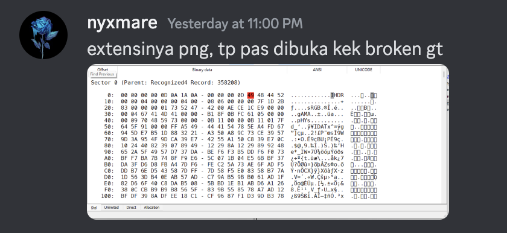

# Forensic

<!-- challenge-index: 48efcb226dce99f4 -->

| Challenge | Topic |
| --- | --- |
| [NotFS (180 pts)](#notfs-180-pts) | Filesystem Forensics, File Carving |

<!-- /challenge-index -->

## NotFS (180 pts)

### Description

Is this a FileSystem? Identify the file and make the necessary adjustments to solve the challenge. Note: The challenge file size is 16GB after extraction.

### Solution

During the competition, my friend found an interesting file without header using r-studio

<figure><figcaption></figcaption></figure>

Because it is a free edition of r-studio we cant dump the file, so looking at some hex value i tried to search the file. First, i use autopsy to load Chall.img file and export the unallocated space partition. Because if we search on 16gb files it will take a long time. Because i know some hex value and know what should the end of PNG file we can just parse the png and get the flag.

```python
f = open("Unalloc_4_20054016_544342528", "rb").read()
index = f.index(bytes.fromhex("A350A89C73CE3957"))
leak = f[index-104:index+20000]
last = f[index:].index(b"IEND")
nice = f[index-100:index+last+8]

nice = b"\x89\x50\x4e\x47" + nice
out = open("flag.png", "wb")
out.write(nice)
```

<figure><figcaption></figcaption></figure>

Flag: BHFlagY{8bd8dc3ea7636c5fb8aeb}
