# Reverse Engineering

<!-- challenge-index: d048126f6aa21a62 -->

| Challenge | Topic |
| --- | --- |
| [Stealer (110 pts)](#stealer-110-pts) | .NET, Malware Deobfuscation |
| [RD What Now? (180pts)](#rd-what-now-180pts) | R Serialization, Z3 |
| [Broken Authentication (280 pts)](#broken-authentication-280-pts) | Windows DLL, RC4 |

<!-- /challenge-index -->

## Stealer (110 pts)

### Description

We received a phishing email within which we have found this file. We believe this executable acts as some sort of credential stealer. Note: This is a defused real malware, consider disabling your AV.

### Solution

Given PE32 .NET, open it using dnspy.

<figure>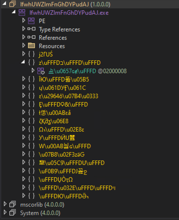<figcaption></figcaption></figure>

Looks like it was obfuscated, so take a look on entrypoint by right click on Ifw\... then "Go to Entry Point"

<figure>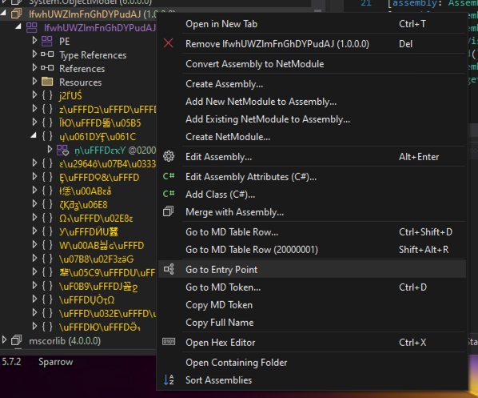<figcaption></figcaption></figure>

So there are so many functions called in entrypoint and all of the function name are obfuscated

<figure>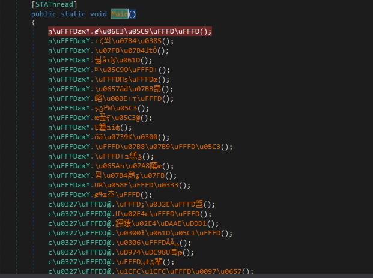<figcaption></figcaption></figure>

Looking at some called function and then i notice that there are some pattern in those functions. For example in function `\u032E\uFFFD\uFFFD쐬\uFFFD()`

<figure>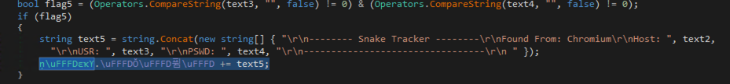<figcaption></figcaption></figure>

We can see that there is something like "global" variable used to store all the leaked data. Clicking the variable we will go to the class of the variable. Scrolling to bottom we will see some "encrypted" values.

<figure>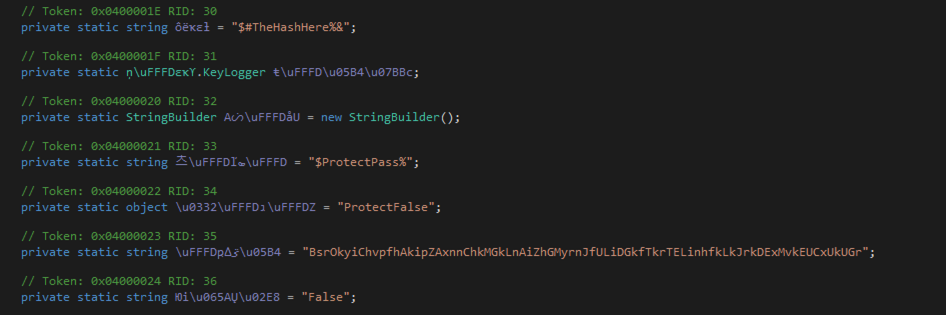<figcaption></figcaption></figure>

At first i didn't think that this malware are well known malware (i was thinking that the author created this by himself). But when i search the encrypted value i found several code that use the same value.

<figure>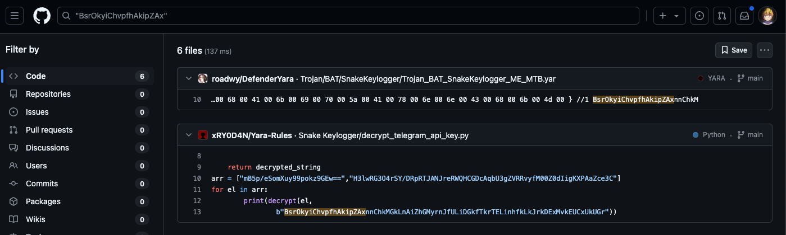<figcaption></figcaption></figure>

So this one is known malware, the code that we found looks like interesting because it use the value for decryption process. Lets try to find any reference regarding snake keylogger.

* <https://ry0dan.github.io/malware%20analysis/Exposing-Snake-Keylogger-Analysis-and-Detection/>

We found the explanation of the decrypt code

<figure>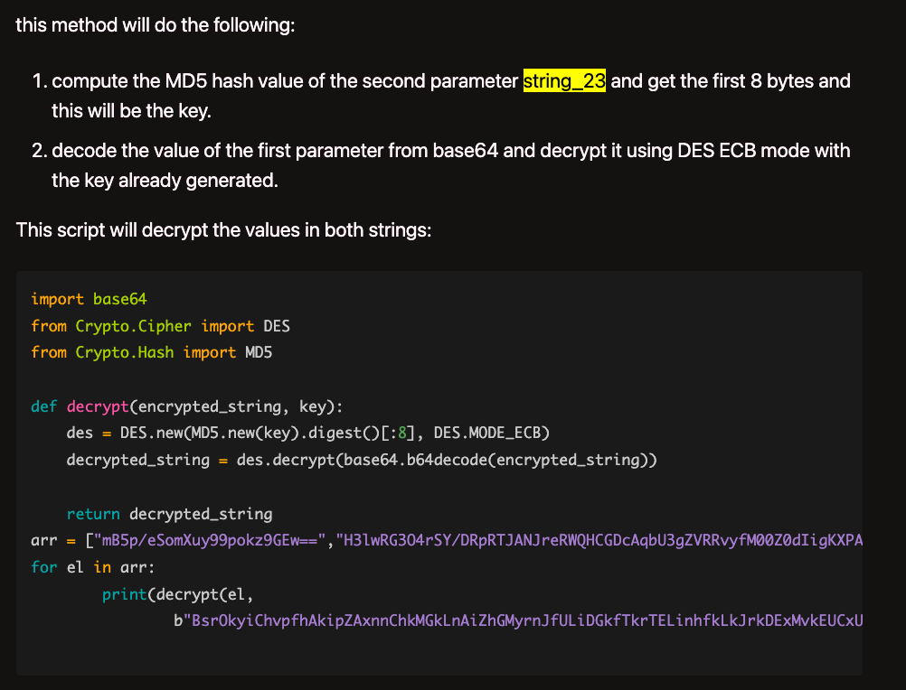<figcaption></figcaption></figure>

So lets try to find the ciphertext value in configuration class. In this case we assume that the RID of the malware is same because the code is actually same.

<figure>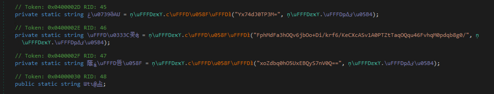<figcaption></figcaption></figure>

Finally, just change the ciphertext in code and got interesting base64 value.

```python
import base64
from Crypto.Cipher import DES
from Crypto.Hash import MD5

def decrypt(encrypted_string, key):
    des = DES.new(MD5.new(key).digest()[:8], DES.MODE_ECB)
    decrypted_string = des.decrypt(base64.b64decode(encrypted_string))

    return decrypted_string
arr = ["xoZdbq0hO5UxEBQyS7nV0Q==","FphMdFa3hOQv6jbOo+Di/krf6/KeCXcASv1A0PTZtTaqOQqu46FvhqM0pdqb8g0/"]
for el in arr:
	print(decrypt(el,
		b"BsrOkyiChvpfhAkipZAxnnChkMGkLnAiZhGMyrnJfULiDGkfTkrTELinhfkLkJrkDExMvkEUCxUkUGr"))
```

<figure>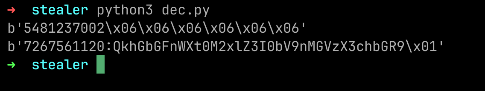<figcaption></figcaption></figure>

Decode the base64 encoded string and got the flag.

<figure>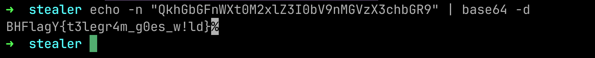<figcaption></figcaption></figure>

Flag: BHFlagY{t3legr4m\_g0es\_w!ld}

## RD What Now? (180pts)

### Description

I have some files missing but I think I can figure it out anyways.

### Solution

Given .rdb file, stuck for a long time finding what kind of file is this. During the competition my friend (nyxmare) did binwalk to the file and found some interesting string on the decompressed zlib.

<figure><figcaption></figcaption></figure>

Based on some information gathering i conclude that it was file from R programming language. Narrowing the search, i found some reference about .rdb file.

* <https://stackoverflow.com/questions/46184224/how-to-open-rdb-file-using-r>

\---TBU---

* Load each decompressed zlib using readRDS
* Create z3 solver based on constraint on each function

```python
from z3 import *

def check_val_1(index_0, index_1, index_2):
	global s
	s.add(flag[index_0 - 1] == flag[index_1 - 1])
	s.add(flag[index_1 - 1] == flag[index_2 - 1])

def check_val_11(index_0, val):
	global s
	s.add(flag[index_0 - 1] == ord(val))

def check_val_6(index_0, index_1, val):
	global s
	tmp = str(val)
	counter = 0
	for i in range(index_0, index_1 + 1):
		s.add(flag[i - 1] == ord(tmp[counter]))
		counter += 1

flag = [BitVec("x{}".format(i), 8) for i in range(94)]
s = Solver()

check_val_1(94,82,6)
check_val_1(1,86,10)
check_val_1(90,83,9)
check_val_1(9,11,15)
check_val_1(29,61,57)

val_1 = flag[14 - 1]
val_2 = flag[18 - 1]
val_3 = flag[24 - 1]
val_4 = flag[32 - 1]
val_5 = flag[36 - 1]
val_6 = flag[62 - 1]

s.add(val_1 == val_2) 
s.add(val_1 == ord("a"))
s.add(val_1 == val_3) 
s.add(val_3 == val_4) 
s.add(val_5 == val_4) 
s.add(val_6 == val_5)

check_val_11(76,"8")
check_val_11(93,"3")
check_val_11(13,"0")
check_val_11(26,"5")
check_val_11(87,"3")
check_val_11(88,"c")
check_val_11(81,"0")
check_val_11(86,"0")
check_val_11(17,"1")
check_val_11(18,"a")
check_val_11(39,"2")
check_val_11(58,"2")
check_val_11(19,"2")
check_val_11(20,"b")
check_val_11(31,"3")
check_val_11(44,"1")
check_val_11(49,"3")
check_val_11(55,"3")
check_val_11(44,"1")
check_val_11(45,"2")
check_val_11(66,"c")


val_1 = flag[72 - 1]
val_2 = flag[92 - 1]
val_3 = flag[26 - 1]
val_4 = flag[34 - 1]
val_5 = flag[60 - 1]
s.add(val_1 == val_2) 
s.add(val_1 == val_3) 
s.add(val_1 == val_4) 
s.add(val_1 == val_5)

val_1 = flag[22 - 1]
val_2 = flag[48 - 1]
val_3 = flag[78 - 1]
val_4 = flag[89 - 1]
s.add(val_1 == val_2) 
s.add(val_1 == val_3) 
s.add(val_1 == val_4)


val_1 = flag[51 - 1]
val_2 = flag[59 - 1]
val_3 = flag[63 - 1]
val_4 = flag[65 - 1]
val_5 = flag[77 - 1]
val_6 = flag[91 - 1]

s.add(val_1 == val_2) 
s.add(val_1 == val_3) 
s.add(val_1 == val_4) 
s.add(val_1 == val_5) 
s.add(val_1 == val_6)


val_1 = flag[51 - 1]
val_2 = flag[22 - 1]
s.add(val_1 - val_2 == 1)

val_1 =flag[17 - 1]
val_2 =flag[23 - 1]
val_3 =flag[28 - 1]
val_4 =flag[35 - 1]
val_5 =flag[37 - 1]
val_6 =flag[43 - 1]
val_7 =flag[44 - 1]
val_8 =flag[52 - 1]
val_9 =flag[69 - 1]
val_10 = flag[74 - 1]

s.add(val_1 == val_2) 
s.add(val_1 == val_3) 
s.add(val_1 == val_4) 
s.add(val_1 == val_5) 
s.add(val_1 == val_6) 
s.add(val_1 == val_7) 
s.add(val_1 == val_8) 
s.add(val_1 == val_9) 
s.add(val_1 == val_10)


val_1 = flag[17 - 1]
val_2 = flag[87 - 1]

s.add((val_2 - val_1) == 2) # reversed

s.add(flag[0] == ord('0'))


s.add(flag[25 - 1] == ord('2'))
s.add(flag[26 - 1] == ord('5'))
s.add(flag[27 - 1] == ord('2'))
s.add(flag[28 - 1] == ord('1'))
s.add(flag[29 - 1] == ord('3'))


s.add(flag[7 - 1] == ord('2'))
s.add(flag[8 - 1] == ord('9'))
s.add(flag[9 - 1] == ord('2'))
s.add(flag[10 - 1] == ord('0'))
s.add(flag[11 - 1] == ord('2'))

check_val_6(67,71,22103)
check_val_6(72,76,50138)
check_val_6(37,41,19230)
check_val_6(43,47,11202)
check_val_6(77,79,763)
check_val_6(85,87,303)
check_val_6(59,61,753)
check_val_6(39,41,230)
check_val_6(21,23,361)
check_val_6(51,53,713)
check_val_6(33,35,351)
check_val_6(45,47,202)
check_val_6(63,65,707)

val_1 = flag[16 - 1]
val_2 = flag[30 - 1]

s.add(val_1 == val_2) 
s.add(val_1 == ord("f"))

val_1 = flag[42 - 1]
val_2 = flag[50 - 1]
val_3 = flag[56 - 1]
val_4 = flag[80 - 1]

s.add(val_1 == val_2) 
s.add(val_1 == ord("d"))
s.add(val_1 == val_3) 
s.add(val_3 == val_4)

val_1 = flag[54 - 1]
val_2 = flag[84 - 1]
val_3 = flag[12 - 1]

s.add(val_1 == val_2) 
s.add(val_1 == ord("e"))
s.add(val_1 == val_3)

for i in range(1, 6):
	s.add(flag[i - 1] == flag[0])

s.add(flag[5] == ord('b'))

list_char = "0123456789abcdef"

for i in flag:
    s.add(z3.Or(*[ord(j) == i for j in list_char]))

print(s.check())
model = s.model()

real_flag = b""
for i in flag:
    try:
    	real_flag += bytes([model[i].as_long()])
    except Exception as e:
    	real_flag += b"?"

print(real_flag)

real_flag = bytes.fromhex(real_flag.decode())

xor_key = b"BHMEAISTHEBESTCTFEVERBETTERTHANALLOFTHEOTHERCTF"

nice = b""
for i in range(len(real_flag)):
	nice += bytes([real_flag[i] ^ xor_key[i % len(xor_key)]])
print(nice)

```

<figure>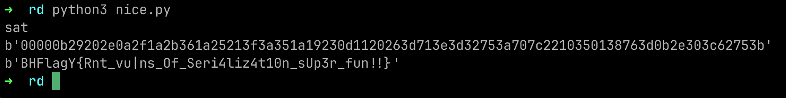<figcaption></figcaption></figure>

Flag: BHFlagY{Rnt\_vu|ns\_Of\_Seri4liz4t10n\_sUp3r\_fun!!}

## Broken Authentication (280 pts)

### Description

A friend of mine has sent me this authenticator, he said it's not working fine even with the right password. Can you help?

### Solution

Given PE 64 bit, open it using IDA.

<figure>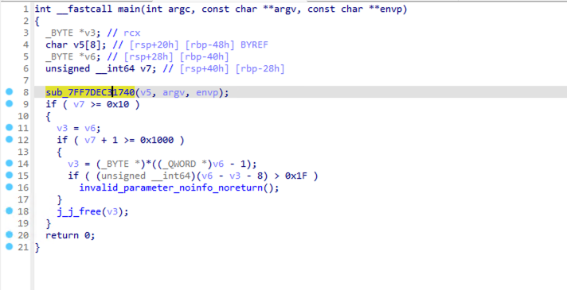<figcaption></figcaption></figure>

When we run the application there will be messagebox popped up and will process our input. When i tried to set breakpoint at main function the messagebox popped up first but the breakpoint is not triggered. So the process of popping up messagebox and checking our input is not done by the main function.&#x20;

In Windows we know that there is a methodology to call function before main function. One of the methodology is through initterm, there is a sample that how we can "define" function called through initterm.

* <https://medium.com/@naore32/beyond-the-main-unearthing-sneaky-functions-521f593ebeb3>

Now, lets try to inspect what function called through initterm. Breakpoint on initterm

<figure>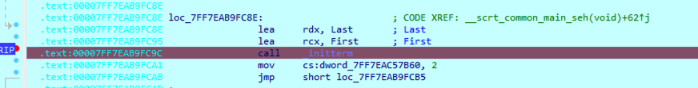<figcaption></figcaption></figure>

There will be no messagebox popped up, so the "actual" code still not executed. Now take a look on First variable.

<figure>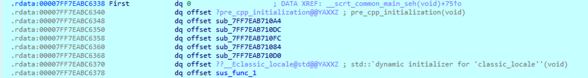<figcaption></figcaption></figure>

Looking at all function we will notice that only the last function are suspicious, so rename the function.&#x20;

```c
void sus_func_1()
{
  _DWORD *v0; // rax
  _DWORD *v1; // [rsp+30h] [rbp+8h] BYREF

  CoInitializeEx(0i64, 0);
  v0 = operator new(0x20ui64);
  if ( v0 )
  {
    v0[4] = 1;
    *(_QWORD *)v0 = &CS::`vftable';
    *((_QWORD *)v0 + 1) = &CS::`vftable';
    *((_QWORD *)v0 + 3) = 0i64;
  }
  v1 = v0;
  sub_7FF7EAB74D20(&v1);
  sub_7FF7EAB75020(&v1);
  (*(void (__fastcall **)(_DWORD *))(*(_QWORD *)v1 + 16i64))(v1);
  v1 = 0i64;
  CoUninitialize();
  dword_7FF7EAC57634 = 0;
}
```

Take a look on sub\_7FF7EAB74D20 function. Breakpoint at 0x7FF7EAB74DEF we will see the decrypted string at \*rbx

<figure>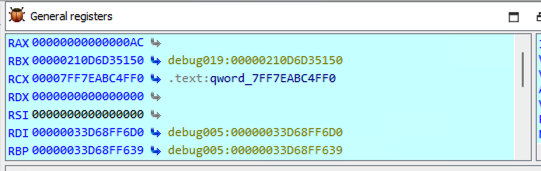<figcaption></figcaption></figure>

<figure>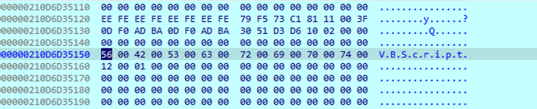<figcaption></figcaption></figure>

Continue the dynamic analysis then we can conclude some insights.

<pre class="language-c" data-line-numbers><code class="lang-c">HRESULT __fastcall sub_7FF7EAB74D20(_QWORD *a1)
{
  _QWORD *ThreadLocalStoragePointer; // rax
  __int64 v3; // rdx
  __int64 v4; // rbx
  int v5; // eax
  __int64 v6; // rbx
  unsigned __int64 v7; // r10
  unsigned __int64 i; // rdx
  __int64 v9; // rcx
  LPVOID v10; // rcx
  HRESULT result; // eax
  __int64 v12; // [rsp+58h] [rbp-41h] BYREF
  LPVOID ppv; // [rsp+60h] [rbp-39h] BYREF
  VARIANTARG pvarg; // [rsp+68h] [rbp-31h] BYREF
  __int128 v15[4]; // [rsp+80h] [rbp-19h] BYREF
  CLSID clsid; // [rsp+C0h] [rbp+27h] BYREF

  ThreadLocalStoragePointer = NtCurrentTeb()->ThreadLocalStoragePointer;
  ppv = 0i64;
  v12 = 0i64;
  v3 = ThreadLocalStoragePointer[TlsIndex];
  v4 = v3 + 16;
  v5 = *(_DWORD *)(v3 + 536);
  if ( (v5 &#x26; 1) == 0 )
  {
    *(_BYTE *)(v3 + 34) = 1;
    *(_DWORD *)(v3 + 536) = v5 | 1;
    *(_DWORD *)v4 = 13238340;
    *(_DWORD *)(v3 + 20) = 13566006;
    *(_DWORD *)(v3 + 24) = 8060998;
    *(_DWORD *)(v3 + 28) = 196828;
    *(_WORD *)(v3 + 32) = 18;
    _tlregdtor((__int64)qword_7FF7EABC4FF0);
  }
  if ( *(_BYTE *)(v4 + 18) )
  {
    *(_WORD *)v4 ^= 0x12u;                      // generate VBScript
    *(_WORD *)(v4 + 2) ^= 0x88u;
    *(_WORD *)(v4 + 6) ^= 0xACu;
    *(_WORD *)(v4 + 12) ^= 0xACu;
    *(_WORD *)(v4 + 4) ^= 0x65u;
    *(_WORD *)(v4 + 8) ^= 0x34u;
    *(_WORD *)(v4 + 10) ^= 0x12u;
    *(_WORD *)(v4 + 14) ^= 0x77u;
    *(_WORD *)(v4 + 16) ^= 0x12u;
    *(_BYTE *)(v4 + 18) = 0;
  }
  if ( CLSIDFromProgID((LPCOLESTR)v4, &#x26;clsid) >= 0 )
    CoCreateInstance(&#x26;clsid, 0i64, 0x17u, &#x26;riid, &#x26;ppv);
  (*(void (__fastcall **)(LPVOID, _QWORD))(*(_QWORD *)ppv + 24i64))(ppv, *a1);// call vbscript
  (**(void (__fastcall ***)(LPVOID, void *, __int64 *))ppv)(ppv, &#x26;unk_7FF7EABC76A0, &#x26;v12);
  (*(void (__fastcall **)(__int64))(*(_QWORD *)v12 + 24i64))(v12);
  memset(&#x26;pvarg, 0, sizeof(pvarg));
  VariantInit(&#x26;pvarg);
  v6 = v12;
  memset(v15, 0, sizeof(v15));
  v7 = sub_7FF7EAB74760();
<strong>  if ( *(_BYTE *)(v7 + 440) )
</strong><strong>  {
</strong><strong>    for ( i = 0i64; i &#x3C; 0xDC; i += 2i64 )
</strong><strong>    {
</strong><strong>      *(_WORD *)(v7 + 2 * i) ^= (unsigned __int8)(0x56FECABDCD5A8890ui64 >> (8 * ((unsigned __int8)i &#x26; 7u)));
</strong><strong>      *(_WORD *)(v7 + 2 * i + 2) ^= (unsigned __int8)(0x56FECABDCD5A8890ui64 >> (8 * ((i + 1) &#x26; 7)));
</strong><strong>    }
</strong><strong>    *(_BYTE *)(v7 + 440) = 0;
</strong><strong>  }
</strong>  (*(void (__fastcall **)(__int64, unsigned __int64, _QWORD, _QWORD, _QWORD, _QWORD, _DWORD, _DWORD, VARIANTARG *, __int128 *))(*(_QWORD *)v6 + 40i64))(// trigger vbscript
    v6,
    v7,
    0i64,
    0i64,
    0i64,
    0i64,
    0,
    0,
    &#x26;pvarg,
    v15);
  v9 = v12;
  if ( v12 )
  {
    v12 = 0i64;
    (*(void (__fastcall **)(__int64))(*(_QWORD *)v9 + 16i64))(v9);
  }
  v10 = ppv;
  if ( ppv )
  {
    ppv = 0i64;
    (*(void (__fastcall **)(LPVOID))(*(_QWORD *)v10 + 16i64))(v10);
  }
  result = VariantClear(&#x26;pvarg);
  if ( v12 )
    result = (*(__int64 (__fastcall **)(__int64))(*(_QWORD *)v12 + 16i64))(v12);
  if ( ppv )
    return (*(__int64 (__fastcall **)(LPVOID))(*(_QWORD *)ppv + 16i64))(ppv);
  return result;
}
</code></pre>

* The VBscript code are resides in line 59-67, it "obfuscated" using xor operation. The easy way to get the plaintext code just breakpoint on `(*(_QWORD *)v6 + 40i64)` function call and take a look on second argument.

<figure>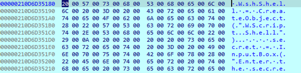<figcaption></figcaption></figure>

```python
def conv(data):
	tmp = bytes.fromhex(''.join(data.split(" ")).strip())
	res = [tmp[i] for i in range(0, len(tmp), 2)]
	return bytes(res)

data = """
20 00 57 00 73 00 68 00  53 00 68 00 65 00 6C 00 
6C 00 20 00 3D 00 20 00  43 00 72 00 65 00 61 00 
74 00 65 00 4F 00 62 00  6A 00 65 00 63 00 74 00 
28 00 22 00 57 00 53 00  63 00 72 00 69 00 70 00 
74 00 2E 00 53 00 68 00  65 00 6C 00 6C 00 22 00 
29 00 0A 00 20 00 20 00  20 00 20 00 73 00 65 00 
63 00 72 00 65 00 74 00  20 00 3D 00 20 00 49 00 
6E 00 70 00 75 00 74 00  42 00 6F 00 78 00 28 00 
22 00 45 00 6E 00 74 00  65 00 72 00 20 00 74 00 
68 00 65 00 20 00 73 00  65 00 63 00 72 00 65 00 
74 00 3A 00 22 00 2C 00  20 00 22 00 53 00 65 00 
63 00 72 00 65 00 74 00  20 00 72 00 65 00 71 00 
75 00 69 00 72 00 65 00  64 00 22 00 29 00 0A 00 
20 00 20 00 20 00 20 00  49 00 66 00 20 00 73 00 
65 00 63 00 72 00 65 00  74 00 20 00 3C 00 3E 00 
20 00 22 00 22 00 20 00  54 00 68 00 65 00 6E 00 
0A 00 20 00 20 00 20 00  20 00 20 00 20 00 20 00 
20 00 57 00 73 00 68 00  53 00 68 00 65 00 6C 00 
6C 00 2E 00 45 00 6E 00  76 00 69 00 72 00 6F 00 
6E 00 6D 00 65 00 6E 00  74 00 28 00 22 00 50 00 
52 00 4F 00 43 00 45 00  53 00 53 00 22 00 29 00 
2E 00 49 00 74 00 65 00  6D 00 28 00 22 00 4B 00 
50 00 41 00 53 00 53 00  22 00 29 00 20 00 3D 00 
20 00 73 00 65 00 63 00  72 00 65 00 74 00 0A 00 
20 00 20 00 20 00 20 00  45 00 6E 00 64 00 20 00 
49 00 66 00 0A 00 20 00  20 00 20 00 20 00 20 00 
20 00 20 00 20 00 00 00  00 00 00 00 00 00 00 00
"""

print(conv(data).decode())
```

<figure>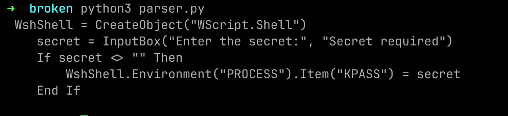<figcaption></figcaption></figure>

The code looks like same like the messagebox popped up when we run the progam. From code above we can see that our input is stored at WshShell Environment Process with key "KPASS". Back to the code now then  continue to the next function sub\_7FF7EAB75020.

<pre class="language-c" data-line-numbers><code class="lang-c">HRESULT __fastcall sub_7FF7EAB75020(_QWORD *a1)
{
  _QWORD *ThreadLocalStoragePointer; // rax
  __int64 v3; // rdi
  _DWORD *v4; // rbx
  int v5; // eax
  __int64 v6; // rsi
  int v7; // eax
  _DWORD *v8; // rbx
  _QWORD *v9; // rax
  _QWORD *v10; // rdx
  void *v11; // rcx
  __int64 v12; // rcx
  LPVOID v13; // rcx
  HRESULT result; // eax
  __int64 v15; // [rsp+50h] [rbp-59h] BYREF
  LPVOID ppv; // [rsp+58h] [rbp-51h] BYREF
  VARIANTARG pvarg; // [rsp+60h] [rbp-49h] BYREF
  __int128 v18[4]; // [rsp+80h] [rbp-29h] BYREF
  CLSID clsid; // [rsp+C0h] [rbp+17h] BYREF
  unsigned __int64 v20; // [rsp+D8h] [rbp+2Fh]

  ThreadLocalStoragePointer = NtCurrentTeb()->ThreadLocalStoragePointer;
  ppv = 0i64;
  v15 = 0i64;
  v3 = ThreadLocalStoragePointer[TlsIndex];
  v4 = (_DWORD *)(v3 + 496);
  v5 = *(_DWORD *)(v3 + 544);
  if ( (v5 &#x26; 1) == 0 )
  {
    *(_BYTE *)(v3 + 512) = 1;
    *(_DWORD *)(v3 + 544) = v5 | 1;
    *v4 = 12320889;
    *(_DWORD *)(v3 + 500) = 12255458;
    *(_DWORD *)(v3 + 504) = 1245214;
    *(_DWORD *)(v3 + 508) = 10027010;
    _tlregdtor((__int64)qword_7FF7EABC4F90);
  }
  if ( *(_BYTE *)(v3 + 512) )
  {
    *(_WORD *)v4 ^= 0x33u;
    *(_WORD *)(v3 + 498) ^= 0xEFu;
    *(_WORD *)(v3 + 500) ^= 0x81u;
    *(_WORD *)(v3 + 502) ^= 0xC9u;
    *(_WORD *)(v3 + 504) ^= 0x77u;
    *(_WORD *)(v3 + 506) ^= 0x63u;
    *(_WORD *)(v3 + 508) ^= 0x76u;
    *(_WORD *)(v3 + 510) ^= 0x99u;
    *(_BYTE *)(v3 + 512) = 0;
  }
  if ( CLSIDFromProgID((LPCOLESTR)(v3 + 496), &#x26;clsid) >= 0 )
    CoCreateInstance(&#x26;clsid, 0i64, 0x17u, &#x26;riid, &#x26;ppv);
  (*(void (__fastcall **)(LPVOID, _QWORD))(*(_QWORD *)ppv + 24i64))(ppv, *a1);
  (**(void (__fastcall ***)(LPVOID, void *, __int64 *))ppv)(ppv, &#x26;unk_7FF7EABC76A0, &#x26;v15);
  (*(void (__fastcall **)(__int64))(*(_QWORD *)v15 + 24i64))(v15);
  memset(&#x26;pvarg, 0, sizeof(pvarg));
  VariantInit(&#x26;pvarg);
  v6 = v15;
  memset(v18, 0, sizeof(v18));
  v7 = *(_DWORD *)(v3 + 548);
  v8 = (_DWORD *)(v3 + 520);
  if ( (v7 &#x26; 1) == 0 )
  {
    *(_WORD *)(v3 + 531) = 386;
    *(_DWORD *)(v3 + 548) = v7 | 1;
    *v8 = -1320252015;
    *(_DWORD *)(v3 + 524) = 338676004;
    *(_WORD *)(v3 + 528) = -13424;
    *(_BYTE *)(v3 + 530) = 74;
    _tlregdtor((__int64)qword_7FF7EABC4FC0);
  }
  if ( *(_BYTE *)(v3 + 532) )
  {
    *(_BYTE *)v8 ^= 0xE2u;                      // generate sup3rs3cr3t
    *(_BYTE *)(v3 + 521) ^= 0xF8u;
    *(_BYTE *)(v3 + 522) ^= 0x3Eu;
    *(_BYTE *)(v3 + 523) ^= 0x82u;
    *(_BYTE *)(v3 + 524) ^= 0x56u;
    *(_BYTE *)(v3 + 525) ^= 0xBAu;
    *(_BYTE *)(v3 + 526) ^= 0x1Cu;
    *(_BYTE *)(v3 + 527) ^= 0x77u;
    *(_BYTE *)(v3 + 528) ^= 0xE2u;
    *(_BYTE *)(v3 + 529) ^= 0xF8u;
    *(_BYTE *)(v3 + 530) ^= 0x3Eu;
    *(_BYTE *)(v3 + 531) ^= 0x82u;
    *(_BYTE *)(v3 + 532) = 0;
  }
<strong>  v9 = (_QWORD *)RC4_func((__int64)&#x26;clsid, byte_7FF7EABDB000, 502162i64, v3 + 520);
</strong>  v10 = v9;
  if ( v9[3] >= 8ui64 )
    v10 = (_QWORD *)*v9;
  (*(void (__fastcall **)(__int64, _QWORD *, _QWORD, _QWORD, _QWORD, _QWORD, _DWORD, _DWORD, VARIANTARG *, __int128 *))(*(_QWORD *)v6 + 40i64))(// call jscript
    v6,
    v10,
    0i64,
    0i64,
    0i64,
    0i64,
    0,
    0,
    &#x26;pvarg,
    v18);
  if ( v20 >= 8 )
  {
    v11 = *(void **)&#x26;clsid.Data1;
    if ( 2 * v20 + 2 >= 0x1000 )
    {
      v11 = *(void **)(*(_QWORD *)&#x26;clsid.Data1 - 8i64);
      if ( (unsigned __int64)(*(_QWORD *)&#x26;clsid.Data1 - (_QWORD)v11 - 8i64) > 0x1F )
        invalid_parameter_noinfo_noreturn();
    }
    j_j_free(v11);
  }
  v12 = v15;
  if ( v15 )
  {
    v15 = 0i64;
    (*(void (__fastcall **)(__int64))(*(_QWORD *)v12 + 16i64))(v12);
  }
  v13 = ppv;
  if ( ppv )
  {
    ppv = 0i64;
    (*(void (__fastcall **)(LPVOID))(*(_QWORD *)v13 + 16i64))(v13);
  }
  result = VariantClear(&#x26;pvarg);
  if ( v15 )
    result = (*(__int64 (__fastcall **)(__int64))(*(_QWORD *)v15 + 16i64))(v15);
  if ( ppv )
    return (*(__int64 (__fastcall **)(LPVOID))(*(_QWORD *)ppv + 16i64))(ppv);
  return result;
}
</code></pre>

* Line 88 is the process of decrypting the javascript code, dump the ciphertext and decrypt it using python

```c
// dump ciphertext
auto fname      = "C:\\Users\\Intel NUC\\ctf\\bhmea\\re\\broken\\dumpjs.bin";
auto address    = 0x7FF7DEC9B000;
auto size       = 502163;
auto file= fopen(fname, "wb");

savefile(file, 0, address, size);
fclose(file);
```

```python
# decrypt ciphertext
from arc4 import ARC4
arc4 = ARC4(b'sup3rs3cr3t')
f = open("dumpjs.bin", "rb").read()
pt = arc4.decrypt(f)
out = open("dump.js", "wb")
out.write(pt)
```

<figure>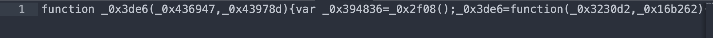<figcaption></figcaption></figure>

So the javascript is obfuscated, lets deobfusacte it using online tools.

* <https://deobfuscate.io/>

See the full code in this [gist](https://gist.github.com/kos0ng/aa196cbae693033ad9392ab18d791d94). Lets focus on the main logic of the input validation.

<pre class="language-javascript" data-line-numbers><code class="lang-javascript">function _0x3719d6(_0x3d03ff, _0x4ddac0) {
    var _0x1638ce = _0xf17cfa(_0x3d03ff);
    var _0x22f21e = new ActiveXObject("ADODB.Stream");
    _0x22f21e.Type = 2;
    _0x22f21e.charSet = "iso-8859-1";
    _0x22f21e.Open();
    _0x22f21e.WriteText(_0x1638ce);
    var _0x58b7e9 = new ActiveXObject("ADODB.Stream");
    _0x58b7e9.Type = 1;
    _0x58b7e9.Open();
    _0x22f21e.Position = 0;
    _0x22f21e.CopyTo(_0x58b7e9);
    _0x58b7e9.SaveToFile(_0x4ddac0, 2);
    _0x58b7e9.Close();
  }
<strong>  k1 = '';
</strong><strong>  k1 += Math.floor(Math.random() * 7).toString();
</strong><strong>  _0x3719d6(&#x3C;base64_value>, _0x59e1ac + "\\malware.dll");
</strong>  var _0x993230 = new ActiveXObject("Microsoft.Windows.ActCtx");
  k1 += Math.floor(Math.random() * 3).toString();
<strong>  _0x993230.ManifestText = "&#x3C;?xml version=\"1.0\" encoding=\"UTF-16\" standalone=\"yes\"?> &#x3C;assembly xmlns=\"urn:schemas-microsoft-com:asm.v1\" manifestVersion=\"1.0\"> \t&#x3C;assemblyIdentity type=\"win32\" name=\"DynamicWrapperX\" version=\"2.2.0.0\"/> \t&#x3C;file name=\"malware.dll\">     \t&#x3C;comClass         \tdescription=\"DynamicWrapperX Class\"         \tclsid=\"{89565276-A714-4a43-912E-978B935EDCCC}\"         \tthreadingModel=\"Both\"         \tprogid=\"DynamicWrapperX\"/> \t&#x3C;/file>  &#x3C;/assembly>";
</strong>  var _0x47f0ea = _0x993230.CreateObject("DynamicWrapperX");
  k1 += Math.floor(Math.random() * 9).toString();
<strong>  _0x47f0ea.Register("Advapi32.dll", "CryptAcquireContextW", "i=pssuu", "r=b");
</strong>  _0x47f0ea.Register("Advapi32.dll", "CryptCreateHash", "i=huhup", "r=b");
  _0x47f0ea.Register("Advapi32.dll", "CryptHashData", "i=hsuu", "r=b");
  k1 += Math.floor(Math.random() * 6).toString();
  _0x47f0ea.Register("Advapi32.dll", "CryptDeriveKey", "i=huhup", "r=b");
  _0x47f0ea.Register("Advapi32.dll", "CryptEncrypt", "i=hhluppu", "r=b");
  k1 += Math.floor(Math.random() * 9).toString();
  _0x47f0ea.Register("Advapi32.dll", "CryptDestroyKey", "i=h", "r=b");
  _0x47f0ea.Register("Advapi32.dll", "CryptDestroyHash", "i=h", "r=b");
  k1 += Math.floor(Math.random() * 8).toString();
  _0x47f0ea.Register("Advapi32.dll", "CryptReleaseContext", "i=hu", "r=b");
  _0x47f0ea.Register("user32.dll", "MessageBoxW", "i=hwwu", "r=l");
  p = new ActiveXObject("WScript.Shell");
  s = p.ExpandEnvironmentStrings("%KPASS%");
  h1 = _0x47f0ea.MemAlloc(8);
  r = 0;
  if (_0x47f0ea.CryptAcquireContextW(h1, 0, 0, 24, 4026531840)) {
    h5 = '';
<strong>    h1 = _0x47f0ea.NumGet(h1, 0, "q");
</strong>    h2 = _0x47f0ea.MemAlloc(8);
    k1 += Math.floor(Math.random() * 4).toString();
    if (_0x47f0ea.CryptCreateHash(h1, 32771, 0, 0, h2)) {
      h2 = _0x47f0ea.NumGet(h2, 0, "q");
      k1 += Math.floor(Math.random() * 5).toString();
      if (_0x47f0ea.CryptHashData(h2, k1, k1.length, 0)) {
        for (i = 0; i &#x3C; s.length; i++) {
          h4 = s.charCodeAt(i).toString(16);
          h5 += ("0" + h4).slice(-2);
        }
        ;
        h3 = _0x47f0ea.MemAlloc(8);
        if (_0x47f0ea.CryptDeriveKey(h1, 26126, h2, 0, h3)) {
          h3 = _0x47f0ea.NumGet(h3, 0, "q");
          l = Math.ceil(s.length / 16) * 16;
          d = _0x47f0ea.MemAlloc(l);
          _0x47f0ea.MemWrite(h5, d);
          ss = _0x47f0ea.MemAlloc(4);
          _0x47f0ea.NumPut(s.length, ss);
          if (_0x47f0ea.CryptEncrypt(h3, 0, 1, 0, d, ss, l)) {
<strong>            if (_0x47f0ea.MemRead(d, _0x47f0ea.NumGet(ss)) == "73E3679507CC8197F665FD5B46F55321CF89BB828CD7BB424B181734D468709709D49085868CDA1B9892B947999E4F64") {
</strong>              r = 1;
            }
            ;
          }
          ;
          _0x47f0ea.CryptDestroyKey(h3);
        }
        ;
        _0x47f0ea.CryptDestroyHash(h2);
      }
      ;
    }
    ;
    _0x47f0ea.CryptReleaseContext(h1, 0);
  }
  ;
  if (r &#x26;&#x26; s.substr(0, 7) === "BHFlagY") {
    _0x47f0ea.MessageBoxW(0, "You are super lucky !!", "Right", 0);
  } else {
    _0x47f0ea.MessageBoxW(0, "Maybe right, maybe wrong.", "Not sure", 0);
  }
  ;
} catch (_0x18fe76) {
  _0x47f0ea.MessageBoxW(0, "An error occurred", "Unsupported", 0);
}
</code></pre>

We cannot directly execute above javascript code using interpreter like node, based on information that i found we can execute above code in internet explorer. Trying to find executable that can run above script i found "csript.exe". We can run above script like using nodejs executable.

<figure>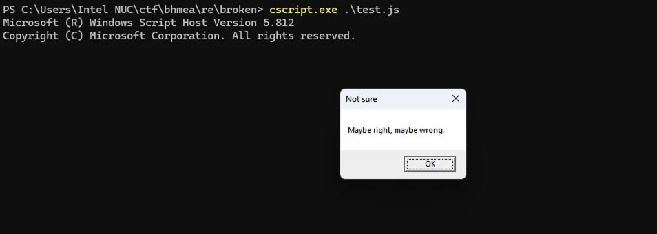<figcaption></figcaption></figure>

Back to the javascript code, there are some insight that we can note

* Line 16-17: initialization of k1 variable that will be used key for encryption. It filled with Math.random values multiplied with some constant
* Line 18 & 21: base64 decode and write malware to dll file, next it will be dynamically loaded through dynamicwrapper
* Line 24: registering some function from library to be used through \_0x47f0ea variable
* Line 42 & 63: example of loaded function from malware.dll

Now we know what the code did, our input that has been stored in KPASS is used as the plaintext and then encrypted using windows API. Lets take a look on some function to extract some useful information

* &#x20;CryptCreateHash
  * Based on wincrypt [documentation](https://learn.microsoft.com/en-us/windows/win32/seccrypto/alg-id) 32771 (0x8003) is CALG\_MD5
* CryptHashData
  * k1 will be the key for the encryption process
* CryptDeriveKey
  * Based on wincrypt [documentation](https://learn.microsoft.com/en-us/windows/win32/seccrypto/alg-id) 26126 (0x660e) is CALG\_AES\_128
* CryptEncrypt
  * d that store h5 value (hex value of our input) will be the plaintext

k1 is random but it looks like bruteforceable, lets analyze it

```javascript
Math.floor(Math.random() * 4).toString()
```

* Math.random value is 0-1 (0 inclusive, 1 exclusive)
  * Minimum = 0
  * Maximum = 0.99
  * So the possible value generated is 0,1,2,3

The length of the key is 8 so the bruteforce process will be very fast. Last, because we know the compared ciphertext lets reverse the flow by decrypting the known ciphertext and get the actual input (flag). Below is the script i used to implement algorithm explained before.

```python
from wincrypto import CryptCreateHash, CryptHashData, CryptDeriveKey, CryptEncrypt, CryptDecrypt, CryptImportKey, CryptExportKey
from wincrypto.constants import *
from binascii import unhexlify
import hashlib
import itertools
import tqdm

def decrypt(key, ct):
    hasher = CryptCreateHash(CALG_MD5)
    CryptHashData(hasher, key)
    aes_key = CryptDeriveKey(hasher, CALG_AES_128)
    pt = CryptDecrypt(aes_key, ct)
    return pt

list_char = [
[str(i) for i in range(7)],
[str(i) for i in range(3)],
[str(i) for i in range(9)],
[str(i) for i in range(6)],
[str(i) for i in range(9)],
[str(i) for i in range(8)],
[str(i) for i in range(4)],
[str(i) for i in range(5)]]

ct = bytes.fromhex("73E3679507CC8197F665FD5B46F55321CF89BB828CD7BB424B181734D468709709D49085868CDA1B9892B947999E4F64")

for i in tqdm.tqdm(itertools.product(*list_char)):
  pt = decrypt(''.join(i).encode(), ct)
  if b"BHFlagY{" in pt:
      print(f"key = {''.join(i)}, flag = {pt}")
      break
```

<figure>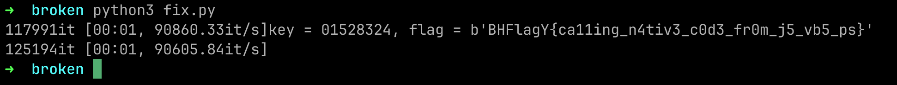<figcaption></figcaption></figure>

Flag: BHFlagY{ca11ing\_n4tiv3\_c0d3\_fr0m\_j5\_vb5\_ps}
