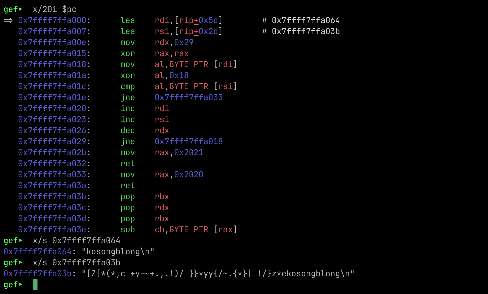
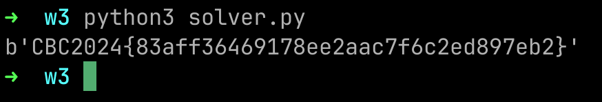
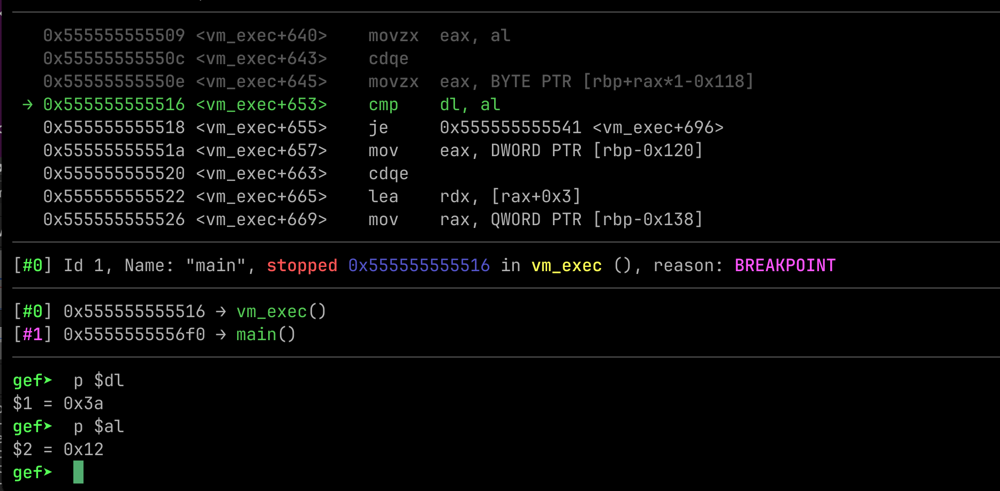
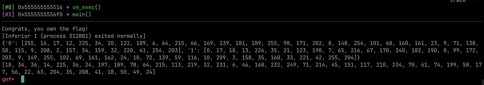
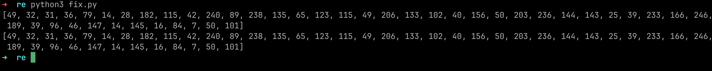
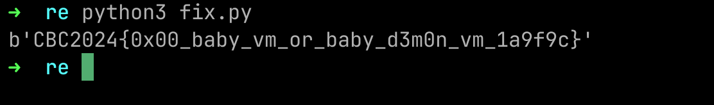
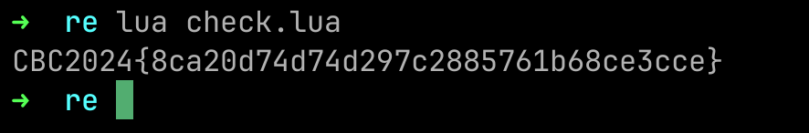

# Reverse Engineering

<!-- challenge-index: 5280fcfcd9d95a33 -->

| Challenge | Topic |
| --- | --- |
| [baby-asm (100 pts)](#baby-asm-100-pts) | Runtime Code Generation, Assembly |
| [baby-vm (100 pts)](#baby-vm-100-pts) | Custom VM, Bytecode |
| [baby-crack (100 pts)](#baby-crack-100-pts) | Lua Bytecode, XOR |

<!-- /challenge-index -->

## baby-asm (100 pts)

### Description

\-

### Solution

Given ELF 64 bit file, open it using IDA

```c
int __fastcall main(int argc, const char **argv, const char **envp)
{
  __int64 v3; // rbx
  __int64 v4; // rbx
  __int64 v5; // rbx
  __int64 v6; // rbx
  __int64 v7; // rbx
  __int64 v8; // rbx
  __int64 v9; // rbx
  __int64 v10; // rbx
  __int64 v11; // rbx
  __int64 v12; // rbx
  __int64 v13; // rbx
  __int64 v14; // rbx
  __int64 v15; // rbx
  __int64 v16; // rbx
  __int64 v17; // rbx
  __int64 v18; // rbx
  _QWORD *v20; // [rsp+8h] [rbp-128h]
  char s[8]; // [rsp+10h] [rbp-120h] BYREF
  __int64 v22; // [rsp+18h] [rbp-118h]
  __int64 v23; // [rsp+20h] [rbp-110h]
  __int64 v24; // [rsp+28h] [rbp-108h]
  __int64 v25; // [rsp+30h] [rbp-100h]
  __int64 v26; // [rsp+38h] [rbp-F8h]
  __int64 v27; // [rsp+40h] [rbp-F0h]
  __int64 v28; // [rsp+48h] [rbp-E8h]
  __int64 v29; // [rsp+50h] [rbp-E0h]
  __int64 v30; // [rsp+58h] [rbp-D8h]
  __int64 v31; // [rsp+60h] [rbp-D0h]
  __int64 v32; // [rsp+68h] [rbp-C8h]
  __int64 v33; // [rsp+70h] [rbp-C0h]
  __int64 v34; // [rsp+78h] [rbp-B8h]
  __int64 v35; // [rsp+80h] [rbp-B0h]
  __int64 v36; // [rsp+88h] [rbp-A8h]
  __int64 v37; // [rsp+90h] [rbp-A0h]
  __int64 v38; // [rsp+98h] [rbp-98h]
  __int64 v39; // [rsp+A0h] [rbp-90h]
  __int64 v40; // [rsp+A8h] [rbp-88h]
  __int64 v41; // [rsp+B0h] [rbp-80h]
  __int64 v42; // [rsp+B8h] [rbp-78h]
  __int64 v43; // [rsp+C0h] [rbp-70h]
  __int64 v44; // [rsp+C8h] [rbp-68h]
  __int64 v45; // [rsp+D0h] [rbp-60h]
  __int64 v46; // [rsp+D8h] [rbp-58h]
  __int64 v47; // [rsp+E0h] [rbp-50h]
  __int64 v48; // [rsp+E8h] [rbp-48h]
  __int64 v49; // [rsp+F0h] [rbp-40h]
  __int64 v50; // [rsp+F8h] [rbp-38h]
  __int64 v51; // [rsp+100h] [rbp-30h]
  __int64 v52; // [rsp+108h] [rbp-28h]
  unsigned __int64 v53; // [rsp+118h] [rbp-18h]

  v53 = __readfsqword(0x28u);
  v20 = mmap(0LL, 0x1000uLL, 7, 34, 0, 0LL);
  if ( v20 == (_QWORD *)-1LL )
  {
    perror("mmap");
    exit(1);
  }
  *v20 = code;
  v20[1] = 0xC7480000002D358DLL;
  v20[2] = 0xC0314800000029C2LL;
  v20[3] = 0x1375063A1834078ALL;
  v20[4] = 0xFF48C6FF48C7FF48LL;
  v20[5] = 0x2021C0C748ED75CALL;
  v20[6] = 0x2020C0C748C30000LL;
  v20[7] = 0x282A5B5A5BC30000LL;
  qmemcpy(v20 + 8, "*,c +y~~+.,.!)/ }}*yy{/~.{*}| !/}z*e", 36);
  printf("Enter your flag: ");
  fgets(s, 256, _bss_start);
  v3 = v22;
  *(_QWORD *)((char *)v20 + 100) = *(_QWORD *)s;
  *(_QWORD *)((char *)v20 + 108) = v3;
  v4 = v24;
  *(_QWORD *)((char *)v20 + 116) = v23;
  *(_QWORD *)((char *)v20 + 124) = v4;
  v5 = v26;
  *(_QWORD *)((char *)v20 + 132) = v25;
  *(_QWORD *)((char *)v20 + 140) = v5;
  v6 = v28;
  *(_QWORD *)((char *)v20 + 148) = v27;
  *(_QWORD *)((char *)v20 + 156) = v6;
  v7 = v30;
  *(_QWORD *)((char *)v20 + 164) = v29;
  *(_QWORD *)((char *)v20 + 172) = v7;
  v8 = v32;
  *(_QWORD *)((char *)v20 + 180) = v31;
  *(_QWORD *)((char *)v20 + 188) = v8;
  v9 = v34;
  *(_QWORD *)((char *)v20 + 196) = v33;
  *(_QWORD *)((char *)v20 + 204) = v9;
  v10 = v36;
  *(_QWORD *)((char *)v20 + 212) = v35;
  *(_QWORD *)((char *)v20 + 220) = v10;
  v11 = v38;
  *(_QWORD *)((char *)v20 + 228) = v37;
  *(_QWORD *)((char *)v20 + 236) = v11;
  v12 = v40;
  *(_QWORD *)((char *)v20 + 244) = v39;
  *(_QWORD *)((char *)v20 + 252) = v12;
  v13 = v42;
  *(_QWORD *)((char *)v20 + 260) = v41;
  *(_QWORD *)((char *)v20 + 268) = v13;
  v14 = v44;
  *(_QWORD *)((char *)v20 + 276) = v43;
  *(_QWORD *)((char *)v20 + 284) = v14;
  v15 = v46;
  *(_QWORD *)((char *)v20 + 292) = v45;
  *(_QWORD *)((char *)v20 + 300) = v15;
  v16 = v48;
  *(_QWORD *)((char *)v20 + 308) = v47;
  *(_QWORD *)((char *)v20 + 316) = v16;
  v17 = v50;
  *(_QWORD *)((char *)v20 + 324) = v49;
  *(_QWORD *)((char *)v20 + 332) = v17;
  v18 = v52;
  *(_QWORD *)((char *)v20 + 340) = v51;
  *(_QWORD *)((char *)v20 + 348) = v18;
  if ( ((unsigned int (*)(void))v20)() == 8225 )
    puts("Congrats, this app successfully cracked!");
  else
    puts("Sorry, try again!");
  return 0;
}
```

From code above we can see that there is mmap function called at initial of main function.  The third argument of mmap function is 7, it means that the we allowed to read, write, and execute memory. We can see that the static values and our input (s) are stored also in v20 and at the end there is a call to v20. So basically v20 contains shellcode that will process our input and static values. To know the instructions executed, we can debug it by stepping instruction on v20 call.&#x20;

```
pie b 0x14B6
pie run
```

Input some random value then send "si" to step instruction.

<figure><figcaption></figcaption></figure>

So rdi is our input and rsi is static values. our input (rdi) will be moved each byte to al and then will be xored with 0x18. After that it will be compared with 1 byte value of rsi (static values). From that information we can get the valid value of input by xoring the static values with 0x18. Below is the script to solve the challenge

```python
a = b"[Z[*(*,c +y~~+.,.!)/ }}*yy{/~.{*}| !/}z*e"
flag = b""
for i in a:
	flag += bytes([i ^ 0x18])
print(flag)
```

<figure><figcaption></figcaption></figure>

Flag: CBC2024{83aff36469178ee2aac7f6c2ed897eb2}

## baby-vm (100 pts)

### Description

\-

### Solution

Given ELF 64 bit, open it using IDA

```c
int __fastcall main(int argc, const char **argv, const char **envp)
{
  FILE *stream; // [rsp+8h] [rbp-18h]
  __int64 size; // [rsp+10h] [rbp-10h]
  void *ptr; // [rsp+18h] [rbp-8h]

  stream = fopen("code.bin", "rb");
  if ( !stream )
  {
    puts("Failed to open code.bin");
    exit(1);
  }
  fseek(stream, 0LL, 2);
  size = ftell(stream);
  fseek(stream, 0LL, 0);
  ptr = malloc(size);
  fread(ptr, size, 1uLL, stream);
  fclose(stream);
  if ( (unsigned int)vm_exec(ptr, (unsigned int)size) )
    puts("Congrats, you own the flag!");
  else
    puts("Oops, wrong flag!");
  return 0;
}
```

The opcode are stored in code.bin and the function that will execute the opcode in vm\_exec, so let's check vm\_exec.

```c
__int64 __fastcall vm_exec(__int64 a1, int a2)
{
  int v3; // ecx
  int v4; // eax
  char v5; // [rsp+1Eh] [rbp-122h] BYREF
  unsigned __int8 v6; // [rsp+1Fh] [rbp-121h]
  int v7; // [rsp+20h] [rbp-120h]
  int v8; // [rsp+24h] [rbp-11Ch]
  _QWORD v9[35]; // [rsp+28h] [rbp-118h]

  v9[34] = __readfsqword(0x28u);
  v7 = 0;
  v9[0] = 0LL;
  v8 = 0;
  while ( 2 )
  {
    if ( v7 < a2 )
    {
      v6 = *(_BYTE *)(v7 + a1);
      switch ( v6 )
      {
        case 0u:
          return LOBYTE(v9[0]);
        case 1u:
          *((_BYTE *)v9 + *(unsigned __int8 *)(v7 + 1LL + a1)) = *(_BYTE *)(a1 + v7 + 2LL);
          v7 += 3;
          continue;
        case 2u:
          v3 = *(unsigned __int8 *)(v7 + 1LL + a1);
          v4 = v8++;
          *((_BYTE *)&v9[1] + v4) = *((_BYTE *)v9 + v3);
          v7 += 2;
          continue;
        case 3u:
          *((_BYTE *)v9 + *(unsigned __int8 *)(v7 + 1LL + a1)) += *((_BYTE *)v9 + *(unsigned __int8 *)(v7 + 2LL + a1));
          v7 += 3;
          continue;
        case 4u:
          *((_BYTE *)v9 + *(unsigned __int8 *)(v7 + 1LL + a1)) -= *((_BYTE *)v9 + *(unsigned __int8 *)(v7 + 2LL + a1));
          v7 += 3;
          continue;
        case 7u:
          if ( *((_BYTE *)v9 + *(unsigned __int8 *)(v7 + 1LL + a1)) == *((_BYTE *)v9
                                                                       + *(unsigned __int8 *)(v7 + 2LL + a1)) )
            v7 += 4;
          else
            v7 = *(unsigned __int8 *)(v7 + 3LL + a1);
          continue;
        case 8u:
          __isoc99_scanf(&unk_2004, &v5);
          *((_BYTE *)v9 + *(unsigned __int8 *)(v7 + 1LL + a1)) = v5;
          v7 += 2;
          continue;
        case 9u:
          v7 = *(unsigned __int8 *)(v7 + 1LL + a1);
          continue;
        default:
          printf("Invalid opcode: %d\n", v6);
          exit(1);
      }
    }
    return LOBYTE(v9[0]);
  }
}
```

We can see that the instruction is not much and the operation available only addition and substraction. So basically at the end our input only will be added or subtracted although there are many operation of substraction or addition. With assumption that our input will be processed individually (each byte and independent) so lets set breakpoint at compare instruction (opcode 7).

```
pie b 0x1516
pie run
```

<figure><figcaption></figcaption></figure>

Lets do scripting and use 2 different input to check the values compared.

```python
#!/usr/bin/python3
import string

def write_payload(data):
    f = open("payload.txt", "wb")
    f.write(bytes(data))
    f.close()

class SolverEquation(gdb.Command):
    def __init__ (self):
        super (SolverEquation, self).__init__ ("solve-equation",gdb.COMMAND_OBSCURE)

    def invoke (self, arg, from_tty):
        dict = {}
        for i in string.printable[:2]:
            list_al = []
            list_dl = []
            tmp = [ord(i)] * 45
            write_payload(tmp)
            gdb.execute("pie b 0x1516")
            gdb.execute("pie run < payload.txt")
            for _ in range(45):
                al = addr2num(gdb.selected_frame().read_register("al"))
                dl = addr2num(gdb.selected_frame().read_register("dl"))
                gdb.execute("set $al=$dl")
                gdb.execute("c")
                list_al.append(al & 0xff)
                list_dl.append(dl & 0xff)
            dict[i] = list_dl
        print(dict)
        print(list_al)
        gdb.execute("pie del")


def addr2num(addr):
    try:
        return int(addr)
    except:
        return long(addr)

SolverEquation()
```

<figure><figcaption></figcaption></figure>

```python
dict = {'0': [255, 16, 17, 12, 225, 34, 20, 122, 189, 6, 64, 215, 66, 169, 239, 181, 189, 255, 98, 171, 202, 8, 148, 254, 101, 68, 160, 161, 23, 9, 71, 138, 58, 115, 9, 208, 2, 157, 34, 159, 32, 220, 41, 254, 203], '1': [0, 17, 18, 13, 226, 35, 21, 123, 190, 7, 65, 216, 67, 170, 240, 182, 190, 0, 99, 172, 203, 9, 149, 255, 102, 69, 161, 162, 24, 10, 72, 139, 59, 116, 10, 209, 3, 158, 35, 160, 33, 221, 42, 255, 204]}
cmp_val = [18, 34, 36, 14, 225, 36, 24, 197, 189, 78, 64, 215, 113, 219, 32, 231, 6, 46, 168, 232, 249, 71, 214, 45, 151, 117, 210, 234, 70, 61, 74, 199, 58, 177, 56, 22, 63, 204, 35, 208, 41, 18, 50, 49, 24]


for i in dict:
	arr = []
	for j in dict[i]:
		arr.append((ord(i) - j) & 0xff)
	print(arr)
```

<figure><figcaption></figcaption></figure>

We can see from image above that the different is same, so lets decode it by adding the known diff with the ciphertext.

```python
dict = {'0': [255, 16, 17, 12, 225, 34, 20, 122, 189, 6, 64, 215, 66, 169, 239, 181, 189, 255, 98, 171, 202, 8, 148, 254, 101, 68, 160, 161, 23, 9, 71, 138, 58, 115, 9, 208, 2, 157, 34, 159, 32, 220, 41, 254, 203], '1': [0, 17, 18, 13, 226, 35, 21, 123, 190, 7, 65, 216, 67, 170, 240, 182, 190, 0, 99, 172, 203, 9, 149, 255, 102, 69, 161, 162, 24, 10, 72, 139, 59, 116, 10, 209, 3, 158, 35, 160, 33, 221, 42, 255, 204]}
cmp_val = [18, 34, 36, 14, 225, 36, 24, 197, 189, 78, 64, 215, 113, 219, 32, 231, 6, 46, 168, 232, 249, 71, 214, 45, 151, 117, 210, 234, 70, 61, 74, 199, 58, 177, 56, 22, 63, 204, 35, 208, 41, 18, 50, 49, 24]


for i in dict:
	arr = []
	for j in dict[i]:
		arr.append((ord(i) - j) & 0xff)

flag = b""
for i in range(len(cmp_val)):
	flag += bytes([(cmp_val[i] + arr[i]) & 0xff])
print(flag)
```

<figure><figcaption></figcaption></figure>

Flag: CBC2024{0x00\_baby\_vm\_or\_baby\_d3m0n\_vm\_1a9f9c}

## baby-crack (100 pts)

### Description

\-

### Solution

Given luac file, it should be compiled lua. At first i tried to clone the repo but it takes long time so i try to find online decompiler and found <https://luadec.metaworm.site/>. Upload the .luac file and we got decompiled version of it.

```lua
-- filename: @main.lua
-- version: lua54
-- line: [0, 0] id: 0
encrypt = function(r0_1)
  -- line: [1, 9] id: 1
  local r1_1 = ""
  for r5_1 = 1, #r0_1, 1 do
    r1_1 = r1_1 .. string.char((string.byte(r0_1:sub(r5_1, r5_1)) ~ r5_1))
  end
  return r1_1
end
io.write("Validate ur flag: ")
if encrypt(io.read()) == "B@@6543s1ij>=j8$u%\'p\'/ {+\"#)*(.B\u{17}\u{1a}@A\u{16}EDMT" then
  print("Yeah, that\'s the correct flag!")
else
  print("Whoops, that\'s not the correct flag!")
end
```

We know that it does xor operation to our input and compare it with static values. So the easy way to solve is by calling the same function again.&#x20;

```lua
encrypt = function(r0_1)
  -- line: [1, 9] id: 1
  local r1_1 = ""
  for r5_1 = 1, #r0_1, 1 do
    r1_1 = r1_1 .. string.char((string.byte(r0_1:sub(r5_1, r5_1)) ~ r5_1))
  end
  return r1_1
end

tmp ="B@@6543s1ij>=j8$u%\'p\'/ {+\"#)*(.B\u{17}\u{1a}@A\u{16}EDMT" 

print(encrypt(tmp))
```

<figure><figcaption></figcaption></figure>

Flag: CBC2024{8ca20d74d74d297c2885761b68ce3cce}
