# Reverse Engineering

<!-- challenge-index: 946cf61a7ecd7dbf -->

| Challenge | Topic |
| --- | --- |
| [JavaCPScript (210 pts)](#javacpscript-210-pts) | JavaScript, Threads, Recursion |
| [FlagChecker (430 pts)🥇](#flagchecker-430-pts) | PyInstaller, Anti-Debugging |
| [No Math Rev (480 pts)](#no-math-rev-480-pts) | Reverse Engineering |

<!-- /challenge-index -->

## JavaCPScript (210 pts)&#x20;

### Description

Mutex in JavaCPScript

### Solution

The challenge written javascript, basically it is a flag validator challenge but it utilize threading and some recursive way to validate the flag. In this case i tried to find the  code that will validate wether our input is correct or not. Looking at Util.js i found interesting code



```javascript
function Solver(a, b, c) {
    function S1(d) {
        function S2(e, f, g) {
            if ((e == null) || (f == null))
                return c(g)
            else {
                function S3(h, i) {
                    function S4(j, k) {
                         return d(i, k, (g) && ((h == null) ? true : (h == j.data)))
                    }
                    return f(S4)
                }
                return e(S3)
            }
        }
        return S2
    }
    return TaskManager(S1)(a, b, true)
}
```



Trying to dump used variable in line 9 i found interesting variable which is g. I notice that g will validate the value from backward and it will return True if our input is correct for each character. The total return from Solver function is 32 which is same like in the modulus value in callReadFileSync function. So the next step is i just bruteforce for each character by running the challenge and check the g variable. Here is the solver i used



```javascript
function Solver(a, b, c) {
    function S1(d) {
        function S2(e, f, g) {
            if ((e == null) || (f == null))
                return c(g)
            else {
                function S3(h, i) {
                    function S4(j, k) {
                        console.log(`g = ${g}`);
                         return d(i, k, (g) && ((h == null) ? true : (h == j.data)))
                    }
                    return f(S4)
                }
                return e(S3)
            }
        }
        return S2
    }
    return TaskManager(S1)(a, b, true)
}
```



* Add line 10 to printout g variable

```python
import subprocess
import string

def write_file(flag):
	outf = open("input", "wb")
	outf.write(bytes(flag))

flag = b"DEAD{AAAAAAAAAAAAAAAAAAAAAAAAAA}"
flag = list(flag)
flag_counter = 2
list_char = "_" + string.printable[:-6]
while True:
	ori_counter = flag_counter
	for i in list_char:
		flag[32 - flag_counter] = ord(i)
		write_file(flag)
		out = subprocess.check_output(['npm', 'run', 'release'])
		counter = out.count(b'= true')
		print(i, counter)
		if counter > flag_counter: # validate True count
			flag_counter += 1
			print(bytes(flag))
			break
	if flag_counter == ori_counter:
		print(bytes(flag))
		break
```

Run the solver and it will get the full flag at the end

Flag: DEAD{CPS7yl3\_4nd\_3vn7\_10op\_h3ll}

## FlagChecker (430 pts)&#x20;

### Description

A simple flag checker

### Solution

Given ELF 64 bit, open it using IDA. Looking at available strings i found interesting string that related to pyinstaller.

<figure>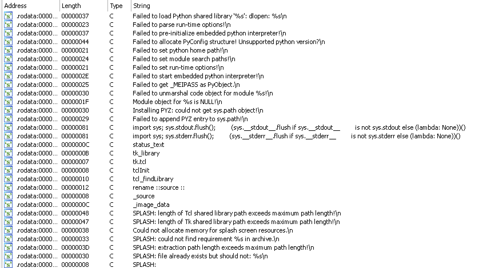<figcaption></figcaption></figure>

Based on above information i tried to extract the pyc file using [pyinstxtractor](https://github.com/extremecoders-re/pyinstxtractor).

<figure>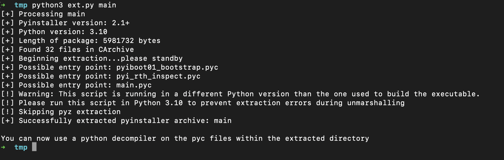<figcaption></figcaption></figure>

<figure>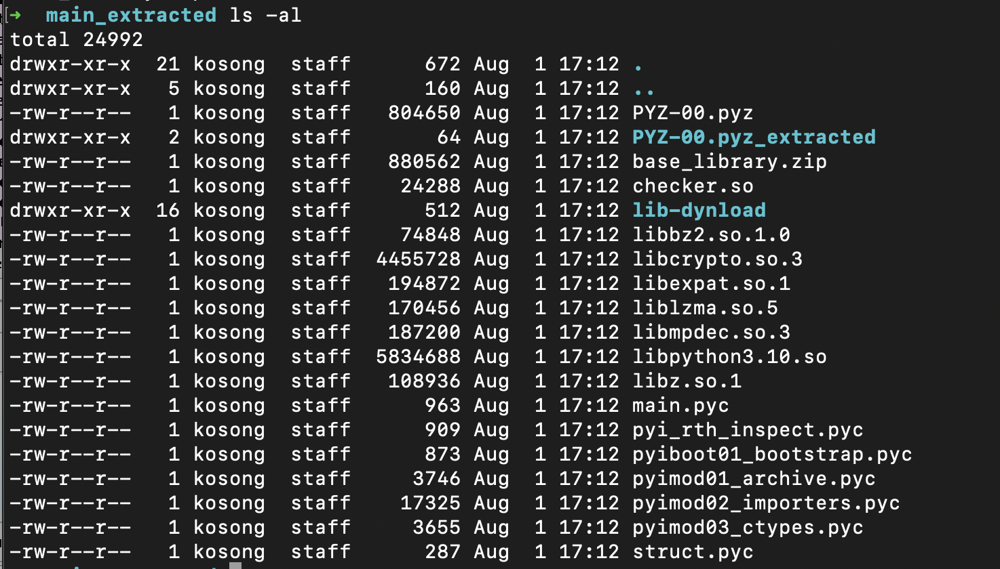<figcaption></figcaption></figure>

Lets use pycdc to deocmpile main.pyc file

```
pycdc main.pyc
```

```python
def emulate(opcodes):
    exec(opcodes, globals())


def main():
Warning: block stack is not empty!
    global chk, t, FLAG, checker
    chk = 0
    t = [
        92,
        138,
        226,
        248,
        124,
        187,
        195,
        106,
        182,
        233,
        9,
        79,
        134,
        101,
        53,
        240,
        196,
        183,
        141,
        83,
        84,
        118,
        226,
        6,
        251,
        74,
        94,
        37,
        117,
        90]
    
    try:
        FLAG = list(input('Flag : ').encode())
    finally:
        pass
    print()
    return None
    import checker
    if chk == 4919:
        checker.check()
        for i, c in enumerate([
            11,
            248,
            141,
            150,
            27,
            187,
            195,
            106,
            182,
            233,
            9,
            79,
            134,
            101,
            53,
            240,
            196,
            183,
            141,
            83,
            84,
            118,
            226,
            6,
            251,
            74,
            94,
            37,
            117,
            90]):
            t[i] ^= c
        print(''.join(map(chr, t)))
        return None
    None('Wrong')
    return None


if __name__ == '__main__':
    main()
    return None
```

Although it was not fully decompile the pyc but we still can understand the flow.

* Some variable are initialize as global variable
* import checker library
* check the value of chk variable
* run checker.check
* print value of t xored with static value (array)

If we try to do the xor with above information we will get the output below

```python
arr = [11,248,141,150,27,187,195,106,182,233,9,79,134,101,53,240,196,183,141,83,84,118,226,6,251,74,94,37,117,90]
t = [92,138,226,248,124,187,195,106,182,233,9,79,134,101,53,240,196,183,141,83,84,118,226,6,251,74,94,37,117,90]

for i in range(len(arr)):
    t[i] ^= arr[i]
print(bytes(t))
```

<figure>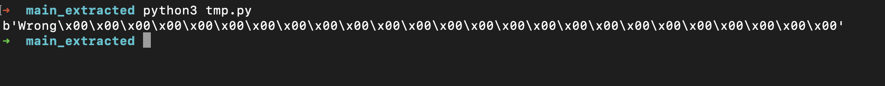<figcaption></figcaption></figure>

In this step my assumption is t variable will be overwritten with some value. Also our input will be processed by some function because t variable and our input (FLAG variable) are global variable. The executed code after receiving our input are importing check library and run check.check, so lets check the library.

<figure>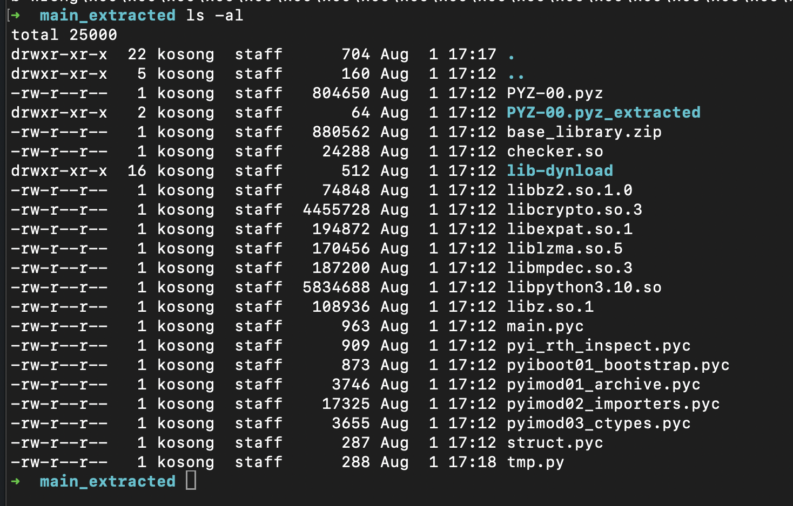<figcaption></figcaption></figure>

From image above we can see that there is no checker.pyc and the only file named checker is shared object file. It is possible to load shared object file in python, so lets try to decompile it using IDA. After opened it in IDA, search function with name checker because the called function is checker. Modify some function and variable based to make it easier to understand

<pre class="language-python" data-line-numbers><code class="lang-python">__int64 PyInit_checker()
{
  __int64 v1; // rax
  char v2; // [rsp+Fh] [rbp-31h]
  int i; // [rsp+10h] [rbp-30h]
  __int64 v4; // [rsp+18h] [rbp-28h]
  __int64 input; // [rsp+20h] [rbp-20h]
  __int64 Item; // [rsp+30h] [rbp-10h]
  __int64 v7; // [rsp+30h] [rbp-10h]

  qword_6780 = PyImport_ImportModule("__main__");
<strong>  qword_6788 = PyObject_GetAttrString_OBF(qword_6780, byte_307F);
</strong>  v4 = PyModule_Create2(&#x26;unk_6480, 1013LL);
  if ( !v4 )
    return 0LL;
  if ( (int)PyModule_AddFunctions(v4, &#x26;off_6500) >= 0 )
  {
    v2 = 1;
<strong>    input = PyObject_GetAttrString_OBF(qword_6780, byte_3015);
</strong>    if ( PyList_Size(input) == 32 )
    {
      Item = PyList_GetItem(input, 31LL);
      if ( PyLong_AsLong(Item) != 125 )
        v2 = 0;
      for ( i = 0; i &#x3C;= 4; ++i )
      {
        v7 = PyList_GetItem(input, i);
        if ( (unsigned int)PyLong_AsLong(v7) != off_6460[i] )// Compare with DEAD{
          v2 = 0;
      }
    }
    else
    {
      v2 = 0;
    }
    if ( v2 )
    {
<strong>      PyObject_GetAttrString_OBF(qword_6780, byte_3087);
</strong>      v1 = PyLong_FromLong(4919LL);
      PyObject_SetAttrString(qword_6780, &#x26;chk_variable, v1);
    }
    ++dword_6790;
    return v4;
  }
  else
  {
    sub_1396(v4);
    return 0LL;
  }
}
</code></pre>

* PyObject\_GetAttrString\_OBF will do string deobfuscation/decode for the second argument
* Our input will be stored in input variable and the size should be 32
* input\[31] should 125 or "}"
* The first 5 bytes of input (index 0 - 4) should be "DEAD{"

So if our input contains DEAD{...} and it has length 32 it will change the chk variable to 4919 which is same like 0x1337. PyObject\_GetAttrString\_OBF just do negation of the second argument, below is the implementation in python

```python
def PyObject_GetAttrString_OBF(arg):
    arr = []
    for i in arg:
        arr.append(~i & 0xff )
    return bytes(arr)

byte_307F = [0x9A, 0x92, 0x8A, 0x93, 0x9E, 0x8B, 0x9A]
byte_3015 = [0x0B9, 0x0B3, 0x0BE, 0x0B8]
byte_3087 = [0x9C, 0x97, 0x94]

print(PyObject_GetAttrString_OBF(byte_307F))
print(PyObject_GetAttrString_OBF(byte_3015))
print(PyObject_GetAttrString_OBF(byte_3087))
```

<figure>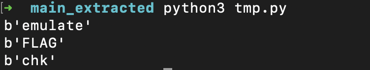<figcaption></figcaption></figure>

The function will be added in flight through function PyModule\_AddFunctions. The second argument will pointing to check function. Double click off\_6500 and take a look on off\_6500+8, there will be function address.

<figure><figcaption></figcaption></figure>

Static analyze the code and take some notes

```c
__int64 sub_2B3C()
{
  __int64 v0; // rax
  int i; // [rsp+0h] [rbp-10h]
  unsigned int j; // [rsp+4h] [rbp-Ch]
  __int64 AttrString_OBF; // [rsp+8h] [rbp-8h]

  sub_1F3B();                                   // Store input to .bss and initialize some values
  for ( i = 0; i <= 2; ++i )
    sub_1DBC();                                 // initialize and call function to process our input
  if ( !(PROCESSED_INPUT[2] ^ 0xFDF61CB53A00DAA8LL | PROCESSED_INPUT[1] ^ 0x273AED9AEFD29A3CLL | PROCESSED_INPUT[0] ^ 0x7AB48E39E26BE2A7LL | PROCESSED_INPUT[3] ^ 0xFC796489FC8864EELL) )
  {
    AttrString_OBF = PyObject_GetAttrString_OBF(MAIN_MODULE, var_t);
    for ( j = 0; j <= 0x1D; ++j )
    {
      v0 = PyLong_FromUnsignedLongLong(byte_6410[j]);
      PyList_SetItem(AttrString_OBF, (int)j, v0);// change t variable to output Correct!
    }
  }
  return sub_13CF(&Py_NoneStruct);
}
```

Now we know that we need to satisfy the comparison. Because the function that process our input is sub\_1DBC lets take a look on it.

```c
v16 = PyBytes_FromString(&unk_3011);
  v0 = sub_1491(&unk_3011);
  v1 = sub_1491(&unk_3011);
  v2 = PyTuple_New(0LL);
  v3 = PyTuple_New(0LL);
  v4 = PyTuple_New(0LL);
  v15 = qword_6760[dword_6790];
  v14 = qword_6740[dword_6790];
  v5 = PyBytes_FromStringAndSize(qword_6440[dword_6790], dword_6430[dword_6790]);
  v6 = PyCode_New(0LL, 0LL, 0LL, 16LL, 0LL, v5, v14, v15, v4, v3, v2, v1, v0, 0LL, v16);
  v11 = PyTuple_Pack(1LL, v6, v7, v8, v9, v10, v13, v14, v15, v16, v17, v6, v18, v19);
  PyObject_CallObject(qword_6788, v11);
  return (unsigned int)++dword_6790;
```

The algorithm doesnt directly shown up, lets take a look on PROCESSED\_INPUT variable. PROCESSED\_INPUT variable has so many cross references, go to one of the cross reference we will see function like below.

<figure>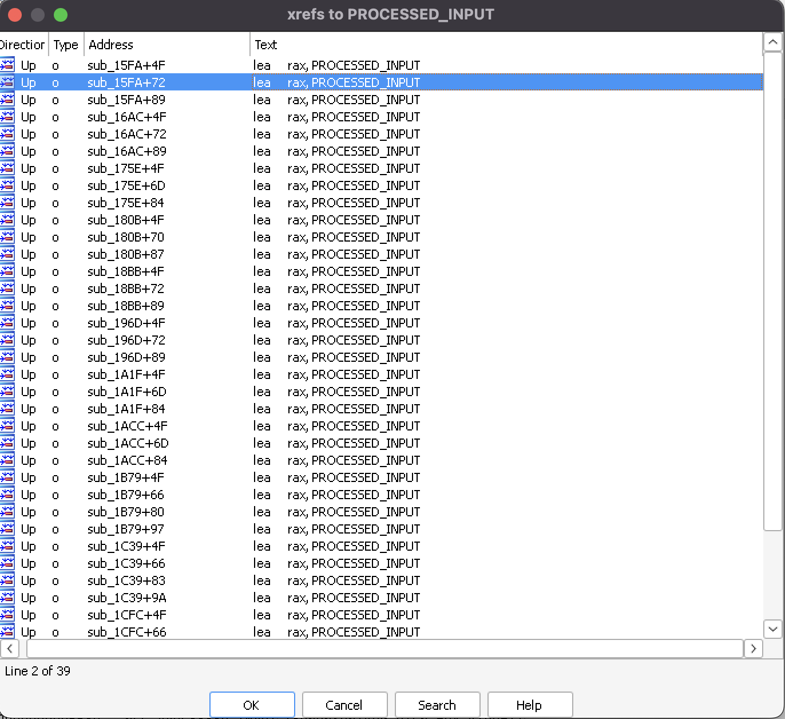<figcaption></figcaption></figure>

<figure>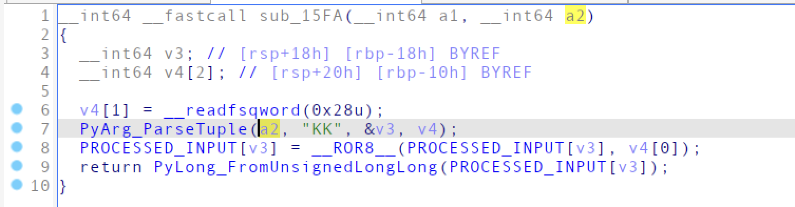<figcaption></figcaption></figure>

From code above we can see that our input will processed by rotate left instruction, looking at another function there will be some arithmetic or logic operator also. My approach during the competition is to set breakpoint on all available operator and then trace the operation. Set breakpoint on all available operator using idapython

```python
from idaapi import *
import idautils
import idc

def print_hex(arr):
	tmp = []
	for i in arr:
		tmp.append(hex(i))
	print(tmp)

def set_bp(ea, cond):
    idaapi.add_bpt(ea, 4, BPT_DEFAULT)

def get_inst(address):
	insn = insn_t()
	size = decode_insn(insn, address)
	inst = idc.print_insn_mnem(address)
	operand = []    
	for j in range(3):
		tmp = idc.print_operand(address, j)
		if(tmp == ''):
			break
		operand.append(tmp)
	return inst + " " + ", ".join(operand), operand, size

def bp_operator(address):
	start_address = address
	print(hex(start_address))
	for _ in range(10):
		inst, operand, size = get_inst(start_address)
		if "mov" not in inst and "lea" not in inst:
			break
		start_address += size
	return start_address


address = 0x66E0
list_target = [i.frm for i in idautils.XrefsTo(address)] 
list_target.sort()
list_target = list_target[:-2]

new_list_target = [[] for _ in range(3)]
for i in range(24):
	new_list_target[0].append(list_target[i])

for i in range(24, 36):
	new_list_target[1].append(list_target[i])

for i in range(0, len(new_list_target[0]), 3):
    set_bp(bp_operator(new_list_target[0][i]), 'view_regs()')

for i in range(0, len(new_list_target[1]), 4):
    set_bp(bp_operator(new_list_target[1][i]), 'view_regs()')
```

<figure>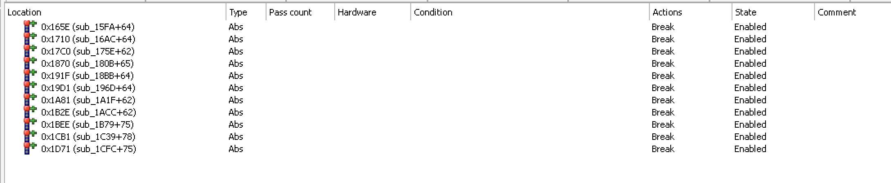<figcaption></figcaption></figure>

After that setup debugger for .so files

* guest
  * run linux\_server64 on linux as root (1)
  * run python3.10 main.pyc (4)
  * trigger breakpoint by input value (7)
* host
  * Select debugger (2)
    * Remote linux debugger
  * process options (3)
    * set hostname to IP Address of guest
  * attach to process (5)
    * select python3 main.pyc
  * continue the process (6)
  * click `same` on debugger warning popup (8)

After that we will see image like below

<figure>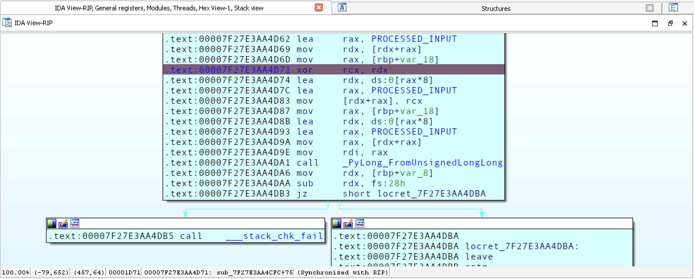<figcaption></figcaption></figure>

run automation below to trace the instruction

```python
from idaapi import *
import idautils
import idc

def print_hex(arr):
	tmp = []
	for i in arr:
		tmp.append(hex(i))
	print(tmp)

def get_inst(address):
	insn = insn_t()
	size = decode_insn(insn, address)
	inst = idc.print_insn_mnem(address)
	operand = []    
	for j in range(3):
		tmp = idc.print_operand(address, j)
		if(tmp == ''):
			break
		operand.append(tmp)
	return inst + " " + ", ".join(operand), operand, size

tracer = []

for _ in range(404):
	print(_)
	rv = idaapi.regval_t()
	idaapi.get_reg_val('RIP', rv)
	inst, operand, size = get_inst(rv.ival)
	dict = {}
	for opn in operand:
		idaapi.get_reg_val(opn, rv)
		dict[opn] = rv.ival
	tracer.append([inst, dict])
	idaapi.continue_process()
	idaapi.wait_for_next_event(idaapi.WFNE_SUSP, -1)

print(tracer)
```

```
[['xor rcx, rdx', {'rcx': 0, 'rdx': 0}], ['xor rcx, rdx', {'rcx': 0, 'rdx': 0}], ['xor rcx, rdx', {'rcx': 0, 'rdx': 0}], ['add rcx, rdx', {'rcx': 0, 'rdx': 3616725281739457860}], ['add rcx, rdx', {'rcx': 0, 'rdx': 3616725281739457860}], ['and rcx, rdx', {'rcx': 3616725281739457860, 'rdx': 255}], ['xor rcx, rdx', {'rcx': 68, 'rdx': 40}], ['xor rcx, rdx', {'rcx': 0, 'rdx': 108}], ['shl rdx, cl', {'rdx': 108, 'cl': 8}], ['shr rdx, cl', {'rdx': 3616725281739457860, 'cl': 8}], ['xor rcx, rdx', {'rcx': 108, 'rdx': 108}], ['add rcx, rdx', {'rcx': 0, 'rdx': 14127833131794757}], ['and rcx, rdx', {'rcx': 14127833131794757, 'rdx': 255}], ['xor rcx, rdx', {'rcx': 69, 'rdx': 177}], ['xor rcx, rdx', {'rcx': 27648, 'rdx': 244}], ['shl rdx, cl', {'rdx': 27892, 'cl': 8}], ['shr rdx, cl', {'rdx': 14127833131794757, 'cl': 8}], ['xor rcx, rdx', {'rcx': 244, 'rdx': 244}], ['add rcx, rdx', {'rcx': 0, 'rdx': 55186848171073}], ['and rcx, rdx', {'rcx': 55186848171073, 'rdx': 255}], ['xor rcx, rdx', {'rcx': 65, 'rdx': 97}], ['xor rcx, rdx', {'rcx': 7140352, 'rdx': 32}], ['shl rdx, cl', {'rdx': 7140384, 'cl': 8}], ['shr rdx, cl', {'rdx': 55186848171073, 'cl': 8}], ['xor rcx, rdx', {'rcx': 32, 'rdx': 32}], ['add rcx, rdx', {'rcx': 0, 'rdx': 215573625668}], ['and rcx, rdx', {'rcx': 215573625668, 'rdx': 255}], ['xor rcx, rdx', {'rcx': 68, 'rdx': 110}], ['xor rcx, rdx', {'rcx': 1827938304, 'rdx': 42}], ['shl rdx, cl', {'rdx': 1827938346, 'cl': 8}], ['shr rdx, cl', {'rdx': 215573625668, 'cl': 8}], ['xor rcx, rdx', {'rcx': 42, 'rdx': 42}], ['add rcx, rdx', {'rcx': 0, 'rdx': 842084475}], ['and rcx, rdx', {'rcx': 842084475, 'rdx': 255}], ['xor rcx, rdx', {'rcx': 123, 'rdx': 3}], ['xor rcx, rdx', {'rcx': 467952216576, 'rdx': 120}], ['shl rdx, cl', {'rdx': 467952216696, 'cl': 8}], ['shr rdx, cl', {'rdx': 842084475, 'cl': 8}], ['xor rcx, rdx', {'rcx': 120, 'rdx': 120}], ['add rcx, rdx', {'rcx': 0, 'rdx': 3289392}], ['and rcx, rdx', {'rcx': 3289392, 'rdx': 255}], ['xor rcx, rdx', {'rcx': 48, 'rdx': 140}], ['xor rcx, rdx', {'rcx': 119795767474176, 'rdx': 188}], ['shl rdx, cl', {'rdx': 119795767474364, 'cl': 8}], ['shr rdx, cl', {'rdx': 3289392, 'cl': 8}], ['xor rcx, rdx', {'rcx': 188, 'rdx': 188}], ['add rcx, rdx', {'rcx': 0, 'rdx': 12849}], ['and rcx, rdx', {'rcx': 12849, 'rdx': 255}], ['xor rcx, rdx', {'rcx': 49, 'rdx': 85}], ['xor rcx, rdx', {'rcx': 30667716473437184, 'rdx': 100}], ['shl rdx, cl', {'rdx': 30667716473437284, 'cl': 8}], ['shr rdx, cl', {'rdx': 12849, 'cl': 8}], ['xor rcx, rdx', {'rcx': 100, 'rdx': 100}], ['add rcx, rdx', {'rcx': 0, 'rdx': 50}], ['and rcx, rdx', {'rcx': 50, 'rdx': 255}], ['xor rcx, rdx', {'rcx': 50, 'rdx': 51}], ['xor rcx, rdx', {'rcx': 7850935417199944704, 'rdx': 1}], ['xor rcx, rdx', {'rcx': 3616725281739457860, 'rdx': 3616725281739457860}], ['add rcx, rdx', {'rcx': 0, 'rdx': 7850935417199944705}], ['xor rcx, rdx', {'rcx': 50, 'rdx': 50}], ['xor rcx, rdx', {'rcx': 1, 'rdx': 1}], ['xor rcx, rdx', {'rcx': 7850935417199944705, 'rdx': 7850935417199944705}], ['add rcx, rdx', {'rcx': 0, 'rdx': 7005692505135330355}], ['add rcx, rdx', {'rcx': 0, 'rdx': 7005692505135330355}], ['and rcx, rdx', {'rcx': 7005692505135330355, 'rdx': 255}], ['xor rcx, rdx', {'rcx': 51, 'rdx': 202}], ['xor rcx, rdx', {'rcx': 0, 'rdx': 249}], ['shl rdx, cl', {'rdx': 249, 'cl': 8}], ['shr rdx, cl', {'rdx': 7005692505135330355, 'cl': 8}], ['xor rcx, rdx', {'rcx': 249, 'rdx': 249}], ['add rcx, rdx', {'rcx': 0, 'rdx': 27365986348184884}], ['and rcx, rdx', {'rcx': 27365986348184884, 'rdx': 255}], ['xor rcx, rdx', {'rcx': 52, 'rdx': 90}], ['xor rcx, rdx', {'rcx': 63744, 'rdx': 110}], ['shl rdx, cl', {'rdx': 63854, 'cl': 8}], ['shr rdx, cl', {'rdx': 27365986348184884, 'cl': 8}], ['xor rcx, rdx', {'rcx': 110, 'rdx': 110}], ['add rcx, rdx', {'rcx': 0, 'rdx': 106898384172597}], ['and rcx, rdx', {'rcx': 106898384172597, 'rdx': 255}], ['xor rcx, rdx', {'rcx': 53, 'rdx': 189}], ['xor rcx, rdx', {'rcx': 16346624, 'rdx': 136}], ['shl rdx, cl', {'rdx': 16346760, 'cl': 8}], ['shr rdx, cl', {'rdx': 106898384172597, 'cl': 8}], ['xor rcx, rdx', {'rcx': 136, 'rdx': 136}], ['add rcx, rdx', {'rcx': 0, 'rdx': 417571813174}], ['and rcx, rdx', {'rcx': 417571813174, 'rdx': 255}], ['xor rcx, rdx', {'rcx': 54, 'rdx': 163}], ['xor rcx, rdx', {'rcx': 4184770560, 'rdx': 149}], ['shl rdx, cl', {'rdx': 4184770709, 'cl': 8}], ['shr rdx, cl', {'rdx': 417571813174, 'cl': 8}], ['xor rcx, rdx', {'rcx': 149, 'rdx': 149}], ['add rcx, rdx', {'rcx': 0, 'rdx': 1631139895}], ['and rcx, rdx', {'rcx': 1631139895, 'rdx': 255}], ['xor rcx, rdx', {'rcx': 55, 'rdx': 138}], ['xor rcx, rdx', {'rcx': 1071301301504, 'rdx': 189}], ['shl rdx, cl', {'rdx': 1071301301693, 'cl': 8}], ['shr rdx, cl', {'rdx': 1631139895, 'cl': 8}], ['xor rcx, rdx', {'rcx': 189, 'rdx': 189}], ['add rcx, rdx', {'rcx': 0, 'rdx': 6371640}], ['and rcx, rdx', {'rcx': 6371640, 'rdx': 255}], ['xor rcx, rdx', {'rcx': 56, 'rdx': 206}], ['xor rcx, rdx', {'rcx': 274253133233408, 'rdx': 246}], ['shl rdx, cl', {'rdx': 274253133233654, 'cl': 8}], ['shr rdx, cl', {'rdx': 6371640, 'cl': 8}], ['xor rcx, rdx', {'rcx': 246, 'rdx': 246}], ['add rcx, rdx', {'rcx': 0, 'rdx': 24889}], ['and rcx, rdx', {'rcx': 24889, 'rdx': 255}], ['xor rcx, rdx', {'rcx': 57, 'rdx': 163}], ['xor rcx, rdx', {'rcx': 70208802107815424, 'rdx': 154}], ['shl rdx, cl', {'rdx': 70208802107815578, 'cl': 8}], ['shr rdx, cl', {'rdx': 24889, 'cl': 8}], ['xor rcx, rdx', {'rcx': 154, 'rdx': 154}], ['add rcx, rdx', {'rcx': 0, 'rdx': 97}], ['and rcx, rdx', {'rcx': 97, 'rdx': 255}], ['xor rcx, rdx', {'rcx': 97, 'rdx': 133}], ['xor rcx, rdx', {'rcx': 17973453339600787968, 'rdx': 228}], ['xor rcx, rdx', {'rcx': 7005692505135330355, 'rdx': 7005692505135330355}], ['add rcx, rdx', {'rcx': 0, 'rdx': 17973453339600788196}], ['xor rcx, rdx', {'rcx': 97, 'rdx': 97}], ['xor rcx, rdx', {'rcx': 228, 'rdx': 228}], ['xor rcx, rdx', {'rcx': 17973453339600788196, 'rdx': 17973453339600788196}], ['add rcx, rdx', {'rcx': 0, 'rdx': 7595434461045744482}], ['add rcx, rdx', {'rcx': 0, 'rdx': 7595434461045744482}], ['and rcx, rdx', {'rcx': 7595434461045744482, 'rdx': 255}], ['xor rcx, rdx', {'rcx': 98, 'rdx': 87}], ['xor rcx, rdx', {'rcx': 0, 'rdx': 53}], ['shl rdx, cl', {'rdx': 53, 'cl': 8}], ['shr rdx, cl', {'rdx': 7595434461045744482, 'cl': 8}], ['xor rcx, rdx', {'rcx': 53, 'rdx': 53}], ['add rcx, rdx', {'rcx': 0, 'rdx': 29669665863459939}], ['and rcx, rdx', {'rcx': 29669665863459939, 'rdx': 255}], ['xor rcx, rdx', {'rcx': 99, 'rdx': 19}], ['xor rcx, rdx', {'rcx': 13568, 'rdx': 112}], ['shl rdx, cl', {'rdx': 13680, 'cl': 8}], ['shr rdx, cl', {'rdx': 29669665863459939, 'cl': 8}], ['xor rcx, rdx', {'rcx': 112, 'rdx': 112}], ['add rcx, rdx', {'rcx': 0, 'rdx': 115897132279140}], ['and rcx, rdx', {'rcx': 115897132279140, 'rdx': 255}], ['xor rcx, rdx', {'rcx': 100, 'rdx': 238}], ['xor rcx, rdx', {'rcx': 3502080, 'rdx': 138}], ['shl rdx, cl', {'rdx': 3502218, 'cl': 8}], ['shr rdx, cl', {'rdx': 115897132279140, 'cl': 8}], ['xor rcx, rdx', {'rcx': 138, 'rdx': 138}], ['add rcx, rdx', {'rcx': 0, 'rdx': 452723172965}], ['and rcx, rdx', {'rcx': 452723172965, 'rdx': 255}], ['xor rcx, rdx', {'rcx': 101, 'rdx': 47}], ['xor rcx, rdx', {'rcx': 896567808, 'rdx': 74}], ['shl rdx, cl', {'rdx': 896567882, 'cl': 8}], ['shr rdx, cl', {'rdx': 452723172965, 'cl': 8}], ['xor rcx, rdx', {'rcx': 74, 'rdx': 74}], ['add rcx, rdx', {'rcx': 0, 'rdx': 1768449894}], ['and rcx, rdx', {'rcx': 1768449894, 'rdx': 255}], ['xor rcx, rdx', {'rcx': 102, 'rdx': 93}], ['xor rcx, rdx', {'rcx': 229521377792, 'rdx': 59}], ['shl rdx, cl', {'rdx': 229521377851, 'cl': 8}], ['shr rdx, cl', {'rdx': 1768449894, 'cl': 8}], ['xor rcx, rdx', {'rcx': 59, 'rdx': 59}], ['add rcx, rdx', {'rcx': 0, 'rdx': 6908007}], ['and rcx, rdx', {'rcx': 6908007, 'rdx': 255}], ['xor rcx, rdx', {'rcx': 103, 'rdx': 216}], ['xor rcx, rdx', {'rcx': 58757472729856, 'rdx': 191}], ['shl rdx, cl', {'rdx': 58757472730047, 'cl': 8}], ['shr rdx, cl', {'rdx': 6908007, 'cl': 8}], ['xor rcx, rdx', {'rcx': 191, 'rdx': 191}], ['add rcx, rdx', {'rcx': 0, 'rdx': 26984}], ['and rcx, rdx', {'rcx': 26984, 'rdx': 255}], ['xor rcx, rdx', {'rcx': 104, 'rdx': 150}], ['xor rcx, rdx', {'rcx': 15041913018892032, 'rdx': 254}], ['shl rdx, cl', {'rdx': 15041913018892286, 'cl': 8}], ['shr rdx, cl', {'rdx': 26984, 'cl': 8}], ['xor rcx, rdx', {'rcx': 254, 'rdx': 254}], ['add rcx, rdx', {'rcx': 0, 'rdx': 105}], ['and rcx, rdx', {'rcx': 105, 'rdx': 255}], ['xor rcx, rdx', {'rcx': 105, 'rdx': 253}], ['xor rcx, rdx', {'rcx': 3850729732836425216, 'rdx': 148}], ['xor rcx, rdx', {'rcx': 7595434461045744482, 'rdx': 7595434461045744482}], ['add rcx, rdx', {'rcx': 0, 'rdx': 3850729732836425364}], ['xor rcx, rdx', {'rcx': 105, 'rdx': 105}], ['xor rcx, rdx', {'rcx': 148, 'rdx': 148}], ['xor rcx, rdx', {'rcx': 3850729732836425364, 'rdx': 3850729732836425364}], ['add rcx, rdx', {'rcx': 0, 'rdx': 9038846972205493098}], ['add rcx, rdx', {'rcx': 0, 'rdx': 9038846972205493098}], ['and rcx, rdx', {'rcx': 9038846972205493098, 'rdx': 255}], ['xor rcx, rdx', {'rcx': 106, 'rdx': 115}], ['xor rcx, rdx', {'rcx': 0, 'rdx': 25}], ['shl rdx, cl', {'rdx': 25, 'cl': 8}], ['shr rdx, cl', {'rdx': 9038846972205493098, 'cl': 8}], ['xor rcx, rdx', {'rcx': 25, 'rdx': 25}], ['add rcx, rdx', {'rcx': 0, 'rdx': 35307995985177707}], ['and rcx, rdx', {'rcx': 35307995985177707, 'rdx': 255}], ['xor rcx, rdx', {'rcx': 107, 'rdx': 140}], ['xor rcx, rdx', {'rcx': 6400, 'rdx': 231}], ['shl rdx, cl', {'rdx': 6631, 'cl': 8}], ['shr rdx, cl', {'rdx': 35307995985177707, 'cl': 8}], ['xor rcx, rdx', {'rcx': 231, 'rdx': 231}], ['add rcx, rdx', {'rcx': 0, 'rdx': 137921859317100}], ['and rcx, rdx', {'rcx': 137921859317100, 'rdx': 255}], ['xor rcx, rdx', {'rcx': 108, 'rdx': 123}], ['xor rcx, rdx', {'rcx': 1697536, 'rdx': 23}], ['shl rdx, cl', {'rdx': 1697559, 'cl': 8}], ['shr rdx, cl', {'rdx': 137921859317100, 'cl': 8}], ['xor rcx, rdx', {'rcx': 23, 'rdx': 23}], ['add rcx, rdx', {'rcx': 0, 'rdx': 538757262957}], ['and rcx, rdx', {'rcx': 538757262957, 'rdx': 255}], ['xor rcx, rdx', {'rcx': 109, 'rdx': 251}], ['xor rcx, rdx', {'rcx': 434575104, 'rdx': 150}], ['shl rdx, cl', {'rdx': 434575254, 'cl': 8}], ['shr rdx, cl', {'rdx': 538757262957, 'cl': 8}], ['xor rcx, rdx', {'rcx': 150, 'rdx': 150}], ['add rcx, rdx', {'rcx': 0, 'rdx': 2104520558}], ['and rcx, rdx', {'rcx': 2104520558, 'rdx': 255}], ['xor rcx, rdx', {'rcx': 110, 'rdx': 174}], ['xor rcx, rdx', {'rcx': 111251265024, 'rdx': 192}], ['shl rdx, cl', {'rdx': 111251265216, 'cl': 8}], ['shr rdx, cl', {'rdx': 2104520558, 'cl': 8}], ['xor rcx, rdx', {'rcx': 192, 'rdx': 192}], ['add rcx, rdx', {'rcx': 0, 'rdx': 8220783}], ['and rcx, rdx', {'rcx': 8220783, 'rdx': 255}], ['xor rcx, rdx', {'rcx': 111, 'rdx': 217}], ['xor rcx, rdx', {'rcx': 28480323895296, 'rdx': 182}], ['shl rdx, cl', {'rdx': 28480323895478, 'cl': 8}], ['shr rdx, cl', {'rdx': 8220783, 'cl': 8}], ['xor rcx, rdx', {'rcx': 182, 'rdx': 182}], ['add rcx, rdx', {'rcx': 0, 'rdx': 32112}], ['and rcx, rdx', {'rcx': 32112, 'rdx': 255}], ['xor rcx, rdx', {'rcx': 112, 'rdx': 167}], ['xor rcx, rdx', {'rcx': 7290962917242368, 'rdx': 215}], ['shl rdx, cl', {'rdx': 7290962917242583, 'cl': 8}], ['shr rdx, cl', {'rdx': 32112, 'cl': 8}], ['xor rcx, rdx', {'rcx': 215, 'rdx': 215}], ['add rcx, rdx', {'rcx': 0, 'rdx': 125}], ['and rcx, rdx', {'rcx': 125, 'rdx': 255}], ['xor rcx, rdx', {'rcx': 125, 'rdx': 117}], ['xor rcx, rdx', {'rcx': 1866486506814101248, 'rdx': 8}], ['xor rcx, rdx', {'rcx': 9038846972205493098, 'rdx': 9038846972205493098}], ['add rcx, rdx', {'rcx': 0, 'rdx': 1866486506814101256}], ['sub rcx, rsi', {'rcx': 1866486506814101256, 'rsi': 17973453339600788196}], ['sub rcx, rsi', {'rcx': 3850729732836425364, 'rsi': 11940581666366945049}], ['sub rcx, rsi', {'rcx': 7850935417199944705, 'rsi': 2339777240922864676}], ['add rcx, rdx', {'rcx': 5511158176277080029, 'rdx': 10574414536351493947}], ['xor rcx, rdx', {'rcx': 10356892140179031931, 'rdx': 14617729643276067908}], ['sub rcx, rsi', {'rcx': 2339777240922864676, 'rsi': 251711479862292877}], ['xor rcx, rdx', {'rcx': 2088065761060571799, 'rdx': 17973453339600788196}], ['rol rdx, cl', {'rdx': 16543063018563260531, 'cl': 45}], ['sub rcx, rsi', {'rcx': 12253868742626595787, 'rsi': 16085572712628573976}], ['xor rcx, rdx', {'rcx': 5001116745541542719, 'rdx': 11755596030111115239}], ['ror rdx, cl', {'rdx': 16085572712628573976, 'cl': 44}], ['ror rdx, cl', {'rdx': 17973453339600788196, 'cl': 9}], ['sub rcx, rsi', {'rcx': 17474968301389870006, 'rsi': 16592331268180477144}], ['add rcx, rdx', {'rcx': 8249670121377692493, 'rdx': 16592331268180477144}], ['ror rdx, cl', {'rdx': 6395257315848618021, 'cl': 52}], ['sub rcx, rsi', {'rcx': 16592331268180477144, 'rsi': 6003555863945812449}], ['sub rcx, rsi', {'rcx': 14615040103707573427, 'rsi': 597381048376120716}], ['add rcx, rdx', {'rcx': 14017659055331452711, 'rdx': 10588775404234664695}], ['xor rcx, rdx', {'rcx': 6159690385856565790, 'rdx': 9018196039742671436}], ['rol rdx, cl', {'rdx': 10588775404234664695, 'cl': 38}], ['sub rcx, rsi', {'rcx': 2908353673277790290, 'rsi': 882637033209392862}], ['xor rcx, rdx', {'rcx': 597381048376120716, 'rdx': 13351145118894221622}], ['ror rdx, cl', {'rdx': 12754925704553118906, 'cl': 60}], ['rol rdx, cl', {'rdx': 882637033209392862, 'cl': 57}], ['xor rcx, rdx', {'rcx': 13553723280952400349, 'rdx': 10099253478012640935}], ['sub rcx, rsi', {'rcx': 3476706365442770810, 'rsi': 2025716640068397428}], ['add rcx, rdx', {'rcx': 1164626462044834731, 'rdx': 1450989725374373382}], ['sub rcx, rsi', {'rcx': 17526529689982126135, 'rsi': 6922426570794261874}], ['sub rcx, rsi', {'rcx': 2025716640068397428, 'rsi': 14319031419321868107}], ['rol rdx, cl', {'rdx': 1450989725374373382, 'cl': 58}], ['ror rdx, cl', {'rdx': 2615616187419208113, 'cl': 56}], ['xor rcx, rdx', {'rcx': 10604103119187864261, 'rdx': 6153429294456080937}], ['xor rcx, rdx', {'rcx': 14288805397828755692, 'rdx': 6706939970549528029}], ['xor rcx, rdx', {'rcx': 1752053971369245048, 'rdx': 11195911924162057521}], ['rol rdx, cl', {'rdx': 6153429294456080937, 'cl': 30}], ['xor rcx, rdx', {'rcx': 11195911924162057521, 'rdx': 8714470315649745175}], ['add rcx, rdx', {'rcx': 16406571691834086438, 'rdx': 9443860807025421385}], ['xor rcx, rdx', {'rcx': 5514957325773418788, 'rdx': 9443860807025421385}], ['rol rdx, cl', {'rdx': 14953715657891536237, 'cl': 13}], ['sub rcx, rsi', {'rcx': 14458020016042129904, 'rsi': 1559227194547134158}], ['rol rdx, cl', {'rdx': 15249859634506848213, 'cl': 63}], ['rol rdx, cl', {'rdx': 12898792821494995746, 'cl': 26}], ['xor rcx, rdx', {'rcx': 16848301854108199914, 'rdx': 9443860807025421385}], ['sub rcx, rsi', {'rcx': 9443860807025421385, 'rsi': 2551354200215176177}], ['sub rcx, rsi', {'rcx': 7700702481794680739, 'rsi': 6892506606810245208}], ['sub rcx, rsi', {'rcx': 17001727875764455134, 'rsi': 808195874984435531}], ['ror rdx, cl', {'rdx': 6892506606810245208, 'cl': 42}], ['add rcx, rdx', {'rcx': 7403688425149956207, 'rdx': 4556746416818193338}], ['add rcx, rdx', {'rcx': 11960434841968149545, 'rdx': 2642734308973145965}], ['sub rcx, rsi', {'rcx': 16193532000780019603, 'rsi': 10333998945874209222}], ['ror rdx, cl', {'rdx': 14603169150941295510, 'cl': 46}], ['sub rcx, rsi', {'rcx': 10333998945874209222, 'rsi': 11414929424574162730}], ['xor rcx, rdx', {'rcx': 808195874984435531, 'rdx': 5859533054905810381}], ['rol rdx, cl', {'rdx': 9503495927690373795, 'cl': 57}], ['sub rcx, rsi', {'rcx': 17365813595009598108, 'rsi': 6514025411833488006}], ['xor rcx, rdx', {'rcx': 5859533054905810381, 'rdx': 11457320156086200674}], ['sub rcx, rsi', {'rcx': 14866854880007492783, 'rsi': 6514025411833488006}], ['xor rcx, rdx', {'rcx': 5118277644590036565, 'rdx': 10851788183176110102}], ['add rcx, rdx', {'rcx': 10851788183176110102, 'rdx': 8743823835651182860}], ['sub rcx, rsi', {'rcx': 8352829468174004777, 'rsi': 15104666043544688195}], ['rol rdx, cl', {'rdx': 6514025411833488006, 'cl': 39}], ['rol rdx, cl', {'rdx': 15104666043544688195, 'cl': 55}], ['xor rcx, rdx', {'rcx': 11694907498338868198, 'rdx': 2443430701136884075}], ['xor rcx, rdx', {'rcx': 2443430701136884075, 'rdx': 8891926457727381901}], ['sub rcx, rsi', {'rcx': 1148867945117741346, 'rsi': 9485820164848380557}], ['add rcx, rdx', {'rcx': 1869349181747612853, 'rdx': 2827788817198162539}], ['xor rcx, rdx', {'rcx': 9485820164848380557, 'rdx': 728891123635864036}], ['add rcx, rdx', {'rcx': 9924224610856217449, 'rdx': 4697137998945775392}], ['add rcx, rdx', {'rcx': 4697137998945775392, 'rdx': 6101432535343518619}], ['sub rcx, rsi', {'rcx': 6525354424187011302, 'rsi': 14621362609801992841}], ['add rcx, rdx', {'rcx': 10109791853978912405, 'rdx': 10350735888094570077}], ['add rcx, rdx', {'rcx': 10350735888094570077, 'rdx': 10798570534289294011}], ['sub rcx, rsi', {'rcx': 10798570534289294011, 'rsi': 10964680514612737013}], ['add rcx, rdx', {'rcx': 2013783668363930866, 'rdx': 3016617568225720338}], ['sub rcx, rsi', {'rcx': 5030401236589651204, 'rsi': 2702562348674312472}], ['xor rcx, rdx', {'rcx': 2327838887915338732, 'rdx': 2702562348674312472}], ['rol rdx, cl', {'rdx': 2702562348674312472, 'cl': 13}], ['add rcx, rdx', {'rcx': 418635760998765300, 'rdx': 1442589320876959980}], ['ror rdx, cl', {'rdx': 18280634093386108614, 'cl': 58}], ['xor rcx, rdx', {'rcx': 14621362609801992841, 'rdx': 5300186185462590366}], ['xor rcx, rdx', {'rcx': 125, 'rdx': 125}], ['xor rcx, rdx', {'rcx': 8, 'rdx': 8}], ['xor rcx, rdx', {'rcx': 0, 'rdx': 1861225081875725280}], ['shr rdx, cl', {'rdx': 1861225081875725280, 'cl': 32}], ['xor rcx, rdx', {'rcx': 0, 'rdx': 1861225081875725280}], ['xor rcx, rdx', {'rcx': 433350233, 'rdx': 3129497952}], ['xor rcx, rdx', {'rcx': 2740731705, 'rdx': 1861225081875725280}], ['xor rcx, rdx', {'rcx': 1861225081875725280, 'rdx': 1861225080317789401}], ['xor rcx, rdx', {'rcx': 1861225080317789401, 'rdx': 2740731705}], ['xor rcx, rdx', {'rcx': 1861225081875725280, 'rdx': 4021042316}], ['xor rcx, rdx', {'rcx': 1861225079045867372, 'rdx': 2740731705}], ['xor rcx, rdx', {'rcx': 2740731705, 'rdx': 1861225080610093141}], ['xor rcx, rdx', {'rcx': 1861225080610093141, 'rdx': 1861225079045867372}], ['xor rcx, rdx', {'rcx': 2740731705, 'rdx': 509917840}], ['xor rcx, rdx', {'rcx': 3174598057, 'rdx': 1861225079045867372}], ['xor rcx, rdx', {'rcx': 1861225079045867372, 'rdx': 1861225081111003845}], ['xor rcx, rdx', {'rcx': 1861225081111003845, 'rdx': 3174598057}], ['xor rcx, rdx', {'rcx': 1861225079045867372, 'rdx': 256360629}], ['shl rdx, cl', {'rdx': 1861225079201073113, 'cl': 32}], ['xor rcx, rdx', {'rcx': 1861225081875725280, 'rdx': 1861225081875725280}], ['xor rcx, rdx', {'rcx': 0, 'rdx': 3230215461320785920}], ['xor rcx, rdx', {'rcx': 3230215461320785920, 'rdx': 3174598057}], ['xor rcx, rdx', {'rcx': 3230215461320785920, 'rdx': 3230215461320785920}], ['xor rcx, rdx', {'rcx': 3174598057, 'rdx': 3174598057}], ['xor rcx, rdx', {'rcx': 0, 'rdx': 9468686904405995799}], ['shr rdx, cl', {'rdx': 9468686904405995799, 'cl': 32}], ['xor rcx, rdx', {'rcx': 0, 'rdx': 9468686904405995799}], ['xor rcx, rdx', {'rcx': 2204600466, 'rdx': 3129497952}], ['xor rcx, rdx', {'rcx': 972018162, 'rdx': 9468686904405995799}], ['xor rcx, rdx', {'rcx': 9468686904405995799, 'rdx': 9468686905360834789}], ['xor rcx, rdx', {'rcx': 9468686905360834789, 'rdx': 972018162}], ['xor rcx, rdx', {'rcx': 9468686904405995799, 'rdx': 4021042316}], ['xor rcx, rdx', {'rcx': 9468686904048160155, 'rdx': 972018162}], ['xor rcx, rdx', {'rcx': 972018162, 'rdx': 9468686903638285417}], ['xor rcx, rdx', {'rcx': 9468686903638285417, 'rdx': 9468686904048160155}], ['xor rcx, rdx', {'rcx': 972018162, 'rdx': 509917840}], ['xor rcx, rdx', {'rcx': 663448418, 'rdx': 9468686904048160155}], ['xor rcx, rdx', {'rcx': 9468686904048160155, 'rdx': 9468686903468648185}], ['xor rcx, rdx', {'rcx': 9468686903468648185, 'rdx': 663448418}], ['xor rcx, rdx', {'rcx': 9468686904048160155, 'rdx': 256360629}], ['shl rdx, cl', {'rdx': 9468686903867395374, 'cl': 32}], ['xor rcx, rdx', {'rcx': 9468686904405995799, 'rdx': 9468686904405995799}], ['xor rcx, rdx', {'rcx': 0, 'rdx': 7091143210747035648}], ['xor rcx, rdx', {'rcx': 7091143210747035648, 'rdx': 663448418}], ['xor rcx, rdx', {'rcx': 7091143210747035648, 'rdx': 7091143210747035648}], ['xor rcx, rdx', {'rcx': 663448418, 'rdx': 663448418}], ['xor rcx, rdx', {'rcx': 0, 'rdx': 3297871888505832624}], ['shr rdx, cl', {'rdx': 3297871888505832624, 'cl': 32}], ['xor rcx, rdx', {'rcx': 0, 'rdx': 3297871888505832624}], ['xor rcx, rdx', {'rcx': 767845634, 'rdx': 3129497952}], ['xor rcx, rdx', {'rcx': 2538355810, 'rdx': 3297871888505832624}], ['xor rcx, rdx', {'rcx': 3297871888505832624, 'rdx': 3297871890339543250}], ['xor rcx, rdx', {'rcx': 3297871890339543250, 'rdx': 2538355810}], ['xor rcx, rdx', {'rcx': 3297871888505832624, 'rdx': 4021042316}], ['xor rcx, rdx', {'rcx': 3297871888865245244, 'rdx': 2538355810}], ['xor rcx, rdx', {'rcx': 2538355810, 'rdx': 3297871886503052382}], ['xor rcx, rdx', {'rcx': 3297871886503052382, 'rdx': 3297871888865245244}], ['xor rcx, rdx', {'rcx': 2538355810, 'rdx': 509917840}], ['xor rcx, rdx', {'rcx': 2301134578, 'rdx': 3297871888865245244}], ['xor rcx, rdx', {'rcx': 3297871888865245244, 'rdx': 3297871886870363854}], ['xor rcx, rdx', {'rcx': 3297871886870363854, 'rdx': 2301134578}], ['xor rcx, rdx', {'rcx': 3297871888865245244, 'rdx': 256360629}], ['shl rdx, cl', {'rdx': 3297871889053579401, 'cl': 32}], ['xor rcx, rdx', {'rcx': 3297871888505832624, 'rdx': 3297871888505832624}], ['xor rcx, rdx', {'rcx': 0, 'rdx': 11369610526591025152}], ['xor rcx, rdx', {'rcx': 11369610526591025152, 'rdx': 2301134578}], ['xor rcx, rdx', {'rcx': 11369610526591025152, 'rdx': 11369610526591025152}], ['xor rcx, rdx', {'rcx': 2301134578, 'rdx': 2301134578}], ['xor rcx, rdx', {'rcx': 0, 'rdx': 7815705333009199551}], ['shr rdx, cl', {'rdx': 7815705333009199551, 'cl': 32}], ['xor rcx, rdx', {'rcx': 0, 'rdx': 7815705333009199551}], ['xor rcx, rdx', {'rcx': 1819735703, 'rdx': 3129497952}], ['xor rcx, rdx', {'rcx': 3607015415, 'rdx': 7815705333009199551}], ['xor rcx, rdx', {'rcx': 7815705333009199551, 'rdx': 7815705334397083208}], ['xor rcx, rdx', {'rcx': 7815705334397083208, 'rdx': 3607015415}], ['xor rcx, rdx', {'rcx': 7815705333009199551, 'rdx': 4021042316}], ['xor rcx, rdx', {'rcx': 7815705334509440307, 'rdx': 3607015415}], ['xor rcx, rdx', {'rcx': 3607015415, 'rdx': 7815705333668586180}], ['xor rcx, rdx', {'rcx': 7815705333668586180, 'rdx': 7815705334509440307}], ['xor rcx, rdx', {'rcx': 3607015415, 'rdx': 509917840}], ['xor rcx, rdx', {'rcx': 3365541223, 'rdx': 7815705334509440307}], ['xor rcx, rdx', {'rcx': 7815705334509440307, 'rdx': 7815705333561923668}], ['xor rcx, rdx', {'rcx': 7815705333561923668, 'rdx': 3365541223}], ['xor rcx, rdx', {'rcx': 7815705334509440307, 'rdx': 256360629}], ['shl rdx, cl', {'rdx': 7815705334630600070, 'cl': 32}], ['xor rcx, rdx', {'rcx': 7815705333009199551, 'rdx': 7815705333009199551}], ['xor rcx, rdx', {'rcx': 0, 'rdx': 12378228813748764672}], ['xor rcx, rdx', {'rcx': 12378228813748764672, 'rdx': 3365541223}]]
```

Generate output for 2 different input then use script below to parse the output

```python
def create_op(op, opn, keys):
	assert len(keys) == 2
	op = op.replace(",", "")
	tmp = op.split(" ")
	fmt = "{} {} {} == {}"
	fmt2 = "{}({}, {}, 64) == {}"
	if tmp[0] == "add":
		result = opn[keys[0]] + opn[keys[1]]
		return fmt.format(tmp[1], "+", tmp[2], hex(result))
	if tmp[0] == "sub":
		result = opn[keys[0]] - opn[keys[1]]
		return fmt.format(tmp[1], "-", tmp[2], hex(result))
	if tmp[0] == "and":
		result = opn[keys[0]] & opn[keys[1]]
		return fmt.format(tmp[1], "&", tmp[2], hex(result))
	if tmp[0] == "shr":
		result = opn[keys[0]] >> opn[keys[1]]
		return fmt.format(tmp[1], ">>", tmp[2], hex(result))
	if tmp[0] == "shl":
		result = opn[keys[0]] << opn[keys[1]]
		return fmt.format(tmp[1], "<<", tmp[2], hex(result))
	if tmp[0] == "xor":
		result = opn[keys[0]] ^ opn[keys[1]]
		return fmt.format(tmp[1], "^", tmp[2], hex(result))
	if tmp[0] == "rol":
		result = rol(opn[keys[0]], opn[keys[1]], 64)
		return fmt2.format("rol", tmp[1], tmp[2], hex(result))
	if tmp[0] == "ror":
		result = ror(opn[keys[0]], opn[keys[1]], 64)
		return fmt2.format("ror", tmp[1], tmp[2], hex(result))
	else:
		print(tmp, opn, keys)
		exit()


rol = lambda val, r_bits, max_bits: \
    (val << r_bits%max_bits) & (2**max_bits-1) | \
    ((val & (2**max_bits-1)) >> (max_bits-(r_bits%max_bits)))
 
ror = lambda val, r_bits, max_bits: \
    ((val & (2**max_bits-1)) >> r_bits%max_bits) | \
    (val << (max_bits-(r_bits%max_bits)) & (2**max_bits-1))


arr1 = [] # output from DEAD{0123456789abcdefghijklmnop}
arr2 = [] # output from DEAD{qrstuvwxyzABCDEFGHIJKLMNOP}

inp = [0x3231307B44414544, 0x6139383736353433, 0x6968676665646362, 0x7D706F6E6D6C6B6A]
assert len(arr1) == len(arr2)
for i in range(404):
	data1 = arr1[i][1]
	data2 = arr2[i][1]
	op = arr1[i][0]
	keys = list(data1.keys())
	counter = 0
	diff_reg = []
	for key in keys:
		if data1[key] == data2[key]:
			counter += 1
		else:
			diff_reg.append(key)
	if counter != len(keys):	
		for key in keys:
			if key not in diff_reg:
				op = op.replace(key, str(data2[key]))
			#else:
			#	op = op.replace(key, hex(data2[key]))
		res_op = create_op(op, data2, keys)
		print(res_op)
```

Use the comment and uncomment versoin of `op = op.replace(key, hex(data2[key]))` then analyze it. In this step my objective is to recover the instruction and put it as python code, below is the reconstructed version.

```python
from Crypto.Util.number import *

def print_hex(arr):
	tmp = []
	for i in arr:
		tmp.append(hex(i))
	print(tmp)

rol = lambda val, r_bits, max_bits: \
    (val << r_bits%max_bits) & (2**max_bits-1) | \
    ((val & (2**max_bits-1)) >> (max_bits-(r_bits%max_bits)))
 
ror = lambda val, r_bits, max_bits: \
    ((val & (2**max_bits-1)) >> r_bits%max_bits) | \
    (val << (max_bits-(r_bits%max_bits)) & (2**max_bits-1))


MASK = 2**64 - 1

old_inp = [0x7372717B44414544, 0x417A797877767574, 0x4948474645444342, 0x7D504F4E4D4C4B4A]

for i in old_inp:
	print(long_to_bytes(i))
inp = []
for i in old_inp:
	inp.append(bytes_to_long(long_to_bytes(i)[::-1]))

tmp = inp[0] & (2**24 - 1)
tmp ^= 0x31558e
tmp1 = (0x6cf4202a78 << 24) | ((tmp & 0xff) << 16) | (((tmp >> 8) & 0xff) << 8) | (((tmp >> 16) & 0xff))

tmp2 = inp[1] ^ 0xca5abda38acea385
tmp3 = inp[2] ^ 0x5713ee2f5dd896fd
tmp4 = inp[3] ^ 0x738c7bfbaed9a775

tmp5 = (tmp4 - tmp2) & MASK
tmp6 = (tmp3 - 11940581666366945049) & MASK
tmp7 = (tmp1 - tmp5) & MASK

tmp7 = tmp7 + 10574414536351493947
tmp7 &= MASK
tmp6 = tmp6 ^ 14617729643276067908
tmp5 = tmp5 - 251711479862292877

tmp5 ^= tmp2
tmp5 = rol(tmp5, 45, 64)
tmp5 -= tmp7
tmp5 &= MASK

tmp6 = tmp6 ^ 11755596030111115239
tmp7 = ror(tmp7, 44, 64)
tmp2 = ror(tmp2, 9, 64)

tmp7 = tmp7 - tmp6
tmp2 = (tmp2 + tmp6) & MASK
tmp2 = ror(tmp2, 52, 64)

tmp6 = tmp6 - 6003555863945812449
tmp5 = tmp5 - tmp2
tmp5 += tmp6
tmp5 &= MASK
tmp5 ^= 9018196039742671436

tmp6 = rol(tmp6, 38, 64)
tmp5 -= tmp7
tmp2 ^= 13351145118894221622
tmp2 = ror(tmp2, 60, 64)
tmp7 = rol(tmp7, 57, 64)

tmp7 ^= 10099253478012640935
tmp7 -= tmp5
tmp2 += tmp7

tmp6 -= 6922426570794261874
tmp5 -= 14319031419321868107
tmp5 &= MASK
tmp7 = rol(tmp7, 58, 64)
tmp2 = ror(tmp2, 56, 64)

tmp6 ^= tmp5
tmp6 ^= 6706939970549528029

tmp7 ^= tmp6

tmp5 = rol(tmp5, 30, 64)
tmp6 ^= 8714470315649745175
tmp6 += tmp7
tmp6 &= MASK
tmp2 ^= tmp7
tmp2 = rol(tmp2, 13, 64)

tmp2 -= 1559227194547134158
tmp5 = rol(tmp5, 63, 64)
tmp2 = rol(tmp2, 26, 64)

tmp5 ^= tmp7
tmp7 -= 2551354200215176177
tmp5 -= tmp7
tmp2 -= tmp5
tmp7 = ror(tmp7, 42, 64)

tmp6 += 4556746416818193338
tmp6 &= MASK
tmp6 += 2642734308973145965
tmp6 &= MASK

tmp2 -= tmp7
tmp6 = ror(tmp6, 46, 64)
tmp7 -= 11414929424574162730
tmp7 &= MASK
tmp5 ^= tmp2
tmp6 = rol(tmp6, 57, 64)
tmp7 -= tmp5
tmp2 ^= 11457320156086200674
tmp2 -= tmp5

tmp6 ^= tmp7
tmp7 += 8743823835651182860
tmp7 &= MASK
tmp2 -= tmp6
tmp2 &= MASK

tmp5 = rol(tmp5, 39, 64)
tmp6 = rol(tmp6, 55, 64)
tmp2 = tmp2 ^ tmp6
tmp6 ^= 8891926457727381901
tmp7 -= tmp2
tmp5 += 2827788817198162539
tmp2 ^= 728891123635864036
tmp2 += tmp5
tmp5 += 6101432535343518619
tmp6 -= tmp2
tmp6 &= MASK
tmp7 &= MASK
tmp7 += tmp6
tmp7 &= MASK
tmp6 += tmp5
tmp5 -= 10964680514612737013
tmp7 += 3016617568225720338
tmp5 &= MASK
tmp6 &= MASK
tmp7 -= tmp6
tmp7 ^= tmp6

tmp6 = rol(tmp6, 13, 64)
tmp7 += 1442589320876959980
tmp7 &= MASK
tmp5 = ror(tmp5, 58, 64)
tmp2 ^= 5300186185462590366

tmp8 = (tmp7 >> 32 ) ^ 3129497952
tmp9 = tmp7 ^ tmp8
tmp10 = tmp7 ^ 4021042316
tmp11 = tmp10 ^ tmp8
tmp12 = tmp8 ^ 509917840
tmp13 = tmp10 ^ 256360629
print(hex(((tmp13 << 32) & MASK) | tmp12 )) # done

tmp14 = (tmp2 >> 32) ^ 3129497952
tmp15 = (tmp2 ^ 4021042316 )
tmp17 = tmp14 ^ 509917840
tmp18 = tmp15 ^ 256360629
print(hex(((tmp18 << 32) & MASK) | tmp17 )) # done

tmp19 = (tmp6 >> 32) ^ 3129497952
tmp20 = (tmp6 ^ 4021042316 )
tmp22 = tmp19 ^ 509917840
tmp23 = tmp20 ^ 256360629
print(hex(((tmp23 << 32) & MASK) | tmp22 )) # done

tmp24 = (tmp5 >> 32) ^ 3129497952
tmp25 = (tmp5 ^ 4021042316 )
tmp26 = tmp24 ^ 509917840
tmp27 = tmp25 ^ 256360629
print(hex(((tmp27 << 32) & MASK) | tmp26 )) # done
```

Looking at all operations above i notice that all of them are reversible, so lets put it backward and reverse the operation.

```python
f = """
tmp7 = tmp7 + 10574414536351493947
tmp7 &= MASK
tmp6 = tmp6 ^ 14617729643276067908
tmp5 = tmp5 - 251711479862292877

tmp5 ^= tmp2
tmp5 = rol(tmp5, 45, 64)
tmp5 -= tmp7
tmp5 &= MASK

tmp6 = tmp6 ^ 11755596030111115239
tmp7 = ror(tmp7, 44, 64)
tmp2 = ror(tmp2, 9, 64)

tmp7 = tmp7 - tmp6
tmp2 = (tmp2 + tmp6) & MASK
tmp2 = ror(tmp2, 52, 64)

tmp6 = tmp6 - 6003555863945812449
tmp5 = tmp5 - tmp2
tmp5 += tmp6
tmp5 &= MASK
tmp5 ^= 9018196039742671436

tmp6 = rol(tmp6, 38, 64)
tmp5 -= tmp7
tmp2 ^= 13351145118894221622
tmp2 = ror(tmp2, 60, 64)
tmp7 = rol(tmp7, 57, 64)

tmp7 ^= 10099253478012640935
tmp7 -= tmp5
tmp2 += tmp7

tmp6 -= 6922426570794261874
tmp5 -= 14319031419321868107
tmp5 &= MASK
tmp7 = rol(tmp7, 58, 64)
tmp2 = ror(tmp2, 56, 64)

tmp6 ^= tmp5
tmp6 ^= 6706939970549528029

tmp7 ^= tmp6

tmp5 = rol(tmp5, 30, 64)
tmp6 ^= 8714470315649745175
tmp6 += tmp7
tmp6 &= MASK
tmp2 ^= tmp7
tmp2 = rol(tmp2, 13, 64)

tmp2 -= 1559227194547134158
tmp5 = rol(tmp5, 63, 64)
tmp2 = rol(tmp2, 26, 64)

tmp5 ^= tmp7
tmp7 -= 2551354200215176177
tmp5 -= tmp7
tmp2 -= tmp5
tmp7 = ror(tmp7, 42, 64)

tmp6 += 4556746416818193338
tmp6 &= MASK
tmp6 += 2642734308973145965
tmp6 &= MASK

tmp2 -= tmp7
tmp6 = ror(tmp6, 46, 64)
tmp7 -= 11414929424574162730
tmp7 &= MASK
tmp5 ^= tmp2
tmp6 = rol(tmp6, 57, 64)
tmp7 -= tmp5
tmp2 ^= 11457320156086200674
tmp2 -= tmp5

tmp6 ^= tmp7
tmp7 += 8743823835651182860
tmp7 &= MASK
tmp2 -= tmp6
tmp2 &= MASK

tmp5 = rol(tmp5, 39, 64)
tmp6 = rol(tmp6, 55, 64)
tmp2 = tmp2 ^ tmp6
tmp6 ^= 8891926457727381901
tmp7 -= tmp2
tmp5 += 2827788817198162539
tmp2 ^= 728891123635864036
tmp2 += tmp5
tmp5 += 6101432535343518619
tmp6 -= tmp2
tmp6 &= MASK
tmp7 &= MASK
tmp7 += tmp6
tmp7 &= MASK
tmp6 += tmp5
tmp5 -= 10964680514612737013
tmp7 += 3016617568225720338
tmp5 &= MASK
tmp6 &= MASK
tmp7 -= tmp6
tmp7 ^= tmp6

tmp6 = rol(tmp6, 13, 64)
tmp7 += 1442589320876959980
tmp7 &= MASK
tmp5 = ror(tmp5, 58, 64)
tmp2 ^= 5300186185462590366
"""

def modify(f):
	f = f.replace("-", "SUB")
	f = f.replace("+", "-")
	f = f.replace("SUB", "+")

	f = f.replace("ror", "SUB")
	f = f.replace("rol", "ror")
	f = f.replace("SUB", "rol")

	return f

f = modify(f).split("\n")
for i in f[::-1]:
	print(i)
```

For below part i reverse it manually

* First part

```python
# encrypt
tmp = inp[0] & (2**24 - 1)
tmp ^= 0x31558e
tmp1 = (0x6cf4202a78 << 24) | ((tmp & 0xff) << 16) | (((tmp >> 8) & 0xff) << 8) | (((tmp >> 16) & 0xff))

tmp2 = inp[1] ^ 0xca5abda38acea385
tmp3 = inp[2] ^ 0x5713ee2f5dd896fd
tmp4 = inp[3] ^ 0x738c7bfbaed9a775

tmp5 = (tmp4 - tmp2) & MASK
tmp6 = (tmp3 - 11940581666366945049) & MASK
tmp7 = (tmp1 - tmp5) & MASK

# decrypt
tmp1 = (tmp7 + tmp5) & MASK
tmp4 = (tmp2 + tmp5) & MASK
tmp3 = (tmp6 + 11940581666366945049) & MASK

inp = [0 for _ in range(4)]

inp[1] = tmp2 ^ 0xca5abda38acea385
inp[2] = tmp3 ^ 0x5713ee2f5dd896fd
inp[3] = tmp4 ^ 0x738c7bfbaed9a775
inp[0] = (((tmp1 & 0xff) << 16) | (((tmp1 >> 8)& 0xff) << 8) | (((tmp1 >> 16)& 0xff))) ^ 0x33558c
```

* Last part

```python
# encrypt
tmp24 = (tmp5 >> 32) ^ 3129497952
tmp25 = (tmp5 ^ 4021042316 )
tmp26 = tmp24 ^ 509917840
tmp27 = tmp25 ^ 256360629

# decrypt
tmp5 = (((((final4) ^ 3129497952 ^ 509917840)) & (2**32 - 1)) << 32) | ((final4 >> 32) ^ 4021042316 ^ 256360629)
```

Put all the code together and run it

```python
from Crypto.Util.number import *

rol = lambda val, r_bits, max_bits: \
    (val << r_bits%max_bits) & (2**max_bits-1) | \
    ((val & (2**max_bits-1)) >> (max_bits-(r_bits%max_bits)))
 
ror = lambda val, r_bits, max_bits: \
    ((val & (2**max_bits-1)) >> r_bits%max_bits) | \
    (val << (max_bits-(r_bits%max_bits)) & (2**max_bits-1))

MASK = 2**64 - 1

final1 = 0x7AB48E39E26BE2A7
final2 = 0x273AED9AEFD29A3C
final3 = 0xFDF61CB53A00DAA8
final4 = 0xFC796489FC8864EE

tmp5 = (((((final4) ^ 3129497952 ^ 509917840)) & (2**32 - 1)) << 32) | ((final4 >> 32) ^ 4021042316 ^ 256360629)
tmp6 = (((((final3) ^ 3129497952 ^ 509917840)) & (2**32 - 1)) << 32) | ((final3 >> 32) ^ 4021042316 ^ 256360629)
tmp2 = (((((final2) ^ 3129497952 ^ 509917840)) & (2**32 - 1)) << 32) | ((final2 >> 32) ^ 4021042316 ^ 256360629)
tmp7 = (((((final1) ^ 3129497952 ^ 509917840)) & (2**32 - 1)) << 32) | ((final1 >> 32) ^ 4021042316 ^ 256360629)

tmp2 ^= 5300186185462590366
tmp5 = rol(tmp5, 58, 64)
tmp7 &= MASK
tmp7 -= 1442589320876959980
tmp6 = ror(tmp6, 13, 64)

tmp7 ^= tmp6
tmp7 += tmp6
tmp6 &= MASK
tmp5 &= MASK
tmp7 -= 3016617568225720338
tmp5 += 10964680514612737013
tmp6 -= tmp5
tmp7 &= MASK
tmp7 -= tmp6
tmp7 &= MASK
tmp6 &= MASK
tmp6 += tmp2
tmp5 -= 6101432535343518619
tmp2 -= tmp5
tmp2 ^= 728891123635864036
tmp5 -= 2827788817198162539
tmp7 += tmp2
tmp6 ^= 8891926457727381901
tmp2 = tmp2 ^ tmp6
tmp6 = ror(tmp6, 55, 64)
tmp5 = ror(tmp5, 39, 64)

tmp2 &= MASK
tmp2 += tmp6
tmp7 &= MASK
tmp7 -= 8743823835651182860
tmp6 ^= tmp7

tmp2 += tmp5
tmp2 ^= 11457320156086200674
tmp7 += tmp5
tmp6 = ror(tmp6, 57, 64)
tmp5 ^= tmp2
tmp7 &= MASK
tmp7 += 11414929424574162730
tmp6 = rol(tmp6, 46, 64)
tmp2 += tmp7

tmp6 &= MASK
tmp6 -= 2642734308973145965
tmp6 &= MASK
tmp6 -= 4556746416818193338

tmp7 = rol(tmp7, 42, 64)
tmp2 += tmp5
tmp5 += tmp7
tmp7 += 2551354200215176177
tmp5 ^= tmp7

tmp2 = ror(tmp2, 26, 64)
tmp5 = ror(tmp5, 63, 64)
tmp2 += 1559227194547134158

tmp2 = ror(tmp2, 13, 64)
tmp2 ^= tmp7
tmp6 &= MASK
tmp6 -= tmp7
tmp6 ^= 8714470315649745175
tmp5 = ror(tmp5, 30, 64)

tmp7 ^= tmp6

tmp6 ^= 6706939970549528029
tmp6 ^= tmp5

tmp2 = rol(tmp2, 56, 64)
tmp7 = ror(tmp7, 58, 64)
tmp5 &= MASK
tmp5 += 14319031419321868107
tmp6 += 6922426570794261874

tmp2 -= tmp7
tmp7 += tmp5
tmp7 ^= 10099253478012640935

tmp7 = ror(tmp7, 57, 64)
tmp2 = rol(tmp2, 60, 64)
tmp2 ^= 13351145118894221622
tmp5 += tmp7
tmp6 = ror(tmp6, 38, 64)

tmp5 ^= 9018196039742671436
tmp5 &= MASK
tmp5 -= tmp6
tmp5 = tmp5 + tmp2
tmp6 = tmp6 + 6003555863945812449

tmp2 = rol(tmp2, 52, 64)
tmp2 = (tmp2 - tmp6) & MASK
tmp7 = tmp7 + tmp6

tmp2 = rol(tmp2, 9, 64)
tmp7 = rol(tmp7, 44, 64)
tmp6 = tmp6 ^ 11755596030111115239

tmp5 &= MASK
tmp5 += tmp7
tmp5 = ror(tmp5, 45, 64)
tmp5 ^= tmp2

tmp5 = tmp5 + 251711479862292877
tmp6 = tmp6 ^ 14617729643276067908
tmp7 &= MASK
tmp7 = tmp7 - 10574414536351493947

tmp1 = (tmp7 + tmp5) & MASK
tmp4 = (tmp2 + tmp5) & MASK
tmp3 = (tmp6 + 11940581666366945049) & MASK

inp = [0 for _ in range(4)]

inp[1] = tmp2 ^ 0xca5abda38acea385
inp[2] = tmp3 ^ 0x5713ee2f5dd896fd
inp[3] = tmp4 ^ 0x738c7bfbaed9a775
inp[0] = (((tmp1 & 0xff) << 16) | (((tmp1 >> 8)& 0xff) << 8) | (((tmp1 >> 16)& 0xff))) ^ 0x33558c

flag = b""
for i in inp:
    tmp = long_to_bytes(i)
    if len(tmp) == 3:
        flag += tmp[::-1]
    else:
        flag += tmp
print(f"DEAD{{{flag.decode()}")
```

<figure>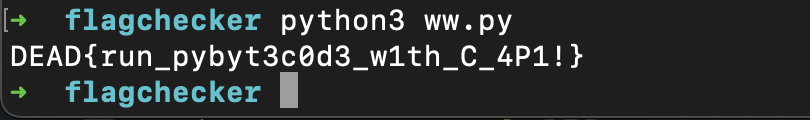<figcaption></figcaption></figure>

Flag: DEAD{run\_pybyt3c0d3\_w1th\_C\_4P1!}

#### Another solution

I'll try to analyze code on PyCode\_New

TBU

## No Math Rev (480 pts)&#x20;

### Description

Enough of this mathematics, how about trying some actual reverse engineering?

### Solution

TBU
