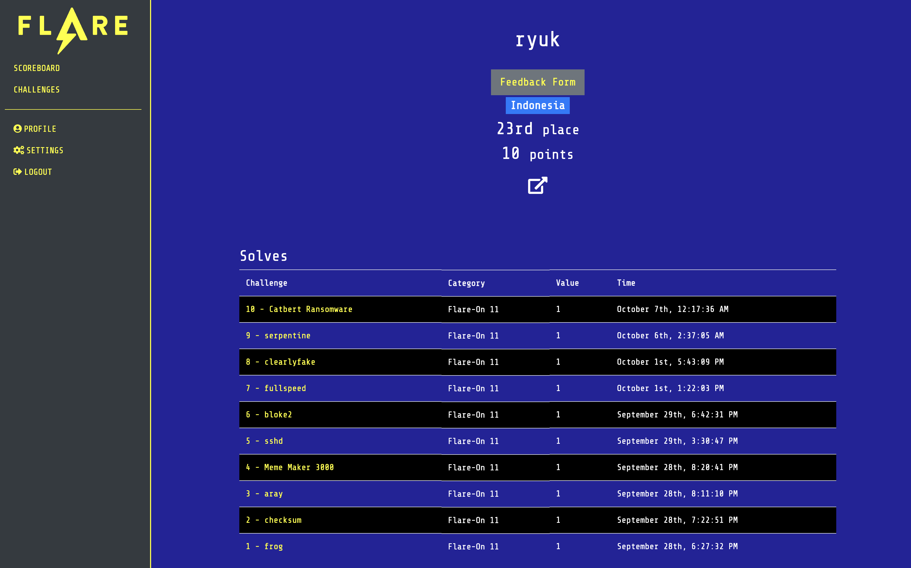

# Flare-On 11


Participated as ryuk. Placed 23rd worldwide and 1st in Indonesia.


<figure><figcaption></figcaption></figure>

<!-- challenge-index: 03c78239dd76a54d -->

| Challenge | Topic |
| --- | --- |
| [Challenge #1 - frog](/posts/write-up/2024/flare-on-11/challenge-1-frog/) | Python, Pygame |
| [Challenge #2 - checksum](/posts/write-up/2024/flare-on-11/challenge-2-checksum/) | Go, Checksum Validation |
| [Challenge #3 - aray](/posts/write-up/2024/flare-on-11/challenge-3-aray/) | YARA, File Reconstruction |
| [Challenge #4 - FLARE Meme Maker 3000](/posts/write-up/2024/flare-on-11/challenge-4-flare-meme-maker-3000/) | JavaScript Obfuscation |
| [Challenge #5 - sshd](/posts/write-up/2024/flare-on-11/challenge-5-sshd/) | Linux Forensics, SSH |
| [Challenge #6 - bloke2](/posts/write-up/2024/flare-on-11/challenge-6-bloke2/) | Verilog, BLAKE2 |
| [Challenge #7 - fullspeed](/posts/write-up/2024/flare-on-11/challenge-7-fullspeed/) | .NET Native AOT, ECDH |
| [Challenge #8 - Clearly Fake](/posts/write-up/2024/flare-on-11/challenge-8-clearly-fake/) | JavaScript, Blockchain, PowerShell |
| [Challenge #9 - serpentine](/posts/write-up/2024/flare-on-11/challenge-9-serpentine/) | Windows Exceptions, Obfuscation |
| [Challenge #10 - Catbert Ransomware](/posts/write-up/2024/flare-on-11/challenge-10-catbert-ransomware/) | UEFI, Ransomware |

Each challenge page links to the author’s official solution while the write-ups are pending.

<!-- /challenge-index -->
